# Inventory & Stock Management

<cite>
**Referenced Files in This Document**
- [stock-movement.entity.ts](file://apps/backend/src/stock-movement/entities/stock-movement.entity.ts)
- [stock-movement.service.ts](file://apps/backend/src/stock-movement/stock-movement.service.ts)
- [product-history.entity.ts](file://apps/backend/src/product-history/entities/product-history.entity.ts)
- [product-history.service.ts](file://apps/backend/src/product-history/product-history.service.ts)
- [product.controller.ts](file://apps/backend/src/product/product.controller.ts)
- [product.service.ts](file://apps/backend/src/product/product.service.ts)
- [order.service.ts](file://apps/backend/src/order/order.service.ts)
- [purchase.service.ts](file://apps/backend/src/purchase/purchase.service.ts)
- [page.tsx](file://apps/frontend/app/admin/products/stock-movements/page.tsx)
- [stock-report.tsx](file://apps/frontend/components/admin/products/stock/stock-report.tsx)
</cite>

## Table of Contents
1. [Introduction](#introduction)
2. [Project Structure](#project-structure)
3. [Core Components](#core-components)
4. [Architecture Overview](#architecture-overview)
5. [Detailed Component Analysis](#detailed-component-analysis)
6. [Dependency Analysis](#dependency-analysis)
7. [Performance Considerations](#performance-considerations)
8. [Troubleshooting Guide](#troubleshooting-guide)
9. [Conclusion](#conclusion)
10. [Appendices](#appendices)

## Introduction
This document explains the inventory and stock management system, focusing on:
- Real-time stock tracking through a durable movement ledger
- Automated stock updates during purchase delivery and order lifecycle events
- Manual stock adjustments with full auditability
- Low-stock reporting and threshold-based visibility
- Product history tracking for complete audit trails
- Reconciliation and consistency measures to prevent overselling

The system separates two complementary records:
- Stock movements: an append-only ledger of every quantity change with before/after snapshots
- Product history: an audit trail of product lifecycle changes such as creation, updates, activation, deactivation, and deletion

## Project Structure
Inventory-related functionality spans backend services, entities, controllers, and frontend admin pages:
- Backend entities define the immutable movement ledger and product history schema
- Services implement recording, querying, filtering, summarization, and trimming
- Controllers expose endpoints for low-stock reports, stock valuation, manual adjustments, and movement/history queries
- Frontend provides admin UIs for viewing stock movements and performing manual stock adjustments

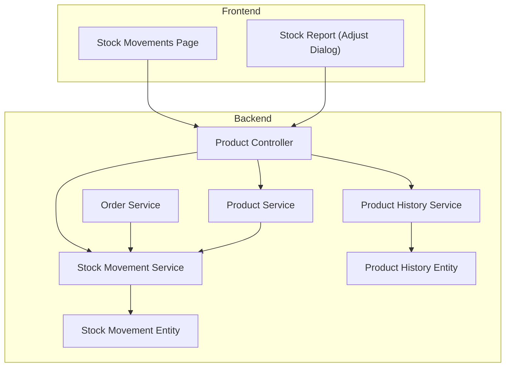

**Diagram sources**
- [product.controller.ts:580-920](file://apps/backend/src/product/product.controller.ts#L580-L920)
- [product.service.ts:1355-1596](file://apps/backend/src/product/product.service.ts#L1355-L1596)
- [order.service.ts:1-100](file://apps/backend/src/order/order.service.ts#L1-L100)
- [product-history.service.ts:1-56](file://apps/backend/src/product-history/product-history.service.ts#L1-L56)
- [stock-movement.service.ts:54-87](file://apps/backend/src/stock-movement/stock-movement.service.ts#L54-L87)
- [stock-movement.entity.ts:9-75](file://apps/backend/src/stock-movement/entities/stock-movement.entity.ts#L9-L75)
- [product-history.entity.ts:9-58](file://apps/backend/src/product-history/entities/product-history.entity.ts#L9-L58)
- [page.tsx:1-33](file://apps/frontend/app/admin/products/stock-movements/page.tsx#L1-L33)
- [stock-report.tsx:121-166](file://apps/frontend/components/admin/products/stock/stock-report.tsx#L121-L166)

**Section sources**
- [product.controller.ts:580-920](file://apps/backend/src/product/product.controller.ts#L580-L920)
- [product.service.ts:1355-1596](file://apps/backend/src/product/product.service.ts#L1355-L1596)
- [order.service.ts:1-100](file://apps/backend/src/order/order.service.ts#L1-L100)
- [product-history.service.ts:1-56](file://apps/backend/src/product-history/product-history.service.ts#L1-L56)
- [stock-movement.service.ts:54-87](file://apps/backend/src/stock-movement/stock-movement.service.ts#L54-L87)
- [stock-movement.entity.ts:9-75](file://apps/backend/src/stock-movement/entities/stock-movement.entity.ts#L9-L75)
- [product-history.entity.ts:9-58](file://apps/backend/src/product-history/entities/product-history.entity.ts#L9-L58)
- [page.tsx:1-33](file://apps/frontend/app/admin/products/stock-movements/page.tsx#L1-L33)
- [stock-report.tsx:121-166](file://apps/frontend/components/admin/products/stock/stock-report.tsx#L121-L166)

## Core Components
- Stock Movement Ledger
  - Immutable record of every stock change with signed quantity, before/after snapshots, reference context, user attribution, and timestamp
  - Supports filtering by product, type, search, and date range; returns paginated results and summary totals
- Product History Audit Trail
  - Records product lifecycle actions with field-level diffs or snapshots
  - Retains the newest N entries per product and exposes filtered, paginated history
- Low-Stock Reporting
  - Returns products at or below a configurable threshold
  - Provides dashboard KPI counts for total, out-of-stock, and low-stock items
- Order and Purchase Integration
  - Orders deduct stock and log ORDER_SALE movements
  - Cancelled orders restore stock and log ORDER_CANCEL movements
  - Delivered purchases add stock and log PURCHASE movements; reversals subtract stock
- Manual Adjustments
  - Admin endpoint adjusts stock outside normal flows and logs ADJUSTMENT movements

**Section sources**
- [stock-movement.entity.ts:9-75](file://apps/backend/src/stock-movement/entities/stock-movement.entity.ts#L9-L75)
- [stock-movement.service.ts:54-225](file://apps/backend/src/stock-movement/stock-movement.service.ts#L54-L225)
- [product-history.entity.ts:9-58](file://apps/backend/src/product-history/entities/product-history.entity.ts#L9-L58)
- [product-history.service.ts:46-235](file://apps/backend/src/product-history/product-history.service.ts#L46-L235)
- [product.controller.ts:580-920](file://apps/backend/src/product/product.controller.ts#L580-L920)
- [product.service.ts:1355-1596](file://apps/backend/src/product/product.service.ts#L1355-L1596)
- [order.service.ts:1-100](file://apps/backend/src/order/order.service.ts#L1-L100)
- [purchase.service.ts:342-382](file://apps/backend/src/purchase/purchase.service.ts#L342-L382)

## Architecture Overview
The inventory system is event-driven around two core ledgers:
- Stock movements capture quantity deltas and state snapshots
- Product history captures attribute and lifecycle changes

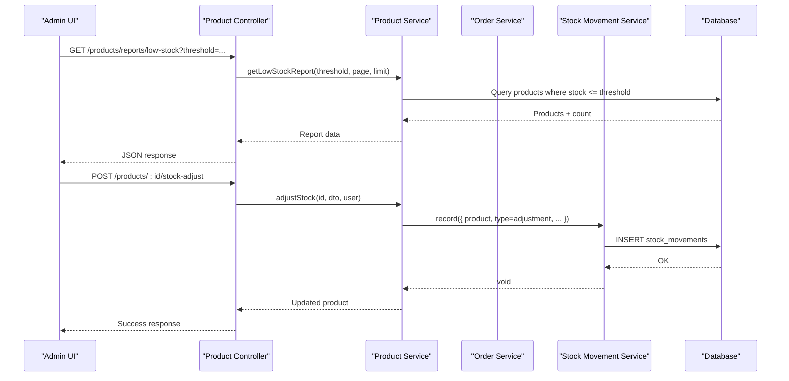

**Diagram sources**
- [product.controller.ts:580-637](file://apps/backend/src/product/product.controller.ts#L580-L637)
- [product.controller.ts:898-920](file://apps/backend/src/product/product.controller.ts#L898-L920)
- [product.service.ts:1355-1405](file://apps/backend/src/product/product.service.ts#L1355-L1405)
- [stock-movement.service.ts:63-87](file://apps/backend/src/stock-movement/stock-movement.service.ts#L63-L87)

## Detailed Component Analysis

### Stock Movement Ledger
The stock movement ledger is the source of truth for inventory changes. Each row stores:
- Product identity and name snapshot
- Movement type (purchase, purchase reversal, order sale, order cancel, adjustment)
- Signed quantity delta
- Before/after stock levels
- Reference context (e.g., purchase or order id)
- User attribution and note
- Timestamp

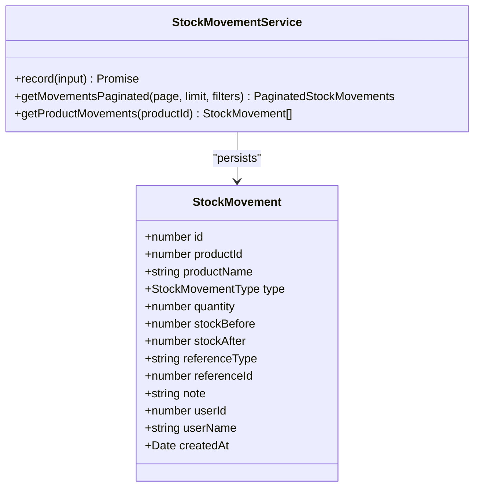

Key behaviors:
- Recording is best-effort: failures are logged but do not break the operation being tracked
- Filtering supports product, type, search, and date range
- Summary aggregates counts by type and units in/out

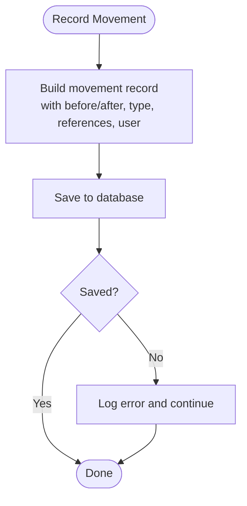

**Diagram sources**
- [stock-movement.entity.ts:9-75](file://apps/backend/src/stock-movement/entities/stock-movement.entity.ts#L9-L75)
- [stock-movement.service.ts:63-87](file://apps/backend/src/stock-movement/stock-movement.service.ts#L63-L87)

**Section sources**
- [stock-movement.entity.ts:9-75](file://apps/backend/src/stock-movement/entities/stock-movement.entity.ts#L9-L75)
- [stock-movement.service.ts:54-225](file://apps/backend/src/stock-movement/stock-movement.service.ts#L54-L225)

### Product History Audit Trail
Product history tracks lifecycle events with action types and optional diffs/snapshots:
- Actions include created, updated, activated, deactivated, deleted
- Diffs store field-level from/to changes
- Snapshots store full entity state for create/delete events
- Retention keeps the newest N entries per product

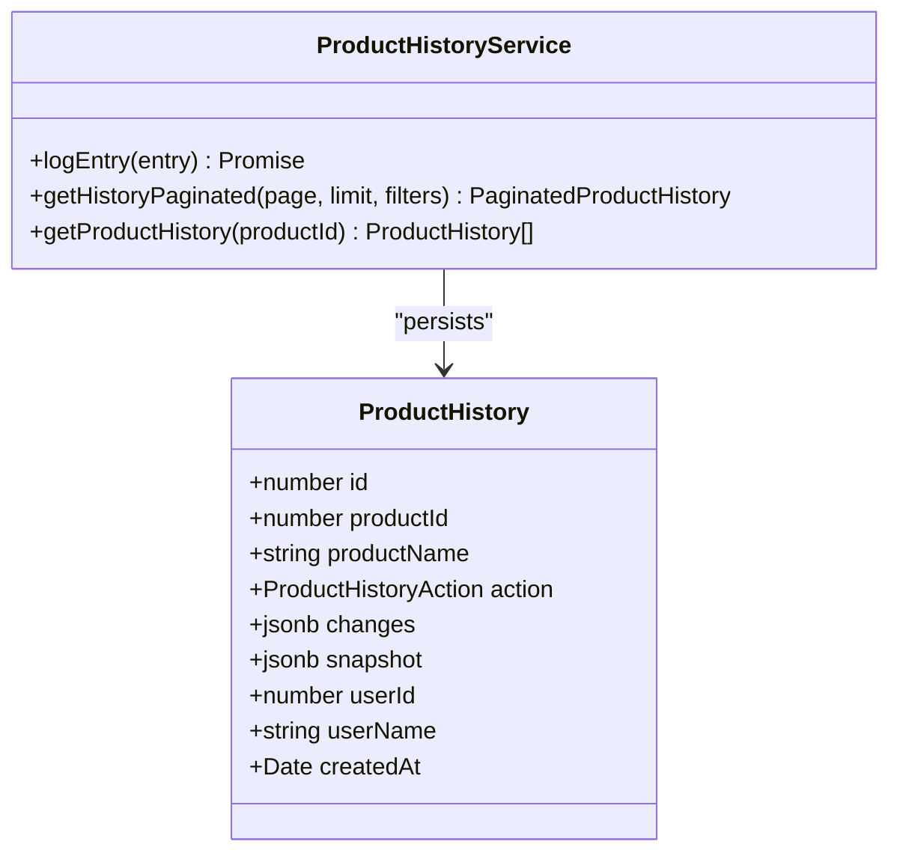

Retention logic trims older entries after each write to maintain bounded storage while preserving recent auditability.

**Diagram sources**
- [product-history.entity.ts:9-58](file://apps/backend/src/product-history/entities/product-history.entity.ts#L9-L58)
- [product-history.service.ts:46-235](file://apps/backend/src/product-history/product-history.service.ts#L46-L235)

**Section sources**
- [product-history.entity.ts:9-58](file://apps/backend/src/product-history/entities/product-history.entity.ts#L9-L58)
- [product-history.service.ts:46-235](file://apps/backend/src/product-history/product-history.service.ts#L46-L235)

### Automated Stock Updates During Order Processing
Orders validate available stock before placement and deduct inventory upon successful processing. Cancellations restore stock. Both operations log corresponding stock movements.

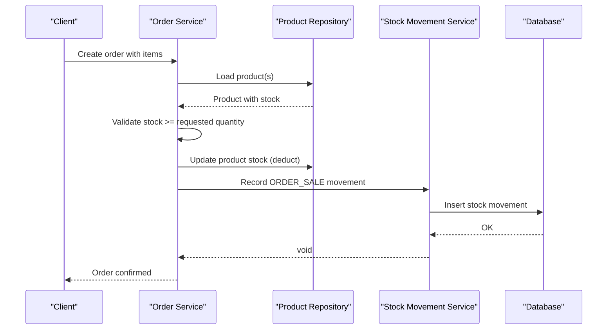

Cancellation flow restores stock and logs ORDER_CANCEL movements.

**Diagram sources**
- [order.service.ts:1-100](file://apps/backend/src/order/order.service.ts#L1-L100)
- [stock-movement.service.ts:63-87](file://apps/backend/src/stock-movement/stock-movement.service.ts#L63-L87)

**Section sources**
- [order.service.ts:1-100](file://apps/backend/src/order/order.service.ts#L1-L100)
- [stock-movement.service.ts:63-87](file://apps/backend/src/stock-movement/stock-movement.service.ts#L63-L87)

### Automated Stock Updates During Purchase Delivery
Delivered purchases increase stock; reversing or deleting delivered purchases decreases stock. Each change logs PURCHASE or PURCHASE_REVERSAL movements.

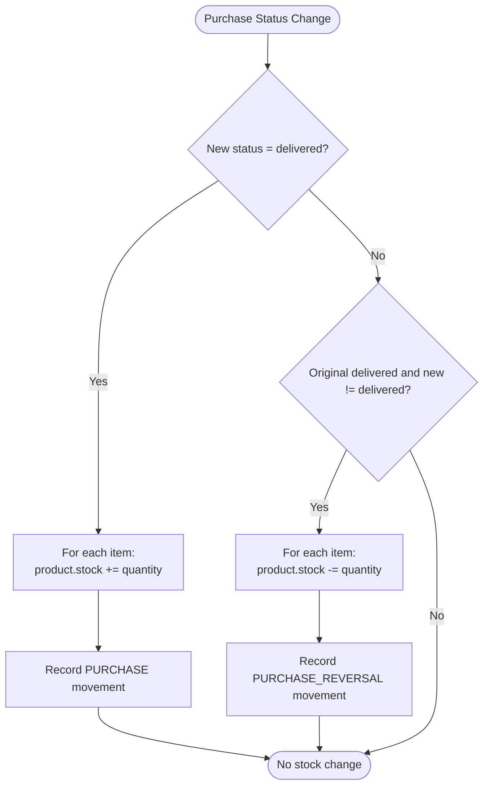

**Diagram sources**
- [purchase.service.ts:342-382](file://apps/backend/src/purchase/purchase.service.ts#L342-L382)
- [stock-movement.service.ts:63-87](file://apps/backend/src/stock-movement/stock-movement.service.ts#L63-L87)

**Section sources**
- [purchase.service.ts:342-382](file://apps/backend/src/purchase/purchase.service.ts#L342-L382)
- [stock-movement.service.ts:63-87](file://apps/backend/src/stock-movement/stock-movement.service.ts#L63-L87)

### Low-Stock Alerts and Threshold Management
The system exposes:
- A low-stock report endpoint that returns products at or below a configurable threshold
- Dashboard KPI counts for total, out-of-stock, and low-stock items
- Stock valuation report including low-stock and out-of-stock lists

Thresholds are query parameters rather than persistent settings in the referenced code paths.

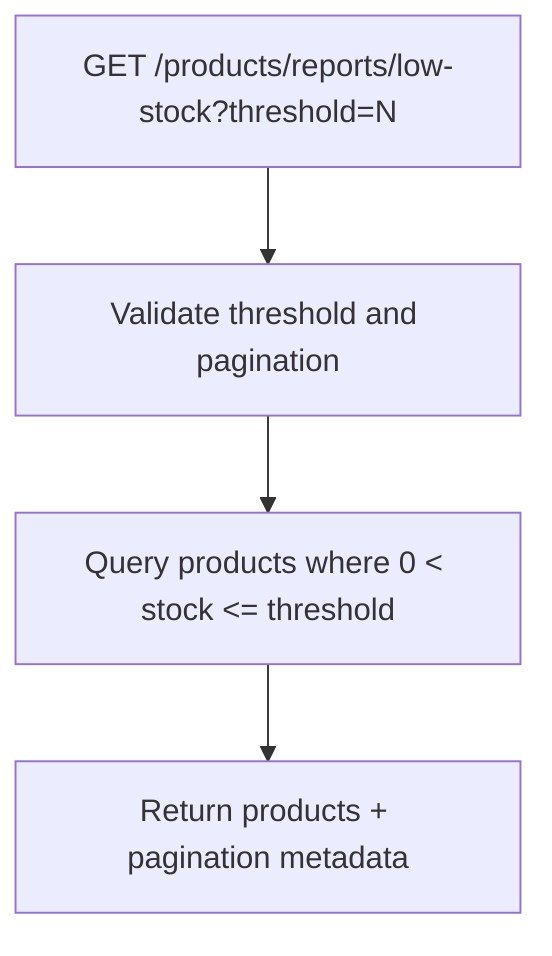

**Diagram sources**
- [product.controller.ts:580-637](file://apps/backend/src/product/product.controller.ts#L580-L637)
- [product.service.ts:1355-1405](file://apps/backend/src/product/product.service.ts#L1355-L1405)

**Section sources**
- [product.controller.ts:580-637](file://apps/backend/src/product/product.controller.ts#L580-L637)
- [product.service.ts:1355-1405](file://apps/backend/src/product/product.service.ts#L1355-L1405)

### Manual Stock Adjustments
Admins can manually adjust stock via a dedicated endpoint. The operation:
- Validates input
- Updates product stock
- Logs an ADJUSTMENT movement with user attribution and optional note

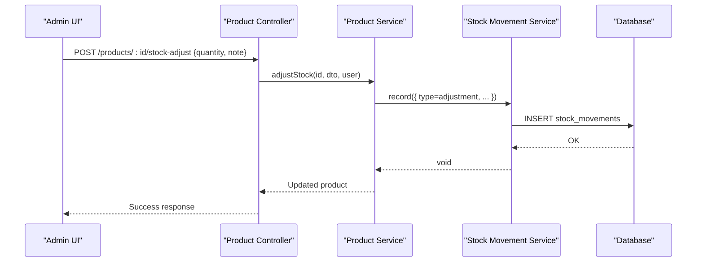

**Diagram sources**
- [product.controller.ts:898-920](file://apps/backend/src/product/product.controller.ts#L898-L920)
- [stock-movement.service.ts:63-87](file://apps/backend/src/stock-movement/stock-movement.service.ts#L63-L87)

**Section sources**
- [product.controller.ts:898-920](file://apps/backend/src/product/product.controller.ts#L898-L920)
- [stock-movement.service.ts:63-87](file://apps/backend/src/stock-movement/stock-movement.service.ts#L63-L87)

### Stock Movement History System
The movement ledger supports:
- Paginated listing with filters (product, type, search, date range)
- Per-product movement retrieval
- Summary metrics (counts by type, units in/out)

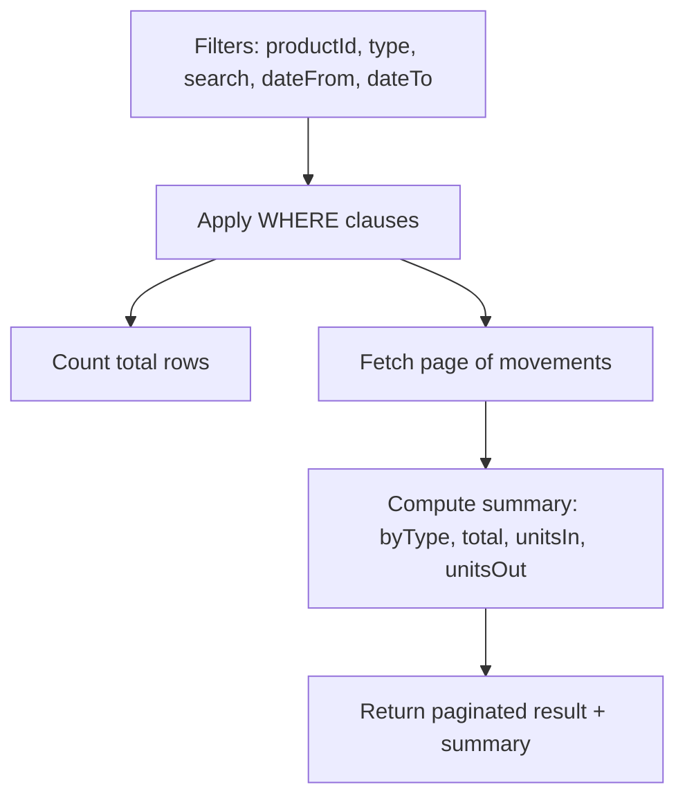

**Diagram sources**
- [stock-movement.service.ts:89-155](file://apps/backend/src/stock-movement/stock-movement.service.ts#L89-L155)
- [stock-movement.service.ts:163-225](file://apps/backend/src/stock-movement/stock-movement.service.ts#L163-L225)

**Section sources**
- [stock-movement.service.ts:89-225](file://apps/backend/src/stock-movement/stock-movement.service.ts#L89-L225)

### Product History Tracking
Product history provides:
- Paginated audit trail with filters (product, action, search, date range)
- Field-level diffs for updates and snapshots for create/delete
- Retention policy keeping the newest N entries per product

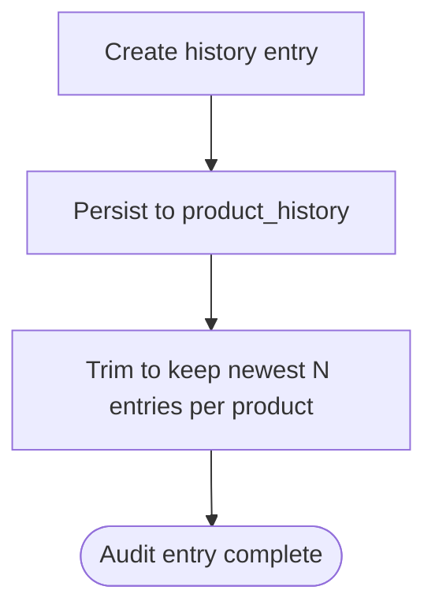

**Diagram sources**
- [product-history.service.ts:58-80](file://apps/backend/src/product-history/product-history.service.ts#L58-L80)
- [product-history.service.ts:217-235](file://apps/backend/src/product-history/product-history.service.ts#L217-L235)

**Section sources**
- [product-history.service.ts:46-235](file://apps/backend/src/product-history/product-history.service.ts#L46-L235)

### Frontend Interfaces
- Stock Movements page displays the chronological ledger with navigation back to products
- Stock report component includes an adjustment dialog that calls the stock-adjust endpoint and refreshes the list

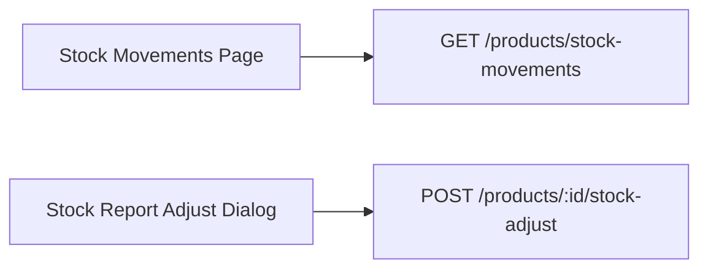

**Diagram sources**
- [page.tsx:1-33](file://apps/frontend/app/admin/products/stock-movements/page.tsx#L1-L33)
- [stock-report.tsx:121-166](file://apps/frontend/components/admin/products/stock/stock-report.tsx#L121-L166)

**Section sources**
- [page.tsx:1-33](file://apps/frontend/app/admin/products/stock-movements/page.tsx#L1-L33)
- [stock-report.tsx:121-166](file://apps/frontend/components/admin/products/stock/stock-report.tsx#L121-L166)

## Dependency Analysis
The following diagram shows how controllers, services, and entities interact to support inventory operations.

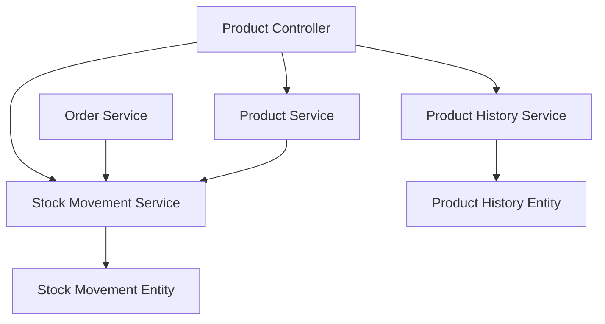

**Diagram sources**
- [product.controller.ts:580-920](file://apps/backend/src/product/product.controller.ts#L580-L920)
- [product.service.ts:1355-1596](file://apps/backend/src/product/product.service.ts#L1355-L1596)
- [order.service.ts:1-100](file://apps/backend/src/order/order.service.ts#L1-L100)
- [product-history.service.ts:1-56](file://apps/backend/src/product-history/product-history.service.ts#L1-L56)
- [stock-movement.service.ts:54-87](file://apps/backend/src/stock-movement/stock-movement.service.ts#L54-L87)
- [product-history.entity.ts:9-58](file://apps/backend/src/product-history/entities/product-history.entity.ts#L9-L58)
- [stock-movement.entity.ts:9-75](file://apps/backend/src/stock-movement/entities/stock-movement.entity.ts#L9-L75)

**Section sources**
- [product.controller.ts:580-920](file://apps/backend/src/product/product.controller.ts#L580-L920)
- [product.service.ts:1355-1596](file://apps/backend/src/product/product.service.ts#L1355-L1596)
- [order.service.ts:1-100](file://apps/backend/src/order/order.service.ts#L1-L100)
- [product-history.service.ts:1-56](file://apps/backend/src/product-history/product-history.service.ts#L1-L56)
- [stock-movement.service.ts:54-87](file://apps/backend/src/stock-movement/stock-movement.service.ts#L54-L87)
- [product-history.entity.ts:9-58](file://apps/backend/src/product-history/entities/product-history.entity.ts#L9-L58)
- [stock-movement.entity.ts:9-75](file://apps/backend/src/stock-movement/entities/stock-movement.entity.ts#L9-L75)

## Performance Considerations
- Use paginated endpoints for large datasets (movements and history)
- Prefer count-only summaries for dashboard KPIs instead of loading full product lists
- Leverage indexes defined on movement and history tables for efficient filtering by product and date
- Keep movement and history writes non-blocking relative to business operations (failures are logged, not thrown)

[No sources needed since this section provides general guidance]

## Troubleshooting Guide
Common issues and resolutions:
- Movement recording fails silently
  - Check application logs for errors from the movement service; the ledger write failure does not abort the originating operation
- History grows unbounded
  - Verify retention trimming is active; the service trims to the configured maximum per product after each write
- Low-stock report returns unexpected results
  - Confirm threshold parameter and ensure stock values are accurate; reconcile using stock valuation report
- Overselling occurs
  - Ensure order validation checks stock before deduction and that cancellation flows restore stock and log movements

**Section sources**
- [stock-movement.service.ts:63-87](file://apps/backend/src/stock-movement/stock-movement.service.ts#L63-L87)
- [product-history.service.ts:58-80](file://apps/backend/src/product-history/product-history.service.ts#L58-L80)
- [product.controller.ts:580-637](file://apps/backend/src/product/product.controller.ts#L580-L637)
- [product.service.ts:1550-1594](file://apps/backend/src/product/product.service.ts#L1550-L1594)

## Conclusion
The inventory and stock management system provides a robust, auditable foundation for real-time stock tracking:
- A durable movement ledger ensures every stock change is traceable with before/after snapshots
- Automated updates during purchases and orders maintain consistency between sales and inventory
- Manual adjustments allow operational corrections with full attribution
- Low-stock reporting and thresholds enable proactive restocking
- Product history offers a comprehensive audit trail for all product lifecycle changes
- Best-effort logging preserves system stability even when auxiliary ledger writes fail

[No sources needed since this section summarizes without analyzing specific files]

## Appendices

### Implementation Examples

- Adjusting stock levels
  - Call the stock-adjust endpoint with a signed quantity and optional note
  - The operation updates product stock and records an ADJUSTMENT movement
  - Frontend example path: [stock-report.tsx:121-166](file://apps/frontend/components/admin/products/stock/stock-report.tsx#L121-L166)

- Querying stock history
  - Use the stock movements endpoint with filters such as productId, type, search, dateFrom, dateTo
  - Retrieve per-product movements via the product-specific endpoint
  - Endpoint paths: [product.controller.ts:823-896](file://apps/backend/src/product/product.controller.ts#L823-L896)

- Setting up stock alerts
  - Use the low-stock report endpoint with a configurable threshold
  - Integrate with dashboards or scheduled jobs to monitor and notify
  - Endpoint path: [product.controller.ts:580-637](file://apps/backend/src/product/product.controller.ts#L580-L637)

- Reconciliation processes
  - Compare current product stock against the sum of signed quantities in the movement ledger
  - Use stock valuation report to cross-check total units and values
  - Methods: [product.service.ts:1550-1594](file://apps/backend/src/product/product.service.ts#L1550-L1594)

- Preventing overselling
  - Validate stock availability before order placement
  - Ensure cancellations restore stock and log appropriate movements
  - References: [order.service.ts:1-100](file://apps/backend/src/order/order.service.ts#L1-L100), [stock-movement.service.ts:63-87](file://apps/backend/src/stock-movement/stock-movement.service.ts#L63-L87)

**Section sources**
- [stock-report.tsx:121-166](file://apps/frontend/components/admin/products/stock/stock-report.tsx#L121-L166)
- [product.controller.ts:580-637](file://apps/backend/src/product/product.controller.ts#L580-L637)
- [product.controller.ts:823-896](file://apps/backend/src/product/product.controller.ts#L823-L896)
- [product.service.ts:1550-1594](file://apps/backend/src/product/product.service.ts#L1550-L1594)
- [order.service.ts:1-100](file://apps/backend/src/order/order.service.ts#L1-L100)
- [stock-movement.service.ts:63-87](file://apps/backend/src/stock-movement/stock-movement.service.ts#L63-L87)