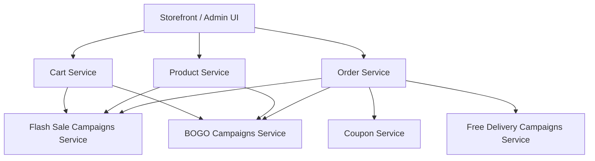
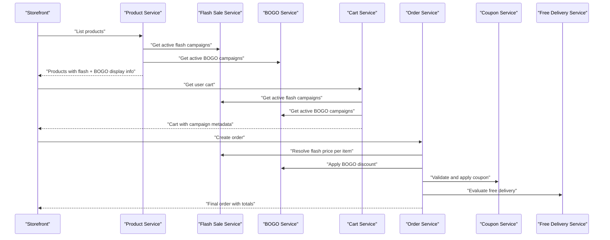
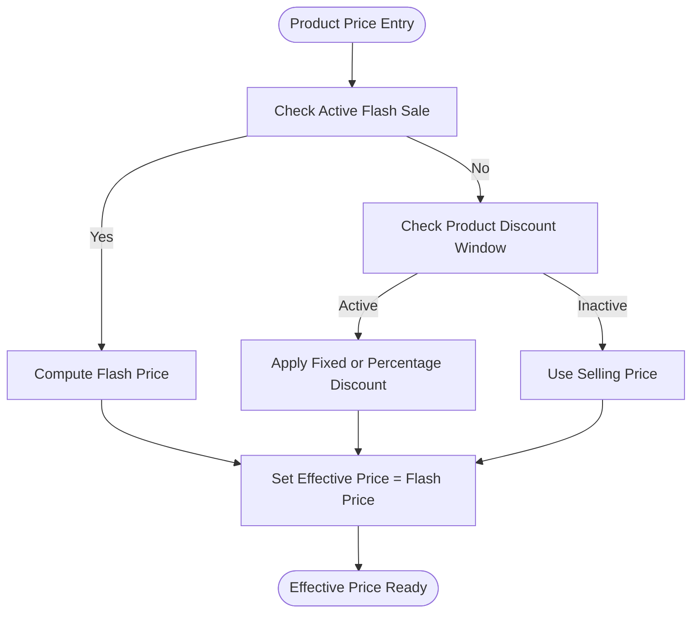
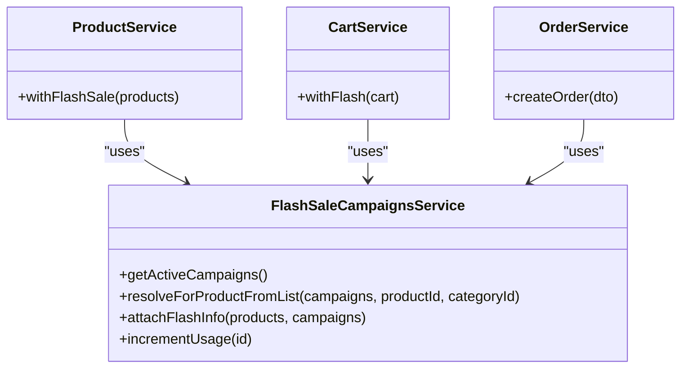
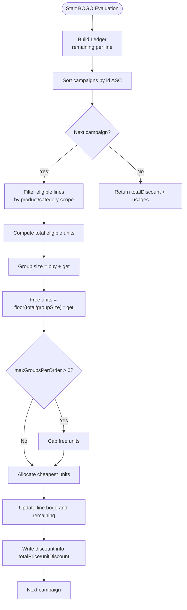
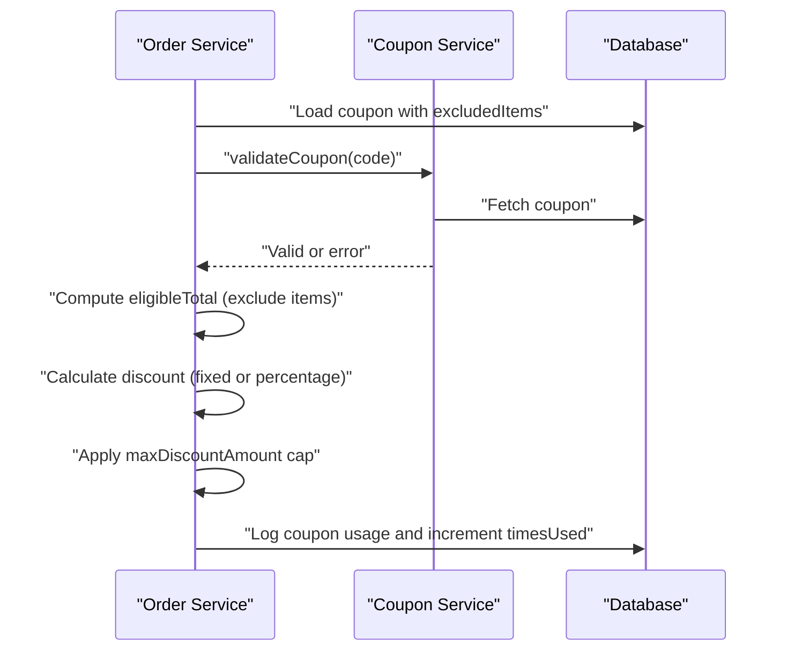
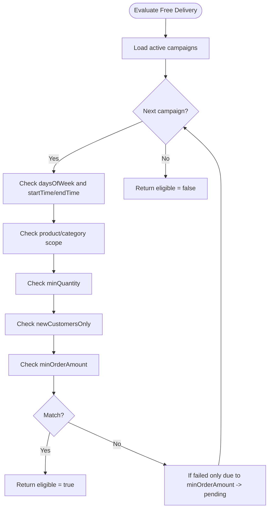
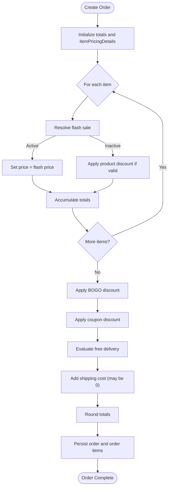
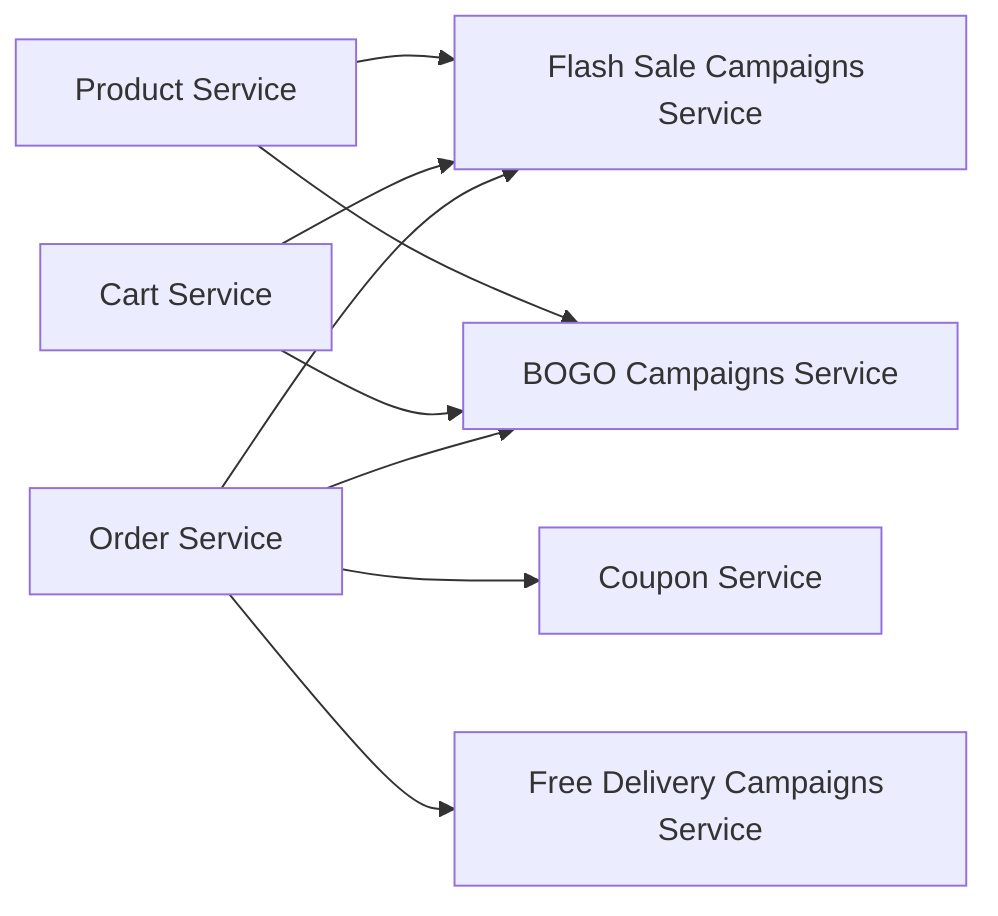

# Pricing & Discount System

<cite>
**Referenced Files in This Document**   
- [cart.service.ts](file://apps/backend/src/cart/cart.service.ts)
- [product.service.ts](file://apps/backend/src/product/product.service.ts)
- [flash-sale-campaigns.service.ts](file://apps/backend/src/flash-sale-campaigns/flash-sale-campaigns.service.ts)
- [bogo-campaigns.service.ts](file://apps/backend/src/bogo-campaigns/bogo-campaigns.service.ts)
- [coupon.service.ts](file://apps/backend/src/coupon/coupon.service.ts)
- [free-delivery-campaigns.service.ts](file://apps/backend/src/free-delivery-campaigns/free-delivery-campaigns.service.ts)
- [order.service.ts](file://apps/backend/src/order/order.service.ts)
- [product-utils.ts](file://apps/frontend/utils/product-utils.ts)
</cite>

## Table of Contents
1. [Introduction](#introduction)
2. [Project Structure](#project-structure)
3. [Core Components](#core-components)
4. [Architecture Overview](#architecture-overview)
5. [Detailed Component Analysis](#detailed-component-analysis)
6. [Dependency Analysis](#dependency-analysis)
7. [Performance Considerations](#performance-considerations)
8. [Troubleshooting Guide](#troubleshooting-guide)
9. [Conclusion](#conclusion)

## Introduction
This document explains the pricing and discount system used by the application. It covers:
- Base pricing structure: cost price, selling price, product-level discounts, and flash sale overrides.
- Discount engine behavior: percentage discounts, fixed amount discounts, and BOGO offers.
- Marketing campaign integration: flash sales, free delivery campaigns, and coupon systems.
- Final pricing logic during order creation, including precedence rules and conflict resolution.
- Practical examples for complex scenarios.
- Best practices and performance guidance for real-time price calculations.

The backend is a NestJS application where product listing, cart enrichment, and order creation compute prices. The frontend includes helper utilities for displaying product discounts.

## Project Structure
Pricing-related functionality spans several backend modules:
- Product listing enriches products with flash sale and BOGO display information.
- Cart responses attach campaign metadata so storefronts show accurate deals.
- Order creation is the authoritative pricing path, applying all discounts in a strict sequence.
- Campaign services manage flash sales, BOGO, and free delivery eligibility.
- Coupon service validates and calculates coupon discounts.
- Frontend helpers compute per-product discount labels and effective prices for display.

**Diagram sources**
- [cart.service.ts:15-48](file://apps/backend/src/cart/cart.service.ts#L15-L48)
- [product.service.ts:56-109](file://apps/backend/src/product/product.service.ts#L56-L109)
- [order.service.ts:59-101](file://apps/backend/src/order/order.service.ts#L59-L101)
- [flash-sale-campaigns.service.ts:82-89](file://apps/backend/src/flash-sale-campaigns/flash-sale-campaigns.service.ts#L82-L89)
- [bogo-campaigns.service.ts:177-187](file://apps/backend/src/bogo-campaigns/bogo-campaigns.service.ts#L177-L187)
- [coupon.service.ts:16-23](file://apps/backend/src/coupon/coupon.service.ts#L16-L23)
- [free-delivery-campaigns.service.ts:84-93](file://apps/backend/src/free-delivery-campaigns/free-delivery-campaigns.service.ts#L84-L93)

**Section sources**
- [cart.service.ts:15-48](file://apps/backend/src/cart/cart.service.ts#L15-L48)
- [product.service.ts:56-109](file://apps/backend/src/product/product.service.ts#L56-L109)
- [order.service.ts:59-101](file://apps/backend/src/order/order.service.ts#L59-L101)

## Core Components
- Product Service: Loads products, applies SWR-style caching, and attaches flash sale and BOGO display info after cache retrieval.
- Flash Sale Campaigns Service: Manages time-bound percentage or fixed discounts scoped to products or categories; computes effective price.
- BOGO Campaigns Service: Manages buy/get promotions; evaluates eligible units across items and applies cheapest-free logic.
- Coupon Service: Validates coupons (active window, usage limits, minimum order amount) and calculates eligible discount amounts.
- Free Delivery Campaigns Service: Evaluates whether shipping should be waived based on day/time, product/category scope, quantity, new customer status, and minimum order amount.
- Order Service: Authoritative order pricing pipeline that applies product discounts, flash sales, BOGO, coupons, and free delivery in a defined precedence.
- Cart Service: Enriches cart responses with campaign metadata for consistent storefront pricing display.
- Frontend Product Utils: Helper functions for checking active product discounts and computing displayed discounted prices.

**Section sources**
- [product.service.ts:84-109](file://apps/backend/src/product/product.service.ts#L84-L109)
- [flash-sale-campaigns.service.ts:69-80](file://apps/backend/src/flash-sale-campaigns/flash-sale-campaigns.service.ts#L69-L80)
- [bogo-campaigns.service.ts:85-175](file://apps/backend/src/bogo-campaigns/bogo-campaigns.service.ts#L85-L175)
- [coupon.service.ts:135-178](file://apps/backend/src/coupon/coupon.service.ts#L135-L178)
- [free-delivery-campaigns.service.ts:263-340](file://apps/backend/src/free-delivery-campaigns/free-delivery-campaigns.service.ts#L263-L340)
- [order.service.ts:174-432](file://apps/backend/src/order/order.service.ts#L174-L432)
- [cart.service.ts:27-48](file://apps/backend/src/cart/cart.service.ts#L27-L48)
- [product-utils.ts:33-67](file://apps/frontend/utils/product-utils.ts#L33-L67)

## Architecture Overview
The pricing architecture separates display-time enrichment from authoritative order-time calculation:
- Display path: Product list and cart endpoints attach campaign metadata without persisting it.
- Order path: Order creation recomputes prices using the same rules but enforces stock checks, usage caps, and final totals.

**Diagram sources**
- [product.service.ts:84-109](file://apps/backend/src/product/product.service.ts#L84-L109)
- [cart.service.ts:27-48](file://apps/backend/src/cart/cart.service.ts#L27-L48)
- [order.service.ts:174-432](file://apps/backend/src/order/order.service.ts#L174-L432)
- [flash-sale-campaigns.service.ts:247-265](file://apps/backend/src/flash-sale-campaigns/flash-sale-campaigns.service.ts#L247-L265)
- [bogo-campaigns.service.ts:322-340](file://apps/backend/src/bogo-campaigns/bogo-campaigns.service.ts#L322-L340)
- [coupon.service.ts:135-178](file://apps/backend/src/coupon/coupon.service.ts#L135-L178)
- [free-delivery-campaigns.service.ts:325-340](file://apps/backend/src/free-delivery-campaigns/free-delivery-campaigns.service.ts#L325-L340)

## Detailed Component Analysis

### Base Pricing Structure
Base pricing uses product fields:
- Purchase price: internal cost reference.
- Selling price: base retail price before any campaign or coupon.
- Product-level discount: optional percentage or fixed discount within a date window.
- Effective price: computed when a flash sale applies; otherwise falls back to selling price.

Key behaviors:
- Product Service sets `effectivePrice` based on flash sale presence.
- Frontend helpers compute discounted price and label for display when product discount is active.

**Diagram sources**
- [product.service.ts:323-353](file://apps/backend/src/product/product.service.ts#L323-L353)
- [flash-sale-campaigns.service.ts:69-80](file://apps/backend/src/flash-sale-campaigns/flash-sale-campaigns.service.ts#L69-L80)
- [product-utils.ts:33-67](file://apps/frontend/utils/product-utils.ts#L33-L67)

**Section sources**
- [product.service.ts:323-353](file://apps/backend/src/product/product.service.ts#L323-L353)
- [product-utils.ts:33-67](file://apps/frontend/utils/product-utils.ts#L33-L67)

### Flash Sale Campaigns
Flash sale campaigns provide:
- Percentage or fixed discounts.
- Scoping to specific products or categories.
- Time windows and usage caps.
- Deterministic precedence: lowest campaign ID wins when multiple overlap.

Display enrichment:
- Product Service attaches `flashSale` and `effectivePrice`.
- Cart Service enriches cart items similarly.

Order-time pricing:
- Order Service resolves flash price per item, overriding product discount (no stacking).
- Usage counters are incremented once per distinct campaign that priced at least one item.

**Diagram sources**
- [flash-sale-campaigns.service.ts:82-89](file://apps/backend/src/flash-sale-campaigns/flash-sale-campaigns.service.ts#L82-L89)
- [product.service.ts:84-109](file://apps/backend/src/product/product.service.ts#L84-L109)
- [cart.service.ts:27-48](file://apps/backend/src/cart/cart.service.ts#L27-L48)
- [order.service.ts:180-254](file://apps/backend/src/order/order.service.ts#L180-L254)

**Section sources**
- [flash-sale-campaigns.service.ts:69-80](file://apps/backend/src/flash-sale-campaigns/flash-sale-campaigns.service.ts#L69-L80)
- [flash-sale-campaigns.service.ts:247-265](file://apps/backend/src/flash-sale-campaigns/flash-sale-campaigns.service.ts#L247-L265)
- [product.service.ts:84-109](file://apps/backend/src/product/product.service.ts#L84-L109)
- [cart.service.ts:27-48](file://apps/backend/src/cart/cart.service.ts#L27-L48)
- [order.service.ts:180-254](file://apps/backend/src/order/order.service.ts#L180-L254)

### BOGO Campaigns
BOGO campaigns define:
- Buy quantity and get quantity.
- Scope via products or categories.
- Per-order group caps.
- Cheapest-free unit allocation across eligible lines.

Algorithm highlights:
- Eligible units pool across lines/products.
- For every (buyQuantity + getQuantity) pooled units, the getQuantity cheapest become free.
- Campaigns run in ascending ID order; lower IDs claim units first.
- Ledger tracks remaining units per line and accumulates BOGO discount per line.

Preview vs order-time:
- Preview estimates BOGO discount using the same per-item pricing rules as order creation.
- Order creation is authoritative and logs usage per campaign.

**Diagram sources**
- [bogo-campaigns.service.ts:95-175](file://apps/backend/src/bogo-campaigns/bogo-campaigns.service.ts#L95-L175)
- [bogo-campaigns.service.ts:419-494](file://apps/backend/src/bogo-campaigns/bogo-campaigns.service.ts#L419-L494)
- [order.service.ts:292-308](file://apps/backend/src/order/order.service.ts#L292-L308)

**Section sources**
- [bogo-campaigns.service.ts:85-175](file://apps/backend/src/bogo-campaigns/bogo-campaigns.service.ts#L85-L175)
- [bogo-campaigns.service.ts:322-340](file://apps/backend/src/bogo-campaigns/bogo-campaigns.service.ts#L322-L340)
- [bogo-campaigns.service.ts:419-494](file://apps/backend/src/bogo-campaigns/bogo-campaigns.service.ts#L419-L494)
- [order.service.ts:292-308](file://apps/backend/src/order/order.service.ts#L292-L308)

### Coupon System
Coupon validation and application:
- Validate active window, usage limits, and minimum eligible order amount.
- Support percentage and fixed discounts.
- Respect maximum discount cap.
- Exclude specific products from discount eligibility.

Order-time integration:
- Order Service calculates eligible total excluding excluded items.
- Applies coupon discount after BOGO and before shipping.
- Logs coupon usage and increments timesUsed.

**Diagram sources**
- [coupon.service.ts:135-178](file://apps/backend/src/coupon/coupon.service.ts#L135-L178)
- [coupon.service.ts:180-306](file://apps/backend/src/coupon/coupon.service.ts#L180-L306)
- [order.service.ts:310-355](file://apps/backend/src/order/order.service.ts#L310-L355)
- [order.service.ts:450-474](file://apps/backend/src/order/order.service.ts#L450-L474)

**Section sources**
- [coupon.service.ts:135-178](file://apps/backend/src/coupon/coupon.service.ts#L135-L178)
- [coupon.service.ts:180-306](file://apps/backend/src/coupon/coupon.service.ts#L180-L306)
- [order.service.ts:310-355](file://apps/backend/src/order/order.service.ts#L310-L355)
- [order.service.ts:450-474](file://apps/backend/src/order/order.service.ts#L450-L474)

### Free Delivery Campaigns
Free delivery campaigns can waive shipping based on:
- Days of week and time windows.
- Product/category scope.
- Minimum quantity.
- New customers only.
- Minimum order amount.

Evaluation flow:
- Evaluate active campaigns in order; first match wins.
- If only minimum order amount fails, return pending state with remaining amount.
- During order creation, shipping cost is waived if eligible and shipping method is not excluded.

**Diagram sources**
- [free-delivery-campaigns.service.ts:263-340](file://apps/backend/src/free-delivery-campaigns/free-delivery-campaigns.service.ts#L263-L340)
- [free-delivery-campaigns.service.ts:346-410](file://apps/backend/src/free-delivery-campaigns/free-delivery-campaigns.service.ts#L346-L410)
- [order.service.ts:357-400](file://apps/backend/src/order/order.service.ts#L357-L400)

**Section sources**
- [free-delivery-campaigns.service.ts:263-340](file://apps/backend/src/free-delivery-campaigns/free-delivery-campaigns.service.ts#L263-L340)
- [free-delivery-campaigns.service.ts:346-410](file://apps/backend/src/free-delivery-campaigns/free-delivery-campaigns.service.ts#L346-L410)
- [order.service.ts:357-400](file://apps/backend/src/order/order.service.ts#L357-L400)

### Order Pricing Pipeline and Precedence Rules
Order creation applies discounts in this strict order:
1. Resolve per-item price:
   - Flash sale overrides product discount (no stacking).
   - If no flash sale, apply product discount if within its date window.
2. Apply BOGO discount:
   - Uses per-item prices already set by flash/product discount.
   - Reduces line totals and updates unitDiscount.
3. Apply coupon discount:
   - Excludes specified products.
   - Applies fixed or percentage discount with optional cap.
4. Evaluate free delivery:
   - Waives shipping if eligible and shipping method is not excluded.
5. Finalize totals:
   - Add shipping cost (possibly zero).
   - Round values and persist order and order items.

**Diagram sources**
- [order.service.ts:174-432](file://apps/backend/src/order/order.service.ts#L174-L432)
- [order.service.ts:434-556](file://apps/backend/src/order/order.service.ts#L434-L556)

**Section sources**
- [order.service.ts:174-432](file://apps/backend/src/order/order.service.ts#L174-L432)
- [order.service.ts:434-556](file://apps/backend/src/order/order.service.ts#L434-L556)

### Examples of Complex Pricing Scenarios

#### Example 1: Flash Sale Overrides Product Discount
Scenario:
- Product has an active percentage discount.
- A flash sale campaign also covers the product.

Behavior:
- Flash sale takes precedence; product discount is ignored for that item.
- Order Service computes flash price and records usage per campaign.

Relevant paths:
- [order.service.ts:212-254](file://apps/backend/src/order/order.service.ts#L212-L254)
- [flash-sale-campaigns.service.ts:69-80](file://apps/backend/src/flash-sale-campaigns/flash-sale-campaigns.service.ts#L69-L80)

#### Example 2: BOGO Across Multiple Items
Scenario:
- Cart contains multiple eligible products/categories under a BOGO campaign.
- Buy 2, Get 1 rule.

Behavior:
- All eligible units are pooled.
- Cheapest units become free up to the campaign’s per-order cap.
- Line totals and unitDiscount are updated accordingly.

Relevant paths:
- [bogo-campaigns.service.ts:95-175](file://apps/backend/src/bogo-campaigns/bogo-campaigns.service.ts#L95-L175)
- [order.service.ts:292-308](file://apps/backend/src/order/order.service.ts#L292-L308)

#### Example 3: Coupon With Excluded Products
Scenario:
- Coupon excludes certain products.
- Cart contains both included and excluded items.

Behavior:
- Eligible total excludes excluded items.
- Discount applies only to eligible total.
- Response includes excluded product names for transparency.

Relevant paths:
- [coupon.service.ts:180-306](file://apps/backend/src/coupon/coupon.service.ts#L180-L306)
- [order.service.ts:310-355](file://apps/backend/src/order/order.service.ts#L310-L355)

#### Example 4: Free Delivery With Minimum Order Amount
Scenario:
- Campaign requires minimum order amount.
- Cart subtotal is below threshold.

Behavior:
- Frontend shows “pending” with remaining amount needed.
- Shipping remains charged until threshold is met.

Relevant paths:
- [free-delivery-campaigns.service.ts:346-410](file://apps/backend/src/free-delivery-campaigns/free-delivery-campaigns.service.ts#L346-L410)

**Section sources**
- [order.service.ts:212-254](file://apps/backend/src/order/order.service.ts#L212-L254)
- [bogo-campaigns.service.ts:95-175](file://apps/backend/src/bogo-campaigns/bogo-campaigns.service.ts#L95-L175)
- [coupon.service.ts:180-306](file://apps/backend/src/coupon/coupon.service.ts#L180-L306)
- [free-delivery-campaigns.service.ts:346-410](file://apps/backend/src/free-delivery-campaigns/free-delivery-campaigns.service.ts#L346-L410)

## Dependency Analysis
Component relationships:
- Product Service depends on Flash Sale and BOGO services to enrich listings.
- Cart Service depends on Flash Sale and BOGO services to enrich cart responses.
- Order Service orchestrates all pricing components: Flash Sale, BOGO, Coupon, and Free Delivery.
- Campaign services expose active campaign lists and attachment methods for display.

**Diagram sources**
- [product.service.ts:56-109](file://apps/backend/src/product/product.service.ts#L56-L109)
- [cart.service.ts:15-48](file://apps/backend/src/cart/cart.service.ts#L15-L48)
- [order.service.ts:59-101](file://apps/backend/src/order/order.service.ts#L59-L101)

**Section sources**
- [product.service.ts:56-109](file://apps/backend/src/product/product.service.ts#L56-L109)
- [cart.service.ts:15-48](file://apps/backend/src/cart/cart.service.ts#L15-L48)
- [order.service.ts:59-101](file://apps/backend/src/order/order.service.ts#L59-L101)

## Performance Considerations
- Caching strategy:
  - Product list uses SWR-style caching with fresh/stale windows to avoid DB herd effects.
  - Campaign services cache active campaigns for short intervals (e.g., 30 seconds), ensuring storefront staleness is bounded while order-time pricing always re-resolves.
- Query optimization:
  - Minimal selects for product lists reduce payload size.
  - Separate count queries avoid expensive joins for pagination counts.
- Display vs authoritative pricing:
  - Display endpoints attach campaign metadata without persisting it.
  - Order creation recomputes prices deterministically, preventing money loss due to stale cache.
- Concurrency safety:
  - Campaign usage increments use atomic conditional updates to cap at maxUsage.
  - Stock checks occur before pricing to prevent ordering unavailable items.

Recommendations:
- Keep campaign caches short-lived to balance freshness and load.
- Avoid heavy joins in high-frequency endpoints; prefer in-memory scoping where possible.
- Log and tolerate non-fatal failures (e.g., email/SMS/notification) to keep order creation resilient.

[No sources needed since this section provides general guidance]

## Troubleshooting Guide
Common issues and diagnostics:
- BOGO evaluation failure:
  - Logged with order number; check campaign scopes and unit pricing inputs.
  - Ensure campaign is active and within date range.
- Flash sale usage increment failure:
  - Logged when campaign reaches maxUsage mid-order; verify campaign configuration.
- Free delivery evaluation failure:
  - Logged with order number; verify day/time windows and product/category scopes.
- Coupon validation errors:
  - Expired, not yet valid, inactive, or usage limit exceeded.
  - Minimum eligible order amount not met.
- Product availability:
  - Inactive products cannot be added to cart or ordered; ensure product.isActive is true.

Operational tips:
- Inspect campaign logs and usage counters to confirm applicability.
- Validate coupon codes through the dedicated validation endpoint before checkout.
- Monitor order creation logs for warnings about campaign usage increments.

**Section sources**
- [order.service.ts:306-308](file://apps/backend/src/order/order.service.ts#L306-L308)
- [order.service.ts:402-426](file://apps/backend/src/order/order.service.ts#L402-L426)
- [order.service.ts:377-381](file://apps/backend/src/order/order.service.ts#L377-L381)
- [coupon.service.ts:135-178](file://apps/backend/src/coupon/coupon.service.ts#L135-L178)
- [cart.service.ts:121-135](file://apps/backend/src/cart/cart.service.ts#L121-L135)

## Conclusion
The pricing and discount system is designed around clear precedence and separation between display-time enrichment and authoritative order-time calculation. Flash sales override product discounts; BOGO applies after per-item pricing; coupons apply after BOGO; free delivery may waive shipping. Campaign services provide efficient, cached access to active promotions, while order creation ensures deterministic, auditable pricing. Following the documented best practices helps maintain accuracy, performance, and resilience under load.

[No sources needed since this section summarizes without analyzing specific files]