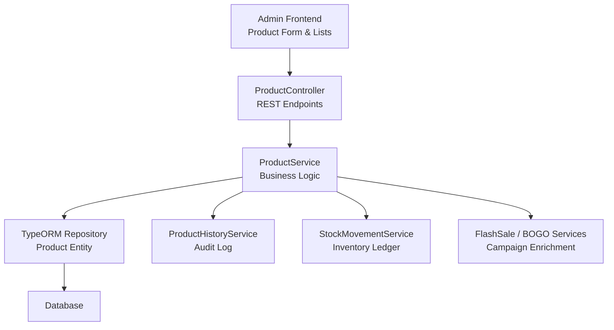
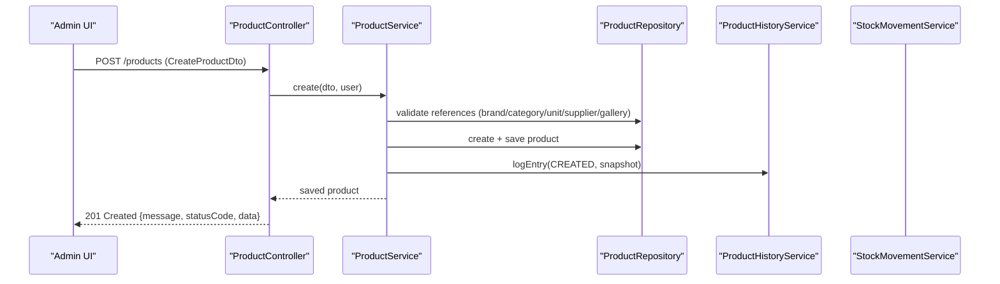
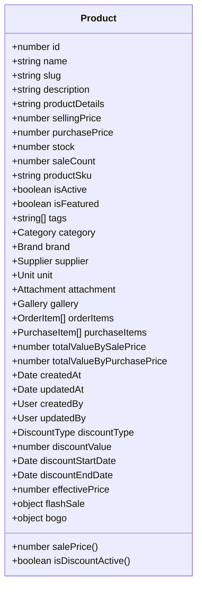
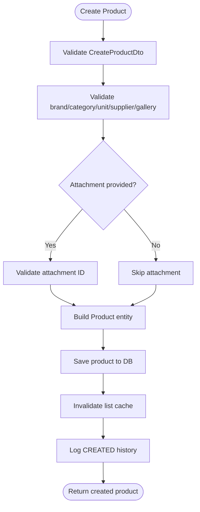
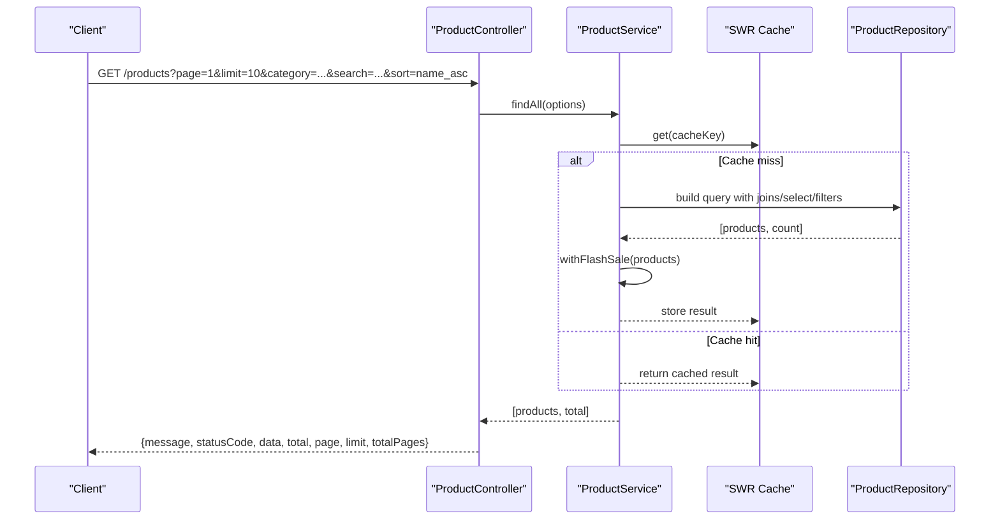
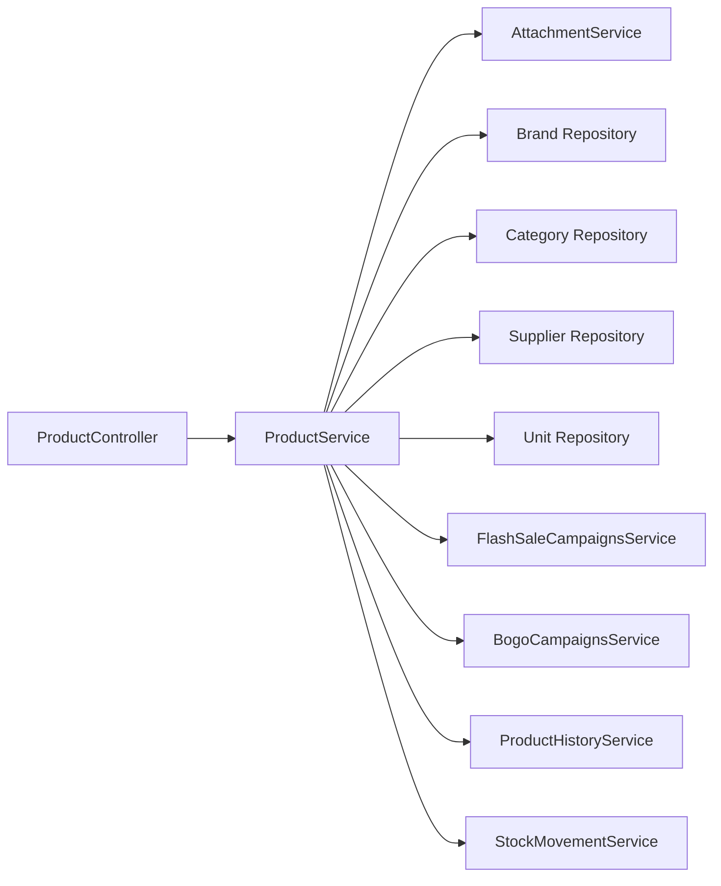

# Product Catalog Management

<cite>
**Referenced Files in This Document**
- [product.controller.ts](file://apps/backend/src/product/product.controller.ts)
- [product.service.ts](file://apps/backend/src/product/product.service.ts)
- [product.entity.ts](file://apps/backend/src/product/entities/product.entity.ts)
- [create-product.dto.ts](file://apps/backend/src/product/dto/create-product.dto.ts)
- [update-product.dto.ts](file://apps/backend/src/product/dto/update-product.dto.ts)
- [find-products-query.dto.ts](file://apps/backend/src/product/dto/find-products-query.dto.ts)
- [product-response.dto.ts](file://apps/backend/src/product/dto/product-response.dto.ts)
- [product-form.tsx](file://apps/frontend/components/admin/products/product-form.tsx)
</cite>

## Table of Contents
1. [Introduction](#introduction)
2. [Project Structure](#project-structure)
3. [Core Components](#core-components)
4. [Architecture Overview](#architecture-overview)
5. [Detailed Component Analysis](#detailed-component-analysis)
6. [Dependency Analysis](#dependency-analysis)
7. [Performance Considerations](#performance-considerations)
8. [Troubleshooting Guide](#troubleshooting-guide)
9. [Conclusion](#conclusion)

## Introduction
This document explains the product catalog management system implemented in the backend and used by the admin frontend. It covers the complete product lifecycle: creation, reading, updating, deletion, visibility control, search and filtering, listing with pagination and sorting, image and gallery handling, SEO-friendly slugs, discount behavior, stock adjustments, audit history, and reporting endpoints.

The system is built with NestJS on the backend using TypeORM entities, DTOs for validation, controllers exposing REST endpoints, and a service layer implementing business logic, caching, and cross-cutting concerns such as campaign enrichment and audit logging. The admin frontend provides forms to create and edit products, upload images and galleries, manage visibility, and interact with the API.

## Project Structure
The product feature lives under `apps/backend/src/product` and includes:
- Controller: HTTP endpoints, query parsing, response formatting, and authorization guards.
- Service: Business logic, repository queries, validation helpers, caching, history logging, and report generation.
- Entity: Database model, computed properties, hooks, indexes, and validation rules.
- DTOs: Request/response contracts and validation decorators.

**Diagram sources**
- [product.controller.ts:49-58](file://apps/backend/src/product/product.controller.ts#L49-L58)
- [product.service.ts:56-82](file://apps/backend/src/product/product.service.ts#L56-L82)
- [product.entity.ts:41-50](file://apps/backend/src/product/entities/product.entity.ts#L41-L50)

**Section sources**
- [product.controller.ts:49-58](file://apps/backend/src/product/product.controller.ts#L49-L58)
- [product.service.ts:56-82](file://apps/backend/src/product/product.service.ts#L56-L82)
- [product.entity.ts:41-50](file://apps/backend/src/product/entities/product.entity.ts#L41-L50)

## Core Components
- Product entity defines fields such as name, slug, description, product details, selling price, purchase price, stock, sale count, SKU, attachment, gallery, category, brand, supplier, unit, tags, discount configuration, timestamps, and computed values like effective price and inventory totals.
- CreateProductDto validates required fields including name, selling price, stock, unit, supplier, category, brand, and optional fields like slug, description, product details, weight, isActive, isFeatured, discount type/value/dates, and tags.
- UpdateProductDto is a partial version of CreateProductDto for PATCH updates.
- ProductResponseDto documents the standard product response shape returned by endpoints.
- FindProductsQueryDto documents supported query parameters for list filtering and pagination.

Key responsibilities:
- Controller: exposes CRUD endpoints, specialized storefront endpoints (discounted, flash sale, BOGO, bestsellers, featured), reports, history, stock movements, and similar products.
- Service: implements validation, persistence, filtering, sorting, pagination, caching, campaign enrichment, history logging, stock adjustment, and reporting.
- Entity: enforces data integrity, generates slugs and SKUs, computes derived values, and indexes frequently queried columns.

**Section sources**
- [product.entity.ts:51-499](file://apps/backend/src/product/entities/product.entity.ts#L51-L499)
- [create-product.dto.ts:17-230](file://apps/backend/src/product/dto/create-product.dto.ts#L17-L230)
- [update-product.dto.ts:1-6](file://apps/backend/src/product/dto/update-product.dto.ts#L1-L6)
- [product-response.dto.ts:5-62](file://apps/backend/src/product/dto/product-response.dto.ts#L5-L62)
- [find-products-query.dto.ts:12-78](file://apps/backend/src/product/dto/find-products-query.dto.ts#L12-L78)

## Architecture Overview
The product catalog follows a layered architecture:
- Presentation layer: NestJS controller methods parse requests, enforce authentication/authorization, and format responses.
- Business layer: Service orchestrates validation, repository operations, caching, campaign enrichment, and audit/logging.
- Data layer: TypeORM repositories map to database tables; computed getters and hooks enrich entity state before persistence.

**Diagram sources**
- [product.controller.ts:60-85](file://apps/backend/src/product/product.controller.ts#L60-L85)
- [product.service.ts:127-173](file://apps/backend/src/product/product.service.ts#L127-L173)

**Section sources**
- [product.controller.ts:60-85](file://apps/backend/src/product/product.controller.ts#L60-L85)
- [product.service.ts:127-173](file://apps/backend/src/product/product.service.ts#L127-L173)

## Detailed Component Analysis

### Product Entity Structure
The Product entity models the core product record and related relationships:
- Identifiers and metadata: id, name, slug, productSku, createdAt, updatedAt, createdBy, updatedBy.
- Pricing and inventory: sellingPrice, purchasePrice, stock, saleCount, totalValueBySalePrice, totalValueByPurchasePrice.
- Relationships: category, brand, supplier, unit, attachment, gallery, orderItems, purchaseItems.
- Visibility and features: isActive, isFeatured, tags.
- Discount configuration: discountType, discountValue, discountStartDate, discountEndDate.
- Computed display fields: salePrice, isDiscountActive, effectivePrice, flashSale, bogo.
- Indexes: slug, isActive, isFeatured, saleCount, sellingPrice, createdAt, combined filters for performance.

Computed behaviors:
- Slug generation runs before insert/update to ensure URL-friendly slugs.
- SKU auto-generation if not provided.
- Discount validation ensures required value when type is set, end date after start date, and percentage discount does not exceed 100%.
- Inventory totals are recalculated based on stock and effective or purchase prices.

**Diagram sources**
- [product.entity.ts:51-499](file://apps/backend/src/product/entities/product.entity.ts#L51-L499)

**Section sources**
- [product.entity.ts:51-499](file://apps/backend/src/product/entities/product.entity.ts#L51-L499)

### Product Creation Workflow
Creation involves:
- Input validation via CreateProductDto.
- Reference validation for brand, category, unit, supplier, and gallery.
- Optional attachment validation.
- Persistence with createdBy/updatedBy tracking.
- Cache invalidation for list endpoints.
- Audit logging of creation event with a snapshot of key fields.

Image and gallery handling:
- The admin form uploads an image file to the attachment endpoint and sends the resulting attachment ID with the product payload.
- Gallery files can be uploaded separately and linked via galleryId.
- On update, attachment can be replaced or explicitly removed by passing null.

SEO optimization:
- Slugs are generated from the product name if not provided, normalized to lowercase with hyphens.
- Unique slug index supports fast lookups by slug.

Validation rules:
- Required fields include name, sellingPrice, stock, unitId, supplierId, categoryId, brandId.
- Optional fields include slug, description, productDetails, purchasePrice, weight, isActive, isFeatured, discountType/value/dates, tags.
- Weight must be positive with up to two decimal places.
- Discount value is required when discountType is set; percentage cannot exceed 100%; end date must not precede start date.

**Diagram sources**
- [product.controller.ts:60-85](file://apps/backend/src/product/product.controller.ts#L60-L85)
- [product.service.ts:127-173](file://apps/backend/src/product/product.service.ts#L127-L173)
- [product.entity.ts:79-87](file://apps/backend/src/product/entities/product.entity.ts#L79-L87)
- [product.entity.ts:434-455](file://apps/backend/src/product/entities/product.entity.ts#L434-L455)

**Section sources**
- [create-product.dto.ts:17-230](file://apps/backend/src/product/dto/create-product.dto.ts#L17-L230)
- [product.service.ts:127-173](file://apps/backend/src/product/product.service.ts#L127-L173)
- [product.entity.ts:79-87](file://apps/backend/src/product/entities/product.entity.ts#L79-L87)
- [product.entity.ts:434-455](file://apps/backend/src/product/entities/product.entity.ts#L434-L455)
- [product-form.tsx:303-383](file://apps/frontend/components/admin/products/product-form.tsx#L303-L383)

### Reading Products
Endpoints:
- GET /products: paginated, filtered, sorted product list.
- GET /products/:id: full product detail by ID.
- GET /products/slug/:slug: storefront detail by slug (returns 404 if inactive).
- GET /products/all: minimal product list without pagination, optionally scoped by category, supplier, active status, and search.
- GET /products/discounted: currently discounted products.
- GET /products/flash-sale: products covered by active flash sale campaigns.
- GET /products/bogo: products covered by active BOGO campaigns.
- GET /products/bestsellers: top-selling products within a time window.
- GET /products/featured: featured products for homepage.
- GET /products/tags: unique tags across all products.
- GET /products/:id/similar: similar best-selling products based on category context.

Filtering and search:
- Category filter includes child categories.
- Brand filter by brand ID.
- Supplier filter by supplier ID.
- Featured filter.
- Text search matches product name and description.
- Price range filter by minPrice and maxPrice.
- Active status filter.
- Has discount filter.
- Tags filter using array containment.

Sorting options:
- price_asc, price_desc, name_asc, name_desc.

Pagination:
- page and limit parameters with total and totalPages metadata.

Performance optimizations:
- List results use SWR-style caching with short fresh TTL and longer stale-while-revalidate window.
- Count queries avoid heavy joins unless needed by filters.
- Select clauses limit payload to necessary fields for lists.
- Storefront detail endpoints cache individual product records.
- Campaign enrichment is applied post-cache to keep cached lists free of volatile campaign data.

**Diagram sources**
- [product.controller.ts:87-250](file://apps/backend/src/product/product.controller.ts#L87-L250)
- [product.service.ts:175-302](file://apps/backend/src/product/product.service.ts#L175-L302)

**Section sources**
- [product.controller.ts:87-250](file://apps/backend/src/product/product.controller.ts#L87-L250)
- [product.service.ts:175-302](file://apps/backend/src/product/product.service.ts#L175-L302)
- [product.service.ts:304-353](file://apps/backend/src/product/product.service.ts#L304-L353)
- [product.service.ts:355-448](file://apps/backend/src/product/product.service.ts#L355-L448)

### Updating Products
Update workflow:
- Load existing product by ID.
- Validate referenced relationships if changed (brand, category, supplier, unit, gallery).
- Handle attachment replacement or explicit removal.
- Apply discount field updates.
- Persist changes and update updatedBy.
- Invalidate relevant caches (by ID and slug) and list cache.
- Log update history with change diff; toggling only isActive logs ACTIVATED/DEACTIVATED instead of generic UPDATE.

Visibility states:
- isActive controls product visibility; toggling it triggers specific history actions.
- isFeatured marks products for special listings.

Example scenarios:
- Update product information while preserving current attachment unless explicitly changed.
- Remove attachment by setting attachment to null.
- Toggle product visibility to activate or deactivate.

**Section sources**
- [product.controller.ts:1026-1050](file://apps/backend/src/product/product.controller.ts#L1026-L1050)
- [product.service.ts:1147-1198](file://apps/backend/src/product/product.service.ts#L1147-L1198)
- [product.service.ts:1281-1310](file://apps/backend/src/product/product.service.ts#L1281-L1310)

### Deleting Products
Deletion workflow:
- Load product by ID.
- Log DELETED history with snapshot.
- Remove product from database.
- Invalidate list cache.
- Delete associated attachment file if present.

Error handling:
- If product not found, NotFoundException is thrown during load.

**Section sources**
- [product.controller.ts:1052-1067](file://apps/backend/src/product/product.controller.ts#L1052-L1067)
- [product.service.ts:1200-1215](file://apps/backend/src/product/product.service.ts#L1200-L1215)

### Stock Adjustments
Manual stock adjustment:
- Endpoint: POST /products/:id/stock-adjust.
- Validates quantity is non-zero and does not make stock negative.
- Updates product stock and persists.
- Records ADJUSTMENT movement in stock ledger with user and note.
- Invalidates list cache.

Reports:
- Low stock report: products with stock above zero but below threshold.
- Out-of-stock report: products with zero stock.
- Stock valuation report: summary totals and product list ordered by low stock.
- Stock summary KPI: total products, out-of-stock, low-stock counts.

**Section sources**
- [product.controller.ts:898-922](file://apps/backend/src/product/product.controller.ts#L898-L922)
- [product.service.ts:1217-1257](file://apps/backend/src/product/product.service.ts#L1217-L1257)
- [product.service.ts:1355-1481](file://apps/backend/src/product/product.service.ts#L1355-L1481)

### Search and Filtering Capabilities
Supported filters:
- Category-based filtering including child categories.
- Brand filtering by brand ID.
- Supplier filtering by supplier ID.
- Featured filtering.
- Text search matching name and description.
- Price range filtering by minPrice and maxPrice.
- Active status filtering.
- Has discount filtering.
- Tags filtering using PostgreSQL array containment.

Sorting:
- By price ascending/descending.
- By name ascending/descending.

Frontend integration:
- Admin product list uses category and brand selectors and displays active filters.
- Storefront pages pass search params (category, brand, sort, minPrice, maxPrice, featured, tags) to the backend.

**Section sources**
- [product.controller.ts:87-250](file://apps/backend/src/product/product.controller.ts#L87-L250)
- [product.service.ts:304-353](file://apps/backend/src/product/product.service.ts#L304-L353)
- [product-form.tsx:433-471](file://apps/frontend/components/admin/products/product-list.tsx#L433-L471)

### Listing Endpoints and Pagination
Endpoints:
- GET /products: primary listing with pagination and filters.
- GET /products/all: minimal fields without pagination.
- GET /products/discounted: discounted products with pagination.
- GET /products/flash-sale: flash sale products with pagination.
- GET /products/bogo: BOGO products with pagination.
- GET /products/bestsellers: best-selling products with time window filter.
- GET /products/featured: featured products.
- GET /products/tags: unique tags.
- GET /products/:id/similar: similar best-selling products.

Pagination metadata:
- Responses include total, page, limit, and totalPages where applicable.

Performance:
- Caching at multiple levels: SWR cache for lists, TypeORM cache for individual products, and campaign services caching.
- Selective joins and select clauses reduce payload size.
- Count-only queries optimize pagination totals.

**Section sources**
- [product.controller.ts:87-584](file://apps/backend/src/product/product.controller.ts#L87-L584)
- [product.service.ts:175-302](file://apps/backend/src/product/product.service.ts#L175-L302)
- [product.service.ts:512-566](file://apps/backend/src/product/product.service.ts#L512-L566)

### Examples of Programmatic Operations

Creating a product programmatically:
- Send a POST request to /products with CreateProductDto fields.
- Ensure required fields are present: name, sellingPrice, stock, unitId, supplierId, categoryId, brandId.
- Optionally provide slug, description, productDetails, purchasePrice, weight, isActive, isFeatured, discountType/value/dates, tags.
- Upload image to attachment endpoint first and include attachment ID.
- Optionally upload gallery files and include galleryId.

Updating product information:
- Send a PATCH request to /products/:id with UpdateProductDto fields.
- To replace attachment, send new attachment ID; to remove, send null.
- To toggle visibility, set isActive true/false.
- To clear discounts, set discountType to null or omit discount fields depending on desired behavior.

Managing product visibility states:
- Set isActive to false to deactivate; this logs DEACTIVATED in history.
- Set isActive to true to activate; this logs ACTIVATED in history.
- Use GET /products/slug/:slug to retrieve storefront detail; inactive products return 404.

Bulk operations:
- The codebase does not expose dedicated bulk product endpoints. Bulk-like operations should be implemented client-side by iterating over product IDs and calling individual endpoints, or by extending the service/controller with batch methods.

Error handling strategies:
- Validation errors from DTOs and entity constraints produce BadRequestException or ConflictException.
- Not found conditions raise NotFoundException.
- Negative stock adjustments raise BadRequestException.
- Caches are invalidated on mutations to prevent stale data.

**Section sources**
- [create-product.dto.ts:17-230](file://apps/backend/src/product/dto/create-product.dto.ts#L17-L230)
- [update-product.dto.ts:1-6](file://apps/backend/src/product/dto/update-product.dto.ts#L1-L6)
- [product.controller.ts:60-85](file://apps/backend/src/product/product.controller.ts#L60-L85)
- [product.controller.ts:1026-1067](file://apps/backend/src/product/product.controller.ts#L1026-L1067)
- [product.service.ts:127-173](file://apps/backend/src/product/product.service.ts#L127-L173)
- [product.service.ts:1147-1198](file://apps/backend/src/product/product.service.ts#L1147-L1198)
- [product.service.ts:1200-1257](file://apps/backend/src/product/product.service.ts#L1200-L1257)

## Dependency Analysis
The product module depends on several external modules and services:
- AttachmentService: manages file attachments for product images.
- Brand, Category, Supplier, Unit repositories: reference validation for relationships.
- FlashSaleCampaignsService and BogoCampaignsService: enrich product listings with campaign info.
- ProductHistoryService: logs creation, updates, activation/deactivation, and deletion events.
- StockMovementService: records stock adjustments and movements.

Coupling and cohesion:
- Controller is thin and delegates to service, maintaining separation of concerns.
- Service encapsulates complex queries, caching, and cross-cutting concerns, improving cohesion.
- Entity contains validation and computed logic close to the data model.

Potential circular dependencies:
- No obvious circular imports between product and dependent modules; dependencies are unidirectional from product to others.

External integrations:
- TypeORM for database access.
- NestJS cache-manager for application-level caching.
- Swagger decorators for API documentation.

**Diagram sources**
- [product.controller.ts:49-58](file://apps/backend/src/product/product.controller.ts#L49-L58)
- [product.service.ts:56-82](file://apps/backend/src/product/product.service.ts#L56-L82)

**Section sources**
- [product.controller.ts:49-58](file://apps/backend/src/product/product.controller.ts#L49-L58)
- [product.service.ts:56-82](file://apps/backend/src/product/product.service.ts#L56-L82)

## Performance Considerations
- SWR-style caching for product lists reduces database load under concurrent traffic.
- Separate count queries avoid expensive joined counts.
- Select clauses restrict payload to necessary fields for lists and reports.
- Individual product detail endpoints cache by ID and slug.
- Campaign enrichment is applied after cache retrieval to avoid freezing volatile data in cache.
- Tag filtering uses PostgreSQL array containment for efficient matching.
- Reports use raw SQL aggregations to minimize ORM overhead.

Recommendations:
- Keep page sizes reasonable (default 10–50) to balance UX and performance.
- Use minimal endpoints (/products/all) for lightweight pickers.
- Leverage tags for faceted navigation and precomputed filters.
- Monitor cache hit rates and adjust TTLs based on traffic patterns.

[No sources needed since this section provides general guidance]

## Troubleshooting Guide
Common issues and resolutions:
- Duplicate product name:
  - Cause: Creating a product with an existing name.
  - Resolution: Change the product name or handle ConflictException in the client.
- Missing references:
  - Cause: Invalid brand/category/unit/supplier/gallery IDs.
  - Resolution: Ensure referenced entities exist before creating/updating products.
- Negative stock adjustment:
  - Cause: Adjustment would reduce stock below zero.
  - Resolution: Verify current stock and adjustment quantity; use positive adjustments to add stock.
- Inactive product detail:
  - Cause: Attempting to fetch storefront detail for an inactive product.
  - Resolution: Activate the product or handle 404 gracefully in the client.
- Stale list data:
  - Cause: Mutations not invalidating caches.
  - Resolution: Ensure mutations call invalidateListCache and clear relevant caches.

Error types:
- BadRequestException: validation failures, invalid adjustments.
- ConflictException: duplicate names.
- NotFoundException: missing products or references.

**Section sources**
- [product.service.ts:127-173](file://apps/backend/src/product/product.service.ts#L127-L173)
- [product.service.ts:1217-1257](file://apps/backend/src/product/product.service.ts#L1217-L1257)
- [product.service.ts:1312-1353](file://apps/backend/src/product/product.service.ts#L1312-L1353)

## Conclusion
The product catalog management system provides robust CRUD operations, comprehensive search and filtering, efficient listing with pagination and sorting, image and gallery handling, SEO-friendly slugs, discount behavior, stock adjustments, audit history, and reporting endpoints. The layered architecture separates concerns effectively, and caching strategies improve performance under load. For bulk operations, extend the service and controller with batch methods or orchestrate calls from the client. Proper error handling and validation ensure data integrity and a smooth developer experience.

[No sources needed since this section summarizes without analyzing specific files]