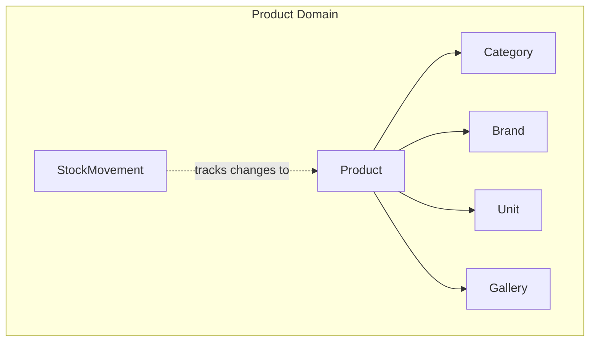
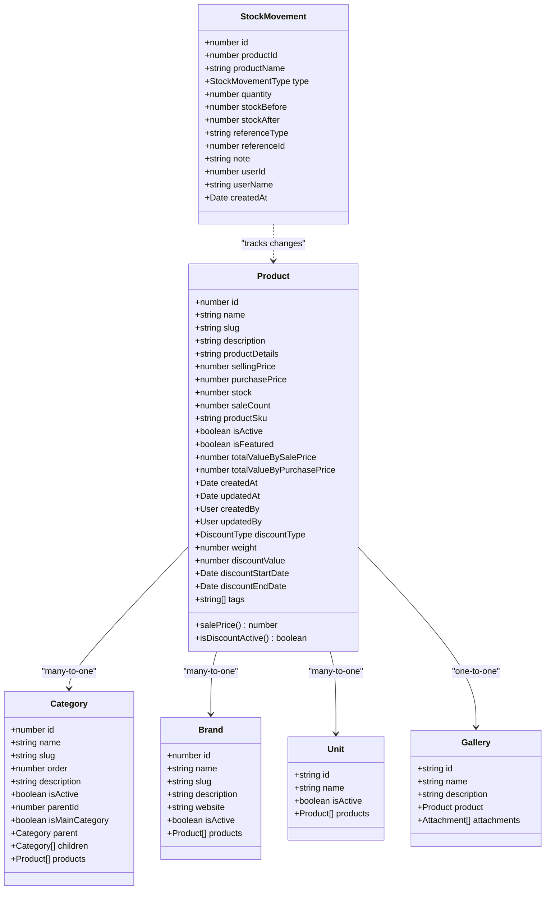
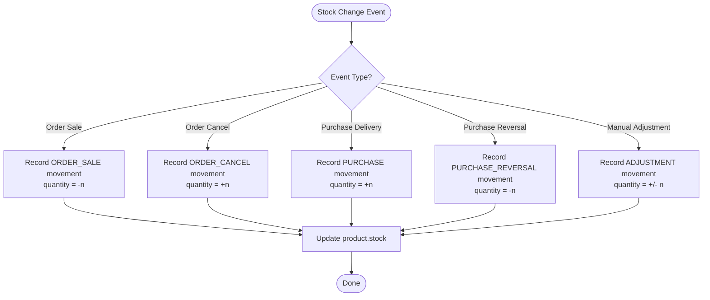
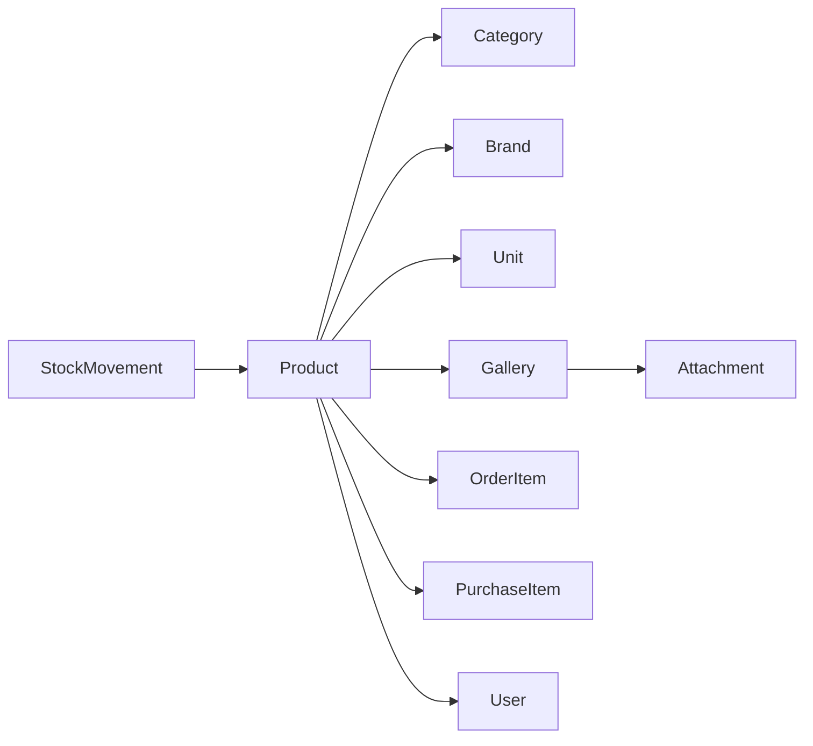

# Product Management

<cite>
**Referenced Files in This Document**
- [product.entity.ts](file://apps/backend/src/product/entities/product.entity.ts)
- [category.entity.ts](file://apps/backend/src/category/entities/category.entity.ts)
- [brand.entity.ts](file://apps/backend/src/brand/entities/brand.entity.ts)
- [unit.entity.ts](file://apps/backend/src/unit/entities/unit.entity.ts)
- [stock-movement.entity.ts](file://apps/backend/src/stock-movement/entities/stock-movement.entity.ts)
- [gallery.entity.ts](file://apps/backend/src/gallery/entities/gallery.entity.ts)
</cite>

## Table of Contents
1. [Introduction](#introduction)
2. [Project Structure](#project-structure)
3. [Core Components](#core-components)
4. [Architecture Overview](#architecture-overview)
5. [Detailed Component Analysis](#detailed-component-analysis)
6. [Dependency Analysis](#dependency-analysis)
7. [Performance Considerations](#performance-considerations)
8. [Troubleshooting Guide](#troubleshooting-guide)
9. [Conclusion](#conclusion)

## Introduction
This document explains the product management system for the German Butcher e-commerce platform. It covers the product catalog model, category hierarchy, brand associations, unit measurements, inventory tracking with stock movement history, pricing and discount strategies, product lifecycle status, image gallery, and search-oriented indexing. It also provides implementation guidance for creating products programmatically, managing inventory levels, and handling bulk operations, along with performance considerations for large catalogs.

## Project Structure
The product domain is implemented as a set of TypeORM entities and related services/controllers under the backend application:
- Product entity defines core product data, pricing, discounts, and relationships to categories, brands, units, suppliers, attachments, galleries, orders, and purchases.
- Category entity supports hierarchical organization via parent-child relationships.
- Brand entity stores brand metadata and links to products.
- Unit entity defines measurement units used by products.
- StockMovement entity records every change to product stock with before/after snapshots.
- Gallery entity holds multiple images per product via attachments.

**Diagram sources**
- [product.entity.ts:145-233](file://apps/backend/src/product/entities/product.entity.ts#L145-L233)
- [category.entity.ts:84-105](file://apps/backend/src/category/entities/category.entity.ts#L84-L105)
- [brand.entity.ts:83-88](file://apps/backend/src/brand/entities/brand.entity.ts#L83-L88)
- [unit.entity.ts:76-77](file://apps/backend/src/unit/entities/unit.entity.ts#L76-L77)
- [gallery.entity.ts:25-29](file://apps/backend/src/gallery/entities/gallery.entity.ts#L25-L29)
- [stock-movement.entity.ts:25-29](file://apps/backend/src/stock-movement/entities/stock-movement.entity.ts#L25-L29)

**Section sources**
- [product.entity.ts:41-50](file://apps/backend/src/product/entities/product.entity.ts#L41-L50)
- [category.entity.ts:22-29](file://apps/backend/src/category/entities/category.entity.ts#L22-L29)
- [brand.entity.ts:20-21](file://apps/backend/src/brand/entities/brand.entity.ts#L20-L21)
- [unit.entity.ts:17-18](file://apps/backend/src/unit/entities/unit.entity.ts#L17-L18)
- [stock-movement.entity.ts:25-29](file://apps/backend/src/stock-movement/entities/stock-movement.entity.ts#L25-L29)
- [gallery.entity.ts:14-15](file://apps/backend/src/gallery/entities/gallery.entity.ts#L14-L15)

## Core Components
- Product: Central entity for catalog items, including identifiers (id, slug, SKU), descriptive fields, pricing, stock, sale count, relationships (category, brand, unit, supplier, gallery, attachment), timestamps, audit users, discount configuration, computed price helpers, and total value calculations.
- Category: Hierarchical taxonomy with slugs, ordering, main menu flag, and product/recipe associations.
- Brand: Brand identity with logo attachment and product association.
- Unit: Measurement unit definitions linked to products.
- StockMovement: Immutable ledger of stock changes with type, quantity delta, before/after snapshots, reference context, and user attribution.
- Gallery: One-to-one link to product with multiple image attachments.

Key responsibilities:
- Catalog CRUD and enrichment (pricing, discounts, values).
- Inventory accounting and audit trail.
- Organizational structure (categories, brands, units).
- Media management (attachments and galleries).

**Section sources**
- [product.entity.ts:51-499](file://apps/backend/src/product/entities/product.entity.ts#L51-L499)
- [category.entity.ts:29-138](file://apps/backend/src/category/entities/category.entity.ts#L29-L138)
- [brand.entity.ts:21-129](file://apps/backend/src/brand/entities/brand.entity.ts#L21-L129)
- [unit.entity.ts:18-78](file://apps/backend/src/unit/entities/unit.entity.ts#L18-L78)
- [stock-movement.entity.ts:9-74](file://apps/backend/src/stock-movement/entities/stock-movement.entity.ts#L9-L74)
- [gallery.entity.ts:15-46](file://apps/backend/src/gallery/entities/gallery.entity.ts#L15-L46)

## Architecture Overview
The product management architecture centers on the Product entity with strong relationships to Category, Brand, Unit, and Gallery, while StockMovement provides an append-only ledger for inventory changes. Pricing logic is embedded in the Product entity through computed getters and validation hooks that enforce discount rules and calculate effective prices and inventory values.

**Diagram sources**
- [product.entity.ts:51-499](file://apps/backend/src/product/entities/product.entity.ts#L51-L499)
- [category.entity.ts:29-138](file://apps/backend/src/category/entities/category.entity.ts#L29-L138)
- [brand.entity.ts:21-129](file://apps/backend/src/brand/entities/brand.entity.ts#L21-L129)
- [unit.entity.ts:18-78](file://apps/backend/src/unit/entities/unit.entity.ts#L18-L78)
- [gallery.entity.ts:15-46](file://apps/backend/src/gallery/entities/gallery.entity.ts#L15-L46)
- [stock-movement.entity.ts:9-74](file://apps/backend/src/stock-movement/entities/stock-movement.entity.ts#L9-L74)

## Detailed Component Analysis

### Product Entity
Responsibilities:
- Identifiers and SEO-friendly slug generation.
- Descriptive content and media references.
- Pricing and discount configuration with validation and computed sale price.
- Inventory fields and derived total values.
- Relationships to category, brand, unit, supplier, gallery, attachment, orders, and purchases.
- Audit fields (created/updated by users and timestamps).
- Tags for filtering and categorization.

Pricing and discounts:
- Base selling price and optional discount type/value with start/end dates.
- Computed salePrice applies percentage or fixed discount when active.
- Validation ensures required discount value, valid date ranges, and percentage bounds.
- Effective price calculation considers flash sales and BOGO campaigns at read time (display-only fields).

Inventory and totals:
- stock tracks available quantity; saleCount tracks sold units.
- totalValueBySalePrice and totalValueByPurchasePrice are recalculated on insert/update using effective price and purchase price.

Lifecycle and visibility:
- isActive controls visibility; isFeatured highlights products.
- No explicit draft/inactive/archived states are modeled beyond isActive; business logic can treat inactive as archived or manage drafts via external processes.

Search optimization:
- Indexes on slug, isActive, isFeatured, saleCount, sellingPrice, createdAt, and composite discount fields support efficient storefront queries and admin filters.

Implementation examples (conceptual):
- Create product: Provide name, category, brand, unit, sellingPrice, purchasePrice, stock, and optionally tags and gallery. The entity will generate slug and SKU automatically.
- Update product: Modify pricing, stock, or metadata; the entity recalculates total values and validates discount constraints.
- Read product: Use indexes on slug or isActive/isFeatured for fast retrieval.

**Section sources**
- [product.entity.ts:51-499](file://apps/backend/src/product/entities/product.entity.ts#L51-L499)

### Category Hierarchy
Features:
- Parent-child relationships via parentId and parent field.
- Children collection enables tree traversal.
- Order and isMainCategory flags control navigation and menu placement.
- Slug auto-generation and indexes for lookup and filtering.

Use cases:
- Build nested menus and product browsing paths.
- Filter products by category or subcategory.

Implementation examples (conceptual):
- Create root category without parentId; create child categories by setting parentId.
- Query children recursively using the parent/children relationship.

**Section sources**
- [category.entity.ts:29-138](file://apps/backend/src/category/entities/category.entity.ts#L29-L138)

### Brand Associations
Features:
- Brand identity with slug, description, website, and logo attachment.
- Active flag and product association.

Use cases:
- Group products by brand for storefront filtering and branding pages.

Implementation examples (conceptual):
- Create brand and associate with products via ManyToOne.

**Section sources**
- [brand.entity.ts:21-129](file://apps/backend/src/brand/entities/brand.entity.ts#L21-L129)

### Unit Measurements
Features:
- Unique string id and name for units like kilogram, piece, etc.
- Active flag and product association.

Use cases:
- Standardize product quantities and display units consistently.

Implementation examples (conceptual):
- Define units once and assign to products via ManyToOne.

**Section sources**
- [unit.entity.ts:18-78](file://apps/backend/src/unit/entities/unit.entity.ts#L18-L78)

### Inventory Tracking and Stock Movement History
Ledger design:
- StockMovement records each change with type (purchase, purchase_reversal, order_sale, order_cancel, adjustment), signed quantity, and before/after stock snapshots.
- Reference fields tie movements to source events (e.g., purchase or order IDs).
- User attribution includes userId and userName snapshot for traceability.

Low stock alerts:
- While no automatic alerting is defined in the entity, clients can compute low-stock conditions by comparing product.stock against thresholds and trigger notifications.

Stock reconciliation:
- Current stock should equal sum(quantity) over movements plus initial stock; maintain consistency by always recording movements alongside stock updates.

Implementation examples (conceptual):
- On order placement: record ORDER_SALE movement with negative quantity and decrement product.stock.
- On order cancellation: record ORDER_CANCEL movement with positive quantity and increment product.stock.
- On purchase delivery: record PURCHASE movement with positive quantity and increment product.stock.
- Manual correction: record ADJUSTMENT movement with signed quantity.

**Diagram sources**
- [stock-movement.entity.ts:9-74](file://apps/backend/src/stock-movement/entities/stock-movement.entity.ts#L9-L74)

**Section sources**
- [stock-movement.entity.ts:9-74](file://apps/backend/src/stock-movement/entities/stock-movement.entity.ts#L9-L74)

### Product Image Gallery System
Design:
- Gallery is one-to-one with Product and contains multiple Attachments.
- Attachments represent individual images/media files.

Usage:
- Associate a Gallery with a Product to store multiple images.
- Manage images via Attachment CRUD within the Gallery context.

Implementation examples (conceptual):
- Create Gallery and attach it to Product.
- Add multiple Attachments to Gallery for product images.

**Section sources**
- [gallery.entity.ts:15-46](file://apps/backend/src/gallery/entities/gallery.entity.ts#L15-L46)
- [product.entity.ts:172-185](file://apps/backend/src/product/entities/product.entity.ts#L172-L185)

### SEO Metadata Management
Current state:
- Slug generation is automatic for Products and Categories, supporting URL-friendly routes.
- No dedicated SEO fields (meta title/description) are present in the analyzed entities.

Recommendations:
- Extend Product and Category with metaTitle, metaDescription, and canonicalUrl fields if SEO customization is required.
- Leverage existing slugs for clean URLs and indexing.

**Section sources**
- [product.entity.ts:67-87](file://apps/backend/src/product/entities/product.entity.ts#L67-L87)
- [category.entity.ts:38-54](file://apps/backend/src/category/entities/category.entity.ts#L38-L54)

### Product Variants Handling
Current state:
- No dedicated variant model is present in the analyzed entities.
- Variants can be modeled as separate Product entries sharing common attributes (e.g., size/color) or via additional fields/tags.

Recommendations:
- Introduce a Variant entity linked to Product with attributes like size, color, and variant-specific pricing/stock.
- Alternatively, use tags and extended fields on Product to represent simple variants.

[No sources needed since this section proposes conceptual extensions not present in the analyzed code]

### Product Lifecycle and Status Management
Current state:
- isActive indicates whether a product is visible; isFeatured marks featured items.
- No explicit draft or archived states are modeled.

Recommended practices:
- Treat isActive=false as inactive/archived in business logic.
- Implement draft workflows at the service layer by gating creation/publishing actions.

**Section sources**
- [product.entity.ts:190-204](file://apps/backend/src/product/entities/product.entity.ts#L190-L204)

## Dependency Analysis
Relationships:
- Product depends on Category, Brand, Unit, Supplier, Gallery, Attachment, OrderItem, PurchaseItem, and User.
- Category has recursive parent-child relationships and product/recipe associations.
- Brand and Unit have one-to-many relationships back to Product.
- Gallery is one-to-one with Product and one-to-many with Attachment.
- StockMovement is independent but logically tied to Product via productId and productName snapshots.

Coupling and cohesion:
- Product is the central hub with high cohesion around catalog data and pricing.
- StockMovement is decoupled from Product’s row deletion, ensuring historical integrity.

Potential circular dependencies:
- None observed among the analyzed entities; relationships are directional.

External integrations:
- DiscountType enum drives discount behavior.
- Flash sale and BOGO campaign services enrich Product reads with display-only fields.

**Diagram sources**
- [product.entity.ts:145-233](file://apps/backend/src/product/entities/product.entity.ts#L145-L233)
- [gallery.entity.ts:25-29](file://apps/backend/src/gallery/entities/gallery.entity.ts#L25-L29)
- [stock-movement.entity.ts:33-40](file://apps/backend/src/stock-movement/entities/stock-movement.entity.ts#L33-L40)

**Section sources**
- [product.entity.ts:145-233](file://apps/backend/src/product/entities/product.entity.ts#L145-L233)
- [gallery.entity.ts:25-29](file://apps/backend/src/gallery/entities/gallery.entity.ts#L25-L29)
- [stock-movement.entity.ts:33-40](file://apps/backend/src/stock-movement/entities/stock-movement.entity.ts#L33-L40)

## Performance Considerations
Indexing strategy:
- Product indexes on slug, isActive, isFeatured, saleCount, sellingPrice, createdAt, and discount fields optimize common queries (search, listing, promotions).
- Category indexes on slug, isActive, parentId, order, isMainCategory, and composite (parentId, isActive) improve navigation and filtering.
- StockMovement indexes on productId+createdAt, createdAt, and type enable efficient history queries and reporting.

Recommendations:
- Prefer querying by slug and isActive for storefront listings.
- Use pagination and selective fields for large catalogs.
- Cache frequently accessed product details and category trees.
- Avoid eager loading heavy relations unless necessary; load gallery and attachments on demand.
- For bulk operations, batch inserts/updates and minimize N+1 queries.

[No sources needed since this section provides general guidance based on observed indexes]

## Troubleshooting Guide
Common issues and resolutions:
- Discount validation errors:
  - Missing discount value when discount type is set.
  - Invalid date range where end date precedes start date.
  - Percentage discount exceeding 100%.
  Resolution: Ensure discountType and discountValue are paired correctly, validate date ranges, and constrain percentage values.

- Total value calculation anomalies:
  - NaN or unexpected values due to missing stock or price fields.
  Resolution: Validate stock and prices before saving; ensure numeric conversions handle nulls safely.

- Low stock detection:
  - No built-in alerting mechanism.
  Resolution: Implement client-side checks comparing product.stock against thresholds and trigger notifications or emails.

- Inconsistent stock after events:
  - Mismatch between product.stock and movement history.
  Resolution: Always record StockMovement alongside stock updates; reconcile periodically by summing movements.

**Section sources**
- [product.entity.ts:434-484](file://apps/backend/src/product/entities/product.entity.ts#L434-L484)
- [stock-movement.entity.ts:22-74](file://apps/backend/src/stock-movement/entities/stock-movement.entity.ts#L22-L74)

## Conclusion
The product management system provides a robust foundation for catalog management, inventory tracking, and promotional pricing. The Product entity encapsulates core business logic for pricing and valuation, while Category, Brand, and Unit provide organizational structure. StockMovement ensures auditable inventory changes, and Gallery supports rich media presentation. For advanced needs such as SEO metadata and product variants, consider extending the schema as outlined. With appropriate indexing and caching strategies, the system can scale effectively for large product catalogs.