# Search & Discovery

<cite>
**Referenced Files in This Document**
- [product.service.ts](file://apps/backend/src/product/product.service.ts)
- [product.controller.ts](file://apps/backend/src/product/product.controller.ts)
- [brand-filter.tsx](file://apps/frontend/components/products/filter/brand-filter.tsx)
- [sort-bar.tsx](file://apps/frontend/components/products/sort-bar.tsx)
- [search-provider.tsx](file://apps/frontend/providers/search-provider.tsx)
- [use-global-search.tsx](file://apps/frontend/hooks/use-global-search.tsx)
- [analytics.service.ts](file://apps/backend/src/analytics/analytics.service.ts)
- [analytics-utils.ts](file://apps/frontend/utils/analytics-utils.ts)
- [page.tsx](file://apps/frontend/app/(main)/product/[slug]/page.tsx)
- [layout.tsx](file://apps/frontend/app/layout.tsx)
- [robots.ts](file://apps/frontend/app/robots.ts)
- [sitemap.ts](file://apps/frontend/app/sitemap.ts)
</cite>

## Table of Contents
1. [Introduction](#introduction)
2. [Project Structure](#project-structure)
3. [Core Components](#core-components)
4. [Architecture Overview](#architecture-overview)
5. [Detailed Component Analysis](#detailed-component-analysis)
6. [Dependency Analysis](#dependency-analysis)
7. [Performance Considerations](#performance-considerations)
8. [Troubleshooting Guide](#troubleshooting-guide)
9. [Conclusion](#conclusion)

## Introduction
This document explains the search and discovery system for the German Butcher e-commerce platform. It covers product search, filtering, sorting, result ranking, analytics, autocomplete behavior, SEO-friendly URLs, and performance strategies used across the backend and frontend.

The implementation provides:
- Full-text search over product name and description on the backend.
- Filtering by category, brand, supplier, featured status, active status, discount presence, price range, and tags.
- Sorting by price or name with a default ordering.
- Best-seller and similar-product ranking based on sales volume and category proximity.
- Autocomplete-style search with debounced client requests.
- Analytics endpoints for top product pages and traffic insights.
- SEO metadata, robots rules, and sitemap generation for discoverability.

## Project Structure
Search and discovery spans both backend and frontend:
- Backend exposes product listing, filtering, sorting, best-sellers, flash-sale/BOGO lists, and slug-based product detail retrieval.
- Frontend provides filter UIs, sort controls, global search provider, and SEO metadata plus sitemap generation.

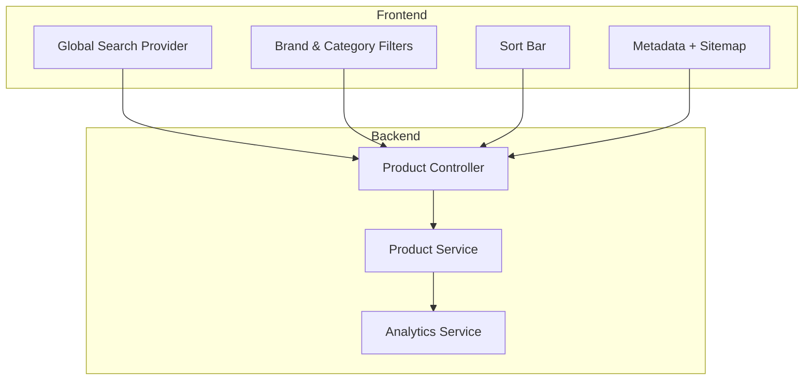

**Diagram sources**
- [product.controller.ts:87-250](file://apps/backend/src/product/product.controller.ts#L87-L250)
- [product.service.ts:175-353](file://apps/backend/src/product/product.service.ts#L175-L353)
- [search-provider.tsx:32-87](file://apps/frontend/providers/search-provider.tsx#L32-L87)
- [brand-filter.tsx:107-185](file://apps/frontend/components/products/filter/brand-filter.tsx#L107-L185)
- [sort-bar.tsx:17-25](file://apps/frontend/components/products/sort-bar.tsx#L17-L25)
- [layout.tsx:36-75](file://apps/frontend/app/layout.tsx#L36-L75)
- [sitemap.ts:49-73](file://apps/frontend/app/sitemap.ts#L49-L73)

**Section sources**
- [product.controller.ts:87-250](file://apps/backend/src/product/product.controller.ts#L87-L250)
- [product.service.ts:175-353](file://apps/backend/src/product/product.service.ts#L175-L353)
- [search-provider.tsx:32-87](file://apps/frontend/providers/search-provider.tsx#L32-L87)
- [brand-filter.tsx:107-185](file://apps/frontend/components/products/filter/brand-filter.tsx#L107-L185)
- [sort-bar.tsx:17-25](file://apps/frontend/components/products/sort-bar.tsx#L17-L25)
- [layout.tsx:36-75](file://apps/frontend/app/layout.tsx#L36-L75)
- [sitemap.ts:49-73](file://apps/frontend/app/sitemap.ts#L49-L73)

## Core Components
- Product listing API: supports pagination, filters, and sorting; returns total count and paginated results.
- Product detail API: retrieves product by slug with rich relations and enforces active-only storefront visibility.
- Best-sellers and similar products: rank by sold quantity and category proximity.
- Frontend search provider: debounced search with abortable requests and URL synchronization.
- Filter UI: manages category, brand, featured toggle, and price range via query parameters.
- Sort UI: updates sort parameter in the URL.
- Analytics: top product page views and device/browser breakdown.
- SEO: metadata templates, robots rules, and dynamic sitemap including products and categories.

**Section sources**
- [product.controller.ts:87-250](file://apps/backend/src/product/product.controller.ts#L87-L250)
- [product.service.ts:175-353](file://apps/backend/src/product/product.service.ts#L175-L353)
- [product.service.ts:938-1043](file://apps/backend/src/product/product.service.ts#L938-L1043)
- [product.service.ts:512-566](file://apps/backend/src/product/product.service.ts#L512-L566)
- [product.service.ts:1044-1146](file://apps/backend/src/product/product.service.ts#L1044-L1146)
- [search-provider.tsx:32-87](file://apps/frontend/providers/search-provider.tsx#L32-L87)
- [brand-filter.tsx:107-185](file://apps/frontend/components/products/filter/brand-filter.tsx#L107-L185)
- [sort-bar.tsx:17-25](file://apps/frontend/components/products/sort-bar.tsx#L17-L25)
- [analytics.service.ts:446-474](file://apps/backend/src/analytics/analytics.service.ts#L446-L474)
- [layout.tsx:36-75](file://apps/frontend/app/layout.tsx#L36-L75)
- [sitemap.ts:49-73](file://apps/frontend/app/sitemap.ts#L49-L73)

## Architecture Overview
The search flow integrates frontend interactions with backend queries and caching layers.

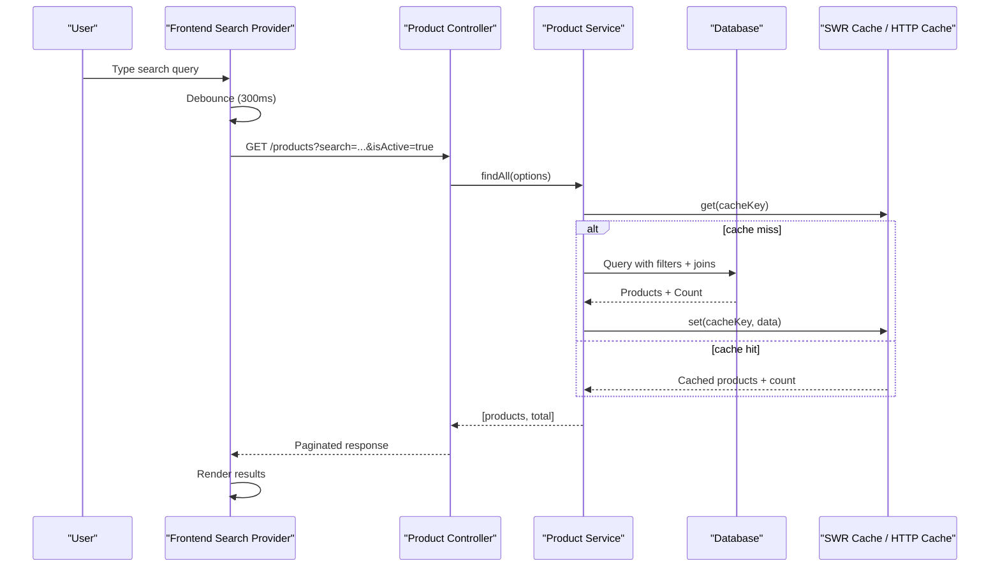

**Diagram sources**
- [search-provider.tsx:32-87](file://apps/frontend/providers/search-provider.tsx#L32-L87)
- [product.controller.ts:87-250](file://apps/backend/src/product/product.controller.ts#L87-L250)
- [product.service.ts:175-301](file://apps/backend/src/product/product.service.ts#L175-L301)

## Detailed Component Analysis

### Product Search and Filtering
- Full-text search matches product name and description using case-insensitive patterns.
- Filters include:
  - Category (including child categories).
  - Brand.
  - Supplier.
  - Featured flag.
  - Active/inactive status.
  - Discount presence.
  - Price range (min/max).
  - Tags array matching.
- Sorting options:
  - Price ascending/descending.
  - Name ascending/descending.
  - Default is name ascending when no sort is provided.

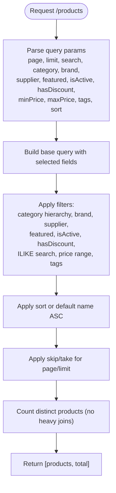

**Diagram sources**
- [product.service.ts:196-257](file://apps/backend/src/product/product.service.ts#L196-L257)
- [product.service.ts:306-353](file://apps/backend/src/product/product.service.ts#L306-L353)
- [product.service.ts:259-278](file://apps/backend/src/product/product.service.ts#L259-L278)

**Section sources**
- [product.service.ts:175-353](file://apps/backend/src/product/product.service.ts#L175-L353)
- [product.controller.ts:87-250](file://apps/backend/src/product/product.controller.ts#L87-L250)

### Sorting Options
- Supported values:
  - price_asc
  - price_desc
  - name_asc
  - name_desc
- The frontend sort bar updates the URL sort parameter; the backend applies the corresponding ORDER BY clause.

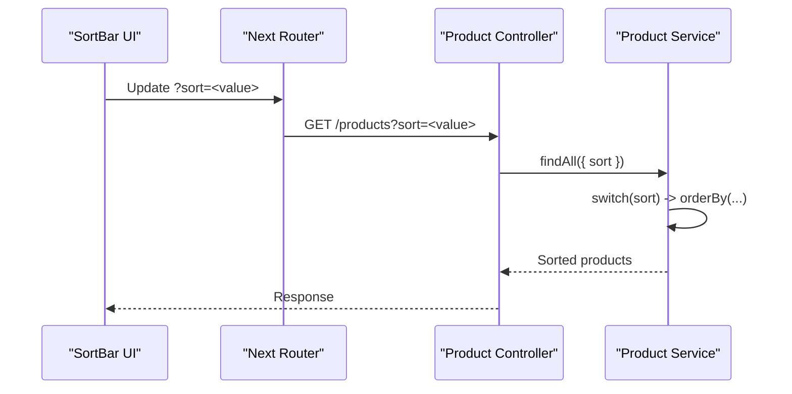

**Diagram sources**
- [sort-bar.tsx:17-25](file://apps/frontend/components/products/sort-bar.tsx#L17-L25)
- [product.controller.ts:149-155](file://apps/backend/src/product/product.controller.ts#L149-L155)
- [product.service.ts:259-278](file://apps/backend/src/product/product.service.ts#L259-L278)

**Section sources**
- [sort-bar.tsx:17-25](file://apps/frontend/components/products/sort-bar.tsx#L17-L25)
- [product.controller.ts:149-155](file://apps/backend/src/product/product.controller.ts#L149-L155)
- [product.service.ts:259-278](file://apps/backend/src/product/product.service.ts#L259-L278)

### Filtering System
- Category filter includes parent and child categories.
- Brand and supplier filters are single-value selectors.
- Featured toggle restricts to featured items.
- Active/inactive status filter controls storefront visibility.
- Discount presence filter selects products with any discount configured.
- Price range supports preset ranges and custom slider input; Infinity represents unbounded upper limit.
- Tags filter uses PostgreSQL array matching.

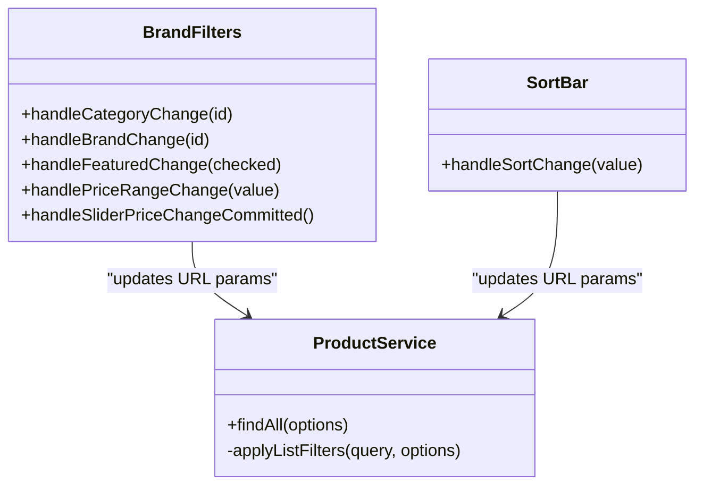

**Diagram sources**
- [brand-filter.tsx:107-185](file://apps/frontend/components/products/filter/brand-filter.tsx#L107-L185)
- [sort-bar.tsx:17-25](file://apps/frontend/components/products/sort-bar.tsx#L17-L25)
- [product.service.ts:306-353](file://apps/backend/src/product/product.service.ts#L306-L353)

**Section sources**
- [brand-filter.tsx:107-185](file://apps/frontend/components/products/filter/brand-filter.tsx#L107-L185)
- [product.service.ts:306-353](file://apps/backend/src/product/product.service.ts#L306-L353)

### Search Result Ranking
- Best-sellers ranking:
  - Aggregates sold quantities from delivered orders within a time window.
  - Orders products by sold quantity descending.
- Similar products ranking:
  - Finds products in the same category or its children.
  - Orders by saleCount descending and then by id ascending.

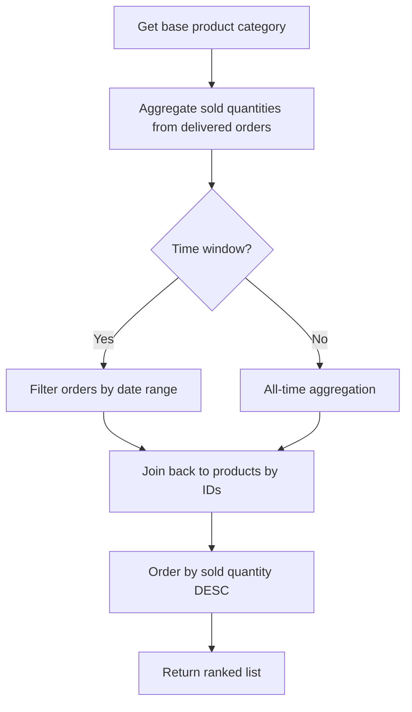

**Diagram sources**
- [product.service.ts:512-566](file://apps/backend/src/product/product.service.ts#L512-L566)
- [product.service.ts:1044-1146](file://apps/backend/src/product/product.service.ts#L1044-L1146)

**Section sources**
- [product.service.ts:512-566](file://apps/backend/src/product/product.service.ts#L512-L566)
- [product.service.ts:1044-1146](file://apps/backend/src/product/product.service.ts#L1044-L1146)

### Autocomplete Suggestions and Search History
- Global search provider:
  - Debounces user input by 300ms.
  - Aborts previous fetches to avoid race conditions.
  - Updates URL only on explicit actions (e.g., Enter key).
  - Clears state and cancels ongoing requests on clear.
- Search history:
  - No dedicated search history persistence is present in the referenced files.
  - Admin product activity history tracks product changes, not customer search queries.

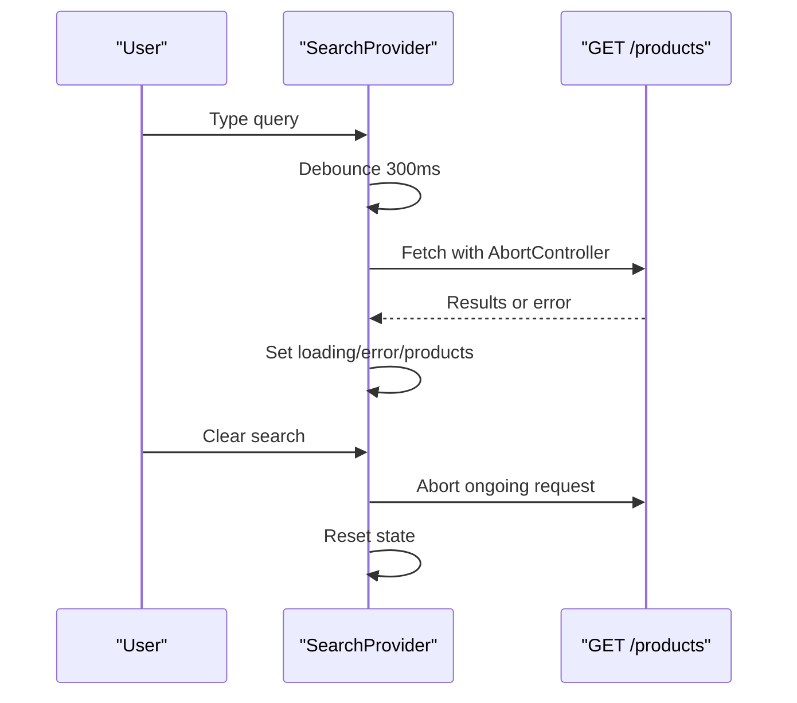

**Diagram sources**
- [search-provider.tsx:32-87](file://apps/frontend/providers/search-provider.tsx#L32-L87)
- [search-provider.tsx:89-114](file://apps/frontend/providers/search-provider.tsx#L89-L114)

**Section sources**
- [search-provider.tsx:32-87](file://apps/frontend/providers/search-provider.tsx#L32-L87)
- [search-provider.tsx:89-114](file://apps/frontend/providers/search-provider.tsx#L89-L114)
- [use-global-search.tsx:6-12](file://apps/frontend/hooks/use-global-search.tsx#L6-L12)

### Search Analytics and Performance Monitoring
- Top product pages:
  - Aggregates GET requests matching product detail paths.
  - Resolves product names from numeric IDs or slugs.
- Device/browser breakdown:
  - Classifies devices and browsers from stored user-agent strings.
- Request metrics:
  - Overview, peak traffic, visitors, top endpoints, response times, conversion.

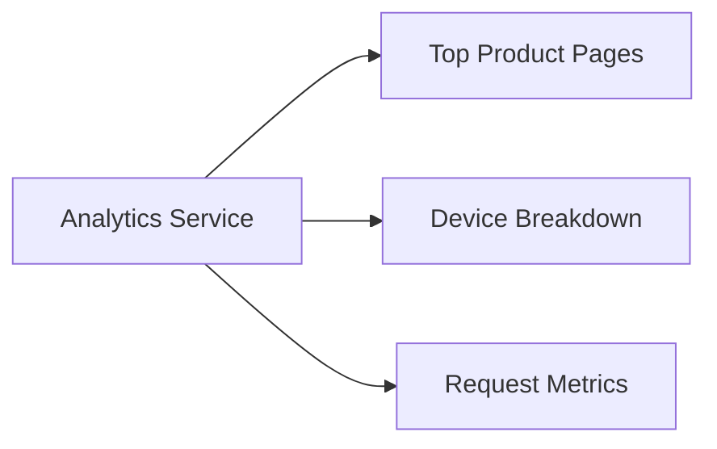

**Diagram sources**
- [analytics.service.ts:446-474](file://apps/backend/src/analytics/analytics.service.ts#L446-L474)
- [analytics.service.ts:382-440](file://apps/backend/src/analytics/analytics.service.ts#L382-L440)
- [analytics-utils.ts:108-161](file://apps/frontend/utils/analytics-utils.ts#L108-L161)

**Section sources**
- [analytics.service.ts:446-474](file://apps/backend/src/analytics/analytics.service.ts#L446-L474)
- [analytics.service.ts:382-440](file://apps/backend/src/analytics/analytics.service.ts#L382-L440)
- [analytics-utils.ts:108-161](file://apps/frontend/utils/analytics-utils.ts#L108-L161)

### Product Recommendation Engine
- Similar products recommendation:
  - Uses category proximity (same category or children) and optional inclusion of parent category.
  - Ranks by saleCount descending and id ascending.
- Best-sellers recommendation:
  - Based on delivered order quantities within configurable time windows.

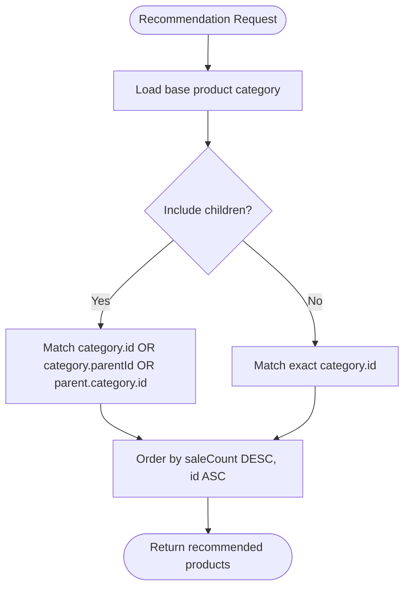

**Diagram sources**
- [product.service.ts:1044-1146](file://apps/backend/src/product/product.service.ts#L1044-L1146)

**Section sources**
- [product.service.ts:1044-1146](file://apps/backend/src/product/product.service.ts#L1044-L1146)

### Implementation Examples
- Search query example:
  - GET /products?search=sausage&isActive=true&page=1&limit=10
- Filter application example:
  - GET /products?category=12&brand=5&minPrice=5000&maxPrice=10000&featured=true&hasDiscount=true&tags=halal,fresh
- Sorting example:
  - GET /products?sort=price_asc
- Pagination example:
  - GET /products?page=2&limit=20

These examples map directly to the controller’s documented query parameters and service-side filter application.

**Section sources**
- [product.controller.ts:94-221](file://apps/backend/src/product/product.controller.ts#L94-L221)
- [product.service.ts:306-353](file://apps/backend/src/product/product.service.ts#L306-L353)

### SEO-Friendly URL Generation and Meta Tag Management
- Metadata:
  - Global layout sets title template, description, keywords, and Open Graph/Twitter assets.
  - Product detail page generates structured data (schema.org), robots directives, canonical URL, and aggregate rating when available.
- Robots:
  - Allows public routes like /products and /categories; disallows admin, api, private, checkout, cart, account, and internal Next.js paths.
- Sitemap:
  - Includes static pages, product pages (by slug or id), and category pages with lastModified timestamps and priorities.

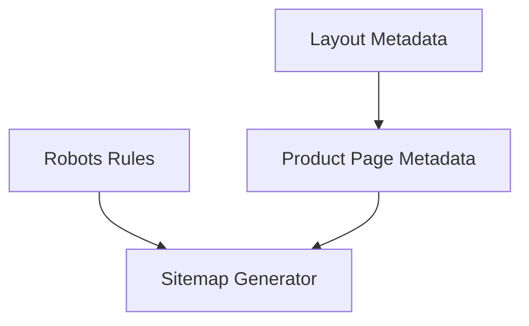

**Diagram sources**
- [layout.tsx:36-75](file://apps/frontend/app/layout.tsx#L36-L75)
- [page.tsx:172-213](file://apps/frontend/app/(main)/product/[slug]/page.tsx#L172-L213)
- [robots.ts:3-32](file://apps/frontend/app/robots.ts#L3-L32)
- [sitemap.ts:49-73](file://apps/frontend/app/sitemap.ts#L49-L73)

**Section sources**
- [layout.tsx:36-75](file://apps/frontend/app/layout.tsx#L36-L75)
- [page.tsx:172-213](file://apps/frontend/app/(main)/product/[slug]/page.tsx#L172-L213)
- [robots.ts:3-32](file://apps/frontend/app/robots.ts#L3-L32)
- [sitemap.ts:49-73](file://apps/frontend/app/sitemap.ts#L49-L73)

## Dependency Analysis
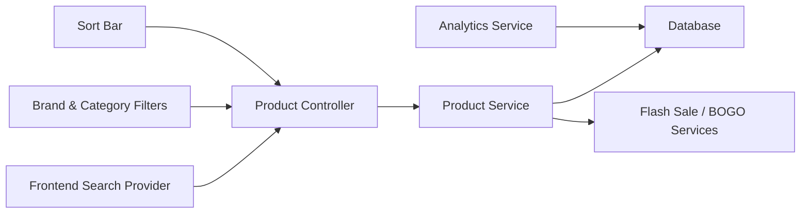

**Diagram sources**
- [search-provider.tsx:32-87](file://apps/frontend/providers/search-provider.tsx#L32-L87)
- [brand-filter.tsx:107-185](file://apps/frontend/components/products/filter/brand-filter.tsx#L107-L185)
- [sort-bar.tsx:17-25](file://apps/frontend/components/products/sort-bar.tsx#L17-L25)
- [product.controller.ts:87-250](file://apps/backend/src/product/product.controller.ts#L87-L250)
- [product.service.ts:175-353](file://apps/backend/src/product/product.service.ts#L175-L353)
- [analytics.service.ts:446-474](file://apps/backend/src/analytics/analytics.service.ts#L446-L474)

**Section sources**
- [product.controller.ts:87-250](file://apps/backend/src/product/product.controller.ts#L87-L250)
- [product.service.ts:175-353](file://apps/backend/src/product/product.service.ts#L175-L353)
- [analytics.service.ts:446-474](file://apps/backend/src/analytics/analytics.service.ts#L446-L474)

## Performance Considerations
- List caching:
  - SWR-style cache with fresh TTL and stale-while-revalidate prevents database thundering herds under load.
  - Cache keys incorporate all filter dimensions to ensure correctness.
- Minimal payload selection:
  - List queries select only necessary fields to reduce memory and network overhead.
- Efficient counting:
  - Separate count query without heavy joins improves performance.
- Relation joins:
  - Joins added conditionally only when filters require them.
- Campaign enrichment:
  - Flash sale and BOGO info attached post-cache to keep cached lists stable while campaigns refresh independently.
- Debounced frontend requests:
  - 300ms debounce reduces unnecessary network calls during typing.
- AbortController usage:
  - Cancels outdated requests to prevent race conditions.
- HTTP caching:
  - Controller-level HTTP cache decorators enable CDN/browser caching for repeated reads.

[No sources needed since this section provides general guidance]

## Troubleshooting Guide
- Zero-result searches:
  - Verify search term spelling and whether the product is active.
  - Check if filters (category, brand, price range) are too restrictive.
- Slow product listings:
  - Inspect cache hit ratio and cache key composition.
  - Ensure minimal field selection and conditional joins are applied.
- Incorrect sorting:
  - Confirm sort parameter values match supported enum values.
- SEO issues:
  - Validate robots rules allow intended crawlers.
  - Confirm sitemap includes updated product/category entries.
  - Check product metadata and schema.org markup.

**Section sources**
- [product.service.ts:175-353](file://apps/backend/src/product/product.service.ts#L175-L353)
- [product.controller.ts:87-250](file://apps/backend/src/product/product.controller.ts#L87-L250)
- [robots.ts:3-32](file://apps/frontend/app/robots.ts#L3-L32)
- [sitemap.ts:49-73](file://apps/frontend/app/sitemap.ts#L49-L73)
- [page.tsx:172-213](file://apps/frontend/app/(main)/product/[slug]/page.tsx#L172-L213)

## Conclusion
The search and discovery system combines robust backend filtering and ranking with a responsive frontend experience. It leverages efficient database queries, selective joins, and layered caching to handle large catalogs. Analytics provide visibility into product popularity and traffic patterns, while SEO tools ensure strong discoverability. Future enhancements could include advanced fuzzy matching, personalized recommendations, and explicit search history tracking.