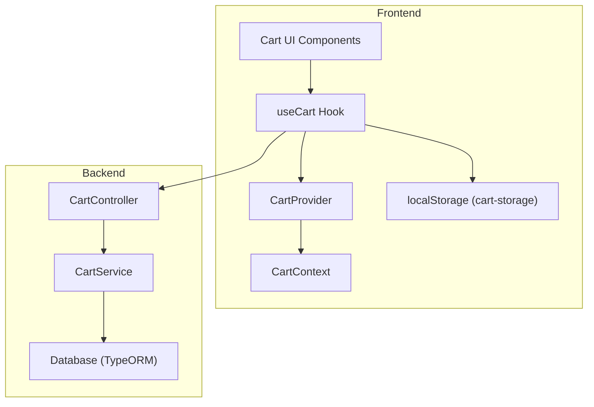
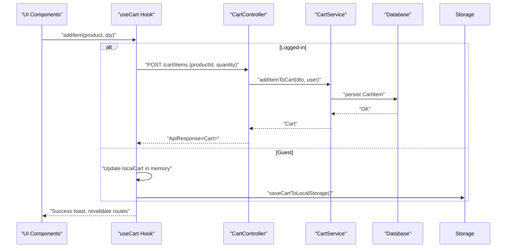
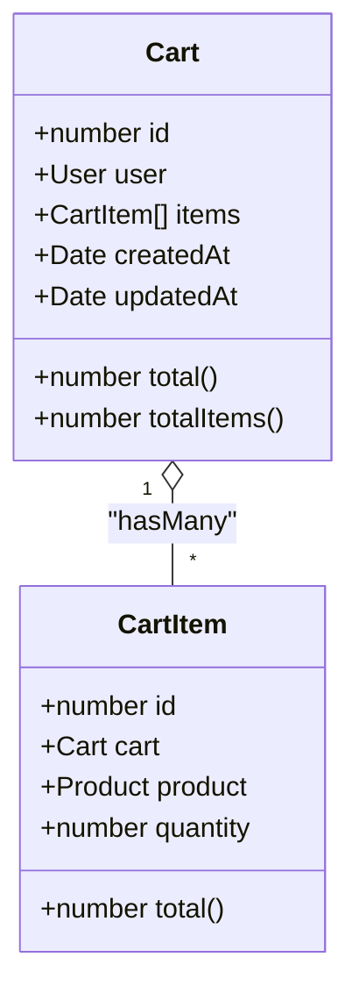
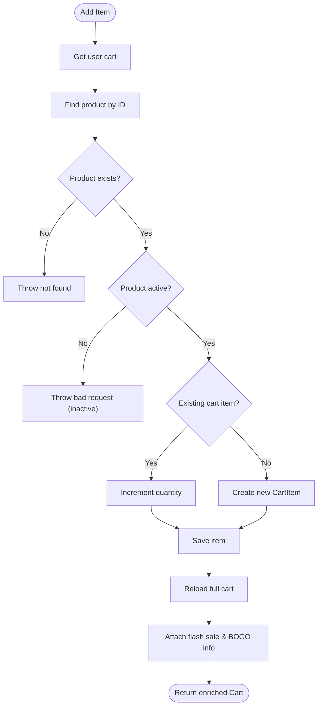
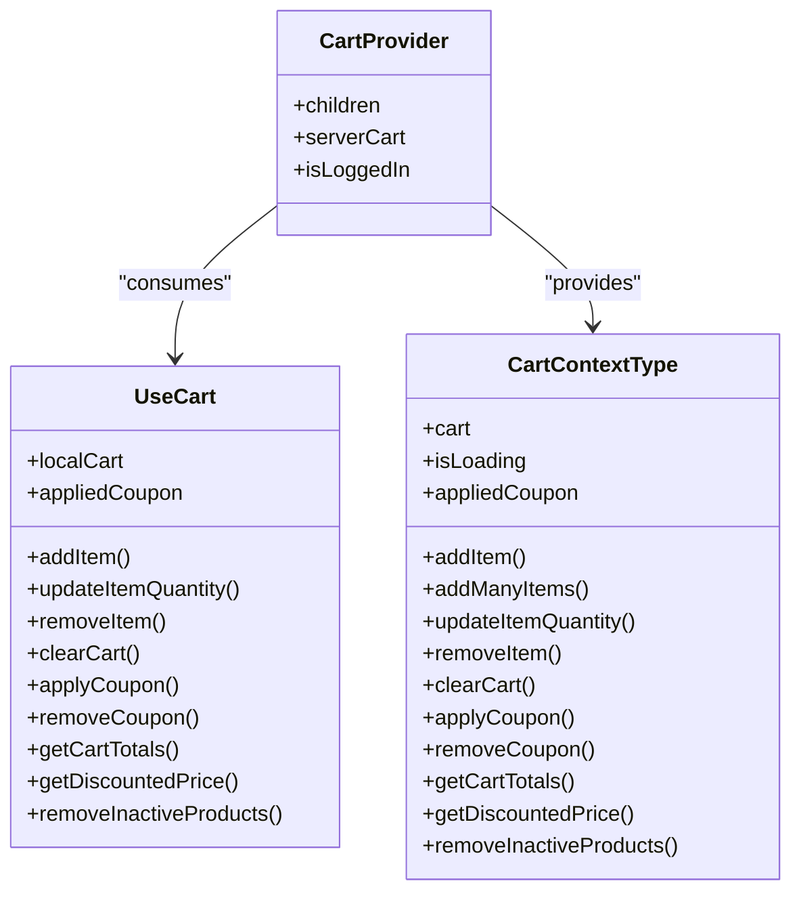
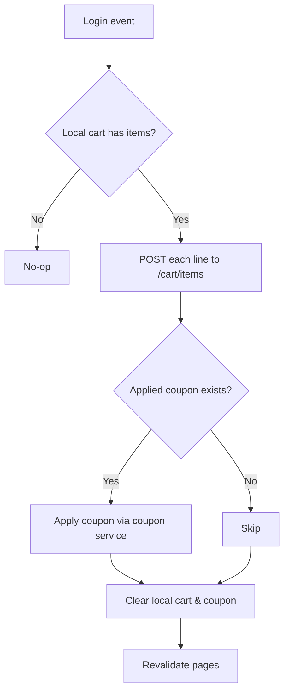
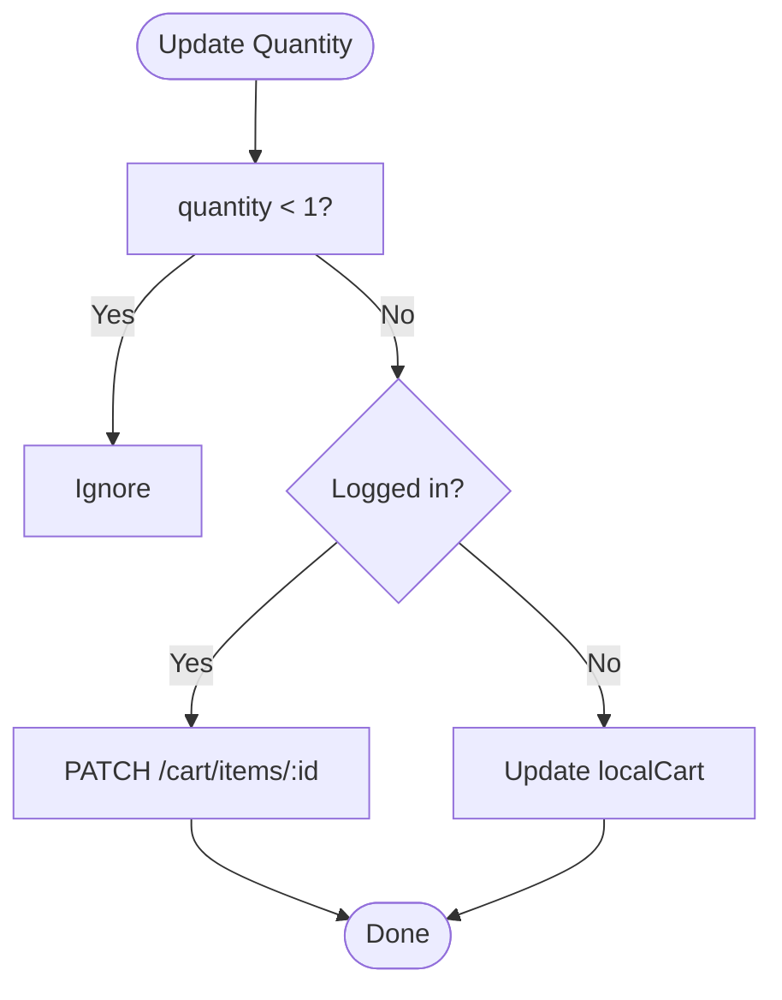
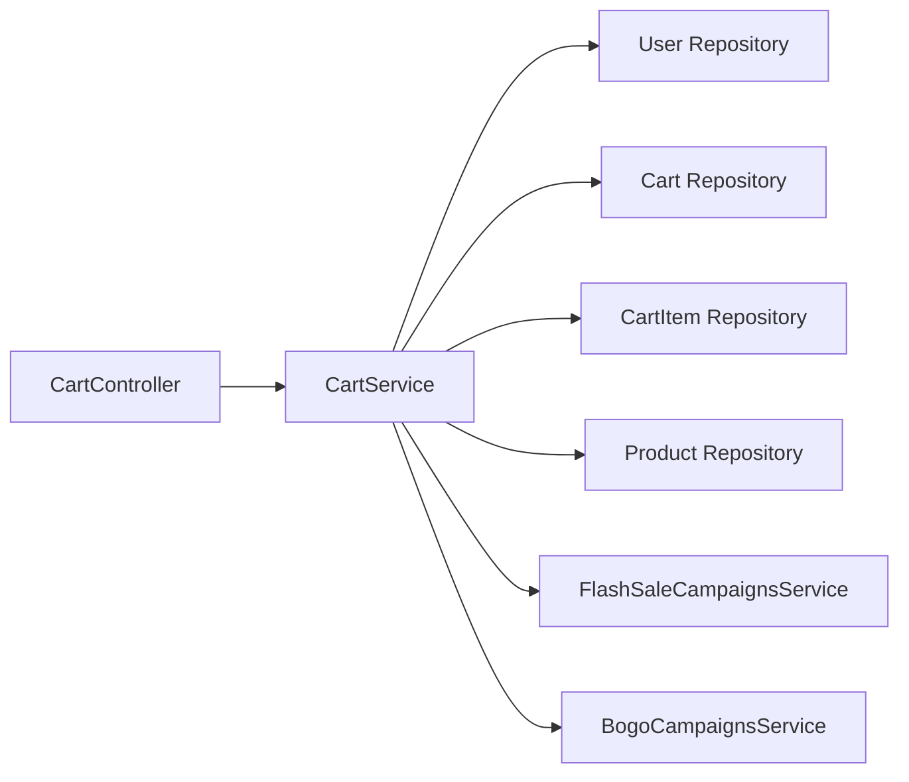

# Cart Management

<cite>
**Referenced Files in This Document**
- [cart.controller.ts](file://apps/backend/src/cart/cart.controller.ts)
- [cart.service.ts](file://apps/backend/src/cart/cart.service.ts)
- [cart.entity.ts](file://apps/backend/src/cart/entities/cart.entity.ts)
- [cart-item.entity.ts](file://apps/backend/src/cart/entities/cart-item.entity.ts)
- [cart-item.dto.ts](file://apps/backend/src/cart/dto/cart-item.dto.ts)
- [update-cart.dto.ts](file://apps/backend/src/cart/dto/update-cart.dto.ts)
- [use-cart.ts](file://apps/frontend/hooks/use-cart.ts)
- [cart-context.tsx](file://apps/frontend/contexts/cart-context.tsx)
- [cart-provider.tsx](file://apps/frontend/providers/cart-provider.tsx)
- [cart-storage.ts](file://apps/frontend/utils/cart-storage.ts)
- [types.ts](file://apps/frontend/utils/types.ts)
- [add-to-cart-button.tsx](file://apps/frontend/components/cart/add-to-cart-button.tsx)
- [cart-item-product-page.tsx](file://apps/frontend/components/cart/cart-item-product-page.tsx)
</cite>

## Table of Contents
1. [Introduction](#introduction)
2. [Project Structure](#project-structure)
3. [Core Components](#core-components)
4. [Architecture Overview](#architecture-overview)
5. [Detailed Component Analysis](#detailed-component-analysis)
6. [Dependency Analysis](#dependency-analysis)
7. [Performance Considerations](#performance-considerations)
8. [Troubleshooting Guide](#troubleshooting-guide)
9. [Conclusion](#conclusion)

## Introduction
This document explains the shopping cart management system for the German Butcher e-commerce platform. It covers the backend cart entity model, service operations, and API endpoints; and the frontend React Context-based state, local persistence with localStorage, server synchronization, validation, stock checks, and promotional pricing. It also includes diagrams, API schemas, error handling patterns, and performance guidance for large carts and concurrent modifications.

## Project Structure
The cart feature is implemented across both backend and frontend:

- Backend (NestJS):
  - Controller exposes REST endpoints for cart CRUD and admin reports.
  - Service implements business logic, including flash sale and BOGO enrichment.
  - Entities define persistent models for Cart and CartItem.
  - DTOs validate add/update payloads.

- Frontend (Next.js + React):
  - useCart hook orchestrates server calls, local state, and localStorage persistence.
  - CartProvider wraps the app to expose cart context.
  - CartContext defines the public API surface for components.
  - cart-storage utilities handle localStorage serialization and conversion helpers.
  - UI components enforce stock limits and provide user feedback.

**Diagram sources**
- [cart.controller.ts:35-214](file://apps/backend/src/cart/cart.controller.ts#L35-L214)
- [cart.service.ts:15-201](file://apps/backend/src/cart/cart.service.ts#L15-L201)
- [use-cart.ts:29-647](file://apps/frontend/hooks/use-cart.ts#L29-L647)
- [cart-context.tsx:7-48](file://apps/frontend/contexts/cart-context.tsx#L7-L48)
- [cart-provider.tsx:14-31](file://apps/frontend/providers/cart-provider.tsx#L14-L31)
- [cart-storage.ts:23-66](file://apps/frontend/utils/cart-storage.ts#L23-L66)

**Section sources**
- [cart.controller.ts:35-214](file://apps/backend/src/cart/cart.controller.ts#L35-L214)
- [cart.service.ts:15-201](file://apps/backend/src/cart/cart.service.ts#L15-L201)
- [use-cart.ts:29-647](file://apps/frontend/hooks/use-cart.ts#L29-L647)
- [cart-context.tsx:7-48](file://apps/frontend/contexts/cart-context.tsx#L7-L48)
- [cart-provider.tsx:14-31](file://apps/frontend/providers/cart-provider.tsx#L14-L31)
- [cart-storage.ts:23-66](file://apps/frontend/utils/cart-storage.ts#L23-L66)

## Core Components
- Backend entities:
  - Cart: one-to-one with User, one-to-many with CartItem, computed total and totalItems.
  - CartItem: many-to-one with Cart and Product, quantity, computed line total.

- Backend DTOs:
  - AddCartItemDto: productId (required), quantity (default 1, minimum 1).
  - UpdateCartItemDto: quantity (required, minimum 1).

- Backend controller endpoints:
  - GET /cart — retrieve authenticated user’s cart.
  - POST /cart/items — add item to cart.
  - PATCH /cart/items/:id — update item quantity.
  - DELETE /cart/items/:id — remove item from cart.
  - DELETE /cart — clear cart.
  - Admin-only: GET /cart/reports/abandoned-summary and /cart/reports/abandoned.

- Frontend state:
  - useCart hook provides addItem, addManyItems, updateItemQuantity, removeItem, clearCart, applyCoupon, removeCoupon, getCartTotals, getDiscountedPrice, removeInactiveProducts.
  - CartProvider injects server cart and login state into CartContext.
  - CartContext exposes typed methods and current cart data.
  - Local storage persists guest carts and applied coupons.

**Section sources**
- [cart.entity.ts:16-78](file://apps/backend/src/cart/entities/cart.entity.ts#L16-L78)
- [cart-item.entity.ts:7-50](file://apps/backend/src/cart/entities/cart-item.entity.ts#L7-L50)
- [cart-item.dto.ts:5-28](file://apps/backend/src/cart/dto/cart-item.dto.ts#L5-L28)
- [update-cart.dto.ts:4-17](file://apps/backend/src/cart/dto/update-cart.dto.ts#L4-L17)
- [cart.controller.ts:40-167](file://apps/backend/src/cart/cart.controller.ts#L40-L167)
- [use-cart.ts:29-647](file://apps/frontend/hooks/use-cart.ts#L29-L647)
- [cart-context.tsx:7-48](file://apps/frontend/contexts/cart-context.tsx#L7-L48)
- [cart-provider.tsx:14-31](file://apps/frontend/providers/cart-provider.tsx#L14-L31)
- [cart-storage.ts:23-109](file://apps/frontend/utils/cart-storage.ts#L23-L109)

## Architecture Overview
The cart system follows a layered architecture on the backend and a provider/context pattern on the frontend.

**Diagram sources**
- [use-cart.ts:157-224](file://apps/frontend/hooks/use-cart.ts#L157-L224)
- [cart.controller.ts:67-84](file://apps/backend/src/cart/cart.controller.ts#L67-L84)
- [cart.service.ts:121-158](file://apps/backend/src/cart/cart.service.ts#L121-L158)

## Detailed Component Analysis

### Backend Entity Model
The cart model consists of Cart and CartItem with relationships to User and Product.

**Diagram sources**
- [cart.entity.ts:16-78](file://apps/backend/src/cart/entities/cart.entity.ts#L16-L78)
- [cart-item.entity.ts:7-50](file://apps/backend/src/cart/entities/cart-item.entity.ts#L7-L50)

**Section sources**
- [cart.entity.ts:16-78](file://apps/backend/src/cart/entities/cart.entity.ts#L16-L78)
- [cart-item.entity.ts:7-50](file://apps/backend/src/cart/entities/cart-item.entity.ts#L7-L50)

### Backend Service Logic
Key responsibilities:
- Retrieve or lazily create a cart per user.
- Add items, merging quantities if already present.
- Update/remove items and clear the cart.
- Enrich cart responses with flash sale and BOGO display info without persisting those fields.
- Provide abandoned cart analytics.

Concurrency handling:
- Handles duplicate key race conditions when creating a new cart by catching database errors and refetching the existing cart.

Promotional pricing:
- Attaches flash sale and BOGO campaign information to products in the cart response for display purposes only.

**Diagram sources**
- [cart.service.ts:121-158](file://apps/backend/src/cart/cart.service.ts#L121-L158)
- [cart.service.ts:27-48](file://apps/backend/src/cart/cart.service.ts#L27-L48)

**Section sources**
- [cart.service.ts:50-119](file://apps/backend/src/cart/cart.service.ts#L50-L119)
- [cart.service.ts:121-201](file://apps/backend/src/cart/cart.service.ts#L121-L201)
- [cart.service.ts:27-48](file://apps/backend/src/cart/cart.service.ts#L27-L48)

### Backend API Endpoints
- GET /cart
  - Auth: JWT required.
  - Response: ApiResponse<Cart>.
- POST /cart/items
  - Body: AddCartItemDto.
  - Response: ApiResponse<Cart>.
- PATCH /cart/items/:id
  - Body: UpdateCartItemDto.
  - Response: ApiResponse<Cart>.
- DELETE /cart/items/:id
  - Response: ApiResponse<Cart>.
- DELETE /cart
  - Response: ApiResponse<Cart>.
- GET /cart/reports/abandoned-summary
  - Auth: JWT + PermissionGuard.
  - Response: ApiResponse<{ abandonedCarts, abandonedValue }>.
- GET /cart/reports/abandoned?page&limit
  - Auth: JWT + PermissionGuard.
  - Response: ApiResponse<{ summary, items, total }>.

Error handling patterns:
- Not found: thrown when product or cart item does not exist.
- Bad request: thrown when adding inactive products.
- All successful responses are wrapped in a standard envelope with message and statusCode.

**Section sources**
- [cart.controller.ts:40-167](file://apps/backend/src/cart/cart.controller.ts#L40-L167)
- [cart.controller.ts:169-212](file://apps/backend/src/cart/cart.controller.ts#L169-L212)
- [cart.service.ts:121-201](file://apps/backend/src/cart/cart.service.ts#L121-L201)

### Frontend Cart State and Context
- CartContext defines the contract:
  - cart: either server Cart or local items array.
  - isLoading: loading indicator.
  - appliedCoupon: locally persisted coupon snapshot.
  - Methods: addItem, addManyItems, updateItemQuantity, removeItem, clearCart, applyCoupon, removeCoupon, getCartTotals, getDiscountedPrice, removeInactiveProducts.

- CartProvider:
  - Wraps children with CartContext.Provider.
  - Supplies serverCart and isLoggedIn to useCart.
  - Ensures cart is never undefined by defaulting to empty items.

- useCart hook:
  - Manages local vs server cart based on authentication.
  - Persists guest carts and coupons to localStorage.
  - Syncs guest cart to server upon login.
  - Revalidates Next.js routes after mutations.
  - Computes totals and discounted prices using effective price resolution.

**Diagram sources**
- [cart-context.tsx:7-48](file://apps/frontend/contexts/cart-context.tsx#L7-L48)
- [cart-provider.tsx:14-31](file://apps/frontend/providers/cart-provider.tsx#L14-L31)
- [use-cart.ts:29-647](file://apps/frontend/hooks/use-cart.ts#L29-L647)

**Section sources**
- [cart-context.tsx:7-48](file://apps/frontend/contexts/cart-context.tsx#L7-L48)
- [cart-provider.tsx:14-31](file://apps/frontend/providers/cart-provider.tsx#L14-L31)
- [use-cart.ts:29-647](file://apps/frontend/hooks/use-cart.ts#L29-L647)

### Persistence Strategy
- Guest users:
  - Cart stored in localStorage under a dedicated key.
  - Coupon stored separately under its own key.
  - Conversion helpers map between backend Cart and local format.

- Logged-in users:
  - Server cart is authoritative.
  - On login, any pending local cart is replayed via POST /cart/items for each line.
  - Applied coupon is reapplied against the server cart.
  - After sync, local cart and coupon are cleared.

- Data refresh:
  - For guest carts, product data is refreshed in background to reflect price/stock changes.
  - Inactive products are removed automatically with user notification.

**Diagram sources**
- [use-cart.ts:107-155](file://apps/frontend/hooks/use-cart.ts#L107-L155)
- [cart-storage.ts:50-66](file://apps/frontend/utils/cart-storage.ts#L50-L66)

**Section sources**
- [cart-storage.ts:23-109](file://apps/frontend/utils/cart-storage.ts#L23-L109)
- [use-cart.ts:107-155](file://apps/frontend/hooks/use-cart.ts#L107-L155)

### Validation, Stock Checks, and Promotions
- Backend validation:
  - AddCartItemDto enforces positive integer productId and quantity >= 1.
  - UpdateCartItemDto enforces positive integer quantity.
  - Adding inactive products throws a bad request.
  - Cart item existence checked before update/remove.

- Frontend validation:
  - UI components prevent exceeding available stock and show descriptive toasts.
  - Bulk add skips unavailable products and summarizes results.
  - Price authority prefers backend-computed effective price when present; otherwise falls back to selling price.

- Promotions:
  - Backend attaches flash sale and BOGO campaign metadata to cart responses for display.
  - Frontend uses getEffectivePrice to compute discounted price consistently.

**Diagram sources**
- [use-cart.ts:283-321](file://apps/frontend/hooks/use-cart.ts#L283-L321)
- [cart-item.dto.ts:5-28](file://apps/backend/src/cart/dto/cart-item.dto.ts#L5-L28)
- [update-cart.dto.ts:4-17](file://apps/backend/src/cart/dto/update-cart.dto.ts#L4-L17)

**Section sources**
- [cart-item.dto.ts:5-28](file://apps/backend/src/cart/dto/cart-item.dto.ts#L5-L28)
- [update-cart.dto.ts:4-17](file://apps/backend/src/cart/dto/update-cart.dto.ts#L4-L17)
- [cart.service.ts:121-178](file://apps/backend/src/cart/cart.service.ts#L121-L178)
- [add-to-cart-button.tsx:44-92](file://apps/frontend/components/cart/add-to-cart-button.tsx#L44-L92)
- [cart-item-product-page.tsx:107-155](file://apps/frontend/components/cart/cart-item-product-page.tsx#L107-L155)
- [use-cart.ts:496-500](file://apps/frontend/hooks/use-cart.ts#L496-L500)

### Examples: API Endpoints and Schemas
- GET /cart
  - Request headers: Authorization: Bearer token.
  - Response: { message, statusCode, data: Cart }.

- POST /cart/items
  - Request body: { productId: number, quantity?: number }.
  - Response: { message, statusCode, data: Cart }.

- PATCH /cart/items/:id
  - Request body: { quantity: number }.
  - Response: { message, statusCode, data: Cart }.

- DELETE /cart/items/:id
  - Response: { message, statusCode, data: Cart }.

- DELETE /cart
  - Response: { message, statusCode, data: Cart }.

- GET /cart/reports/abandoned-summary
  - Auth: JWT + permission guard.
  - Response: { message, statusCode, data: { abandonedCarts, abandonedValue } }.

- GET /cart/reports/abandoned?page=1&limit=10
  - Auth: JWT + permission guard.
  - Response: { message, statusCode, data: { summary, items, total } }.

**Section sources**
- [cart.controller.ts:40-167](file://apps/backend/src/cart/cart.controller.ts#L40-L167)
- [cart.controller.ts:169-212](file://apps/backend/src/cart/cart.controller.ts#L169-L212)

### Examples: Implementation Patterns

- Backend add-to-cart flow:
  - Controller validates JWT and maps request to DTO.
  - Service fetches or creates cart, finds product, ensures product is active, merges or creates CartItem, saves, reloads cart, enriches promotions, returns enriched Cart.

- Frontend add-to-cart flow:
  - If logged in: POST to server, then revalidate routes.
  - If guest: update localCart, save to localStorage, show success toast.

- Frontend quantity update:
  - If logged in: PATCH server endpoint, then revalidate routes.
  - If guest: update localCart and persist.

- Frontend remove/clear:
  - If logged in: call server delete endpoints, then revalidate routes.
  - If guest: filter out item(s) or reset localCart and clear coupon.

**Section sources**
- [cart.controller.ts:67-167](file://apps/backend/src/cart/cart.controller.ts#L67-L167)
- [cart.service.ts:121-201](file://apps/backend/src/cart/cart.service.ts#L121-L201)
- [use-cart.ts:157-224](file://apps/frontend/hooks/use-cart.ts#L157-L224)
- [use-cart.ts:283-384](file://apps/frontend/hooks/use-cart.ts#L283-L384)

## Dependency Analysis
The cart module depends on several other modules and services:

**Diagram sources**
- [cart.controller.ts:35-39](file://apps/backend/src/cart/cart.controller.ts#L35-L39)
- [cart.service.ts:15-25](file://apps/backend/src/cart/cart.service.ts#L15-L25)

**Section sources**
- [cart.controller.ts:35-39](file://apps/backend/src/cart/cart.controller.ts#L35-L39)
- [cart.service.ts:15-25](file://apps/backend/src/cart/cart.service.ts#L15-L25)

## Performance Considerations
- Large carts:
  - Avoid N+1 queries by fetching related product data efficiently; the service already loads necessary relations for cart retrieval.
  - Batch operations where possible; the frontend replays lines sequentially on login but could be optimized with batch endpoints if needed.

- Concurrent modifications:
  - Backend handles race conditions during cart creation by catching duplicate key errors and refetching the existing cart.
  - Frontend uses optimistic updates for guest carts and revalidates routes to ensure consistency.

- Promotional enrichment:
  - Flash sale and BOGO info is attached only for display and not persisted, minimizing write overhead.

- Client-side caching:
  - Guest carts are persisted to localStorage to avoid repeated network requests.
  - Background refresh of product data keeps prices and stock up to date without blocking UI.

[No sources needed since this section provides general guidance]

## Troubleshooting Guide
Common issues and resolutions:
- Adding inactive products:
  - Backend throws a bad request; ensure product.isActive is true before adding.

- Updating/removing non-existent items:
  - Backend throws not found; verify itemId belongs to the authenticated user’s cart.

- Stock exceeded on frontend:
  - UI prevents increments beyond available stock and shows toasts; check product.stock and handle gracefully.

- Coupon application failures:
  - Frontend clears applied coupon and shows error messages; verify coupon eligibility and cart contents.

- Sync failures on login:
  - Frontend catches errors, shows toasts, and retains local cart for retry; ensure API availability and correct tokens.

**Section sources**
- [cart.service.ts:121-178](file://apps/backend/src/cart/cart.service.ts#L121-L178)
- [add-to-cart-button.tsx:44-92](file://apps/frontend/components/cart/add-to-cart-button.tsx#L44-L92)
- [cart-item-product-page.tsx:107-155](file://apps/frontend/components/cart/cart-item-product-page.tsx#L107-L155)
- [use-cart.ts:386-445](file://apps/frontend/hooks/use-cart.ts#L386-L445)
- [use-cart.ts:107-155](file://apps/frontend/hooks/use-cart.ts#L107-L155)

## Conclusion
The cart management system combines a robust backend with a responsive frontend. The backend enforces data integrity, handles concurrency, and enriches cart responses with promotional metadata. The frontend manages local and server state seamlessly, persists guest carts, synchronizes on login, and provides clear user feedback for validation and stock constraints. Together, these layers deliver a reliable, scalable shopping cart experience suitable for high-volume e-commerce workloads.