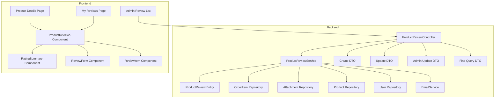
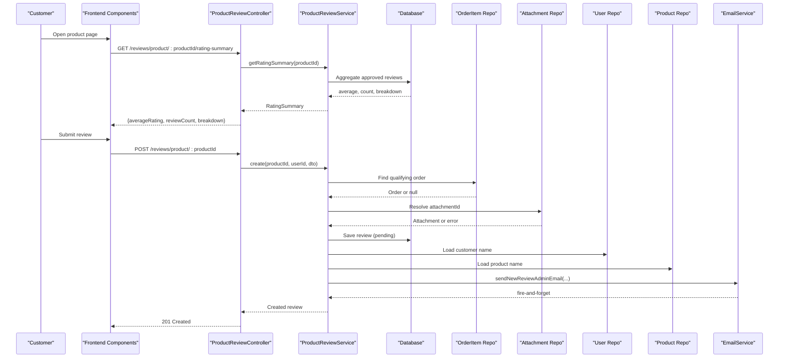
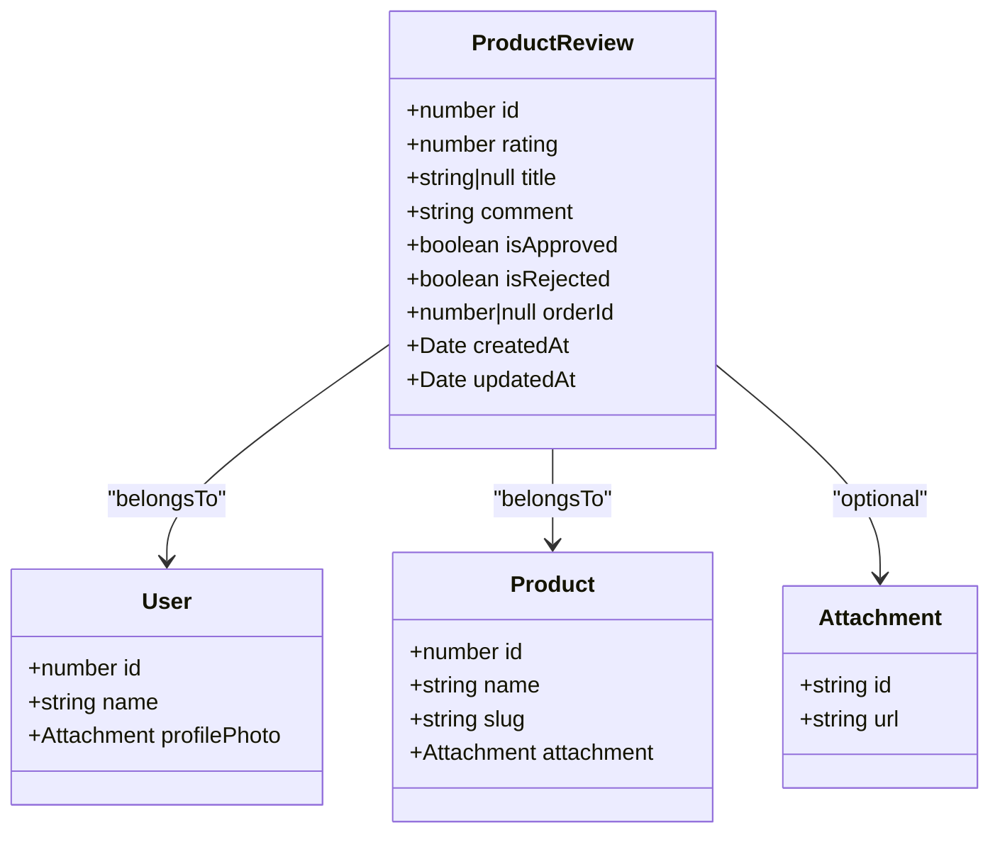
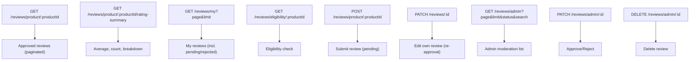
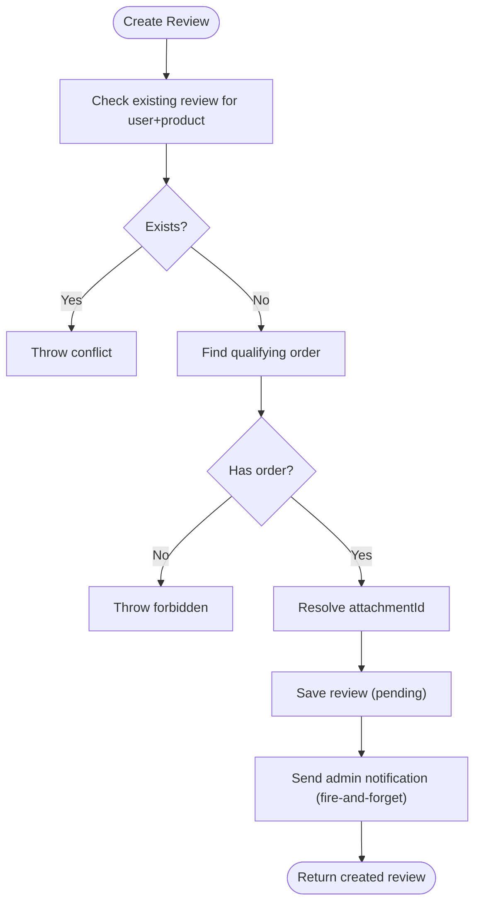
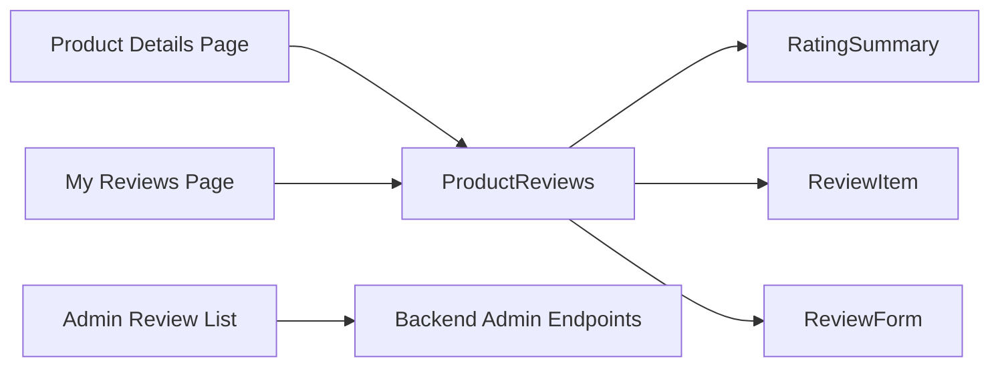
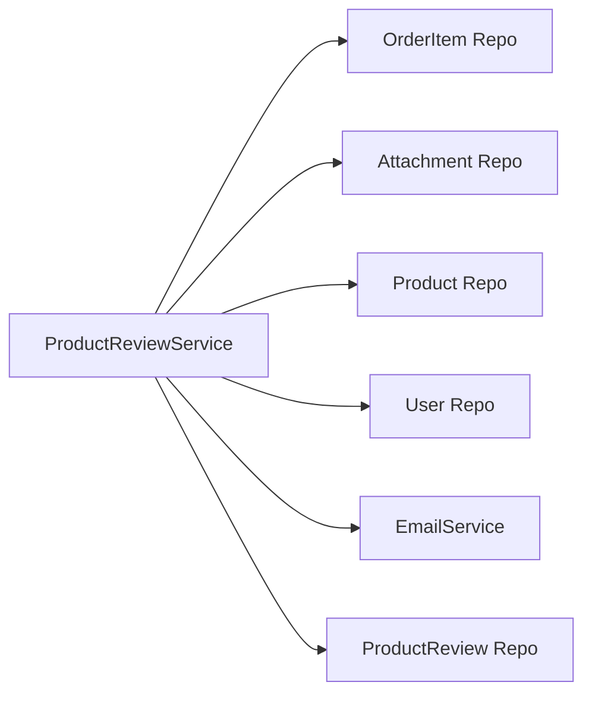

# Product Reviews & Ratings

<cite>
**Referenced Files in This Document**
- [product-review.entity.ts](file://apps/backend/src/product-review/entities/product-review.entity.ts)
- [create-product-review.dto.ts](file://apps/backend/src/product-review/dto/create-product-review.dto.ts)
- [update-product-review.dto.ts](file://apps/backend/src/product-review/dto/update-product-review.dto.ts)
- [admin-update-review.dto.ts](file://apps/backend/src/product-review/dto/admin-update-review.dto.ts)
- [find-reviews-query.dto.ts](file://apps/backend/src/product-review/dto/find-reviews-query.dto.ts)
- [product-review.controller.ts](file://apps/backend/src/product-review/product-review.controller.ts)
- [product-review.service.ts](file://apps/backend/src/product-review/product-review.service.ts)
- [types.ts](file://apps/frontend/utils/types.ts)
- [product-reviews.tsx](file://apps/frontend/components/products/product-details/product-reviews/product-reviews.tsx)
- [rating-summary.tsx](file://apps/frontend/components/products/product-details/product-reviews/rating-summary.tsx)
- [review-form.tsx](file://apps/frontend/components/products/product-details/product-reviews/review-form.tsx)
- [review-item.tsx](file://apps/frontend/components/products/product-details/product-reviews/review-item.tsx)
- [reviews page](file://apps/frontend/app/(main)/user/(account)/[id]/reviews/page.tsx)
- [admin review-list.tsx](file://apps/frontend/components/admin/review/review-list.tsx)
</cite>

## Table of Contents
1. [Introduction](#introduction)
2. [Project Structure](#project-structure)
3. [Core Components](#core-components)
4. [Architecture Overview](#architecture-overview)
5. [Detailed Component Analysis](#detailed-component-analysis)
6. [Dependency Analysis](#dependency-analysis)
7. [Performance Considerations](#performance-considerations)
8. [Troubleshooting Guide](#troubleshooting-guide)
9. [Conclusion](#conclusion)

## Introduction
This document explains the product review and rating system for the German Butcher e-commerce platform. It covers the data model, backend services, API endpoints, frontend components, moderation workflows, analytics, validation rules, and performance considerations. The system enforces verified-buyer-only reviews, admin moderation, and safe public exposure of review data.

## Project Structure
The review feature is implemented as a NestJS module on the backend and as Next.js components on the frontend:
- Backend: entities, DTOs, controller, service, and related modules (order, attachment, email).
- Frontend: product detail page integration, review submission form, review list, rating summary, and admin moderation UI.

**Diagram sources**
- [product-review.controller.ts:42-366](file://apps/backend/src/product-review/product-review.controller.ts#L42-L366)
- [product-review.service.ts:62-496](file://apps/backend/src/product-review/product-review.service.ts#L62-L496)
- [product-review.entity.ts:16-88](file://apps/backend/src/product-review/entities/product-review.entity.ts#L16-L88)
- [create-product-review.dto.ts:12-48](file://apps/backend/src/product-review/dto/create-product-review.dto.ts#L12-L48)
- [update-product-review.dto.ts:1-5](file://apps/backend/src/product-review/dto/update-product-review.dto.ts#L1-L5)
- [admin-update-review.dto.ts:4-20](file://apps/backend/src/product-review/dto/admin-update-review.dto.ts#L4-L20)
- [find-reviews-query.dto.ts:4-24](file://apps/backend/src/product-review/dto/find-reviews-query.dto.ts#L4-L24)
- [product-reviews.tsx:22-50](file://apps/frontend/components/products/product-details/product-reviews/product-reviews.tsx#L22-L50)
- [rating-summary.tsx:8-20](file://apps/frontend/components/products/product-details/product-reviews/rating-summary.tsx#L8-L20)
- [review-form.tsx:120-150](file://apps/frontend/components/products/product-details/product-reviews/review-form.tsx#L120-L150)
- [review-item.tsx:1-20](file://apps/frontend/components/products/product-details/product-reviews/review-item.tsx#L1-L20)
- [reviews page:1-40](file://apps/frontend/app/(main)/user/(account)/[id]/reviews/page.tsx#L1-L40)
- [admin review-list.tsx:28-100](file://apps/frontend/components/admin/review/review-list.tsx#L28-L100)

**Section sources**
- [product-review.controller.ts:42-366](file://apps/backend/src/product-review/product-review.controller.ts#L42-L366)
- [product-review.service.ts:62-496](file://apps/backend/src/product-review/product-review.service.ts#L62-L496)
- [product-reviews.tsx:22-50](file://apps/frontend/components/products/product-details/product-reviews/product-reviews.tsx#L22-L50)

## Core Components
- ProductReview entity defines the persistent review record with rating, optional title, comment, moderation flags, order linkage, optional photo attachment, timestamps, and indexes for efficient queries.
- DTOs enforce input validation for creation, updates, admin status changes, and admin listing filters.
- Controller exposes REST endpoints for customers and admins.
- Service implements business logic: eligibility checks, verification via orders, moderation state management, pagination, aggregation, and notifications.
- Frontend components render ratings, lists, forms, and admin moderation tools.

Key responsibilities:
- Data model: ProductReview entity.
- Validation: Create/Update/Admin DTOs.
- API surface: Controller endpoints.
- Business logic: Service methods for create, update, eligibility, listing, aggregation, moderation.
- UI: Product details integration, review form, rating summary, my reviews page, admin review list.

**Section sources**
- [product-review.entity.ts:16-88](file://apps/backend/src/product-review/entities/product-review.entity.ts#L16-L88)
- [create-product-review.dto.ts:12-48](file://apps/backend/src/product-review/dto/create-product-review.dto.ts#L12-L48)
- [update-product-review.dto.ts:1-5](file://apps/backend/src/product-review/dto/update-product-review.dto.ts#L1-L5)
- [admin-update-review.dto.ts:4-20](file://apps/backend/src/product-review/dto/admin-update-review.dto.ts#L4-L20)
- [find-reviews-query.dto.ts:4-24](file://apps/backend/src/product-review/dto/find-reviews-query.dto.ts#L4-L24)
- [product-review.controller.ts:42-366](file://apps/backend/src/product-review/product-review.controller.ts#L42-L366)
- [product-review.service.ts:62-496](file://apps/backend/src/product-review/product-review.service.ts#L62-L496)

## Architecture Overview
The review flow integrates customer actions, order verification, admin moderation, and public display.

**Diagram sources**
- [product-review.controller.ts:87-126](file://apps/backend/src/product-review/product-review.controller.ts#L87-L126)
- [product-review.controller.ts:193-230](file://apps/backend/src/product-review/product-review.controller.ts#L193-L230)
- [product-review.service.ts:231-271](file://apps/backend/src/product-review/product-review.service.ts#L231-L271)
- [product-review.service.ts:273-329](file://apps/backend/src/product-review/product-review.service.ts#L273-L329)

## Detailed Component Analysis

### Data Model: ProductReview Entity
The entity models a single product review with fields for rating, optional title, comment, moderation flags, user and product relations, optional attachment, audit order reference, and timestamps. Indexes support uniqueness per user-product pair and fast filtering by product and approval status.

**Diagram sources**
- [product-review.entity.ts:16-88](file://apps/backend/src/product-review/entities/product-review.entity.ts#L16-L88)

**Section sources**
- [product-review.entity.ts:16-88](file://apps/backend/src/product-review/entities/product-review.entity.ts#L16-L88)

### Backend API Surface
Endpoints expose:
- Public read: approved reviews and rating summary for a product.
- Authenticated customer: eligibility check, submit review, edit own review, list my reviews.
- Admin: list reviews with filters/search, approve/reject, delete.

**Diagram sources**
- [product-review.controller.ts:47-85](file://apps/backend/src/product-review/product-review.controller.ts#L47-L85)
- [product-review.controller.ts:87-126](file://apps/backend/src/product-review/product-review.controller.ts#L87-L126)
- [product-review.controller.ts:128-152](file://apps/backend/src/product-review/product-review.controller.ts#L128-L152)
- [product-review.controller.ts:154-191](file://apps/backend/src/product-review/product-review.controller.ts#L154-L191)
- [product-review.controller.ts:193-230](file://apps/backend/src/product-review/product-review.controller.ts#L193-L230)
- [product-review.controller.ts:232-262](file://apps/backend/src/product-review/product-review.controller.ts#L232-L262)
- [product-review.controller.ts:264-305](file://apps/backend/src/product-review/product-review.controller.ts#L264-L305)
- [product-review.controller.ts:307-336](file://apps/backend/src/product-review/product-review.controller.ts#L307-L336)
- [product-review.controller.ts:338-365](file://apps/backend/src/product-review/product-review.controller.ts#L338-L365)

**Section sources**
- [product-review.controller.ts:47-365](file://apps/backend/src/product-review/product-review.controller.ts#L47-L365)

### Service Logic: Eligibility, Submission, Moderation
- Verified buyer check: uses order items to find an order containing the product with allowed statuses; cancelled orders do not qualify.
- One review per user-product pair enforced at service level and database index.
- Attachments resolved safely; invalid IDs throw bad request.
- Editing resets moderation to pending.
- Admin status updates are mutually exclusive: approving clears rejection and vice versa.
- Admin listing supports status filter and search across reviewer name, comment, and product name.

**Diagram sources**
- [product-review.service.ts:107-121](file://apps/backend/src/product-review/product-review.service.ts#L107-L121)
- [product-review.service.ts:166-199](file://apps/backend/src/product-review/product-review.service.ts#L166-L199)
- [product-review.service.ts:273-329](file://apps/backend/src/product-review/product-review.service.ts#L273-L329)

**Section sources**
- [product-review.service.ts:78-121](file://apps/backend/src/product-review/product-review.service.ts#L78-L121)
- [product-review.service.ts:166-199](file://apps/backend/src/product-review/product-review.service.ts#L166-L199)
- [product-review.service.ts:273-329](file://apps/backend/src/product-review/product-review.service.ts#L273-L329)
- [product-review.service.ts:331-368](file://apps/backend/src/product-review/product-review.service.ts#L331-L368)
- [product-review.service.ts:404-448](file://apps/backend/src/product-review/product-review.service.ts#L404-L448)
- [product-review.service.ts:450-479](file://apps/backend/src/product-review/product-review.service.ts#L450-L479)

### Frontend Review Components
- ProductReviews component fetches rating summary and approved reviews for a product and composes the section.
- RatingSummary displays average rating and star distribution.
- ReviewForm handles eligibility checks and submission to the backend.
- ReviewItem renders individual review content safely.
- My Reviews page shows the authenticated user’s reviews including moderation state.
- Admin review list provides moderation controls (approve/reject/delete) and search/filtering.

**Diagram sources**
- [product-reviews.tsx:22-50](file://apps/frontend/components/products/product-details/product-reviews/product-reviews.tsx#L22-L50)
- [rating-summary.tsx:8-20](file://apps/frontend/components/products/product-details/product-reviews/rating-summary.tsx#L8-L20)
- [review-form.tsx:120-150](file://apps/frontend/components/products/product-details/product-reviews/review-form.tsx#L120-L150)
- [review-item.tsx:1-20](file://apps/frontend/components/products/product-details/product-reviews/review-item.tsx#L1-L20)
- [reviews page:1-40](file://apps/frontend/app/(main)/user/(account)/[id]/reviews/page.tsx#L1-L40)
- [admin review-list.tsx:28-100](file://apps/frontend/components/admin/review/review-list.tsx#L28-L100)

**Section sources**
- [product-reviews.tsx:22-50](file://apps/frontend/components/products/product-details/product-reviews/product-reviews.tsx#L22-L50)
- [rating-summary.tsx:8-20](file://apps/frontend/components/products/product-details/product-reviews/rating-summary.tsx#L8-L20)
- [review-form.tsx:120-150](file://apps/frontend/components/products/product-details/product-reviews/review-form.tsx#L120-L150)
- [review-item.tsx:1-20](file://apps/frontend/components/products/product-details/product-reviews/review-item.tsx#L1-L20)
- [reviews page:1-40](file://apps/frontend/app/(main)/user/(account)/[id]/reviews/page.tsx#L1-L40)
- [admin review-list.tsx:28-100](file://apps/frontend/components/admin/review/review-list.tsx#L28-L100)

### Review Analytics
- Average rating and total review count are computed over approved reviews only.
- Per-star breakdown counts each rating value from 1 to 5.
- Frontend aggregates these values to display summary cards and charts.

Implementation references:
- Backend aggregation query and breakdown mapping.
- Frontend types for rating summary.

**Section sources**
- [product-review.service.ts:231-271](file://apps/backend/src/product-review/product-review.service.ts#L231-L271)
- [types.ts:1310-1314](file://apps/frontend/utils/types.ts#L1310-L1314)

### Validation, Spam Protection, and Content Filtering
- Input validation:
  - Rating must be integer between 1 and 5.
  - Comment length constrained to a minimum and maximum.
  - Optional title length capped.
  - Optional attachment ID validated against stored attachments.
- Spam protection:
  - Verified buyer requirement enforced via order history.
  - One review per user-product pair.
  - All new reviews default to pending until approved.
- Content filtering:
  - No explicit content filter is present in the reviewed files; moderation relies on admin approval and rejection.

**Section sources**
- [create-product-review.dto.ts:12-48](file://apps/backend/src/product-review/dto/create-product-review.dto.ts#L12-L48)
- [product-review.service.ts:107-121](file://apps/backend/src/product-review/product-review.service.ts#L107-L121)
- [product-review.service.ts:166-199](file://apps/backend/src/product-review/product-review.service.ts#L166-L199)
- [product-review.service.ts:273-329](file://apps/backend/src/product-review/product-review.service.ts#L273-L329)

### API Examples and Data Schemas
- GET /reviews/product/:productId
  - Purpose: Retrieve approved reviews for a product.
  - Query params: page, limit.
  - Response: paginated array of public reviews with metadata.
- GET /reviews/product/:productId/rating-summary
  - Purpose: Get average rating, review count, and per-star breakdown.
  - Response: object with averageRating, reviewCount, breakdown.
- GET /reviews/my
  - Purpose: List authenticated user’s reviews (including pending/rejected).
  - Query params: page, limit.
- GET /reviews/eligibility/:productId
  - Purpose: Check if user can review a product.
  - Response: canReview, status enum, optional existing review.
- POST /reviews/product/:productId
  - Purpose: Submit a new review (pending).
  - Body: CreateProductReviewDto.
  - Responses: 201 Created, 403 Forbidden, 409 Conflict.
- PATCH /reviews/:id
  - Purpose: Edit own review (resets to pending).
  - Body: UpdateProductReviewDto.
- GET /reviews/admin
  - Purpose: Admin moderation list with filters.
  - Query params: page, limit, status, search.
- PATCH /reviews/admin/:id
  - Purpose: Approve or reject a review.
  - Body: AdminUpdateReviewDto.
- DELETE /reviews/admin/:id
  - Purpose: Delete a review.

Data schemas:
- ProductReview entity fields and relations.
- Create/Update DTOs for review content.
- AdminUpdateReviewDto for moderation actions.
- FindReviewsQueryDto for admin listing filters.
- Frontend types mirroring server responses.

**Section sources**
- [product-review.controller.ts:47-365](file://apps/backend/src/product-review/product-review.controller.ts#L47-L365)
- [product-review.entity.ts:16-88](file://apps/backend/src/product-review/entities/product-review.entity.ts#L16-L88)
- [create-product-review.dto.ts:12-48](file://apps/backend/src/product-review/dto/create-product-review.dto.ts#L12-L48)
- [update-product-review.dto.ts:1-5](file://apps/backend/src/product-review/dto/update-product-review.dto.ts#L1-L5)
- [admin-update-review.dto.ts:4-20](file://apps/backend/src/product-review/dto/admin-update-review.dto.ts#L4-L20)
- [find-reviews-query.dto.ts:4-24](file://apps/backend/src/product-review/dto/find-reviews-query.dto.ts#L4-L24)
- [types.ts:1289-1325](file://apps/frontend/utils/types.ts#L1289-L1325)

## Dependency Analysis
The review subsystem depends on:
- OrderItem and OrderStatus to verify buyers.
- Attachment for optional photos.
- Product and User for context and public display.
- EmailService for admin notifications.

**Diagram sources**
- [product-review.service.ts:62-76](file://apps/backend/src/product-review/product-review.service.ts#L62-L76)

**Section sources**
- [product-review.service.ts:62-76](file://apps/backend/src/product-review/product-review.service.ts#L62-L76)

## Performance Considerations
- Pagination: All listing endpoints use skip/take to limit result sets and compute totalPages.
- Aggregation: Rating summary uses SQL aggregation to avoid loading full rows.
- Indexes: Database indexes on product+isApproved and unique constraint on user+product improve query performance and enforce constraints.
- Relations: Public review projection selects only necessary fields to reduce payload size.
- Notifications: Admin email is sent asynchronously to avoid blocking submission.

Recommendations:
- Cache rating summaries and approved review lists per product using a short TTL cache layer.
- Precompute and store average rating and review counts on the product entity if write volume is high.
- Use connection pooling and query optimization for large catalogs.

**Section sources**
- [product-review.service.ts:201-229](file://apps/backend/src/product-review/product-review.service.ts#L201-L229)
- [product-review.service.ts:231-271](file://apps/backend/src/product-review/product-review.service.ts#L231-L271)
- [product-review.entity.ts:16-18](file://apps/backend/src/product-review/entities/product-review.entity.ts#L16-L18)
- [product-review.service.ts:311-322](file://apps/backend/src/product-review/product-review.service.ts#L311-L322)

## Troubleshooting Guide
Common issues and resolutions:
- 403 Forbidden on review submission:
  - Cause: User has no qualifying order for the product.
  - Resolution: Ensure order exists with allowed status and contains the product.
- 409 Conflict on review submission:
  - Cause: User already reviewed the product.
  - Resolution: Edit existing review instead of creating a new one.
- Invalid attachment ID:
  - Cause: Attachment ID does not exist.
  - Resolution: Provide a valid attachment ID or omit it.
- Edited review not visible:
  - Cause: Edited reviews reset to pending.
  - Resolution: Wait for admin approval.
- Admin cannot find review:
  - Cause: Review deleted or wrong ID.
  - Resolution: Verify ID and permissions.

Operational notes:
- Admin approval/rejection toggles are mutually exclusive.
- Search in admin list matches reviewer name, comment, and product name.

**Section sources**
- [product-review.service.ts:273-329](file://apps/backend/src/product-review/product-review.service.ts#L273-L329)
- [product-review.service.ts:331-368](file://apps/backend/src/product-review/product-review.service.ts#L331-L368)
- [product-review.service.ts:404-448](file://apps/backend/src/product-review/product-review.service.ts#L404-L448)
- [product-review.service.ts:450-479](file://apps/backend/src/product-review/product-review.service.ts#L450-L479)

## Conclusion
The product review and rating system provides a secure, moderated, and user-friendly experience. Verified buyers can submit reviews that require admin approval before publication. The backend enforces strict validation and integrity, while the frontend offers clear interfaces for customers and administrators. With careful indexing, pagination, and aggregation, the system scales well and remains responsive under load. Future enhancements may include caching, precomputed metrics, and content filtering to further improve performance and safety.