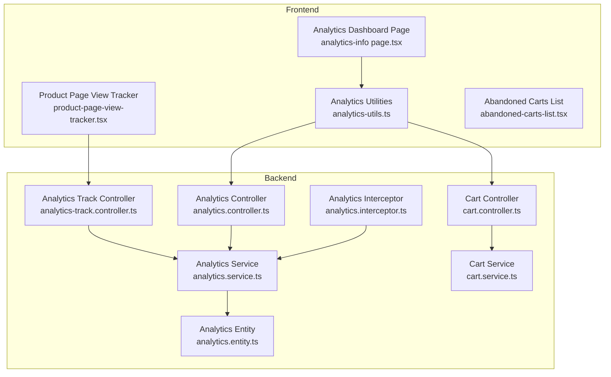
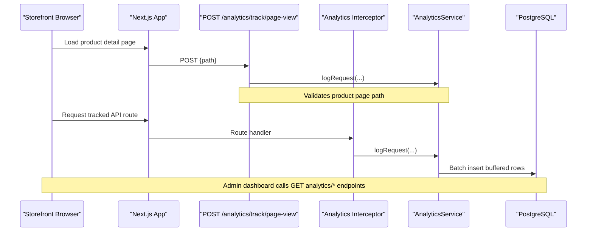
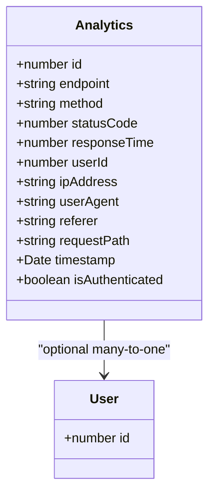
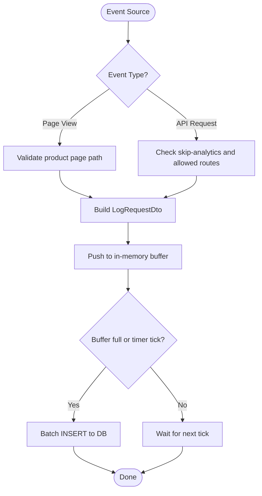
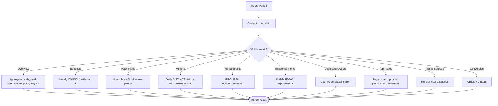
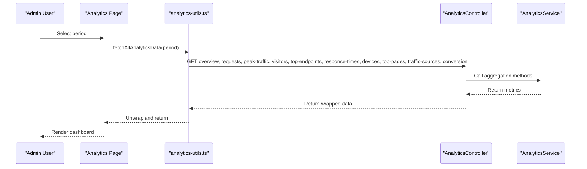
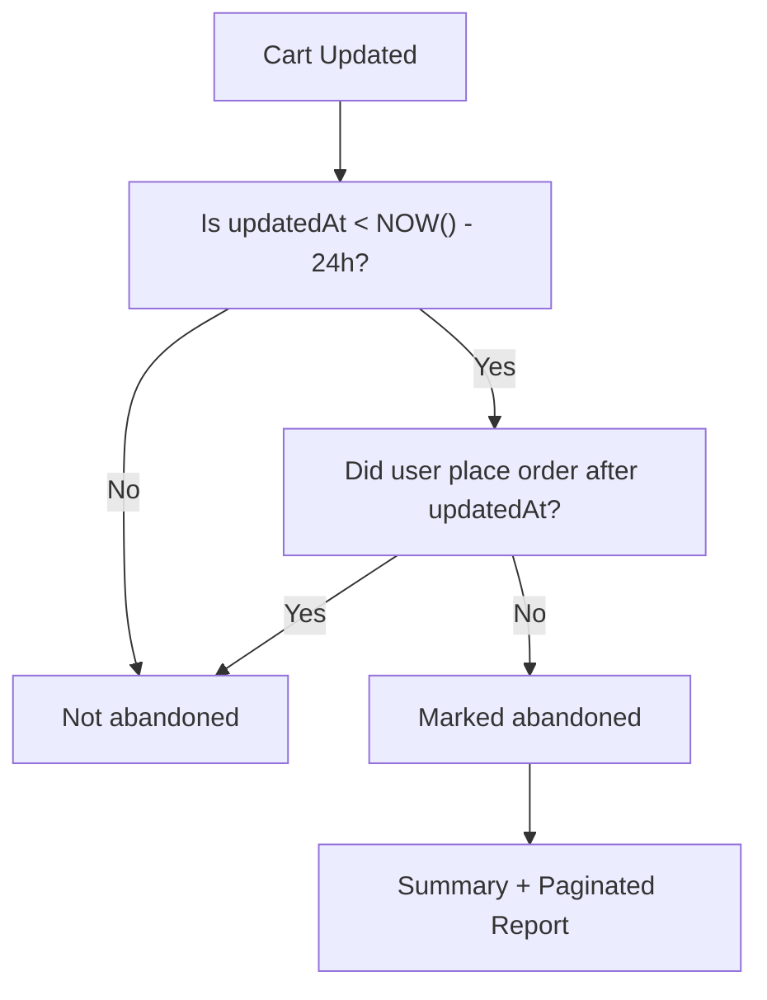
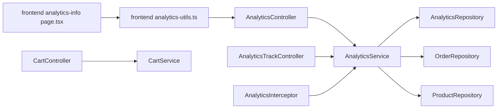

# Shopping Analytics & Tracking

<cite>
**Referenced Files in This Document**
- [analytics.service.ts](file://apps/backend/src/analytics/analytics.service.ts)
- [analytics.controller.ts](file://apps/backend/src/analytics/analytics.controller.ts)
- [analytics-track.controller.ts](file://apps/backend/src/analytics/analytics-track.controller.ts)
- [analytics.entity.ts](file://apps/backend/src/analytics/entities/analytics.entity.ts)
- [log-request.dto.ts](file://apps/backend/src/analytics/dto/log-request.dto.ts)
- [analytics-response.dto.ts](file://apps/backend/src/analytics/dto/analytics-response.dto.ts)
- [analytics.interceptor.ts](file://apps/backend/src/analytics/interceptors/analytics.interceptor.ts)
- [product-page-view-tracker.tsx](file://apps/frontend/components/products/product-details/product-page-view-tracker.tsx)
- [analytics-utils.ts](file://apps/frontend/utils/analytics-utils.ts)
- [analytics-info page.tsx](file://apps/frontend/app/admin/analytics/analytics-info/page.tsx)
- [abandoned-carts-list.tsx](file://apps/frontend/components/admin/reports/abandoned-carts-list.tsx)
- [cart.controller.ts](file://apps/backend/src/cart/cart.controller.ts)
- [cart.service.ts](file://apps/backend/src/cart/cart.service.ts)
</cite>

## Table of Contents
1. [Introduction](#introduction)
2. [Project Structure](#project-structure)
3. [Core Components](#core-components)
4. [Architecture Overview](#architecture-overview)
5. [Detailed Component Analysis](#detailed-component-analysis)
6. [Dependency Analysis](#dependency-analysis)
7. [Performance Considerations](#performance-considerations)
8. [Troubleshooting Guide](#troubleshooting-guide)
9. [Conclusion](#conclusion)
10. [Appendices](#appendices)

## Introduction
This document explains the shopping analytics and tracking system for the German Butcher e-commerce platform. It covers how page views, user interactions, conversion events, and abandoned carts are captured, aggregated, and presented. The backend records request-level telemetry and product page views, aggregates metrics over configurable time windows, and exposes reporting endpoints. The frontend includes a storefront beacon for product page views and an admin dashboard that visualizes funnel metrics, conversion rates, device/browser mix, traffic sources, and top product pages. Abandoned cart analysis is provided as a dedicated report with summary and paginated detail.

## Project Structure
The analytics feature spans both backend and frontend:

- Backend
  - Controllers expose API endpoints for admin dashboards and public page-view beacons.
  - A service handles buffering, aggregation, retention, and index management.
  - An interceptor captures allowed API routes into the analytics store.
  - Entities define the persisted analytics row schema.
  - DTOs define request payloads and response schemas.
- Frontend
  - Storefront component fires a fire-and-forget page view when visiting product detail pages.
  - Admin analytics utilities call backend endpoints and unwrap responses.
  - Admin analytics page composes charts and tables from multiple data sources.
  - Abandoned carts report lists carts not converted to orders after 24 hours.

**Diagram sources**
- [product-page-view-tracker.tsx:1-33](file://apps/frontend/components/products/product-details/product-page-view-tracker.tsx#L1-L33)
- [analytics-info page.tsx:1-261](file://apps/frontend/app/admin/analytics/analytics-info/page.tsx#L1-L261)
- [analytics-utils.ts:1-207](file://apps/frontend/utils/analytics-utils.ts#L1-L207)
- [analytics-track.controller.ts:1-62](file://apps/backend/src/analytics/analytics-track.controller.ts#L1-L62)
- [analytics.controller.ts:1-330](file://apps/backend/src/analytics/analytics.controller.ts#L1-L330)
- [analytics.interceptor.ts:1-116](file://apps/backend/src/analytics/interceptors/analytics.interceptor.ts#L1-L116)
- [analytics.service.ts:1-617](file://apps/backend/src/analytics/analytics.service.ts#L1-L617)
- [analytics.entity.ts:1-59](file://apps/backend/src/analytics/entities/analytics.entity.ts#L1-L59)
- [cart.controller.ts:169-213](file://apps/backend/src/cart/cart.controller.ts#L169-L213)
- [cart.service.ts:206-285](file://apps/backend/src/cart/cart.service.ts#L206-L285)

**Section sources**
- [analytics.service.ts:1-617](file://apps/backend/src/analytics/analytics.service.ts#L1-L617)
- [analytics.controller.ts:1-330](file://apps/backend/src/analytics/analytics.controller.ts#L1-L330)
- [analytics-track.controller.ts:1-62](file://apps/backend/src/analytics/analytics-track.controller.ts#L1-L62)
- [analytics.entity.ts:1-59](file://apps/backend/src/analytics/entities/analytics.entity.ts#L1-L59)
- [analytics.interceptor.ts:1-116](file://apps/backend/src/analytics/interceptors/analytics.interceptor.ts#L1-L116)
- [product-page-view-tracker.tsx:1-33](file://apps/frontend/components/products/product-details/product-page-view-tracker.tsx#L1-L33)
- [analytics-utils.ts:1-207](file://apps/frontend/utils/analytics-utils.ts#L1-L207)
- [analytics-info page.tsx:1-261](file://apps/frontend/app/admin/analytics/analytics-info/page.tsx#L1-L261)
- [cart.controller.ts:169-213](file://apps/backend/src/cart/cart.controller.ts#L169-L213)
- [cart.service.ts:206-285](file://apps/backend/src/cart/cart.service.ts#L206-L285)

## Core Components
- Analytics entity
  - Stores endpoint, HTTP method, status code, response time, optional user identity, IP address, user agent, referer, concrete request path, timestamp, and authentication flag.
  - Includes indexes on timestamp and composite timestamp+endpoint for efficient dashboard queries.
- Analytics service
  - Buffers analytics rows and flushes them in batches or at intervals.
  - Provides overview, requests per time bucket, peak traffic by hour-of-day, unique visitors by day, top endpoints, response time stats, device/browser breakdown, top product pages, traffic sources, and conversion rate (orders vs visitors).
  - Schedules daily retention cleanup based on configured retention days.
  - Ensures required database indexes exist at startup.
- Analytics controller
  - Exposes protected endpoints for overview, requests, peak traffic, visitors, top endpoints, response times, devices, top product pages, traffic sources, and conversion.
- Analytics track controller
  - Public endpoint to record storefront product page views; validates paths against a product page pattern.
- Analytics interceptor
  - Captures selected API routes into analytics with method, endpoint, status, timing, user context, IP, user agent, referer, and request path.
- Frontend components
  - Product page view tracker sends a lightweight POST to the public page-view endpoint.
  - Admin analytics utilities fetch all dashboard datasets and unwrap responses.
  - Admin analytics page composes overview cards, charts, and tables.
  - Abandoned carts list displays summary and paginated details.

**Section sources**
- [analytics.entity.ts:1-59](file://apps/backend/src/analytics/entities/analytics.entity.ts#L1-L59)
- [analytics.service.ts:1-617](file://apps/backend/src/analytics/analytics.service.ts#L1-L617)
- [analytics.controller.ts:1-330](file://apps/backend/src/analytics/analytics.controller.ts#L1-L330)
- [analytics-track.controller.ts:1-62](file://apps/backend/src/analytics/analytics-track.controller.ts#L1-L62)
- [analytics.interceptor.ts:1-116](file://apps/backend/src/analytics/interceptors/analytics.interceptor.ts#L1-L116)
- [product-page-view-tracker.tsx:1-33](file://apps/frontend/components/products/product-details/product-page-view-tracker.tsx#L1-L33)
- [analytics-utils.ts:1-207](file://apps/frontend/utils/analytics-utils.ts#L1-L207)
- [analytics-info page.tsx:1-261](file://apps/frontend/app/admin/analytics/analytics-info/page.tsx#L1-L261)

## Architecture Overview
The system combines server-side request telemetry with client-initiated product page views. The admin dashboard consumes these signals to visualize performance, engagement, and conversion.

**Diagram sources**
- [product-page-view-tracker.tsx:1-33](file://apps/frontend/components/products/product-details/product-page-view-tracker.tsx#L1-L33)
- [analytics-track.controller.ts:1-62](file://apps/backend/src/analytics/analytics-track.controller.ts#L1-L62)
- [analytics.interceptor.ts:1-116](file://apps/backend/src/analytics/interceptors/analytics.interceptor.ts#L1-L116)
- [analytics.service.ts:1-617](file://apps/backend/src/analytics/analytics.service.ts#L1-L617)

## Detailed Component Analysis

### Analytics Data Model
The analytics table stores each recorded event with fields suitable for funnel and performance analysis.

**Diagram sources**
- [analytics.entity.ts:1-59](file://apps/backend/src/analytics/entities/analytics.entity.ts#L1-L59)

**Section sources**
- [analytics.entity.ts:1-59](file://apps/backend/src/analytics/entities/analytics.entity.ts#L1-L59)

### Event Ingestion Pipeline
Two ingestion paths feed the analytics store:

- Storefront page views via public beacon
- Server-side API request telemetry via interceptor

**Diagram sources**
- [analytics-track.controller.ts:1-62](file://apps/backend/src/analytics/analytics-track.controller.ts#L1-L62)
- [analytics.interceptor.ts:1-116](file://apps/backend/src/analytics/interceptors/analytics.interceptor.ts#L1-L116)
- [analytics.service.ts:142-192](file://apps/backend/src/analytics/analytics.service.ts#L142-L192)

**Section sources**
- [analytics-track.controller.ts:1-62](file://apps/backend/src/analytics/analytics-track.controller.ts#L1-L62)
- [analytics.interceptor.ts:1-116](file://apps/backend/src/analytics/interceptors/analytics.interceptor.ts#L1-L116)
- [analytics.service.ts:142-192](file://apps/backend/src/analytics/analytics.service.ts#L142-L192)

### Analytics Service Aggregation
Key aggregation methods:

- Overview: requests per minute, total requests, unique visitors, peak hour, top endpoint, average response time.
- Requests over time: hourly buckets with zero-filled gaps.
- Peak traffic: hour-of-day distribution across the period.
- Unique visitors: daily counts aligned to local timezone.
- Top endpoints: most accessed endpoints with average response time.
- Response time metrics: average, min, max.
- Device and browser breakdown: derived from stored user-agent strings.
- Top product pages: matches concrete product paths and resolves product names.
- Traffic sources: groups by referer host; missing referer counted as Direct.
- Conversion: orders divided by unique visitors in the period.

**Diagram sources**
- [analytics.service.ts:194-548](file://apps/backend/src/analytics/analytics.service.ts#L194-L548)

**Section sources**
- [analytics.service.ts:194-548](file://apps/backend/src/analytics/analytics.service.ts#L194-L548)

### Admin Analytics Dashboard
The admin analytics page loads multiple datasets concurrently and renders overview cards, charts, and tables. It supports a global period selector and uses fixed ranges for certain panels to ensure stable samples.

**Diagram sources**
- [analytics-info page.tsx:1-261](file://apps/frontend/app/admin/analytics/analytics-info/page.tsx#L1-L261)
- [analytics-utils.ts:100-137](file://apps/frontend/utils/analytics-utils.ts#L100-L137)
- [analytics.controller.ts:36-311](file://apps/backend/src/analytics/analytics.controller.ts#L36-L311)
- [analytics.service.ts:194-548](file://apps/backend/src/analytics/analytics.service.ts#L194-L548)

**Section sources**
- [analytics-info page.tsx:1-261](file://apps/frontend/app/admin/analytics/analytics-info/page.tsx#L1-L261)
- [analytics-utils.ts:1-207](file://apps/frontend/utils/analytics-utils.ts#L1-207)
- [analytics.controller.ts:1-330](file://apps/backend/src/analytics/analytics.controller.ts#L1-L330)

### Abandoned Cart Analysis
Abandoned carts are defined as carts with items that remain untouched for 24+ hours and where the user did not place an order after the last cart update. The backend provides a summary and a paginated report; the frontend renders summary tiles and a table.

**Diagram sources**
- [cart.service.ts:206-285](file://apps/backend/src/cart/cart.service.ts#L206-L285)
- [cart.controller.ts:169-213](file://apps/backend/src/cart/cart.controller.ts#L169-L213)
- [abandoned-carts-list.tsx:1-168](file://apps/frontend/components/admin/reports/abandoned-carts-list.tsx#L1-L168)

**Section sources**
- [cart.service.ts:206-285](file://apps/backend/src/cart/cart.service.ts#L206-L285)
- [cart.controller.ts:169-213](file://apps/backend/src/cart/cart.controller.ts#L169-L213)
- [abandoned-carts-list.tsx:1-168](file://apps/frontend/components/admin/reports/abandoned-carts-list.tsx#L1-L168)

## Dependency Analysis
- Controllers depend on services for business logic and data access.
- The interceptor depends on the analytics service and utility helpers for IP extraction.
- The service depends on repositories for analytics, orders, and products.
- Frontend utilities depend on protected API fetching and type definitions.
- The abandoned carts flow depends on cart and order entities.

**Diagram sources**
- [analytics.controller.ts:1-330](file://apps/backend/src/analytics/analytics.controller.ts#L1-L330)
- [analytics-track.controller.ts:1-62](file://apps/backend/src/analytics/analytics-track.controller.ts#L1-L62)
- [analytics.interceptor.ts:1-116](file://apps/backend/src/analytics/interceptors/analytics.interceptor.ts#L1-L116)
- [analytics.service.ts:1-617](file://apps/backend/src/analytics/analytics.service.ts#L1-L617)
- [analytics-utils.ts:1-207](file://apps/frontend/utils/analytics-utils.ts#L1-207)
- [analytics-info page.tsx:1-261](file://apps/frontend/app/admin/analytics/analytics-info/page.tsx#L1-L261)
- [cart.controller.ts:169-213](file://apps/backend/src/cart/cart.controller.ts#L169-L213)
- [cart.service.ts:206-285](file://apps/backend/src/cart/cart.service.ts#L206-L285)

**Section sources**
- [analytics.service.ts:1-617](file://apps/backend/src/analytics/analytics.service.ts#L1-L617)
- [analytics.controller.ts:1-330](file://apps/backend/src/analytics/analytics.controller.ts#L1-L330)
- [analytics.interceptor.ts:1-116](file://apps/backend/src/analytics/interceptors/analytics.interceptor.ts#L1-L116)
- [analytics-utils.ts:1-207](file://apps/frontend/utils/analytics-utils.ts#L1-207)
- [cart.service.ts:206-285](file://apps/backend/src/cart/cart.service.ts#L206-L285)

## Performance Considerations
- Buffered writes
  - Events are batched in memory and flushed either when the buffer reaches a configured size or on a periodic timer. This reduces database round trips under high load.
- Indexing
  - Startup ensures critical indexes on timestamp and timestamp+endpoint exist, preventing full-table scans for dashboard queries.
- Retention
  - A scheduled job deletes rows older than the configured retention window to keep the analytics table bounded.
- Timezone handling
  - Aggregations align to local time zones to avoid misaligned day/hour buckets.
- Concurrency safety
  - Flushing is single-flight to prevent overlapping inserts; failed flushes re-queue rows respecting the buffer cap.
- Frontend resilience
  - Page view beacon uses fire-and-forget semantics so analytics failures do not block UI.

[No sources needed since this section provides general guidance]

## Troubleshooting Guide
- Missing dashboard data
  - Verify indexes were created at startup and that the analytics table has recent rows.
  - Confirm the interceptor is enabled for the relevant routes and that the skip-analytics decorator is not applied unintentionally.
- Incorrect time buckets
  - Ensure the application timezone and database settings align; aggregations shift timestamps to local time before truncation.
- High latency on analytics endpoints
  - Increase flush batch size or reduce retention days if the table grows too large.
  - Review top endpoints and response time metrics to identify slow routes.
- No product page views recorded
  - Confirm the storefront tracker posts only valid product page paths and that the public beacon is reachable.
- Abandoned carts not appearing
  - Ensure carts have been inactive for more than 24 hours and no subsequent order was placed by the same user after the last cart update.

**Section sources**
- [analytics.service.ts:89-117](file://apps/backend/src/analytics/analytics.service.ts#L89-L117)
- [analytics.service.ts:593-615](file://apps/backend/src/analytics/analytics.service.ts#L593-L615)
- [analytics.interceptor.ts:20-56](file://apps/backend/src/analytics/interceptors/analytics.interceptor.ts#L20-L56)
- [analytics-track.controller.ts:35-60](file://apps/backend/src/analytics/analytics-track.controller.ts#L35-L60)
- [cart.service.ts:206-285](file://apps/backend/src/cart/cart.service.ts#L206-L285)

## Conclusion
The analytics system provides robust, high-volume tracking of API usage and storefront product page views, with strong performance safeguards and clear reporting. The admin dashboard consolidates funnel metrics, conversion rates, device/browser mix, traffic sources, and top product pages. Abandoned cart analysis complements conversion insights by surfacing unconverted carts with measurable value. The design balances real-time observability with long-term storage efficiency through buffering, indexing, and retention policies.

[No sources needed since this section summarizes without analyzing specific files]

## Appendices

### Analytics API Endpoints
- Protected admin endpoints
  - GET /analytics/overview?period=...
  - GET /analytics/requests?period=...
  - GET /analytics/peak-traffic?period=...
  - GET /analytics/visitors?period=...
  - GET /analytics/top-endpoints?limit=...&period=...
  - GET /analytics/response-times?period=...
  - GET /analytics/devices?period=...
  - GET /analytics/top-pages?period=...&limit=...
  - GET /analytics/traffic-sources?period=...
  - GET /analytics/conversion?period=...
- Public storefront endpoint
  - POST /analytics/track/page-view
    - Body: path string (must match product page pattern)

**Section sources**
- [analytics.controller.ts:36-311](file://apps/backend/src/analytics/analytics.controller.ts#L36-L311)
- [analytics-track.controller.ts:35-60](file://apps/backend/src/analytics/analytics-track.controller.ts#L35-L60)

### Event Schema
- LogRequestDto fields
  - endpoint: string (required)
  - method: string (required)
  - statusCode: number (required)
  - responseTime: number (required)
  - userId: number (optional)
  - ipAddress: string (required)
  - userAgent: string (optional)
  - referer: string (optional)
  - requestPath: string (optional)
  - isAuthenticated: boolean (required)

**Section sources**
- [log-request.dto.ts:1-46](file://apps/backend/src/analytics/dto/log-request.dto.ts#L1-L46)

### Example Usage Patterns
- Custom event tracking
  - Use the public page-view endpoint to record product page visits from the storefront.
  - Extend the interceptor’s allowed routes to include additional business-critical endpoints.
- Analytics integration patterns
  - On the frontend, use the analytics utilities to fetch all dashboard datasets and render charts.
  - For custom reports, call specific endpoints such as conversion or top product pages with appropriate periods.

**Section sources**
- [product-page-view-tracker.tsx:1-33](file://apps/frontend/components/products/product-details/product-page-view-tracker.tsx#L1-L33)
- [analytics-utils.ts:1-207](file://apps/frontend/utils/analytics-utils.ts#L1-207)
- [analytics.interceptor.ts:34-56](file://apps/backend/src/analytics/interceptors/analytics.interceptor.ts#L34-L56)