# Shopping Experience

<cite>
**Referenced Files in This Document**
- [cart.service.ts](file://apps/backend/src/cart/cart.service.ts)
- [cart.controller.ts](file://apps/backend/src/cart/cart.controller.ts)
- [cart.entity.ts](file://apps/backend/src/cart/entities/cart.entity.ts)
- [cart-item.entity.ts](file://apps/backend/src/cart/entities/cart-item.entity.ts)
- [wishlist.service.ts](file://apps/backend/src/wishlist/wishlist.service.ts)
- [wishlist.controller.ts](file://apps/backend/src/wishlist/wishlist.controller.ts)
- [wishlist.entity.ts](file://apps/backend/src/wishlist/entities/wishlist.entity.ts)
- [wishlist-item.entity.ts](file://apps/backend/src/wishlist/entities/wishlist-item.entity.ts)
- [product-review.service.ts](file://apps/backend/src/product-review/product-review.service.ts)
- [product-review.controller.ts](file://apps/backend/src/product-review/product-review.controller.ts)
- [product-review.entity.ts](file://apps/backend/src/product-review/entities/product-review.entity.ts)
- [use-cart.ts](file://apps/frontend/hooks/use-cart.ts)
- [cart-context.tsx](file://apps/frontend/contexts/cart-context.tsx)
- [cart-storage.ts](file://apps/frontend/utils/cart-storage.ts)
</cite>

## Table of Contents
1. [Introduction](#introduction)
2. [Project Structure](#project-structure)
3. [Core Components](#core-components)
4. [Architecture Overview](#architecture-overview)
5. [Detailed Component Analysis](#detailed-component-analysis)
6. [Dependency Analysis](#dependency-analysis)
7. [Performance Considerations](#performance-considerations)
8. [Troubleshooting Guide](#troubleshooting-guide)
9. [Conclusion](#conclusion)

## Introduction
This document explains the shopping experience features for the German Butcher e-commerce platform, focusing on:
- Shopping cart: add-to-cart, quantity management, persistence across sessions, and abandoned cart analytics
- Wishlist: save/remove favorite products
- Product reviews and ratings: submission, moderation, and public display
- Real-time cart synchronization and cross-device compatibility
- Analytics tracking hooks and abandoned cart analysis
- Recommendation surfaces used by storefront components
- Performance optimization and caching strategies
- Mobile-responsive design patterns and progressive web app considerations

## Project Structure
The shopping experience spans backend NestJS modules (Cart, Wishlist, Product Review) and a Next.js frontend that manages local state, persistence, and server synchronization.

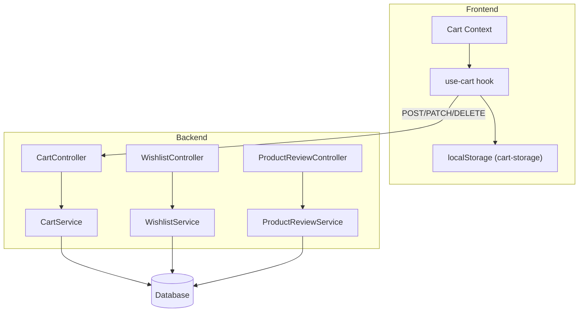

**Diagram sources**
- [use-cart.ts:157-224](file://apps/frontend/hooks/use-cart.ts#L157-L224)
- [cart-context.tsx:7-36](file://apps/frontend/contexts/cart-context.tsx#L7-L36)
- [cart-storage.ts:23-66](file://apps/frontend/utils/cart-storage.ts#L23-L66)
- [cart.controller.ts:35-167](file://apps/backend/src/cart/cart.controller.ts#L35-L167)
- [cart.service.ts:121-201](file://apps/backend/src/cart/cart.service.ts#L121-L201)
- [wishlist.controller.ts:29-140](file://apps/backend/src/wishlist/wishlist.controller.ts#L29-L140)
- [wishlist.service.ts:20-123](file://apps/backend/src/wishlist/wishlist.service.ts#L20-L123)
- [product-review.controller.ts:42-365](file://apps/backend/src/product-review/product-review.controller.ts#L42-L365)
- [product-review.service.ts:166-495](file://apps/backend/src/product-review/product-review.service.ts#L166-L495)

**Section sources**
- [use-cart.ts:1-647](file://apps/frontend/hooks/use-cart.ts#L1-L647)
- [cart-context.tsx:1-49](file://apps/frontend/contexts/cart-context.tsx#L1-L49)
- [cart-storage.ts:1-109](file://apps/frontend/utils/cart-storage.ts#L1-L109)
- [cart.controller.ts:1-214](file://apps/backend/src/cart/cart.controller.ts#L1-L214)
- [cart.service.ts:1-298](file://apps/backend/src/cart/cart.service.ts#L1-L298)
- [wishlist.controller.ts:1-142](file://apps/backend/src/wishlist/wishlist.controller.ts#L1-L142)
- [wishlist.service.ts:1-125](file://apps/backend/src/wishlist/wishlist.service.ts#L1-L125)
- [product-review.controller.ts:1-367](file://apps/backend/src/product-review/product-review.controller.ts#L1-L367)
- [product-review.service.ts:1-497](file://apps/backend/src/product-review/product-review.service.ts#L1-L497)

## Core Components
- Cart service and controller provide authenticated endpoints to get, add, update, remove, and clear cart items; they also expose abandoned cart reports for admin analytics.
- Wishlist service and controller manage per-user wishlists with add/remove/clear operations.
- Product review service and controller handle eligibility checks, review creation/update, moderation workflows, and public listing with rating summaries.
- Frontend use-cart hook orchestrates local vs server cart behavior, persistence via localStorage, coupon application, and server revalidation.

**Section sources**
- [cart.service.ts:15-298](file://apps/backend/src/cart/cart.service.ts#L15-L298)
- [cart.controller.ts:35-214](file://apps/backend/src/cart/cart.controller.ts#L35-L214)
- [wishlist.service.ts:10-125](file://apps/backend/src/wishlist/wishlist.service.ts#L10-L125)
- [wishlist.controller.ts:29-142](file://apps/backend/src/wishlist/wishlist.controller.ts#L29-L142)
- [product-review.service.ts:62-497](file://apps/backend/src/product-review/product-review.service.ts#L62-L497)
- [product-review.controller.ts:42-367](file://apps/backend/src/product-review/product-review.controller.ts#L42-L367)
- [use-cart.ts:29-647](file://apps/frontend/hooks/use-cart.ts#L29-L647)

## Architecture Overview
The shopping flow integrates frontend state, backend APIs, and database entities.

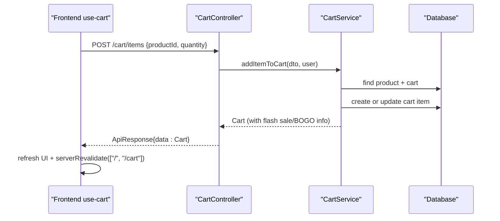

**Diagram sources**
- [use-cart.ts:157-224](file://apps/frontend/hooks/use-cart.ts#L157-L224)
- [cart.controller.ts:67-84](file://apps/backend/src/cart/cart.controller.ts#L67-L84)
- [cart.service.ts:121-158](file://apps/backend/src/cart/cart.service.ts#L121-L158)

## Detailed Component Analysis

### Shopping Cart System
Responsibilities:
- Add items to cart (merge quantities if present)
- Update item quantities
- Remove items and clear cart
- Persist guest carts in localStorage and sync to server upon login
- Enrich cart responses with flash-sale and BOGO pricing metadata
- Provide abandoned cart summary and paginated report for admins

Key behaviors:
- Guest cart is stored locally and synchronized when the user logs in
- Server cart is lazily created per user
- Inactive products are rejected at add time
- Abandoned cart metrics exclude users who checked out after last touch

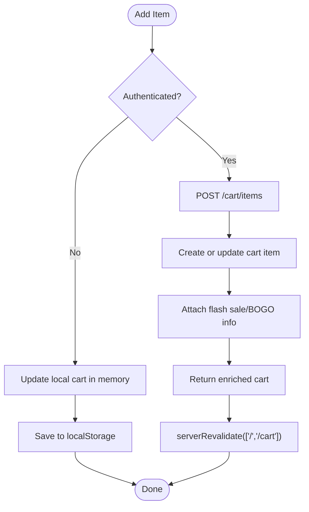

**Diagram sources**
- [use-cart.ts:157-224](file://apps/frontend/hooks/use-cart.ts#L157-L224)
- [cart.service.ts:121-158](file://apps/backend/src/cart/cart.service.ts#L121-L158)
- [cart.controller.ts:67-84](file://apps/backend/src/cart/cart.controller.ts#L67-L84)

Persistence and session handling:
- Guest carts persist via localStorage keys for cart and coupon
- On login, local items are replayed to the server and cleared from local storage
- Coupon state is persisted for guests and reapplied during sync

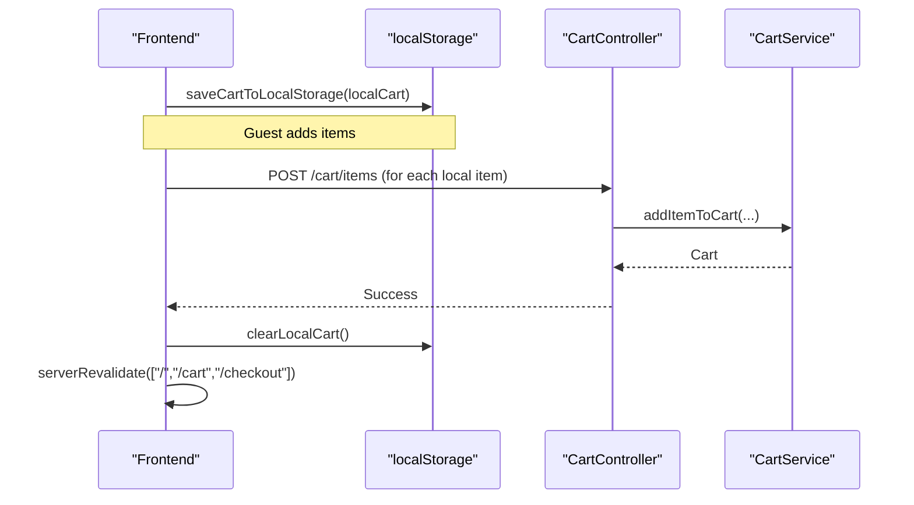

**Diagram sources**
- [use-cart.ts:107-155](file://apps/frontend/hooks/use-cart.ts#L107-L155)
- [cart-storage.ts:26-66](file://apps/frontend/utils/cart-storage.ts#L26-L66)
- [cart.controller.ts:67-84](file://apps/backend/src/cart/cart.controller.ts#L67-L84)
- [cart.service.ts:121-158](file://apps/backend/src/cart/cart.service.ts#L121-L158)

Abandoned cart analytics:
- Summary endpoint returns count and total value of abandoned carts
- Paginated report lists per-cart details with user contact info and item counts

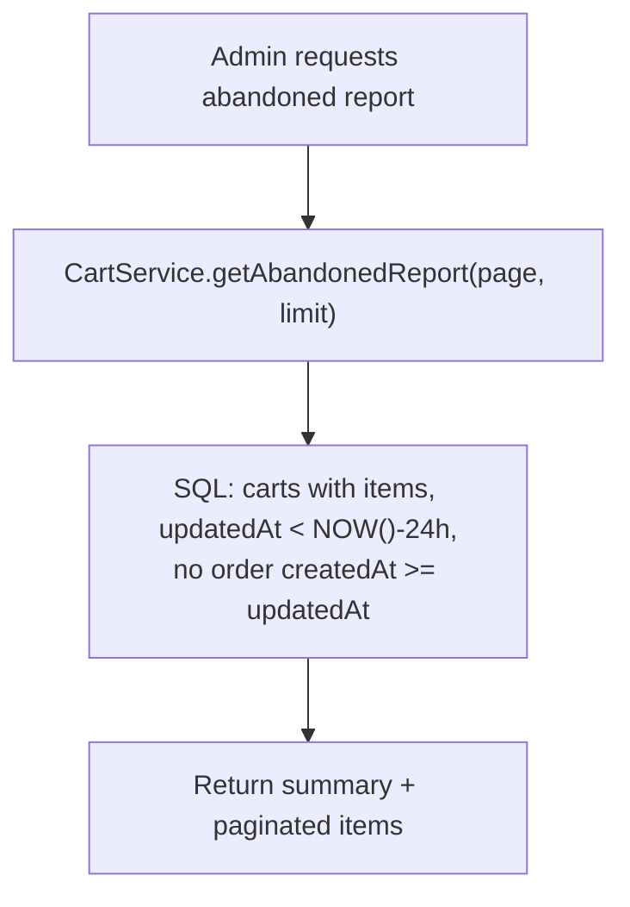

**Diagram sources**
- [cart.service.ts:203-298](file://apps/backend/src/cart/cart.service.ts#L203-L298)
- [cart.controller.ts:169-212](file://apps/backend/src/cart/cart.controller.ts#L169-L212)

Data model relationships:
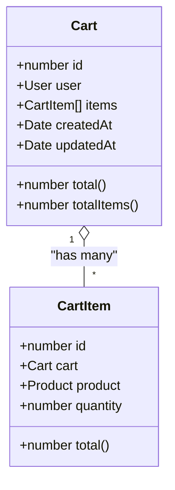

**Diagram sources**
- [cart.entity.ts:16-78](file://apps/backend/src/cart/entities/cart.entity.ts#L16-L78)
- [cart-item.entity.ts:7-50](file://apps/backend/src/cart/entities/cart-item.entity.ts#L7-L50)

**Section sources**
- [cart.service.ts:15-298](file://apps/backend/src/cart/cart.service.ts#L15-L298)
- [cart.controller.ts:35-214](file://apps/backend/src/cart/cart.controller.ts#L35-L214)
- [cart.entity.ts:16-78](file://apps/backend/src/cart/entities/cart.entity.ts#L16-L78)
- [cart-item.entity.ts:7-50](file://apps/backend/src/cart/entities/cart-item.entity.ts#L7-L50)
- [use-cart.ts:29-647](file://apps/frontend/hooks/use-cart.ts#L29-L647)
- [cart-storage.ts:1-109](file://apps/frontend/utils/cart-storage.ts#L1-L109)

### Wishlist Feature
Responsibilities:
- Get user wishlist (auto-create if missing)
- Add product to wishlist (idempotent)
- Remove item and clear wishlist

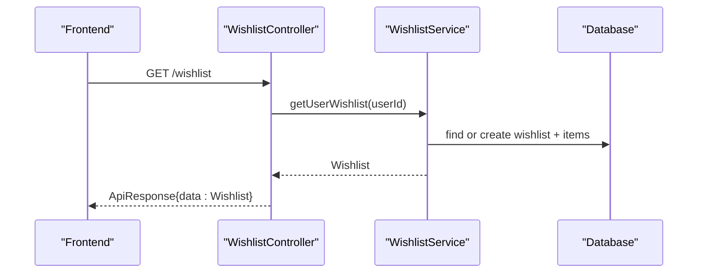

**Diagram sources**
- [wishlist.controller.ts:34-60](file://apps/backend/src/wishlist/wishlist.controller.ts#L34-L60)
- [wishlist.service.ts:20-65](file://apps/backend/src/wishlist/wishlist.service.ts#L20-L65)

Data model relationships:
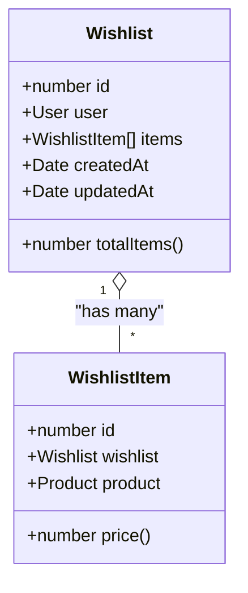

**Diagram sources**
- [wishlist.entity.ts:16-63](file://apps/backend/src/wishlist/entities/wishlist.entity.ts#L16-L63)
- [wishlist-item.entity.ts:7-42](file://apps/backend/src/wishlist/entities/wishlist-item.entity.ts#L7-L42)

**Section sources**
- [wishlist.service.ts:10-125](file://apps/backend/src/wishlist/wishlist.service.ts#L10-L125)
- [wishlist.controller.ts:29-142](file://apps/backend/src/wishlist/wishlist.controller.ts#L29-L142)
- [wishlist.entity.ts:16-63](file://apps/backend/src/wishlist/entities/wishlist.entity.ts#L16-L63)
- [wishlist-item.entity.ts:7-42](file://apps/backend/src/wishlist/entities/wishlist-item.entity.ts#L7-L42)

### Product Reviews and Ratings
Capabilities:
- Eligibility check: verified buyer and not already reviewed
- Create review: requires qualifying order; sets pending moderation; optional attachment
- Edit own review: resets moderation flags to pending
- Public listing: approved reviews only, paginated
- Rating summary: average rating, count, and star breakdown
- Admin moderation: approve/reject/delete, search, filter by status

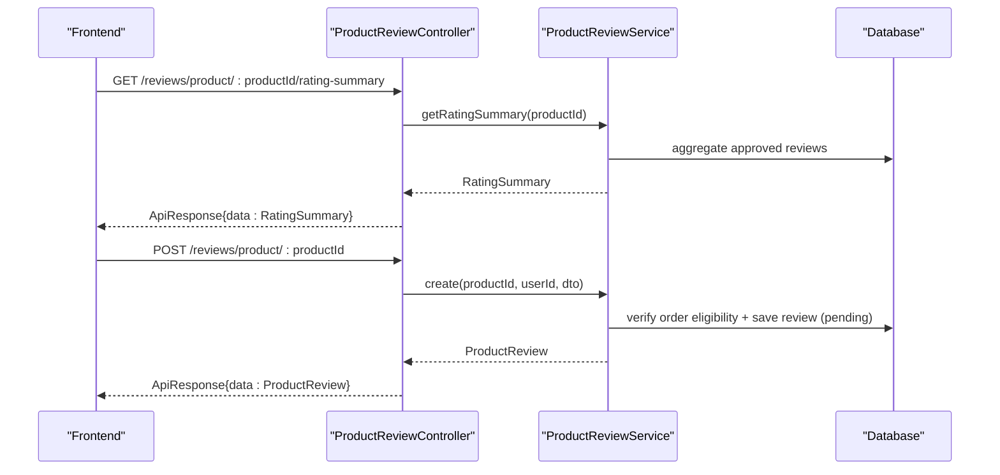

**Diagram sources**
- [product-review.controller.ts:87-126](file://apps/backend/src/product-review/product-review.controller.ts#L87-L126)
- [product-review.controller.ts:193-230](file://apps/backend/src/product-review/product-review.controller.ts#L193-L230)
- [product-review.service.ts:231-271](file://apps/backend/src/product-review/product-review.service.ts#L231-L271)
- [product-review.service.ts:273-329](file://apps/backend/src/product-review/product-review.service.ts#L273-L329)

Moderation workflow:
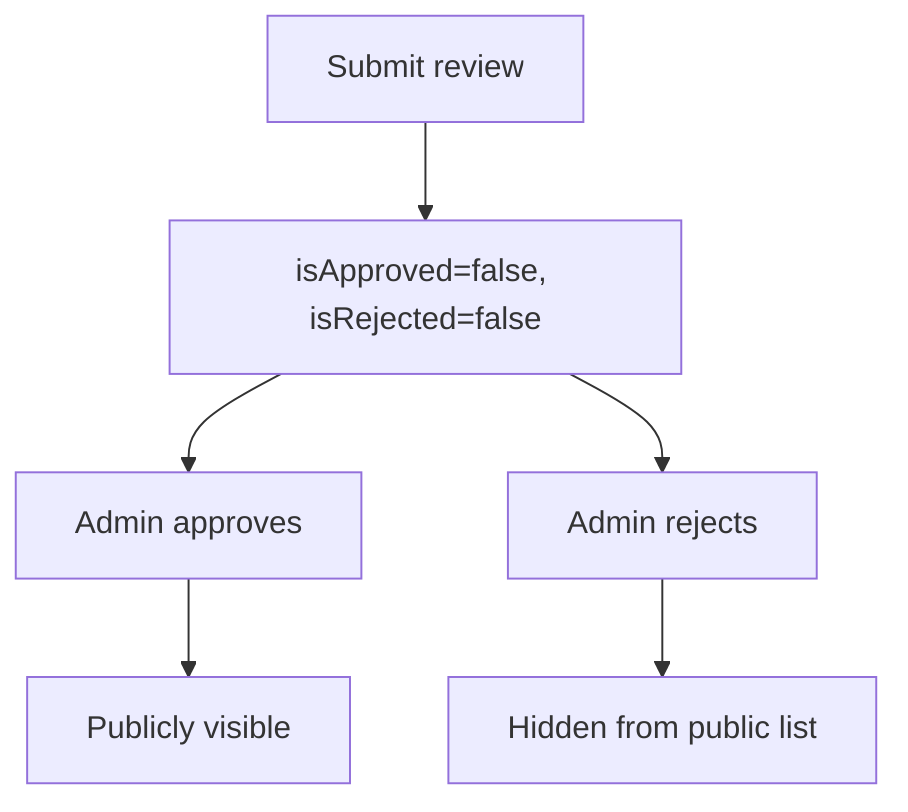

**Diagram sources**
- [product-review.service.ts:450-479](file://apps/backend/src/product-review/product-review.service.ts#L450-L479)
- [product-review.controller.ts:307-336](file://apps/backend/src/product-review/product-review.controller.ts#L307-L336)

Data model highlights:
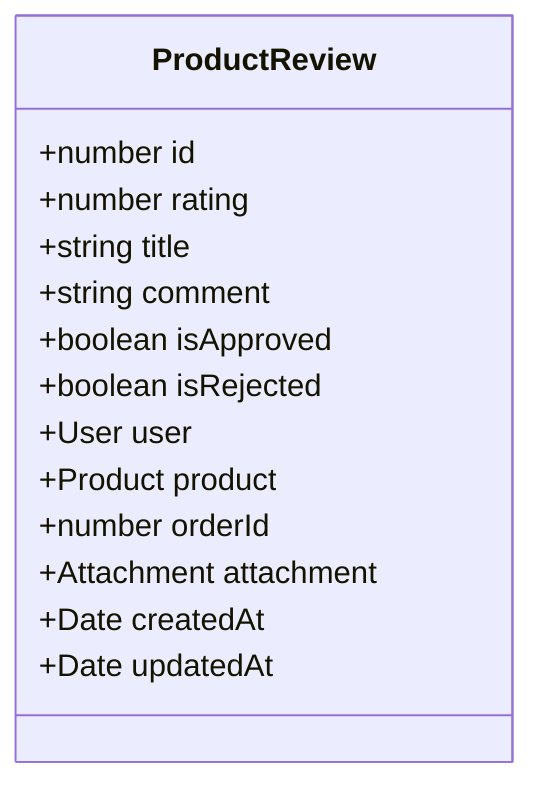

**Diagram sources**
- [product-review.entity.ts:16-88](file://apps/backend/src/product-review/entities/product-review.entity.ts#L16-L88)

**Section sources**
- [product-review.service.ts:62-497](file://apps/backend/src/product-review/product-review.service.ts#L62-L497)
- [product-review.controller.ts:42-367](file://apps/backend/src/product-review/product-review.controller.ts#L42-L367)
- [product-review.entity.ts:16-88](file://apps/backend/src/product-review/entities/product-review.entity.ts#L16-L88)

### Real-Time Cart Synchronization and Cross-Device Compatibility
- Guest carts persist in localStorage and are automatically synced to the server upon login
- Server cart is refreshed on tab focus/visibility change to keep prices current
- After successful sync, local cart and coupon are cleared and pages are revalidated

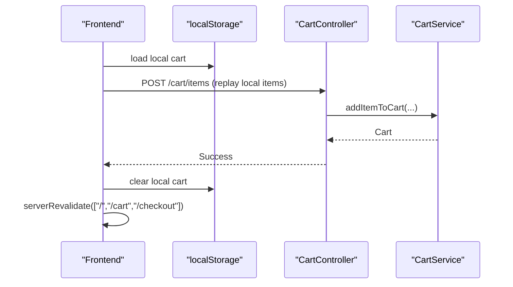

**Diagram sources**
- [use-cart.ts:107-155](file://apps/frontend/hooks/use-cart.ts#L107-L155)
- [cart.controller.ts:67-84](file://apps/backend/src/cart/cart.controller.ts#L67-L84)
- [cart.service.ts:121-158](file://apps/backend/src/cart/cart.service.ts#L121-L158)

**Section sources**
- [use-cart.ts:45-155](file://apps/frontend/hooks/use-cart.ts#L45-L155)
- [cart-storage.ts:26-66](file://apps/frontend/utils/cart-storage.ts#L26-L66)

### Analytics Tracking and Conversion Metrics
- Abandoned cart summary and detailed report endpoints support conversion funnel analysis
- The frontend uses toast notifications and server revalidation to reflect state changes, aiding behavioral observation

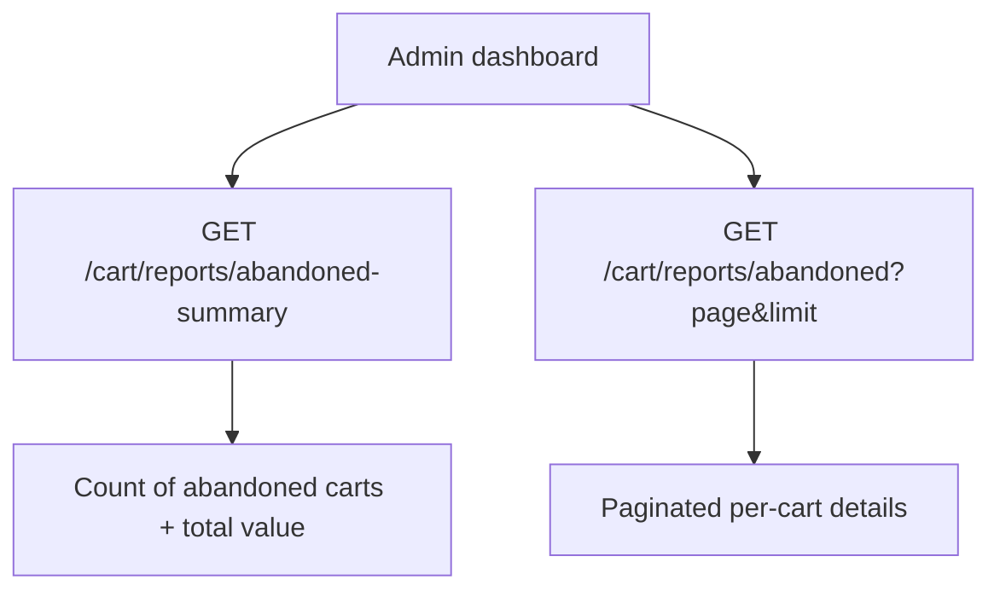

**Diagram sources**
- [cart.controller.ts:169-212](file://apps/backend/src/cart/cart.controller.ts#L169-L212)
- [cart.service.ts:203-298](file://apps/backend/src/cart/cart.service.ts#L203-L298)

**Section sources**
- [cart.controller.ts:169-212](file://apps/backend/src/cart/cart.controller.ts#L169-L212)
- [cart.service.ts:203-298](file://apps/backend/src/cart/cart.service.ts#L203-L298)

### Recommendation Surfaces
- Storefront components render recommended products using shared card components and Suspense boundaries
- These surfaces can be powered by curated endpoints or future recommendation engines

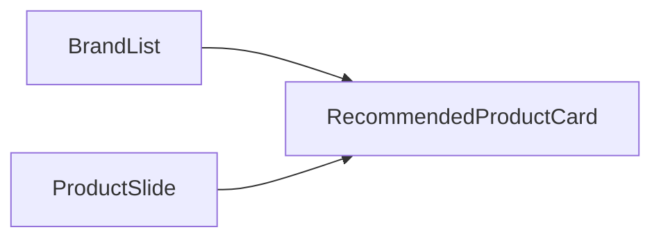

**Diagram sources**
- [brand-list.tsx:1-46](file://apps/frontend/components/homepage/brands/brand-list.tsx#L1-L46)
- [ProductSlide.tsx:1-28](file://apps/frontend/components/homepage/brands/ProductSlide.tsx#L1-L28)

**Section sources**
- [brand-list.tsx:1-46](file://apps/frontend/components/homepage/brands/brand-list.tsx#L1-L46)
- [ProductSlide.tsx:1-28](file://apps/frontend/components/homepage/brands/ProductSlide.tsx#L1-L28)

## Dependency Analysis
- CartController depends on CartService for business logic and TypeORM repositories for persistence
- WishlistController depends on WishlistService similarly
- ProductReviewController depends on ProductReviewService which coordinates OrderItem verification, Attachment resolution, and EmailService notifications
- Frontend use-cart hook depends on api-utils for HTTP calls, cart-storage for persistence, and product-utils for effective pricing

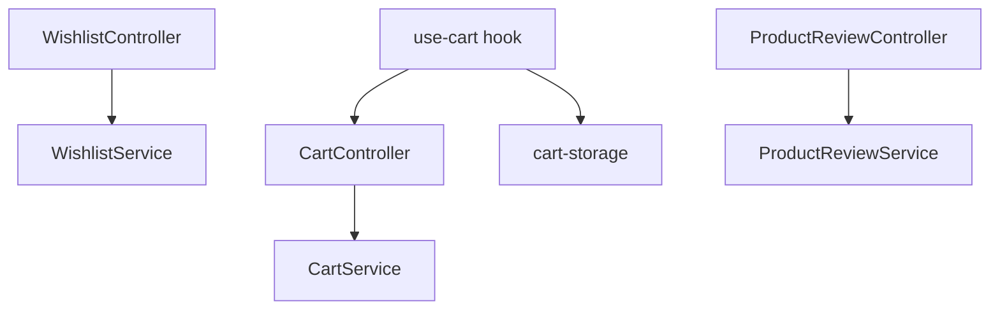

**Diagram sources**
- [cart.controller.ts:35-167](file://apps/backend/src/cart/cart.controller.ts#L35-L167)
- [cart.service.ts:15-201](file://apps/backend/src/cart/cart.service.ts#L15-L201)
- [wishlist.controller.ts:29-140](file://apps/backend/src/wishlist/wishlist.controller.ts#L29-L140)
- [wishlist.service.ts:10-123](file://apps/backend/src/wishlist/wishlist.service.ts#L10-L123)
- [product-review.controller.ts:42-365](file://apps/backend/src/product-review/product-review.controller.ts#L42-L365)
- [product-review.service.ts:62-495](file://apps/backend/src/product-review/product-review.service.ts#L62-L495)
- [use-cart.ts:1-647](file://apps/frontend/hooks/use-cart.ts#L1-L647)
- [cart-storage.ts:1-109](file://apps/frontend/utils/cart-storage.ts#L1-L109)

**Section sources**
- [cart.controller.ts:35-167](file://apps/backend/src/cart/cart.controller.ts#L35-L167)
- [cart.service.ts:15-201](file://apps/backend/src/cart/cart.service.ts#L15-L201)
- [wishlist.controller.ts:29-140](file://apps/backend/src/wishlist/wishlist.controller.ts#L29-L140)
- [wishlist.service.ts:10-123](file://apps/backend/src/wishlist/wishlist.service.ts#L10-L123)
- [product-review.controller.ts:42-365](file://apps/backend/src/product-review/product-review.controller.ts#L42-L365)
- [product-review.service.ts:62-495](file://apps/backend/src/product-review/product-review.service.ts#L62-L495)
- [use-cart.ts:1-647](file://apps/frontend/hooks/use-cart.ts#L1-L647)
- [cart-storage.ts:1-109](file://apps/frontend/utils/cart-storage.ts#L1-L109)

## Performance Considerations
- Backend
  - Batch enrichment: Flash sale and BOGO info attached once per cart response to avoid repeated lookups
  - Abandoned cart queries use optimized SQL with indexes on timestamps and foreign keys
  - Review queries use query builders with pagination and selective joins
- Frontend
  - Local-first cart updates reduce network overhead for guests
  - Background refresh of product data for local cart ensures accurate pricing without blocking UI
  - Debounced visibility/focus events throttle server cart refreshes
  - Server revalidation targets minimal routes to reduce unnecessary full-page reloads

Recommendations:
- Cache frequently accessed product data on the client for short durations
- Implement optimistic UI for non-critical actions (e.g., wishlist toggles)
- Use CDN caching for static assets and images
- Consider Redis caching for hot product listings and rating summaries

[No sources needed since this section provides general guidance]

## Troubleshooting Guide
Common issues and resolutions:
- Adding inactive products fails on the backend; ensure product is active before adding
- Duplicate key errors when creating a cart are handled by fetching the existing cart
- Review submission requires a qualifying order; verify order status and product linkage
- Edited reviews reset moderation flags; expect pending status after edits
- Local cart sync clears local storage after successful server sync; confirm login flow triggers sync

Operational tips:
- Inspect toast messages for success/error feedback
- Verify server revalidation paths after mutations
- For abandoned cart reports, ensure orders are created after cart updates to avoid false positives

**Section sources**
- [cart.service.ts:63-118](file://apps/backend/src/cart/cart.service.ts#L63-L118)
- [cart.service.ts:121-158](file://apps/backend/src/cart/cart.service.ts#L121-L158)
- [product-review.service.ts:273-329](file://apps/backend/src/product-review/product-review.service.ts#L273-L329)
- [product-review.service.ts:331-368](file://apps/backend/src/product-review/product-review.service.ts#L331-L368)
- [use-cart.ts:107-155](file://apps/frontend/hooks/use-cart.ts#L107-L155)

## Conclusion
The shopping experience combines robust backend services with a responsive, persistent frontend. The cart system supports both guest and authenticated flows with automatic synchronization. Wishlists provide simple product bookmarking. Reviews enforce verified purchases and moderation while exposing rich rating summaries. Analytics endpoints enable abandoned cart insights, and storefront components offer recommendation surfaces ready for future personalization. Performance-conscious patterns such as local-first updates, background refresh, and targeted revalidation help maintain responsiveness under high traffic.