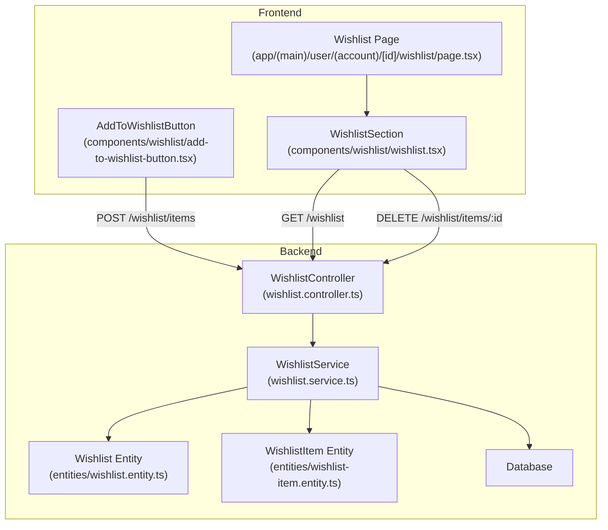
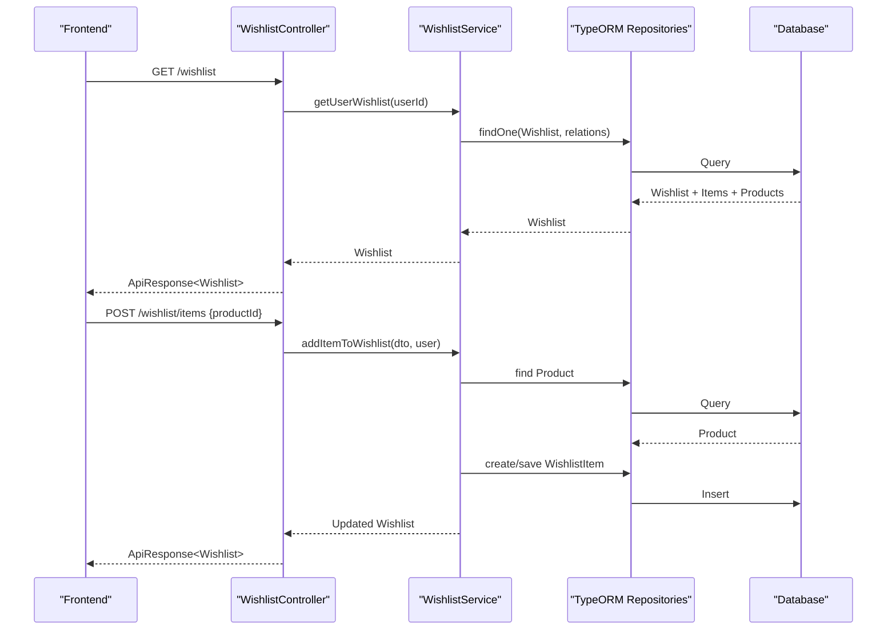
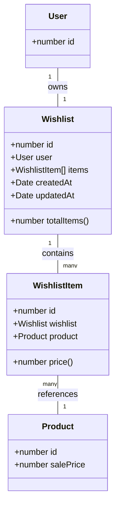
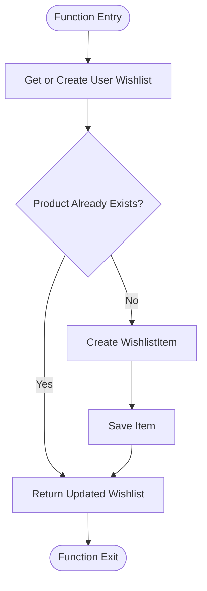
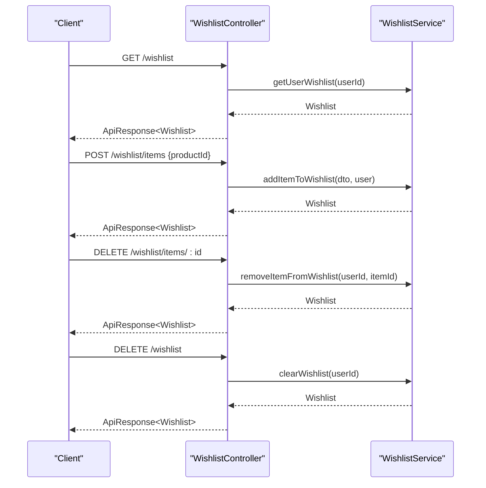
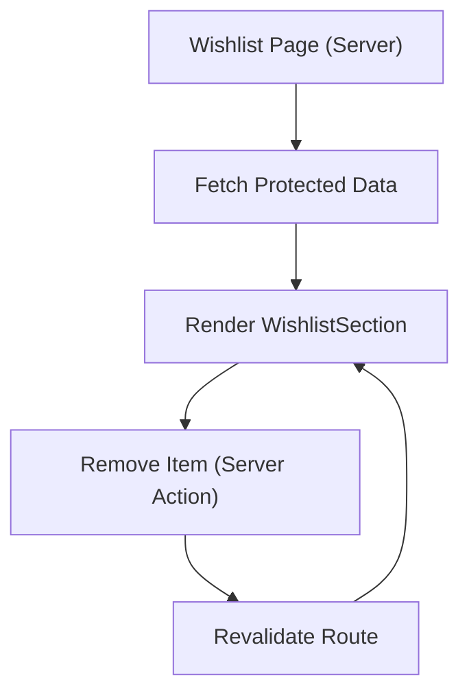
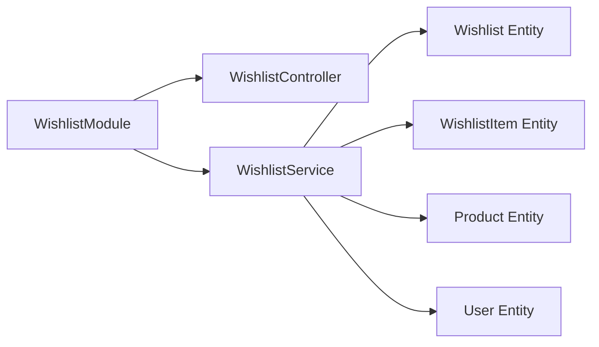

# Wishlist System

<cite>
**Referenced Files in This Document**
- [wishlist.entity.ts](file://apps/backend/src/wishlist/entities/wishlist.entity.ts)
- [wishlist-item.entity.ts](file://apps/backend/src/wishlist/entities/wishlist-item.entity.ts)
- [add-wishlist-item.dto.ts](file://apps/backend/src/wishlist/dto/add-wishlist-item.dto.ts)
- [wishlist.service.ts](file://apps/backend/src/wishlist/wishlist.service.ts)
- [wishlist.controller.ts](file://apps/backend/src/wishlist/wishlist.controller.ts)
- [wishlist.module.ts](file://apps/backend/src/wishlist/wishlist.module.ts)
- [wishlist.tsx](file://apps/frontend/components/wishlist/wishlist.tsx)
- [add-to-wishlist-button.tsx](file://apps/frontend/components/wishlist/add-to-wishlist-button.tsx)
- [wishlist page](file://apps/frontend/app/(main)/user/(account)/[id]/wishlist/page.tsx)
</cite>

## Table of Contents
1. [Introduction](#introduction)
2. [Project Structure](#project-structure)
3. [Core Components](#core-components)
4. [Architecture Overview](#architecture-overview)
5. [Detailed Component Analysis](#detailed-component-analysis)
6. [Dependency Analysis](#dependency-analysis)
7. [Performance Considerations](#performance-considerations)
8. [Troubleshooting Guide](#troubleshooting-guide)
9. [Conclusion](#conclusion)
10. [Appendices](#appendices)

## Introduction
This document explains the wishlist feature for the German Butcher e-commerce platform. It covers the backend entities, service logic, API endpoints, and frontend components that implement adding, removing, listing, and clearing wishlists. It also addresses persistence across devices and sessions, security considerations, and current gaps such as sharing capabilities.

## Project Structure
The wishlist feature is implemented in both backend (NestJS) and frontend (Next.js):

- Backend:
  - Entities define the data model for a user’s wishlist and its items.
  - Service encapsulates business logic for CRUD operations on wishlists.
  - Controller exposes REST endpoints protected by JWT authentication.
  - Module wires repositories and exports the service.

- Frontend:
  - A client component renders the user’s wishlist and allows removal.
  - An add-to-wishlist button integrates with product pages and handles guest flows.
  - A server-side page fetches and revalidates the wishlist data.

**Diagram sources**
- [wishlist.controller.ts:31-141](file://apps/backend/src/wishlist/wishlist.controller.ts#L31-L141)
- [wishlist.service.ts:20-123](file://apps/backend/src/wishlist/wishlist.service.ts#L20-L123)
- [wishlist.entity.ts:16-63](file://apps/backend/src/wishlist/entities/wishlist.entity.ts#L16-L63)
- [wishlist-item.entity.ts:7-42](file://apps/backend/src/wishlist/entities/wishlist-item.entity.ts#L7-L42)
- [wishlist.tsx:15-79](file://apps/frontend/components/wishlist/wishlist.tsx#L15-L79)
- [add-to-wishlist-button.tsx:35-67](file://apps/frontend/components/wishlist/add-to-wishlist-button.tsx#L35-L67)
- [wishlist page:13-31](file://apps/frontend/app/(main)/user/(account)/[id]/wishlist/page.tsx#L13-L31)

**Section sources**
- [wishlist.controller.ts:31-141](file://apps/backend/src/wishlist/wishlist.controller.ts#L31-L141)
- [wishlist.service.ts:20-123](file://apps/backend/src/wishlist/wishlist.service.ts#L20-L123)
- [wishlist.entity.ts:16-63](file://apps/backend/src/wishlist/entities/wishlist.entity.ts#L16-L63)
- [wishlist-item.entity.ts:7-42](file://apps/backend/src/wishlist/entities/wishlist-item.entity.ts#L7-L42)
- [wishlist.tsx:15-79](file://apps/frontend/components/wishlist/wishlist.tsx#L15-L79)
- [add-to-wishlist-button.tsx:35-67](file://apps/frontend/components/wishlist/add-to-wishlist-button.tsx#L35-L67)
- [wishlist page:13-31](file://apps/frontend/app/(main)/user/(account)/[id]/wishlist/page.tsx#L13-L31)

## Core Components
- Wishlist entity: Represents a user’s personal collection of desired products, including timestamps and a computed total item count.
- WishlistItem entity: Links a specific product to a wishlist, with an eager-loaded product reference and a derived price field.
- AddWishlistItemDto: Validates the product ID payload for adding items.
- WishlistService: Implements fetching a user’s wishlist (auto-creating if missing), adding/removing items, and clearing the list.
- WishlistController: Exposes authenticated REST endpoints for getting, adding, removing, and clearing wishlists.
- WishlistModule: Registers TypeORM repositories and wires controller/service.
- Frontend WishlistSection: Renders the user’s wishlist and supports removing items via a server action.
- AddToWishlistButton: Provides UI to add items to the wishlist, handling guest redirection and loading states.

**Section sources**
- [wishlist.entity.ts:16-63](file://apps/backend/src/wishlist/entities/wishlist.entity.ts#L16-L63)
- [wishlist-item.entity.ts:7-42](file://apps/backend/src/wishlist/entities/wishlist-item.entity.ts#L7-L42)
- [add-wishlist-item.dto.ts:4-14](file://apps/backend/src/wishlist/dto/add-wishlist-item.dto.ts#L4-L14)
- [wishlist.service.ts:20-123](file://apps/backend/src/wishlist/wishlist.service.ts#L20-L123)
- [wishlist.controller.ts:31-141](file://apps/backend/src/wishlist/wishlist.controller.ts#L31-L141)
- [wishlist.module.ts:10-15](file://apps/backend/src/wishlist/wishlist.module.ts#L10-L15)
- [wishlist.tsx:15-79](file://apps/frontend/components/wishlist/wishlist.tsx#L15-L79)
- [add-to-wishlist-button.tsx:35-67](file://apps/frontend/components/wishlist/add-to-wishlist-button.tsx#L35-L67)

## Architecture Overview
The wishlist system follows a layered architecture:

- Presentation Layer (Frontend):
  - Server-rendered page fetches the user’s wishlist and passes it to a client component.
  - Client component renders items and triggers removals via server actions.
  - Product pages integrate an add-to-wishlist button that calls the backend API.

- Application Layer (Backend):
  - Controller validates requests and delegates to the service.
  - Service orchestrates repository access and business rules (e.g., idempotent adds).

- Persistence Layer:
  - TypeORM maps entities to database tables.
  - Relationships enforce referential integrity and cascade deletes.

**Diagram sources**
- [wishlist.controller.ts:34-82](file://apps/backend/src/wishlist/wishlist.controller.ts#L34-L82)
- [wishlist.service.ts:20-97](file://apps/backend/src/wishlist/wishlist.service.ts#L20-L97)

## Detailed Component Analysis

### Data Model
- Wishlist:
  - One-to-one relationship with User.
  - One-to-many relationship with WishlistItem.
  - Timestamps for creation and updates.
  - Computed property for total items.

- WishlistItem:
  - Many-to-one relationship with Wishlist.
  - Many-to-one relationship with Product (eager loaded).
  - Derived price from the linked product.

**Diagram sources**
- [wishlist.entity.ts:16-63](file://apps/backend/src/wishlist/entities/wishlist.entity.ts#L16-L63)
- [wishlist-item.entity.ts:7-42](file://apps/backend/src/wishlist/entities/wishlist-item.entity.ts#L7-L42)

**Section sources**
- [wishlist.entity.ts:16-63](file://apps/backend/src/wishlist/entities/wishlist.entity.ts#L16-L63)
- [wishlist-item.entity.ts:7-42](file://apps/backend/src/wishlist/entities/wishlist-item.entity.ts#L7-L42)

### Service Logic
Key responsibilities:
- Retrieve or auto-create a user’s wishlist.
- Add a product to the wishlist (idempotent; skips duplicates).
- Remove a specific item from the wishlist.
- Clear all items from the wishlist.

**Diagram sources**
- [wishlist.service.ts:67-97](file://apps/backend/src/wishlist/wishlist.service.ts#L67-L97)

**Section sources**
- [wishlist.service.ts:20-123](file://apps/backend/src/wishlist/wishlist.service.ts#L20-L123)

### API Endpoints
All endpoints are protected by JWT authentication.

- GET /wishlist
  - Purpose: Retrieve the authenticated user’s wishlist.
  - Response: Wrapped response containing the Wishlist object with items and related product details.

- POST /wishlist/items
  - Purpose: Add a product to the authenticated user’s wishlist.
  - Request body: productId (integer, positive).
  - Response: Wrapped response containing the updated Wishlist.

- DELETE /wishlist/items/:id
  - Purpose: Remove a specific item from the authenticated user’s wishlist.
  - Path parameter: itemId (integer).
  - Response: Wrapped response containing the updated Wishlist.

- DELETE /wishlist
  - Purpose: Clear all items from the authenticated user’s wishlist.
  - Response: Wrapped response containing the empty Wishlist.

**Diagram sources**
- [wishlist.controller.ts:34-141](file://apps/backend/src/wishlist/wishlist.controller.ts#L34-L141)
- [wishlist.service.ts:20-123](file://apps/backend/src/wishlist/wishlist.service.ts#L20-L123)

**Section sources**
- [wishlist.controller.ts:34-141](file://apps/backend/src/wishlist/wishlist.controller.ts#L34-L141)
- [add-wishlist-item.dto.ts:4-14](file://apps/backend/src/wishlist/dto/add-wishlist-item.dto.ts#L4-L14)

### Frontend Components and State Management
- WishlistSection:
  - Displays the user’s wishlist items using a grid layout.
  - Supports removing items via a callback that invokes a server action.
  - Shows an empty state with navigation to browse products.

- AddToWishlistButton:
  - Handles guest users by redirecting to sign-in.
  - Calls the backend API to add items and provides visual feedback.
  - Includes a hook for local state management of added items.

- Wishlist Page:
  - Fetches the wishlist data server-side and passes it to the client component.
  - Uses a server action to remove items and revalidate the route.

**Diagram sources**
- [wishlist page:13-31](file://apps/frontend/app/(main)/user/(account)/[id]/wishlist/page.tsx#L13-L31)
- [wishlist.tsx:19-27](file://apps/frontend/components/wishlist/wishlist.tsx#L19-L27)

**Section sources**
- [wishlist.tsx:15-79](file://apps/frontend/components/wishlist/wishlist.tsx#L15-L79)
- [add-to-wishlist-button.tsx:35-67](file://apps/frontend/components/wishlist/add-to-wishlist-button.tsx#L35-L67)
- [wishlist page:13-31](file://apps/frontend/app/(main)/user/(account)/[id]/wishlist/page.tsx#L13-L31)

### Persistence Across Devices and Sessions
- Persistence:
  - Wishlists are stored in the database and associated with the authenticated user.
  - The service ensures a wishlist exists per user and auto-creates one when needed.

- Cross-device synchronization:
  - Because wishlists are tied to user accounts, they are synchronized across devices once the user is authenticated.

- Guest behavior:
  - Guests cannot add items to the wishlist; the frontend redirects them to sign-in.

**Section sources**
- [wishlist.service.ts:20-65](file://apps/backend/src/wishlist/wishlist.service.ts#L20-L65)
- [add-to-wishlist-button.tsx:35-47](file://apps/frontend/components/wishlist/add-to-wishlist-button.tsx#L35-L47)

### Sharing Functionality
- Current implementation:
  - No public wishlist sharing endpoints or entities exist in the codebase.
  - There is no social media integration for wishlists.

- Recommendation:
  - To support sharing, introduce a public link mechanism with unique tokens and optional privacy controls.
  - Add endpoints to generate and revoke share links and to render public views.

[No sources needed since this section discusses future enhancements not present in the code]

### Security Considerations and Privacy Controls
- Authentication:
  - All wishlist endpoints require a valid JWT token.

- Authorization:
  - Operations are scoped to the authenticated user’s wishlist.
  - Removal checks ensure the item belongs to the requesting user.

- Recommendations:
  - Enforce rate limiting on mutation endpoints.
  - Validate and sanitize inputs at the controller layer.
  - If implementing sharing, use short-lived, revocable tokens and allow owners to toggle visibility.

**Section sources**
- [wishlist.controller.ts:34-141](file://apps/backend/src/wishlist/wishlist.controller.ts#L34-L141)
- [wishlist.service.ts:99-113](file://apps/backend/src/wishlist/wishlist.service.ts#L99-L113)

## Dependency Analysis
The wishlist module depends on core domain entities and uses TypeORM for persistence.

**Diagram sources**
- [wishlist.module.ts:10-15](file://apps/backend/src/wishlist/wishlist.module.ts#L10-L15)
- [wishlist.service.ts:10-18](file://apps/backend/src/wishlist/wishlist.service.ts#L10-L18)

**Section sources**
- [wishlist.module.ts:10-15](file://apps/backend/src/wishlist/wishlist.module.ts#L10-L15)
- [wishlist.service.ts:10-18](file://apps/backend/src/wishlist/wishlist.service.ts#L10-L18)

## Performance Considerations
- Eager loading:
  - WishlistItem eagerly loads Product to reduce N+1 queries when rendering lists.

- Relation loading:
  - Service loads nested relations (attachment, unit, supplier) for rich product data.

- Idempotency:
  - Adding an existing product is a no-op, preventing duplicate entries and extra writes.

- Bulk operations:
  - Clearing the wishlist removes multiple items in a single operation.

[No sources needed since this section provides general guidance based on observed patterns]

## Troubleshooting Guide
Common issues and resolutions:
- “User not found” error:
  - Occurs when attempting to retrieve a wishlist for a non-existent user.
  - Ensure the authenticated user exists before accessing their wishlist.

- “Product not found” error:
  - Happens when adding a product that does not exist.
  - Validate product IDs before calling the add endpoint.

- “Wishlist item not found” error:
  - Raised when trying to remove an item that does not belong to the user or does not exist.
  - Verify ownership and existence before deletion.

- Frontend guest flow:
  - Guests are redirected to sign-in when attempting to add items.
  - Confirm authentication state before enabling wishlist actions.

**Section sources**
- [wishlist.service.ts:34-42](file://apps/backend/src/wishlist/wishlist.service.ts#L34-L42)
- [wishlist.service.ts:73-77](file://apps/backend/src/wishlist/wishlist.service.ts#L73-L77)
- [wishlist.service.ts:103-109](file://apps/backend/src/wishlist/wishlist.service.ts#L103-L109)
- [add-to-wishlist-button.tsx:35-47](file://apps/frontend/components/wishlist/add-to-wishlist-button.tsx#L35-L47)

## Conclusion
The wishlist feature provides a robust, user-scoped mechanism for saving desired products, with clear separation between presentation, application, and persistence layers. It supports essential CRUD operations and integrates well with product pages. While sharing capabilities are not yet implemented, the foundation is in place to extend the system with public links and privacy controls.

## Appendices

### API Reference Summary
- GET /wishlist
  - Auth: Required (JWT)
  - Response: ApiResponse<Wishlist>

- POST /wishlist/items
  - Auth: Required (JWT)
  - Body: { productId: number }
  - Response: ApiResponse<Wishlist>

- DELETE /wishlist/items/:id
  - Auth: Required (JWT)
  - Path Param: id (itemId)
  - Response: ApiResponse<Wishlist>

- DELETE /wishlist
  - Auth: Required (JWT)
  - Response: ApiResponse<Wishlist>

**Section sources**
- [wishlist.controller.ts:34-141](file://apps/backend/src/wishlist/wishlist.controller.ts#L34-L141)
- [add-wishlist-item.dto.ts:4-14](file://apps/backend/src/wishlist/dto/add-wishlist-item.dto.ts#L4-L14)