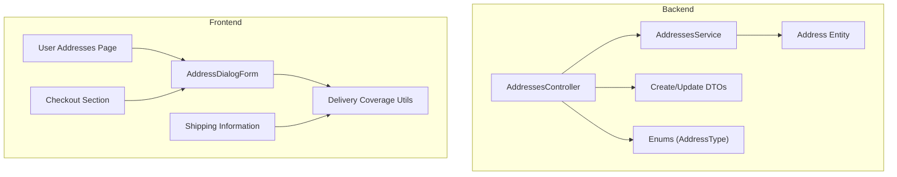
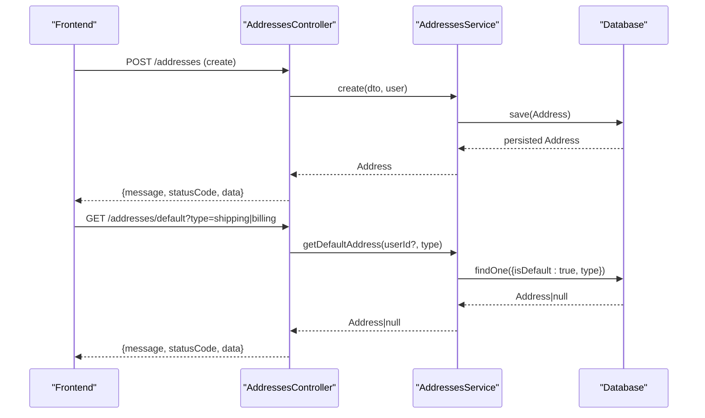
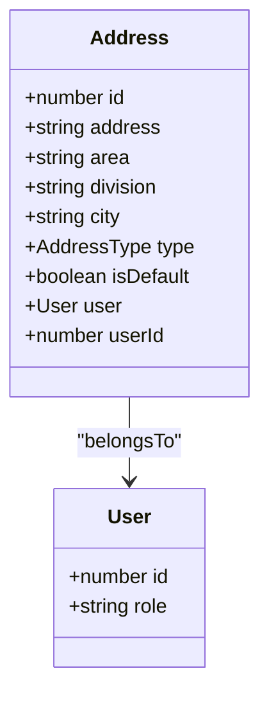
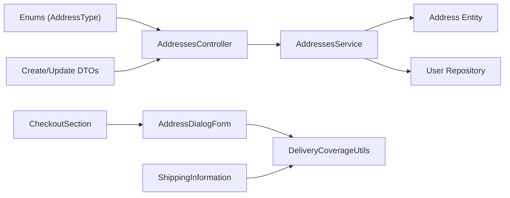

# Address Management

<cite>
**Referenced Files in This Document**
- [address.entity.ts](file://apps/backend/src/address/entities/address.entity.ts)
- [create-address.dto.ts](file://apps/backend/src/address/dto/create-address.dto.ts)
- [update-address.dto.ts](file://apps/backend/src/address/dto/update-address.dto.ts)
- [address.controller.ts](file://apps/backend/src/address/address.controller.ts)
- [address.service.ts](file://apps/backend/src/address/address.service.ts)
- [enums/index.ts](file://apps/backend/src/common/enums/index.ts)
- [delivery-coverage.ts](file://apps/frontend/lib/delivery-coverage.ts)
- [AddressDialogForm.tsx](file://apps/frontend/components/user-account/AddressDialogForm.tsx)
- [user-address.tsx](file://apps/frontend/components/user-account/user-address.tsx)
- [shipping-information.tsx](file://apps/frontend/components/checkout/shipping-information.tsx)
- [checkoutSection.tsx](file://apps/frontend/components/checkout/checkoutSection.tsx)
- [migrate-address-locations.js](file://apps/backend/scripts/migrate-address-locations.js)
</cite>

## Table of Contents
1. [Introduction](#introduction)
2. [Project Structure](#project-structure)
3. [Core Components](#core-components)
4. [Architecture Overview](#architecture-overview)
5. [Detailed Component Analysis](#detailed-component-analysis)
6. [Dependency Analysis](#dependency-analysis)
7. [Performance Considerations](#performance-considerations)
8. [Troubleshooting Guide](#troubleshooting-guide)
9. [Conclusion](#conclusion)

## Introduction
This document explains the address management system across backend and frontend. It covers:
- Address entity structure (street, city, district, area, geolocation coordinates)
- Multiple addresses per user with default selection and categorization (shipping, billing)
- Validation rules and DTOs
- Delivery zone checking via business settings
- Frontend forms, map integration notes, and autocomplete patterns
- CRUD operations and integration with order processing
- Location-based services and delivery optimization considerations

## Project Structure
The address feature is implemented as a NestJS module on the backend and React components on the frontend. The backend exposes REST endpoints for address CRUD and default address retrieval. The frontend provides user-facing forms to add/edit addresses and integrates with checkout flows.

**Diagram sources**
- [address.controller.ts:38-219](file://apps/backend/src/address/address.controller.ts#L38-L219)
- [address.service.ts:15-157](file://apps/backend/src/address/address.service.ts#L15-L157)
- [address.entity.ts:13-46](file://apps/backend/src/address/entities/address.entity.ts#L13-L46)
- [create-address.dto.ts:11-44](file://apps/backend/src/address/dto/create-address.dto.ts#L11-L44)
- [update-address.dto.ts:1-5](file://apps/backend/src/address/dto/update-address.dto.ts#L1-L5)
- [enums/index.ts:1-4](file://apps/backend/src/common/enums/index.ts#L1-L4)
- [AddressDialogForm.tsx:45-124](file://apps/frontend/components/user-account/AddressDialogForm.tsx#L45-L124)
- [user-address.tsx:100-282](file://apps/frontend/components/user-account/user-address.tsx#L100-L282)
- [shipping-information.tsx:39-106](file://apps/frontend/components/checkout/shipping-information.tsx#L39-L106)
- [checkoutSection.tsx:116-427](file://apps/frontend/components/checkout/checkoutSection.tsx#L116-L427)
- [delivery-coverage.ts:1-134](file://apps/frontend/lib/delivery-coverage.ts#L1-L134)

**Section sources**
- [address.controller.ts:38-219](file://apps/backend/src/address/address.controller.ts#L38-L219)
- [address.service.ts:15-157](file://apps/backend/src/address/address.service.ts#L15-L157)
- [address.entity.ts:13-46](file://apps/backend/src/address/entities/address.entity.ts#L13-L46)
- [create-address.dto.ts:11-44](file://apps/backend/src/address/dto/create-address.dto.ts#L11-L44)
- [update-address.dto.ts:1-5](file://apps/backend/src/address/dto/update-address.dto.ts#L1-L5)
- [enums/index.ts:1-4](file://apps/backend/src/common/enums/index.ts#L1-L4)
- [delivery-coverage.ts:1-134](file://apps/frontend/lib/delivery-coverage.ts#L1-L134)
- [AddressDialogForm.tsx:45-124](file://apps/frontend/components/user-account/AddressDialogForm.tsx#L45-L124)
- [user-address.tsx:100-282](file://apps/frontend/components/user-account/user-address.tsx#L100-L282)
- [shipping-information.tsx:39-106](file://apps/frontend/components/checkout/shipping-information.tsx#L39-L106)
- [checkoutSection.tsx:116-427](file://apps/frontend/components/checkout/checkoutSection.tsx#L116-L427)

## Core Components
- Backend API controller exposing secure endpoints for creating, listing, retrieving defaults, updating, and deleting addresses.
- Service layer handling business logic including default address management and user scoping.
- Data Transfer Objects defining validation rules for create/update payloads.
- Entity mapping address fields and relationships to users.
- Frontend form component with Zod validation and dynamic field visibility based on business settings.
- Delivery coverage utilities that normalize and filter divisions, cities, and areas.
- Checkout integration that creates an address inline during order placement.

Key responsibilities:
- Controller: request routing, authentication, authorization, response shaping.
- Service: persistence, default address normalization, queries by user/type.
- DTOs: input validation and Swagger documentation.
- Entity: database schema and relations.
- Frontend: user experience, validation, and integration with checkout.

**Section sources**
- [address.controller.ts:38-219](file://apps/backend/src/address/address.controller.ts#L38-L219)
- [address.service.ts:15-157](file://apps/backend/src/address/address.service.ts#L15-L157)
- [create-address.dto.ts:11-44](file://apps/backend/src/address/dto/create-address.dto.ts#L11-L44)
- [update-address.dto.ts:1-5](file://apps/backend/src/address/dto/update-address.dto.ts#L1-L5)
- [address.entity.ts:13-46](file://apps/backend/src/address/entities/address.entity.ts#L13-L46)
- [AddressDialogForm.tsx:45-124](file://apps/frontend/components/user-account/AddressDialogForm.tsx#L45-L124)
- [delivery-coverage.ts:1-134](file://apps/frontend/lib/delivery-coverage.ts#L1-L134)

## Architecture Overview
The address system follows a layered architecture:
- Presentation layer (frontend): forms and pages manage user interactions.
- API layer (backend controller): validates requests, enforces auth/authz, delegates to service.
- Business layer (service): implements domain rules such as default address handling and user-scoped queries.
- Persistence layer (entity/repository): stores and retrieves address records.

**Diagram sources**
- [address.controller.ts:45-109](file://apps/backend/src/address/address.controller.ts#L45-L109)
- [address.service.ts:24-124](file://apps/backend/src/address/address.service.ts#L24-L124)

## Detailed Component Analysis

### Address Entity and Data Model
The Address entity includes:
- id: primary key
- address: street-level text
- area: neighborhood or locality
- division: administrative region
- city: district/city name
- type: shipping or billing
- isDefault: boolean flag for default selection
- user: relation to User

Geolocation coordinates are not present in the current entity. If needed, latitude/longitude can be added later.

**Diagram sources**
- [address.entity.ts:13-46](file://apps/backend/src/address/entities/address.entity.ts#L13-L46)
- [enums/index.ts:1-4](file://apps/backend/src/common/enums/index.ts#L1-L4)

**Section sources**
- [address.entity.ts:13-46](file://apps/backend/src/address/entities/address.entity.ts#L13-L46)
- [enums/index.ts:1-4](file://apps/backend/src/common/enums/index.ts#L1-L4)

### Backend API Endpoints
Endpoints:
- POST /addresses: create address
- GET /addresses: list all (admin sees all; regular users see own), optional type filter
- GET /addresses/default?type=shipping|billing: get default address by type
- GET /addresses/:id: get single address
- PATCH /addresses/:id: update address
- DELETE /addresses/:id: delete address
- GET /addresses/user/:userId?type=...: list addresses by user ID (users can only access their own)

Authentication and authorization:
- JWT guard protects most endpoints.
- Admin guard required for admin-only listing.
- Role checks ensure non-admin users cannot access other users’ addresses.

Response format:
- Standardized ApiResponseDto envelope with message, statusCode, and data.

**Section sources**
- [address.controller.ts:38-219](file://apps/backend/src/address/address.controller.ts#L38-L219)

### Service Layer Logic
Responsibilities:
- Create: validates user existence, unsets previous default for same type if setting new default, persists address.
- FindAllByUser: filters by user and optional type, orders by default first.
- FindOne: finds by id with optional user scoping.
- Update: applies updates and handles default toggling.
- Remove: deletes address with user scoping.
- GetDefaultAddress: returns default address filtered by user and type.
- findByUserId: ensures user exists before returning addresses.
- unsetDefaultAddresses: helper to clear default flags for a given user and type.

Error handling:
- NotFoundException for missing resources.
- InternalServerErrorException for unexpected failures.

**Section sources**
- [address.service.ts:15-157](file://apps/backend/src/address/address.service.ts#L15-L157)

### DTOs and Validation Rules
CreateAddressDto:
- address: required string
- area: optional string
- division: optional string
- city: optional string
- type: required enum (shipping/billing)
- isDefault: optional boolean

UpdateAddressDto:
- Partial of CreateAddressDto

Validation:
- class-validator decorators enforce types, presence, and enums.
- Swagger annotations provide API docs.

Note: Area/division/city are nullable at the DB level and optional in DTOs to support admin-configured field visibility.

**Section sources**
- [create-address.dto.ts:11-44](file://apps/backend/src/address/dto/create-address.dto.ts#L11-L44)
- [update-address.dto.ts:1-5](file://apps/backend/src/address/dto/update-address.dto.ts#L1-L5)

### Frontend Address Forms and Validation
AddressDialogForm:
- Uses Zod schema to validate inputs dynamically based on enabled fields from business settings.
- Supports add and edit modes.
- Integrates with delivery coverage utilities to show/hide division/city/area fields and pre-select when only one option is available.
- Submits via API utils and triggers server revalidation.

Validation rules:
- address: required
- area: required when enabled
- division: required when enabled
- city: required when enabled
- type: must be shipping or billing
- isDefault: boolean toggle

UX behaviors:
- Cascading selects: choosing division filters cities; choosing city filters areas.
- Pre-selection when only one valid option remains.
- Success/error toasts and revalidation after mutations.

**Section sources**
- [AddressDialogForm.tsx:45-124](file://apps/frontend/components/user-account/AddressDialogForm.tsx#L45-L124)
- [AddressDialogForm.tsx:175-207](file://apps/frontend/components/user-account/AddressDialogForm.tsx#L175-L207)

### Delivery Zone Checking and Coverage Utilities
DeliveryCoverage:
- Normalizes legacy formats into a consistent list structure with enabled flags.
- Provides functions to retrieve enabled divisions, cities, and areas.
- Falls back to bundled dataset when no configuration exists.

Usage:
- Address forms and checkout sections compute which fields to show and pre-select values based on enabled options.

**Section sources**
- [delivery-coverage.ts:1-134](file://apps/frontend/lib/delivery-coverage.ts#L1-L134)

### Checkout Integration and Order Processing
ShippingInformation:
- Reads business settings to determine enabled divisions/cities/areas.
- Shows AddressSelector for existing addresses and allows adding new ones.
- Auto-preselects single-option fields for streamlined UX.

CheckoutSection:
- When placing an order, if a new address is provided, it creates an address with type shipping and marks it as default.
- Captures errors and shows toast notifications.
- Proceeds with order flow using the created or selected address ID.

**Section sources**
- [shipping-information.tsx:39-106](file://apps/frontend/components/checkout/shipping-information.tsx#L39-L106)
- [checkoutSection.tsx:116-427](file://apps/frontend/components/checkout/checkoutSection.tsx#L116-L427)

### User Address Management UI
UserAddresses page:
- Displays list of addresses with labels for address, division, city, area.
- Supports adding, editing, and deleting addresses.
- Uses AddressDialog for add/edit operations.
- Confirms deletion with a dialog.

**Section sources**
- [user-address.tsx:100-282](file://apps/frontend/components/user-account/user-address.tsx#L100-L282)

### Geocoding Services and Map Integration
Current implementation does not include geocoding or map integration in the address module. There is no latitude/longitude field in the Address entity, and no geocoding calls in the controller/service.

Recommendations:
- Add latitude/longitude columns to the Address entity.
- Integrate a geocoding provider (e.g., Google Maps, OpenStreetMap Nominatim) to resolve coordinates from address strings.
- Expose a service method to update coordinates upon address creation/update.
- Optionally store normalized location metadata (district/area canonical names) using the migration script’s matching logic.

**Section sources**
- [address.entity.ts:13-46](file://apps/backend/src/address/entities/address.entity.ts#L13-L46)

### Address Autocomplete Functionality
Autocomplete is not explicitly implemented in the address module. The frontend uses searchable select components for city/area selection constrained by delivery coverage.

To implement autocomplete:
- Use SearchableSelect components for address fields where appropriate.
- Provide client-side filtering against enabled lists from delivery-coverage utilities.
- For free-form address fields, integrate a geocoder-backed suggestion API.

**Section sources**
- [AddressDialogForm.tsx:259-323](file://apps/frontend/components/user-account/AddressDialogForm.tsx#L259-L323)
- [delivery-coverage.ts:96-133](file://apps/frontend/lib/delivery-coverage.ts#L96-L133)

### Default Address Selection and Categorization
Default behavior:
- When creating or updating an address with isDefault=true, the service clears the default flag for the same type under the same user before saving.
- Default addresses can be retrieved by type (shipping/billing).

Categorization:
- AddressType enum supports shipping and billing.
- Frontend forms allow selecting shipping or billing.

**Section sources**
- [address.service.ts:24-40](file://apps/backend/src/address/address.service.ts#L24-L40)
- [address.service.ts:78-97](file://apps/backend/src/address/address.service.ts#L78-L97)
- [address.service.ts:109-124](file://apps/backend/src/address/address.service.ts#L109-L124)
- [enums/index.ts:1-4](file://apps/backend/src/common/enums/index.ts#L1-L4)

### Migration and Canonicalization of Locations
A migration script normalizes city/area values using fuzzy matching and canonical datasets. It:
- Matches city/area pairs to canonical districts/areas.
- Reports unmatched rows for manual correction.
- Applies updates within a transaction.

Use cases:
- Backfilling canonical city/area values for historical addresses.
- Ensuring consistency between stored locations and delivery coverage lists.

**Section sources**
- [migrate-address-locations.js:592-700](file://apps/backend/scripts/migrate-address-locations.js#L592-L700)

## Dependency Analysis

**Diagram sources**
- [enums/index.ts:1-4](file://apps/backend/src/common/enums/index.ts#L1-L4)
- [address.controller.ts:38-219](file://apps/backend/src/address/address.controller.ts#L38-L219)
- [address.service.ts:15-157](file://apps/backend/src/address/address.service.ts#L15-L157)
- [address.entity.ts:13-46](file://apps/backend/src/address/entities/address.entity.ts#L13-L46)
- [AddressDialogForm.tsx:45-124](file://apps/frontend/components/user-account/AddressDialogForm.tsx#L45-L124)
- [delivery-coverage.ts:1-134](file://apps/frontend/lib/delivery-coverage.ts#L1-L134)
- [shipping-information.tsx:39-106](file://apps/frontend/components/checkout/shipping-information.tsx#L39-L106)
- [checkoutSection.tsx:116-427](file://apps/frontend/components/checkout/checkoutSection.tsx#L116-L427)

**Section sources**
- [address.controller.ts:38-219](file://apps/backend/src/address/address.controller.ts#L38-L219)
- [address.service.ts:15-157](file://apps/backend/src/address/address.service.ts#L15-L157)
- [address.entity.ts:13-46](file://apps/backend/src/address/entities/address.entity.ts#L13-L46)
- [AddressDialogForm.tsx:45-124](file://apps/frontend/components/user-account/AddressDialogForm.tsx#L45-L124)
- [delivery-coverage.ts:1-134](file://apps/frontend/lib/delivery-coverage.ts#L1-L134)
- [shipping-information.tsx:39-106](file://apps/frontend/components/checkout/shipping-information.tsx#L39-L106)
- [checkoutSection.tsx:116-427](file://apps/frontend/components/checkout/checkoutSection.tsx#L116-L427)

## Performance Considerations
- Query efficiency:
  - Use selective where clauses and relations to avoid unnecessary joins.
  - Index frequently queried fields like userId, type, and isDefault.
- Default address normalization:
  - Batch unset operations to minimize round trips.
- Frontend rendering:
  - Memoize derived lists (enabled divisions/cities/areas) to prevent recomputation.
- Geocoding:
  - Cache coordinates to reduce external API calls.
  - Debounce user input for autocomplete suggestions.

[No sources needed since this section provides general guidance]

## Troubleshooting Guide
Common issues and resolutions:
- Missing default address:
  - Ensure isDefault is set correctly and type matches query.
  - Verify unsetDefaultAddresses runs on create/update.
- Unauthorized access:
  - Non-admin users attempting to list another user’s addresses will receive a forbidden error.
- Validation errors:
  - Check DTO constraints and frontend Zod schema alignment.
- Delivery coverage mismatch:
  - Normalize coverage data and verify enabled flags.
- Unmatched locations:
  - Run the migration script to canonicalize city/area values and review unmatched rows.

**Section sources**
- [address.controller.ts:200-219](file://apps/backend/src/address/address.controller.ts#L200-L219)
- [address.service.ts:148-157](file://apps/backend/src/address/address.service.ts#L148-L157)
- [create-address.dto.ts:11-44](file://apps/backend/src/address/dto/create-address.dto.ts#L11-L44)
- [delivery-coverage.ts:35-94](file://apps/frontend/lib/delivery-coverage.ts#L35-L94)
- [migrate-address-locations.js:638-700](file://apps/backend/scripts/migrate-address-locations.js#L638-L700)

## Conclusion
The address management system provides robust CRUD operations, default address handling, and delivery zone validation through business settings. The frontend offers intuitive forms with dynamic field visibility and preselection. While geocoding and map integration are not yet implemented, the architecture supports future enhancements. The migration tool helps maintain data quality by canonicalizing location values.

[No sources needed since this section summarizes without analyzing specific files]