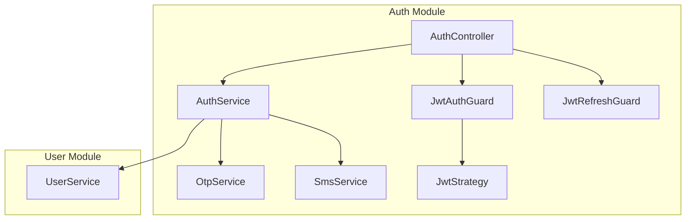
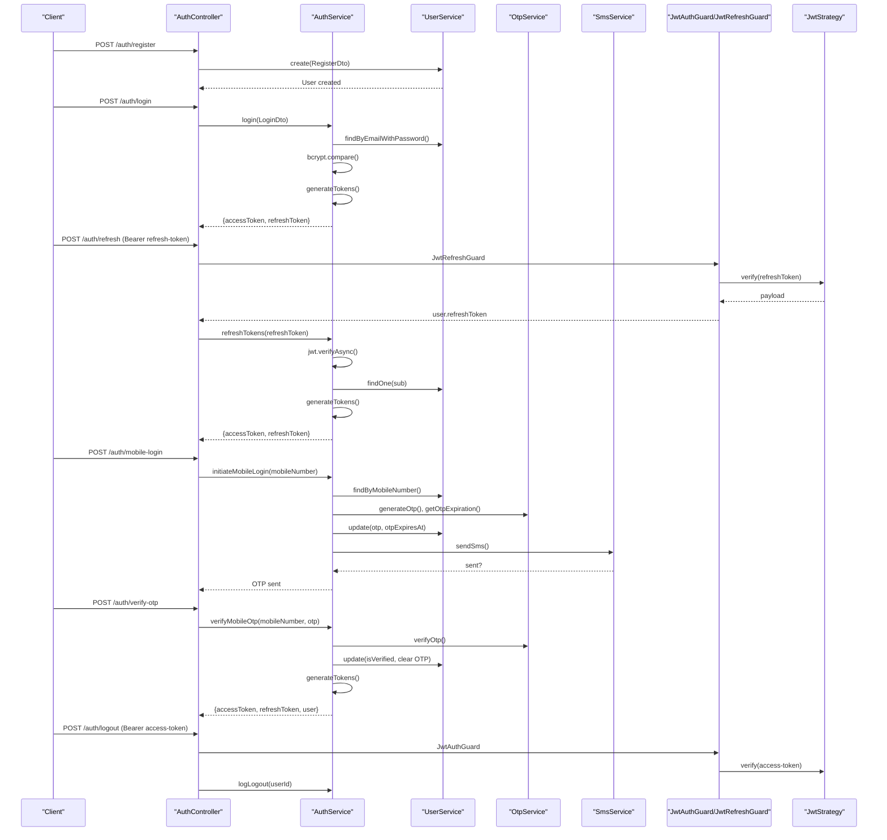
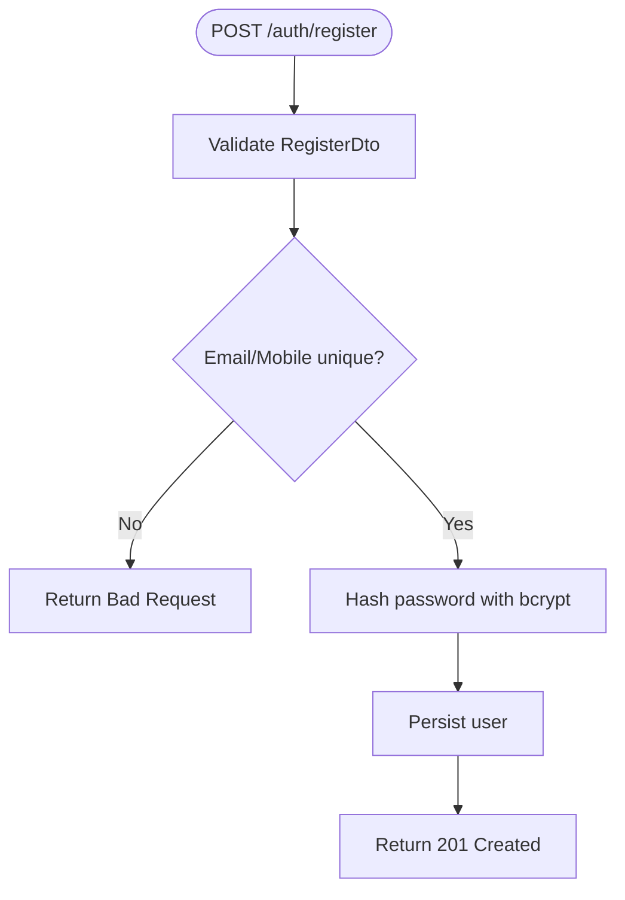
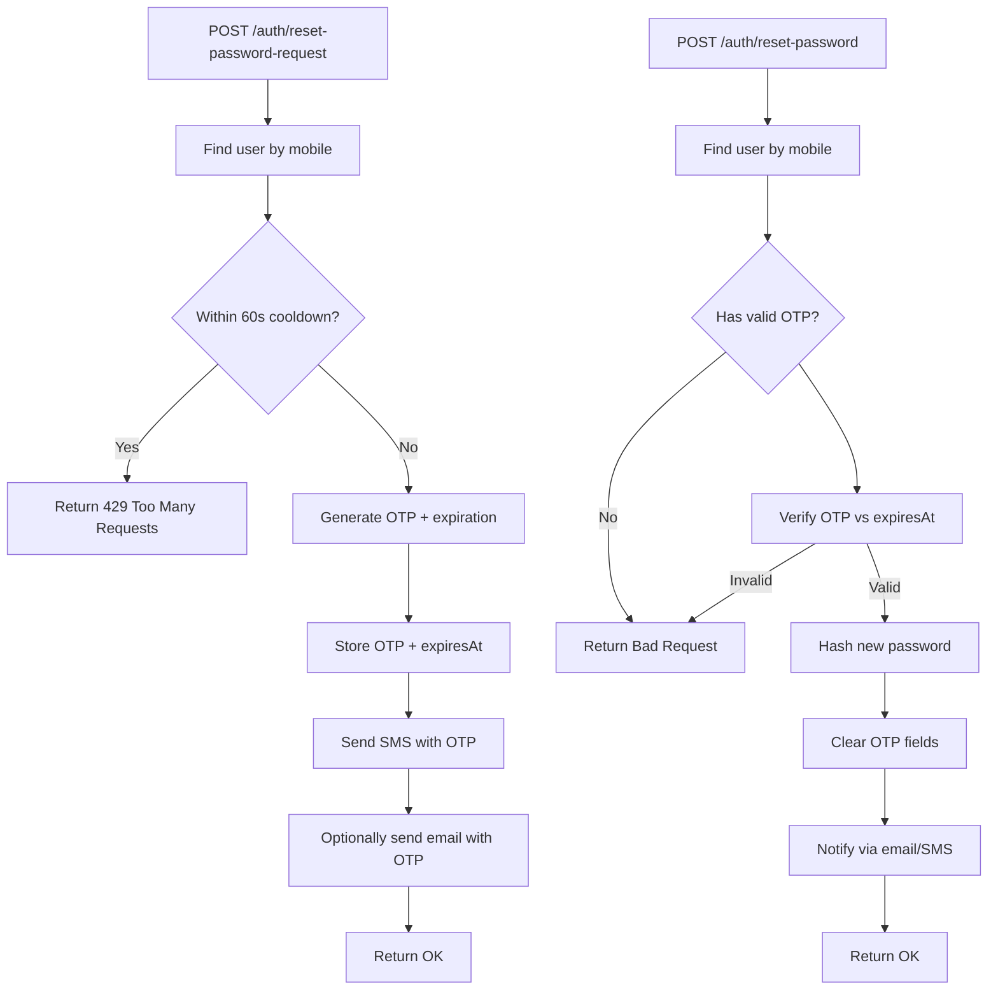
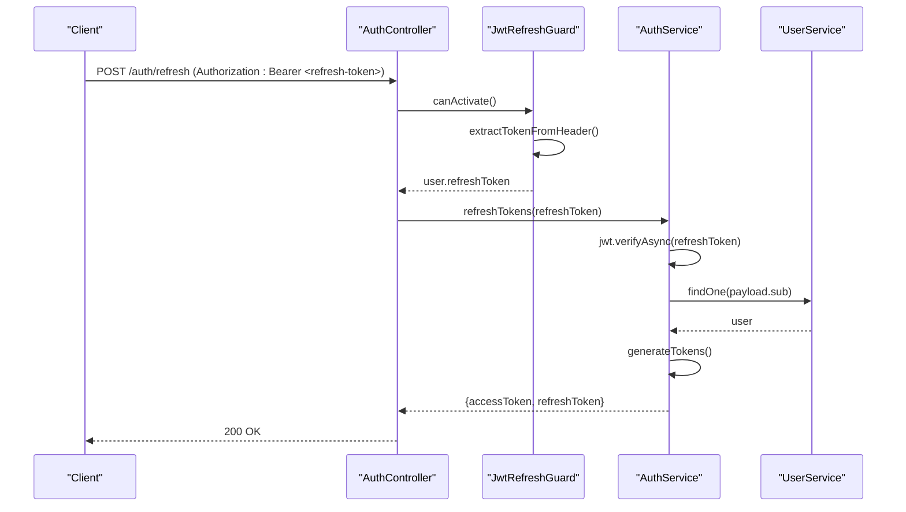
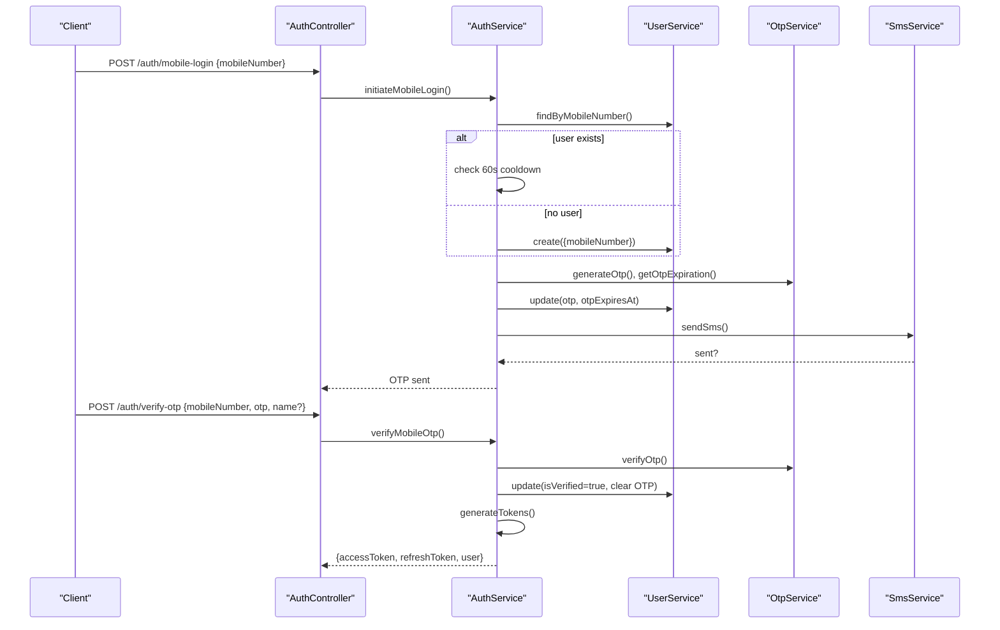
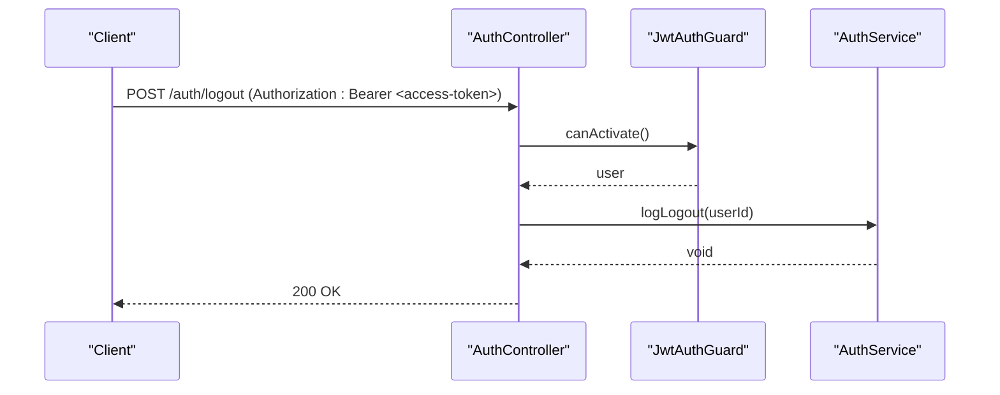
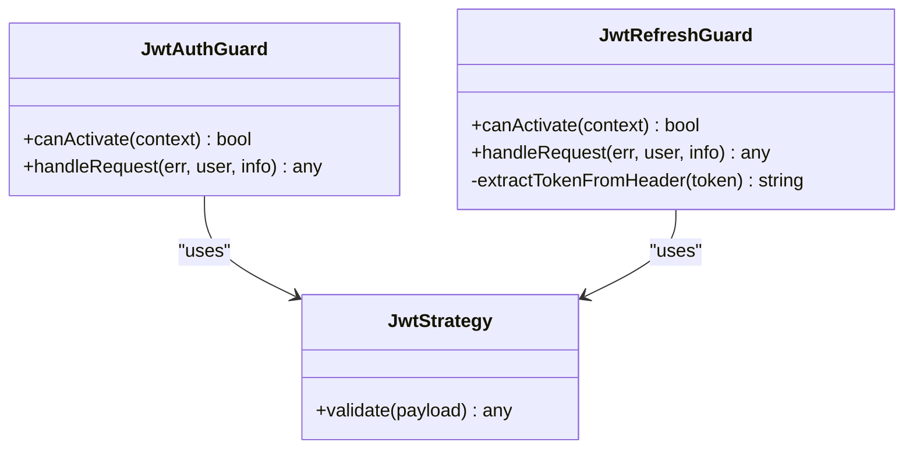
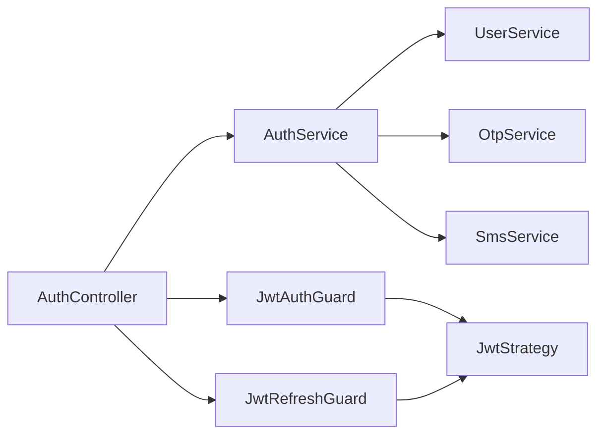

# Authentication & Security

<cite>
**Referenced Files in This Document**
- [auth.controller.ts](file://apps/backend/src/auth/auth.controller.ts)
- [auth.service.ts](file://apps/backend/src/auth/auth.service.ts)
- [otp.service.ts](file://apps/backend/src/auth/otp.service.ts)
- [sms.service.ts](file://apps/backend/src/auth/sms.service.ts)
- [jwt-auth.guard.ts](file://apps/backend/src/auth/guards/jwt-auth.guard.ts)
- [jwt-refresh.guard.ts](file://apps/backend/src/auth/guards/jwt-refresh.guard.ts)
- [jwt.strategy.ts](file://apps/backend/src/auth/strategies/jwt.strategy.ts)
- [user.service.ts](file://apps/backend/src/user/user.service.ts)
- [register.dto.ts](file://apps/backend/src/auth/dto/register.dto.ts)
- [login.dto.ts](file://apps/backend/src/auth/dto/login.dto.ts)
- [mobile-login.dto.ts](file://apps/backend/src/auth/dto/mobile-login.dto.ts)
</cite>

## Table of Contents
1. [Introduction](#introduction)
2. [Project Structure](#project-structure)
3. [Core Components](#core-components)
4. [Architecture Overview](#architecture-overview)
5. [Detailed Component Analysis](#detailed-component-analysis)
6. [Dependency Analysis](#dependency-analysis)
7. [Performance Considerations](#performance-considerations)
8. [Troubleshooting Guide](#troubleshooting-guide)
9. [Conclusion](#conclusion)

## Introduction
This document explains the authentication and security system implemented in the backend. It covers user registration with password hashing, email verification flows, OTP-based mobile login, JWT access and refresh tokens (including rotation), password reset via OTP, session management and logout, protected routes and guards, error handling, and security best practices such as rate limiting and brute-force prevention.

## Project Structure
The authentication subsystem is organized under the auth module with controllers, services, DTOs, guards, strategies, and integrations for OTP and SMS. User persistence and password operations are handled by the user service.

**Diagram sources**
- [auth.controller.ts:31-36](file://apps/backend/src/auth/auth.controller.ts#L31-L36)
- [auth.service.ts:21-32](file://apps/backend/src/auth/auth.service.ts#L21-L32)
- [otp.service.ts:4-6](file://apps/backend/src/auth/otp.service.ts#L4-L6)
- [sms.service.ts:6-10](file://apps/backend/src/auth/sms.service.ts#L6-L10)
- [jwt-auth.guard.ts:10-15](file://apps/backend/src/auth/guards/jwt-auth.guard.ts#L10-L15)
- [jwt-refresh.guard.ts:10-15](file://apps/backend/src/auth/guards/jwt-refresh.guard.ts#L10-L15)
- [jwt.strategy.ts:6-14](file://apps/backend/src/auth/strategies/jwt.strategy.ts#L6-L14)
- [user.service.ts:29-42](file://apps/backend/src/user/user.service.ts#L29-L42)

**Section sources**
- [auth.controller.ts:31-36](file://apps/backend/src/auth/auth.controller.ts#L31-L36)
- [auth.service.ts:21-32](file://apps/backend/src/auth/auth.service.ts#L21-L32)
- [user.service.ts:29-42](file://apps/backend/src/user/user.service.ts#L29-L42)

## Core Components
- AuthController: Exposes endpoints for register, login, refresh, logout, validate, mobile-login, verify-otp. Applies throttling and guard decorators.
- AuthService: Implements login validation, token generation, refresh logic, mobile OTP flow, and activity logging.
- OtpService: Generates OTPs, computes expiration, validates OTPs against expiry.
- SmsService: Sends OTP messages via an external SMS gateway.
- JwtStrategy: Validates access tokens using Passport-JWT.
- JwtAuthGuard / JwtRefreshGuard: Enforce authentication for access and refresh token flows.
- UserService: Persists users, hashes passwords with bcrypt, manages OTP fields, last login updates, and password reset workflows.

Key responsibilities:
- Registration: Validate input, hash password, persist user.
- Login: Verify credentials, issue access and refresh tokens.
- Refresh: Validate refresh token, rotate tokens.
- Mobile login: Send OTP, verify OTP, issue tokens.
- Password reset: Generate OTP, send via SMS/email, verify OTP, update password.
- Session/logout: Log logout activity; clients should discard tokens.

**Section sources**
- [auth.controller.ts:38-307](file://apps/backend/src/auth/auth.controller.ts#L38-L307)
- [auth.service.ts:54-170](file://apps/backend/src/auth/auth.service.ts#L54-L170)
- [otp.service.ts:8-33](file://apps/backend/src/auth/otp.service.ts#L8-L33)
- [sms.service.ts:12-62](file://apps/backend/src/auth/sms.service.ts#L12-L62)
- [jwt.strategy.ts:6-25](file://apps/backend/src/auth/strategies/jwt.strategy.ts#L6-L25)
- [jwt-auth.guard.ts:10-45](file://apps/backend/src/auth/guards/jwt-auth.guard.ts#L10-L45)
- [jwt-refresh.guard.ts:10-61](file://apps/backend/src/auth/guards/jwt-refresh.guard.ts#L10-L61)
- [user.service.ts:561-629](file://apps/backend/src/user/user.service.ts#L561-L629)

## Architecture Overview
The authentication architecture uses a controller-driven API with service-layer business logic, guarded routes, and JWT strategy-based token validation. OTP and SMS are integrated for mobile login and password reset.

**Diagram sources**
- [auth.controller.ts:38-307](file://apps/backend/src/auth/auth.controller.ts#L38-L307)
- [auth.service.ts:75-170](file://apps/backend/src/auth/auth.service.ts#L75-L170)
- [auth.service.ts:172-358](file://apps/backend/src/auth/auth.service.ts#L172-L358)
- [auth.service.ts:364-431](file://apps/backend/src/auth/auth.service.ts#L364-L431)
- [otp.service.ts:8-33](file://apps/backend/src/auth/otp.service.ts#L8-L33)
- [sms.service.ts:12-62](file://apps/backend/src/auth/sms.service.ts#L12-L62)
- [jwt.strategy.ts:6-25](file://apps/backend/src/auth/strategies/jwt.strategy.ts#L6-L25)
- [jwt-auth.guard.ts:10-45](file://apps/backend/src/auth/guards/jwt-auth.guard.ts#L10-L45)
- [jwt-refresh.guard.ts:10-61](file://apps/backend/src/auth/guards/jwt-refresh.guard.ts#L10-L61)
- [user.service.ts:808-829](file://apps/backend/src/user/user.service.ts#L808-L829)

## Detailed Component Analysis

### User Registration Flow
- Input validation: Email format, name length, password strength, optional mobile number.
- Password hashing: Uses bcrypt with salt rounds to store secure hashes.
- Persistence: Creates user with default role if none provided; checks uniqueness for email and mobile number.
- Response: Returns created user data.

**Diagram sources**
- [register.dto.ts:13-62](file://apps/backend/src/auth/dto/register.dto.ts#L13-L62)
- [user.service.ts:561-629](file://apps/backend/src/user/user.service.ts#L561-L629)

**Section sources**
- [auth.controller.ts:38-79](file://apps/backend/src/auth/auth.controller.ts#L38-L79)
- [register.dto.ts:13-62](file://apps/backend/src/auth/dto/register.dto.ts#L13-L62)
- [user.service.ts:561-629](file://apps/backend/src/user/user.service.ts#L561-L629)

### Email Verification
- The current implementation does not include an explicit email verification endpoint or workflow in the referenced files. Registration returns user data without requiring email confirmation before issuing tokens. If email verification is required, it should be added as a dedicated flow that marks the user’s verified status after confirming a token sent to the email.

[No sources needed since this section describes a missing feature]

### Password Reset with Secure Token Generation and Delivery
- OTP generation: Uses OtpService to generate a 6-digit code and compute expiration time.
- Cooldown protection: Prevents resending within 60 seconds per mobile number.
- Delivery: Sends OTP via SMS and optionally via email as a fallback.
- Reset: Verifies OTP, hashes new password with bcrypt, clears OTP fields, and notifies user via both channels.

**Diagram sources**
- [user.service.ts:830-938](file://apps/backend/src/user/user.service.ts#L830-L938)
- [otp.service.ts:8-33](file://apps/backend/src/auth/otp.service.ts#L8-L33)
- [sms.service.ts:12-62](file://apps/backend/src/auth/sms.service.ts#L12-L62)

**Section sources**
- [user.service.ts:830-938](file://apps/backend/src/user/user.service.ts#L830-L938)
- [otp.service.ts:8-33](file://apps/backend/src/auth/otp.service.ts#L8-L33)
- [sms.service.ts:12-62](file://apps/backend/src/auth/sms.service.ts#L12-L62)

### JWT-Based Authentication and Token Rotation
- Access tokens: Signed with JWT_ACCESS_SECRET and short-lived expiration.
- Refresh tokens: Signed with JWT_REFRESH_SECRET and longer-lived expiration.
- Rotation: On refresh, a new pair of tokens is issued, replacing the previous ones.
- Guards: JwtAuthGuard enforces access token validation; JwtRefreshGuard enforces refresh token validation and attaches refreshToken to the request context.

**Diagram sources**
- [auth.controller.ts:116-150](file://apps/backend/src/auth/auth.controller.ts#L116-L150)
- [jwt-refresh.guard.ts:10-61](file://apps/backend/src/auth/guards/jwt-refresh.guard.ts#L10-L61)
- [auth.service.ts:107-170](file://apps/backend/src/auth/auth.service.ts#L107-L170)
- [user.service.ts:259-355](file://apps/backend/src/user/user.service.ts#L259-L355)

**Section sources**
- [auth.controller.ts:116-150](file://apps/backend/src/auth/auth.controller.ts#L116-L150)
- [auth.service.ts:107-170](file://apps/backend/src/auth/auth.service.ts#L107-L170)
- [jwt-refresh.guard.ts:10-61](file://apps/backend/src/auth/guards/jwt-refresh.guard.ts#L10-L61)
- [jwt.strategy.ts:6-25](file://apps/backend/src/auth/strategies/jwt.strategy.ts#L6-L25)

### OTP-Based Mobile Login
- Initiate: Validates mobile number, creates user if missing, generates OTP, stores OTP and expiration, sends SMS.
- Verify: Validates OTP format and expiry, marks user verified, clears OTP, issues tokens, logs activity.

**Diagram sources**
- [auth.controller.ts:231-307](file://apps/backend/src/auth/auth.controller.ts#L231-L307)
- [auth.service.ts:172-358](file://apps/backend/src/auth/auth.service.ts#L172-L358)
- [otp.service.ts:8-33](file://apps/backend/src/auth/otp.service.ts#L8-L33)
- [sms.service.ts:12-62](file://apps/backend/src/auth/sms.service.ts#L12-L62)
- [user.service.ts:822-829](file://apps/backend/src/user/user.service.ts#L822-L829)

**Section sources**
- [auth.controller.ts:231-307](file://apps/backend/src/auth/auth.controller.ts#L231-L307)
- [auth.service.ts:172-358](file://apps/backend/src/auth/auth.service.ts#L172-L358)
- [mobile-login.dto.ts:5-40](file://apps/backend/src/auth/dto/mobile-login.dto.ts#L5-L40)

### Logout and Session Management
- Logout endpoint requires a valid access token.
- Logs logout activity asynchronously; client should discard stored tokens.
- No server-side session invalidation is performed beyond activity logging.

**Diagram sources**
- [auth.controller.ts:152-195](file://apps/backend/src/auth/auth.controller.ts#L152-L195)
- [auth.service.ts:364-380](file://apps/backend/src/auth/auth.service.ts#L364-L380)
- [jwt-auth.guard.ts:10-45](file://apps/backend/src/auth/guards/jwt-auth.guard.ts#L10-L45)

**Section sources**
- [auth.controller.ts:152-195](file://apps/backend/src/auth/auth.controller.ts#L152-L195)
- [auth.service.ts:364-380](file://apps/backend/src/auth/auth.service.ts#L364-L380)

### Protected Routes and Guard Implementation
- JwtAuthGuard: Enforces access token validation and supports marking routes public via reflector metadata.
- JwtRefreshGuard: Enforces refresh token validation and ensures Authorization header presence.
- JwtStrategy: Extracts and validates access tokens, mapping payload to user context.

**Diagram sources**
- [jwt-auth.guard.ts:10-45](file://apps/backend/src/auth/guards/jwt-auth.guard.ts#L10-L45)
- [jwt-refresh.guard.ts:10-61](file://apps/backend/src/auth/guards/jwt-refresh.guard.ts#L10-L61)
- [jwt.strategy.ts:6-25](file://apps/backend/src/auth/strategies/jwt.strategy.ts#L6-L25)

**Section sources**
- [jwt-auth.guard.ts:10-45](file://apps/backend/src/auth/guards/jwt-auth.guard.ts#L10-L45)
- [jwt-refresh.guard.ts:10-61](file://apps/backend/src/auth/guards/jwt-refresh.guard.ts#L10-L61)
- [jwt.strategy.ts:6-25](file://apps/backend/src/auth/strategies/jwt.strategy.ts#L6-L25)

### Error Handling for Authentication Failures
- Invalid credentials: UnauthorizedException with standardized message.
- Invalid/expired tokens: UnauthorizedException from guards and strategy.
- Invalid refresh token: UnauthorizedException during refresh flow.
- Invalid OTP: UnauthorizedException or BadRequestException depending on step.
- Rate-limited requests: Throttler returns appropriate HTTP status codes.

**Section sources**
- [auth.service.ts:54-73](file://apps/backend/src/auth/auth.service.ts#L54-L73)
- [auth.service.ts:107-144](file://apps/backend/src/auth/auth.service.ts#L107-L144)
- [auth.service.ts:252-358](file://apps/backend/src/auth/auth.service.ts#L252-L358)
- [jwt-auth.guard.ts:31-45](file://apps/backend/src/auth/guards/jwt-auth.guard.ts#L31-L45)
- [jwt-refresh.guard.ts:41-61](file://apps/backend/src/auth/guards/jwt-refresh.guard.ts#L41-L61)

## Dependency Analysis
The following diagram shows key dependencies among authentication components.

**Diagram sources**
- [auth.controller.ts:31-36](file://apps/backend/src/auth/auth.controller.ts#L31-L36)
- [auth.service.ts:21-32](file://apps/backend/src/auth/auth.service.ts#L21-L32)
- [jwt-auth.guard.ts:10-15](file://apps/backend/src/auth/guards/jwt-auth.guard.ts#L10-L15)
- [jwt-refresh.guard.ts:10-15](file://apps/backend/src/auth/guards/jwt-refresh.guard.ts#L10-L15)
- [jwt.strategy.ts:6-14](file://apps/backend/src/auth/strategies/jwt.strategy.ts#L6-L14)

**Section sources**
- [auth.controller.ts:31-36](file://apps/backend/src/auth/auth.controller.ts#L31-L36)
- [auth.service.ts:21-32](file://apps/backend/src/auth/auth.service.ts#L21-L32)

## Performance Considerations
- Non-blocking audit writes: Login and logout activity logging are fire-and-forget to avoid impacting response latency.
- Parallel token signing: Access and refresh tokens are signed concurrently.
- Database write latency: Comments indicate test DB latency can be high; non-critical operations are decoupled from critical paths.

Recommendations:
- Keep OTP resend cooldowns and throttling tuned to expected traffic patterns.
- Monitor SMS gateway latency and failures; consider retries or fallback channels.
- Use connection pooling and query optimization for user lookups during high load.

[No sources needed since this section provides general guidance]

## Troubleshooting Guide
Common issues and resolutions:
- Invalid credentials: Ensure correct email/password; verify password hashing and comparison logic.
- Invalid refresh token: Confirm refresh token is present and not expired; ensure separate secret configuration.
- OTP resend blocked: Respect 60-second cooldown per mobile number; check OTP validity window.
- SMS delivery failures: Verify SMS_API_KEY, SMS_SENDER_NUMBER, and SMS_SEND_URL; inspect gateway responses.
- Logout not revoking sessions: Clients must discard tokens; server currently only logs logout activity.

**Section sources**
- [auth.service.ts:54-73](file://apps/backend/src/auth/auth.service.ts#L54-L73)
- [auth.service.ts:107-144](file://apps/backend/src/auth/auth.service.ts#L107-L144)
- [auth.service.ts:172-250](file://apps/backend/src/auth/auth.service.ts#L172-L250)
- [sms.service.ts:12-62](file://apps/backend/src/auth/sms.service.ts#L12-L62)
- [auth.controller.ts:152-195](file://apps/backend/src/auth/auth.controller.ts#L152-L195)

## Conclusion
The authentication system implements robust user registration with bcrypt password hashing, OTP-based mobile login, JWT access and refresh tokens with rotation, and a password reset flow secured by OTP and dual-channel notifications. Guards enforce token validation, and throttling mitigates brute-force attempts. For production hardening, consider adding CSRF protections where applicable, enforcing strict token rotation policies, and centralizing error responses.

[No sources needed since this section summarizes without analyzing specific files]