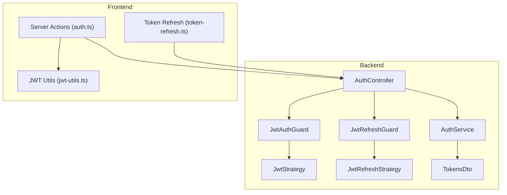
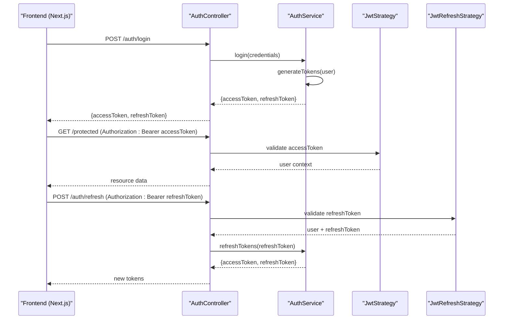
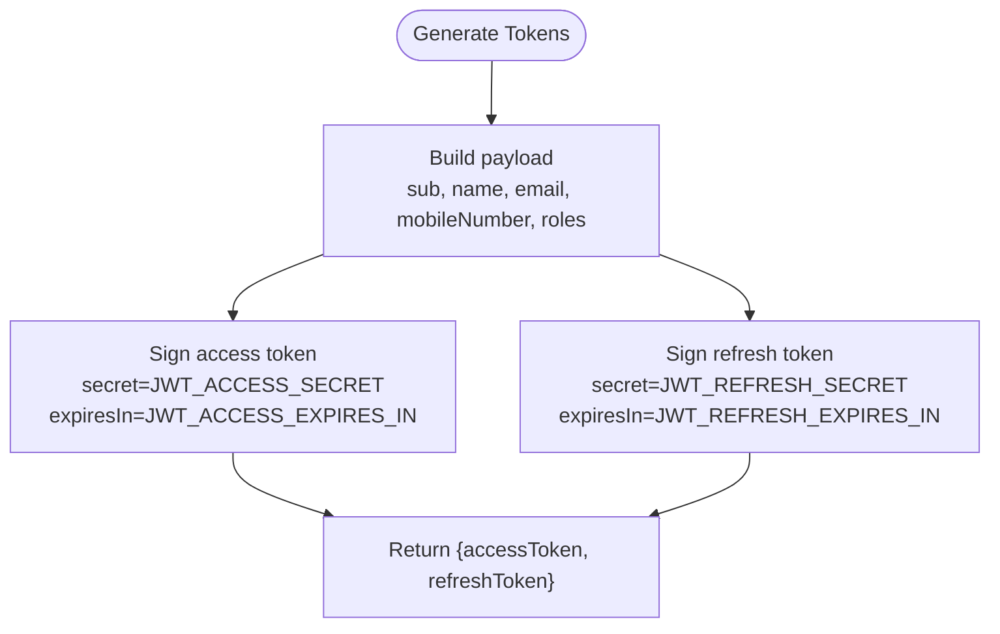
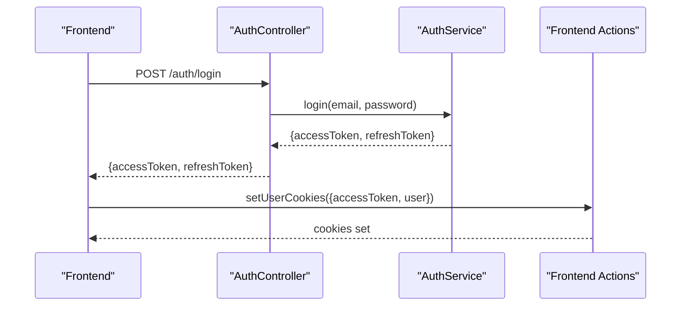
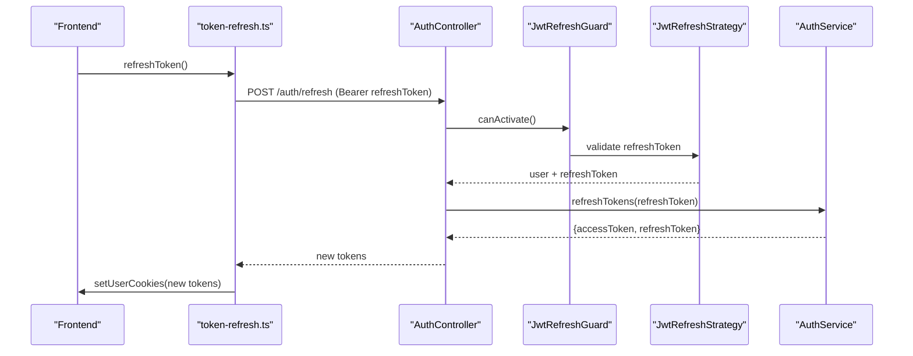
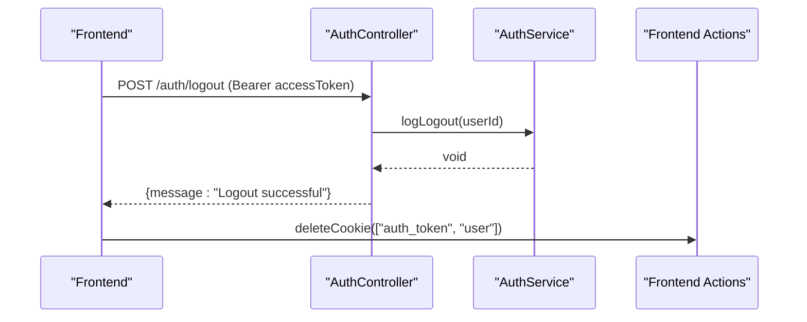
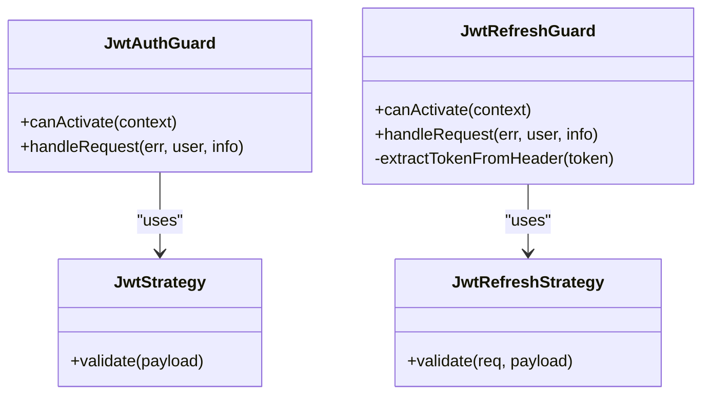
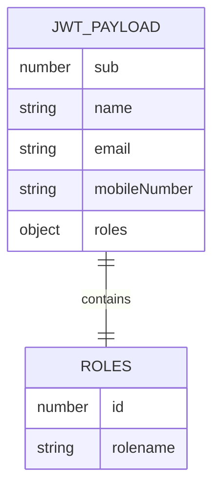
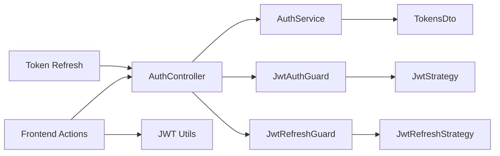

# JWT Authentication & Token Management

<cite>
**Referenced Files in This Document**
- [auth.controller.ts](file://apps/backend/src/auth/auth.controller.ts)
- [auth.service.ts](file://apps/backend/src/auth/auth.service.ts)
- [tokens.dto.ts](file://apps/backend/src/auth/dto/tokens.dto.ts)
- [jwt-auth.guard.ts](file://apps/backend/src/auth/guards/jwt-auth.guard.ts)
- [jwt-refresh.guard.ts](file://apps/backend/src/auth/guards/jwt-refresh.guard.ts)
- [jwt.strategy.ts](file://apps/backend/src/auth/strategies/jwt.strategy.ts)
- [jwt-refresh.strategy.ts](file://apps/backend/src/auth/strategies/jwt-refresh.strategy.ts)
- [token-refresh.ts](file://apps/frontend/utils/token-refresh.ts)
- [auth.ts](file://apps/frontend/actions/auth.ts)
- [jwt-utils.ts](file://apps/frontend/actions/jwt-utils.ts)
</cite>

## Table of Contents
1. [Introduction](#introduction)
2. [Project Structure](#project-structure)
3. [Core Components](#core-components)
4. [Architecture Overview](#architecture-overview)
5. [Detailed Component Analysis](#detailed-component-analysis)
6. [Dependency Analysis](#dependency-analysis)
7. [Performance Considerations](#performance-considerations)
8. [Troubleshooting Guide](#troubleshooting-guide)
9. [Conclusion](#conclusion)

## Introduction
This document explains the JWT-based authentication and token management implemented across the backend (NestJS) and frontend (Next.js). It covers the dual-token system using access tokens and refresh tokens, their lifetimes, payload structure, generation, validation, rotation, and security considerations. It also documents login, token refresh, logout, protected route guards, and frontend token handling including expiration checks and automatic refresh strategies.

## Project Structure
The authentication implementation is split between:
- Backend: controllers, services, guards, strategies, and DTOs under `apps/backend/src/auth`.
- Frontend: server actions for auth flows, cookie management, token utilities, and a dedicated refresh utility.

**Diagram sources**
- [auth.controller.ts:31-309](file://apps/backend/src/auth/auth.controller.ts#L31-L309)
- [auth.service.ts:21-170](file://apps/backend/src/auth/auth.service.ts#L21-L170)
- [jwt-auth.guard.ts:10-45](file://apps/backend/src/auth/guards/jwt-auth.guard.ts#L10-L45)
- [jwt-refresh.guard.ts:10-61](file://apps/backend/src/auth/guards/jwt-refresh.guard.ts#L10-L61)
- [jwt.strategy.ts:6-26](file://apps/backend/src/auth/strategies/jwt.strategy.ts#L6-L26)
- [jwt-refresh.strategy.ts:7-24](file://apps/backend/src/auth/strategies/jwt-refresh.strategy.ts#L7-L24)
- [tokens.dto.ts:4-27](file://apps/backend/src/auth/dto/tokens.dto.ts#L4-L27)
- [auth.ts:55-157](file://apps/frontend/actions/auth.ts#L55-L157)
- [token-refresh.ts:7-46](file://apps/frontend/utils/token-refresh.ts#L7-L46)
- [jwt-utils.ts:1-52](file://apps/frontend/actions/jwt-utils.ts#L1-L52)

**Section sources**
- [auth.controller.ts:31-309](file://apps/backend/src/auth/auth.controller.ts#L31-L309)
- [auth.service.ts:21-170](file://apps/backend/src/auth/auth.service.ts#L21-L170)
- [jwt-auth.guard.ts:10-45](file://apps/backend/src/auth/guards/jwt-auth.guard.ts#L10-L45)
- [jwt-refresh.guard.ts:10-61](file://apps/backend/src/auth/guards/jwt-refresh.guard.ts#L10-L61)
- [jwt.strategy.ts:6-26](file://apps/backend/src/auth/strategies/jwt.strategy.ts#L6-L26)
- [jwt-refresh.strategy.ts:7-24](file://apps/backend/src/auth/strategies/jwt-refresh.strategy.ts#L7-L24)
- [tokens.dto.ts:4-27](file://apps/backend/src/auth/dto/tokens.dto.ts#L4-L27)
- [auth.ts:55-157](file://apps/frontend/actions/auth.ts#L55-L157)
- [token-refresh.ts:7-46](file://apps/frontend/utils/token-refresh.ts#L7-L46)
- [jwt-utils.ts:1-52](file://apps/frontend/actions/jwt-utils.ts#L1-L52)

## Core Components
- AuthController: exposes endpoints for register, login, refresh, logout, validate, mobile-login, and verify-otp.
- AuthService: validates credentials, generates access and refresh tokens, handles refresh flow, and logs activity.
- JwtStrategy and JwtRefreshStrategy: Passport strategies that decode and validate access and refresh tokens respectively.
- JwtAuthGuard and JwtRefreshGuard: NestJS guards enforcing access-token or refresh-token requirements on routes.
- TokensDto: typed response shape for access and refresh tokens with Swagger documentation.
- Frontend Server Actions: handle login, registration, OTP verification, logout, and cookie persistence.
- Token Refresh Utility: calls the backend refresh endpoint and updates cookies on success.
- JWT Utils: decodes JWT payloads, extracts user info, and checks expiration.

Key responsibilities:
- Access tokens are used to authorize protected API calls.
- Refresh tokens are used to obtain new access tokens without re-authentication.
- Cookies store the access token and user profile securely on the server side.

**Section sources**
- [auth.controller.ts:31-309](file://apps/backend/src/auth/auth.controller.ts#L31-L309)
- [auth.service.ts:21-170](file://apps/backend/src/auth/auth.service.ts#L21-L170)
- [jwt.strategy.ts:6-26](file://apps/backend/src/auth/strategies/jwt.strategy.ts#L6-L26)
- [jwt-refresh.strategy.ts:7-24](file://apps/backend/src/auth/strategies/jwt-refresh.strategy.ts#L7-L24)
- [jwt-auth.guard.ts:10-45](file://apps/backend/src/auth/guards/jwt-auth.guard.ts#L10-L45)
- [jwt-refresh.guard.ts:10-61](file://apps/backend/src/auth/guards/jwt-refresh.guard.ts#L10-L61)
- [tokens.dto.ts:4-27](file://apps/backend/src/auth/dto/tokens.dto.ts#L4-L27)
- [auth.ts:55-157](file://apps/frontend/actions/auth.ts#L55-L157)
- [token-refresh.ts:7-46](file://apps/frontend/utils/token-refresh.ts#L7-L46)
- [jwt-utils.ts:1-52](file://apps/frontend/actions/jwt-utils.ts#L1-L52)

## Architecture Overview
The system uses a dual-token architecture:
- Login returns an access token and a refresh token.
- Protected routes require a valid access token via Bearer authorization.
- When the access token expires, the frontend calls the refresh endpoint with the refresh token to get a new pair.
- Logout invalidates the session at the backend and clears frontend cookies.

**Diagram sources**
- [auth.controller.ts:81-150](file://apps/backend/src/auth/auth.controller.ts#L81-L150)
- [auth.service.ts:75-170](file://apps/backend/src/auth/auth.service.ts#L75-L170)
- [jwt.strategy.ts:6-26](file://apps/backend/src/auth/strategies/jwt.strategy.ts#L6-L26)
- [jwt-refresh.strategy.ts:7-24](file://apps/backend/src/auth/strategies/jwt-refresh.strategy.ts#L7-L24)

## Detailed Component Analysis

### Dual-Token System: Access Token vs Refresh Token
- Access Token:
  - Used for authorizing requests to protected endpoints.
  - Validated by JwtStrategy and enforced by JwtAuthGuard.
  - Payload includes user identity and roles; see strategy mapping.
- Refresh Token:
  - Used only to obtain new access tokens via `/auth/refresh`.
  - Validated by JwtRefreshStrategy and enforced by JwtRefreshGuard.
  - Uses a separate secret from the access token.

Token generation:
- Both tokens are generated concurrently with distinct secrets and expiration settings.
- The payload contains user identifiers and role information.

Token rotation:
- Each successful refresh issues a new pair of tokens.
- The frontend replaces stored tokens after a successful refresh.

Security considerations:
- Separate secrets for access and refresh tokens reduce risk if one secret is compromised.
- Refresh token responses should not expose the refresh token in client-visible APIs; DTO marks it write-only.

**Section sources**
- [auth.service.ts:146-170](file://apps/backend/src/auth/auth.service.ts#L146-L170)
- [jwt.strategy.ts:6-26](file://apps/backend/src/auth/strategies/jwt.strategy.ts#L6-L26)
- [jwt-refresh.strategy.ts:7-24](file://apps/backend/src/auth/strategies/jwt-refresh.strategy.ts#L7-L24)
- [tokens.dto.ts:4-27](file://apps/backend/src/auth/dto/tokens.dto.ts#L4-L27)

### Token Generation and Validation
- Generation:
  - AuthService.generateTokens creates both tokens using configured secrets and expiration values.
- Validation:
  - JwtStrategy validates access tokens and maps payload to user context.
  - JwtRefreshStrategy validates refresh tokens and attaches the raw refresh token value for service use.

**Diagram sources**
- [auth.service.ts:146-170](file://apps/backend/src/auth/auth.service.ts#L146-L170)

**Section sources**
- [auth.service.ts:75-170](file://apps/backend/src/auth/auth.service.ts#L75-L170)
- [jwt.strategy.ts:6-26](file://apps/backend/src/auth/strategies/jwt.strategy.ts#L6-L26)
- [jwt-refresh.strategy.ts:7-24](file://apps/backend/src/auth/strategies/jwt-refresh.strategy.ts#L7-L24)

### Login Flow
- Client sends credentials to `/auth/login`.
- AuthService validates credentials and generates tokens.
- Frontend stores the access token and user profile in secure HTTP-only cookies.

**Diagram sources**
- [auth.controller.ts:81-114](file://apps/backend/src/auth/auth.controller.ts#L81-L114)
- [auth.service.ts:75-100](file://apps/backend/src/auth/auth.service.ts#L75-L100)
- [auth.ts:55-157](file://apps/frontend/actions/auth.ts#L55-L157)

**Section sources**
- [auth.controller.ts:81-114](file://apps/backend/src/auth/auth.controller.ts#L81-L114)
- [auth.service.ts:75-100](file://apps/backend/src/auth/auth.service.ts#L75-L100)
- [auth.ts:55-157](file://apps/frontend/actions/auth.ts#L55-L157)

### Token Refresh Process
- Frontend calls `/auth/refresh` with the refresh token when needed.
- Backend validates the refresh token and issues new tokens.
- Frontend updates cookies with the new access token and user data.

**Diagram sources**
- [token-refresh.ts:7-46](file://apps/frontend/utils/token-refresh.ts#L7-L46)
- [auth.controller.ts:116-150](file://apps/backend/src/auth/auth.controller.ts#L116-L150)
- [jwt-refresh.guard.ts:10-61](file://apps/backend/src/auth/guards/jwt-refresh.guard.ts#L10-L61)
- [jwt-refresh.strategy.ts:7-24](file://apps/backend/src/auth/strategies/jwt-refresh.strategy.ts#L7-L24)
- [auth.service.ts:107-144](file://apps/backend/src/auth/auth.service.ts#L107-L144)

**Section sources**
- [token-refresh.ts:7-46](file://apps/frontend/utils/token-refresh.ts#L7-L46)
- [auth.controller.ts:116-150](file://apps/backend/src/auth/auth.controller.ts#L116-L150)
- [auth.service.ts:107-144](file://apps/backend/src/auth/auth.service.ts#L107-L144)

### Logout Procedure
- Frontend calls `/auth/logout` with the current access token.
- Backend logs logout activity and returns success.
- Frontend deletes cookies to clear session state.

**Diagram sources**
- [auth.controller.ts:152-195](file://apps/backend/src/auth/auth.controller.ts#L152-L195)
- [auth.service.ts:364-380](file://apps/backend/src/auth/auth.service.ts#L364-L380)
- [auth.ts:240-266](file://apps/frontend/actions/auth.ts#L240-L266)

**Section sources**
- [auth.controller.ts:152-195](file://apps/backend/src/auth/auth.controller.ts#L152-L195)
- [auth.service.ts:364-380](file://apps/backend/src/auth/auth.service.ts#L364-L380)
- [auth.ts:240-266](file://apps/frontend/actions/auth.ts#L240-L266)

### Protected Routes and Guard Usage
- Access Token Guard:
  - JwtAuthGuard enforces access token presence and validity.
  - Supports public route overrides via reflector metadata.
- Refresh Token Guard:
  - JwtRefreshGuard enforces refresh token presence and validity.
  - Adds custom error handling and attaches refresh token to request.user.

**Diagram sources**
- [jwt-auth.guard.ts:10-45](file://apps/backend/src/auth/guards/jwt-auth.guard.ts#L10-L45)
- [jwt-refresh.guard.ts:10-61](file://apps/backend/src/auth/guards/jwt-refresh.guard.ts#L10-L61)
- [jwt.strategy.ts:6-26](file://apps/backend/src/auth/strategies/jwt.strategy.ts#L6-L26)
- [jwt-refresh.strategy.ts:7-24](file://apps/backend/src/auth/strategies/jwt-refresh.strategy.ts#L7-L24)

**Section sources**
- [jwt-auth.guard.ts:10-45](file://apps/backend/src/auth/guards/jwt-auth.guard.ts#L10-L45)
- [jwt-refresh.guard.ts:10-61](file://apps/backend/src/auth/guards/jwt-refresh.guard.ts#L10-L61)

### JWT Payload Structure
- Access Token Payload:
  - Contains user identity fields such as sub, name, email, mobileNumber, and roles.
  - Roles include identifier and rolename used for authorization decisions.
- Refresh Token Payload:
  - Similar structure but validated with a different secret and longer lifetime.

Frontend decoding:
- jwt-utils.decodeJwt parses the base64 payload.
- getUserFromToken extracts user fields and admin status.
- isTokenExpired checks exp against current time.

**Diagram sources**
- [auth.service.ts:146-170](file://apps/backend/src/auth/auth.service.ts#L146-L170)
- [jwt.strategy.ts:16-25](file://apps/backend/src/auth/strategies/jwt.strategy.ts#L16-L25)
- [jwt-utils.ts:24-43](file://apps/frontend/actions/jwt-utils.ts#L24-L43)

**Section sources**
- [auth.service.ts:146-170](file://apps/backend/src/auth/auth.service.ts#L146-L170)
- [jwt.strategy.ts:16-25](file://apps/backend/src/auth/strategies/jwt.strategy.ts#L16-L25)
- [jwt-utils.ts:1-52](file://apps/frontend/actions/jwt-utils.ts#L1-L52)

### Secret Key Management and Configuration
- Access tokens are signed with JWT_ACCESS_SECRET and expire according to JWT_ACCESS_EXPIRES_IN.
- Refresh tokens are signed with JWT_REFRESH_SECRET and expire according to JWT_REFRESH_EXPIRES_IN.
- Strategies read these configuration values to validate tokens.

Best practices:
- Store secrets in environment variables.
- Use different secrets for access and refresh tokens.
- Rotate secrets periodically and ensure clients tolerate short-lived access tokens.

**Section sources**
- [auth.service.ts:146-170](file://apps/backend/src/auth/auth.service.ts#L146-L170)
- [jwt.strategy.ts:6-13](file://apps/backend/src/auth/strategies/jwt.strategy.ts#L6-L13)
- [jwt-refresh.strategy.ts:7-18](file://apps/backend/src/auth/strategies/jwt-refresh.strategy.ts#L7-L18)

### Security Considerations
- Token Storage:
  - Frontend stores the access token in an HTTP-only cookie to mitigate XSS exposure.
  - User profile is also stored in an HTTP-only cookie for server-side rendering and API calls.
- Token Expiration Handling:
  - Frontend can check expiration using isTokenExpired before making protected requests.
  - Automatic refresh is triggered when accessing protected resources with an expired access token.
- Rotation Strategy:
  - Each refresh issues new tokens; old tokens become invalid upon next refresh depending on policy.
- Error Handling:
  - Guards throw UnauthorizedException for invalid or missing tokens.
  - Frontend clears cookies on refresh failure to force re-authentication.

**Section sources**
- [auth.ts:55-157](file://apps/frontend/actions/auth.ts#L55-L157)
- [jwt-utils.ts:45-52](file://apps/frontend/actions/jwt-utils.ts#L45-L52)
- [jwt-auth.guard.ts:31-44](file://apps/backend/src/auth/guards/jwt-auth.guard.ts#L31-L44)
- [jwt-refresh.guard.ts:41-55](file://apps/backend/src/auth/guards/jwt-refresh.guard.ts#L41-L55)

### Examples: Protected Route Implementation and Guard Usage
- Protecting a controller method:
  - Apply @UseGuards(JwtAuthGuard) to require a valid access token.
  - Use @ApiBearerAuth('token') for OpenAPI documentation.
- Refresh-protected endpoints:
  - Apply @UseGuards(JwtRefreshGuard) to require a valid refresh token.
  - Use @ApiBearerAuth('refresh-token') for OpenAPI documentation.

These patterns are demonstrated across the authentication endpoints.

**Section sources**
- [auth.controller.ts:116-150](file://apps/backend/src/auth/auth.controller.ts#L116-L150)
- [auth.controller.ts:152-195](file://apps/backend/src/auth/auth.controller.ts#L152-L195)
- [jwt-auth.guard.ts:10-45](file://apps/backend/src/auth/guards/jwt-auth.guard.ts#L10-L45)
- [jwt-refresh.guard.ts:10-61](file://apps/backend/src/auth/guards/jwt-refresh.guard.ts#L10-L61)

### Token Handling in Backend and Frontend Contexts
- Backend:
  - Controllers delegate to AuthService for token operations.
  - Guards enforce token presence and validity.
  - Strategies decode and map payloads to user contexts.
- Frontend:
  - Server actions manage login, OTP verification, logout, and cookie persistence.
  - Token refresh utility calls the backend refresh endpoint and updates cookies.
  - JWT utils decode tokens and check expiration.

**Section sources**
- [auth.controller.ts:31-309](file://apps/backend/src/auth/auth.controller.ts#L31-L309)
- [auth.service.ts:21-170](file://apps/backend/src/auth/auth.service.ts#L21-L170)
- [auth.ts:55-157](file://apps/frontend/actions/auth.ts#L55-L157)
- [token-refresh.ts:7-46](file://apps/frontend/utils/token-refresh.ts#L7-L46)
- [jwt-utils.ts:1-52](file://apps/frontend/actions/jwt-utils.ts#L1-L52)

## Dependency Analysis
The authentication subsystem has clear separation of concerns:
- Controllers depend on services and guards.
- Services depend on JWT service and configuration.
- Guards depend on strategies.
- Frontend depends on server actions and utilities.

**Diagram sources**
- [auth.controller.ts:31-309](file://apps/backend/src/auth/auth.controller.ts#L31-L309)
- [auth.service.ts:21-170](file://apps/backend/src/auth/auth.service.ts#L21-L170)
- [jwt-auth.guard.ts:10-45](file://apps/backend/src/auth/guards/jwt-auth.guard.ts#L10-L45)
- [jwt-refresh.guard.ts:10-61](file://apps/backend/src/auth/guards/jwt-refresh.guard.ts#L10-L61)
- [jwt.strategy.ts:6-26](file://apps/backend/src/auth/strategies/jwt.strategy.ts#L6-L26)
- [jwt-refresh.strategy.ts:7-24](file://apps/backend/src/auth/strategies/jwt-refresh.strategy.ts#L7-L24)
- [tokens.dto.ts:4-27](file://apps/backend/src/auth/dto/tokens.dto.ts#L4-L27)
- [auth.ts:55-157](file://apps/frontend/actions/auth.ts#L55-L157)
- [token-refresh.ts:7-46](file://apps/frontend/utils/token-refresh.ts#L7-L46)
- [jwt-utils.ts:1-52](file://apps/frontend/actions/jwt-utils.ts#L1-L52)

**Section sources**
- [auth.controller.ts:31-309](file://apps/backend/src/auth/auth.controller.ts#L31-L309)
- [auth.service.ts:21-170](file://apps/backend/src/auth/auth.service.ts#L21-L170)
- [jwt-auth.guard.ts:10-45](file://apps/backend/src/auth/guards/jwt-auth.guard.ts#L10-L45)
- [jwt-refresh.guard.ts:10-61](file://apps/backend/src/auth/guards/jwt-refresh.guard.ts#L10-L61)
- [jwt.strategy.ts:6-26](file://apps/backend/src/auth/strategies/jwt.strategy.ts#L6-L26)
- [jwt-refresh.strategy.ts:7-24](file://apps/backend/src/auth/strategies/jwt-refresh.strategy.ts#L7-L24)
- [tokens.dto.ts:4-27](file://apps/backend/src/auth/dto/tokens.dto.ts#L4-L27)
- [auth.ts:55-157](file://apps/frontend/actions/auth.ts#L55-L157)
- [token-refresh.ts:7-46](file://apps/frontend/utils/token-refresh.ts#L7-L46)
- [jwt-utils.ts:1-52](file://apps/frontend/actions/jwt-utils.ts#L1-L52)

## Performance Considerations
- Concurrent token signing:
  - Access and refresh tokens are signed in parallel to reduce latency during login and refresh.
- Non-blocking audit writes:
  - Last login updates and activity logging are fire-and-forget to avoid blocking authentication responses.
- Throttling:
  - Login and OTP endpoints are rate-limited to prevent abuse.

Recommendations:
- Keep access token lifetimes short to minimize impact of compromise.
- Monitor refresh token usage and implement revocation policies if needed.
- Cache user profiles where appropriate to reduce database load.

**Section sources**
- [auth.service.ts:86-99](file://apps/backend/src/auth/auth.service.ts#L86-L99)
- [auth.service.ts:155-164](file://apps/backend/src/auth/auth.service.ts#L155-L164)
- [auth.controller.ts:81-83](file://apps/backend/src/auth/auth.controller.ts#L81-L83)
- [auth.controller.ts:231-240](file://apps/backend/src/auth/auth.controller.ts#L231-L240)

## Troubleshooting Guide
Common issues and resolutions:
- Invalid or expired access token:
  - Ensure JwtAuthGuard is applied to protected routes.
  - Verify Authorization header contains a valid Bearer token.
- Invalid or expired refresh token:
  - Ensure JwtRefreshGuard is applied to refresh endpoints.
  - Check that the refresh token is sent in the Authorization header.
- Cookie-related failures:
  - Confirm HTTP-only cookies are set correctly and match domain/path/security settings.
  - Clear stale cookies on refresh failure to force re-authentication.
- Token expiration handling:
  - Use isTokenExpired to proactively refresh tokens before they expire.
  - Implement retry logic with automatic refresh on 401 responses.

Operational tips:
- Log guard errors and refresh failures for diagnostics.
- Validate environment variables for JWT secrets and expiration times.
- Test token rotation by refreshing and verifying new tokens work immediately.

**Section sources**
- [jwt-auth.guard.ts:31-44](file://apps/backend/src/auth/guards/jwt-auth.guard.ts#L31-L44)
- [jwt-refresh.guard.ts:41-55](file://apps/backend/src/auth/guards/jwt-refresh.guard.ts#L41-L55)
- [token-refresh.ts:25-45](file://apps/frontend/utils/token-refresh.ts#L25-L45)
- [jwt-utils.ts:45-52](file://apps/frontend/actions/jwt-utils.ts#L45-L52)

## Conclusion
The authentication system implements a robust dual-token approach with clear separation between access and refresh tokens. Access tokens authorize protected routes, while refresh tokens enable seamless token renewal. The backend uses dedicated guards and strategies for validation, and the frontend manages tokens securely via HTTP-only cookies with utilities for decoding and expiration checks. Following the documented flows and best practices ensures secure, maintainable authentication across the application.