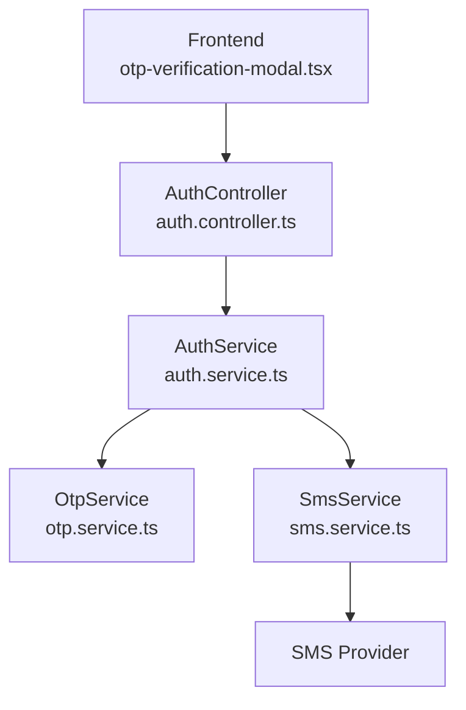
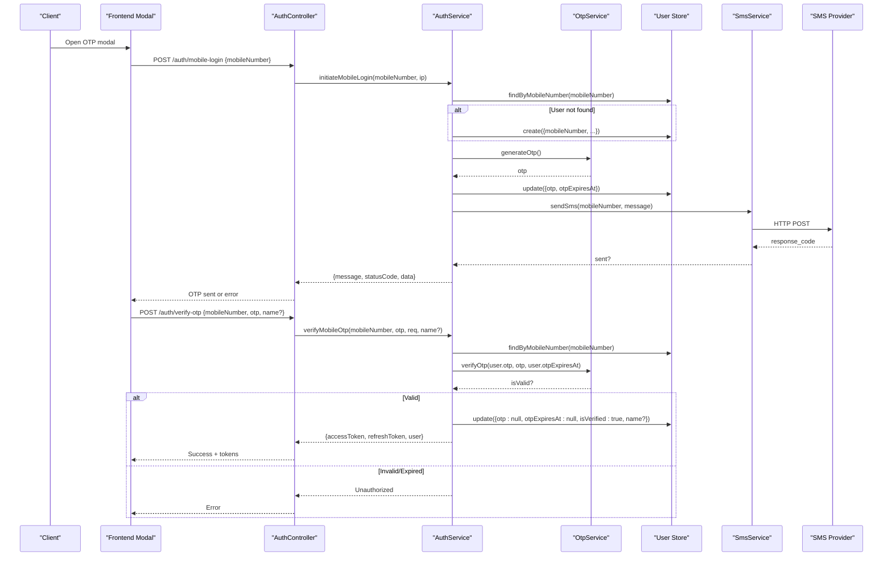
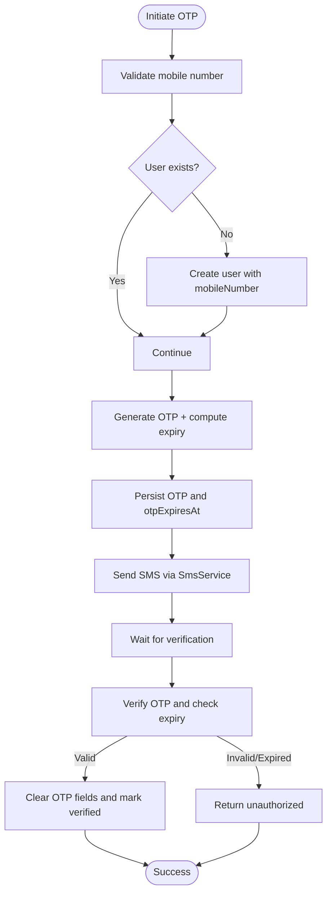
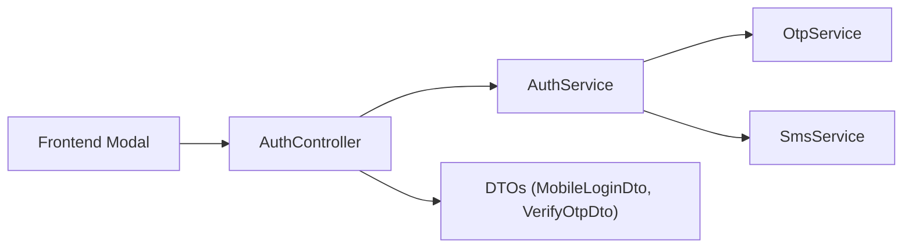

# OTP Verification System

<cite>
**Referenced Files in This Document**
- [auth.controller.ts](file://apps/backend/src/auth/auth.controller.ts)
- [auth.service.ts](file://apps/backend/src/auth/auth.service.ts)
- [otp.service.ts](file://apps/backend/src/auth/otp.service.ts)
- [sms.service.ts](file://apps/backend/src/auth/sms.service.ts)
- [mobile-login.dto.ts](file://apps/backend/src/auth/dto/mobile-login.dto.ts)
- [otp-verification-modal.tsx](file://apps/frontend/components/auth/otp-verification-modal.tsx)
</cite>

## Table of Contents
1. [Introduction](#introduction)
2. [Project Structure](#project-structure)
3. [Core Components](#core-components)
4. [Architecture Overview](#architecture-overview)
5. [Detailed Component Analysis](#detailed-component-analysis)
6. [Dependency Analysis](#dependency-analysis)
7. [Performance Considerations](#performance-considerations)
8. [Troubleshooting Guide](#troubleshooting-guide)
9. [Conclusion](#conclusion)

## Introduction
This document explains the One-Time Password (OTP) verification system used for mobile number authentication. It covers:
- Mobile number validation and international phone number support
- OTP generation, storage, expiration handling, and verification
- SMS delivery integration patterns
- Cooldown mechanism to prevent rapid OTP requests
- Security measures against brute force attacks and rate limiting strategies
- End-to-end flows for OTP initiation and verification
- Error handling for failed deliveries or invalid codes

## Project Structure
The OTP feature spans backend controllers/services and a frontend modal component:
- Backend API endpoints are defined in the auth controller
- Business logic resides in the auth service
- OTP algorithms and validity helpers are encapsulated in the OTP service
- SMS provider integration is abstracted by the SMS service
- DTOs define input contracts for mobile login and OTP verification
- Frontend provides an OTP verification modal with resend cooldown UI

**Diagram sources**
- [auth.controller.ts:231-307](file://apps/backend/src/auth/auth.controller.ts#L231-L307)
- [auth.service.ts:172-358](file://apps/backend/src/auth/auth.service.ts#L172-L358)
- [otp.service.ts:1-35](file://apps/backend/src/auth/otp.service.ts#L1-L35)
- [sms.service.ts:1-64](file://apps/backend/src/auth/sms.service.ts#L1-L64)
- [otp-verification-modal.tsx:1-288](file://apps/frontend/components/auth/otp-verification-modal.tsx#L1-L288)

**Section sources**
- [auth.controller.ts:231-307](file://apps/backend/src/auth/auth.controller.ts#L231-L307)
- [auth.service.ts:172-358](file://apps/backend/src/auth/auth.service.ts#L172-L358)
- [otp.service.ts:1-35](file://apps/backend/src/auth/otp.service.ts#L1-L35)
- [sms.service.ts:1-64](file://apps/backend/src/auth/sms.service.ts#L1-L64)
- [otp-verification-modal.tsx:1-288](file://apps/frontend/components/auth/otp-verification-modal.tsx#L1-L288)

## Core Components
- AuthController: Exposes REST endpoints for initiating mobile login and verifying OTP; applies global throttling rules.
- AuthService: Orchestrates OTP lifecycle, validates mobile numbers, enforces per-number cooldown, persists OTP and expiry, sends SMS via SmsService, and returns JWT tokens upon successful verification.
- OtpService: Generates OTPs (with a development fallback), computes expiration time based on configured validity window, and verifies OTPs against stored values and expiry.
- SmsService: Integrates with an external SMS gateway using environment-configured credentials; logs success/failure and returns boolean status.
- DTOs: Define validated request shapes for mobile login and OTP verification, including international phone number support and OTP length constraints.
- Frontend Modal: Provides a user-friendly OTP entry interface, client-side validation, resend cooldown timer, and optional name capture for new users.

**Section sources**
- [auth.controller.ts:231-307](file://apps/backend/src/auth/auth.controller.ts#L231-L307)
- [auth.service.ts:172-358](file://apps/backend/src/auth/auth.service.ts#L172-L358)
- [otp.service.ts:1-35](file://apps/backend/src/auth/otp.service.ts#L1-L35)
- [sms.service.ts:1-64](file://apps/backend/src/auth/sms.service.ts#L1-L64)
- [mobile-login.dto.ts:1-40](file://apps/backend/src/auth/dto/mobile-login.dto.ts#L1-L40)
- [otp-verification-modal.tsx:1-288](file://apps/frontend/components/auth/otp-verification-modal.tsx#L1-L288)

## Architecture Overview
The OTP flow integrates frontend UI, backend endpoints, OTP logic, and SMS delivery.

**Diagram sources**
- [auth.controller.ts:231-307](file://apps/backend/src/auth/auth.controller.ts#L231-L307)
- [auth.service.ts:172-358](file://apps/backend/src/auth/auth.service.ts#L172-L358)
- [otp.service.ts:1-35](file://apps/backend/src/auth/otp.service.ts#L1-L35)
- [sms.service.ts:1-64](file://apps/backend/src/auth/sms.service.ts#L1-L64)

## Detailed Component Analysis

### Mobile Number Validation and International Support
- Backend validation uses a strict E.164-like regex ensuring a leading plus sign followed by digits up to 15 total characters.
- DTOs also validate mobile numbers using a built-in phone validator for Swagger documentation and request validation.
- The frontend modal accepts any string but relies on backend validation for correctness.

Key behaviors:
- Rejects malformed numbers early with a bad request response.
- Supports international numbers via E.164 format.

**Section sources**
- [auth.service.ts:360-362](file://apps/backend/src/auth/auth.service.ts#L360-L362)
- [mobile-login.dto.ts:1-40](file://apps/backend/src/auth/dto/mobile-login.dto.ts#L1-L40)

### OTP Generation Algorithm
- In production, OTPs are random 6-digit integers generated from a uniform distribution.
- In development, a fixed OTP is returned to simplify testing.
- Expiration is computed relative to a configurable validity window (default 5 minutes).

Security considerations:
- Avoids predictable sequences.
- Uses a short-lived validity window to limit exposure.

**Section sources**
- [otp.service.ts:1-35](file://apps/backend/src/auth/otp.service.ts#L1-L35)

### OTP Storage and Lifecycle
- On initiation, the system stores the OTP and its expiration timestamp in the user record.
- Upon successful verification, both fields are cleared and the user is marked verified.
- The lifetime is derived from configuration and enforced during verification.

Lifecycle steps:
- Generate OTP and compute expiry
- Persist OTP and expiry
- Send SMS
- Verify and clear OTP on success

**Diagram sources**
- [auth.service.ts:172-358](file://apps/backend/src/auth/auth.service.ts#L172-L358)
- [otp.service.ts:1-35](file://apps/backend/src/auth/otp.service.ts#L1-L35)

**Section sources**
- [auth.service.ts:172-358](file://apps/backend/src/auth/auth.service.ts#L172-L358)
- [otp.service.ts:1-35](file://apps/backend/src/auth/otp.service.ts#L1-L35)

### SMS Delivery Integration
- SmsService calls an external endpoint with api_key, senderid, number, and message.
- Success is determined by a specific response code; otherwise, it logs warnings/errors and returns failure.
- Missing configuration results in a safe failure path without throwing.

Integration pattern:
- Environment-driven configuration for provider URL, keys, and sender ID.
- Centralized logging for observability.

**Section sources**
- [sms.service.ts:1-64](file://apps/backend/src/auth/sms.service.ts#L1-L64)

### Cooldown Mechanism and Rate Limiting
- Per-number cooldown: Resending an OTP is blocked if less than 60 seconds have elapsed since the last send. Derived from stored otpExpiresAt and configured OTP validity.
- Endpoint-level throttling: Both mobile-login and verify-otp endpoints use NestJS Throttler with multiple windows (short/medium/long) to mitigate brute-force and abuse at the application layer.

Important notes:
- Cooldown is per mobile number, independent of IP.
- Global throttling is site-wide due to server-side rendering calling these endpoints from a shared backend IP.

**Section sources**
- [auth.service.ts:204-218](file://apps/backend/src/auth/auth.service.ts#L204-L218)
- [auth.controller.ts:231-276](file://apps/backend/src/auth/auth.controller.ts#L231-L276)

### Security Measures Against Brute Force
- Strict OTP format validation (6 digits).
- Short OTP validity window.
- Per-number resend cooldown.
- Multi-window throttling on sensitive endpoints.
- Non-revealing error messages for invalid/expired OTPs.

**Section sources**
- [auth.service.ts:269-299](file://apps/backend/src/auth/auth.service.ts#L269-L299)
- [auth.controller.ts:231-276](file://apps/backend/src/auth/auth.controller.ts#L231-L276)

### OTP Initiation Flow Example
- Client calls POST /auth/mobile-login with an international mobile number.
- Backend validates number, ensures user exists (creates if missing), checks cooldown, generates OTP, persists it, and sends SMS.
- Returns success or appropriate error (e.g., too many requests, service unavailable).

**Section sources**
- [auth.controller.ts:231-267](file://apps/backend/src/auth/auth.controller.ts#L231-L267)
- [auth.service.ts:172-249](file://apps/backend/src/auth/auth.service.ts#L172-L249)

### OTP Verification Endpoint Example
- Client calls POST /auth/verify-otp with mobileNumber, otp, and optional name.
- Backend validates inputs, retrieves user, verifies OTP against stored value and expiry, clears OTP fields, marks user verified, and returns JWT tokens along with sanitized user data.

**Section sources**
- [auth.controller.ts:269-307](file://apps/backend/src/auth/auth.controller.ts#L269-L307)
- [auth.service.ts:252-358](file://apps/backend/src/auth/auth.service.ts#L252-L358)

### Frontend OTP Verification Modal
- Renders digit-by-digit input with paste support and keyboard navigation.
- Enforces minimum OTP length and optional name capture for new users.
- Implements a client-side resend cooldown timer and displays errors/messages.

Usage:
- Provide callbacks for resending OTP and verifying OTP.
- Configure OTP length and resend cooldown duration.

**Section sources**
- [otp-verification-modal.tsx:1-288](file://apps/frontend/components/auth/otp-verification-modal.tsx#L1-L288)

## Dependency Analysis
The following diagram shows how components depend on each other within the OTP subsystem.

**Diagram sources**
- [auth.controller.ts:231-307](file://apps/backend/src/auth/auth.controller.ts#L231-L307)
- [auth.service.ts:172-358](file://apps/backend/src/auth/auth.service.ts#L172-L358)
- [otp.service.ts:1-35](file://apps/backend/src/auth/otp.service.ts#L1-L35)
- [sms.service.ts:1-64](file://apps/backend/src/auth/sms.service.ts#L1-L64)
- [mobile-login.dto.ts:1-40](file://apps/backend/src/auth/dto/mobile-login.dto.ts#L1-L40)
- [otp-verification-modal.tsx:1-288](file://apps/frontend/components/auth/otp-verification-modal.tsx#L1-L288)

**Section sources**
- [auth.controller.ts:231-307](file://apps/backend/src/auth/auth.controller.ts#L231-L307)
- [auth.service.ts:172-358](file://apps/backend/src/auth/auth.service.ts#L172-L358)
- [otp.service.ts:1-35](file://apps/backend/src/auth/otp.service.ts#L1-L35)
- [sms.service.ts:1-64](file://apps/backend/src/auth/sms.service.ts#L1-L64)
- [mobile-login.dto.ts:1-40](file://apps/backend/src/auth/dto/mobile-login.dto.ts#L1-L40)
- [otp-verification-modal.tsx:1-288](file://apps/frontend/components/auth/otp-verification-modal.tsx#L1-L288)

## Performance Considerations
- Non-critical audit writes (last login updates and activity logs) are fire-and-forget to avoid blocking responses.
- OTP generation and verification are lightweight operations.
- SMS delivery is asynchronous from the perspective of the caller; failures result in immediate error responses to clients.
- Throttling is applied at the controller level to protect endpoints under load.

[No sources needed since this section provides general guidance]

## Troubleshooting Guide
Common issues and resolutions:
- Invalid mobile number format: Ensure E.164 format (+countrycode+number). Check DTO validation and backend regex.
- OTP resend blocked: Respect the 60-second per-number cooldown; retry after the interval.
- Failed SMS delivery: Inspect SMS provider configuration (API key, sender ID, send URL) and provider response codes.
- Invalid or expired OTP: Re-initiate OTP if expired; ensure correct 6-digit code entry.
- Too many requests: Throttling may be triggered; wait for the cooldown window or adjust limits cautiously.

Operational tips:
- Log and monitor SMS provider response codes and error messages.
- Use development OTP mode for easier testing.
- Review audit logs for login attempts and failures.

**Section sources**
- [auth.service.ts:172-358](file://apps/backend/src/auth/auth.service.ts#L172-L358)
- [sms.service.ts:1-64](file://apps/backend/src/auth/sms.service.ts#L1-L64)
- [auth.controller.ts:231-307](file://apps/backend/src/auth/auth.controller.ts#L231-L307)

## Conclusion
The OTP verification system combines robust backend validation, secure OTP handling, and resilient SMS integration. It enforces strong security through short lifetimes, per-number cooldowns, and multi-window throttling. The frontend modal offers a smooth user experience with client-side safeguards. Together, these components provide a reliable, scalable solution for mobile-based authentication.

[No sources needed since this section summarizes without analyzing specific files]