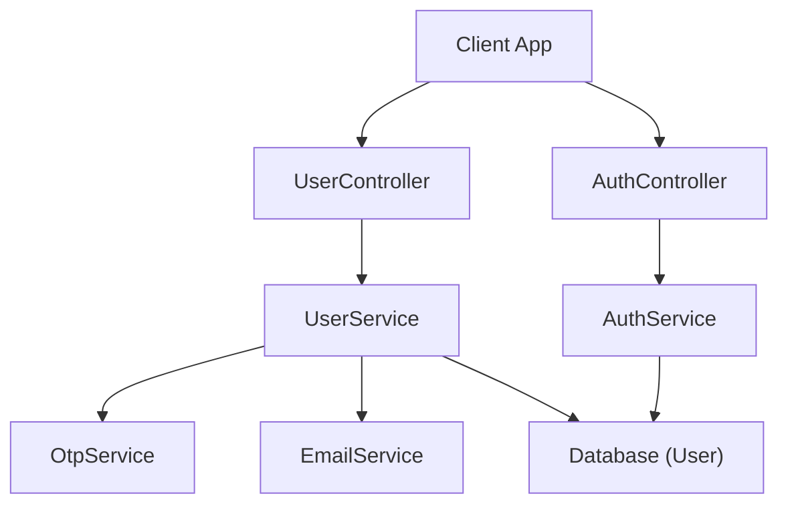
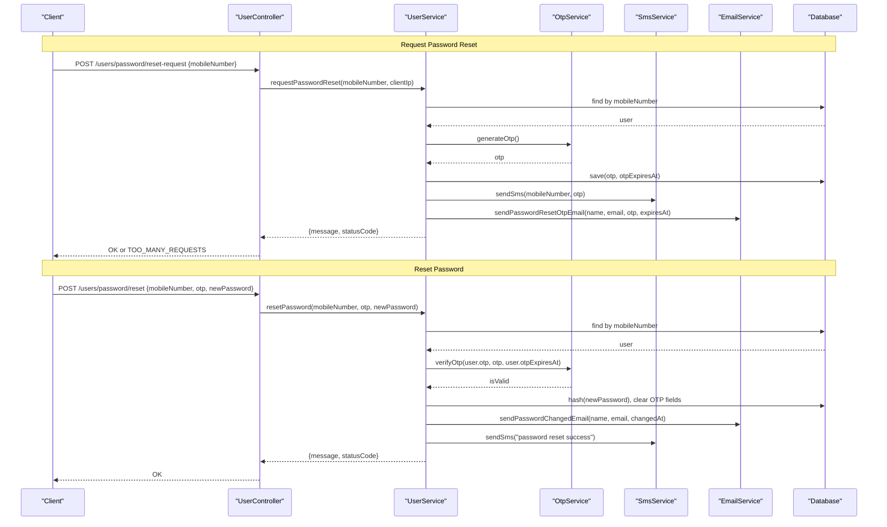
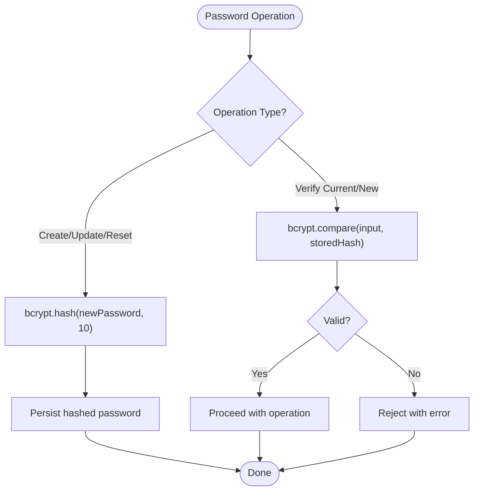
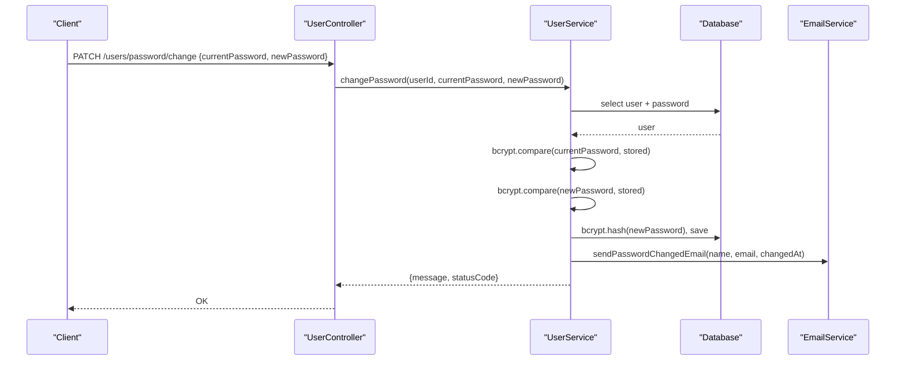
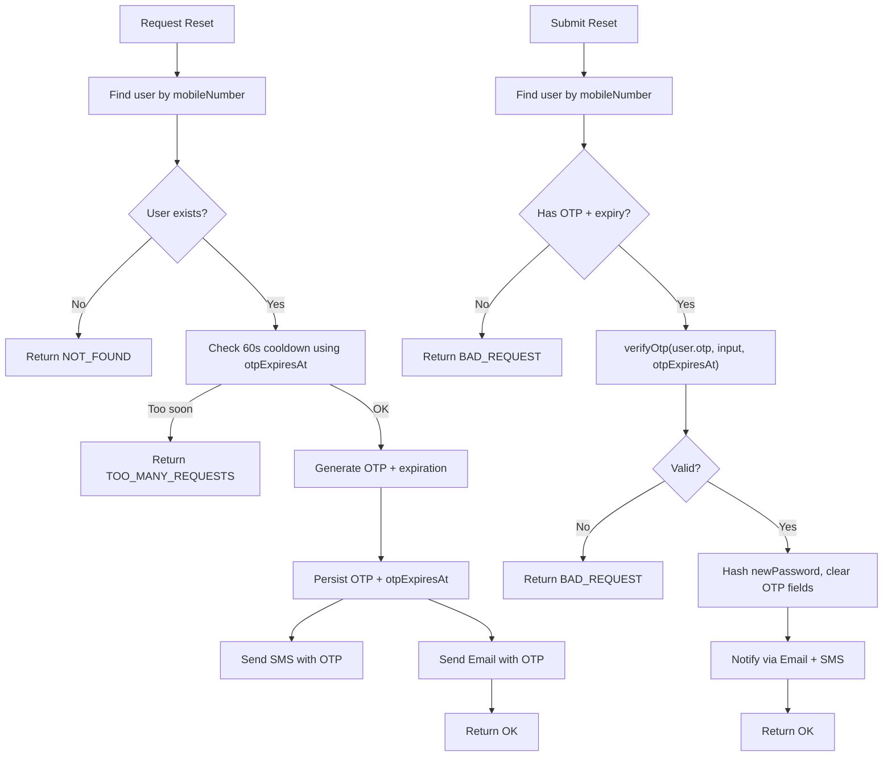
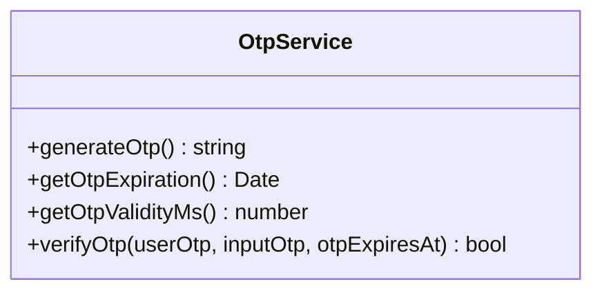
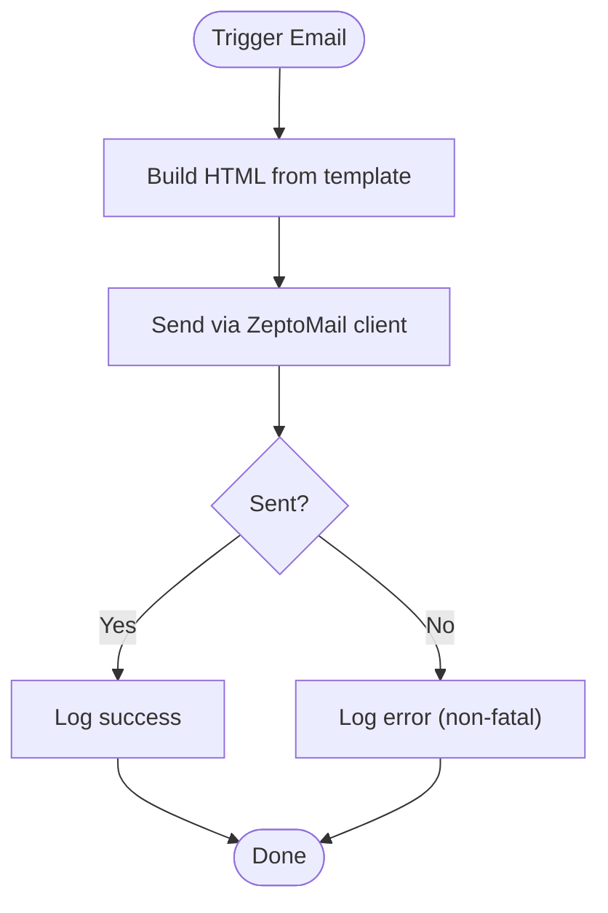
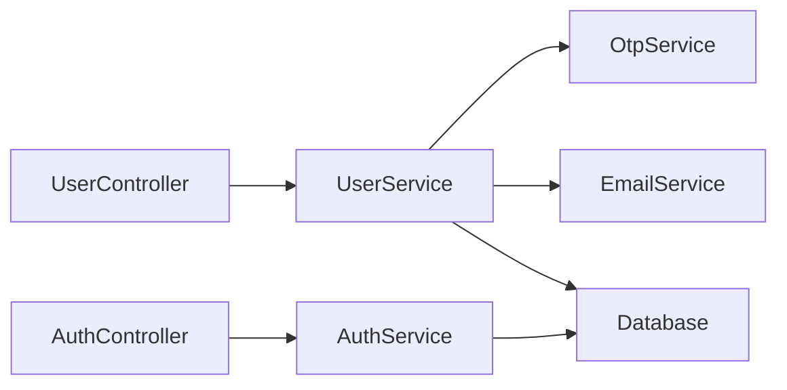

# Password Management & Reset

<cite>
**Referenced Files in This Document**
- [user.service.ts](file://apps/backend/src/user/user.service.ts)
- [auth.service.ts](file://apps/backend/src/auth/auth.service.ts)
- [otp.service.ts](file://apps/backend/src/auth/otp.service.ts)
- [email.service.ts](file://apps/backend/src/email/email.service.ts)
- [change-password.dto.ts](file://apps/backend/src/user/dto/change-password.dto.ts)
- [user.controller.ts](file://apps/backend/src/user/user.controller.ts)
- [auth.controller.ts](file://apps/backend/src/auth/auth.controller.ts)
</cite>

## Table of Contents
1. [Introduction](#introduction)
2. [Project Structure](#project-structure)
3. [Core Components](#core-components)
4. [Architecture Overview](#architecture-overview)
5. [Detailed Component Analysis](#detailed-component-analysis)
6. [Dependency Analysis](#dependency-analysis)
7. [Performance Considerations](#performance-considerations)
8. [Troubleshooting Guide](#troubleshooting-guide)
9. [Conclusion](#conclusion)

## Introduction
This document explains the password management and reset functionality in the backend, focusing on secure hashing with bcrypt, OTP-based password reset via SMS and email, token expiration handling, and security measures against common vulnerabilities. It also covers password update validation rules, rate limiting, and audit logging for authentication events.

## Project Structure
Password-related flows are implemented across a small set of services and controllers:
- User service handles password hashing, change, and OTP-based reset workflows.
- Auth service validates credentials and manages login/OTP login flows.
- OTP service generates and verifies time-bound codes.
- Email service sends password reset OTP and password changed notifications.
- Controllers expose REST endpoints for password reset and change operations.

**Diagram sources**
- [user.controller.ts:292-397](file://apps/backend/src/user/user.controller.ts#L292-L397)
- [auth.controller.ts:81-114](file://apps/backend/src/auth/auth.controller.ts#L81-L114)
- [user.service.ts:718-770](file://apps/backend/src/user/user.service.ts#L718-L770)
- [user.service.ts:830-938](file://apps/backend/src/user/user.service.ts#L830-L938)
- [auth.service.ts:54-73](file://apps/backend/src/auth/auth.service.ts#L54-L73)
- [otp.service.ts:8-33](file://apps/backend/src/auth/otp.service.ts#L8-L33)
- [email.service.ts:221-293](file://apps/backend/src/email/email.service.ts#L221-L293)

**Section sources**
- [user.controller.ts:292-397](file://apps/backend/src/user/user.controller.ts#L292-L397)
- [auth.controller.ts:81-114](file://apps/backend/src/auth/auth.controller.ts#L81-L114)

## Core Components
- Secure password hashing: bcrypt is used to hash passwords during creation, updates, and resets.
- Password verification: bcrypt.compare validates current/new passwords.
- OTP-based reset: OTP generation, storage, cooldown protection, and verification.
- Email/SMS delivery: OTP sent via SMS and email; password change confirmation emails.
- DTO validation: length constraints enforced at API boundary.
- Rate limiting: throttling applied to sensitive endpoints.

Key responsibilities:
- UserService: hashing, comparing, OTP reset workflow, change password.
- AuthService: credential validation and login flow.
- OtpService: OTP generation, validity window, verification.
- EmailService: password reset OTP and password changed notifications.
- Controllers: route requests to services and apply throttling.

**Section sources**
- [user.service.ts:612-620](file://apps/backend/src/user/user.service.ts#L612-L620)
- [user.service.ts:718-770](file://apps/backend/src/user/user.service.ts#L718-L770)
- [user.service.ts:830-938](file://apps/backend/src/user/user.service.ts#L830-L938)
- [auth.service.ts:54-73](file://apps/backend/src/auth/auth.service.ts#L54-L73)
- [otp.service.ts:8-33](file://apps/backend/src/auth/otp.service.ts#L8-L33)
- [email.service.ts:221-293](file://apps/backend/src/email/email.service.ts#L221-L293)
- [change-password.dto.ts:1-23](file://apps/backend/src/user/dto/change-password.dto.ts#L1-L23)
- [user.controller.ts:347-397](file://apps/backend/src/user/user.controller.ts#L347-L397)

## Architecture Overview
The password reset flow uses an OTP mechanism rather than a traditional link-based token. The user provides their mobile number, receives a time-limited code via SMS and email, then submits the code along with a new password. The system verifies the OTP, hashes the new password with bcrypt, clears OTP state, and notifies the user via email and SMS.

**Diagram sources**
- [user.controller.ts:347-397](file://apps/backend/src/user/user.controller.ts#L347-L397)
- [user.service.ts:830-938](file://apps/backend/src/user/user.service.ts#L830-L938)
- [otp.service.ts:8-33](file://apps/backend/src/auth/otp.service.ts#L8-L33)
- [email.service.ts:221-293](file://apps/backend/src/email/email.service.ts#L221-L293)

## Detailed Component Analysis

### Password Hashing and Verification
- Hashing: bcrypt.hash is used when creating users, updating passwords, and resetting passwords. Salt rounds are set to 10.
- Verification: bcrypt.compare validates current and new passwords during change and login flows.

Security notes:
- Never store plaintext passwords.
- Use consistent salt rounds.
- Avoid returning credential fields in responses.

**Diagram sources**
- [user.service.ts:612-620](file://apps/backend/src/user/user.service.ts#L612-L620)
- [user.service.ts:718-770](file://apps/backend/src/user/user.service.ts#L718-L770)
- [user.service.ts:830-938](file://apps/backend/src/user/user.service.ts#L830-L938)
- [auth.service.ts:54-73](file://apps/backend/src/auth/auth.service.ts#L54-L73)

**Section sources**
- [user.service.ts:612-620](file://apps/backend/src/user/user.service.ts#L612-L620)
- [user.service.ts:718-770](file://apps/backend/src/user/user.service.ts#L718-L770)
- [user.service.ts:830-938](file://apps/backend/src/user/user.service.ts#L830-L938)
- [auth.service.ts:54-73](file://apps/backend/src/auth/auth.service.ts#L54-L73)

### Password Change Flow (Authenticated Users)
- Endpoint: PATCH /users/password/change
- Validation: DTO enforces minimum length and maximum length for new password.
- Logic:
  - Fetch user with password field explicitly selected.
  - Verify current password.
  - Ensure new password differs from current.
  - Hash and persist new password.
  - Send password changed notification email (fire-and-forget).

**Diagram sources**
- [user.controller.ts:292-315](file://apps/backend/src/user/user.controller.ts#L292-L315)
- [user.service.ts:718-770](file://apps/backend/src/user/user.service.ts#L718-L770)
- [email.service.ts:221-257](file://apps/backend/src/email/email.service.ts#L221-L257)
- [change-password.dto.ts:1-23](file://apps/backend/src/user/dto/change-password.dto.ts#L1-L23)

**Section sources**
- [user.controller.ts:292-315](file://apps/backend/src/user/user.controller.ts#L292-L315)
- [user.service.ts:718-770](file://apps/backend/src/user/user.service.ts#L718-L770)
- [change-password.dto.ts:1-23](file://apps/backend/src/user/dto/change-password.dto.ts#L1-L23)

### Password Reset Workflow (OTP-Based)
- Endpoints:
  - POST /users/password/reset-request
  - POST /users/password/reset
- Steps:
  - Validate mobile number exists.
  - Enforce per-number resend cooldown (60 seconds).
  - Generate OTP and expiration timestamp.
  - Persist OTP and expiry.
  - Send SMS with OTP and email with OTP.
  - On reset submission, verify OTP and expiration.
  - Hash new password, clear OTP fields, and notify via email and SMS.

**Diagram sources**
- [user.controller.ts:347-397](file://apps/backend/src/user/user.controller.ts#L347-L397)
- [user.service.ts:830-938](file://apps/backend/src/user/user.service.ts#L830-L938)
- [otp.service.ts:8-33](file://apps/backend/src/auth/otp.service.ts#L8-L33)
- [email.service.ts:259-293](file://apps/backend/src/email/email.service.ts#L259-L293)

**Section sources**
- [user.controller.ts:347-397](file://apps/backend/src/user/user.controller.ts#L347-L397)
- [user.service.ts:830-938](file://apps/backend/src/user/user.service.ts#L830-L938)
- [otp.service.ts:8-33](file://apps/backend/src/auth/otp.service.ts#L8-L33)
- [email.service.ts:259-293](file://apps/backend/src/email/email.service.ts#L259-L293)

### OTP Generation and Expiration Handling
- Generation:
  - In development, returns a fixed code for testing.
  - In production, generates a random 6-digit code.
- Validity:
  - Configurable expiration window (default 5 minutes).
  - Expiration computed as current time plus validity milliseconds.
- Verification:
  - Checks if current time exceeds expiration.
  - Compares provided OTP with stored OTP.

**Diagram sources**
- [otp.service.ts:8-33](file://apps/backend/src/auth/otp.service.ts#L8-L33)

**Section sources**
- [otp.service.ts:8-33](file://apps/backend/src/auth/otp.service.ts#L8-L33)

### Email Delivery and Templates
- Password reset OTP email:
  - Sends HTML body generated from template data including name, email, OTP, and expiration.
  - Non-fatal errors are logged; does not block reset flow.
- Password changed email:
  - Sent after successful password change or reset.
  - Non-fatal errors are logged; does not block change flow.

**Diagram sources**
- [email.service.ts:221-293](file://apps/backend/src/email/email.service.ts#L221-L293)

**Section sources**
- [email.service.ts:221-293](file://apps/backend/src/email/email.service.ts#L221-L293)

### API Examples and Error Handling
- Request password reset:
  - Method: POST
  - Path: /users/password/reset-request
  - Body: { mobileNumber }
  - Responses:
    - 200: OTP sent to SMS and email
    - 404: User not found
    - 429: Resend blocked by cooldown
- Reset password:
  - Method: POST
  - Path: /users/password/reset
  - Body: { mobileNumber, otp, newPassword }
  - Responses:
    - 200: Password reset successfully
    - 400: Invalid OTP or expired
    - 404: User not found
- Change password (authenticated):
  - Method: PATCH
  - Path: /users/password/change
  - Body: { currentPassword, newPassword }
  - Responses:
    - 200: Password changed successfully
    - 400: Current password incorrect or new password identical
    - 401: Unauthorized

Error handling highlights:
- Cooldown enforcement prevents rapid resends.
- OTP verification checks both value and expiration.
- Email/SMS failures are logged but do not fail core operations.

**Section sources**
- [user.controller.ts:347-397](file://apps/backend/src/user/user.controller.ts#L347-L397)
- [user.service.ts:830-938](file://apps/backend/src/user/user.service.ts#L830-L938)

### Security Measures and Best Practices
- Password hashing:
  - bcrypt with salt rounds set to 10.
- Password verification:
  - bcrypt.compare for all comparisons.
- OTP security:
  - Time-bound OTPs with configurable expiration.
  - Per-number cooldown to mitigate brute-force and spam.
- Input validation:
  - DTO constraints enforce minimum and maximum lengths for new passwords.
- Rate limiting:
  - Throttling applied to sensitive endpoints (e.g., password reset, login).
- Data exposure prevention:
  - Credential fields excluded from responses.

Audit logging:
- Login/logout actions are logged via UserActivityService.
- Password changes trigger security confirmation emails.

**Section sources**
- [user.service.ts:612-620](file://apps/backend/src/user/user.service.ts#L612-L620)
- [user.service.ts:718-770](file://apps/backend/src/user/user.service.ts#L718-L770)
- [user.service.ts:830-938](file://apps/backend/src/user/user.service.ts#L830-L938)
- [auth.service.ts:382-407](file://apps/backend/src/auth/auth.service.ts#L382-L407)
- [change-password.dto.ts:1-23](file://apps/backend/src/user/dto/change-password.dto.ts#L1-L23)
- [user.controller.ts:347-397](file://apps/backend/src/user/user.controller.ts#L347-L397)

## Dependency Analysis
The following diagram shows how controllers depend on services and how services interact with OTP and email subsystems.

**Diagram sources**
- [user.controller.ts:292-397](file://apps/backend/src/user/user.controller.ts#L292-L397)
- [auth.controller.ts:81-114](file://apps/backend/src/auth/auth.controller.ts#L81-L114)
- [user.service.ts:718-938](file://apps/backend/src/user/user.service.ts#L718-L938)
- [auth.service.ts:54-73](file://apps/backend/src/auth/auth.service.ts#L54-L73)

**Section sources**
- [user.controller.ts:292-397](file://apps/backend/src/user/user.controller.ts#L292-L397)
- [auth.controller.ts:81-114](file://apps/backend/src/auth/auth.controller.ts#L81-L114)

## Performance Considerations
- bcrypt hashing cost:
  - Salt rounds of 10 provide strong security; consider monitoring CPU usage under load.
- OTP verification:
  - Simple equality check after expiration validation; negligible overhead.
- Email/SMS delivery:
  - Fire-and-forget pattern ensures critical flows remain responsive even if delivery fails.
- Database queries:
  - Explicitly selecting password only where needed reduces payload size.

[No sources needed since this section provides general guidance]

## Troubleshooting Guide
Common issues and resolutions:
- OTP expired:
  - Cause: Verification performed after expiration.
  - Resolution: Re-request OTP; ensure timely use within validity window.
- Invalid OTP:
  - Cause: Incorrect code or mismatched case/format.
  - Resolution: Confirm received code; re-enter exactly.
- Resend blocked:
  - Cause: Cooldown within 60 seconds of last send.
  - Resolution: Wait before requesting again.
- Email/SMS delivery failure:
  - Cause: Provider configuration or network issues.
  - Resolution: Check logs; ensure provider credentials are configured; OTP still works via alternate channel.

Operational tips:
- Monitor logs for failed email/SMS deliveries.
- Validate environment variables for OTP expiration and email provider settings.
- Ensure throttler configuration aligns with expected traffic patterns.

**Section sources**
- [user.service.ts:830-938](file://apps/backend/src/user/user.service.ts#L830-L938)
- [email.service.ts:221-293](file://apps/backend/src/email/email.service.ts#L221-L293)

## Conclusion
The system implements robust password management and reset functionality using bcrypt hashing, OTP-based verification with configurable expiration, and resilient email/SMS delivery. Rate limiting and strict validation protect against abuse, while fire-and-forget notifications maintain responsiveness. Audit logging captures authentication events for visibility and compliance.

[No sources needed since this section summarizes without analyzing specific files]