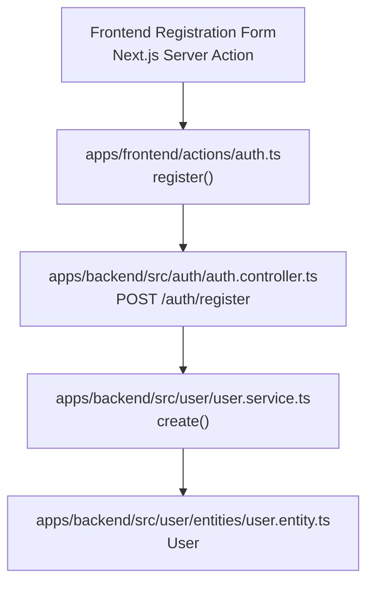
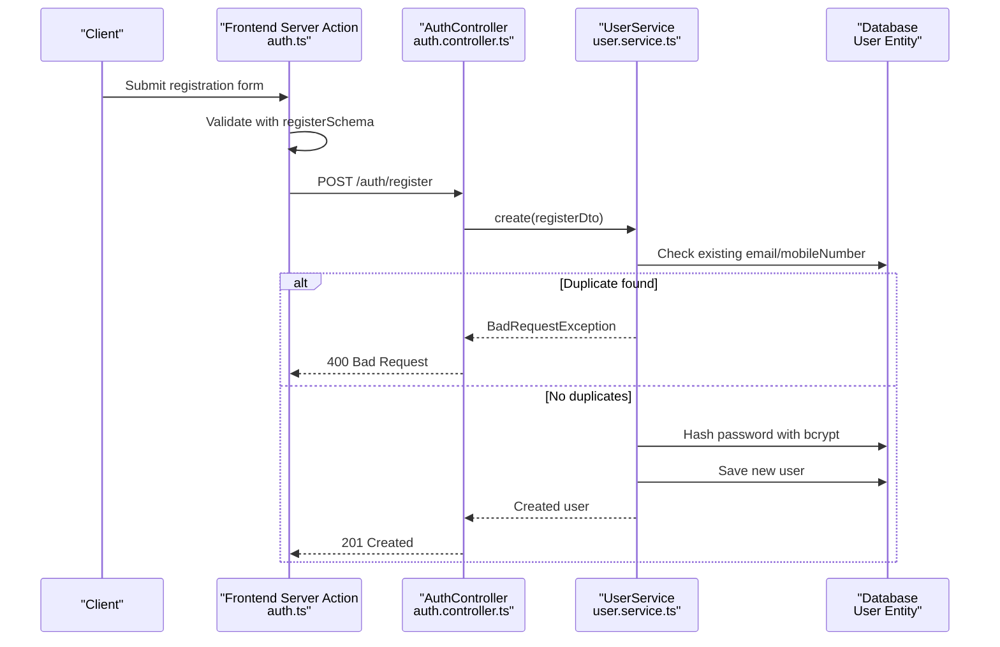
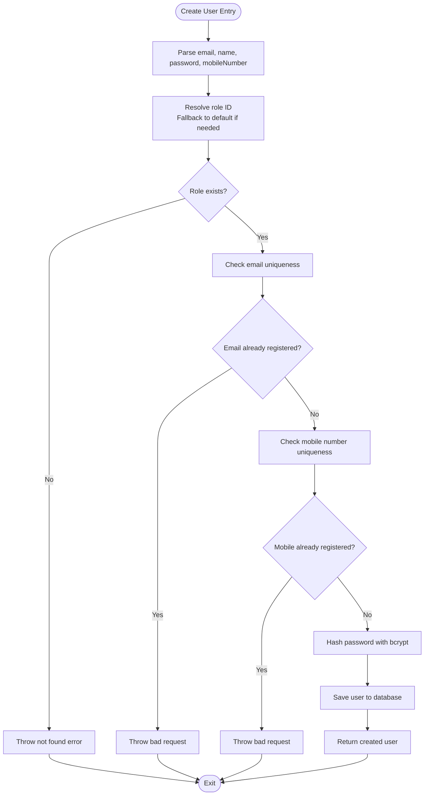
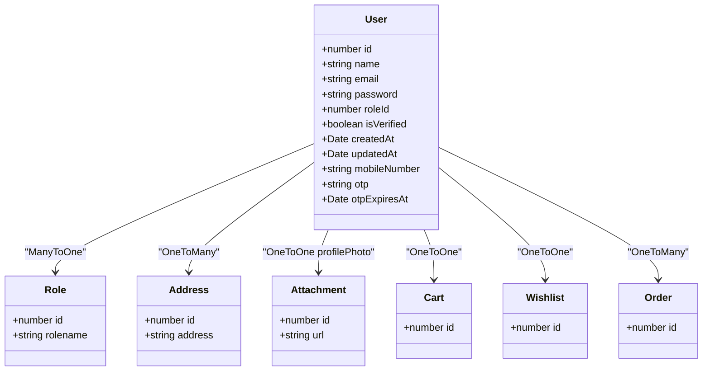
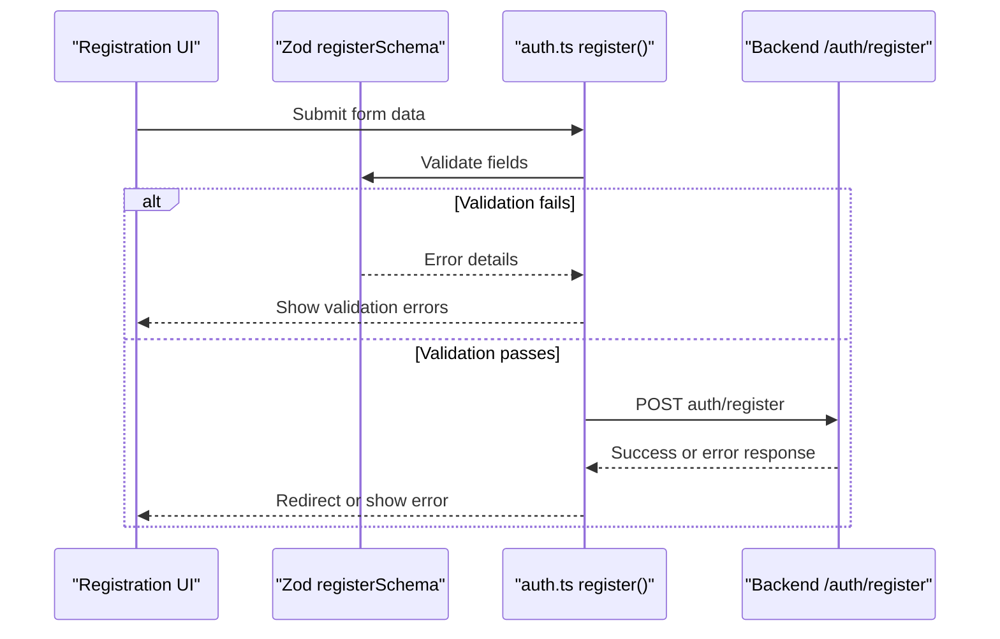
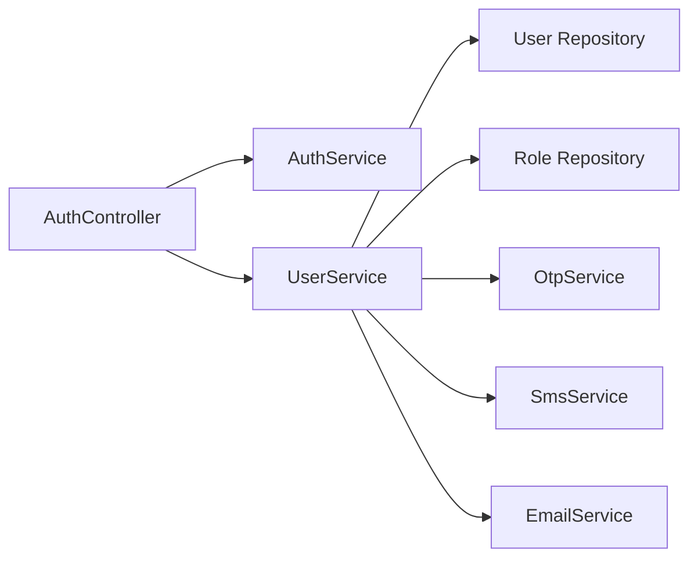

# User Registration & Verification

<cite>
**Referenced Files in This Document**   
- [auth.controller.ts](file://apps/backend/src/auth/auth.controller.ts)
- [register.dto.ts](file://apps/backend/src/auth/dto/register.dto.ts)
- [create-user.dto.ts](file://apps/backend/src/user/dto/create-user.dto.ts)
- [user.service.ts](file://apps/backend/src/user/user.service.ts)
- [user.entity.ts](file://apps/backend/src/user/entities/user.entity.ts)
- [auth.ts](file://apps/frontend/actions/auth.ts)
- [form-validation.ts](file://apps/frontend/utils/form-validation.ts)
</cite>

## Table of Contents
1. [Introduction](#introduction)
2. [Project Structure](#project-structure)
3. [Core Components](#core-components)
4. [Architecture Overview](#architecture-overview)
5. [Detailed Component Analysis](#detailed-component-analysis)
6. [Dependency Analysis](#dependency-analysis)
7. [Performance Considerations](#performance-considerations)
8. [Troubleshooting Guide](#troubleshooting-guide)
9. [Conclusion](#conclusion)

## Introduction
This document explains the user registration and verification system implemented in this monorepo. It covers:
- The complete registration flow from frontend form submission to backend account creation.
- Email validation, password hashing with bcrypt, duplicate detection, and role assignment.
- The user entity structure, required fields, and validation rules.
- Registration DTOs, error handling for duplicate users, and security measures during account creation.
- API call examples, response formats, and common error scenarios.
- Password requirements, email format validation, and the current state of account activation workflows.

The system currently creates a user without sending an email verification link or requiring explicit email confirmation before login. OTP-based mobile verification is available separately through other endpoints.

## Project Structure
Registration-related code spans both the NestJS backend and the Next.js frontend:

- Backend entry point for registration: `POST /auth/register`
- Registration input validation: `RegisterDto`
- Internal user creation logic: `UserService.create`
- User data model: `User` entity
- Frontend server action: `register(formData)`
- Frontend schema validation: `registerSchema`

**Diagram sources**
- [auth.ts:205-239](file://apps/frontend/actions/auth.ts#L205-L239)
- [auth.controller.ts:38-79](file://apps/backend/src/auth/auth.controller.ts#L38-L79)
- [user.service.ts:561-629](file://apps/backend/src/user/user.service.ts#L561-L629)
- [user.entity.ts:22-182](file://apps/backend/src/user/entities/user.entity.ts#L22-L182)

**Section sources**
- [auth.controller.ts:38-79](file://apps/backend/src/auth/auth.controller.ts#L38-L79)
- [auth.ts:205-239](file://apps/frontend/actions/auth.ts#L205-L239)

## Core Components
This section summarizes the main building blocks involved in registration.

| Component | Responsibility | Key Behavior |
|---|---|---|
| Frontend registration server action | Validates form data, calls backend, stores result | Uses Zod schema, posts to `/auth/register`, returns success or error message |
| Registration controller | Exposes public registration endpoint | Applies rate limiting, delegates to `UserService.create` |
| Registration DTO | Defines accepted request fields and validation rules | Validates email, name, password, optional mobile number |
| User service create method | Creates a user account securely | Checks duplicates, validates role, hashes password, saves user |
| User entity | Defines persistent user model | Includes identity, credentials, verification flag, timestamps, relations |
| Frontend form validation schema | Enforces client-side constraints | Requires name, email, mobile number, password, confirm password |

**Section sources**
- [auth.ts:205-239](file://apps/frontend/actions/auth.ts#L205-L239)
- [auth.controller.ts:38-79](file://apps/backend/src/auth/auth.controller.ts#L38-L79)
- [register.dto.ts:13-62](file://apps/backend/src/auth/dto/register.dto.ts#L13-L62)
- [user.service.ts:561-629](file://apps/backend/src/user/user.service.ts#L561-L629)
- [user.entity.ts:22-182](file://apps/backend/src/user/entities/user.entity.ts#L22-L182)
- [form-validation.ts:9-22](file://apps/frontend/utils/form-validation.ts#L9-L22)

## Architecture Overview
The registration architecture follows a layered approach:

1. **Frontend layer**: A Next.js server action validates inputs using Zod and sends a POST request to the backend.
2. **API layer**: The authentication controller exposes a throttled registration endpoint.
3. **Service layer**: The user service performs business logic, including duplicate checks, role resolution, and password hashing.
4. **Persistence layer**: TypeORM persists the hashed user record into the database.

**Diagram sources**
- [auth.ts:205-239](file://apps/frontend/actions/auth.ts#L205-L239)
- [auth.controller.ts:38-79](file://apps/backend/src/auth/auth.controller.ts#L38-L79)
- [user.service.ts:561-629](file://apps/backend/src/user/user.service.ts#L561-L629)
- [user.entity.ts:22-182](file://apps/backend/src/user/entities/user.entity.ts#L22-L182)

## Detailed Component Analysis

### Registration API Endpoint
The registration endpoint is publicly accessible and protected by a throttle decorator that limits requests to five per minute. It accepts a `RegisterDto`, sets HTTP status `201 Created`, and delegates creation to the user service.

Key behaviors:
- Public endpoint under `/auth/register`.
- Rate-limited to prevent abuse.
- Swagger documentation includes example responses and error schemas.
- Returns the created user data on success.

**Section sources**
- [auth.controller.ts:38-79](file://apps/backend/src/auth/auth.controller.ts#L38-L79)

### Registration Input Validation: RegisterDto
`RegisterDto` defines the backend’s expected registration payload:

| Field | Required | Validation Rules | Notes |
|---|---:|---|---|
| `email` | Yes | Must be a valid email; cannot be empty | Used for uniqueness check |
| `name` | Yes | String, minimum 2 characters, maximum 100 characters | Display name |
| `password` | Yes | Minimum 8 characters; must include uppercase, lowercase, digit, and special character | Write-only field |
| `mobileNumber` | Optional | Valid phone number format | Used for OTP flows and uniqueness check |

Security notes:
- Password is write-only in API metadata.
- Strong regex enforces complexity at the DTO level.

**Section sources**
- [register.dto.ts:13-62](file://apps/backend/src/auth/dto/register.dto.ts#L13-L62)

### Internal User Creation Logic: UserService.create
The service method handles the core registration workflow:

1. Extracts `email`, `name`, `password`, and `mobileNumber` from the input.
2. Resolves the user role:
   - If a role ID is provided but invalid, it falls back to the default customer role.
   - If no valid role exists, it throws a not-found error.
3. Checks for an existing user by email and throws a bad request if found.
4. Checks for an existing user by mobile number and throws a bad request if found.
5. Hashes the password using bcrypt with salt rounds configured in the service.
6. Creates and saves the user record.
7. Returns a success response with the saved user.

Important observations:
- The `isVerified` flag is not set during registration; it remains its default value.
- No email verification link is sent during registration.
- Role assignment defaults to the customer role when necessary.

**Diagram sources**
- [user.service.ts:561-629](file://apps/backend/src/user/user.service.ts#L561-L629)

**Section sources**
- [user.service.ts:561-629](file://apps/backend/src/user/user.service.ts#L561-L629)

### User Entity Structure
The `User` entity represents the persisted user model. Relevant fields for registration and verification include:

| Field | Type | Constraints | Purpose |
|---|---|---|---|
| `id` | Number | Primary key | Unique user identifier |
| `name` | String | Length constraints via DTO/entity metadata | Full name |
| `email` | String | Unique column | Account identifier |
| `password` | String | Excluded from API output; write-only metadata | Stored bcrypt hash |
| `roleId` | Number | Nullable; defaults to customer role | Role reference |
| `role` | Relation | Nullable | Associated role object |
| `isVerified` | Boolean | Default false | Indicates whether the account is verified |
| `mobileNumber` | String | Nullable | Phone number used for OTP flows |
| `otp` | String | Excluded from API output; write-only metadata | One-time password for mobile verification |
| `otpExpiresAt` | Date | Excluded from API output; write-only metadata | OTP expiration timestamp |
| `createdAt` | Date | Auto-generated | Registration timestamp |
| `updatedAt` | Date | Auto-updated | Last modification timestamp |

Verification note:
- `isVerified` exists but is not automatically set to true during registration.
- OTP fields exist for mobile verification flows but are unrelated to email verification.

**Diagram sources**
- [user.entity.ts:22-182](file://apps/backend/src/user/entities/user.entity.ts#L22-L182)

**Section sources**
- [user.entity.ts:22-182](file://apps/backend/src/user/entities/user.entity.ts#L22-L182)

### Frontend Registration Flow
The frontend uses a server action to handle registration:

1. Validates the form using `registerSchema`.
2. Sends the validated payload to `/auth/register`.
3. On success, returns a success message and redirects to the sign-in page.
4. On failure, returns an error message derived from the thrown error or a generic failure message.

Frontend schema requirements:
- Name is required.
- Email must be a valid email string.
- Mobile number must be at least 11 characters.
- Password must be at least 8 characters.
- Confirm password must match the password.

Note: The frontend schema requires a mobile number, while the backend `RegisterDto` marks it optional. This difference should be reconciled based on product requirements.

**Diagram sources**
- [auth.ts:205-239](file://apps/frontend/actions/auth.ts#L205-L239)
- [form-validation.ts:9-22](file://apps/frontend/utils/form-validation.ts#L9-L22)

**Section sources**
- [auth.ts:205-239](file://apps/frontend/actions/auth.ts#L205-L239)
- [form-validation.ts:9-22](file://apps/frontend/utils/form-validation.ts#L9-L22)

### Security Measures During Account Creation
- **Password hashing**: Passwords are hashed using bcrypt before being stored.
- **Write-only sensitive fields**: Password, OTP, and OTP expiration are excluded from API responses.
- **Duplicate protection**: Both email and mobile number are checked for uniqueness before saving.
- **Rate limiting**: The registration endpoint is throttled to reduce brute-force attempts.
- **Role validation**: Invalid roles fall back to a safe default rather than allowing arbitrary privilege escalation.

**Section sources**
- [user.service.ts:561-629](file://apps/backend/src/user/user.service.ts#L561-L629)
- [auth.controller.ts:38-79](file://apps/backend/src/auth/auth.controller.ts#L38-L79)
- [user.entity.ts:49-58](file://apps/backend/src/user/entities/user.entity.ts#L49-L58)
- [user.entity.ts:156-177](file://apps/backend/src/user/entities/user.entity.ts#L156-L177)

### Email Verification and Account Activation Workflow
Current behavior:
- Registration does not send an email verification link.
- The `isVerified` field exists but is not updated during registration.
- There is no dedicated registration confirmation endpoint in the analyzed files.

Available related functionality:
- OTP-based mobile verification exists through separate endpoints.
- Password reset OTP emails are supported by the email service.
- Password change confirmation emails are sent after successful password changes.

Recommendation:
If email verification is required, implement:
- A verification token generation step during registration.
- An email containing a secure verification link.
- A backend endpoint to validate the token and set `isVerified = true`.
- Frontend handling for verification success and failure states.

[No sources needed since this section provides conceptual guidance]

## Dependency Analysis
The registration flow depends on several modules and services:

- `AuthController` depends on `AuthService` and `UserService`.
- `UserService` depends on:
  - TypeORM repository for `User`.
  - Role repository for role validation.
  - OTP service for OTP-related operations.
  - SMS service for mobile OTP flows.
  - Email service for email-related operations.

**Diagram sources**
- [auth.controller.ts:32-36](file://apps/backend/src/auth/auth.controller.ts#L32-L36)
- [user.service.ts:29-42](file://apps/backend/src/user/user.service.ts#L29-L42)

**Section sources**
- [auth.controller.ts:32-36](file://apps/backend/src/auth/auth.controller.ts#L32-L36)
- [user.service.ts:29-42](file://apps/backend/src/user/user.service.ts#L29-L42)

## Performance Considerations
- **bcrypt cost**: Salt rounds are configured in the service; ensure the environment can handle the computational cost during high-volume registration.
- **Throttling**: Registration is limited to five requests per minute globally; consider IP-based or user-based throttling if needed.
- **Database queries**: Duplicate checks perform single-row lookups; ensure indexes exist on `email` and `mobileNumber` for performance.
- **Response size**: The created user response may include relations; avoid eager loading unnecessary data in production responses.

[No sources needed since this section provides general guidance]

## Troubleshooting Guide

### Common Registration Errors
| Scenario | Expected Behavior | Resolution |
|---|---|---|
| Duplicate email | Backend throws bad request with message indicating email already exists | Use a different email or inform the user that the account exists |
| Duplicate mobile number | Backend throws bad request with message indicating mobile number already registered | Use a different mobile number or contact support |
| Invalid email format | DTO validation rejects the request | Correct the email format |
| Weak password | DTO validation rejects the request due to missing required character types | Add uppercase, lowercase, digit, and special character |
| Missing or invalid role | Service falls back to default role or throws not found if default role is missing | Ensure default role exists in the database |
| Frontend validation fails | Server action returns validation errors | Fix form fields according to Zod schema messages |

**Section sources**
- [user.service.ts:588-610](file://apps/backend/src/user/user.service.ts#L588-L610)
- [register.dto.ts:13-62](file://apps/backend/src/auth/dto/register.dto.ts#L13-L62)
- [auth.ts:205-239](file://apps/frontend/actions/auth.ts#L205-L239)
- [form-validation.ts:9-22](file://apps/frontend/utils/form-validation.ts#L9-L22)

### API Examples

#### Registration Request
- Method: `POST`
- Path: `/auth/register`
- Body fields:
  - `email`: Valid email address
  - `name`: Full name
  - `password`: Complex password meeting backend requirements
  - `mobileNumber`: Optional phone number

#### Successful Response
- Status: `201 Created`
- Body contains:
  - `message`: Success message
  - `statusCode`: `201`
  - `data`: Created user object

#### Duplicate Email Response
- Status: `400 Bad Request`
- Body contains:
  - `message`: Indicates email already exists
  - `statusCode`: `400`

#### Duplicate Mobile Number Response
- Status: `400 Bad Request`
- Body contains:
  - `message`: Indicates mobile number already registered
  - `statusCode`: `400`

**Section sources**
- [auth.controller.ts:38-79](file://apps/backend/src/auth/auth.controller.ts#L38-L79)
- [user.service.ts:588-629](file://apps/backend/src/user/user.service.ts#L588-L629)

## Conclusion
The current registration system provides secure account creation with strong password hashing, input validation, duplicate protection, and role fallback. However, it does not implement email verification or automatic account activation during registration. OTP-based mobile verification exists separately, and email templates support password reset and password change notifications.

To fully meet typical registration and verification expectations, add:
- Email verification token generation and storage.
- A verification email with a secure link.
- A backend endpoint to activate accounts.
- Frontend handling for verification outcomes.
- Alignment between frontend and backend mobile number requirements.

[No sources needed since this section summarizes without analyzing specific files]