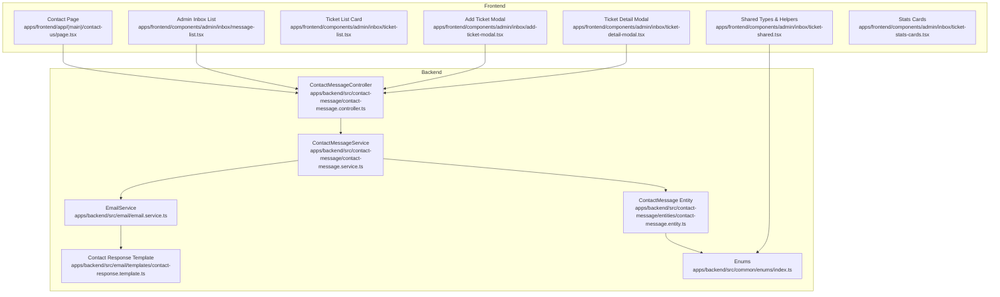
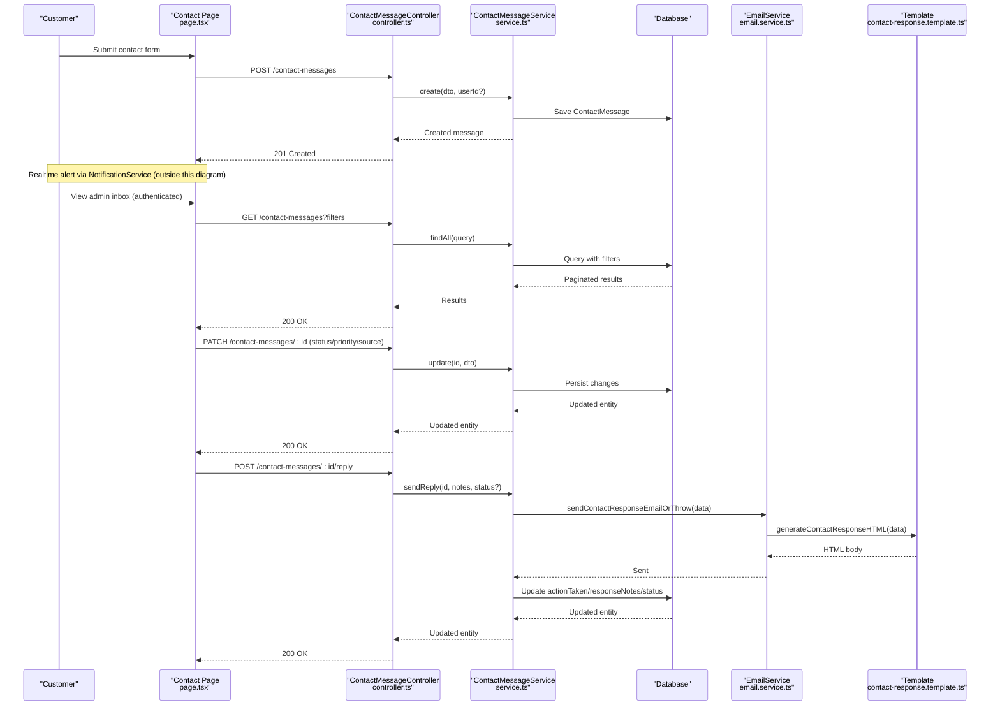
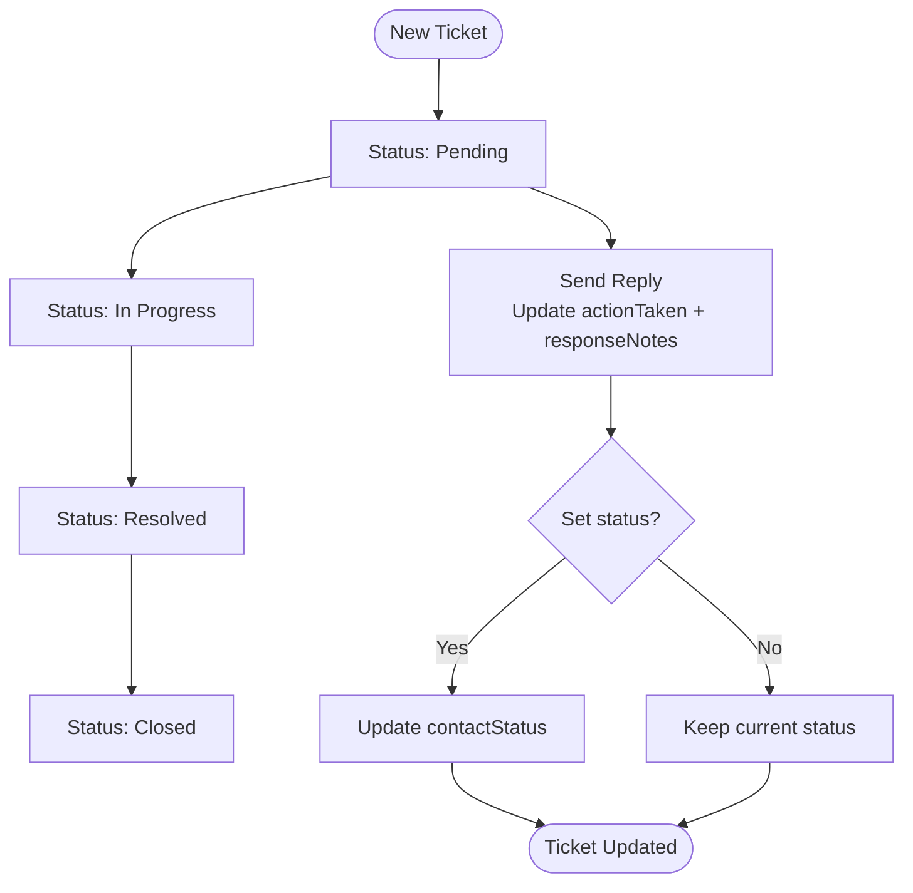
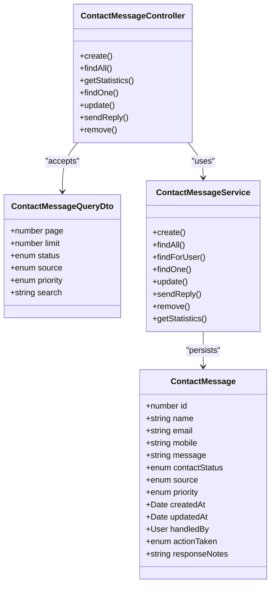
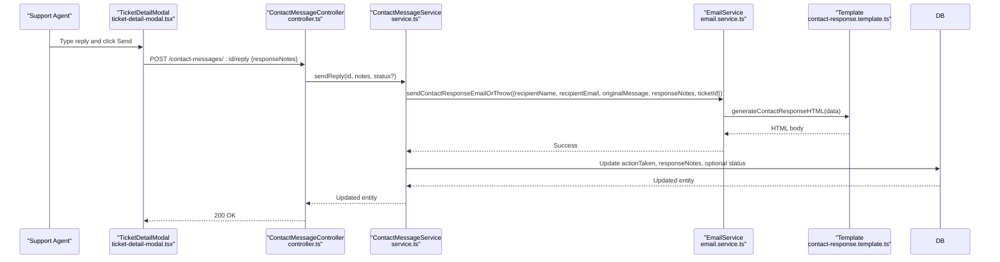
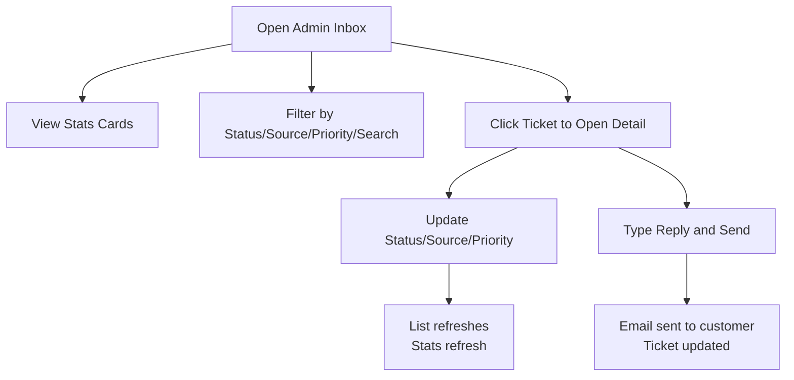
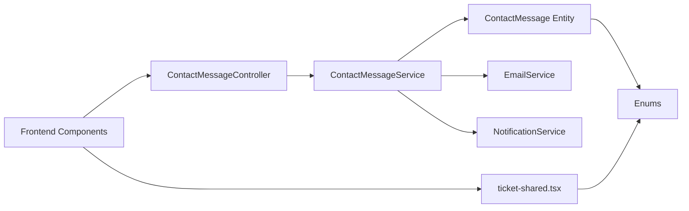

# Customer Support System

<cite>
**Referenced Files in This Document**
- [contact-message.controller.ts](file://apps/backend/src/contact-message/contact-message.controller.ts)
- [contact-message.service.ts](file://apps/backend/src/contact-message/contact-message.service.ts)
- [contact-message.entity.ts](file://apps/backend/src/contact-message/entities/contact-message.entity.ts)
- [create-contact-message.dto.ts](file://apps/backend/src/contact-message/dto/create-contact-message.dto.ts)
- [update-contact-message.dto.ts](file://apps/backend/src/contact-message/dto/update-contact-message.dto.ts)
- [contact-message-query.dto.ts](file://apps/backend/src/contact-message/dto/contact-message-query.dto.ts)
- [enums/index.ts](file://apps/backend/src/common/enums/index.ts)
- [email.service.ts](file://apps/backend/src/email/email.service.ts)
- [contact-response.template.ts](file://apps/backend/src/email/templates/contact-response.template.ts)
- [page.tsx](file://apps/frontend/app/(main)/contact-us/page.tsx)
- [ticket-shared.tsx](file://apps/frontend/components/admin/inbox/ticket-shared.tsx)
- [message-list.tsx](file://apps/frontend/components/admin/inbox/message-list.tsx)
- [ticket-list.tsx](file://apps/frontend/components/admin/inbox/ticket-list.tsx)
- [add-ticket-modal.tsx](file://apps/frontend/components/admin/inbox/add-ticket-modal.tsx)
- [ticket-detail-modal.tsx](file://apps/frontend/components/admin/inbox/ticket-detail-modal.tsx)
- [ticket-stats-cards.tsx](file://apps/frontend/components/admin/inbox/ticket-stats-cards.tsx)
</cite>

## Table of Contents
1. [Introduction](#introduction)
2. [Project Structure](#project-structure)
3. [Core Components](#core-components)
4. [Architecture Overview](#architecture-overview)
5. [Detailed Component Analysis](#detailed-component-analysis)
6. [Dependency Analysis](#dependency-analysis)
7. [Performance Considerations](#performance-considerations)
8. [Troubleshooting Guide](#troubleshooting-guide)
9. [Conclusion](#conclusion)

## Introduction
This document explains the customer support and communication system that powers contact message submission, ticket creation, inbox management, email notifications, and admin workflows. It covers:
- Contact form submission and validation
- Ticket lifecycle (status, priority, source, assignment, replies)
- Admin inbox with filtering, pagination, statistics, and detail operations
- Automated email responses to customers
- Metrics and status tracking for support performance

## Project Structure
The support system spans backend NestJS modules and frontend Next.js pages/components:
- Backend: controller, service, entity, DTOs, enums, and email integration
- Frontend: public contact page, admin inbox list/detail modals, shared utilities, and stats cards

**Diagram sources**
- [contact-message.controller.ts:34-37](file://apps/backend/src/contact-message/contact-message.controller.ts#L34-L37)
- [contact-message.service.ts:13-20](file://apps/backend/src/contact-message/contact-message.service.ts#L13-L20)
- [contact-message.entity.ts:20-91](file://apps/backend/src/contact-message/entities/contact-message.entity.ts#L20-L91)
- [email.service.ts:29-56](file://apps/backend/src/email/email.service.ts#L29-L56)
- [contact-response.template.ts:7-13](file://apps/backend/src/email/templates/contact-response.template.ts#L7-L13)
- [enums/index.ts:43-75](file://apps/backend/src/common/enums/index.ts#L43-L75)
- [page.tsx:21-40](file://apps/frontend/app/(main)/contact-us/page.tsx#L21-L40)
- [ticket-shared.tsx:15-35](file://apps/frontend/components/admin/inbox/ticket-shared.tsx#L15-L35)

**Section sources**
- [contact-message.controller.ts:34-37](file://apps/backend/src/contact-message/contact-message.controller.ts#L34-L37)
- [contact-message.service.ts:13-20](file://apps/backend/src/contact-message/contact-message.service.ts#L13-L20)
- [contact-message.entity.ts:20-91](file://apps/backend/src/contact-message/entities/contact-message.entity.ts#L20-L91)
- [page.tsx:21-40](file://apps/frontend/app/(main)/contact-us/page.tsx#L21-L40)
- [ticket-shared.tsx:15-35](file://apps/frontend/components/admin/inbox/ticket-shared.tsx#L15-L35)

## Core Components
- ContactMessageController: REST endpoints for creating, listing, updating, replying to, and deleting contact messages; includes rate limiting and permission guards.
- ContactMessageService: Business logic for persistence, filtering/pagination, statistics, reply dispatch, and real-time notifications.
- ContactMessage Entity: Data model with status, source, priority, timestamps, assignee, action taken, and response notes.
- EmailService: Sends templated emails to customers and admins using ZeptoMail.
- Frontend Contact Page: Public form with validation and submission to create tickets.
- Admin Inbox UI: Lists, filters, adds tickets, updates status/source/priority, sends replies, and shows statistics.

**Section sources**
- [contact-message.controller.ts:40-198](file://apps/backend/src/contact-message/contact-message.controller.ts#L40-L198)
- [contact-message.service.ts:22-188](file://apps/backend/src/contact-message/contact-message.service.ts#L22-L188)
- [contact-message.entity.ts:20-91](file://apps/backend/src/contact-message/entities/contact-message.entity.ts#L20-L91)
- [email.service.ts:118-176](file://apps/backend/src/email/email.service.ts#L118-L176)
- [page.tsx:92-118](file://apps/frontend/app/(main)/contact-us/page.tsx#L92-L118)
- [ticket-detail-modal.tsx:101-125](file://apps/frontend/components/admin/inbox/ticket-detail-modal.tsx#L101-L125)

## Architecture Overview
End-to-end flow from customer submission to admin handling and automated email response.

**Diagram sources**
- [page.tsx:92-118](file://apps/frontend/app/(main)/contact-us/page.tsx#L92-L118)
- [contact-message.controller.ts:40-198](file://apps/backend/src/contact-message/contact-message.controller.ts#L40-L198)
- [contact-message.service.ts:22-188](file://apps/backend/src/contact-message/contact-message.service.ts#L22-L188)
- [email.service.ts:118-176](file://apps/backend/src/email/email.service.ts#L118-L176)
- [contact-response.template.ts:15-110](file://apps/backend/src/email/templates/contact-response.template.ts#L15-L110)

## Detailed Component Analysis

### Contact Form Submission and Validation
- The public contact page validates inputs (name, email, mobile, message) and posts to the backend contact-messages endpoint. On success, it shows a confirmation toast and resets the form.
- Backend enforces additional validation via DTOs and rate-limits submissions to prevent spam.

Key behaviors:
- Client-side validation schema ensures required fields and formats.
- Backend DTO validates length, format, and enum values.
- Rate limiter allows limited submissions per minute.

**Section sources**
- [page.tsx:21-40](file://apps/frontend/app/(main)/contact-us/page.tsx#L21-L40)
- [page.tsx:92-118](file://apps/frontend/app/(main)/contact-us/page.tsx#L92-L118)
- [create-contact-message.dto.ts:13-55](file://apps/backend/src/contact-message/dto/create-contact-message.dto.ts#L13-L55)
- [contact-message.controller.ts:40-62](file://apps/backend/src/contact-message/contact-message.controller.ts#L40-L62)

### Ticket Creation and Lifecycle Management
- Tickets are represented by the ContactMessage entity with fields for name, email, mobile, message, status, source, priority, timestamps, handledBy, actionTaken, and responseNotes.
- Lifecycle states include pending, in_progress, resolved, closed. Priority levels include low, medium, high. Sources include website, facebook, phone, email, whatsapp, other.
- Admins can update status, source, priority, and add response notes. Replies trigger an email to the customer and persist actionTaken and responseNotes.

**Diagram sources**
- [contact-message.entity.ts:46-90](file://apps/backend/src/contact-message/entities/contact-message.entity.ts#L46-L90)
- [contact-message.service.ts:145-164](file://apps/backend/src/contact-message/contact-message.service.ts#L145-L164)
- [enums/index.ts:43-75](file://apps/backend/src/common/enums/index.ts#L43-L75)

**Section sources**
- [contact-message.entity.ts:20-91](file://apps/backend/src/contact-message/entities/contact-message.entity.ts#L20-L91)
- [contact-message.service.ts:138-164](file://apps/backend/src/contact-message/contact-message.service.ts#L138-L164)
- [enums/index.ts:43-75](file://apps/backend/src/common/enums/index.ts#L43-L75)

### Admin Inbox: Filtering, Pagination, and Statistics
- The admin inbox lists tickets with search by name/email, filter by status, source, and priority, and supports pagination.
- Statistics endpoint returns total count and counts grouped by status.
- Frontend components render stats cards and interactive filters.

**Diagram sources**
- [contact-message.entity.ts:20-91](file://apps/backend/src/contact-message/entities/contact-message.entity.ts#L20-L91)
- [contact-message-query.dto.ts:11-45](file://apps/backend/src/contact-message/dto/contact-message-query.dto.ts#L11-L45)
- [contact-message.controller.ts:64-198](file://apps/backend/src/contact-message/contact-message.controller.ts#L64-L198)
- [contact-message.service.ts:73-188](file://apps/backend/src/contact-message/contact-message.service.ts#L73-L188)

**Section sources**
- [contact-message.controller.ts:64-198](file://apps/backend/src/contact-message/contact-message.controller.ts#L64-L198)
- [contact-message.service.ts:73-188](file://apps/backend/src/contact-message/contact-message.service.ts#L73-L188)
- [message-list.tsx:47-73](file://apps/frontend/components/admin/inbox/message-list.tsx#L47-L73)
- [ticket-stats-cards.tsx:36-67](file://apps/frontend/components/admin/inbox/ticket-stats-cards.tsx#L36-L67)

### Email Notifications and Automated Responses
- When an admin sends a reply, the backend calls EmailService to send a branded HTML email to the customer. The template includes the original message, the response, and a call-to-action link.
- EmailService also provides methods for order confirmations, password change notifications, and admin alerts. For contact replies, it uses a dedicated method that throws on failure so the reply operation can fail fast if email is misconfigured.

**Diagram sources**
- [ticket-detail-modal.tsx:101-125](file://apps/frontend/components/admin/inbox/ticket-detail-modal.tsx#L101-L125)
- [contact-message.controller.ts:160-179](file://apps/backend/src/contact-message/contact-message.controller.ts#L160-L179)
- [contact-message.service.ts:145-164](file://apps/backend/src/contact-message/contact-message.service.ts#L145-L164)
- [email.service.ts:154-176](file://apps/backend/src/email/email.service.ts#L154-L176)
- [contact-response.template.ts:15-110](file://apps/backend/src/email/templates/contact-response.template.ts#L15-L110)

**Section sources**
- [email.service.ts:118-176](file://apps/backend/src/email/email.service.ts#L118-L176)
- [contact-response.template.ts:7-110](file://apps/backend/src/email/templates/contact-response.template.ts#L7-L110)
- [contact-message.service.ts:145-164](file://apps/backend/src/contact-message/contact-message.service.ts#L145-L164)

### Admin Interface Features
- Add Ticket Modal: Allows agents to manually create tickets for phone/Facebook/WhatsApp inquiries.
- Ticket List: Displays tickets with subject preview, time ago, and status/priority badges.
- Ticket Detail Modal: Provides controls to update status, source, priority, and send replies. Includes customer info and links to view customer profile when available.
- Stats Cards: Visualizes total messages and breakdown by status.

**Diagram sources**
- [add-ticket-modal.tsx:13-61](file://apps/frontend/components/admin/inbox/add-ticket-modal.tsx#L13-L61)
- [ticket-list.tsx:11-38](file://apps/frontend/components/admin/inbox/ticket-list.tsx#L11-L38)
- [ticket-detail-modal.tsx:65-125](file://apps/frontend/components/admin/inbox/ticket-detail-modal.tsx#L65-L125)
- [ticket-stats-cards.tsx:36-67](file://apps/frontend/components/admin/inbox/ticket-stats-cards.tsx#L36-L67)

**Section sources**
- [add-ticket-modal.tsx:13-61](file://apps/frontend/components/admin/inbox/add-ticket-modal.tsx#L13-L61)
- [ticket-list.tsx:11-38](file://apps/frontend/components/admin/inbox/ticket-list.tsx#L11-L38)
- [ticket-detail-modal.tsx:65-125](file://apps/frontend/components/admin/inbox/ticket-detail-modal.tsx#L65-L125)
- [ticket-stats-cards.tsx:36-67](file://apps/frontend/components/admin/inbox/ticket-stats-cards.tsx#L36-L67)

## Dependency Analysis
- Controller depends on Service for all business operations and applies authentication/permission guards.
- Service depends on Repository (via TypeORM), EmailService for outbound mail, and NotificationService for realtime alerts.
- Entity references User for both sender and handler relationships.
- Enums define shared constants across backend and frontend.
- Frontend components depend on API utilities and shared types/helpers.

**Diagram sources**
- [contact-message.controller.ts:34-37](file://apps/backend/src/contact-message/contact-message.controller.ts#L34-L37)
- [contact-message.service.ts:13-20](file://apps/backend/src/contact-message/contact-message.service.ts#L13-L20)
- [contact-message.entity.ts:20-91](file://apps/backend/src/contact-message/entities/contact-message.entity.ts#L20-L91)
- [ticket-shared.tsx:15-35](file://apps/frontend/components/admin/inbox/ticket-shared.tsx#L15-L35)

**Section sources**
- [contact-message.controller.ts:34-37](file://apps/backend/src/contact-message/contact-message.controller.ts#L34-L37)
- [contact-message.service.ts:13-20](file://apps/backend/src/contact-message/contact-message.service.ts#L13-L20)
- [contact-message.entity.ts:20-91](file://apps/backend/src/contact-message/entities/contact-message.entity.ts#L20-L91)
- [ticket-shared.tsx:15-35](file://apps/frontend/components/admin/inbox/ticket-shared.tsx#L15-L35)

## Performance Considerations
- Rate Limiting: Contact creation is throttled to reduce spam impact.
- Pagination: All list endpoints return paginated data to keep UI responsive.
- Filtering: Server-side filtering by status, source, priority, and search reduces client overhead.
- Email Failures: Email sending failures are logged and do not block core flows except where explicitly required (reply path throws to ensure visibility).

[No sources needed since this section provides general guidance]

## Troubleshooting Guide
- Contact form submission fails:
  - Verify client-side validation matches backend DTO constraints.
  - Check network requests to POST /contact-messages and inspect server errors.
- Admin cannot see tickets:
  - Ensure JWT authentication and module permissions are configured for /admin/inbox.
  - Confirm the user has appropriate roles/permissions.
- Email replies not received:
  - Validate ZeptoMail configuration (API URL, key, from address/name).
  - Check EmailService logs for send failures.
  - Ensure admin notification recipients are configured if needed.
- Stats not updating:
  - Confirm GET /contact-messages/statistics is called after state changes.
  - Verify backend statistics aggregation queries run successfully.

**Section sources**
- [contact-message.controller.ts:40-62](file://apps/backend/src/contact-message/contact-message.controller.ts#L40-L62)
- [contact-message.controller.ts:79-95](file://apps/backend/src/contact-message/contact-message.controller.ts#L79-L95)
- [email.service.ts:41-56](file://apps/backend/src/email/email.service.ts#L41-L56)
- [email.service.ts:154-176](file://apps/backend/src/email/email.service.ts#L154-L176)

## Conclusion
The customer support system provides a robust pipeline from customer inquiries to admin resolution with clear status tracking, prioritization, and automated email responses. The admin inbox offers comprehensive tools for managing tickets efficiently, while the public contact form ensures a smooth customer experience. With built-in filtering, pagination, and statistics, teams can monitor workload and performance effectively.

[No sources needed since this section summarizes without analyzing specific files]