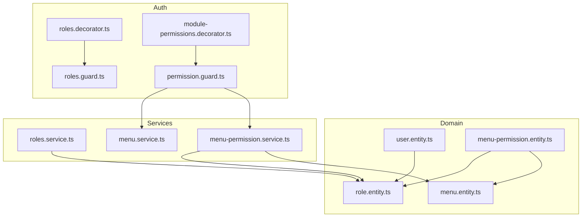
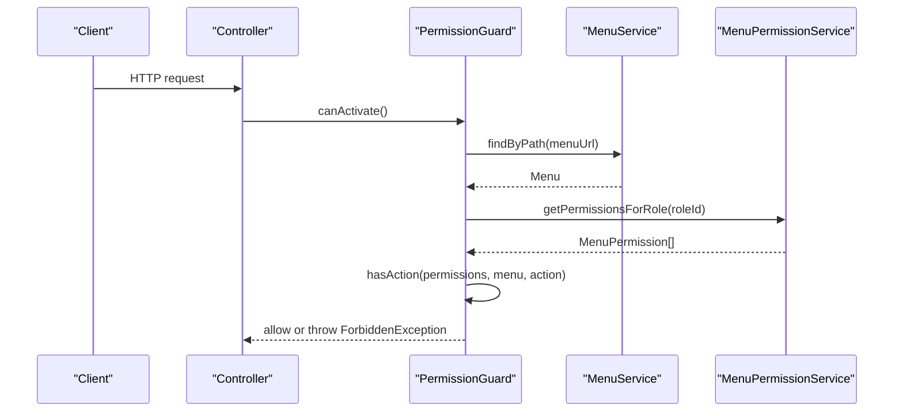
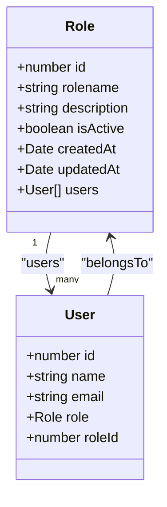
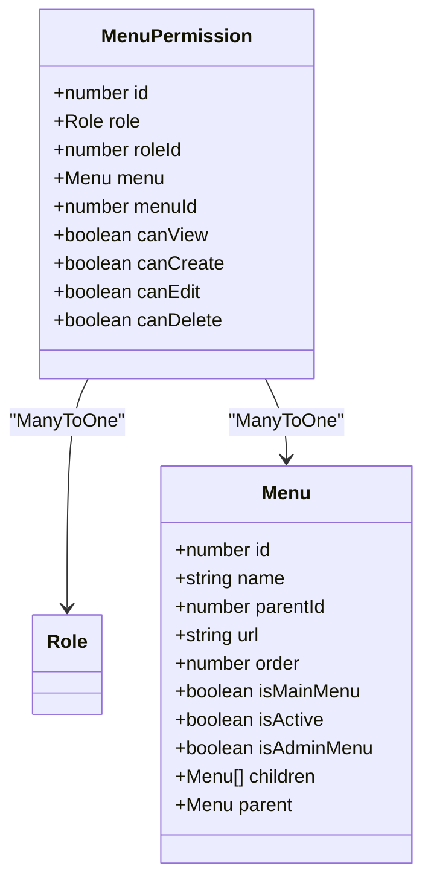
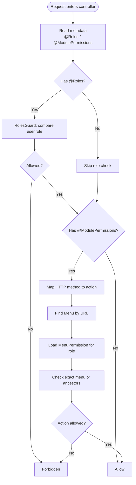
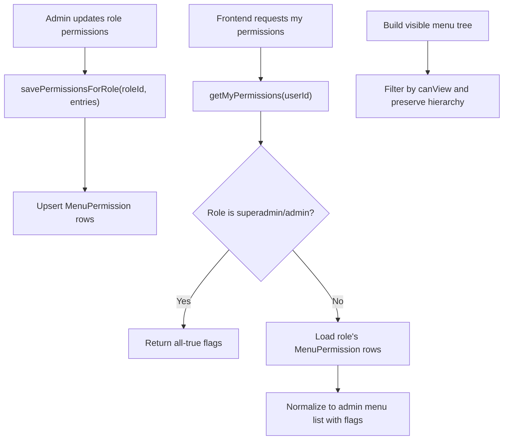
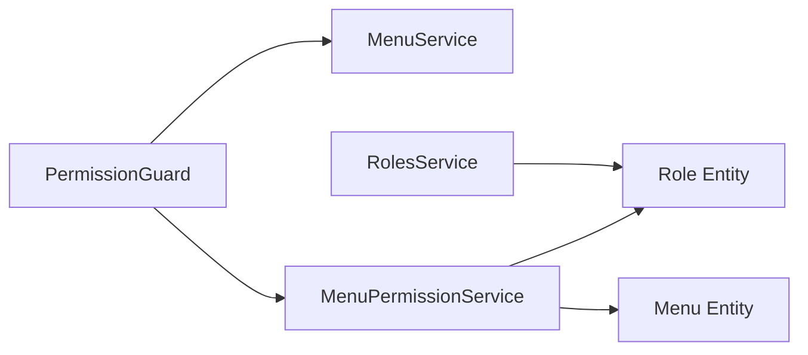

# Role-Based Access Control (RBAC)

<cite>
**Referenced Files in This Document**
- [role.entity.ts](file://apps/backend/src/roles/entities/role.entity.ts)
- [user.entity.ts](file://apps/backend/src/user/entities/user.entity.ts)
- [menu.entity.ts](file://apps/backend/src/menu/entities/menu.entity.ts)
- [menu-permission.entity.ts](file://apps/backend/src/menu-permission/entities/menu-permission.entity.ts)
- [roles.service.ts](file://apps/backend/src/roles/roles.service.ts)
- [menu.service.ts](file://apps/backend/src/menu/menu.service.ts)
- [menu-permission.service.ts](file://apps/backend/src/menu-permission/menu-permission.service.ts)
- [roles.decorator.ts](file://apps/backend/src/auth/decorators/roles.decorator.ts)
- [module-permissions.decorator.ts](file://apps/backend/src/auth/decorators/module-permissions.decorator.ts)
- [roles.guard.ts](file://apps/backend/src/auth/guards/roles.guard.ts)
- [permission.guard.ts](file://apps/backend/src/auth/guards/permission.guard.ts)
- [menu-permission.module.ts](file://apps/backend/src/menu-permission/menu-permission.module.ts)
</cite>

## Table of Contents
1. [Introduction](#introduction)
2. [Project Structure](#project-structure)
3. [Core Components](#core-components)
4. [Architecture Overview](#architecture-overview)
5. [Detailed Component Analysis](#detailed-component-analysis)
6. [Dependency Analysis](#dependency-analysis)
7. [Performance Considerations](#performance-considerations)
8. [Troubleshooting Guide](#troubleshooting-guide)
9. [Conclusion](#conclusion)

## Introduction
This document explains the role-based access control system implemented in the backend. It covers:
- Predefined roles and their typical permissions hierarchy
- Custom role creation and permission assignment via admin endpoints
- Menu permission system that controls UI visibility and API access
- Decorators and guards for route protection
- Examples of creating roles, assigning permissions, and implementing role checks
- Security implications and best practices

The RBAC model is centered around four core entities: User, Role, Menu, and MenuPermission. Permissions are granular per menu item and support view, create, edit, and delete actions.

## Project Structure
The RBAC implementation spans several modules:
- Roles module defines the Role entity and CRUD operations
- Menu module defines hierarchical menus with URL paths used for authorization
- Menu Permission module links roles to menus with boolean action flags
- Auth decorators and guards enforce role and permission checks at controller boundaries

**Diagram sources**
- [roles.decorator.ts:1-6](file://apps/backend/src/auth/decorators/roles.decorator.ts#L1-L6)
- [module-permissions.decorator.ts:1-14](file://apps/backend/src/auth/decorators/module-permissions.decorator.ts#L1-L14)
- [roles.guard.ts:1-28](file://apps/backend/src/auth/guards/roles.guard.ts#L1-L28)
- [permission.guard.ts:1-100](file://apps/backend/src/auth/guards/permission.guard.ts#L1-L100)
- [role.entity.ts:1-79](file://apps/backend/src/roles/entities/role.entity.ts#L1-L79)
- [user.entity.ts:62-77](file://apps/backend/src/user/entities/user.entity.ts#L62-L77)
- [menu.entity.ts:1-115](file://apps/backend/src/menu/entities/menu.entity.ts#L1-L115)
- [menu-permission.entity.ts:1-72](file://apps/backend/src/menu-permission/entities/menu-permission.entity.ts#L1-L72)
- [roles.service.ts:1-93](file://apps/backend/src/roles/roles.service.ts#L1-L93)
- [menu.service.ts:1-231](file://apps/backend/src/menu/menu.service.ts#L1-L231)
- [menu-permission.service.ts:1-180](file://apps/backend/src/menu-permission/menu-permission.service.ts#L1-L180)

**Section sources**
- [role.entity.ts:1-79](file://apps/backend/src/roles/entities/role.entity.ts#L1-L79)
- [user.entity.ts:62-77](file://apps/backend/src/user/entities/user.entity.ts#L62-L77)
- [menu.entity.ts:1-115](file://apps/backend/src/menu/entities/menu.entity.ts#L1-L115)
- [menu-permission.entity.ts:1-72](file://apps/backend/src/menu-permission/entities/menu-permission.entity.ts#L1-L72)
- [roles.service.ts:1-93](file://apps/backend/src/roles/roles.service.ts#L1-L93)
- [menu.service.ts:1-231](file://apps/backend/src/menu/menu.service.ts#L1-L231)
- [menu-permission.service.ts:1-180](file://apps/backend/src/menu-permission/menu-permission.service.ts#L1-L180)
- [roles.decorator.ts:1-6](file://apps/backend/src/auth/decorators/roles.decorator.ts#L1-L6)
- [module-permissions.decorator.ts:1-14](file://apps/backend/src/auth/decorators/module-permissions.decorator.ts#L1-L14)
- [roles.guard.ts:1-28](file://apps/backend/src/auth/guards/roles.guard.ts#L1-L28)
- [permission.guard.ts:1-100](file://apps/backend/src/auth/guards/permission.guard.ts#L1-L100)

## Core Components
- Role: Represents a named role with active/inactive state and audit fields. Users reference a single role.
- User: Holds a foreign key to Role and can be associated with business data.
- Menu: Hierarchical menu items with URL paths, ordering, and flags indicating admin/main menu membership.
- MenuPermission: Per-role, per-menu boolean flags for canView, canCreate, canEdit, canDelete.

Key relationships:
- User has ManyToOne Role
- MenuPermission has ManyToOne Role and ManyToOne Menu
- Menu supports parent-child hierarchy for section inheritance

**Section sources**
- [role.entity.ts:14-77](file://apps/backend/src/roles/entities/role.entity.ts#L14-L77)
- [user.entity.ts:62-77](file://apps/backend/src/user/entities/user.entity.ts#L62-L77)
- [menu.entity.ts:12-93](file://apps/backend/src/menu/entities/menu.entity.ts#L12-L93)
- [menu-permission.entity.ts:12-50](file://apps/backend/src/menu-permission/entities/menu-permission.entity.ts#L12-L50)

## Architecture Overview
The RBAC architecture combines declarative decorators with runtime guards:
- @Roles restricts controllers/endpoints to specific role names
- @ModulePermissions marks endpoints with a menu URL; PermissionGuard maps HTTP methods to permission actions and enforces them against MenuPermission rows
- MenuPermissionService provides both fine-grained permission checks and aggregated UI permissions for rendering menus

**Diagram sources**
- [permission.guard.ts:39-90](file://apps/backend/src/auth/guards/permission.guard.ts#L39-L90)
- [menu.service.ts:155-172](file://apps/backend/src/menu/menu.service.ts#L155-L172)
- [menu-permission.service.ts:45-51](file://apps/backend/src/menu-permission/menu-permission.service.ts#L45-L51)

## Detailed Component Analysis

### Roles and Users
- Role stores rolename, description, isActive, and audit fields. It references createdBy/updatedBy users and exposes a one-to-many relationship to User.
- User holds roleId and an optional Role object. The default role ID indicates customer by convention.

**Diagram sources**
- [role.entity.ts:14-77](file://apps/backend/src/roles/entities/role.entity.ts#L14-L77)
- [user.entity.ts:62-77](file://apps/backend/src/user/entities/user.entity.ts#L62-L77)

**Section sources**
- [role.entity.ts:14-77](file://apps/backend/src/roles/entities/role.entity.ts#L14-L77)
- [user.entity.ts:62-77](file://apps/backend/src/user/entities/user.entity.ts#L62-L77)

### Menu and MenuPermission
- Menu supports hierarchical structure via parentId and children, plus url for authorization mapping.
- MenuPermission binds a Role to a Menu with boolean flags for each action.

**Diagram sources**
- [menu.entity.ts:12-93](file://apps/backend/src/menu/entities/menu.entity.ts#L12-L93)
- [menu-permission.entity.ts:12-50](file://apps/backend/src/menu-permission/entities/menu-permission.entity.ts#L12-L50)

**Section sources**
- [menu.entity.ts:12-93](file://apps/backend/src/menu/entities/menu.entity.ts#L12-L93)
- [menu-permission.entity.ts:12-50](file://apps/backend/src/menu-permission/entities/menu-permission.entity.ts#L12-L50)

### Decorators and Guards
- @Roles declares required role names. RolesGuard checks if the current user’s role matches any required role.
- @ModulePermissions declares the menu URL for a controller/endpoint. PermissionGuard maps HTTP method to a permission action and validates it against MenuPermission rows. It also supports section inheritance by checking ancestor menus.

**Diagram sources**
- [roles.decorator.ts:1-6](file://apps/backend/src/auth/decorators/roles.decorator.ts#L1-L6)
- [module-permissions.decorator.ts:1-14](file://apps/backend/src/auth/decorators/module-permissions.decorator.ts#L1-L14)
- [roles.guard.ts:1-28](file://apps/backend/src/auth/guards/roles.guard.ts#L1-L28)
- [permission.guard.ts:16-90](file://apps/backend/src/auth/guards/permission.guard.ts#L16-L90)

**Section sources**
- [roles.decorator.ts:1-6](file://apps/backend/src/auth/decorators/roles.decorator.ts#L1-L6)
- [module-permissions.decorator.ts:1-14](file://apps/backend/src/auth/decorators/module-permissions.decorator.ts#L1-L14)
- [roles.guard.ts:1-28](file://apps/backend/src/auth/guards/roles.guard.ts#L1-L28)
- [permission.guard.ts:16-90](file://apps/backend/src/auth/guards/permission.guard.ts#L16-L90)

### Menu Permission Service and UI Visibility
- MenuPermissionService provides:
  - createOrUpdatePermission and savePermissionsForRole for admin configuration
  - getPermissionsForRole for runtime enforcement
  - getUserMenuPermissions and getAccessibleMenusForUser for building visible menus
  - getMyPermissions to return a normalized set of admin menu permissions for the frontend, including superadmin/admin bypass behavior and inactive role handling

**Diagram sources**
- [menu-permission.service.ts:97-123](file://apps/backend/src/menu-permission/menu-permission.service.ts#L97-L123)
- [menu-permission.service.ts:130-178](file://apps/backend/src/menu-permission/menu-permission.service.ts#L130-L178)
- [menu-permission.service.ts:66-88](file://apps/backend/src/menu-permission/menu-permission.service.ts#L66-L88)

**Section sources**
- [menu-permission.service.ts:20-51](file://apps/backend/src/menu-permission/menu-permission.service.ts#L20-L51)
- [menu-permission.service.ts:66-88](file://apps/backend/src/menu-permission/menu-permission.service.ts#L66-L88)
- [menu-permission.service.ts:97-123](file://apps/backend/src/menu-permission/menu-permission.service.ts#L97-L123)
- [menu-permission.service.ts:130-178](file://apps/backend/src/menu-permission/menu-permission.service.ts#L130-L178)

### Role Management Endpoints
- RolesService exposes findAll, findOne, create, update, remove for managing roles. It records createdBy/updatedBy when mutating roles.

Typical usage patterns:
- Create a new role with a unique rolename and description
- Update role status (isActive) to enable/disable without deleting
- Remove roles only when no users depend on them

**Section sources**
- [roles.service.ts:20-93](file://apps/backend/src/roles/roles.service.ts#L20-L93)

### Example Workflows

#### Creating a Custom Role
- Call the roles service to create a role with a unique rolename and description.
- Optionally assign the role to users by updating their roleId.

Reference:
- [roles.service.ts:57-64](file://apps/backend/src/roles/roles.service.ts#L57-L64)

#### Assigning Permissions to a Role
- Use MenuPermissionService.savePermissionsForRole to set canView/canCreate/canEdit/canDelete for each admin menu URL.
- For UI visibility, use getAccessibleMenusForUser to build the menu tree filtered by canView.

References:
- [menu-permission.service.ts:97-123](file://apps/backend/src/menu-permission/menu-permission.service.ts#L97-L123)
- [menu-permission.service.ts:66-88](file://apps/backend/src/menu-permission/menu-permission.service.ts#L66-L88)

#### Implementing Role Checks in Controllers
- Protect endpoints with @Roles("admin") and apply RolesGuard globally or locally.
- For fine-grained control, annotate endpoints with @ModulePermissions("/some-admin-url") and apply PermissionGuard.

References:
- [roles.decorator.ts:1-6](file://apps/backend/src/auth/decorators/roles.decorator.ts#L1-L6)
- [roles.guard.ts:1-28](file://apps/backend/src/auth/guards/roles.guard.ts#L1-L28)
- [module-permissions.decorator.ts:1-14](file://apps/backend/src/auth/decorators/module-permissions.decorator.ts#L1-L14)
- [permission.guard.ts:16-90](file://apps/backend/src/auth/guards/permission.guard.ts#L16-L90)

## Dependency Analysis
- PermissionGuard depends on MenuService and MenuPermissionService to resolve menu lineage and permissions.
- MenuPermissionModule is global so guards can inject services from any module.
- RolesService depends only on the Role repository.

**Diagram sources**
- [permission.guard.ts:32-37](file://apps/backend/src/auth/guards/permission.guard.ts#L32-L37)
- [menu-permission.module.ts:11-23](file://apps/backend/src/menu-permission/menu-permission.module.ts#L11-L23)
- [roles.service.ts:14-18](file://apps/backend/src/roles/roles.service.ts#L14-L18)

**Section sources**
- [permission.guard.ts:32-37](file://apps/backend/src/auth/guards/permission.guard.ts#L32-L37)
- [menu-permission.module.ts:11-23](file://apps/backend/src/menu-permission/menu-permission.module.ts#L11-L23)
- [roles.service.ts:14-18](file://apps/backend/src/roles/roles.service.ts#L14-L18)

## Performance Considerations
- PermissionGuard performs DB lookups for menu and permissions on protected routes. Cache frequently accessed menu trees where appropriate.
- MenuPermissionService.getMyPermissions returns a normalized permission matrix for the frontend; consider caching this response per userId for the session duration.
- Avoid excessive nested queries by preloading relations when serving large menu trees.

[No sources needed since this section provides general guidance]

## Troubleshooting Guide
Common issues and resolutions:
- Missing authenticated role: Ensure the request contains user.userId and user.roleId after authentication.
- Unknown module menu: Verify that the menu URL in @ModulePermissions exactly matches a Menu.url entry.
- Unsupported method: Only GET, POST, PUT, PATCH, DELETE are mapped to permission actions.
- Role is inactive: If the logged-in role is deactivated, all permissions are denied. Reactivate the role or reissue tokens.
- Section inheritance not working: Confirm the menu hierarchy and that ancestor menus have the required action enabled.

Relevant behaviors:
- PermissionGuard throws ForbiddenException for missing role, unknown menu, unsupported method, inactive role, or insufficient action.
- getMyPermissions returns all-false flags for inactive roles and all-true for superadmin/admin.

**Section sources**
- [permission.guard.ts:46-74](file://apps/backend/src/auth/guards/permission.guard.ts#L46-L74)
- [menu-permission.service.ts:130-178](file://apps/backend/src/menu-permission/menu-permission.service.ts#L130-L178)

## Conclusion
The RBAC system uses a clear separation between coarse-grained role checks (@Roles) and fine-grained menu-based permissions (@ModulePermissions). Roles are managed through dedicated services, while MenuPermission ties roles to menu URLs with granular action flags. PermissionGuard enforces these rules at runtime, supporting section inheritance for scalable permission management. For UI visibility, MenuPermissionService normalizes permissions into a structured format that frontends can render safely. Follow best practices to keep roles minimal, menus well-structured, and permissions auditable.

[No sources needed since this section summarizes without analyzing specific files]