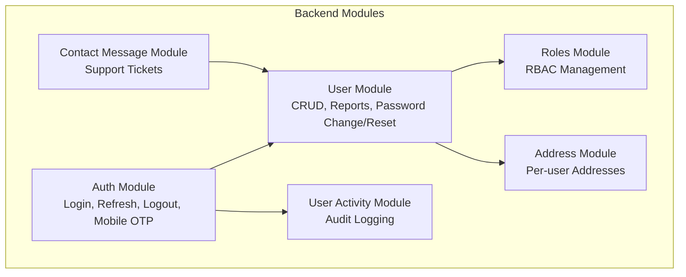
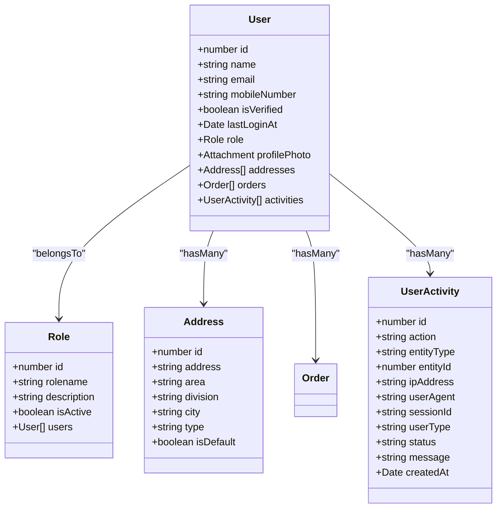
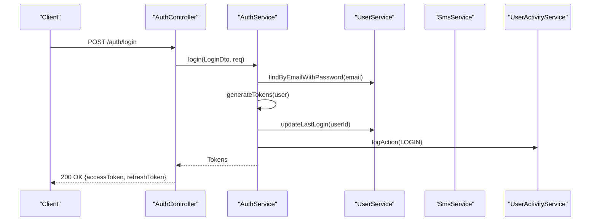
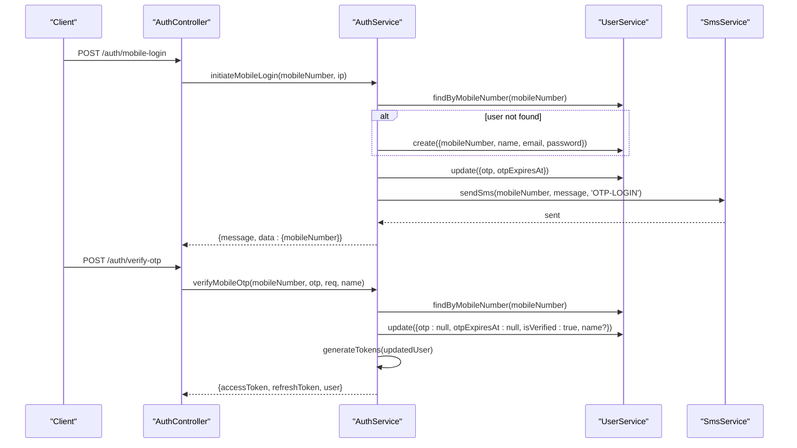
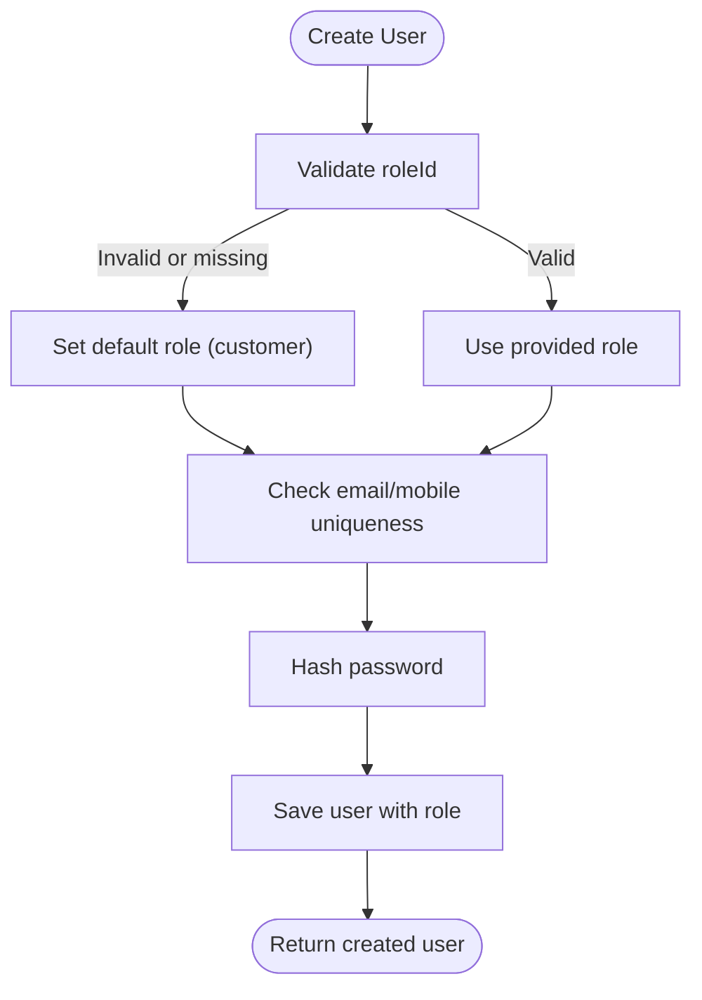
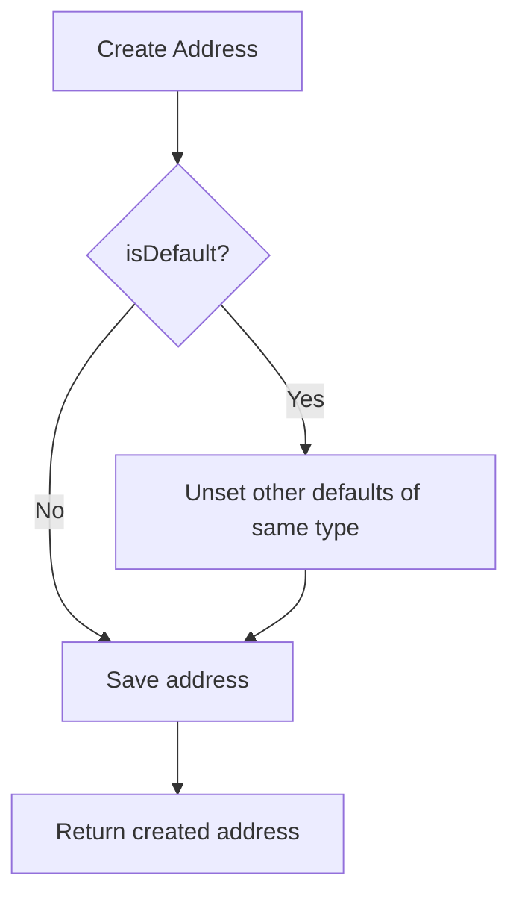
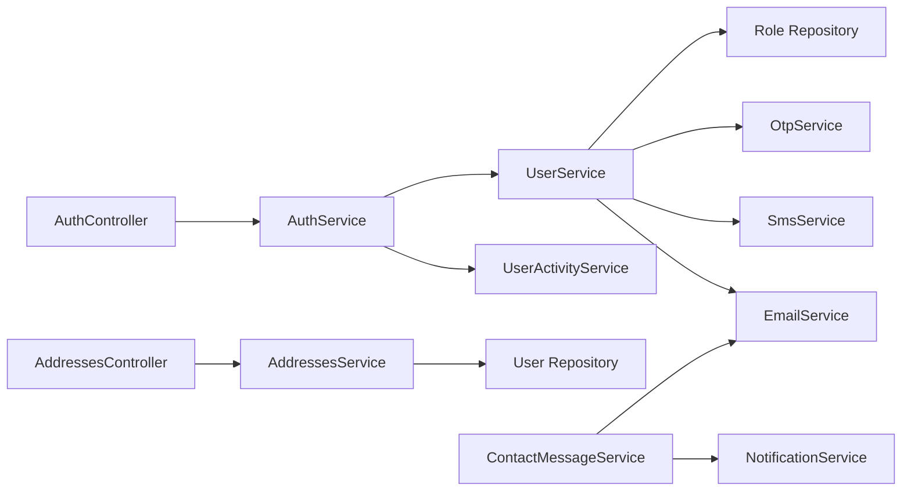

# User Management

<cite>
**Referenced Files in This Document**
- [auth.controller.ts](file://apps/backend/src/auth/auth.controller.ts)
- [auth.service.ts](file://apps/backend/src/auth/auth.service.ts)
- [user.controller.ts](file://apps/backend/src/user/user.controller.ts)
- [user.service.ts](file://apps/backend/src/user/user.service.ts)
- [user.entity.ts](file://apps/backend/src/user/entities/user.entity.ts)
- [roles.controller.ts](file://apps/backend/src/roles/roles.controller.ts)
- [roles.service.ts](file://apps/backend/src/roles/roles.service.ts)
- [role.entity.ts](file://apps/backend/src/roles/entities/role.entity.ts)
- [address.controller.ts](file://apps/backend/src/address/address.controller.ts)
- [address.service.ts](file://apps/backend/src/address/address.service.ts)
- [user-activity.service.ts](file://apps/backend/src/user-activity/user-activity.service.ts)
- [contact-message.service.ts](file://apps/backend/src/contact-message/contact-message.service.ts)
</cite>

## Table of Contents
1. Introduction
2. Project Structure
3. Core Components
4. Architecture Overview
5. Detailed Component Analysis
6. Dependency Analysis
7. Performance Considerations
8. Troubleshooting Guide
9. Conclusion

## Introduction
This document explains the user management system for the German Butcher e-commerce platform. It covers registration and authentication flows (email, mobile OTP), password reset, role-based access control (RBAC), profile and address management, customer support ticketing, activity tracking and audit logging, security considerations, and segmentation foundations for marketing and personalization.

## Project Structure
The backend is a NestJS application with feature modules:
- Authentication: endpoints for login, refresh, logout, mobile OTP login, and token validation.
- Users: CRUD for users, top customers, reports, and password change/reset.
- Roles: RBAC entity and admin-only management endpoints.
- Addresses: per-user addresses with default selection and type filtering.
- User Activity: audit logging and scheduled cleanup.
- Contact Messages: customer support tickets with notifications and email replies.

**Diagram sources**
- [auth.controller.ts:31-309](file://apps/backend/src/auth/auth.controller.ts#L31-L309)
- [user.controller.ts:37-399](file://apps/backend/src/user/user.controller.ts#L37-L399)
- [roles.controller.ts:32-139](file://apps/backend/src/roles/roles.controller.ts#L32-L139)
- [address.controller.ts:38-221](file://apps/backend/src/address/address.controller.ts#L38-L221)
- [user-activity.service.ts:25-279](file://apps/backend/src/user-activity/user-activity.service.ts#L25-L279)
- [contact-message.service.ts:13-190](file://apps/backend/src/contact-message/contact-message.service.ts#L13-L190)

**Section sources**
- [auth.controller.ts:31-309](file://apps/backend/src/auth/auth.controller.ts#L31-L309)
- [user.controller.ts:37-399](file://apps/backend/src/user/user.controller.ts#L37-L399)
- [roles.controller.ts:32-139](file://apps/backend/src/roles/roles.controller.ts#L32-L139)
- [address.controller.ts:38-221](file://apps/backend/src/address/address.controller.ts#L38-L221)
- [user-activity.service.ts:25-279](file://apps/backend/src/user-activity/user-activity.service.ts#L25-L279)
- [contact-message.service.ts:13-190](file://apps/backend/src/contact-message/contact-message.service.ts#L13-L190)

## Core Components
- Authentication Service: validates credentials, issues JWTs, handles mobile OTP login, logs activities.
- User Service: creates/updates users, manages roles, top customers, reports, password change/reset.
- Role Service: admin-only CRUD for roles; used to assign roles to users.
- Address Service: manages multiple addresses per user, default selection by type, and retrieval.
- User Activity Service: records actions, supports pagination, filters, and scheduled cleanup.
- Contact Message Service: stores support messages, sends email replies, notifies admins.

Key data model relationships:
- User has many Addresses, Orders, Activities; belongs to Role.
- Role has many Users.

**Diagram sources**
- [user.entity.ts:22-183](file://apps/backend/src/user/entities/user.entity.ts#L22-L183)
- [role.entity.ts:14-79](file://apps/backend/src/roles/entities/role.entity.ts#L14-L79)
- [user-activity.service.ts:1-279](file://apps/backend/src/user-activity/user-activity.service.ts#L1-L279)

**Section sources**
- [user.entity.ts:22-183](file://apps/backend/src/user/entities/user.entity.ts#L22-L183)
- [role.entity.ts:14-79](file://apps/backend/src/roles/entities/role.entity.ts#L14-L79)
- [user-activity.service.ts:1-279](file://apps/backend/src/user-activity/user-activity.service.ts#L1-L279)

## Architecture Overview
Authentication flow:
- Email login: controller delegates to service, which validates credentials, generates tokens, updates last login, and logs activity.
- Mobile OTP login: initiates OTP via SMS with cooldown, verifies OTP, sets verification flag, returns tokens and sanitized user.
- Token refresh: validates refresh token and issues new pair.
- Logout: invalidates client-side tokens and logs logout activity.

**Diagram sources**
- [auth.controller.ts:81-114](file://apps/backend/src/auth/auth.controller.ts#L81-L114)
- [auth.service.ts:54-100](file://apps/backend/src/auth/auth.service.ts#L54-L100)
- [user-activity.service.ts:34-53](file://apps/backend/src/user-activity/user-activity.service.ts#L34-L53)

Mobile OTP login flow:

**Diagram sources**
- [auth.controller.ts:231-307](file://apps/backend/src/auth/auth.controller.ts#L231-L307)
- [auth.service.ts:172-358](file://apps/backend/src/auth/auth.service.ts#L172-L358)

## Detailed Component Analysis

### Authentication and Registration
- Registration: endpoint delegates to user service to create user with validated role (defaults to customer if invalid).
- Login: validates credentials, generates JWT access and refresh tokens, updates last login, logs activity.
- Refresh: validates refresh token and issues new tokens.
- Logout: logs logout activity.
- Mobile OTP login: enforces phone format, cooldown, SMS delivery, OTP verification, account verification flag, optional name update.

Security notes:
- Passwords are hashed using bcrypt.
- JWT secrets and expiry configured via environment variables.
- Throttling applied to sensitive endpoints.

Implementation references:
- Registration and login endpoints: [auth.controller.ts:38-114](file://apps/backend/src/auth/auth.controller.ts#L38-L114)
- Token generation and refresh: [auth.service.ts:107-170](file://apps/backend/src/auth/auth.service.ts#L107-L170)
- Mobile OTP initiation and verification: [auth.service.ts:172-358](file://apps/backend/src/auth/auth.service.ts#L172-L358)

**Section sources**
- [auth.controller.ts:38-114](file://apps/backend/src/auth/auth.controller.ts#L38-L114)
- [auth.service.ts:54-170](file://apps/backend/src/auth/auth.service.ts#L54-L170)
- [auth.service.ts:172-358](file://apps/backend/src/auth/auth.service.ts#L172-L358)

### Role-Based Access Control (RBAC)
- Roles are entities with names, descriptions, and active flags.
- Admin-only endpoints manage roles (create, read, update, delete).
- Users belong to roles; default role for new users is customer (roleId 3).
- Permission enforcement uses guards and module permissions decorators on controllers.

Implementation references:
- Role CRUD endpoints: [roles.controller.ts:32-139](file://apps/backend/src/roles/roles.controller.ts#L32-L139)
- Role service logic: [roles.service.ts:14-93](file://apps/backend/src/roles/roles.service.ts#L14-L93)
- Role entity: [role.entity.ts:14-79](file://apps/backend/src/roles/entities/role.entity.ts#L14-L79)
- User creation with role assignment: [user.service.ts:561-629](file://apps/backend/src/user/user.service.ts#L561-L629)

**Diagram sources**
- [user.service.ts:561-629](file://apps/backend/src/user/user.service.ts#L561-L629)

**Section sources**
- [roles.controller.ts:32-139](file://apps/backend/src/roles/roles.controller.ts#L32-L139)
- [roles.service.ts:14-93](file://apps/backend/src/roles/roles.service.ts#L14-L93)
- [role.entity.ts:14-79](file://apps/backend/src/roles/entities/role.entity.ts#L14-L79)
- [user.service.ts:561-629](file://apps/backend/src/user/user.service.ts#L561-L629)

### User Profile Management
- Update user: allows updating name, email, password, profile photo reference, and other fields; ensures email uniqueness and hashes passwords.
- Change password: requires current password, prevents reuse, sends confirmation email asynchronously.
- Retrieve user details: includes role, addresses, profile photo, and recent delivered orders with items and shipping/payment methods.

Implementation references:
- Update user: [user.controller.ts:316-331](file://apps/backend/src/user/user.controller.ts#L316-L331), [user.service.ts:630-713](file://apps/backend/src/user/user.service.ts#L630-L713)
- Change password: [user.controller.ts:292-315](file://apps/backend/src/user/user.controller.ts#L292-L315), [user.service.ts:718-770](file://apps/backend/src/user/user.service.ts#L718-L770)
- Get user by ID: [user.controller.ts:260-273](file://apps/backend/src/user/user.controller.ts#L260-L273), [user.service.ts:259-355](file://apps/backend/src/user/user.service.ts#L259-L355)

**Section sources**
- [user.controller.ts:260-331](file://apps/backend/src/user/user.controller.ts#L260-L331)
- [user.service.ts:259-770](file://apps/backend/src/user/user.service.ts#L259-L770)

### Address Management
- Create/update/delete addresses per user.
- Default address selection by type (e.g., home, office); setting one default unsets others of the same type.
- Retrieval: list all (admin sees all, users see own), get default by type, get by ID, get by user ID with authorization checks.

Implementation references:
- Address controller endpoints: [address.controller.ts:45-221](file://apps/backend/src/address/address.controller.ts#L45-L221)
- Address service logic: [address.service.ts:24-158](file://apps/backend/src/address/address.service.ts#L24-L158)

**Diagram sources**
- [address.service.ts:24-40](file://apps/backend/src/address/address.service.ts#L24-L40)

**Section sources**
- [address.controller.ts:45-221](file://apps/backend/src/address/address.controller.ts#L45-L221)
- [address.service.ts:24-158](file://apps/backend/src/address/address.service.ts#L24-L158)

### Customer Support Features
- Contact messages: create, paginate, filter by status/source/priority/search, reply via email, update status and notes, statistics.
- Real-time notifications to admins when new messages arrive.

Implementation references:
- Contact message service: [contact-message.service.ts:22-190](file://apps/backend/src/contact-message/contact-message.service.ts#L22-L190)

**Section sources**
- [contact-message.service.ts:22-190](file://apps/backend/src/contact-message/contact-message.service.ts#L22-L190)

### User Activity Tracking and Audit Logging
- Logs login/logout and other actions with IP, user agent, request/session IDs, and user type (admin/customer).
- Paginated queries with filters (action, entity type, user type, status, user ID).
- Scheduled cleanup of old records (default 90 days).

Implementation references:
- Activity logging: [user-activity.service.ts:34-53](file://apps/backend/src/user-activity/user-activity.service.ts#L34-L53)
- Pagination and filters: [user-activity.service.ts:55-131](file://apps/backend/src/user-activity/user-activity.service.ts#L55-L131)
- Cleanup cron: [user-activity.service.ts:252-277](file://apps/backend/src/user-activity/user-activity.service.ts#L252-L277)
- Login/logout activity from auth service: [auth.service.ts:382-431](file://apps/backend/src/auth/auth.service.ts#L382-L431)

**Section sources**
- [user-activity.service.ts:34-131](file://apps/backend/src/user-activity/user-activity.service.ts#L34-L131)
- [user-activity.service.ts:252-277](file://apps/backend/src/user-activity/user-activity.service.ts#L252-L277)
- [auth.service.ts:382-431](file://apps/backend/src/auth/auth.service.ts#L382-L431)

### Password Reset Flow
- Request password reset: throttled endpoint that triggers OTP via SMS for the given mobile number.
- Reset password: verifies OTP and updates password.

Implementation references:
- Password reset request: [user.controller.ts:347-369](file://apps/backend/src/user/user.controller.ts#L347-L369)
- Password reset execution: [user.controller.ts:370-397](file://apps/backend/src/user/user.controller.ts#L370-L397)

Note: The actual OTP handling and SMS integration are implemented within the user service and shared OTP/SMS services referenced by these endpoints.

**Section sources**
- [user.controller.ts:347-397](file://apps/backend/src/user/user.controller.ts#L347-L397)

### Implementation Examples

- User registration:
  - Endpoint: POST /auth/register
  - Behavior: Creates user, validates role (defaults to customer), hashes password, returns user and tokens.
  - References: [auth.controller.ts:38-79](file://apps/backend/src/auth/auth.controller.ts#L38-L79), [user.service.ts:561-629](file://apps/backend/src/user/user.service.ts#L561-L629)

- Role assignment:
  - Via user creation DTO with roleId; validated against existing roles; fallback to customer role if invalid.
  - References: [user.service.ts:561-629](file://apps/backend/src/user/user.service.ts#L561-L629), [roles.service.ts:14-93](file://apps/backend/src/roles/roles.service.ts#L14-L93)

- Profile updates:
  - PATCH /users/:id with partial fields including profile photo reference; email uniqueness enforced; password hashing applied if changed.
  - References: [user.controller.ts:316-331](file://apps/backend/src/user/user.controller.ts#L316-L331), [user.service.ts:630-713](file://apps/backend/src/user/user.service.ts#L630-L713)

**Section sources**
- [auth.controller.ts:38-79](file://apps/backend/src/auth/auth.controller.ts#L38-L79)
- [user.service.ts:561-713](file://apps/backend/src/user/user.service.ts#L561-L713)
- [roles.service.ts:14-93](file://apps/backend/src/roles/roles.service.ts#L14-L93)

## Dependency Analysis
Module interactions:
- Auth depends on User and User Activity services.
- User depends on Role repository, OTP/SMS services, and Email service.
- Address depends on User repository for ownership checks.
- Contact Message depends on Email and Notification services.

**Diagram sources**
- [auth.controller.ts:31-309](file://apps/backend/src/auth/auth.controller.ts#L31-L309)
- [auth.service.ts:21-32](file://apps/backend/src/auth/auth.service.ts#L21-L32)
- [user.service.ts:29-42](file://apps/backend/src/user/user.service.ts#L29-L42)
- [address.controller.ts:38-43](file://apps/backend/src/address/address.controller.ts#L38-L43)
- [address.service.ts:15-22](file://apps/backend/src/address/address.service.ts#L15-L22)
- [contact-message.service.ts:13-20](file://apps/backend/src/contact-message/contact-message.service.ts#L13-L20)

**Section sources**
- [auth.controller.ts:31-309](file://apps/backend/src/auth/auth.controller.ts#L31-L309)
- [auth.service.ts:21-32](file://apps/backend/src/auth/auth.service.ts#L21-L32)
- [user.service.ts:29-42](file://apps/backend/src/user/user.service.ts#L29-L42)
- [address.controller.ts:38-43](file://apps/backend/src/address/address.controller.ts#L38-L43)
- [address.service.ts:15-22](file://apps/backend/src/address/address.service.ts#L15-L22)
- [contact-message.service.ts:13-20](file://apps/backend/src/contact-message/contact-message.service.ts#L13-L20)

## Performance Considerations
- Non-blocking audit writes: login/logout activity logging is fire-and-forget to avoid impacting response latency.
- Throttling: rate limits protect sensitive endpoints (login, mobile OTP, password reset).
- Efficient queries: paginated lists and selective joins reduce payload size.
- Scheduled cleanup: automated deletion of old audit logs keeps database size manageable.

[No sources needed since this section provides general guidance]

## Troubleshooting Guide
Common issues and resolutions:
- Invalid credentials: ensure correct email/password; check bcrypt comparison and user existence.
- OTP resend blocked: respect 60-second cooldown per mobile number; verify SMS provider availability.
- Email already exists: registration fails if duplicate email; prompt user to use another email or proceed with login.
- Mobile number already registered: registration fails if duplicate mobile; guide user to login or password reset.
- Refresh token invalid: re-authenticate via login or mobile OTP; ensure proper secret configuration.
- Address default conflicts: setting a new default unsets previous defaults of the same type; verify business rules.

Operational tips:
- Monitor audit logs for failed attempts and anomalies.
- Review SMS delivery failures and fallback strategies.
- Ensure environment variables for JWT secrets and expiration are correctly set.

**Section sources**
- [auth.service.ts:54-100](file://apps/backend/src/auth/auth.service.ts#L54-L100)
- [auth.service.ts:172-358](file://apps/backend/src/auth/auth.service.ts#L172-L358)
- [user.service.ts:561-629](file://apps/backend/src/user/user.service.ts#L561-L629)
- [address.service.ts:24-40](file://apps/backend/src/address/address.service.ts#L24-L40)

## Conclusion
The user management system provides secure authentication (email and mobile OTP), robust RBAC, comprehensive profile and address management, customer support ticketing, and thorough audit logging. Security is reinforced through password hashing, token management, throttling, and privacy-safe responses. The architecture is modular and extensible, enabling future enhancements such as social login integration and advanced segmentation for marketing and personalization.

[No sources needed since this section summarizes without analyzing specific files]