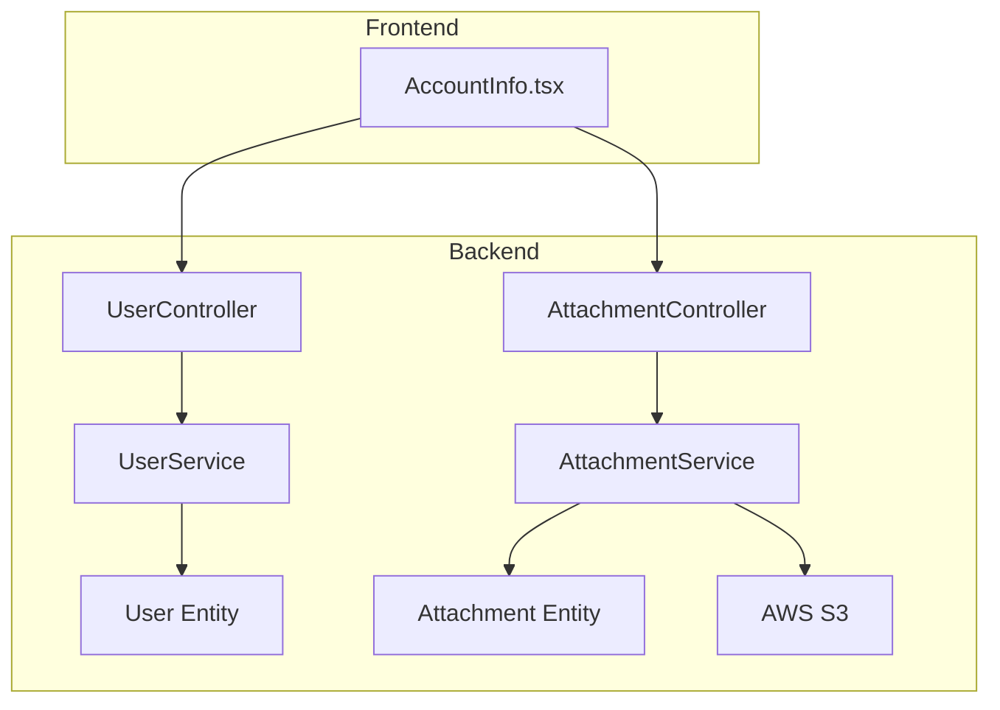
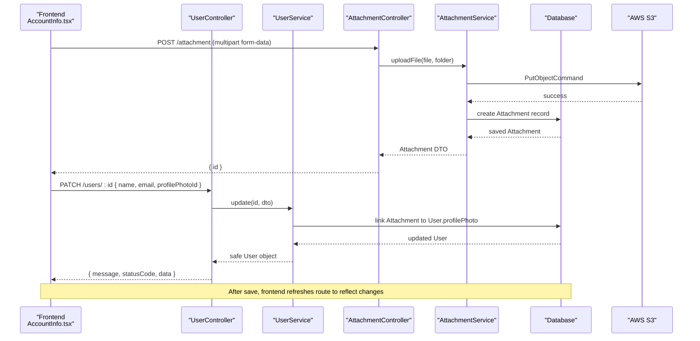
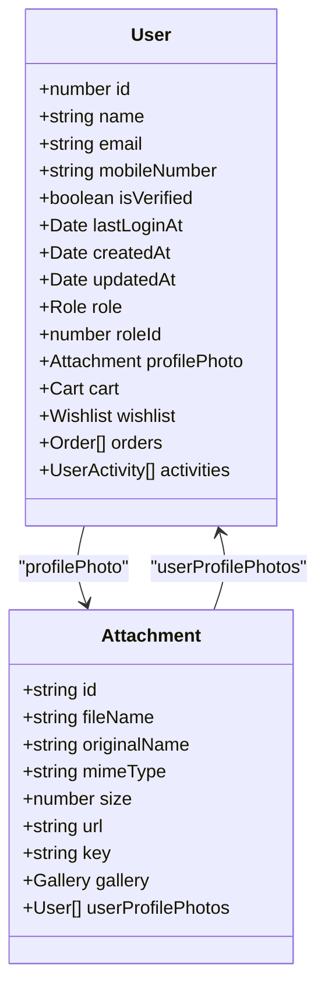
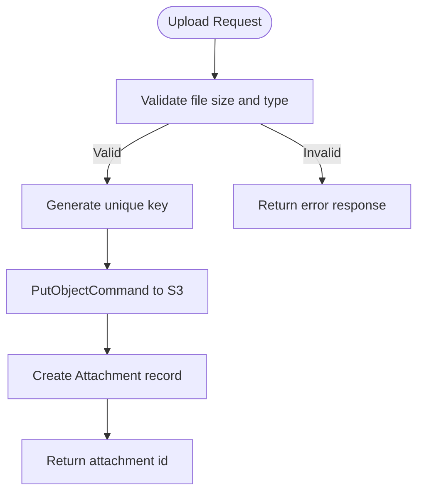
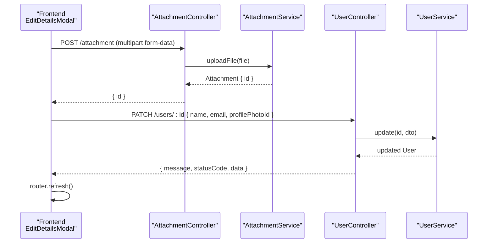
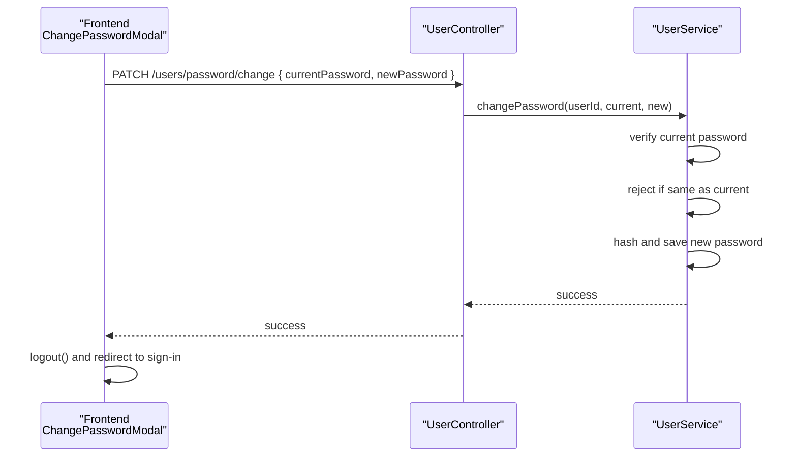
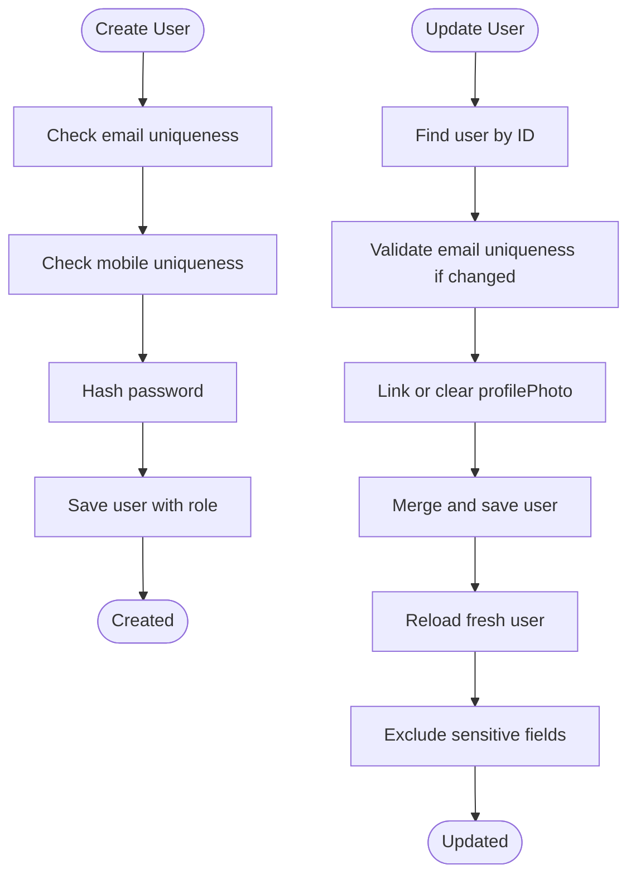
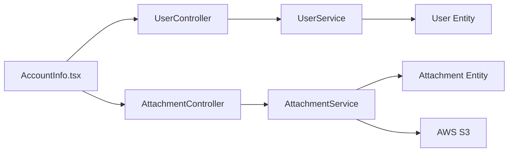

# User Profile Management

<cite>
**Referenced Files in This Document**
- [user.entity.ts](file://apps/backend/src/user/entities/user.entity.ts)
- [user.controller.ts](file://apps/backend/src/user/user.controller.ts)
- [user.service.ts](file://apps/backend/src/user/user.service.ts)
- [attachment.entity.ts](file://apps/backend/src/attachment/entities/attachment.entity.ts)
- [attachment.controller.ts](file://apps/backend/src/attachment/attachment.controller.ts)
- [attachment.service.ts](file://apps/backend/src/attachment/attachment.service.ts)
- [AccountInfo.tsx](file://apps/frontend/components/user-account/AccountInfo.tsx)
</cite>

## Table of Contents
1. [Introduction](#introduction)
2. [Project Structure](#project-structure)
3. [Core Components](#core-components)
4. [Architecture Overview](#architecture-overview)
5. [Detailed Component Analysis](#detailed-component-analysis)
6. [Dependency Analysis](#dependency-analysis)
7. [Performance Considerations](#performance-considerations)
8. [Troubleshooting Guide](#troubleshooting-guide)
9. [Conclusion](#conclusion)

## Introduction
This document explains the user profile management features implemented in the monorepo. It covers:
- The user profile data model, including personal information and contact details.
- Profile photo upload and management using AWS S3 through a dedicated attachment service.
- User account configuration options such as name, email, password changes, and verification status.
- Frontend components for editing profile details, validation rules, and real-time UI updates.
- End-to-end workflows for profile CRUD operations, image uploads, and client-server synchronization.
- Data privacy considerations and consent-related behaviors observed in the implementation.

## Project Structure
The user profile feature spans both backend and frontend:
- Backend NestJS modules expose REST endpoints for user management and file attachments.
- A TypeORM-based User entity models profile fields and relationships.
- An Attachment entity stores metadata for files uploaded to AWS S3.
- Next.js frontend components render the user profile page, handle edits, and coordinate uploads.

**Diagram sources**
- [AccountInfo.tsx:171-233](file://apps/frontend/components/user-account/AccountInfo.tsx#L171-L233)
- [user.controller.ts:260-345](file://apps/backend/src/user/user.controller.ts#L260-L345)
- [user.service.ts:630-713](file://apps/backend/src/user/user.service.ts#L630-L713)
- [attachment.controller.ts:36-66](file://apps/backend/src/attachment/attachment.controller.ts#L36-L66)
- [attachment.service.ts:38-70](file://apps/backend/src/attachment/attachment.service.ts#L38-L70)
- [user.entity.ts:22-182](file://apps/backend/src/user/entities/user.entity.ts#L22-L182)
- [attachment.entity.ts:19-117](file://apps/backend/src/attachment/entities/attachment.entity.ts#L19-L117)

**Section sources**
- [user.entity.ts:22-182](file://apps/backend/src/user/entities/user.entity.ts#L22-L182)
- [attachment.entity.ts:19-117](file://apps/backend/src/attachment/entities/attachment.entity.ts#L19-L117)
- [user.controller.ts:260-345](file://apps/backend/src/user/user.controller.ts#L260-L345)
- [attachment.controller.ts:36-66](file://apps/backend/src/attachment/attachment.controller.ts#L36-L66)
- [AccountInfo.tsx:171-233](file://apps/frontend/components/user-account/AccountInfo.tsx#L171-L233)

## Core Components
- User profile data model:
  - Personal information: full name, email, mobile number.
  - Account state: verification flag, timestamps (created, updated), last login.
  - Role association and optional role ID.
  - Profile photo relation to an Attachment entity.
- Attachment storage:
  - Metadata for uploaded files: filename, original name, MIME type, size, URL, storage key.
  - Relationship back to users who use the file as a profile photo.
- API surface:
  - User endpoints for retrieval, update, password change, and deletion.
  - Attachment endpoints for single/multiple uploads, listing, retrieval, and deletion.
- Frontend profile editor:
  - Read-only display of profile fields.
  - Edit modal for name, email, and profile photo selection.
  - Password change modal with server-side validation.

**Section sources**
- [user.entity.ts:22-182](file://apps/backend/src/user/entities/user.entity.ts#L22-L182)
- [attachment.entity.ts:19-117](file://apps/backend/src/attachment/entities/attachment.entity.ts#L19-L117)
- [user.controller.ts:260-345](file://apps/backend/src/user/user.controller.ts#L260-L345)
- [attachment.controller.ts:36-110](file://apps/backend/src/attachment/attachment.controller.ts#L36-L110)
- [AccountInfo.tsx:72-106](file://apps/frontend/components/user-account/AccountInfo.tsx#L72-L106)
- [AccountInfo.tsx:108-395](file://apps/frontend/components/user-account/AccountInfo.tsx#L108-L395)
- [AccountInfo.tsx:436-605](file://apps/frontend/components/user-account/AccountInfo.tsx#L436-L605)

## Architecture Overview
The profile workflow combines frontend editing, secure authentication, and cloud storage:

**Diagram sources**
- [attachment.controller.ts:36-66](file://apps/backend/src/attachment/attachment.controller.ts#L36-L66)
- [attachment.service.ts:38-70](file://apps/backend/src/attachment/attachment.service.ts#L38-L70)
- [user.controller.ts:316-331](file://apps/backend/src/user/user.controller.ts#L316-L331)
- [user.service.ts:630-713](file://apps/backend/src/user/user.service.ts#L630-L713)
- [AccountInfo.tsx:171-233](file://apps/frontend/components/user-account/AccountInfo.tsx#L171-L233)

## Detailed Component Analysis

### User Profile Data Model
The User entity defines the core profile fields and relationships:
- Identity and contact: id, name, email, mobileNumber.
- Security and lifecycle: password (write-only, excluded from responses), isVerified, lastLoginAt, createdAt, updatedAt.
- Role linkage: role relation and roleId scalar.
- Media: eager-loaded profilePhoto relation to Attachment.
- Business relations: cart, wishlist, orders, activities.

**Diagram sources**
- [user.entity.ts:22-182](file://apps/backend/src/user/entities/user.entity.ts#L22-L182)
- [attachment.entity.ts:19-117](file://apps/backend/src/attachment/entities/attachment.entity.ts#L19-L117)

**Section sources**
- [user.entity.ts:22-182](file://apps/backend/src/user/entities/user.entity.ts#L22-L182)
- [attachment.entity.ts:19-117](file://apps/backend/src/attachment/entities/attachment.entity.ts#L19-L117)

### Profile Photo Upload and AWS S3 Integration
The attachment subsystem handles file ingestion and persistence:
- Controller validates multipart input and enforces a maximum file size.
- Service uploads the file buffer to AWS S3 with public-read ACL.
- Service persists metadata (filename, original name, MIME type, size, URL, key).
- Deletion removes the object from S3 and deletes the database record.

**Diagram sources**
- [attachment.controller.ts:36-66](file://apps/backend/src/attachment/attachment.controller.ts#L36-L66)
- [attachment.service.ts:38-70](file://apps/backend/src/attachment/attachment.service.ts#L38-L70)

**Section sources**
- [attachment.controller.ts:36-66](file://apps/backend/src/attachment/attachment.controller.ts#L36-L66)
- [attachment.service.ts:38-119](file://apps/backend/src/attachment/attachment.service.ts#L38-L119)
- [attachment.service.ts:120-155](file://apps/backend/src/attachment/attachment.service.ts#L120-L155)

### User Profile Editing Workflow
The frontend provides:
- A read-only profile view showing name, contact number, email, verification status, membership date, and last updated timestamp.
- An edit modal that allows updating name, email, and selecting a new profile photo.
- Validation rules for name length and characters, email format, and image constraints.
- A two-step save process: upload the selected image first, then patch the user profile with the attachment ID or remove it.

**Diagram sources**
- [AccountInfo.tsx:171-233](file://apps/frontend/components/user-account/AccountInfo.tsx#L171-L233)
- [user.controller.ts:316-331](file://apps/backend/src/user/user.controller.ts#L316-L331)
- [user.service.ts:630-713](file://apps/backend/src/user/user.service.ts#L630-L713)

**Section sources**
- [AccountInfo.tsx:108-395](file://apps/frontend/components/user-account/AccountInfo.tsx#L108-L395)
- [AccountInfo.tsx:608-719](file://apps/frontend/components/user-account/AccountInfo.tsx#L608-L719)

### Password Change Flow
The password change flow ensures current password verification and prevents reuse:
- Frontend validates minimum length and confirmation match.
- Backend verifies current password hash and rejects identical new passwords.
- On success, the frontend logs out the user and redirects to sign-in.

**Diagram sources**
- [AccountInfo.tsx:436-605](file://apps/frontend/components/user-account/AccountInfo.tsx#L436-L605)
- [user.controller.ts:292-315](file://apps/backend/src/user/user.controller.ts#L292-L315)
- [user.service.ts:714-770](file://apps/backend/src/user/user.service.ts#L714-L770)

**Section sources**
- [AccountInfo.tsx:436-605](file://apps/frontend/components/user-account/AccountInfo.tsx#L436-L605)
- [user.controller.ts:292-315](file://apps/backend/src/user/user.controller.ts#L292-L315)
- [user.service.ts:714-770](file://apps/backend/src/user/user.service.ts#L714-L770)

### Profile CRUD Operations
- Create:
  - Endpoint creates a user with validated email/mobile uniqueness and hashed password.
  - Default role assignment when invalid or missing role ID.
- Read:
  - Retrieve a specific user by ID with related role, addresses, profile photo, and delivered orders.
- Update:
  - Patch endpoint supports name, email, password hashing, and linking/removing profile photo via Attachment ID.
  - Safe response excludes sensitive fields like password, OTP, and OTP expiry.
- Delete:
  - Remove endpoint deletes a user by ID with not-found handling.

**Diagram sources**
- [user.service.ts:561-629](file://apps/backend/src/user/user.service.ts#L561-L629)
- [user.service.ts:630-713](file://apps/backend/src/user/user.service.ts#L630-L713)

**Section sources**
- [user.controller.ts:274-345](file://apps/backend/src/user/user.controller.ts#L274-L345)
- [user.service.ts:561-629](file://apps/backend/src/user/user.service.ts#L561-L629)
- [user.service.ts:630-713](file://apps/backend/src/user/user.service.ts#L630-L713)

### Frontend Validation Rules and Real-Time Updates
Validation rules implemented in the edit modal:
- Name: between 2 and 50 characters; only letters and spaces allowed.
- Email: basic email format validation.
- Image: must be an image file; max 5MB; accepted formats indicated to the user.
- Contact number: displayed as read-only; cannot be edited in this modal.

Real-time updates:
- After successful profile update, the component calls router.refresh() to reload server data.
- Toast notifications provide immediate feedback on success or error states.

**Section sources**
- [AccountInfo.tsx:171-233](file://apps/frontend/components/user-account/AccountInfo.tsx#L171-L233)
- [AccountInfo.tsx:608-719](file://apps/frontend/components/user-account/AccountInfo.tsx#L608-L719)

### User Preference Settings and Notification Preferences
Observed behavior:
- The User entity does not include explicit preference or notification settings fields.
- There are no profile-specific toggles for preferences or notifications in the analyzed code.
- If future preference or notification settings are added, they should follow the same pattern:
  - Define typed fields in the User entity or a related settings entity.
  - Expose PATCH endpoints to update them safely.
  - Add frontend controls with validation and real-time updates.

[No sources needed since this section discusses absence of features rather than analyzing specific files]

### Data Privacy Considerations and Consent Management
Privacy safeguards present in the implementation:
- Sensitive fields such as password, OTP, and OTP expiration are excluded from API responses.
- Passwords are hashed before storage and verified securely during change operations.
- Profile photo URLs are publicly accessible via S3; ensure bucket policies align with privacy requirements.
- No explicit consent flags or audit logs for profile edits were found in the analyzed files.

Recommendations for enhanced privacy:
- Introduce explicit consent fields for marketing communications or data processing.
- Log sensitive profile changes with user context and timestamps.
- Enforce least-privilege access to profile endpoints and restrict bulk exposure of PII.

**Section sources**
- [user.entity.ts:49-58](file://apps/backend/src/user/entities/user.entity.ts#L49-L58)
- [user.entity.ts:156-177](file://apps/backend/src/user/entities/user.entity.ts#L156-L177)
- [user.service.ts:705-712](file://apps/backend/src/user/user.service.ts#L705-L712)
- [attachment.service.ts:47-56](file://apps/backend/src/attachment/attachment.service.ts#L47-L56)

## Dependency Analysis
The following diagram shows how the frontend interacts with backend controllers and services, and how services depend on entities and external storage.

**Diagram sources**
- [AccountInfo.tsx:171-233](file://apps/frontend/components/user-account/AccountInfo.tsx#L171-L233)
- [user.controller.ts:260-345](file://apps/backend/src/user/user.controller.ts#L260-L345)
- [user.service.ts:630-713](file://apps/backend/src/user/user.service.ts#L630-L713)
- [attachment.controller.ts:36-66](file://apps/backend/src/attachment/attachment.controller.ts#L36-L66)
- [attachment.service.ts:38-70](file://apps/backend/src/attachment/attachment.service.ts#L38-L70)
- [user.entity.ts:22-182](file://apps/backend/src/user/entities/user.entity.ts#L22-L182)
- [attachment.entity.ts:19-117](file://apps/backend/src/attachment/entities/attachment.entity.ts#L19-L117)

**Section sources**
- [user.controller.ts:260-345](file://apps/backend/src/user/user.controller.ts#L260-L345)
- [attachment.controller.ts:36-110](file://apps/backend/src/attachment/attachment.controller.ts#L36-L110)
- [user.service.ts:630-713](file://apps/backend/src/user/user.service.ts#L630-L713)
- [attachment.service.ts:38-119](file://apps/backend/src/attachment/attachment.service.ts#L38-L119)

## Performance Considerations
- Avoid eager-loading large relations unless necessary; profile photo is eager-loaded, which can increase payload size.
- Use pagination and filtering for list endpoints to reduce database load.
- For profile updates, prefer partial patches to minimize unnecessary writes.
- Consider caching frequently accessed profile data at the application layer if read-heavy.
- Ensure S3 uploads are optimized by validating file types and sizes on the client side to reduce failed requests.

[No sources needed since this section provides general guidance]

## Troubleshooting Guide
Common issues and resolutions:
- Image upload fails due to size or type:
  - Verify client-side validation matches server-side MaxFileSizeValidator.
  - Confirm MIME type and file extension are correct.
- Profile update returns not found:
  - Ensure the user ID exists and the request is authenticated.
- Password change rejected:
  - Check current password correctness and ensure new password differs from current.
- Profile photo not reflected after update:
  - Confirm the frontend calls router.refresh() after a successful update.
  - Verify the Attachment ID was correctly linked to the User profilePhoto relation.

**Section sources**
- [attachment.controller.ts:48-56](file://apps/backend/src/attachment/attachment.controller.ts#L48-L56)
- [user.controller.ts:316-331](file://apps/backend/src/user/user.controller.ts#L316-L331)
- [user.service.ts:714-770](file://apps/backend/src/user/user.service.ts#L714-L770)
- [AccountInfo.tsx:613-616](file://apps/frontend/components/user-account/AccountInfo.tsx#L613-L616)

## Conclusion
The user profile management system provides a solid foundation for managing personal information, contact details, and profile photos. The backend enforces security and data integrity, while the frontend offers a user-friendly editing experience with validation and real-time updates. AWS S3 integration enables scalable media storage. To extend the system, consider adding explicit user preferences and notification settings, along with consent tracking and audit logging for enhanced privacy compliance.