# Data Access Patterns

<cite>
**Referenced Files in This Document**
- [app.module.ts](file://apps/backend/src/app.module.ts)
- [menu-permission.service.ts](file://apps/backend/src/menu-permission/menu-permission.service.ts)
- [sales-point.service.ts](file://apps/backend/src/sales-point/sales-point.service.ts)
- [sales-point-shop.service.ts](file://apps/backend/src/sales-point-shop/sales-point-shop.service.ts)
- [product.service.ts](file://apps/backend/src/product/product.service.ts)
- [swr-cache.ts](file://apps/backend/src/common/utils/swr-cache.ts)
- [activity.interceptor.ts](file://apps/backend/src/interceptor/activity.interceptor.ts)
- [analytics.service.ts](file://apps/backend/src/analytics/analytics.service.ts)
- [order.service.ts](file://apps/backend/src/order/order.service.ts)
</cite>

## Table of Contents
1. [Introduction](#introduction)
2. [Project Structure](#project-structure)
3. [Core Components](#core-components)
4. [Architecture Overview](#architecture-overview)
5. [Detailed Component Analysis](#detailed-component-analysis)
6. [Dependency Analysis](#dependency-analysis)
7. [Performance Considerations](#performance-considerations)
8. [Troubleshooting Guide](#troubleshooting-guide)
9. [Conclusion](#conclusion)

## Introduction
This document explains data access patterns used across the German Butcher backend, focusing on TypeORM repository usage, service-layer abstractions, query building strategies, transaction management, connection pooling and lifecycle, query optimization (eager/lazy loading, selective projection), pagination, filtering, sorting, complex queries with joins/subqueries/aggregates, caching, read replicas configuration, write optimization, error handling, retry mechanisms, and database resilience.

## Project Structure
The backend is a NestJS application that configures TypeORM globally and registers domain modules. Each feature module imports entities via TypeOrmModule.forFeature and exposes services that encapsulate repository operations. The global configuration sets up PostgreSQL, connection pooling, and environment-driven behavior such as schema synchronization.

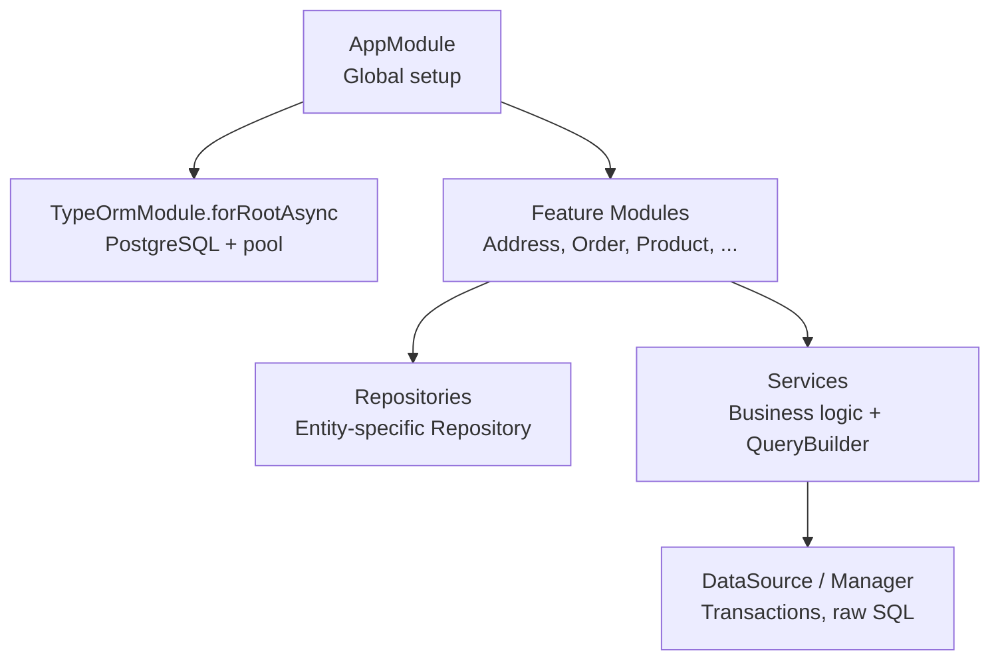

**Diagram sources**
- [app.module.ts:93-115](file://apps/backend/src/app.module.ts#L93-L115)

**Section sources**
- [app.module.ts:60-115](file://apps/backend/src/app.module.ts#L60-L115)

## Core Components
- Global TypeORM configuration with PostgreSQL, auto-loaded entities, environment-controlled synchronize, and connection pool tuning.
- Feature modules register their entities for dependency injection.
- Services implement repository patterns using injected Repository<T>, QueryBuilder, DataSource, and TransactionManager where needed.
- In-process caching via SwrCache to reduce DB load under concurrent requests.
- Interceptors and analytics services demonstrate raw SQL usage and batched writes.

**Section sources**
- [app.module.ts:93-115](file://apps/backend/src/app.module.ts#L93-L115)
- [swr-cache.ts:1-91](file://apps/backend/src/common/utils/swr-cache.ts#L1-L91)

## Architecture Overview
The data access architecture follows a layered approach:
- Controllers receive HTTP requests and delegate to services.
- Services encapsulate business rules and build queries using TypeORM APIs.
- Repositories provide entity-specific persistence operations.
- DataSource and TransactionManager are used for advanced scenarios (transactions, raw SQL).
- Caching sits above repositories to mitigate cache stampedes and hot paths.

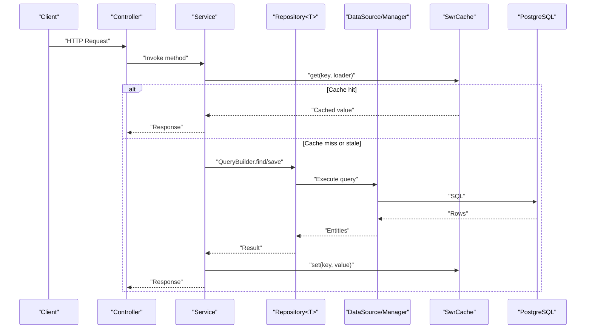

**Diagram sources**
- [product.service.ts:251-289](file://apps/backend/src/product/product.service.ts#L251-L289)
- [swr-cache.ts:30-52](file://apps/backend/src/common/utils/swr-cache.ts#L30-L52)

## Detailed Component Analysis

### Connection Pooling and Lifecycle
- PostgreSQL driver is configured with explicit pool size, idle timeout, and connection timeout.
- Synchronize is disabled in production unless explicitly enabled via environment variables.
- Entities are auto-loaded from registered modules.

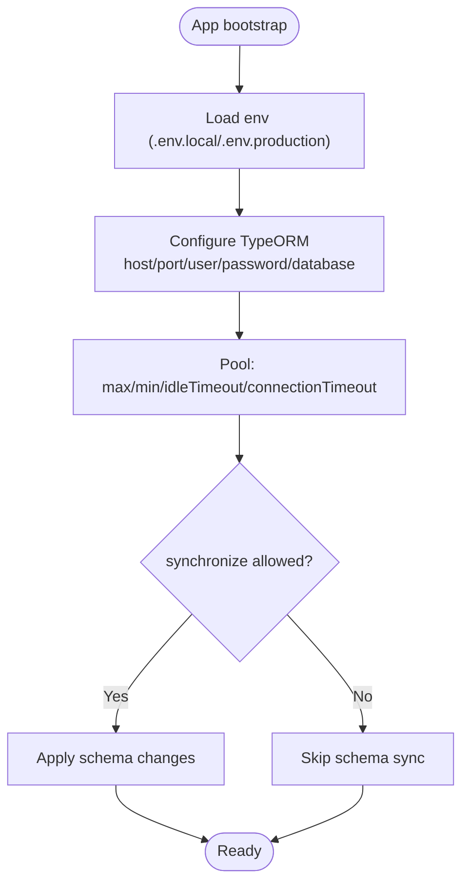

**Diagram sources**
- [app.module.ts:93-115](file://apps/backend/src/app.module.ts#L93-L115)

**Section sources**
- [app.module.ts:93-115](file://apps/backend/src/app.module.ts#L93-L115)

### Repository Pattern and Service Layer Abstractions
- Services inject Repository<T> per entity and expose domain methods.
- Queries are built using find/findOne with relations, order, and where clauses, or via QueryBuilder for complex cases.
- Examples include list endpoints with filters, joins, and aggregations.

Key examples:
- Sales point listing with left joins and ILIKE search.
- Sales point shop statistics with group-by and conditional counts.
- Menu permissions upsert within a transaction.

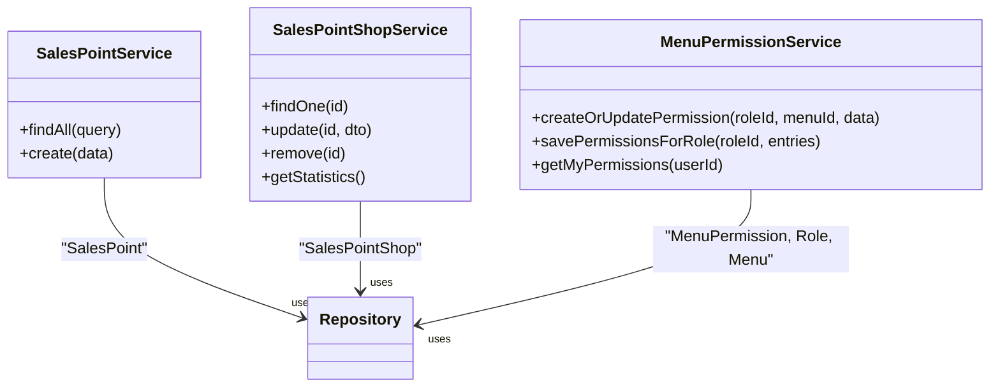

**Diagram sources**
- [sales-point.service.ts:46-77](file://apps/backend/src/sales-point/sales-point.service.ts#L46-L77)
- [sales-point-shop.service.ts:134-168](file://apps/backend/src/sales-point-shop/sales-point-shop.service.ts#L134-L168)
- [menu-permission.service.ts:20-43](file://apps/backend/src/menu-permission/menu-permission.service.ts#L20-L43)

**Section sources**
- [sales-point.service.ts:46-77](file://apps/backend/src/sales-point/sales-point.service.ts#L46-L77)
- [sales-point-shop.service.ts:83-168](file://apps/backend/src/sales-point-shop/sales-point-shop.service.ts#L83-L168)
- [menu-permission.service.ts:20-43](file://apps/backend/src/menu-permission/menu-permission.service.ts#L20-L43)

### Query Building Strategies
- QueryBuilder is used for complex filtering, joins, grouping, aggregation, and raw SQL when necessary.
- Selective field projection is achieved by selecting specific columns and adding computed aggregates.
- Raw SQL is used for analytical queries and performance-sensitive operations.

Examples:
- Sales point shop statistics use select/addSelect/groupBy/orderBy.
- Analytics overview uses COUNT(DISTINCT ...) and DATE_TRUNC.
- Order customer type share uses a CTE and window-like logic.

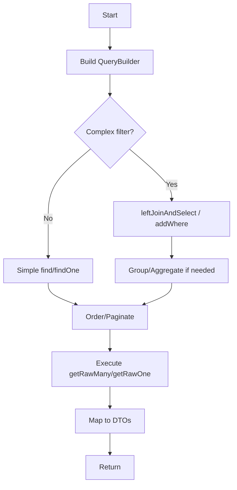

**Diagram sources**
- [sales-point-shop.service.ts:140-168](file://apps/backend/src/sales-point-shop/sales-point-shop.service.ts#L140-L168)
- [analytics.service.ts:194-214](file://apps/backend/src/analytics/analytics.service.ts#L194-L214)
- [order.service.ts:791-826](file://apps/backend/src/order/order.service.ts#L791-L826)

**Section sources**
- [sales-point-shop.service.ts:140-168](file://apps/backend/src/sales-point-shop/sales-point-shop.service.ts#L140-L168)
- [analytics.service.ts:194-214](file://apps/backend/src/analytics/analytics.service.ts#L194-L214)
- [order.service.ts:791-826](file://apps/backend/src/order/order.service.ts#L791-L826)

### Transactions Management
- Batch upsert operations are wrapped in transactions using manager.transaction to ensure atomicity.
- Upsert logic checks existence and either updates or creates new rows within a single transaction boundary.

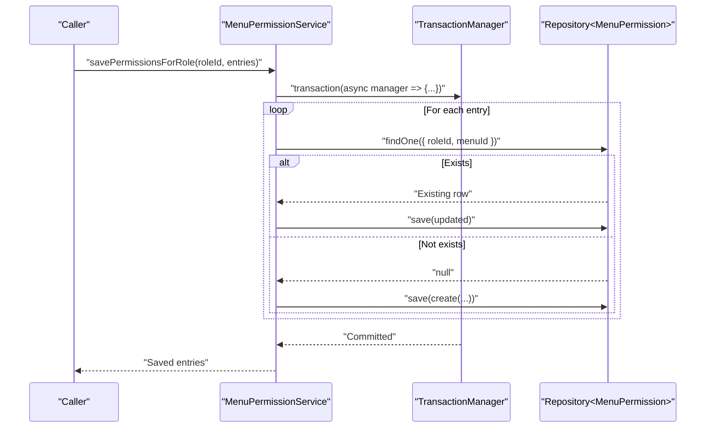

**Diagram sources**
- [menu-permission.service.ts:97-123](file://apps/backend/src/menu-permission/menu-permission.service.ts#L97-L123)

**Section sources**
- [menu-permission.service.ts:97-123](file://apps/backend/src/menu-permission/menu-permission.service.ts#L97-L123)

### Pagination, Filtering, and Sorting
- Pagination is implemented using skip/limit or page/limit parameters.
- Filtering supports boolean flags, text search (ILIKE), and optional criteria.
- Sorting supports multiple strategies with defaults.

Examples:
- Sales point listing applies isActive filter, ILIKE search across multiple fields, and joins for attachments/shops.
- Product list applies shared filters to both count and data queries, then sorts by price or name.

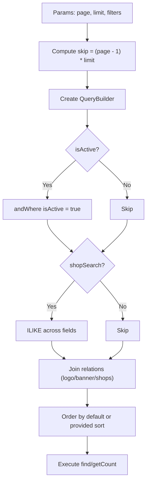

**Diagram sources**
- [sales-point.service.ts:46-77](file://apps/backend/src/sales-point/sales-point.service.ts#L46-L77)
- [product.service.ts:251-289](file://apps/backend/src/product/product.service.ts#L251-L289)

**Section sources**
- [sales-point.service.ts:46-77](file://apps/backend/src/sales-point/sales-point.service.ts#L46-L77)
- [product.service.ts:251-289](file://apps/backend/src/product/product.service.ts#L251-L289)

### Eager Loading, Lazy Loading, and Selective Projection
- Eager loading is applied via relations in find options or leftJoinAndSelect in QueryBuilder.
- Lazy loading is implicit when relations are not selected; accessing them triggers additional queries.
- Selective projection is performed by selecting only required columns and computing aggregates.

Examples:
- Sales point listing eagerly loads logoAttachment, bannerAttachment, and shops.
- Sales point shop statistics project division/district and compute counts.
- Analytics overview selects aggregated metrics without full entity payloads.

**Section sources**
- [sales-point.service.ts:58-62](file://apps/backend/src/sales-point/sales-point.service.ts#L58-L62)
- [sales-point-shop.service.ts:140-168](file://apps/backend/src/sales-point-shop/sales-point-shop.service.ts#L140-L168)
- [analytics.service.ts:194-214](file://apps/backend/src/analytics/analytics.service.ts#L194-L214)

### Complex Queries with Joins, Subqueries, and Aggregates
- Joins: leftJoinAndSelect for related entities in list queries.
- Subqueries/CTEs: analytics and order services use raw SQL with CTEs and date truncation for time-based analytics.
- Aggregates: COUNT, COUNT(CASE WHEN ...), GROUP BY, ORDER BY.

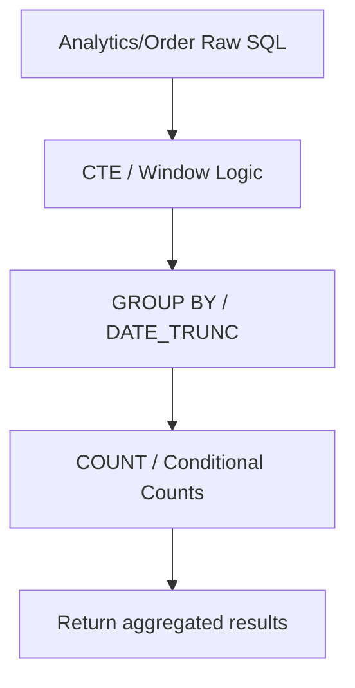

**Diagram sources**
- [analytics.service.ts:194-214](file://apps/backend/src/analytics/analytics.service.ts#L194-L214)
- [order.service.ts:791-826](file://apps/backend/src/order/order.service.ts#L791-L826)

**Section sources**
- [analytics.service.ts:194-214](file://apps/backend/src/analytics/analytics.service.ts#L194-L214)
- [order.service.ts:791-826](file://apps/backend/src/order/order.service.ts#L791-L826)

### Caching Strategies
- In-process stale-while-revalidate cache (SwrCache) reduces DB load by serving fresh values immediately, returning stale values while refreshing once in the background, and deduplicating concurrent loads.
- Product list endpoint composes a cache key from pagination and filter parameters to avoid cross-contamination.

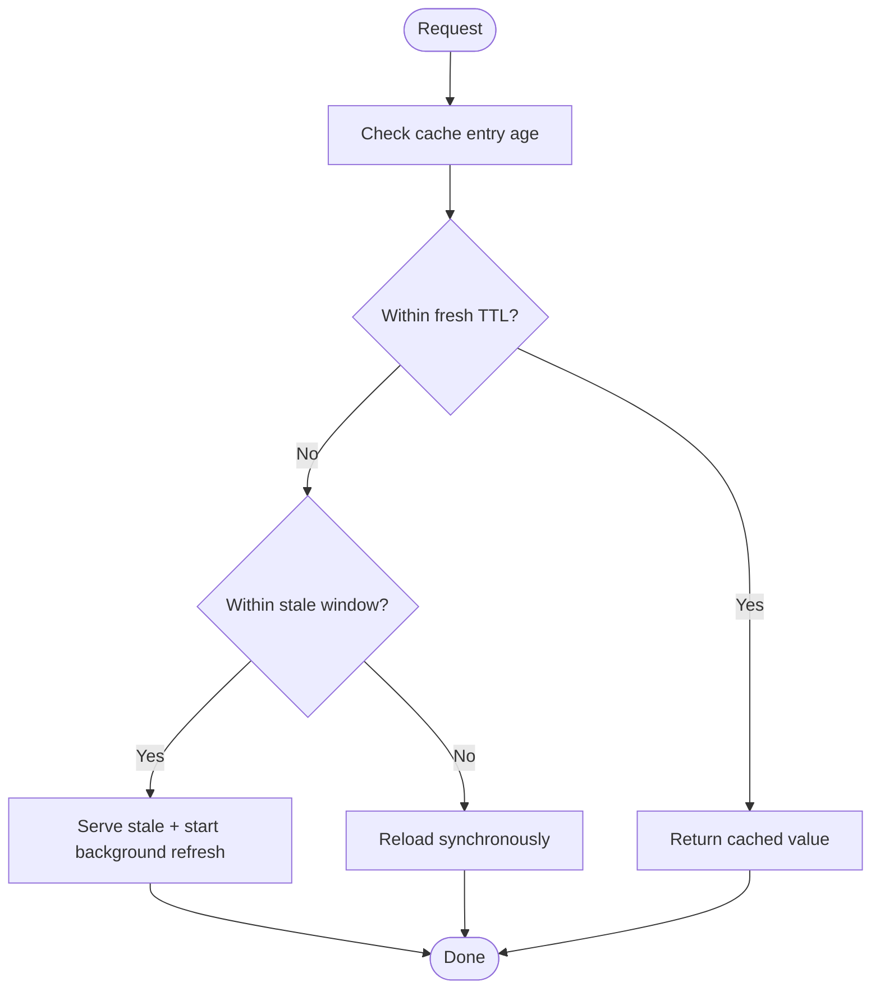

**Diagram sources**
- [swr-cache.ts:30-52](file://apps/backend/src/common/utils/swr-cache.ts#L30-L52)
- [product.service.ts:280-289](file://apps/backend/src/product/product.service.ts#L280-L289)

**Section sources**
- [swr-cache.ts:1-91](file://apps/backend/src/common/utils/swr-cache.ts#L1-L91)
- [product.service.ts:280-289](file://apps/backend/src/product/product.service.ts#L280-L289)

### Read Replicas Configuration
- The current configuration defines a single PostgreSQL connection. There is no read replica configuration present in the codebase.
- To support read replicas, consider configuring multiple connections and routing read-heavy queries through a secondary DataSource, while keeping writes on the primary.

[No sources needed since this section provides general guidance]

### Write Optimization Patterns
- Batch upserts inside transactions minimize round-trips and ensure consistency.
- Bulk inserts are used in analytics to flush buffered events periodically.
- Avoid unnecessary joins and projections; select only required fields.

**Section sources**
- [menu-permission.service.ts:97-123](file://apps/backend/src/menu-permission/menu-permission.service.ts#L97-L123)
- [analytics.service.ts:175-192](file://apps/backend/src/analytics/analytics.service.ts#L175-L192)

### Error Handling, Retry Mechanisms, and Resilience
- Services throw standard NestJS exceptions (NotFound, BadRequest, InternalServerError) to translate domain errors into HTTP responses.
- Analytics flush retries by re-queueing failed batches and capping buffer size.
- Activity interceptor performs best-effort reads for audit logging and swallows errors to avoid disrupting request flow.
- Database connection resilience relies on pool settings and timeouts; there is no explicit retry middleware for transient DB errors in the analyzed files.

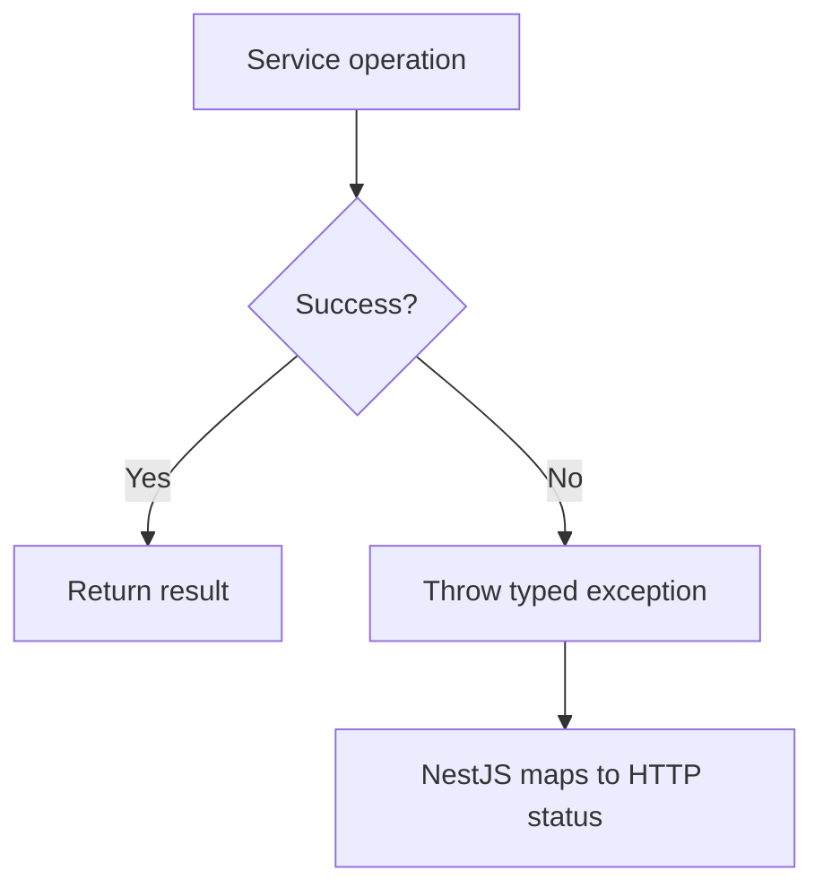

**Diagram sources**
- [sales-point.service.ts:35-43](file://apps/backend/src/sales-point/sales-point.service.ts#L35-L43)
- [analytics.service.ts:175-192](file://apps/backend/src/analytics/analytics.service.ts#L175-L192)
- [activity.interceptor.ts:116-134](file://apps/backend/src/interceptor/activity.interceptor.ts#L116-L134)

**Section sources**
- [sales-point.service.ts:35-43](file://apps/backend/src/sales-point/sales-point.service.ts#L35-L43)
- [analytics.service.ts:175-192](file://apps/backend/src/analytics/analytics.service.ts#L175-L192)
- [activity.interceptor.ts:116-134](file://apps/backend/src/interceptor/activity.interceptor.ts#L116-L134)

## Dependency Analysis
- AppModule depends on ConfigModule and ThrottlerModule, and wires TypeOrmModule.forRootAsync.
- Feature modules depend on TypeOrmModule.forFeature to register repositories.
- Services depend on injected repositories and sometimes DataSource/Manager for advanced operations.
- Caching utility is independent and can be reused across services.

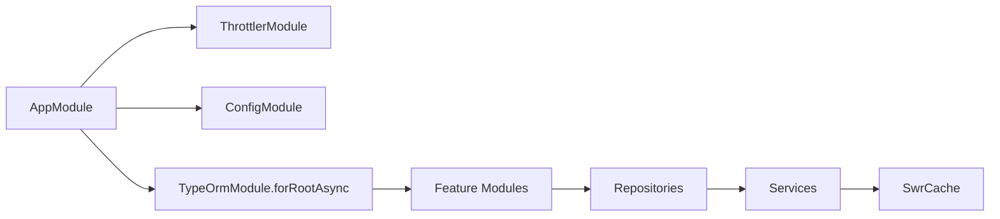

**Diagram sources**
- [app.module.ts:60-115](file://apps/backend/src/app.module.ts#L60-L115)
- [swr-cache.ts:1-91](file://apps/backend/src/common/utils/swr-cache.ts#L1-L91)

**Section sources**
- [app.module.ts:60-115](file://apps/backend/src/app.module.ts#L60-L115)

## Performance Considerations
- Use eager loading selectively to avoid N+1 queries; prefer leftJoinAndSelect for known relations.
- Prefer selective projection (select/addSelect) for large tables and analytics.
- Leverage SwrCache for hot read paths to prevent cache stampedes.
- Keep transactions small and focused on critical sections.
- Tune pool.max based on workload and database capacity; monitor idleTimeout and connectionTimeout.

[No sources needed since this section provides general guidance]

## Troubleshooting Guide
- If queries fail due to invalid aliases or missing joins, review QueryBuilder join chains and alias usage.
- For inconsistent analytics data, check buffer flush logic and retry behavior.
- For slow list endpoints, verify indexes on filtered/sorted columns and ensure proper projection.
- For unexpected schema changes, confirm synchronize policy and TEMP_DB_SYNC flag.

**Section sources**
- [sales-point-shop.service.ts:140-168](file://apps/backend/src/sales-point-shop/sales-point-shop.service.ts#L140-L168)
- [analytics.service.ts:175-192](file://apps/backend/src/analytics/analytics.service.ts#L175-L192)
- [app.module.ts:105-113](file://apps/backend/src/app.module.ts#L105-L113)

## Conclusion
The German Butcher backend employs a clear repository/service pattern with TypeORM, leveraging QueryBuilder for flexible querying, transactions for consistency, and an in-process cache to improve throughput. Connection pooling is tuned at the application level, and raw SQL is used judiciously for analytics and performance-critical paths. While read replicas are not configured, the architecture allows extension to multi-connection setups. Robust error handling and best-effort auditing contribute to resilience.