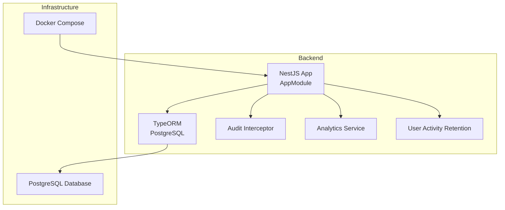
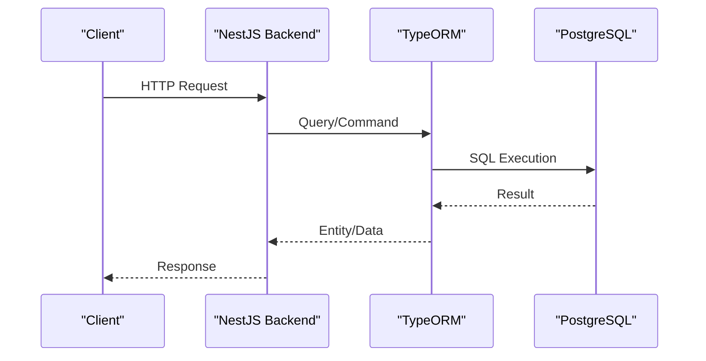
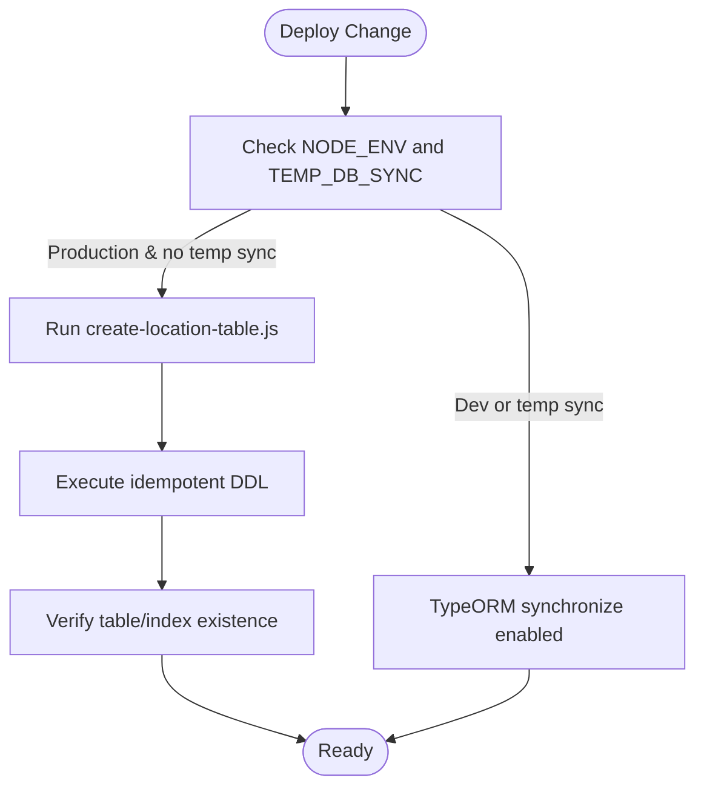
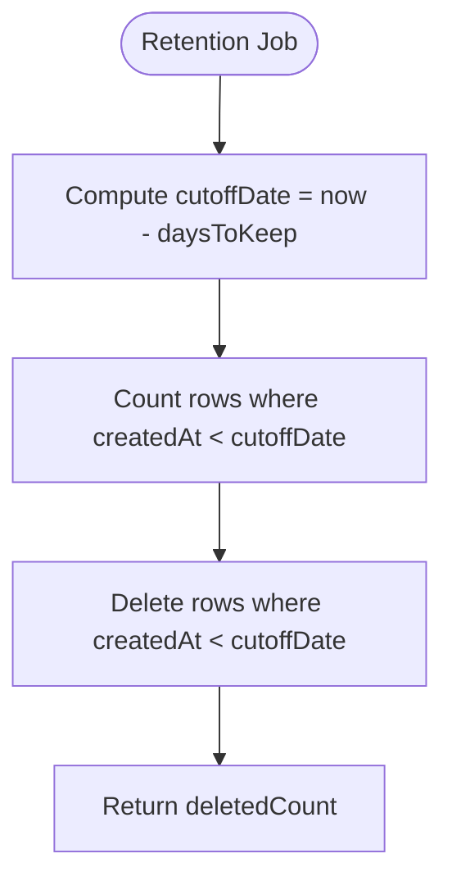
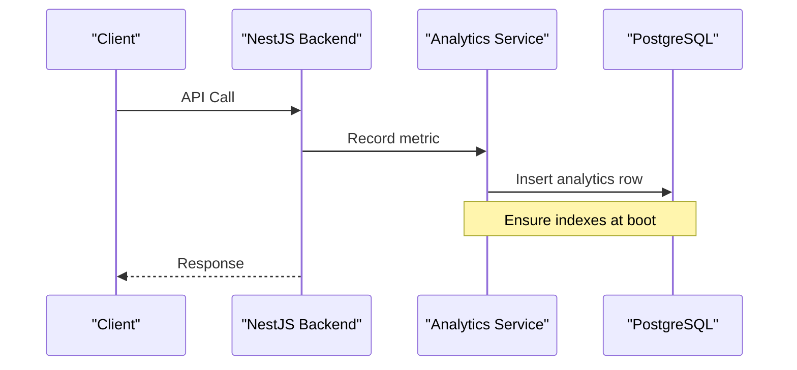
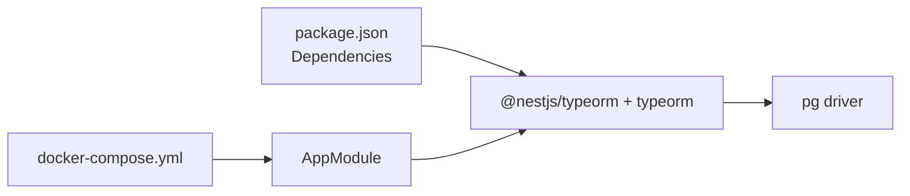

# Data Management

<cite>
**Referenced Files in This Document**
- [app.module.ts](file://apps/backend/src/app.module.ts)
- [configuration.ts](file://apps/backend/src/config/configuration.ts)
- [create-location-table.js](file://apps/backend/scripts/create-location-table.js)
- [database.dbml](file://apps/backend/database.dbml)
- [docker-compose.yml](file://docker-compose.yml)
- [analytics.service.ts](file://apps/backend/src/analytics/analytics.service.ts)
- [activity.interceptor.ts](file://apps/backend/src/interceptor/activity.interceptor.ts)
- [user-activity.service.ts](file://apps/backend/src/user-activity/user-activity.service.ts)
- [user-activity.controller.ts](file://apps/backend/src/user-activity/user-activity.controller.ts)
- [order.service.ts](file://apps/backend/src/order/order.service.ts)
- [package.json](file://apps/backend/package.json)
</cite>

## Table of Contents
1. [Introduction](#introduction)
2. [Project Structure](#project-structure)
3. [Core Components](#core-components)
4. [Architecture Overview](#architecture-overview)
5. [Detailed Component Analysis](#detailed-component-analysis)
6. [Dependency Analysis](#dependency-analysis)
7. [Performance Considerations](#performance-considerations)
8. [Troubleshooting Guide](#troubleshooting-guide)
9. [Conclusion](#conclusion)
10. [Appendices](#appendices)

## Introduction
This document provides comprehensive data management guidance for the German Butcher platform, focusing on database migrations, backups, operational procedures, disaster recovery, retention and archival policies, monitoring and alerting, and security considerations. It is grounded in the repository’s current implementation: a NestJS backend using TypeORM with PostgreSQL, Docker Compose orchestration, ad-hoc migration scripts, runtime index enforcement, audit logging, and user activity retention utilities.

## Project Structure
The data layer centers around:
- A PostgreSQL database configured via environment variables at application bootstrap.
- TypeORM entities and an optional schema synchronization mode disabled in production.
- Ad-hoc scripts to create or adjust tables when synchronize is off.
- Runtime index creation for analytics performance.
- Audit logging and user activity retention utilities.
- Docker Compose services for frontend and backend (no managed database service defined here).

**Diagram sources**
- [app.module.ts:93-115](file://apps/backend/src/app.module.ts#L93-L115)
- [docker-compose.yml:26-46](file://docker-compose.yml#L26-L46)

**Section sources**
- [app.module.ts:93-115](file://apps/backend/src/app.module.ts#L93-L115)
- [docker-compose.yml:1-55](file://docker-compose.yml#L1-L55)

## Core Components
- Database configuration and connection pooling are defined in the application module. Synchronization is disabled in production unless explicitly enabled by a temporary flag.
- Environment-driven configuration includes payment-related settings and base URLs.
- Production-safe DDL is executed via a Node script that reads .env and runs idempotent SQL statements.
- Analytics indexes are ensured at boot to avoid full table scans.
- Audit logging captures sensitive-field-aware change records.
- User activity retention supports deletion of old records and statistics about them.

**Section sources**
- [app.module.ts:93-115](file://apps/backend/src/app.module.ts#L93-L115)
- [configuration.ts:1-16](file://apps/backend/src/config/configuration.ts#L1-L16)
- [create-location-table.js:1-67](file://apps/backend/scripts/create-location-table.js#L1-L67)
- [analytics.service.ts:82-105](file://apps/backend/src/analytics/analytics.service.ts#L82-L105)
- [activity.interceptor.ts:136-160](file://apps/backend/src/interceptor/activity.interceptor.ts#L136-L160)
- [user-activity.service.ts:197-242](file://apps/backend/src/user-activity/user-activity.service.ts#L197-L242)

## Architecture Overview
The system uses a standard web architecture where the NestJS backend connects to PostgreSQL through TypeORM. Operational concerns such as auditing, analytics indexing, and retention are implemented within the backend. Infrastructure is containerized via Docker Compose; the database itself is not provisioned by compose in this repository.

**Diagram sources**
- [app.module.ts:93-115](file://apps/backend/src/app.module.ts#L93-L115)

## Detailed Component Analysis

### Migrations and Schema Version Control
Current state:
- No dedicated TypeORM migration files are present in the repository.
- Development relies on TypeORM synchronize; production disables synchronize by default.
- One-off DDL is applied via a Node script that reads environment variables from .env and executes idempotent SQL.

Operational guidance:
- Treat the ad-hoc script as the de facto migration mechanism until formal TypeORM migrations are introduced.
- Always run the script against the target database before deploying changes that require new tables or types.
- Keep the script idempotent (CREATE IF NOT EXISTS, DO $$ EXCEPTION WHEN duplicate_object THEN NULL $$) to support repeated runs.

**Diagram sources**
- [app.module.ts:105-107](file://apps/backend/src/app/module.ts#L105-L107)
- [create-location-table.js:11-20](file://apps/backend/scripts/create-location-table.js#L11-L20)
- [create-location-table.js:22-39](file://apps/backend/scripts/create-location-table.js#L22-L39)

**Section sources**
- [app.module.ts:105-107](file://apps/backend/src/app.module.ts#L105-L107)
- [create-location-table.js:1-67](file://apps/backend/scripts/create-location-table.js#L1-L67)

### Backup Strategy
Repository status:
- No built-in backup jobs or tools are present in the codebase.
- The database is external to the compose file; therefore, backups must be managed at the database layer or infrastructure layer.

Recommended strategy:
- Full backups: Schedule periodic logical dumps (e.g., daily) and/or physical backups depending on RPO/RTO targets.
- Incremental backups: Use WAL archiving or continuous archiving to enable point-in-time recovery.
- Offsite replication: Replicate to a separate region or storage bucket for resilience.
- Test restores: Regularly validate restore procedures against recent backups.

[No sources needed since this section provides general guidance]

### Point-in-Time Recovery and Disaster Recovery
Repository status:
- No automated DR or PITR tooling is present.

Recommended procedure:
- Enable WAL archiving on the PostgreSQL instance.
- Maintain a baseline full backup plus archived WAL segments.
- For recovery: restore the latest full backup, replay WAL up to the desired timestamp, verify integrity, and promote if required.
- Document RTO/RPO targets and test failover scenarios periodically.

[No sources needed since this section provides general guidance]

### Data Restoration Procedures
Repository status:
- No restoration scripts are included.

Recommended steps:
- Logical restore: Import SQL dumps into a staging database, validate constraints and referential integrity, then swap or migrate to production.
- Physical restore: Restore data directory or use streaming replication to a standby, then switch traffic after validation.
- Validate checksums and row counts post-restore.

[No sources needed since this section provides general guidance]

### Business Continuity Planning
Repository status:
- Application health checks exist for frontend and backend endpoints.

Recommendations:
- Define SLIs/SLOs for availability and latency.
- Implement multi-AZ/region deployment for critical services.
- Automate failover and rollback playbooks.
- Monitor dependency health (payment gateways, email/SMS providers).

**Section sources**
- [docker-compose.yml:19-24](file://docker-compose.yml#L19-L24)
- [docker-compose.yml:41-46](file://docker-compose.yml#L41-L46)

### Data Retention Policies and Archival
Repository status:
- User activity retention utility supports deleting records older than a configurable number of days and provides statistics about deletable records.

Implementation highlights:
- Deletion API endpoint exposes a cleanup operation with a configurable retention window.
- Statistics endpoint returns count, cutoff date, oldest record, and estimated size.

**Diagram sources**
- [user-activity.service.ts:197-216](file://apps/backend/src/user-activity/user-activity.service.ts#L197-L216)

**Section sources**
- [user-activity.service.ts:197-242](file://apps/backend/src/user-activity/user-activity.service.ts#L197-L242)
- [user-activity.controller.ts:327-394](file://apps/backend/src/user-activity/user-activity.controller.ts#L327-L394)

### Compliance and Customer Data Protection
Repository status:
- Audit interceptor sanitizes sensitive fields (e.g., password, otp, otpExpiresAt) before recording changes.
- Privacy policy page documents security measures and customer rights.

Recommendations:
- Classify sensitive data and apply least-privilege access controls.
- Encrypt sensitive data at rest and in transit.
- Retain audit logs per compliance requirements while honoring retention policies.
- Conduct regular audits and penetration tests.

**Section sources**
- [activity.interceptor.ts:136-160](file://apps/backend/src/interceptor/activity.interceptor.ts#L136-L160)

### Monitoring and Alerting
Repository status:
- Analytics service collects request metrics and ensures indexes for efficient querying.
- Health check endpoints are exposed for both frontend and backend in Docker Compose.

Key capabilities:
- Indexes on analytics timestamps ensure dashboard queries remain performant.
- Metrics include request counts by hour, top endpoints, and response time aggregates.

**Diagram sources**
- [analytics.service.ts:82-105](file://apps/backend/src/analytics/analytics.service.ts#L82-L105)
- [analytics.service.ts:254-381](file://apps/backend/src/analytics/analytics.service.ts#L254-L381)

**Section sources**
- [analytics.service.ts:82-105](file://apps/backend/src/analytics/analytics.service.ts#L82-L105)
- [analytics.service.ts:254-381](file://apps/backend/src/analytics/analytics.service.ts#L254-L381)
- [docker-compose.yml:41-46](file://docker-compose.yml#L41-L46)

### Security Considerations
Repository status:
- Audit interceptor removes sensitive fields from audit records.
- Configuration loads environment-based settings for payment integrations and URLs.

Recommendations:
- Enforce TLS everywhere and rotate secrets regularly.
- Restrict database access via network policies and IAM roles.
- Centralize secret management (e.g., vault or cloud secret manager).
- Enable database-level encryption and audit logging.

**Section sources**
- [activity.interceptor.ts:136-160](file://apps/backend/src/interceptor/activity.interceptor.ts#L136-L160)
- [configuration.ts:1-16](file://apps/backend/src/config/configuration.ts#L1-L16)

## Dependency Analysis
High-level dependencies relevant to data management:
- AppModule configures TypeORM with PostgreSQL and connection pool settings.
- Package dependencies include TypeORM and PostgreSQL driver.
- Docker Compose defines service boundaries and health checks.

**Diagram sources**
- [package.json:23-63](file://apps/backend/package.json#L23-L63)
- [app.module.ts:93-115](file://apps/backend/src/app.module.ts#L93-L115)
- [docker-compose.yml:26-46](file://docker-compose.yml#L26-L46)

**Section sources**
- [package.json:23-63](file://apps/backend/package.json#L23-L63)
- [app.module.ts:93-115](file://apps/backend/src/app.module.ts#L93-L115)
- [docker-compose.yml:1-55](file://docker-compose.yml#L1-L55)

## Performance Considerations
- Connection pooling: Configure max/min pool sizes and timeouts based on workload and database capacity.
- Indexing: Ensure analytics and frequently queried columns have appropriate indexes; the analytics service enforces key indexes at boot.
- Query optimization: Avoid full table scans by leveraging indexed columns and proper WHERE clauses.
- Timezone handling: Be mindful of timezone conversions in analytical queries to avoid mis-bucketing.

**Section sources**
- [app.module.ts:108-113](file://apps/backend/src/app.module.ts#L108-L113)
- [analytics.service.ts:82-105](file://apps/backend/src/analytics/analytics.service.ts#L82-L105)
- [order.service.ts:791-826](file://apps/backend/src/order/order.service.ts#L791-L826)

## Troubleshooting Guide
Common issues and resolutions:
- Missing tables in production:
  - Cause: synchronize disabled and schema not created.
  - Resolution: Run the location table creation script against the target database.
- Slow analytics queries:
  - Cause: Missing indexes on timestamp columns.
  - Resolution: Ensure the analytics service runs and creates indexes at boot.
- Excessive disk usage due to audit/activity logs:
  - Cause: Long retention windows.
  - Resolution: Use the retention API to delete old records and schedule periodic cleanup.

**Section sources**
- [create-location-table.js:1-67](file://apps/backend/scripts/create-location-table.js#L1-L67)
- [analytics.service.ts:82-105](file://apps/backend/src/analytics/analytics.service.ts#L82-L105)
- [user-activity.controller.ts:327-394](file://apps/backend/src/user-activity/user-activity.controller.ts#L327-L394)

## Conclusion
The German Butcher platform currently relies on environment-driven TypeORM configuration, ad-hoc DDL scripts for production schema changes, runtime index enforcement for analytics, and built-in utilities for audit logging and user activity retention. To strengthen data management, adopt formal TypeORM migrations, implement robust backup and disaster recovery procedures, enforce strict retention and archival policies, and establish comprehensive monitoring and alerting aligned with business SLAs.

## Appendices

### Database Schema Reference
The repository includes a DBML schema definition describing core entities and relationships. Use it as a reference for understanding the data model and identifying potential areas for indexing, partitioning, or archival.

**Section sources**
- [database.dbml:1-538](file://apps/backend/database.dbml#L1-L538)