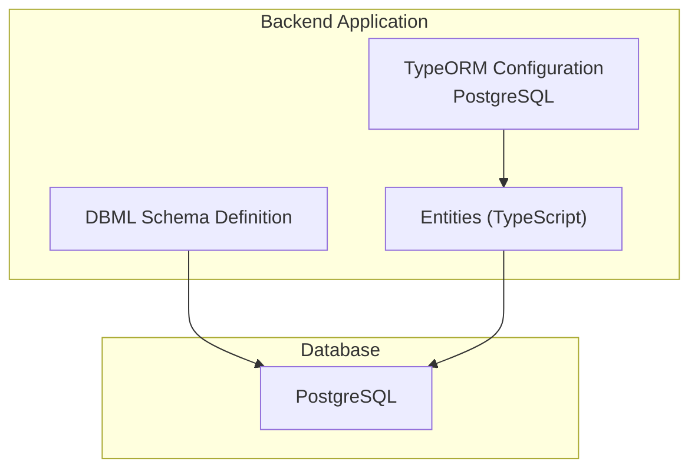
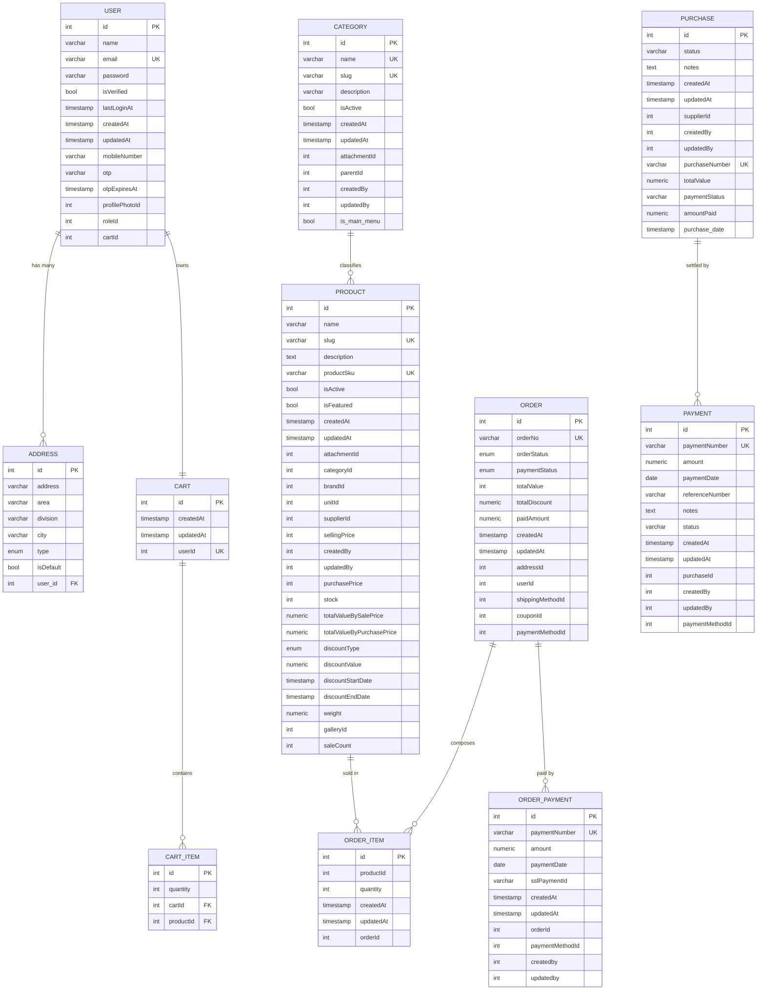
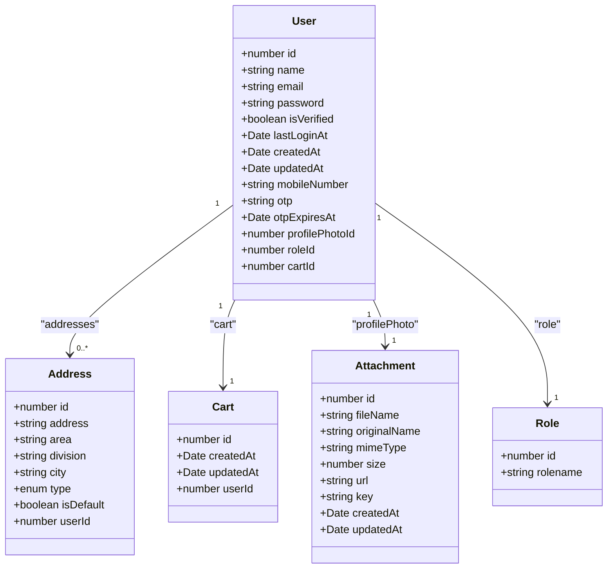
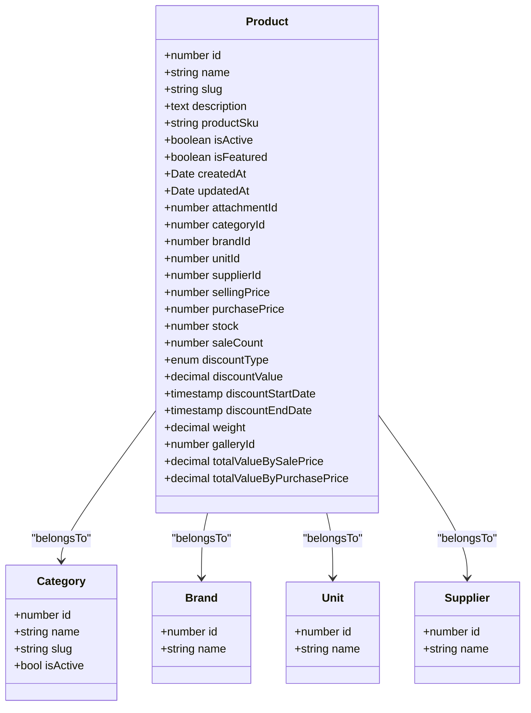
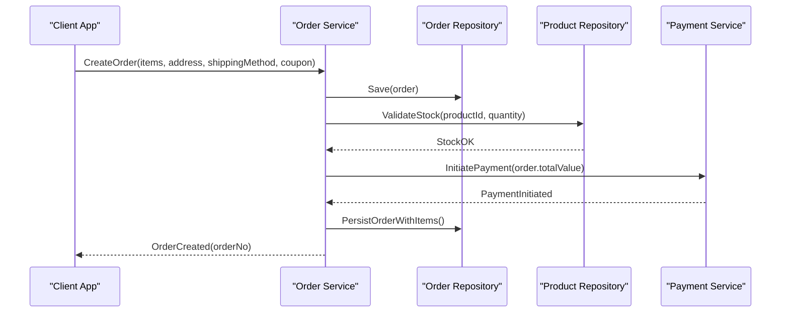
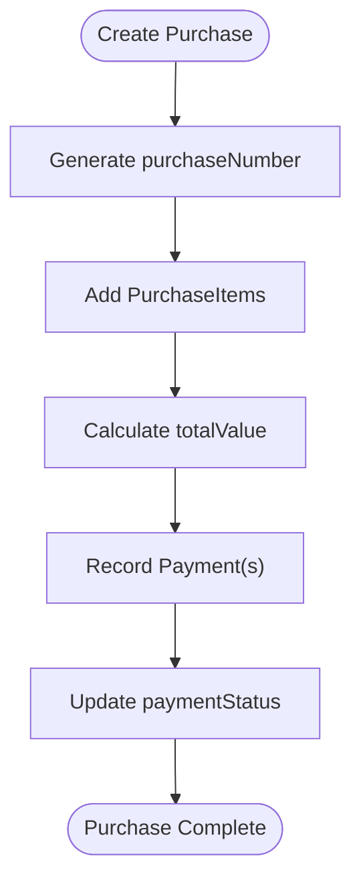
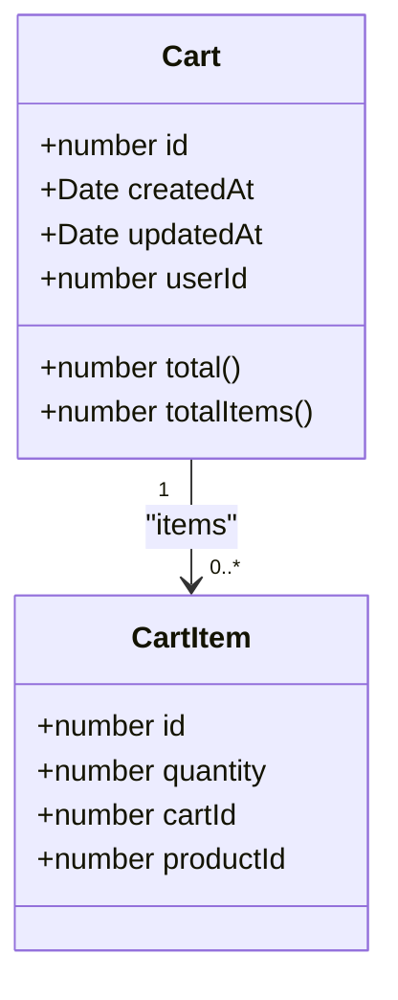
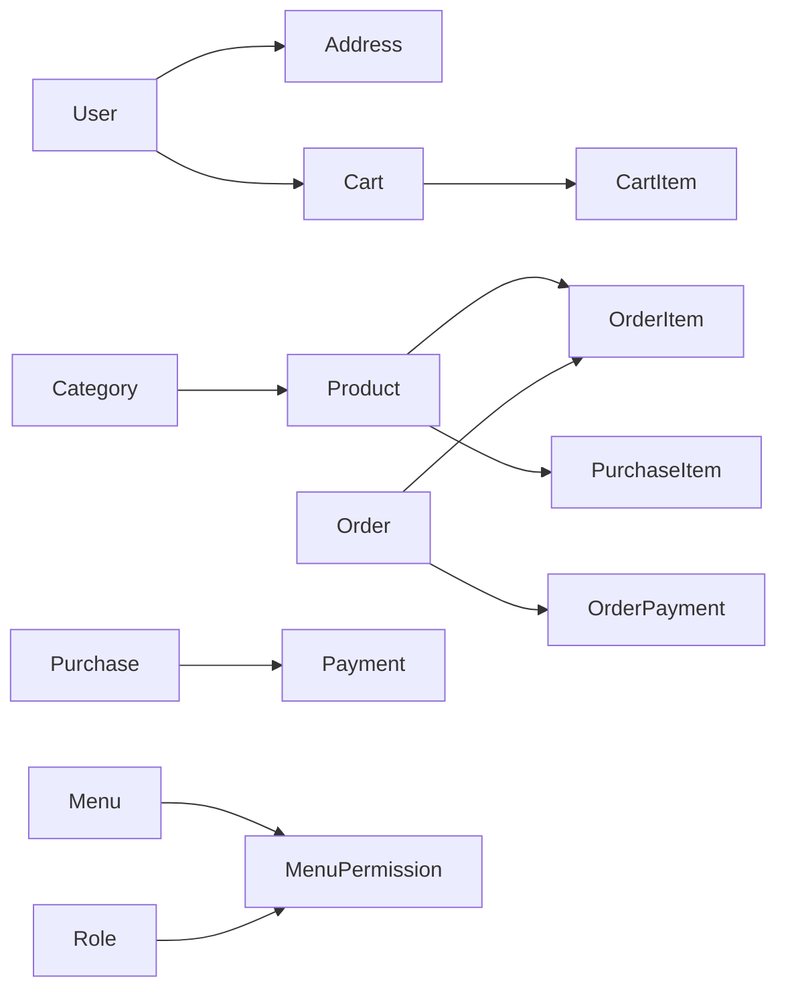

# Database Design

<cite>
**Referenced Files in This Document**
- [database.dbml](file://apps/backend/database.dbml)
- [app.module.ts](file://apps/backend/src/app.module.ts)
- [user.entity.ts](file://apps/backend/src/user/entities/user.entity.ts)
- [address.entity.ts](file://apps/backend/src/address/entities/address.entity.ts)
- [cart.entity.ts](file://apps/backend/src/cart/entities/cart.entity.ts)
- [product.entity.ts](file://apps/backend/src/product/entities/product.entity.ts)
- [category.entity.ts](file://apps/backend/src/category/entities/category.entity.ts)
- [order.entity.ts](file://apps/backend/src/order/entities/order.entity.ts)
- [order-item.entity.ts](file://apps/backend/src/order/entities/order-item.entity.ts)
- [order-payment.entity.ts](file://apps/backend/src/order-payment/entities/order-payment.entity.ts)
- [payment.entity.ts](file://apps/backend/src/payment/entities/payment.entity.ts)
- [purchase.entity.ts](file://apps/backend/src/purchase/entities/purchase.entity.ts)
</cite>

## Table of Contents
1. [Introduction](#introduction)
2. [Project Structure](#project-structure)
3. [Core Components](#core-components)
4. [Architecture Overview](#architecture-overview)
5. [Detailed Component Analysis](#detailed-component-analysis)
6. [Dependency Analysis](#dependency-analysis)
7. [Performance Considerations](#performance-considerations)
8. [Troubleshooting Guide](#troubleshooting-guide)
9. [Conclusion](#conclusion)
10. [Appendices](#appendices)

## Introduction
This document provides comprehensive data model documentation for the German Butcher e-commerce platform. It focuses on entity relationships, field definitions, constraints, validation rules, primary and foreign key relationships, indexes, TypeORM access patterns, transactions, migration strategies, backup and disaster recovery, retention and compliance, and scaling guidance for high-volume operations.

The database schema is defined using DBML and implemented via TypeORM entities in a NestJS backend. The core domains include users, addresses, carts, products, categories, orders, order items, payments, purchases, suppliers, shipping methods, coupons, and related reference tables.

## Project Structure
The database design is primarily captured in a single DBML file and reflected by TypeScript entities under the backend application. The NestJS application configures TypeORM with PostgreSQL, enabling auto-loading of entities and conditional synchronization based on environment variables.

**Diagram sources**
- [app.module.ts:93-115](file://apps/backend/src/app.module.ts#L93-L115)
- [database.dbml:1-538](file://apps/backend/database.dbml#L1-L538)

**Section sources**
- [app.module.ts:63-115](file://apps/backend/src/app.module.ts#L63-L115)
- [database.dbml:1-538](file://apps/backend/database.dbml#L1-L538)

## Core Components
This section summarizes the core entities and their responsibilities:

- User: Customer or admin account with authentication, roles, profile photo, OTP, and linked cart/wishlist.
- Address: Shipping/billing address per user with type and default flags.
- Cart and CartItem: Per-user shopping cart with item quantities and computed totals.
- Product: Catalog item with pricing, stock, discounts, attachments, category, brand, supplier, unit, and sale metrics.
- Category: Hierarchical product taxonomy with slugs and menu flags.
- Order and OrderItem: Sales transaction with status tracking, payment linkage, shipping method, coupon, and delivery metadata.
- OrderPayment: Payment records per order including gateway references and refund linkage.
- Purchase and Payment: Procurement records from suppliers with payment tracking and totals.
- Reference Tables: Brand, Unit, Supplier, ShippingMethod, Coupon, OrderPaymentMethod, PaymentMethod, Attachment, Gallery, Role, Menu, MenuPermission.

Key characteristics:
- Monetary values use decimal types to avoid floating-point rounding issues.
- Enums are used for statuses and types where applicable.
- Audit fields like createdAt/updatedAt and createdBy/updatedBy are present across many entities.
- Unique identifiers such as orderNo, productSku, purchaseNumber, and paymentNumber ensure traceability.

**Section sources**
- [user.entity.ts:22-182](file://apps/backend/src/user/entities/user.entity.ts#L22-L182)
- [address.entity.ts:13-46](file://apps/backend/src/address/entities/address.entity.ts#L13-L46)
- [cart.entity.ts:16-78](file://apps/backend/src/cart/entities/cart.entity.ts#L16-L78)
- [product.entity.ts:41-499](file://apps/backend/src/product/entities/product.entity.ts#L41-L499)
- [category.entity.ts:22-138](file://apps/backend/src/category/entities/category.entity.ts#L22-L138)
- [order.entity.ts:24-156](file://apps/backend/src/order/entities/order.entity.ts#L24-L156)
- [order-item.entity.ts:13-65](file://apps/backend/src/order/entities/order-item.entity.ts#L13-L65)
- [order-payment.entity.ts:18-126](file://apps/backend/src/order-payment/entities/order-payment.entity.ts#L18-L126)
- [purchase.entity.ts:19-221](file://apps/backend/src/purchase/entities/purchase.entity.ts#L19-L221)
- [payment.entity.ts:17-142](file://apps/backend/src/payment/entities/payment.entity.ts#L17-L142)

## Architecture Overview
The system uses a relational database with clear domain boundaries:

- Users own addresses, orders, and carts.
- Products belong to categories, brands, units, and suppliers; they have attachments and galleries.
- Orders contain order items referencing products at time of sale.
- Payments are recorded both for sales (OrderPayment) and procurement (Payment).
- Purchases aggregate supplier inventory intake with associated payments.

**Diagram sources**
- [database.dbml:60-538](file://apps/backend/database.dbml#L60-L538)

**Section sources**
- [database.dbml:60-538](file://apps/backend/database.dbml#L60-L538)

## Detailed Component Analysis

### User and Identity Model
- Primary Key: user.id
- Unique Constraints: user.email
- Foreign Keys:
  - user.roleId -> role.id
  - user.cartId -> cart.id
  - user.profilePhotoId -> attachment.id
- Relationships:
  - One-to-many: user.addresses
  - One-to-one: user.cart, user.wishlist
  - One-to-many: user.orders
- Validation Rules:
  - Email uniqueness enforced at DB level.
  - Password excluded from API responses.
  - Mobile number pattern validated at DTO layer.
  - OTP and expiration stored securely and excluded from API outputs.

Indexes:
- email unique index.
- Additional indexes may be added for roleId and cartId if frequently queried.

Data Types and Constraints:
- name: required string.
- email: unique string.
- password: optional hashed string.
- isVerified: boolean default false.
- lastLoginAt: nullable timestamp.
- createdAt/updatedAt: timestamps with defaults.
- mobileNumber: optional string with format validation.
- otp/otpExpiresAt: sensitive fields excluded from API.

**Diagram sources**
- [user.entity.ts:22-182](file://apps/backend/src/user/entities/user.entity.ts#L22-L182)
- [address.entity.ts:13-46](file://apps/backend/src/address/entities/address.entity.ts#L13-L46)
- [cart.entity.ts:16-78](file://apps/backend/src/cart/entities/cart.entity.ts#L16-L78)
- [database.dbml:60-75](file://apps/backend/database.dbml#L60-L75)

**Section sources**
- [user.entity.ts:22-182](file://apps/backend/src/user/entities/user.entity.ts#L22-L182)
- [address.entity.ts:13-46](file://apps/backend/src/address/entities/address.entity.ts#L13-L46)
- [cart.entity.ts:16-78](file://apps/backend/src/cart/entities/cart.entity.ts#L16-L78)
- [database.dbml:60-75](file://apps/backend/database.dbml#L60-L75)

### Product Catalog Model
- Primary Key: product.id
- Unique Constraints: product.slug, product.productSku
- Foreign Keys:
  - product.categoryId -> category.id
  - product.brandId -> brand.id
  - product.unitId -> unit.id
  - product.supplierId -> supplier.id
  - product.attachmentId -> attachment.id
  - product.galleryId -> galleries.id
- Relationships:
  - Many-to-one: product.category, product.brand, product.unit, product.supplier
  - One-to-many: product.orderItems, product.purchaseItems
- Validation Rules:
  - Slug generation and normalization.
  - SKU auto-generation if missing.
  - Discount validation: value required when type set; percentage <= 100; end date >= start date.
  - Positive price validations.
- Indexes:
  - slug, isActive, isFeatured, saleCount, sellingPrice, createdAt, composite (isActive, isFeatured), composite (discountType, discountValue, discountStartDate, discountEndDate).

Data Types and Constraints:
- name: required string.
- slug: unique normalized string.
- description: optional text.
- sellingPrice/purchasePrice: positive decimals.
- stock: integer default 0.
- saleCount: integer default 0.
- discountType/value/start/end: optional discount configuration.
- weight: optional decimal.
- totalValueBySalePrice/totalValueByPurchasePrice: computed decimals.

**Diagram sources**
- [product.entity.ts:41-499](file://apps/backend/src/product/entities/product.entity.ts#L41-L499)
- [category.entity.ts:22-138](file://apps/backend/src/category/entities/category.entity.ts#L22-L138)
- [database.dbml:92-121](file://apps/backend/database.dbml#L92-L121)

**Section sources**
- [product.entity.ts:41-499](file://apps/backend/src/product/entities/product.entity.ts#L41-L499)
- [category.entity.ts:22-138](file://apps/backend/src/category/entities/category.entity.ts#L22-L138)
- [database.dbml:92-121](file://apps/backend/database.dbml#L92-L121)

### Order and Order Items
- Primary Key: order.id
- Unique Constraints: order.orderNo
- Foreign Keys:
  - order.addressId -> address.id
  - order.userId -> user.id
  - order.shippingMethodId -> shipping_method.id
  - order.couponId -> coupon.id
  - order.paymentMethodId -> order_payment_method.id
- Relationships:
  - Many-to-one: order.address, order.user, order.shippingMethod, order.coupon, order.paymentMethod
  - One-to-many: order.items, order.payments, order.statusTracks
- Validation Rules:
  - Status enums for orderStatus and paymentStatus.
  - Decimal precision for monetary fields.
  - Optional deliveredAt/cancelledAt timestamps.

Order Item:
- Primary Key: order_item.id
- Foreign Keys:
  - order_item.orderId -> order.id
  - order_item.productId -> product.id
- Fields:
  - quantity: integer.
  - unitPrice/totalPrice: decimals capturing snapshot prices.
  - unitDiscount: decimal discount per unit.

**Diagram sources**
- [order.entity.ts:24-156](file://apps/backend/src/order/entities/order.entity.ts#L24-L156)
- [order-item.entity.ts:13-65](file://apps/backend/src/order/entities/order-item.entity.ts#L13-L65)

**Section sources**
- [order.entity.ts:24-156](file://apps/backend/src/order/entities/order.entity.ts#L24-L156)
- [order-item.entity.ts:13-65](file://apps/backend/src/order/entities/order-item.entity.ts#L13-L65)

### Payments for Orders and Purchases
OrderPayment:
- Primary Key: order_payment.id
- Unique Constraints: order_payment.paymentNumber
- Foreign Keys:
  - order_payment.orderId -> order.id
  - order_payment.paymentMethodId -> order_payment_method.id
- Fields:
  - amount: decimal.
  - paymentDate: date.
  - sslPaymentId: optional gateway ID.
  - bankTranId: optional bank transaction ID for refunds.
  - paymentType: enum indicating payment/refund.
  - originalPaymentId/originalPayment: refund linkage.

Payment (Procurement):
- Primary Key: payment.id
- Unique Constraints: payment.paymentNumber
- Foreign Keys:
  - payment.purchaseId -> purchase.id
  - payment.paymentMethodId -> payment_method.id
- Fields:
  - amount: decimal.
  - paymentDate: date.
  - referenceNumber: optional.
  - status: string enum-like.
  - createdBy/updatedBy: audit users.

Purchase:
- Primary Key: purchase.id
- Unique Constraints: purchase.purchaseNumber
- Foreign Keys:
  - purchase.supplierId -> supplier.id
- Fields:
  - totalValue: decimal sum of items.
  - purchaseDate: timestamp.
  - status: string enum-like.
  - paymentStatus: due/partial/paid.
  - amountPaid: decimal.

**Diagram sources**
- [purchase.entity.ts:19-221](file://apps/backend/src/purchase/entities/purchase.entity.ts#L19-L221)
- [payment.entity.ts:17-142](file://apps/backend/src/payment/entities/payment.entity.ts#L17-L142)

**Section sources**
- [order-payment.entity.ts:18-126](file://apps/backend/src/order-payment/entities/order-payment.entity.ts#L18-L126)
- [payment.entity.ts:17-142](file://apps/backend/src/payment/entities/payment.entity.ts#L17-L142)
- [purchase.entity.ts:19-221](file://apps/backend/src/purchase/entities/purchase.entity.ts#L19-L221)

### Addresses and Carts
Address:
- Primary Key: address.id
- Foreign Keys:
  - address.user_id -> user.id
- Fields:
  - type: enum shipping/billing/other.
  - isDefault: boolean flag.

Cart and CartItem:
- Primary Key: cart.id
- Unique Constraints: cart.userId
- Foreign Keys:
  - cart_item.cartId -> cart.id
  - cart_item.productId -> product.id
- Computed Properties:
  - Cart.total: sum of item.salePrice * quantity.
  - Cart.totalItems: sum of item.quantity.

**Diagram sources**
- [cart.entity.ts:16-78](file://apps/backend/src/cart/entities/cart.entity.ts#L16-L78)
- [database.dbml:296-308](file://apps/backend/database.dbml#L296-L308)

**Section sources**
- [address.entity.ts:13-46](file://apps/backend/src/address/entities/address.entity.ts#L13-L46)
- [cart.entity.ts:16-78](file://apps/backend/src/cart/entities/cart.entity.ts#L16-L78)
- [database.dbml:285-308](file://apps/backend/database.dbml#L285-L308)

## Dependency Analysis
The DBML file defines explicit foreign key relationships that enforce referential integrity. Notable relationships include:

- user -> address (one-to-many)
- user -> cart (one-to-one)
- cart -> cart_item (one-to-many)
- category -> product (one-to-many)
- product -> order_item (one-to-many)
- order -> order_item (one-to-many)
- order -> order_payment (one-to-many)
- purchase -> payment (one-to-many)
- product -> purchase_item (one-to-many)
- menu -> menu_permission (many-to-many via join table)
- role -> menu_permission (many-to-many via join table)

**Diagram sources**
- [database.dbml:407-538](file://apps/backend/database.dbml#L407-L538)

**Section sources**
- [database.dbml:407-538](file://apps/backend/database.dbml#L407-L538)

## Performance Considerations
Indexing strategy:
- Product: multiple indexes on slug, isActive, isFeatured, saleCount, sellingPrice, createdAt, composite (isActive, isFeatured), composite (discountType, discountValue, discountStartDate, discountEndDate).
- Category: indexes on slug, isActive, parentId, order, isMainCategory, composite (parentId, isActive).
- Order: indexes on orderStatus and paymentStatus.
- Menu: explicit index on parentId.

Query optimization recommendations:
- Use selective column projection to reduce payload size.
- Prefer indexed columns in WHERE clauses (e.g., orderStatus, paymentStatus, isActive).
- Avoid N+1 queries by eager loading necessary relations or using batched queries.
- For large datasets, consider partitioning orders and payments by date ranges.

Transaction management:
- Wrap order creation, stock reservation, and payment initiation in a single transaction to maintain consistency.
- Ensure idempotency for payment callbacks and refund processing.

Data consistency:
- Snapshot prices in order items to preserve historical accuracy even if product prices change.
- Maintain audit fields (createdAt, updatedAt, createdBy, updatedBy) for traceability.

Scaling guidance:
- Read replicas for reporting and analytics queries.
- Horizontal sharding by tenant or region if multi-tenant or geographically distributed.
- Archive old orders and payments to cold storage while maintaining referential links.

Backup and disaster recovery:
- Automated daily logical backups with point-in-time recovery enabled.
- Test restore procedures regularly.
- Encrypt backups at rest and in transit.

Retention and compliance:
- Retain customer PII according to legal requirements; implement deletion workflows upon request.
- Mask sensitive fields (password, otp) in logs and APIs.
- Anonymize analytics data after retention period.

**Section sources**
- [product.entity.ts:41-49](file://apps/backend/src/product/entities/product.entity.ts#L41-L49)
- [category.entity.ts:22-28](file://apps/backend/src/category/entities/category.entity.ts#L22-L28)
- [order.entity.ts:49-57](file://apps/backend/src/order/entities/order.entity.ts#L49-L57)
- [database.dbml:163-166](file://apps/backend/database.dbml#L163-L166)

## Troubleshooting Guide
Common issues and resolutions:

- Duplicate email or SKU:
  - Cause: Violation of unique constraints.
  - Resolution: Enforce validation at API layer; handle conflict errors gracefully.

- Invalid discount configuration:
  - Cause: Missing discount value or invalid date range.
  - Resolution: Apply entity-level validation hooks; return descriptive error messages.

- Payment mismatch:
  - Cause: Discrepancy between order total and payment amounts.
  - Resolution: Reconcile payments against order totals; log discrepancies for manual review.

- Stock overselling:
  - Cause: Race conditions during concurrent orders.
  - Resolution: Use row-level locking or optimistic concurrency control; validate stock within transactions.

- Migration failures:
  - Cause: Schema changes conflicting with existing data.
  - Resolution: Use backward-compatible migrations; test in staging; rollback plan documented.

**Section sources**
- [product.entity.ts:434-455](file://apps/backend/src/product/entities/product.entity.ts#L434-L455)
- [payment.entity.ts:95-109](file://apps/backend/src/payment/entities/payment.entity.ts#L95-L109)
- [purchase.entity.ts:159-221](file://apps/backend/src/purchase/entities/purchase.entity.ts#L159-L221)

## Conclusion
The German Butcher e-commerce platform employs a well-structured relational schema with clear entity relationships, robust validation, and thoughtful indexing. TypeORM entities mirror the DBML definition, ensuring consistency between design and implementation. By following the recommended query optimization, transaction practices, and operational guidelines, the platform can scale effectively while maintaining data integrity and compliance.

## Appendices

### Data Access Patterns Using TypeORM
- Entity definitions map directly to database tables.
- Use repositories for CRUD operations; prefer find options with relations and indices.
- Leverage decorators for automatic timestamps and audit fields.
- Utilize cascade operations carefully to avoid unintended deletions.

Example paths:
- User repository usage: [user.entity.ts:22-182](file://apps/backend/src/user/entities/user.entity.ts#L22-L182)
- Product repository usage: [product.entity.ts:41-499](file://apps/backend/src/product/entities/product.entity.ts#L41-L499)
- Order repository usage: [order.entity.ts:24-156](file://apps/backend/src/order/entities/order.entity.ts#L24-L156)

### Sample Data for Testing and Development
- Seed minimal datasets for users, categories, products, and orders.
- Include varied discount configurations and payment statuses.
- Populate addresses and carts to exercise checkout flows.
- Use fixtures for suppliers and purchases to test procurement workflows.

[No sources needed since this section provides general guidance]

### Database Schema Evolution Strategies
- Version migrations with incremental changes.
- Backward compatibility for API consumers.
- Feature flags for gradual rollout.
- Rollback scripts for each migration.

[No sources needed since this section provides general guidance]

### Backup Procedures and Disaster Recovery Plans
- Daily full backups with incremental WAL archiving.
- Restore drills quarterly.
- Offsite replication for critical environments.
- Incident response runbooks for data loss scenarios.

[No sources needed since this section provides general guidance]

### Data Retention Policies and Compliance Requirements
- Define retention periods per data category (PII, orders, analytics).
- Implement automated purging and anonymization.
- Audit logging for data access and modifications.
- Compliance checks for GDPR/local regulations.

[No sources needed since this section provides general guidance]

### Database Scaling and Partitioning Strategies
- Partition orders and payments by month/year.
- Shard by tenant or region for multi-tenant setups.
- Use read replicas for heavy reporting workloads.
- Monitor query performance and adjust indexes accordingly.

[No sources needed since this section provides general guidance]