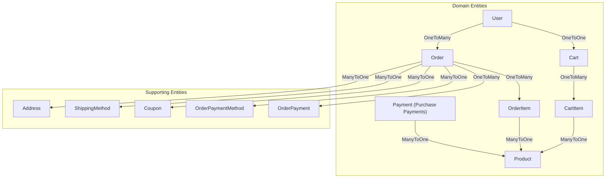
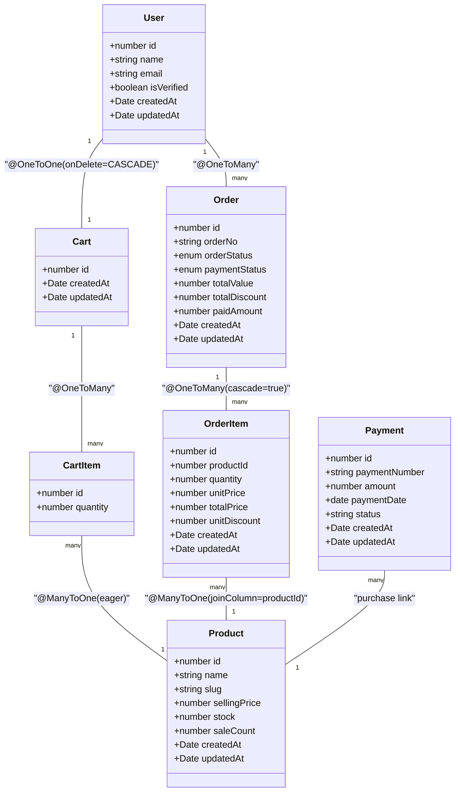
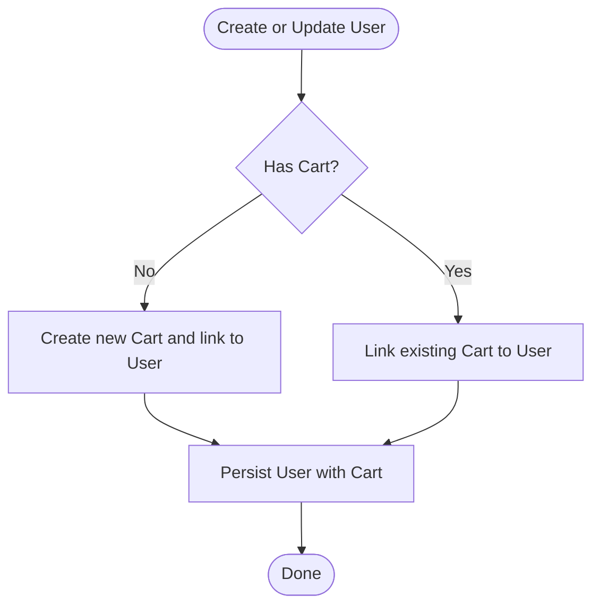
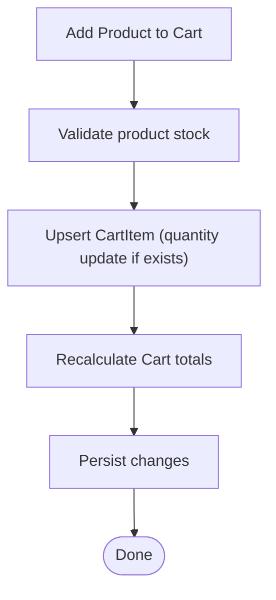
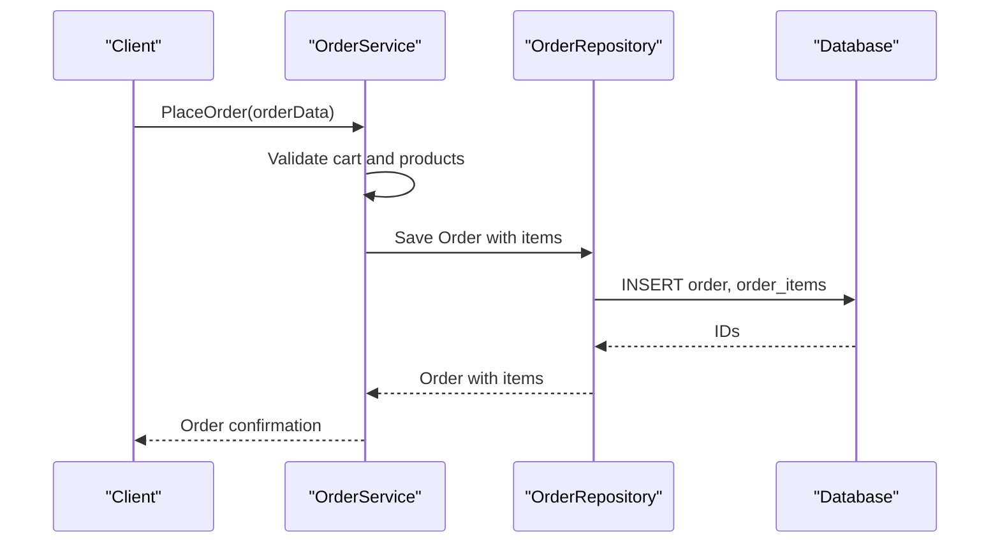
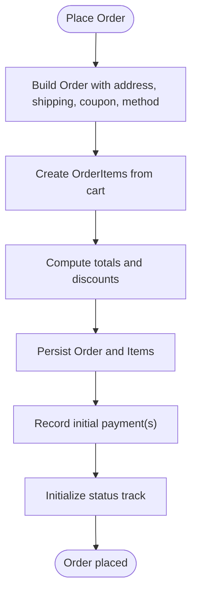
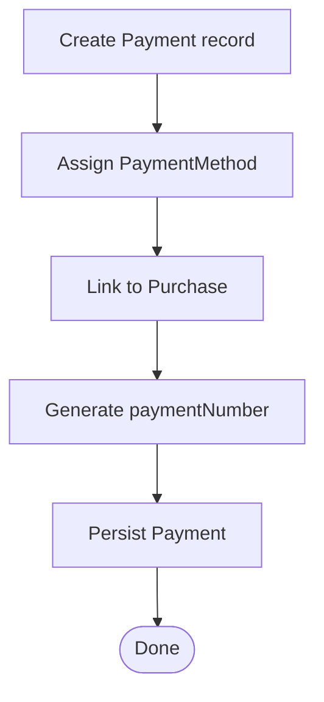
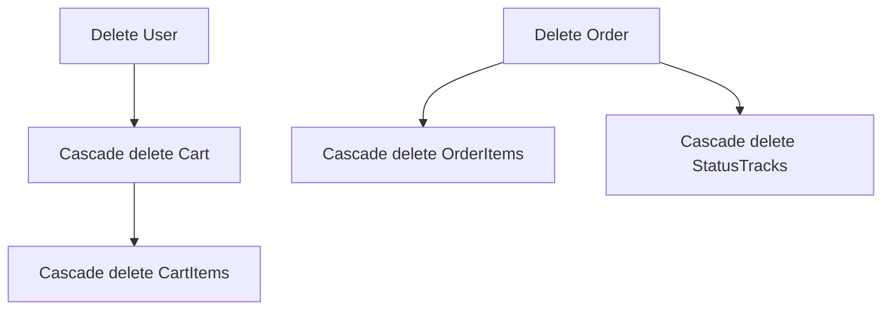
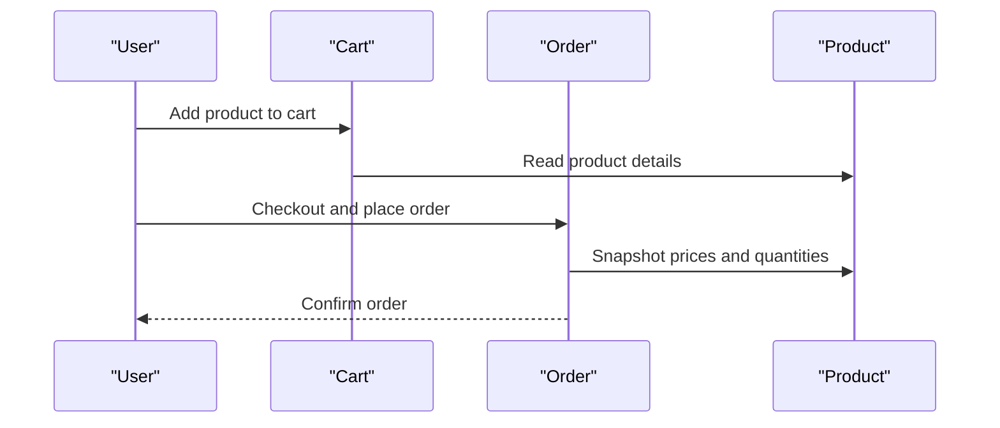
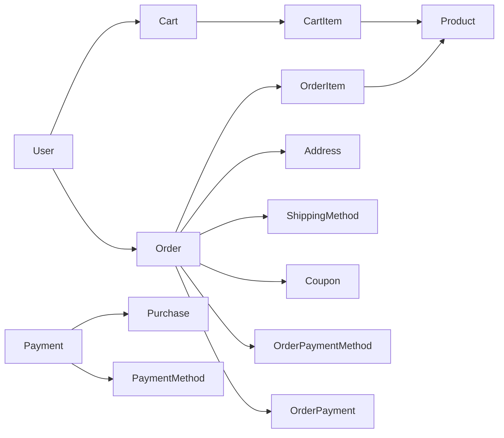

# Entity Relationships

<cite>
**Referenced Files in This Document**
- [user.entity.ts](file://apps/backend/src/user/entities/user.entity.ts)
- [product.entity.ts](file://apps/backend/src/product/entities/product.entity.ts)
- [order.entity.ts](file://apps/backend/src/order/entities/order.entity.ts)
- [order-item.entity.ts](file://apps/backend/src/order/entities/order-item.entity.ts)
- [payment.entity.ts](file://apps/backend/src/payment/entities/payment.entity.ts)
- [cart.entity.ts](file://apps/backend/src/cart/entities/cart.entity.ts)
- [cart-item.entity.ts](file://apps/backend/src/cart/entities/cart-item.entity.ts)
- [database.dbml](file://apps/backend/database.dbml)
</cite>

## Table of Contents
1. [Introduction](#introduction)
2. [Project Structure](#project-structure)
3. [Core Components](#core-components)
4. [Architecture Overview](#architecture-overview)
5. [Detailed Component Analysis](#detailed-component-analysis)
6. [Dependency Analysis](#dependency-analysis)
7. [Performance Considerations](#performance-considerations)
8. [Troubleshooting Guide](#troubleshooting-guide)
9. [Conclusion](#conclusion)

## Introduction
This document provides comprehensive data model documentation for the German Butcher e-commerce platform, focusing on core entities and their relationships: User, Product, Order, Payment, Cart, and related entities such as OrderItem, CartItem, Address, ShippingMethod, Coupon, and OrderPaymentMethod. It explains primary and foreign key relationships, cardinality constraints, referential integrity rules, TypeORM decorators used to define relationships, cascade operations, orphan deletion strategies, lifecycle management, example complex queries, and performance implications.

## Project Structure
The entity definitions are implemented using TypeORM decorators within NestJS modules. The database schema is also described in a DBML file that captures tables, columns, indexes, and foreign key references with delete behaviors.

**Diagram sources**
- [user.entity.ts:59-146](file://apps/backend/src/user/entities/user.entity.ts#L59-L146)
- [cart.entity.ts:26-37](file://apps/backend/src/cart/entities/cart.entity.ts#L26-L37)
- [cart-item.entity.ts:17-29](file://apps/backend/src/cart/entities/cart-item.entity.ts#L17-L29)
- [product.entity.ts:187-225](file://apps/backend/src/product/entities/product.entity.ts#L187-L225)
- [order.entity.ts:34-114](file://apps/backend/src/order/entities/order.entity.ts#L34-L114)
- [order-item.entity.ts:27-33](file://apps/backend/src/order/entities/order-item.entity.ts#L27-L33)
- [payment.entity.ts:33-70](file://apps/backend/src/payment/entities/payment.entity.ts#L33-L70)

**Section sources**
- [database.dbml:60-121](file://apps/backend/database.dbml#L60-L121)
- [database.dbml:285-308](file://apps/backend/database.dbml#L285-L308)
- [database.dbml:357-405](file://apps/backend/database.dbml#L357-L405)

## Core Components
This section summarizes the core entities and their relationship patterns defined via TypeORM decorators and enforced by database constraints.

- User
  - One-to-One with Cart (owned by User; onDelete: CASCADE)
  - One-to-One with Wishlist (not shown here)
  - One-to-Many with Orders
  - Many-to-One with Role
  - One-to-Many with Addresses
  - Optional attachment profile photo

- Product
  - Many-to-One with Category, Brand, Supplier, Unit
  - One-to-Many with OrderItems
  - One-to-Many with PurchaseItems
  - Optional Gallery and Attachment

- Order
  - Many-to-One with User, Address, ShippingMethod, Coupon, OrderPaymentMethod
  - One-to-Many with OrderItems (cascade true)
  - One-to-Many with OrderPayments
  - One-to-Many with Status Tracks (cascade true)

- OrderItem
  - Many-to-One with Order and Product

- Cart
  - One-to-One with User (onDelete: CASCADE)
  - One-to-Many with CartItems

- CartItem
  - Many-to-One with Cart (onDelete: CASCADE)
  - Many-to-One with Product

- Payment (for purchases)
  - Many-to-One with Purchase and PaymentMethod
  - Audit fields createdBy/updatedBy referencing User

**Section sources**
- [user.entity.ts:59-146](file://apps/backend/src/user/entities/user.entity.ts#L59-L146)
- [product.entity.ts:145-233](file://apps/backend/src/product/entities/product.entity.ts#L145-L233)
- [order.entity.ts:34-114](file://apps/backend/src/order/entities/order.entity.ts#L34-L114)
- [order-item.entity.ts:27-33](file://apps/backend/src/order/entities/order-item.entity.ts#L27-L33)
- [cart.entity.ts:26-37](file://apps/backend/src/cart/entities/cart.entity.ts#L26-L37)
- [cart-item.entity.ts:17-29](file://apps/backend/src/cart/entities/cart-item.entity.ts#L17-L29)
- [payment.entity.ts:33-70](file://apps/backend/src/payment/entities/payment.entity.ts#L33-L70)

## Architecture Overview
The following diagram maps the main domain entities and their relationships as implemented in the codebase.

**Diagram sources**
- [user.entity.ts:131-146](file://apps/backend/src/user/entities/user.entity.ts#L131-L146)
- [cart.entity.ts:26-37](file://apps/backend/src/cart/entities/cart.entity.ts#L26-L37)
- [cart-item.entity.ts:17-29](file://apps/backend/src/cart/entities/cart-item.entity.ts#L17-L29)
- [product.entity.ts:187-225](file://apps/backend/src/product/entities/product.entity.ts#L187-L225)
- [order.entity.ts:59-114](file://apps/backend/src/order/entities/order.entity.ts#L59-L114)
- [order-item.entity.ts:27-33](file://apps/backend/src/order/entities/order-item.entity.ts#L27-L33)
- [payment.entity.ts:33-70](file://apps/backend/src/payment/entities/payment.entity.ts#L33-L70)

## Detailed Component Analysis

### User and Cart Relationship
- Relationship: One-to-One from User to Cart
- Decorators: @OneToOne with onDelete: 'CASCADE' and @JoinColumn
- Behavior: Deleting a user cascades to cart removal; cart has a unique userId column
- Referential Integrity: Enforced by both TypeORM and DB FK

**Diagram sources**
- [user.entity.ts:131-136](file://apps/backend/src/user/entities/user.entity.ts#L131-L136)
- [cart.entity.ts:26-30](file://apps/backend/src/cart/entities/cart.entity.ts#L26-L30)

**Section sources**
- [user.entity.ts:131-136](file://apps/backend/src/user/entities/user.entity.ts#L131-L136)
- [cart.entity.ts:26-30](file://apps/backend/src/cart/entities/cart.entity.ts#L26-L30)
- [database.dbml:303-308](file://apps/backend/database.dbml#L303-L308)
- [database.dbml:533-533](file://apps/backend/database.dbml#L533-L533)

### Cart and CartItem Relationship
- Relationship: One-to-Many from Cart to CartItem
- Decorators: @OneToMany on Cart; @ManyToOne on CartItem with onDelete: 'CASCADE'
- Behavior: Removing a cart deletes its items; each item belongs to one cart
- Cardinality: One Cart has many CartItems; Each CartItem belongs to one Cart

**Diagram sources**
- [cart.entity.ts:32-37](file://apps/backend/src/cart/entities/cart.entity.ts#L32-L37)
- [cart-item.entity.ts:17-29](file://apps/backend/src/cart/entities/cart-item.entity.ts#L17-L29)

**Section sources**
- [cart.entity.ts:32-37](file://apps/backend/src/cart/entities/cart.entity.ts#L32-L37)
- [cart-item.entity.ts:17-29](file://apps/backend/src/cart/entities/cart-item.entity.ts#L17-L29)
- [database.dbml:296-301](file://apps/backend/database.dbml#L296-L301)
- [database.dbml:425-427](file://apps/backend/database.dbml#L425-L427)

### Product and OrderItem Relationship
- Relationship: One-to-Many from Product to OrderItem
- Decorators: @OneToMany on Product; @ManyToOne on OrderItem with @JoinColumn('productId')
- Behavior: OrderItem stores snapshot price fields (unitPrice, totalPrice, unitDiscount) at time of order
- Cardinality: One Product can appear in many OrderItems across orders

**Diagram sources**
- [product.entity.ts:187-188](file://apps/backend/src/product/entities/product.entity.ts#L187-L188)
- [order-item.entity.ts:27-33](file://apps/backend/src/order/entities/order-item.entity.ts#L27-L33)
- [order.entity.ts:59-61](file://apps/backend/src/order/entities/order.entity.ts#L59-L61)

**Section sources**
- [product.entity.ts:187-188](file://apps/backend/src/product/entities/product.entity.ts#L187-L188)
- [order-item.entity.ts:27-33](file://apps/backend/src/order/entities/order-item.entity.ts#L27-L33)
- [database.dbml:398-405](file://apps/backend/database.dbml#L398-L405)
- [database.dbml:453-455](file://apps/backend/database.dbml#L453-L455)

### Order and Related Entities
- Order to User: Many-to-One
- Order to Address: Many-to-One
- Order to ShippingMethod: Many-to-One
- Order to Coupon: Many-to-One (optional)
- Order to OrderPaymentMethod: Many-to-One
- Order to OrderItems: One-to-Many (cascade true)
- Order to OrderPayments: One-to-Many
- Order to StatusTracks: One-to-Many (cascade true)

**Diagram sources**
- [order.entity.ts:34-114](file://apps/backend/src/order/entities/order.entity.ts#L34-L114)

**Section sources**
- [order.entity.ts:34-114](file://apps/backend/src/order/entities/order.entity.ts#L34-L114)
- [database.dbml:381-405](file://apps/backend/database.dbml#L381-L405)
- [database.dbml:443-461](file://apps/backend/database.dbml#L443-L461)

### Payment Entity (Purchase Payments)
- Relationship: Many-to-One with Purchase and PaymentMethod
- Audit: createdBy/updatedBy reference User
- Purpose: Records payments against purchase orders (procurement), not customer orders

**Diagram sources**
- [payment.entity.ts:33-70](file://apps/backend/src/payment/entities/payment.entity.ts#L33-L70)
- [payment.entity.ts:95-109](file://apps/backend/src/payment/entities/payment.entity.ts#L95-L109)

**Section sources**
- [payment.entity.ts:33-70](file://apps/backend/src/payment/entities/payment.entity.ts#L33-L70)
- [payment.entity.ts:95-109](file://apps/backend/src/payment/entities/payment.entity.ts#L95-L109)
- [database.dbml:228-242](file://apps/backend/database.dbml#L228-L242)
- [database.dbml:473-479](file://apps/backend/database.dbml#L473-L479)

### Cascade Operations and Orphan Deletion Strategies
- User to Cart: onDelete: 'CASCADE' ensures cart is removed when user is deleted
- Cart to CartItem: onDelete: 'CASCADE' on CartItem side ensures items are removed when cart is removed
- Order to OrderItems: cascade: true allows saving order with nested items in a single transaction
- Order to StatusTracks: cascade: true enables automatic persistence of status history
- DB-level constraints:
  - galleries -> attachment: delete: cascade
  - category.parentId: delete: set null
  - order_status_track: delete: cascade
  - cart_item: delete: cascade

**Diagram sources**
- [user.entity.ts:131-136](file://apps/backend/src/user/entities/user.entity.ts#L131-L136)
- [cart-item.entity.ts:17-17](file://apps/backend/src/cart/entities/cart-item.entity.ts#L17-L17)
- [order.entity.ts:59-61](file://apps/backend/src/order/entities/order.entity.ts#L59-L61)
- [order.entity.ts:113-114](file://apps/backend/src/order/entities/order.entity.ts#L113-L114)
- [database.dbml:409-409](file://apps/backend/database.dbml#L409-L409)
- [database.dbml:433-433](file://apps/backend/database.dbml#L433-L433)
- [database.dbml:469-469](file://apps/backend/database.dbml#L469-L469)
- [database.dbml:425-425](file://apps/backend/database.dbml#L425-L425)

**Section sources**
- [user.entity.ts:131-136](file://apps/backend/src/user/entities/user.entity.ts#L131-L136)
- [cart-item.entity.ts:17-17](file://apps/backend/src/cart/entities/cart-item.entity.ts#L17-L17)
- [order.entity.ts:59-61](file://apps/backend/src/order/entities/order.entity.ts#L59-L61)
- [order.entity.ts:113-114](file://apps/backend/src/order/entities/order.entity.ts#L113-L114)
- [database.dbml:409-409](file://apps/backend/database.dbml#L409-L409)
- [database.dbml:425-425](file://apps/backend/database.dbml#L425-L425)
- [database.dbml:433-433](file://apps/backend/database.dbml#L433-L433)
- [database.dbml:469-469](file://apps/backend/database.dbml#L469-L469)

### Relationship Lifecycle Management
- Creating a User may create a Cart automatically (service layer typically handles this)
- Adding products to Cart updates or creates CartItem entries
- Placing an Order converts CartItems into OrderItems, capturing price snapshots
- Order payments are recorded separately per transaction
- Status tracks are appended on order state changes

**Diagram sources**
- [cart.entity.ts:32-37](file://apps/backend/src/cart/entities/cart.entity.ts#L32-L37)
- [cart-item.entity.ts:24-29](file://apps/backend/src/cart/entities/cart-item.entity.ts#L24-L29)
- [order.entity.ts:59-61](file://apps/backend/src/order/entities/order.entity.ts#L59-L61)
- [order-item.entity.ts:31-33](file://apps/backend/src/order/entities/order-item.entity.ts#L31-L33)

**Section sources**
- [cart.entity.ts:32-37](file://apps/backend/src/cart/entities/cart.entity.ts#L32-L37)
- [cart-item.entity.ts:24-29](file://apps/backend/src/cart/entities/cart-item.entity.ts#L24-L29)
- [order.entity.ts:59-61](file://apps/backend/src/order/entities/order.entity.ts#L59-L61)
- [order-item.entity.ts:31-33](file://apps/backend/src/order/entities/order-item.entity.ts#L31-L33)

## Dependency Analysis
The following dependency graph shows how core entities depend on each other through TypeORM relations and DB foreign keys.

**Diagram sources**
- [user.entity.ts:59-146](file://apps/backend/src/user/entities/user.entity.ts#L59-L146)
- [cart.entity.ts:26-37](file://apps/backend/src/cart/entities/cart.entity.ts#L26-L37)
- [cart-item.entity.ts:17-29](file://apps/backend/src/cart/entities/cart-item.entity.ts#L17-L29)
- [product.entity.ts:187-225](file://apps/backend/src/product/entities/product.entity.ts#L187-L225)
- [order.entity.ts:34-114](file://apps/backend/src/order/entities/order.entity.ts#L34-L114)
- [order-item.entity.ts:27-33](file://apps/backend/src/order/entities/order-item.entity.ts#L27-L33)
- [payment.entity.ts:33-70](file://apps/backend/src/payment/entities/payment.entity.ts#L33-L70)

**Section sources**
- [database.dbml:407-537](file://apps/backend/database.dbml#L407-L537)

## Performance Considerations
- Eager loading:
  - Product.unit, Product.category, Product.supplier are eager-loaded to reduce N+1 queries in storefront reads.
  - Payment.paymentMethod and Payment.purchase are eager-loaded.
  - Trade-off: larger payloads and potential over-fetching; consider selective loading in admin APIs.
- Indexes:
  - Product has multiple indexes (slug, isActive, isFeatured, saleCount, sellingPrice, createdAt, composite active+featured, discount fields).
  - Order.orderStatus and Order.paymentStatus are indexed for filtering.
- Denormalized snapshots:
  - OrderItem stores unitPrice, totalPrice, unitDiscount to preserve historical pricing independent of Product changes.
- Cascades:
  - Use cascade: true judiciously; ensure transactions wrap multi-step writes to avoid partial states.
- Query complexity:
  - Complex joins across User -> Order -> OrderItem -> Product should be paginated and projected to minimize payload size.
  - Prefer repository methods that select only needed relations and use pagination.

[No sources needed since this section provides general guidance]

## Troubleshooting Guide
- Foreign key constraint violations:
  - Ensure referenced entities exist before creating dependent records (e.g., Address before Order).
  - Verify onDelete behaviors match business requirements (e.g., setting null vs cascade).
- Cascade pitfalls:
  - Deleting a User will remove Cart and CartItems; confirm service logic does not require retaining cart history.
  - Deleting an Order removes OrderItems and StatusTracks due to cascade; archive if needed.
- Data consistency:
  - OrderItem price snapshots must be captured at order time; do not rely solely on Product.sellingPrice for historical reports.
- Performance issues:
  - Avoid eager-loading heavy relations in list endpoints; use DTOs and selective includes.
  - Monitor N+1 queries when traversing Order -> OrderItem -> Product.

**Section sources**
- [order.entity.ts:59-61](file://apps/backend/src/order/entities/order.entity.ts#L59-L61)
- [order.entity.ts:113-114](file://apps/backend/src/order/entities/order.entity.ts#L113-L114)
- [order-item.entity.ts:35-48](file://apps/backend/src/order/entities/order-item.entity.ts#L35-L48)
- [database.dbml:409-409](file://apps/backend/database.dbml#L409-L409)
- [database.dbml:425-425](file://apps/backend/database.dbml#L425-L425)
- [database.dbml:469-469](file://apps/backend/database.dbml#L469-L469)

## Conclusion
The German Butcher platform models core commerce concepts with clear TypeORM relationships and strong referential integrity enforced at the database level. Key patterns include one-to-one ownership (User-Cart), one-to-many hierarchies (Cart-CartItem, Order-OrderItem), and snapshotting of critical values (OrderItem prices). Cascade operations simplify lifecycle management but must be used thoughtfully. For performance, leverage indexes, selective eager loading, and careful query design to balance data freshness with efficiency.

[No sources needed since this section summarizes without analyzing specific files]