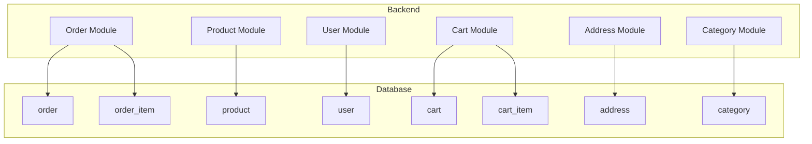
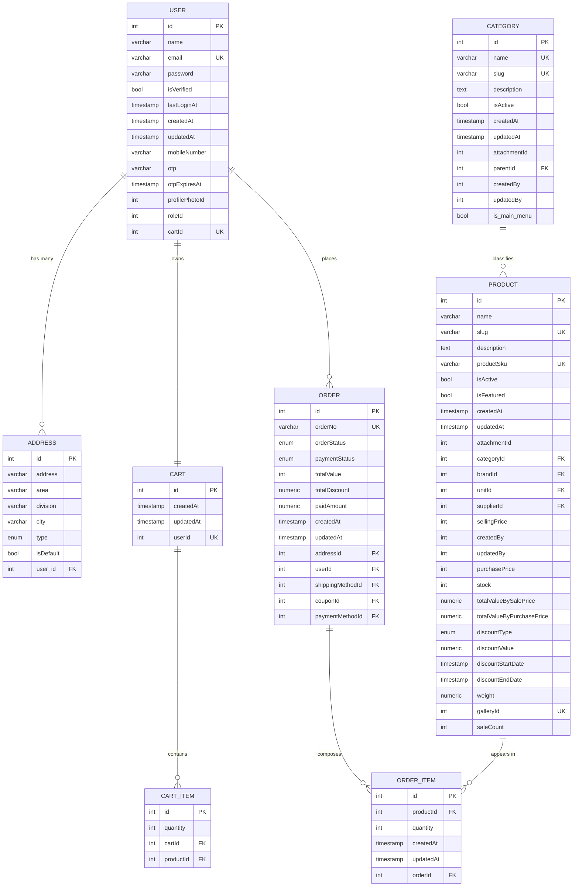
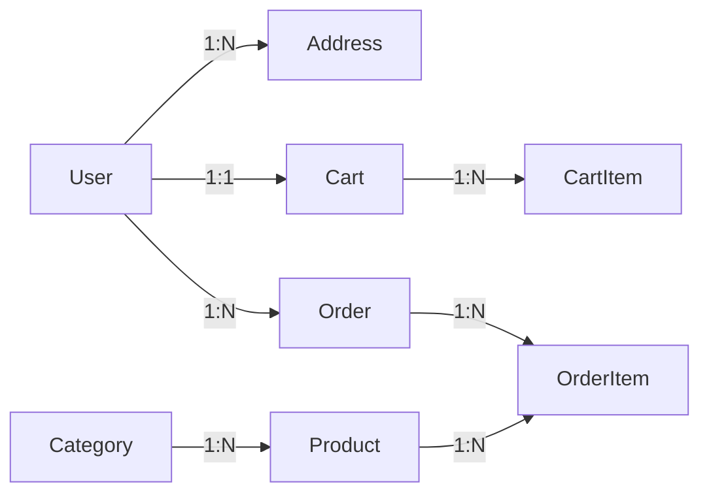

# Schema Design

<cite>
**Referenced Files in This Document**
- [database.dbml](file://apps/backend/database.dbml)
- [order.entity.ts](file://apps/backend/src/order/entities/order.entity.ts)
- [product.entity.ts](file://apps/backend/src/product/entities/product.entity.ts)
- [user.entity.ts](file://apps/backend/src/user/entities/user.entity.ts)
- [cart.entity.ts](file://apps/backend/src/cart/entities/cart.entity.ts)
- [cart-item.entity.ts](file://apps/backend/src/cart/entities/cart-item.entity.ts)
- [address.entity.ts](file://apps/backend/src/address/entities/address.entity.ts)
- [category.entity.ts](file://apps/backend/src/category/entities/category.entity.ts)
- [order-item.entity.ts](file://apps/backend/src/order/entities/order-item.entity.ts)
- [README.md](file://README.md)
</cite>

## Table of Contents
1. [Introduction](#introduction)
2. [Project Structure](#project-structure)
3. [Core Components](#core-components)
4. [Architecture Overview](#architecture-overview)
5. [Detailed Component Analysis](#detailed-component-analysis)
6. [Dependency Analysis](#dependency-analysis)
7. [Performance Considerations](#performance-considerations)
8. [Troubleshooting Guide](#troubleshooting-guide)
9. [Conclusion](#conclusion)
10. [Appendices](#appendices)

## Introduction
This document defines the database schema design for the German Butcher e-commerce platform. It focuses on table structures, field definitions, data types, constraints, normalization principles, indexing strategies, and performance considerations for high-volume e-commerce workloads. The schema is modeled using PostgreSQL with TypeORM entities and a DBML model that captures tables, enums, indexes, and relationships.

The backend uses NestJS 11 with TypeORM and PostgreSQL. The frontend is built with Next.js 16. The database is external and configured via environment variables.

**Section sources**
- [README.md:52-66](file://README.md#L52-L66)
- [README.md:237-248](file://README.md#L237-L248)

## Project Structure
The repository is a monorepo containing:
- apps/backend: NestJS API with feature modules (orders, products, users, carts, etc.)
- apps/frontend: Next.js storefront and admin UI
- sql and scripts: Database migrations and backfills
- docs: Feature documentation

[No sources needed since this diagram shows conceptual project structure]

## Core Components
This section documents the major entities and their schemas as defined by the DBML model and TypeORM entities.

### User
- Purpose: Represents system users (customers, admins).
- Key fields:
  - id: surrogate primary key
  - name: user full name
  - email: unique login identifier
  - password: hashed password
  - isVerified: account verification flag
  - lastLoginAt: last successful login timestamp
  - createdAt/updatedAt: audit timestamps
  - mobileNumber: optional phone number
  - otp/otpExpiresAt: OTP-related fields
  - profilePhotoId: reference to attachment
  - roleId: role assignment
  - cartId: one-to-one link to cart
- Constraints:
  - id: NOT NULL, PK, auto-increment
  - name: NOT NULL
  - email: UNIQUE, NOT NULL
  - isVerified: NOT NULL, default false
  - createdAt/updatedAt: NOT NULL, default now()
  - roleId: default 3
  - cartId: UNIQUE
- Relationships:
  - One-to-many addresses
  - One-to-one cart
  - Many orders
  - Many activities
  - Role association

**Section sources**
- [database.dbml:60-75](file://apps/backend/database.dbml#L60-L75)
- [user.entity.ts:22-182](file://apps/backend/src/user/entities/user.entity.ts#L22-L182)

### Address
- Purpose: Stores shipping/billing addresses per user.
- Key fields:
  - id: surrogate PK
  - address/area/division/city: location details
  - type: enum (shipping/billing/other)
  - isDefault: default address flag
  - userId: FK to user
- Constraints:
  - type: NOT NULL, default shipping
  - isDefault: NOT NULL, default false
  - userId: NOT NULL
- Relationships:
  - Belongs to user

**Section sources**
- [database.dbml:285-294](file://apps/backend/database.dbml#L285-L294)
- [address.entity.ts:13-46](file://apps/backend/src/address/entities/address.entity.ts#L13-L46)

### Category
- Purpose: Hierarchical product categories.
- Key fields:
  - id: surrogate PK
  - name: unique category name
  - slug: URL-friendly unique slug
  - description: optional text
  - isActive: visibility flag
  - parentId: self-referencing parent category
  - createdBy/updatedBy: audit users
  - createdAt/updatedAt: audit timestamps
- Constraints:
  - name: UNIQUE, NOT NULL
  - slug: UNIQUE
  - isActive: NOT NULL, default true
  - createdAt/updatedAt: NOT NULL, default now()
- Relationships:
  - Self-referencing hierarchy via parentId
  - Many products

**Section sources**
- [database.dbml:77-90](file://apps/backend/database.dbml#L77-L90)
- [category.entity.ts:22-138](file://apps/backend/src/category/entities/category.entity.ts#L22-L138)

### Product
- Purpose: Catalog items with pricing, inventory, and discount metadata.
- Key fields:
  - id: surrogate PK
  - name: product name
  - slug: unique URL-friendly slug
  - description/productDetails: rich text
  - productSku: unique SKU
  - isActive/isFeatured: flags
  - categoryId/brandId/unitId/supplierId: references
  - sellingPrice/purchasePrice: monetary values
  - stock: inventory quantity
  - saleCount: sales counter
  - totalValueBySalePrice/totalValueByPurchasePrice: computed inventory values
  - discountType/discountValue/discountStartDate/discountEndDate: discount window
  - weight: optional weight
  - galleryId: optional gallery reference
  - attachmentId: image reference
  - createdBy/updatedBy: audit users
  - createdAt/updatedAt: audit timestamps
- Constraints:
  - name: NOT NULL
  - slug: UNIQUE
  - productSku: UNIQUE
  - isActive/isFeatured: NOT NULL, defaults
  - stock: NOT NULL, default 0
  - saleCount: NOT NULL, default 0
  - Monetary columns: decimal precision/scale where applicable
- Relationships:
  - Many order items
  - Many purchase items
  - Category, brand, supplier, unit associations
  - Optional gallery and attachment

**Section sources**
- [database.dbml:92-121](file://apps/backend/database.dbml#L92-L121)
- [product.entity.ts:41-499](file://apps/backend/src/product/entities/product.entity.ts#L41-L499)

### Cart and Cart Item
- Purpose: Shopping cart per user with line items.
- Key fields:
  - Cart: id, createdAt, updatedAt, userId (unique)
  - CartItem: id, cartId, productId, quantity
- Constraints:
  - Cart.userId: UNIQUE
  - CartItem.quantity: NOT NULL, default 1
- Relationships:
  - Cart belongs to user (one-to-one)
  - Cart has many cart items
  - Cart item references product

**Section sources**
- [database.dbml:296-308](file://apps/backend/database.dbml#L296-L308)
- [cart.entity.ts:16-78](file://apps/backend/src/cart/entities/cart.entity.ts#L16-L78)
- [cart-item.entity.ts:7-50](file://apps/backend/src/cart/entities/cart-item.entity.ts#L7-L50)

### Order and Order Item
- Purpose: Customer purchases and line items.
- Key fields:
  - Order: id, orderNo (unique), orderStatus, paymentStatus, totalValue, totalDiscount, paidAmount, createdAt/updatedAt, addressId, userId, shippingMethodId, couponId, paymentMethodId, deliveredAt, cancelledAt
  - OrderItem: id, productId, quantity, orderId, unitPrice, totalPrice, unitDiscount, createdAt/updatedAt
- Constraints:
  - orderNo: UNIQUE, NOT NULL
  - orderStatus/paymentStatus: enums with defaults
  - totalValue/totalDiscount/paidAmount: decimal precision/scale
  - OrderItem.unitPrice/totalPrice: decimal precision/scale
- Relationships:
  - Order belongs to user and address
  - Order has many order items
  - Order item references product

**Section sources**
- [database.dbml:357-405](file://apps/backend/database.dbml#L357-L405)
- [order.entity.ts:24-156](file://apps/backend/src/order/entities/order.entity.ts#L24-L156)
- [order-item.entity.ts:13-65](file://apps/backend/src/order/entities/order-item.entity.ts#L13-L65)

### Additional Entities (Summary)
- Brand: brand catalog with images and audit fields
- Attachment: file metadata and storage keys
- Menu/menu_permission: RBAC menu access control
- Supplier: vendor information
- Purchase/purchase_item: procurement records
- Payment/payment_method: purchase payments
- Banner: promotional banners
- Shipping_method: delivery options
- Order_payment_method: order payment method definitions
- Order_payment: order payment transactions
- Order_status_track: order lifecycle tracking
- Galleries: media galleries

**Section sources**
- [database.dbml:123-355](file://apps/backend/database.dbml#L123-L355)

## Architecture Overview
The database schema centers around core e-commerce domains: users, products, categories, carts, orders, and supporting entities like attachments, brands, suppliers, and promotions. Relationships are enforced via foreign keys, and enumerations constrain state transitions.

**Diagram sources**
- [database.dbml:60-405](file://apps/backend/database.dbml#L60-L405)

## Detailed Component Analysis

### Normalization Principles Applied
- First Normal Form (1NF): All tables have atomic columns; arrays are avoided except where explicitly used (e.g., product tags array).
- Second Normal Form (2NF): Non-key attributes depend on the whole primary key; composite keys are minimized. Surrogate keys (id) are used for all major entities.
- Third Normal Form (3NF): Transitive dependencies are removed; related data is split into separate tables (e.g., category, brand, supplier, unit).
- Referential Integrity: Foreign keys enforce consistent relationships across entities.

**Section sources**
- [database.dbml:407-538](file://apps/backend/database.dbml#L407-L538)

### Indexing Strategies for Query Optimization
- Primary Keys: All tables define integer surrogate PKs with auto-increment.
- Unique Constraints: Used for business identifiers (email, slug, productSku, orderNo, code fields).
- Explicit Indexes:
  - Product: slug, isActive, isFeatured, saleCount, sellingPrice, createdAt, composite (isActive, isFeatured), discount windows
  - Category: slug, isActive, parentId, order, isMainCategory, composite (parentId, isActive)
  - Order: orderStatus, paymentStatus
  - Menu: parentId
  - UserActivity: composite (userId, action), composite (entityType, entityId), createdAt
- Recommendations:
  - Add composite indexes for frequent query patterns (e.g., order(userId, createdAt), product(categoryId, isActive))
  - Consider partial indexes for active records (e.g., WHERE isActive = true)
  - Use covering indexes for common read queries (e.g., product listing filters)

**Section sources**
- [product.entity.ts:41-49](file://apps/backend/src/product/entities/product.entity.ts#L41-L49)
- [category.entity.ts:22-28](file://apps/backend/src/category/entities/category.entity.ts#L22-L28)
- [order.entity.ts:49-57](file://apps/backend/src/order/entities/order.entity.ts#L49-L57)
- [database.dbml:163-166](file://apps/backend/database.dbml#L163-L166)

### Column-Level Constraints and Defaults
- NOT NULL: Enforced on critical fields (name, email, stock, saleCount, orderNo, status enums)
- UNIQUE: Business keys (email, slug, productSku, orderNo, codes)
- CHECK Constraints:
  - Discount validation logic implemented at entity level (discount value required when type set; percentage <= 100; date ordering)
  - Positive numeric validations for prices and quantities
- Default Values:
  - Timestamps default to current time
  - Boolean flags default to expected states (isActive=true, isVerified=false)
  - Enums default to initial states (orderStatus=pending, paymentStatus=pending)

**Section sources**
- [product.entity.ts:434-455](file://apps/backend/src/product/entities/product.entity.ts#L434-L455)
- [database.dbml:30-53](file://apps/backend/database.dbml#L30-L53)
- [database.dbml:381-396](file://apps/backend/database.dbml#L381-L396)

### Composite Keys, Surrogate Keys, and Natural Keys
- Surrogate Keys: Integer id columns serve as PKs for all major entities.
- Natural Keys:
  - email (user)
  - slug (product, category)
  - productSku (product)
  - orderNo (order)
  - code (coupon, payment_method, order_payment_method)
- Composite Keys:
  - No explicit composite PKs; instead, composite indexes optimize multi-column queries.

**Section sources**
- [database.dbml:60-405](file://apps/backend/database.dbml#L60-L405)

### Data Type Choices, Precision Settings, and Storage Optimizations
- Numeric Types:
  - Monetary values use decimal/numeric with precision/scale (e.g., 10,2 or 12,2) to avoid floating-point errors.
  - Inventory totals use higher precision (12,2) for accurate valuation.
- Text Types:
  - Short strings use varchar with length limits (e.g., productSku length 50).
  - Long descriptions use text.
- Enumerations:
  - Status and type fields use enums to constrain allowed values.
- Timestamps:
  - createdAt/updatedAt use default CURRENT_TIMESTAMP or NOW().
- Storage Optimizations:
  - Avoid unnecessary large text fields in frequently queried tables.
  - Use appropriate lengths for varchar to reduce index size.
  - Prefer integers for IDs and foreign keys.

**Section sources**
- [product.entity.ts:235-261](file://apps/backend/src/product/entities/product.entity.ts#L235-L261)
- [order.entity.ts:68-92](file://apps/backend/src/order/entities/order.entity.ts#L68-L92)
- [order-item.entity.ts:35-48](file://apps/backend/src/order/entities/order-item.entity.ts#L35-L48)

### Table Partitioning Strategies
- Recommended partitions:
  - order: partition by range on createdAt (monthly or quarterly)
  - order_payment: partition by range on paymentDate or createdAt
  - user_activity: partition by range on createdAt
- Benefits:
  - Faster archival and purging of old data
  - Improved query performance for recent data
  - Reduced index sizes per partition

[No sources needed since this section provides general guidance]

### Clustering Considerations
- PostgreSQL does not support traditional clustering; however:
  - Use appropriate indexes to simulate clustered behavior for hot paths
  - Consider tablespace placement for high-I/O tables
  - Leverage pg_partman for partition management

[No sources needed since this section provides general guidance]

### Scalability Planning for High-Volume E-commerce Data
- Read Scaling:
  - Replicas for read-heavy endpoints (product catalog, category browsing)
- Write Scaling:
  - Connection pooling (PgBouncer)
  - Batch inserts for order creation and inventory updates
- Caching:
  - Redis for product listings, cart totals, session data
- Sharding:
  - Horizontal sharding by tenant or region if multi-tenant or global scale is required
- Monitoring:
  - Slow query logs, index usage stats, lock contention monitoring

[No sources needed since this section provides general guidance]

## Dependency Analysis
Relationships between core entities are enforced via foreign keys and reflected in both DBML and TypeORM entities.

**Diagram sources**
- [database.dbml:407-538](file://apps/backend/database.dbml#L407-L538)
- [cart.entity.ts:26-37](file://apps/backend/src/cart/entities/cart.entity.ts#L26-L37)
- [order.entity.ts:59-61](file://apps/backend/src/order/entities/order.entity.ts#L59-L61)

**Section sources**
- [database.dbml:407-538](file://apps/backend/database.dbml#L407-L538)

## Performance Considerations
- Indexing:
  - Ensure indexes exist for frequently filtered columns (slug, isActive, saleCount, orderStatus, paymentStatus)
  - Add composite indexes for common query patterns
- Denormalization:
  - Precomputed totals (totalValueBySalePrice, totalValueByPurchasePrice) reduce runtime calculations
- Transactions:
  - Wrap order creation and inventory updates in transactions to maintain consistency
- Bulk Operations:
  - Use batch inserts for order items and purchase items
- Archival:
  - Partition historical orders and payments for faster maintenance operations

**Section sources**
- [product.entity.ts:457-484](file://apps/backend/src/product/entities/product.entity.ts#L457-L484)
- [order.entity.ts:125-155](file://apps/backend/src/order/entities/order.entity.ts#L125-L155)

## Troubleshooting Guide
- Common Issues:
  - Duplicate unique constraints (email, slug, productSku, orderNo)
  - Missing foreign key references (ensure referential integrity)
  - Invalid enum values (validate against defined enums)
  - Decimal precision mismatches (ensure correct precision/scale)
- Debugging Steps:
  - Check constraint violations in error logs
  - Validate entity-level validations (discount rules, positive numbers)
  - Review index usage with EXPLAIN ANALYZE for slow queries

**Section sources**
- [product.entity.ts:434-455](file://apps/backend/src/product/entities/product.entity.ts#L434-L455)
- [database.dbml:30-53](file://apps/backend/database.dbml#L30-L53)

## Conclusion
The German Butcher database schema is designed for scalability, performance, and maintainability. It leverages surrogate keys, natural keys, enumerations, and precise numeric types to ensure data integrity and efficient querying. Indexing strategies and precomputed totals support high-volume e-commerce operations. Future enhancements include partitioning, caching, and read replicas to handle growth.

[No sources needed since this section summarizes without analyzing specific files]

## Appendices
- Environment Configuration:
  - DATABASE_URL must be configured for PostgreSQL connectivity
- Deployment Notes:
  - External PostgreSQL instance required
  - Docker Compose can orchestrate services locally

**Section sources**
- [README.md:237-248](file://README.md#L237-L248)