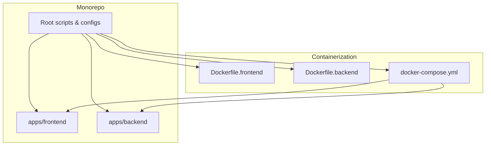
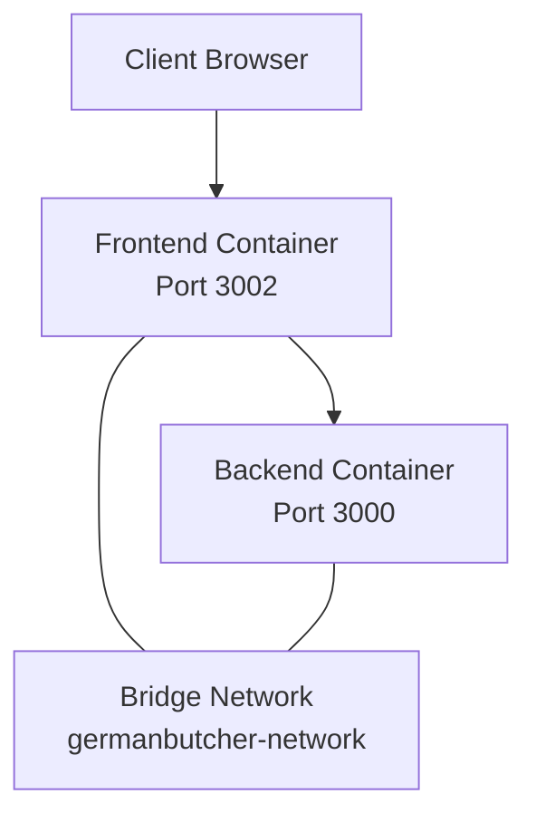
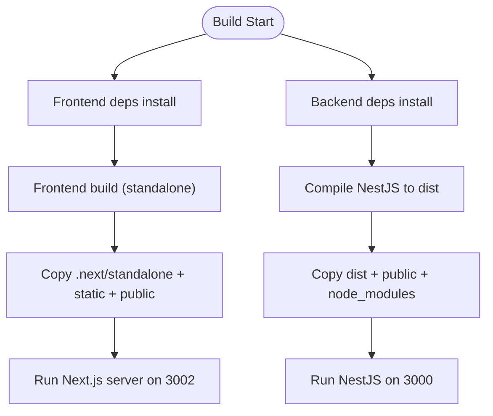
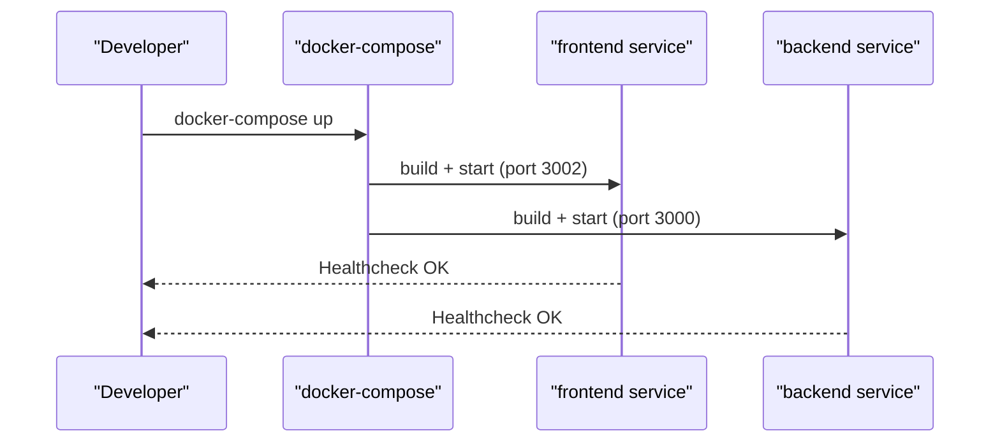
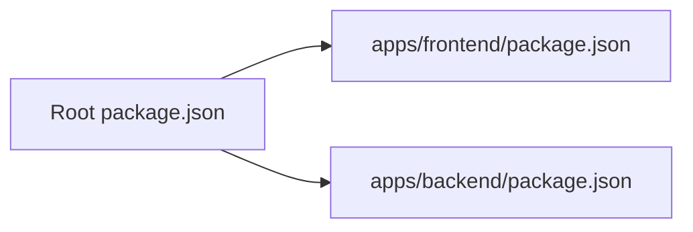

# Deployment & DevOps

<cite>
**Referenced Files in This Document**
- [Dockerfile.backend](file://Dockerfile.backend)
- [Dockerfile.frontend](file://Dockerfile.frontend)
- [docker-compose.yml](file://docker-compose.yml)
- [.dockerignore](file://.dockerignore)
- [apps/backend/.dockerignore](file://apps/backend/.dockerignore)
- [apps/frontend/.dockerignore](file://apps/frontend/.dockerignore)
- [package.json](file://package.json)
- [apps/backend/package.json](file://apps/backend/package.json)
- [apps/frontend/package.json](file://apps/frontend/package.json)
</cite>

## Table of Contents
1. [Introduction](#introduction)
2. [Project Structure](#project-structure)
3. [Core Components](#core-components)
4. [Architecture Overview](#architecture-overview)
5. [Detailed Component Analysis](#detailed-component-analysis)
6. [Dependency Analysis](#dependency-analysis)
7. [Performance Considerations](#performance-considerations)
8. [Troubleshooting Guide](#troubleshooting-guide)
9. [Conclusion](#conclusion)
10. [Appendices](#appendices)

## Introduction
This document provides comprehensive deployment and DevOps guidance for the German Butcher e-commerce platform, covering containerization with Docker, multi-stage builds, Docker Compose orchestration for local development and staging, CI/CD pipeline recommendations, production deployment strategies (including load balancing and auto-scaling), monitoring and logging, security best practices, rollback procedures, backup and disaster recovery, and scaling considerations for traffic spikes and growth.

## Project Structure
The repository is a monorepo containing:
- Frontend application (Next.js) under apps/frontend
- Backend application (NestJS) under apps/backend
- Root-level Dockerfiles for both applications
- A docker-compose file orchestrating services
- Workspace configuration via pnpm

**Diagram sources**
- [Dockerfile.frontend:1-83](file://Dockerfile.frontend#L1-L83)
- [Dockerfile.backend:1-61](file://Dockerfile.backend#L1-L61)
- [docker-compose.yml:1-55](file://docker-compose.yml#L1-L55)
- [package.json:1-30](file://package.json#L1-L30)

**Section sources**
- [package.json:1-30](file://package.json#L1-L30)
- [Dockerfile.frontend:1-83](file://Dockerfile.frontend#L1-L83)
- [Dockerfile.backend:1-61](file://Dockerfile.backend#L1-L61)
- [docker-compose.yml:1-55](file://docker-compose.yml#L1-L55)

## Core Components
- Frontend container: Next.js app built in standalone mode, served by Node.js on port 3002.
- Backend container: NestJS app compiled to dist, served on port 3000.
- Orchestration: docker-compose defines two services sharing a bridge network, health checks, env files, and restart policies.
- Build optimization: Multi-stage Dockerfiles with dependency caching, non-root users, and minimal runtime images.

Key responsibilities:
- Frontend build uses Next.js webpack build and outputs a standalone server bundle.
- Backend build compiles TypeScript to JavaScript and copies static assets.
- docker-compose wires environment variables from per-app .env files and exposes ports.

**Section sources**
- [Dockerfile.frontend:1-83](file://Dockerfile.frontend#L1-L83)
- [Dockerfile.backend:1-61](file://Dockerfile.backend#L1-L61)
- [docker-compose.yml:1-55](file://docker-compose.yml#L1-L55)
- [apps/frontend/package.json:1-88](file://apps/frontend/package.json#L1-L88)
- [apps/backend/package.json:1-114](file://apps/backend/package.json#L1-L114)

## Architecture Overview
High-level runtime architecture:
- Client browsers access the frontend over HTTPS (via reverse proxy or CDN).
- The frontend calls backend APIs over HTTP(S).
- Both containers run on a shared internal network defined by docker-compose.

**Diagram sources**
- [docker-compose.yml:1-55](file://docker-compose.yml#L1-L55)

## Detailed Component Analysis

### Containerization Strategy (Multi-Stage Builds)
- Frontend (Next.js):
  - Base stage installs libc6-compat and pnpm.
  - Dependency stage installs workspace dependencies with frozen lockfile.
  - Builder stage sets NEXT_PUBLIC_* variables at build time and runs the Next.js build.
  - Production stage copies only the standalone output and public assets, runs as a non-root user, and serves on port 3002.
- Backend (NestJS):
  - Dependencies stage installs pnpm and workspace dependencies.
  - Builder stage compiles the backend and ensures public directory exists.
  - Runner stage copies node_modules, dist, package.json, and public assets; runs as a non-root user on port 3000.

Optimization techniques:
- Multi-stage builds reduce final image size.
- Frozen lockfile installs ensure reproducible builds.
- Non-root users improve security posture.
- Excluding node_modules, dist, .next, and logs via .dockerignore reduces context size.

**Diagram sources**
- [Dockerfile.frontend:1-83](file://Dockerfile.frontend#L1-L83)
- [Dockerfile.backend:1-61](file://Dockerfile.backend#L1-L61)

**Section sources**
- [Dockerfile.frontend:1-83](file://Dockerfile.frontend#L1-L83)
- [Dockerfile.backend:1-61](file://Dockerfile.backend#L1-L61)
- [.dockerignore:1-37](file://.dockerignore#L1-L37)
- [apps/frontend/.dockerignore:1-41](file://apps/frontend/.dockerignore#L1-L41)
- [apps/backend/.dockerignore:1-41](file://apps/backend/.dockerignore#L1-L41)

### Docker Compose Setup (Local Development and Staging)
- Services:
  - frontend: builds from Dockerfile.frontend, exposes 3002, loads env from apps/frontend/.env, healthcheck via wget.
  - backend: builds from Dockerfile.backend, exposes 3000, loads env from apps/backend/.env, healthcheck via /v1 endpoint.
- Networking:
  - Shared bridge network germanbutcher-network enables inter-service communication.
- Volumes:
  - frontend-cache and backend-cache are declared for potential persistent caches.

Environment configuration:
- Per-app environment variables are loaded from .env files.
- Port bindings are explicitly set for both services.

**Diagram sources**
- [docker-compose.yml:1-55](file://docker-compose.yml#L1-L55)

**Section sources**
- [docker-compose.yml:1-55](file://docker-compose.yml#L1-L55)

### CI/CD Pipeline Recommendations
Recommended stages:
- Lint and format validation
- Unit tests (Jest for backend)
- E2E tests (if applicable)
- Build frontend and backend images
- Push images to a registry
- Deploy to staging with automated smoke tests
- Promote to production after approval gates

Suggested tooling:
- GitHub Actions, GitLab CI, or Azure Pipelines
- Docker Buildx for multi-platform builds
- Trivy or Snyk for image scanning
- Helm/Kustomize for Kubernetes deployments (if applicable)

Pipeline outline:
- On push/PR: lint, test, build images, scan, publish artifacts
- On main branch: deploy to staging, run integration tests
- On tag/release: promote to production with manual approval

[No sources needed since this section provides general guidance]

### Production Deployment Strategies
- Reverse Proxy/TLS Termination:
  - Place NGINX, Traefik, or an API Gateway in front of the containers to terminate TLS and route traffic.
- Load Balancing:
  - Use a cloud load balancer or ingress controller to distribute requests across multiple frontend and backend replicas.
- Auto-Scaling:
  - Configure horizontal pod autoscaling (Kubernetes) or managed service scaling policies based on CPU/memory or custom metrics.
- Environment Management:
  - Store secrets in a vault or cloud secret manager; inject them at runtime into containers.
- Database and Storage:
  - Use managed databases and object storage (e.g., AWS S3) for scalability and durability.

[No sources needed since this section provides general guidance]

### Monitoring and Logging
- Application Metrics:
  - Expose Prometheus-compatible metrics endpoints if supported by your framework.
  - Use APM tools (e.g., OpenTelemetry, New Relic, Datadog) to trace requests across frontend and backend.
- Centralized Logging:
  - Ship container logs to a centralized system (e.g., ELK stack, Loki, CloudWatch).
- Health Checks:
  - Keep health endpoints active; integrate with orchestrator probes for readiness/liveness.
- Business Metrics:
  - Track orders, revenue, conversion rates, and error rates using analytics pipelines.

[No sources needed since this section provides general guidance]

### Security Considerations
- TLS/SSL:
  - Terminate TLS at the edge (reverse proxy or managed service).
- Secrets Management:
  - Never bake secrets into images; use environment variables injected by the orchestrator or secret managers.
- Least Privilege:
  - Containers already run as non-root users; ensure filesystem permissions are restricted.
- Image Security:
  - Scan images regularly and pin base image versions.
- Network Policies:
  - Restrict inter-service communication to required ports and namespaces.

[No sources needed since this section provides general guidance]

### Rollback Procedures
- Blue/Green or Canary:
  - Maintain two identical environments; switch traffic gradually to the new version.
- Image Versioning:
  - Tag images with semantic versions and git commit SHAs; keep previous versions available.
- Automated Rollback:
  - If health checks fail post-deploy, automatically revert to the last known good image.

[No sources needed since this section provides general guidance]

### Backup and Disaster Recovery
- Database Backups:
  - Schedule automated snapshots and offsite replication.
- Object Storage:
  - Enable versioning and lifecycle policies for media/assets.
- Configuration Backups:
  - Back up environment configurations and secrets securely.
- DR Plan:
  - Define RTO/RPO targets and run periodic drills.

[No sources needed since this section provides general guidance]

### Scaling Considerations
- Horizontal Scaling:
  - Scale frontend and backend independently based on traffic patterns.
- Caching:
  - Use CDN for static assets and browser caching headers.
  - Implement backend caching layers where appropriate.
- Connection Limits:
  - Tune worker processes and connection pools for database and external services.
- Rate Limiting:
  - Apply rate limiting at the gateway level to protect backend services.

[No sources needed since this section provides general guidance]

## Dependency Analysis
Runtime and build dependencies:
- Frontend depends on Next.js and related libraries; build script uses webpack.
- Backend depends on NestJS ecosystem, TypeORM, Socket.IO, JWT, and other utilities.
- Monorepo scripts coordinate dev/build/start across apps.

**Diagram sources**
- [package.json:1-30](file://package.json#L1-L30)
- [apps/frontend/package.json:1-88](file://apps/frontend/package.json#L1-L88)
- [apps/backend/package.json:1-114](file://apps/backend/package.json#L1-L114)

**Section sources**
- [package.json:1-30](file://package.json#L1-L30)
- [apps/frontend/package.json:1-88](file://apps/frontend/package.json#L1-L88)
- [apps/backend/package.json:1-114](file://apps/backend/package.json#L1-L114)

## Performance Considerations
- Image Size:
  - Multi-stage builds and excluding unnecessary files via .dockerignore reduce image sizes.
- Startup Time:
  - Pre-warm caches and avoid heavy initialization in entrypoints.
- Resource Limits:
  - Set CPU/memory limits per container to prevent noisy neighbor issues.
- Static Assets:
  - Serve static assets via CDN and enable long-lived cache headers.

[No sources needed since this section provides general guidance]

## Troubleshooting Guide
Common issues and resolutions:
- Healthcheck failures:
  - Verify exposed ports and that the correct endpoints respond.
- Environment variables not applied:
  - Ensure .env files exist and are correctly referenced by docker-compose.
- Build failures due to missing dependencies:
  - Confirm pnpm lockfile consistency and workspace configuration.
- Permission errors running as non-root:
  - Validate file ownership and permissions for copied directories.

Operational tips:
- Inspect container logs and health status.
- Test connectivity between services on the shared network.
- Validate image contents before deployment.

**Section sources**
- [docker-compose.yml:1-55](file://docker-compose.yml#L1-L55)

## Conclusion
The German Butcher platform leverages modern containerization practices with multi-stage Dockerfiles, a clear Compose-based orchestration for local and staging environments, and a foundation for scalable production deployments. By following the recommended CI/CD, monitoring, security, and scaling guidelines, teams can deliver reliable updates while maintaining performance and resilience.

[No sources needed since this section summarizes without analyzing specific files]

## Appendices

### Appendix A: Key Scripts and Ports
- Frontend:
  - Build: Next.js webpack build producing standalone output.
  - Runtime: Node.js server on port 3002.
- Backend:
  - Build: NestJS compilation to dist.
  - Runtime: Node.js server on port 3000.
- Root scripts:
  - Provide convenience commands for dev, build, and Docker operations.

**Section sources**
- [apps/frontend/package.json:1-88](file://apps/frontend/package.json#L1-L88)
- [apps/backend/package.json:1-114](file://apps/backend/package.json#L1-L114)
- [package.json:1-30](file://package.json#L1-L30)