# Application Structure & Architecture

<cite>
**Referenced Files in This Document**
- [next.config.js](file://apps/frontend/next.config.js)
- [tsconfig.json](file://apps/frontend/tsconfig.json)
- [app/layout.tsx](file://apps/frontend/app/layout.tsx)
- [app/(main)/layout.tsx](file://apps/frontend/app/(main)/layout.tsx)
- [app/admin/layout.tsx](file://apps/frontend/app/admin/layout.tsx)
- [app/(main)/page.tsx](file://apps/frontend/app/(main)/page.tsx)
- [app/(main)/product/[slug]/page.tsx](file://apps/frontend/app/(main)/product/[slug]/page.tsx)
- [app/(main)/order-confirmation/[id]/page.tsx](file://apps/frontend/app/(main)/order-confirmation/[id]/page.tsx)
- [app/(main)/user/(account)/[id]/layout.tsx](file://apps/frontend/app/(main)/user/(account)/[id]/layout.tsx)
- [app/(main)/products/featured/page.tsx](file://apps/frontend/app/(main)/products/featured/page.tsx)
- [app/admin/dashboard/page.tsx](file://apps/frontend/app/admin/dashboard/page.tsx)
</cite>

## Table of Contents
1. [Introduction](#introduction)
2. [Project Structure](#project-structure)
3. [Core Components](#core-components)
4. [Architecture Overview](#architecture-overview)
5. [Detailed Component Analysis](#detailed-component-analysis)
6. [Dependency Analysis](#dependency-analysis)
7. [Performance Considerations](#performance-considerations)
8. [Troubleshooting Guide](#troubleshooting-guide)
9. [Conclusion](#conclusion)

## Introduction
This document explains the German Butcher Next.js application structure and architecture, focusing on the App Router implementation, layout hierarchy, routing patterns, configuration, TypeScript setup, and development/deployment considerations. The frontend is a Next.js 16 App Router application with:
- A root layout providing global providers, fonts, metadata, and analytics.
- A customer-facing route group under app/(main)/ for public storefront pages.
- An administrative interface under app/admin/.
- Dynamic routes for product details and order confirmation.
- Nested layouts for user account sections.

## Project Structure
The Next.js App Router organizes routes by directory:
- Root layout at app/layout.tsx sets up global providers, fonts, SEO metadata, and analytics.
- Customer-facing routes are grouped under app/(main)/ to share a common layout and UI shell (header, footer, mobile navigation).
- Administrative routes live under app/admin/, each feature folder containing its own page and components.
- API routes exist under app/api/ for server-side endpoints.

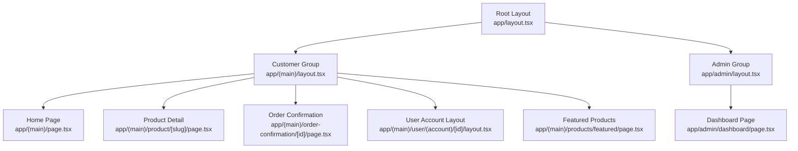

**Diagram sources**
- [app/layout.tsx:180-206](file://apps/frontend/app/layout.tsx#L180-L206)
- [app/(main)/layout.tsx:36-72](file://apps/frontend/app/(main)/layout.tsx#L36-L72)
- [app/admin/layout.tsx:57-71](file://apps/frontend/app/admin/layout.tsx#L57-L71)
- [app/(main)/page.tsx:29-106](file://apps/frontend/app/(main)/page.tsx#L29-L106)
- [app/(main)/product/[slug]/page.tsx:223-248](file://apps/frontend/app/(main)/product/[slug]/page.tsx#L223-L248)
- [app/(main)/order-confirmation/[id]/page.tsx:169-179](file://apps/frontend/app/(main)/order-confirmation/[id]/page.tsx#L169-L179)
- [app/(main)/user/(account)/[id]/layout.tsx:23-157](file://apps/frontend/app/(main)/user/(account)/[id]/layout.tsx#L23-L157)
- [app/(main)/products/featured/page.tsx:4-18](file://apps/frontend/app/(main)/products/featured/page.tsx#L4-L18)
- [app/admin/dashboard/page.tsx:103-118](file://apps/frontend/app/admin/dashboard/page.tsx#L103-L118)

**Section sources**
- [app/layout.tsx:1-210](file://apps/frontend/app/layout.tsx#L1-L210)
- [app/(main)/layout.tsx:1-73](file://apps/frontend/app/(main)/layout.tsx#L1-L73)
- [app/admin/layout.tsx:1-72](file://apps/frontend/app/admin/layout.tsx#L1-L72)

## Core Components
- Root layout provides:
  - Global font variables and metadata generation (SEO, Open Graph, Twitter cards).
  - Analytics integrations (Google Tag Manager and Google Analytics).
  - Providers for notifications, cart state, and search context.
  - Server-side user retrieval and cart initialization for authenticated users.
- Customer group layout provides:
  - Storefront header, footer, mobile bottom navigation, WhatsApp widget, and go-to-top button.
  - Maintenance mode takeover based on business settings.
  - Visitor heartbeat and route loading bar.
- Admin layout provides:
  - Suspense-wrapped admin shell with skeleton placeholders while client-side layout loads.

Key responsibilities:
- Metadata and SEO are centralized in the root layout.
- Public storefront features are encapsulated in the main layout.
- Admin UI is isolated with its own layout and skeletons.

**Section sources**
- [app/layout.tsx:36-178](file://apps/frontend/app/layout.tsx#L36-L178)
- [app/layout.tsx:180-206](file://apps/frontend/app/layout.tsx#L180-L206)
- [app/(main)/layout.tsx:16-34](file://apps/frontend/app/(main)/layout.tsx#L16-L34)
- [app/(main)/layout.tsx:36-72](file://apps/frontend/app/(main)/layout.tsx#L36-L72)
- [app/admin/layout.tsx:7-55](file://apps/frontend/app/admin/layout.tsx#L7-L55)
- [app/admin/layout.tsx:57-71](file://apps/frontend/app/admin/layout.tsx#L57-L71)

## Architecture Overview
The application uses Next.js App Router conventions:
- File-based routing maps directories to URLs.
- Route groups (parenthesized folders) organize shared layouts without affecting URL paths.
- Dynamic segments ([slug], [id]) enable parameterized routes.
- Server components fetch data directly in page functions; client components handle interactivity.

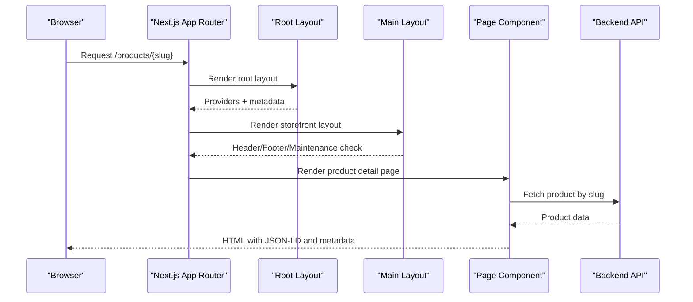

**Diagram sources**
- [app/layout.tsx:36-178](file://apps/frontend/app/layout.tsx#L36-L178)
- [app/(main)/layout.tsx:36-72](file://apps/frontend/app/(main)/layout.tsx#L36-L72)
- [app/(main)/product/[slug]/page.tsx:16-221](file://apps/frontend/app/(main)/product/[slug]/page.tsx#L16-L221)
- [app/(main)/product/[slug]/page.tsx:223-248](file://apps/frontend/app/(main)/product/[slug]/page.tsx#L223-L248)

## Detailed Component Analysis

### Root Layout and Global Providers
Responsibilities:
- Define global fonts (Quicksand and CastorTwoW01) and CSS variables.
- Generate site-wide metadata including title templates, description, keywords, Open Graph, Twitter card, icons, manifest, robots, verification, and category.
- Inject Google Tag Manager and Google Analytics.
- Wrap children with NotificationProvider, CartProvider, and SearchProvider.
- Fetch user session and cart data server-side for authenticated users.

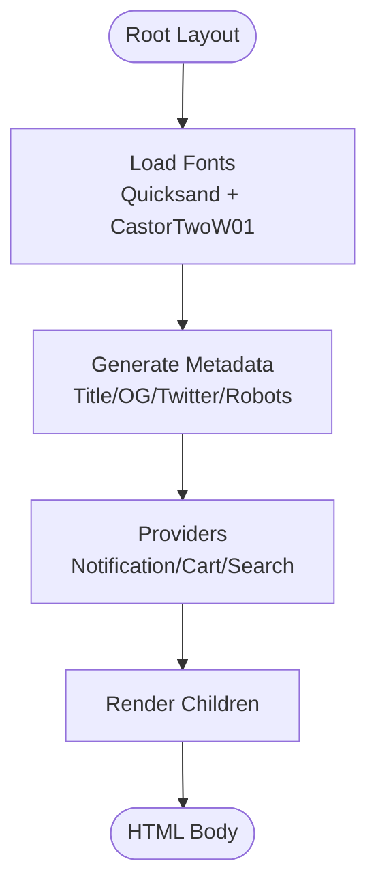

**Diagram sources**
- [app/layout.tsx:17-34](file://apps/frontend/app/layout.tsx#L17-L34)
- [app/layout.tsx:36-178](file://apps/frontend/app/layout.tsx#L36-L178)
- [app/layout.tsx:180-206](file://apps/frontend/app/layout.tsx#L180-L206)

**Section sources**
- [app/layout.tsx:17-34](file://apps/frontend/app/layout.tsx#L17-L34)
- [app/layout.tsx:36-178](file://apps/frontend/app/layout.tsx#L36-L178)
- [app/layout.tsx:180-206](file://apps/frontend/app/layout.tsx#L180-L206)

### Customer-Facing Storefront Layout
Responsibilities:
- Retrieve user session and business settings.
- Enforce maintenance mode when configured; otherwise render storefront shell.
- Provide header, footer, mobile bottom header, WhatsApp widget, GoToTop, and route loading bar.

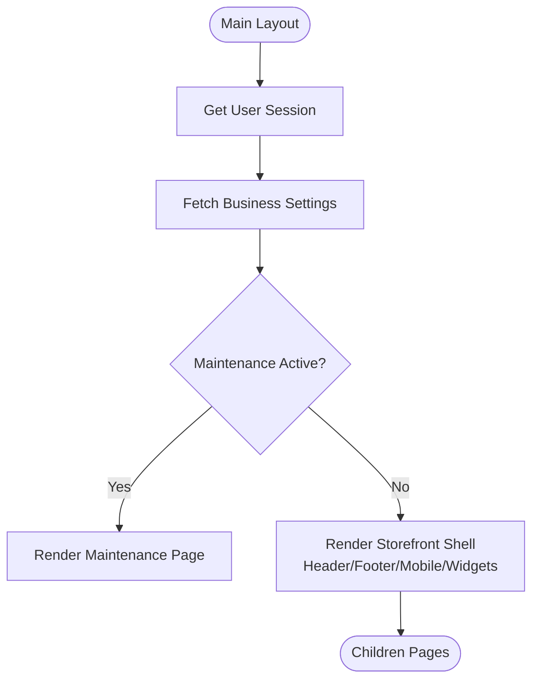

**Diagram sources**
- [app/(main)/layout.tsx:16-34](file://apps/frontend/app/(main)/layout.tsx#L16-L34)
- [app/(main)/layout.tsx:36-72](file://apps/frontend/app/(main)/layout.tsx#L36-L72)

**Section sources**
- [app/(main)/layout.tsx:16-34](file://apps/frontend/app/(main)/layout.tsx#L16-L34)
- [app/(main)/layout.tsx:36-72](file://apps/frontend/app/(main)/layout.tsx#L36-L72)

### Admin Layout and Skeletons
Responsibilities:
- Wrap admin content with Suspense and provide skeleton UI for sidebar and header while client layout initializes.
- Ensure consistent admin shell across all admin pages.

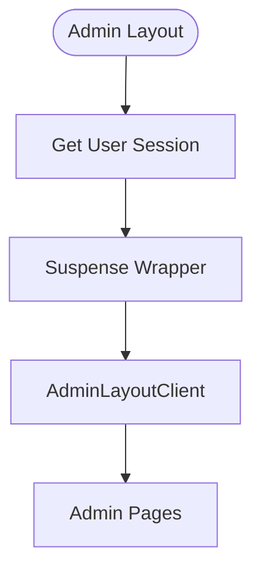

**Diagram sources**
- [app/admin/layout.tsx:7-55](file://apps/frontend/app/admin/layout.tsx#L7-L55)
- [app/admin/layout.tsx:57-71](file://apps/frontend/app/admin/layout.tsx#L57-L71)

**Section sources**
- [app/admin/layout.tsx:7-55](file://apps/frontend/app/admin/layout.tsx#L7-L55)
- [app/admin/layout.tsx:57-71](file://apps/frontend/app/admin/layout.tsx#L57-L71)

### Dynamic Routes: Product Details
Responsibilities:
- Validate slugs to prevent invalid file extensions.
- Generate rich metadata including Open Graph, Twitter card, canonical URL, and JSON-LD structured data for products.
- Fetch product data and render details or not found.

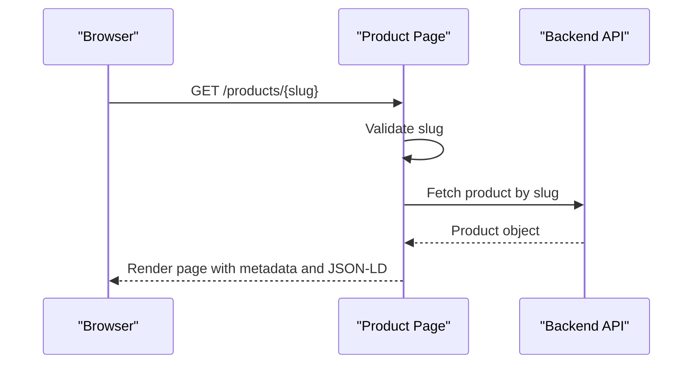

**Diagram sources**
- [app/(main)/product/[slug]/page.tsx:8-13](file://apps/frontend/app/(main)/product/[slug]/page.tsx#L8-L13)
- [app/(main)/product/[slug]/page.tsx:16-221](file://apps/frontend/app/(main)/product/[slug]/page.tsx#L16-L221)
- [app/(main)/product/[slug]/page.tsx:223-248](file://apps/frontend/app/(main)/product/[slug]/page.tsx#L223-L248)

**Section sources**
- [app/(main)/product/[slug]/page.tsx:8-13](file://apps/frontend/app/(main)/product/[slug]/page.tsx#L8-L13)
- [app/(main)/product/[slug]/page.tsx:16-221](file://apps/frontend/app/(main)/product/[slug]/page.tsx#L16-L221)
- [app/(main)/product/[slug]/page.tsx:223-248](file://apps/frontend/app/(main)/product/[slug]/page.tsx#L223-L248)

### Dynamic Routes: Order Confirmation
Responsibilities:
- Fetch protected order data and compute summary including product discounts, BOGO usage, coupon discount, shipping cost, and total.
- Determine payment method type (COD vs others), due amount, and whether to show Pay Now or Download Invoice.
- Render order status pills, items list, payment/shipping info, customer info, address, and summary.

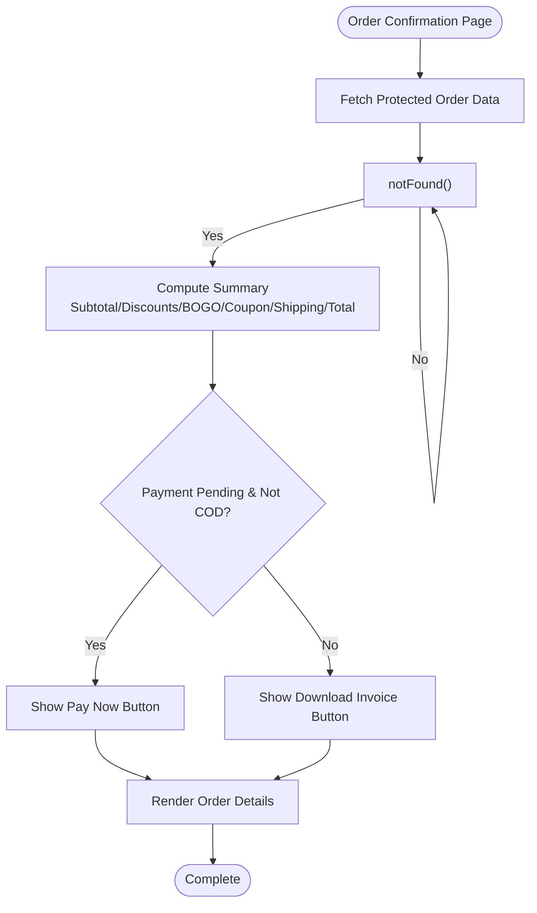

**Diagram sources**
- [app/(main)/order-confirmation/[id]/page.tsx:37-45](file://apps/frontend/app/(main)/order-confirmation/[id]/page.tsx#L37-L45)
- [app/(main)/order-confirmation/[id]/page.tsx:47-81](file://apps/frontend/app/(main)/order-confirmation/[id]/page.tsx#L47-L81)
- [app/(main)/order-confirmation/[id]/page.tsx:169-179](file://apps/frontend/app/(main)/order-confirmation/[id]/page.tsx#L169-L179)
- [app/(main)/order-confirmation/[id]/page.tsx:184-228](file://apps/frontend/app/(main)/order-confirmation/[id]/page.tsx#L184-L228)
- [app/(main)/order-confirmation/[id]/page.tsx:519-535](file://apps/frontend/app/(main)/order-confirmation/[id]/page.tsx#L519-L535)

**Section sources**
- [app/(main)/order-confirmation/[id]/page.tsx:37-45](file://apps/frontend/app/(main)/order-confirmation/[id]/page.tsx#L37-L45)
- [app/(main)/order-confirmation/[id]/page.tsx:47-81](file://apps/frontend/app/(main)/order-confirmation/[id]/page.tsx#L47-L81)
- [app/(main)/order-confirmation/[id]/page.tsx:169-179](file://apps/frontend/app/(main)/order-confirmation/[id]/page.tsx#L169-L179)
- [app/(main)/order-confirmation/[id]/page.tsx:184-228](file://apps/frontend/app/(main)/order-confirmation/[id]/page.tsx#L184-L228)
- [app/(main)/order-confirmation/[id]/page.tsx:519-535](file://apps/frontend/app/(main)/order-confirmation/[id]/page.tsx#L519-L535)

### Nested Layouts: User Account Section
Responsibilities:
- Provide profile breadcrumb and responsive sidebar navigation for user account subpages.
- Display user avatar/name and section links (Profile, Orders, Addresses, Wishlist, Reviews, Notifications, Support).
- Include floating support button on mobile.

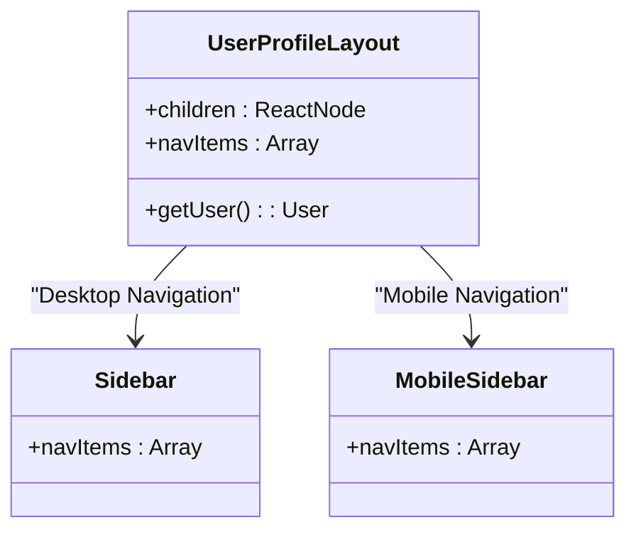

**Diagram sources**
- [app/(main)/user/(account)/[id]/layout.tsx:23-157](file://apps/frontend/app/(main)/user/(account)/[id]/layout.tsx#L23-L157)

**Section sources**
- [app/(main)/user/(account)/[id]/layout.tsx:23-157](file://apps/frontend/app/(main)/user/(account)/[id]/layout.tsx#L23-L157)

### Route Groups and Static Pages
Examples:
- Home page composes multiple sections (carousel banners, categories, featured products, flash sale, BOGO, discounted products, bestsellers, brands, sales partners, clients, testimonials, newsletter).
- Featured products page renders a product list with a specific endpoint.

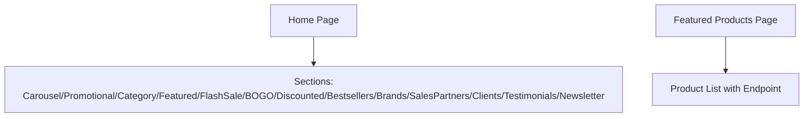

**Diagram sources**
- [app/(main)/page.tsx:29-106](file://apps/frontend/app/(main)/page.tsx#L29-L106)
- [app/(main)/products/featured/page.tsx:4-18](file://apps/frontend/app/(main)/products/featured/page.tsx#L4-L18)

**Section sources**
- [app/(main)/page.tsx:29-106](file://apps/frontend/app/(main)/page.tsx#L29-L106)
- [app/(main)/products/featured/page.tsx:4-18](file://apps/frontend/app/(main)/products/featured/page.tsx#L4-L18)

### Admin Dashboard Page
Responsibilities:
- Force dynamic rendering for real-time dashboard data.
- Aggregate reports, stock summary, and customer counts via parallel protected API calls.
- Render analytics widgets, charts, order list, stock report tabs, top customers, and top sale products.

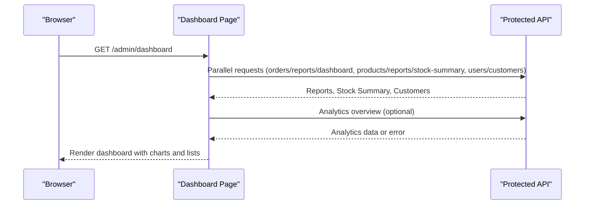

**Diagram sources**
- [app/admin/dashboard/page.tsx:1-3](file://apps/frontend/app/admin/dashboard/page.tsx#L1-L3)
- [app/admin/dashboard/page.tsx:32-45](file://apps/frontend/app/admin/dashboard/page.tsx#L32-L45)
- [app/admin/dashboard/page.tsx:70-85](file://apps/frontend/app/admin/dashboard/page.tsx#L70-L85)
- [app/admin/dashboard/page.tsx:103-118](file://apps/frontend/app/admin/dashboard/page.tsx#L103-L118)

**Section sources**
- [app/admin/dashboard/page.tsx:1-3](file://apps/frontend/app/admin/dashboard/page.tsx#L1-L3)
- [app/admin/dashboard/page.tsx:32-45](file://apps/frontend/app/admin/dashboard/page.tsx#L32-L45)
- [app/admin/dashboard/page.tsx:70-85](file://apps/frontend/app/admin/dashboard/page.tsx#L70-L85)
- [app/admin/dashboard/page.tsx:103-118](file://apps/frontend/app/admin/dashboard/page.tsx#L103-L118)

## Dependency Analysis
Routing and layout dependencies:
- Root layout depends on auth actions, providers, and utilities for metadata and analytics.
- Main layout depends on auth actions, business settings, and storefront components.
- Admin layout depends on auth actions and admin client layout component.
- Dynamic pages depend on API utilities and typed models.

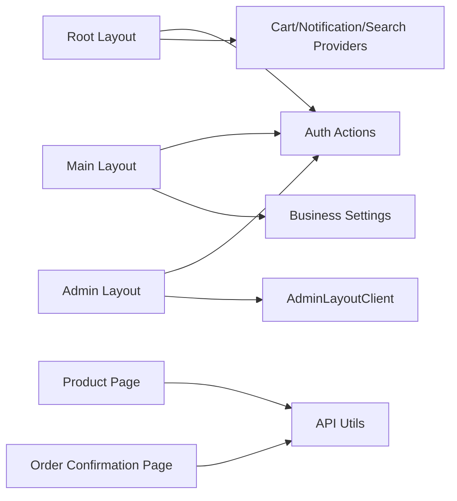

**Diagram sources**
- [app/layout.tsx:1-15](file://apps/frontend/app/layout.tsx#L1-L15)
- [app/(main)/layout.tsx:1-14](file://apps/frontend/app/(main)/layout.tsx#L1-L14)
- [app/admin/layout.tsx:1-5](file://apps/frontend/app/admin/layout.tsx#L1-L5)
- [app/(main)/product/[slug]/page.tsx:1-6](file://apps/frontend/app/(main)/product/[slug]/page.tsx#L1-L6)
- [app/(main)/order-confirmation/[id]/page.tsx:1-29](file://apps/frontend/app/(main)/order-confirmation/[id]/page.tsx#L1-L29)

**Section sources**
- [app/layout.tsx:1-15](file://apps/frontend/app/layout.tsx#L1-L15)
- [app/(main)/layout.tsx:1-14](file://apps/frontend/app/(main)/layout.tsx#L1-L14)
- [app/admin/layout.tsx:1-5](file://apps/frontend/app/admin/layout.tsx#L1-L5)
- [app/(main)/product/[slug]/page.tsx:1-6](file://apps/frontend/app/(main)/product/[slug]/page.tsx#L1-L6)
- [app/(main)/order-confirmation/[id]/page.tsx:1-29](file://apps/frontend/app/(main)/order-confirmation/[id]/page.tsx#L1-L29)

## Performance Considerations
- Image optimization:
  - SVG allowed and remote S3 origins configured for long-term caching.
  - Minimum cache TTL set to reduce upstream fetches.
  - Quality presets defined for optimized image delivery.
- Build output:
  - Standalone output for efficient deployment.
  - Transpile packages for PDF rendering and webpack externals for server-side handling.
- Rendering strategy:
  - Dashboard forces dynamic rendering to ensure fresh metrics.
  - ISR used for certain protected endpoints via revalidate options.

Recommendations:
- Keep remotePatterns minimal and secure.
- Use Suspense boundaries to stream critical UI first.
- Prefer parallel data fetching where possible to reduce latency.

**Section sources**
- [next.config.js:1-39](file://apps/frontend/next.config.js#L1-L39)
- [app/admin/dashboard/page.tsx:1-3](file://apps/frontend/app/admin/dashboard/page.tsx#L1-L3)

## Troubleshooting Guide
Common issues and resolutions:
- Invalid product slug:
  - Slugs ending with file extensions are rejected; use notFound() to return proper 404 behavior.
- Missing product data:
  - If product fetch fails or returns no id, trigger notFound().
- Order not found:
  - If order fetch returns null, trigger notFound().
- Analytics failures:
  - Optional analytics data should be wrapped in try/catch to avoid breaking dashboard rendering.

Actionable steps:
- Validate input parameters before API calls.
- Handle errors gracefully and return appropriate UI states.
- Log errors for debugging but do not expose sensitive details to the client.

**Section sources**
- [app/(main)/product/[slug]/page.tsx:8-13](file://apps/frontend/app/(main)/product/[slug]/page.tsx#L8-L13)
- [app/(main)/product/[slug]/page.tsx:223-248](file://apps/frontend/app/(main)/product/[slug]/page.tsx#L223-L248)
- [app/(main)/order-confirmation/[id]/page.tsx:37-45](file://apps/frontend/app/(main)/order-confirmation/[id]/page.tsx#L37-L45)
- [app/(main)/order-confirmation/[id]/page.tsx:169-179](file://apps/frontend/app/(main)/order-confirmation/[id]/page.tsx#L169-L179)
- [app/admin/dashboard/page.tsx:70-85](file://apps/frontend/app/admin/dashboard/page.tsx#L70-L85)

## Conclusion
The German Butcher Next.js application leverages the App Router to deliver a scalable, maintainable storefront and admin interface. The root layout centralizes global concerns, while route groups isolate customer and admin experiences. Dynamic routes handle parameterized content with robust validation and rich metadata. Configuration emphasizes performance through image optimization and standalone builds. TypeScript ensures type safety and modern module resolution. Following these patterns helps maintain clarity, performance, and reliability across the application.