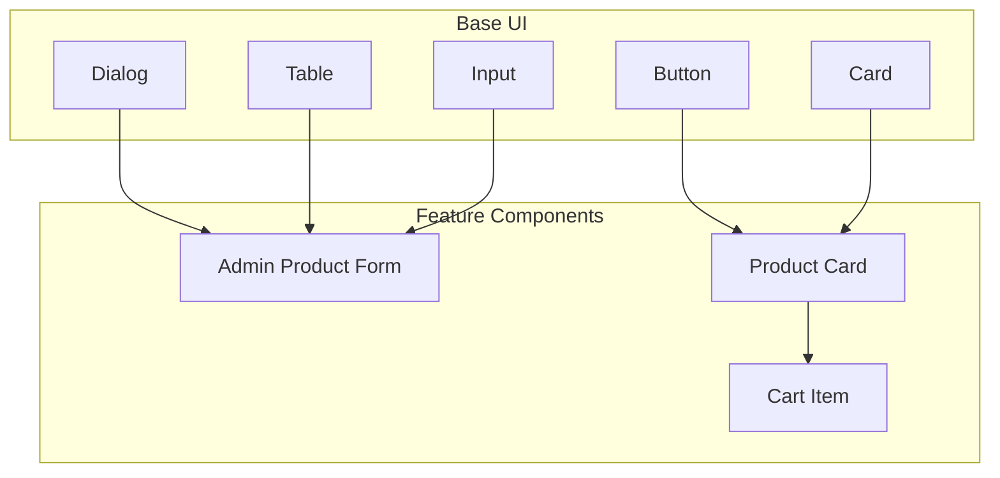
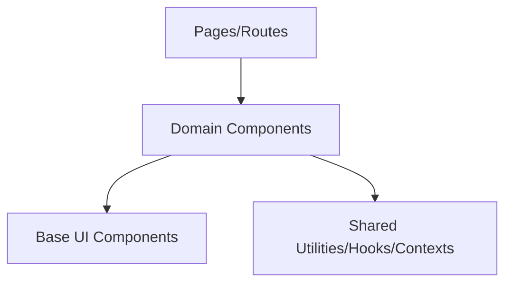
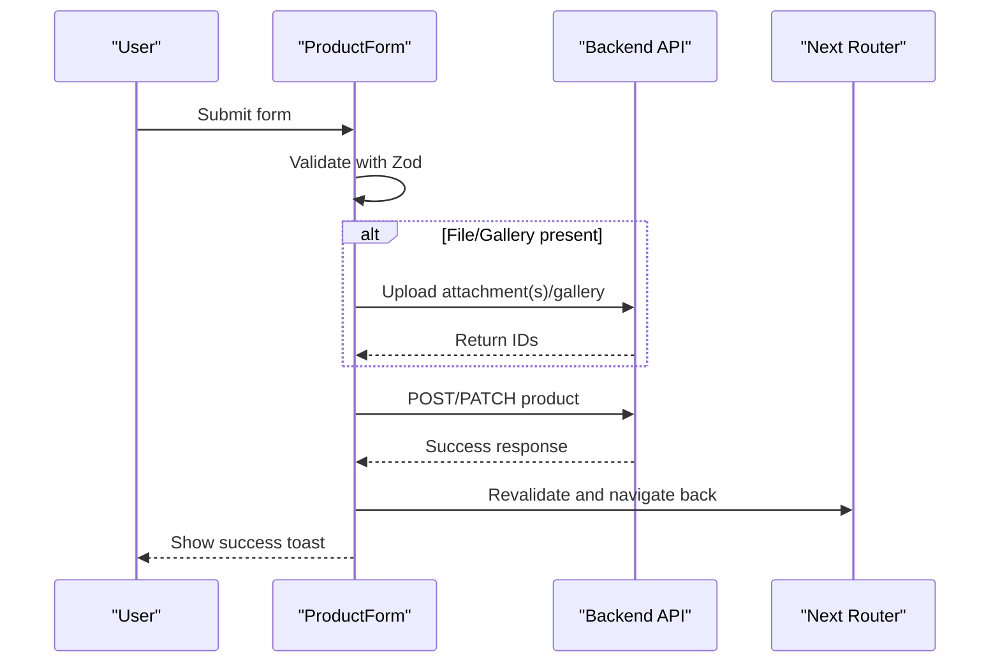
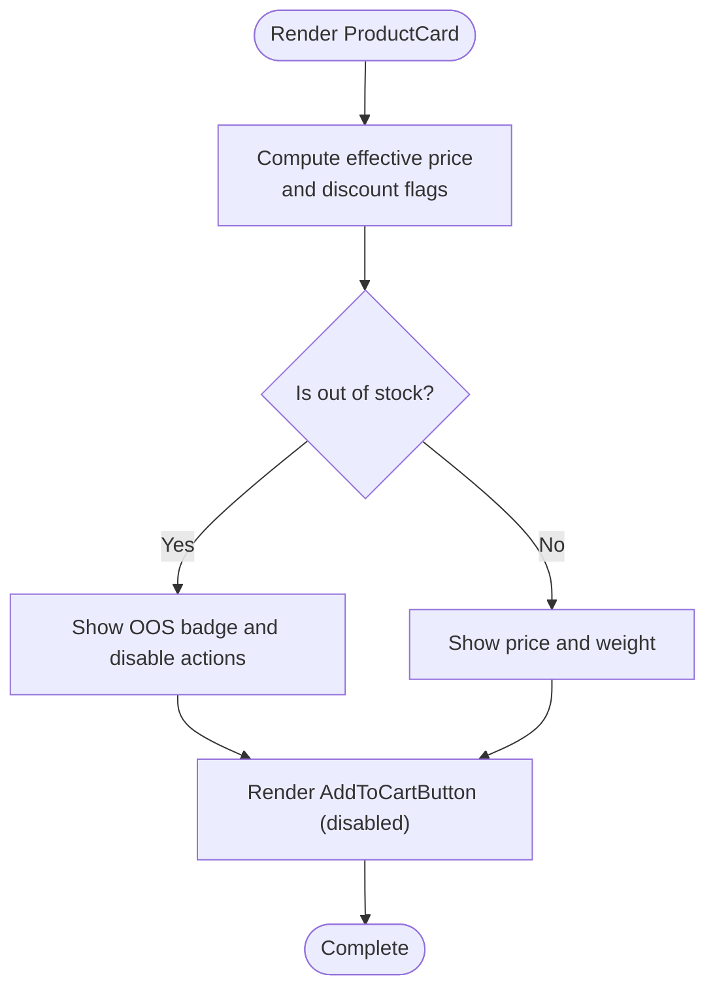
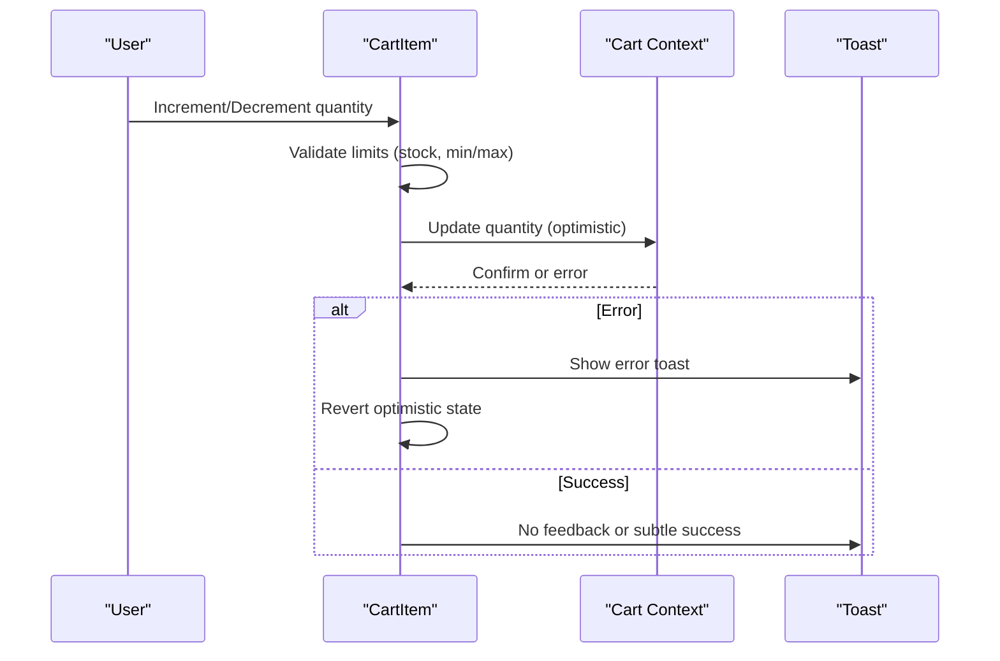
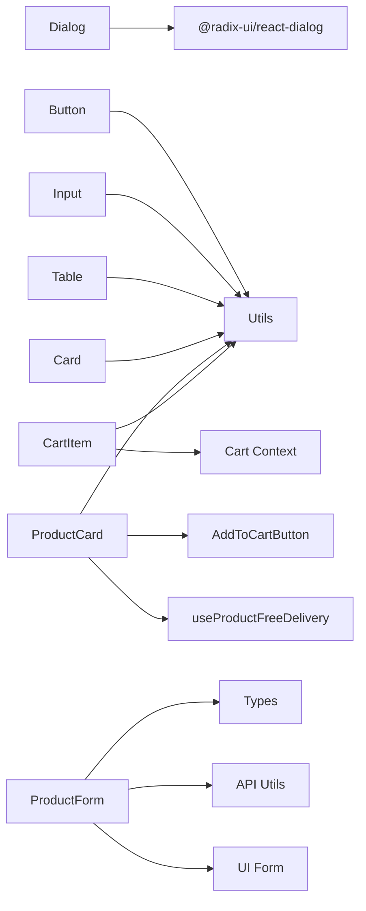

# Component System & UI Library

<cite>
**Referenced Files in This Document**
- [button.tsx](file://apps/frontend/components/ui/button.tsx)
- [input.tsx](file://apps/frontend/components/ui/input.tsx)
- [dialog.tsx](file://apps/frontend/components/ui/dialog.tsx)
- [table.tsx](file://apps/frontend/components/ui/table.tsx)
- [card.tsx](file://apps/frontend/components/ui/card.tsx)
- [product-form.tsx](file://apps/frontend/components/admin/products/product-form.tsx)
- [product-card.tsx](file://apps/frontend/components/products/product-card.tsx)
- [cart-item.tsx](file://apps/frontend/components/cart/cart-item.tsx)
</cite>

## Table of Contents
1. [Introduction](#introduction)
2. [Project Structure](#project-structure)
3. [Core Components](#core-components)
4. [Architecture Overview](#architecture-overview)
5. [Detailed Component Analysis](#detailed-component-analysis)
6. [Dependency Analysis](#dependency-analysis)
7. [Performance Considerations](#performance-considerations)
8. [Troubleshooting Guide](#troubleshooting-guide)
9. [Conclusion](#conclusion)

## Introduction
This document explains the German Butcher component system and UI library. It covers the hierarchical organization from base UI components to feature-specific components, composition patterns, prop interfaces, event handling, design system principles (Tailwind CSS, accessibility, responsive design), reusable usage examples, custom hooks integration, state management within components, testing strategies, performance optimization techniques, lifecycle considerations, error boundaries, and loading states.

## Project Structure
The frontend organizes components into a clear hierarchy:
- Base UI primitives live under components/ui/ (e.g., Button, Input, Dialog, Table, Card). These are theme-agnostic building blocks styled with Tailwind CSS and utility functions.
- Feature-specific components live under domain directories such as components/admin/, components/products/, and components/cart/. They compose base UI components and integrate business logic, data fetching, and state.

**Diagram sources**
- [button.tsx:1-63](file://apps/frontend/components/ui/button.tsx#L1-L63)
- [input.tsx:1-22](file://apps/frontend/components/ui/input.tsx#L1-L22)
- [dialog.tsx:1-136](file://apps/frontend/components/ui/dialog.tsx#L1-L136)
- [table.tsx:1-112](file://apps/frontend/components/ui/table.tsx#L1-L112)
- [card.tsx:1-97](file://apps/frontend/components/ui/card.tsx#L1-L97)
- [product-form.tsx:1-471](file://apps/frontend/components/admin/products/product-form.tsx#L1-L471)
- [product-card.tsx:1-180](file://apps/frontend/components/products/product-card.tsx#L1-L180)
- [cart-item.tsx:1-358](file://apps/frontend/components/cart/cart-item.tsx#L1-L358)

**Section sources**
- [button.tsx:1-63](file://apps/frontend/components/ui/button.tsx#L1-L63)
- [input.tsx:1-22](file://apps/frontend/components/ui/input.tsx#L1-L22)
- [dialog.tsx:1-136](file://apps/frontend/components/ui/dialog.tsx#L1-L136)
- [table.tsx:1-112](file://apps/frontend/components/ui/table.tsx#L1-L112)
- [card.tsx:1-97](file://apps/frontend/components/ui/card.tsx#L1-L97)
- [product-form.tsx:1-471](file://apps/frontend/components/admin/products/product-form.tsx#L1-L471)
- [product-card.tsx:1-180](file://apps/frontend/components/products/product-card.tsx#L1-L180)
- [cart-item.tsx:1-358](file://apps/frontend/components/cart/cart-item.tsx#L1-L358)

## Core Components
This section documents key base UI components and their responsibilities.

- Button
  - Purpose: Accessible, variant-driven button with size variants and optional slot rendering for composable links or icons.
  - Styling: Uses class-variance-authority for consistent variants and sizes; Tailwind classes define colors, focus rings, and disabled states.
  - Accessibility: Focus-visible ring styles and aria-invalid support via parent form context.
  - Composition: Supports asChild pattern to render as any element via Radix Slot.

- Input
  - Purpose: Styled native input with consistent focus, invalid, and disabled states.
  - Styling: Tailwind utilities for border, background, placeholder, selection color, and focus ring.
  - Accessibility: Inherits native semantics; supports aria-invalid for validation feedback.

- Dialog
  - Purpose: Full dialog system built on Radix primitives including overlay, portal, header/footer, title, description, and close behavior.
  - Styling: Consistent backdrop, animations, and layout using Tailwind utilities.
  - Accessibility: Proper focus trapping and keyboard navigation provided by Radix; includes sr-only close label.

- Table
  - Purpose: Semantic table structure with container, header, body, footer, rows, cells, and caption.
  - Styling: Hover states, selected row highlighting, and responsive horizontal scroll wrapper.
  - Accessibility: Semantic HTML elements ensure screen reader compatibility.

- Card
  - Purpose: Content container with header, title, description, content, action, and footer sections.
  - Styling: Grid-based header layout and consistent spacing/borders.

**Section sources**
- [button.tsx:1-63](file://apps/frontend/components/ui/button.tsx#L1-L63)
- [input.tsx:1-22](file://apps/frontend/components/ui/input.tsx#L1-L22)
- [dialog.tsx:1-136](file://apps/frontend/components/ui/dialog.tsx#L1-L136)
- [table.tsx:1-112](file://apps/frontend/components/ui/table.tsx#L1-L112)
- [card.tsx:1-97](file://apps/frontend/components/ui/card.tsx#L1-L97)

## Architecture Overview
The component architecture follows a layered approach:
- Base UI layer: Primitive components provide consistent styling, accessibility, and interaction patterns.
- Domain layer: Feature components compose base UI components and encapsulate business logic, data fetching, and state.
- Integration points: Feature components use shared utilities, hooks, and contexts for cross-cutting concerns like cart state, notifications, and formatting.

[No sources needed since this diagram shows conceptual workflow, not actual code structure]

## Detailed Component Analysis

### Admin Product Form
A comprehensive form for creating and editing products, composed of multiple sections and integrated with backend APIs.

Key aspects:
- State and Lifecycle
  - Uses React Hook Form with Zod resolver for schema validation.
  - Initializes default values from existing product data when editing.
  - Fetches units, suppliers, and gallery attachments asynchronously on mount/edit.
  - Manages file previews and object URLs with cleanup to prevent memory leaks.

- Data Flow
  - Submits either create or update payloads depending on mode.
  - Handles image and gallery uploads via FormData and updates attachment/gallery IDs.
  - Revalidates product lists after successful submission and navigates back.

- Error Handling
  - Displays toast messages for success and failure cases.
  - Validates required fields (e.g., subcategory selection) before submission.
  - Gracefully handles API errors and reverts optimistic UI changes where necessary.

- Composition
  - Composes smaller sections for basic information, identification, pricing/inventory, discount, image, gallery, and status/visibility.
  - Integrates with base UI Form and other UI primitives.

**Diagram sources**
- [product-form.tsx:91-201](file://apps/frontend/components/admin/products/product-form.tsx#L91-L201)
- [product-form.tsx:296-395](file://apps/frontend/components/admin/products/product-form.tsx#L296-L395)

**Section sources**
- [product-form.tsx:1-471](file://apps/frontend/components/admin/products/product-form.tsx#L1-L471)

### Product Card
Displays product details, badges, pricing, and add-to-cart actions.

Key aspects:
- Display Logic
  - Computes effective price and highlights price drops.
  - Shows flash sale and per-product discount badges with countdown timers.
  - Indicates out-of-stock and free delivery eligibility.

- Interaction
  - Links to product detail page.
  - Integrates AddToCartButton with stock-aware disabling.

- Performance
  - Uses lazy loading and optimized image sizing.
  - Avoids unnecessary re-renders by computing derived values locally.

**Diagram sources**
- [product-card.tsx:21-179](file://apps/frontend/components/products/product-card.tsx#L21-L179)

**Section sources**
- [product-card.tsx:1-180](file://apps/frontend/components/products/product-card.tsx#L1-L180)

### Cart Item
Manages individual cart item interactions, including quantity updates, removal, and stock/discount display.

Key aspects:
- State Management
  - Uses cart context for global cart operations and discounted price calculations.
  - Maintains local optimistic state for quantity updates and image loading.

- Validation and Feedback
  - Prevents exceeding available stock and shows informative toasts.
  - Highlights low stock, discounts, and inactive products.

- Accessibility
  - Provides meaningful labels for remove and wishlist actions.
  - Uses semantic buttons and aria attributes.

**Diagram sources**
- [cart-item.tsx:39-73](file://apps/frontend/components/cart/cart-item.tsx#L39-L73)
- [cart-item.tsx:87-101](file://apps/frontend/components/cart/cart-item.tsx#L87-L101)

**Section sources**
- [cart-item.tsx:1-358](file://apps/frontend/components/cart/cart-item.tsx#L1-L358)

## Dependency Analysis
- Base UI components depend on:
  - Tailwind CSS utilities and cn helper for className composition.
  - Radix primitives for accessible dialogs and slots.
  - Class-variance-authority for variant systems.

- Feature components depend on:
  - Shared utilities (formatting, product helpers, image fallback).
  - Custom hooks (e.g., free delivery eligibility).
  - Contexts (e.g., cart context) for cross-component state.
  - Next.js router and image/link components.

**Diagram sources**
- [button.tsx:1-63](file://apps/frontend/components/ui/button.tsx#L1-L63)
- [input.tsx:1-22](file://apps/frontend/components/ui/input.tsx#L1-L22)
- [dialog.tsx:1-136](file://apps/frontend/components/ui/dialog.tsx#L1-L136)
- [table.tsx:1-112](file://apps/frontend/components/ui/table.tsx#L1-L112)
- [card.tsx:1-97](file://apps/frontend/components/ui/card.tsx#L1-L97)
- [product-form.tsx:1-471](file://apps/frontend/components/admin/products/product-form.tsx#L1-L471)
- [product-card.tsx:1-180](file://apps/frontend/components/products/product-card.tsx#L1-L180)
- [cart-item.tsx:1-358](file://apps/frontend/components/cart/cart-item.tsx#L1-L358)

**Section sources**
- [button.tsx:1-63](file://apps/frontend/components/ui/button.tsx#L1-L63)
- [input.tsx:1-22](file://apps/frontend/components/ui/input.tsx#L1-L22)
- [dialog.tsx:1-136](file://apps/frontend/components/ui/dialog.tsx#L1-L136)
- [table.tsx:1-112](file://apps/frontend/components/ui/table.tsx#L1-L112)
- [card.tsx:1-97](file://apps/frontend/components/ui/card.tsx#L1-L97)
- [product-form.tsx:1-471](file://apps/frontend/components/admin/products/product-form.tsx#L1-L471)
- [product-card.tsx:1-180](file://apps/frontend/components/products/product-card.tsx#L1-L180)
- [cart-item.tsx:1-358](file://apps/frontend/components/cart/cart-item.tsx#L1-L358)

## Performance Considerations
- Image Optimization
  - Use next/image with fill and appropriate sizes to reduce payload and improve LCP.
  - Lazy load images below the fold and show skeletons while loading.

- Rendering Efficiency
  - Memoize expensive computations and avoid unnecessary re-renders in list components.
  - Prefer client-side state for transient UI (e.g., optimistic updates) and revert on error.

- Network Requests
  - Batch independent requests using Promise.all to reduce latency.
  - Debounce search inputs and throttle frequent events.

- Memory Management
  - Revoke object URLs for uploaded files to prevent memory leaks.
  - Clean up event listeners and subscriptions in useEffect teardown.

- Accessibility and UX
  - Provide focus-visible styles and aria attributes for better keyboard navigation.
  - Use skeleton loaders and spinners to indicate loading states without blocking interaction.

[No sources needed since this section provides general guidance]

## Troubleshooting Guide
Common issues and resolutions:
- Form Submission Errors
  - Ensure all required fields are validated before submission.
  - Handle API errors gracefully and display user-friendly toasts.
  - Revalidate dependent data (e.g., subcategories) when parent selections change.

- Image Uploads
  - Verify file types and sizes before upload.
  - Revoke object URLs to avoid memory leaks.
  - Sync server-provided gallery attachments with local previews.

- Cart Interactions
  - Validate stock availability before updating quantities.
  - Revert optimistic updates on network failures.
  - Provide clear feedback for insufficient stock and inactive products.

- Dialog and Modal Behavior
  - Ensure proper focus management and escape key handling via Radix primitives.
  - Avoid nested portals that can cause stacking issues.

**Section sources**
- [product-form.tsx:190-197](file://apps/frontend/components/admin/products/product-form.tsx#L190-L197)
- [product-form.tsx:273-294](file://apps/frontend/components/admin/products/product-form.tsx#L273-L294)
- [product-form.tsx:296-395](file://apps/frontend/components/admin/products/product-form.tsx#L296-L395)
- [cart-item.tsx:39-73](file://apps/frontend/components/cart/cart-item.tsx#L39-L73)
- [cart-item.tsx:87-101](file://apps/frontend/components/cart/cart-item.tsx#L87-L101)

## Conclusion
The German Butcher component system combines a robust base UI layer with feature-rich domain components. The design emphasizes consistency through Tailwind CSS, accessibility via Radix primitives, and responsive layouts. Feature components demonstrate strong composition patterns, careful state management, and thoughtful error and loading state handling. Following the outlined best practices ensures maintainability, performance, and a high-quality user experience across the application.

[No sources needed since this section summarizes without analyzing specific files]