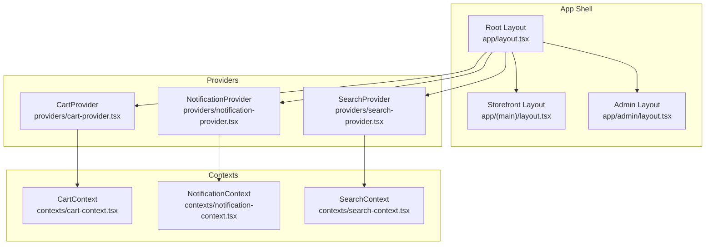
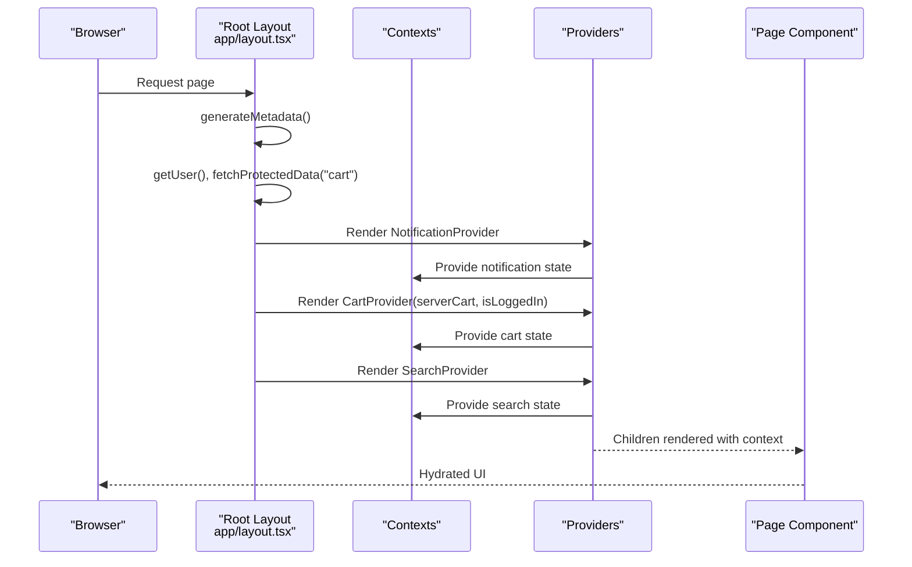
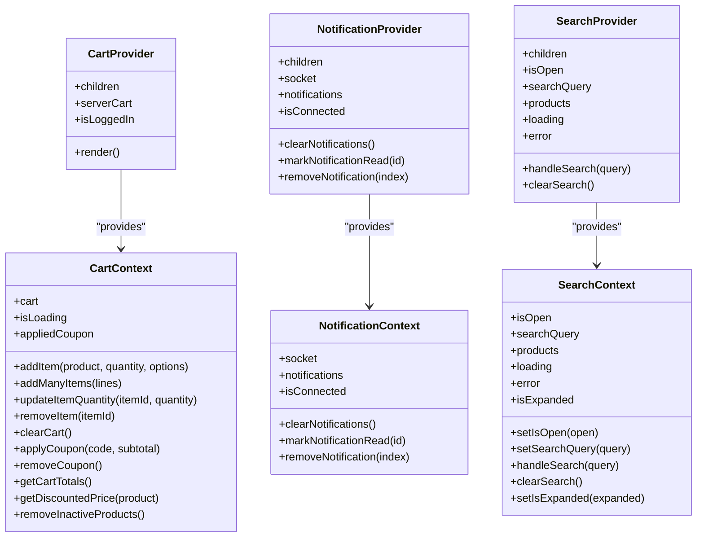
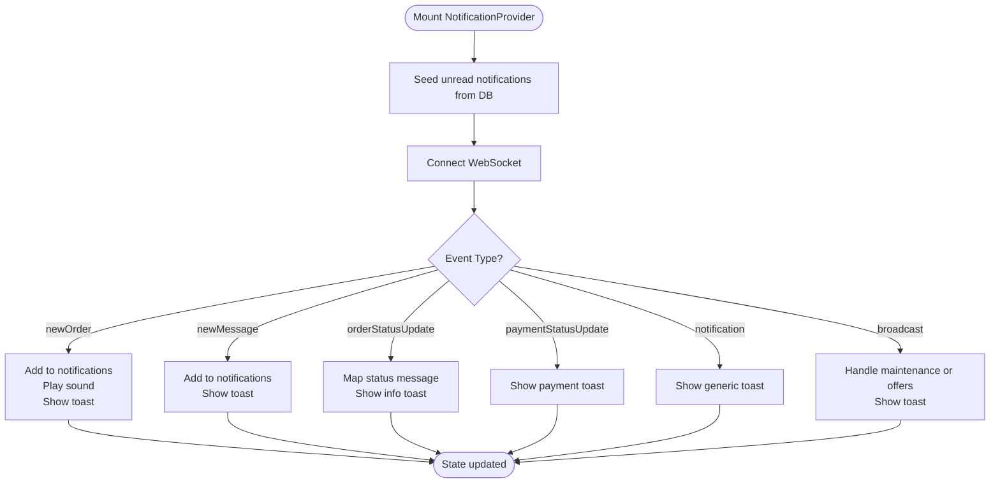
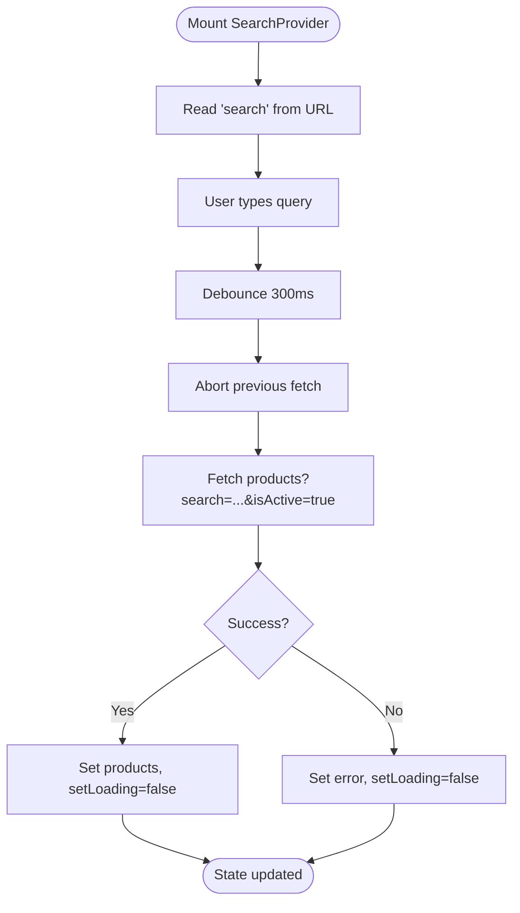
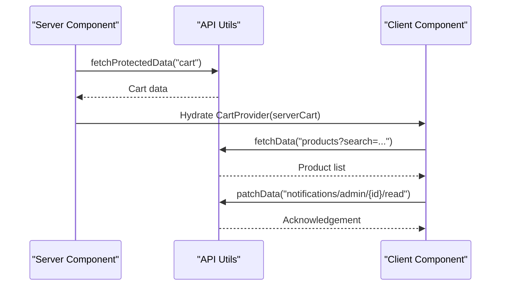
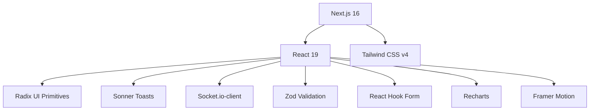
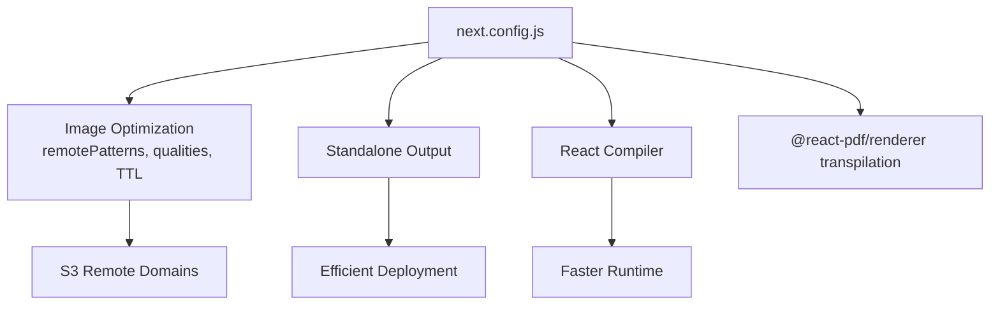

# Frontend Application

<cite>
**Referenced Files in This Document**
- [package.json](file://apps/frontend/package.json)
- [next.config.js](file://apps/frontend/next.config.js)
- [app/layout.tsx](file://apps/frontend/app/layout.tsx)
- [app/(main)/layout.tsx](file://apps/frontend/app/(main)/layout.tsx)
- [app/admin/layout.tsx](file://apps/frontend/app/admin/layout.tsx)
- [providers/cart-provider.tsx](file://apps/frontend/providers/cart-provider.tsx)
- [providers/notification-provider.tsx](file://apps/frontend/providers/notification-provider.tsx)
- [providers/search-provider.tsx](file://apps/frontend/providers/search-provider.tsx)
- [contexts/cart-context.tsx](file://apps/frontend/contexts/cart-context.tsx)
- [contexts/notification-context.tsx](file://apps/frontend/contexts/notification-context.tsx)
- [contexts/search-context.tsx](file://apps/frontend/contexts/search-context.tsx)
</cite>

## Table of Contents
1. [Introduction](#introduction)
2. [Project Structure](#project-structure)
3. [Core Components](#core-components)
4. [Architecture Overview](#architecture-overview)
5. [Detailed Component Analysis](#detailed-component-analysis)
6. [Dependency Analysis](#dependency-analysis)
7. [Performance Considerations](#performance-considerations)
8. [Troubleshooting Guide](#troubleshooting-guide)
9. [Conclusion](#conclusion)

## Introduction
This document describes the German Butcher Next.js frontend application, focusing on its modern React architecture built with Next.js 16 App Router. It explains the component-based design using reusable UI components, global state management via providers and contexts, and the hook system for shared logic. The documentation covers customer-facing routes under app/(main)/, admin dashboard routes under app/admin/, styling with Tailwind CSS v4, responsive patterns, accessibility considerations, data fetching strategies (server and client), and performance optimizations such as code splitting, image optimization, and caching.

## Project Structure
The frontend is organized around the Next.js App Router:
- Root layout at app/layout.tsx sets up global providers, fonts, metadata, analytics, and toasts.
- Customer storefront layout at app/(main)/layout.tsx composes Header, Footer, mobile bottom header, WhatsApp widget, maintenance mode, and route loading bar.
- Admin layout at app/admin/layout.tsx wraps admin pages with a client-side layout component and skeleton fallbacks.
- Reusable UI primitives live under components/ui/.
- Feature-specific components are grouped by domain (cart, checkout, products, homepage, etc.).
- Global state is provided through providers in providers/ and exposed via contexts in contexts/.
- Shared logic is encapsulated in hooks/ and utilities in utils/.

**Diagram sources**
- [app/layout.tsx:180-206](file://apps/frontend/app/layout.tsx#L180-L206)
- [app/(main)/layout.tsx:36-72](file://apps/frontend/app/(main)/layout.tsx#L36-L72)
- [app/admin/layout.tsx:57-71](file://apps/frontend/app/admin/layout.tsx#L57-L71)
- [providers/cart-provider.tsx:14-31](file://apps/frontend/providers/cart-provider.tsx#L14-L31)
- [providers/notification-provider.tsx:23-287](file://apps/frontend/providers/notification-provider.tsx#L23-L287)
- [providers/search-provider.tsx:8-135](file://apps/frontend/providers/search-provider.tsx#L8-L135)
- [contexts/cart-context.tsx:7-48](file://apps/frontend/contexts/cart-context.tsx#L7-L48)
- [contexts/notification-context.tsx:1-7](file://apps/frontend/contexts/notification-context.tsx#L1-L7)
- [contexts/search-context.tsx:4-20](file://apps/frontend/contexts/search-context.tsx#L4-L20)

**Section sources**
- [app/layout.tsx:1-210](file://apps/frontend/app/layout.tsx#L1-L210)
- [app/(main)/layout.tsx:1-73](file://apps/frontend/app/(main)/layout.tsx#L1-L73)
- [app/admin/layout.tsx:1-72](file://apps/frontend/app/admin/layout.tsx#L1-L72)

## Core Components
- Root layout provides global metadata, fonts, analytics, toast container, and wraps all children with NotificationProvider, CartProvider, and SearchProvider. It also hydrates cart data server-side when a user is authenticated.
- Storefront layout composes site-wide UI (Header, Footer, MobileBottomHeader, WhatsAppMessengerWidget, GoToTop, MaintenancePage) and fetches business settings to enable maintenance mode.
- Admin layout renders a Suspense boundary around AdminLayoutClient and shows skeleton placeholders while the client layout initializes.

Key responsibilities:
- Global provider composition and hydration
- Route-level layout composition
- Maintenance gating for the storefront
- Admin shell scaffolding with skeletons

**Section sources**
- [app/layout.tsx:36-178](file://apps/frontend/app/layout.tsx#L36-L178)
- [app/layout.tsx:180-206](file://apps/frontend/app/layout.tsx#L180-L206)
- [app/(main)/layout.tsx:16-72](file://apps/frontend/app/(main)/layout.tsx#L16-L72)
- [app/admin/layout.tsx:7-71](file://apps/frontend/app/admin/layout.tsx#L7-L71)

## Architecture Overview
The application follows a layered architecture:
- Presentation layer: Pages and layouts under app/(main)/ and app/admin/ compose feature components.
- State layer: Contexts define contracts; Providers implement state and side effects.
- Logic layer: Hooks encapsulate reusable behaviors (cart operations, notifications, search).
- Data layer: Server components fetch data; client components handle interactivity and real-time updates.

**Diagram sources**
- [app/layout.tsx:180-206](file://apps/frontend/app/layout.tsx#L180-L206)
- [providers/notification-provider.tsx:23-287](file://apps/frontend/providers/notification-provider.tsx#L23-L287)
- [providers/cart-provider.tsx:14-31](file://apps/frontend/providers/cart-provider.tsx#L14-L31)
- [providers/search-provider.tsx:8-135](file://apps/frontend/providers/search-provider.tsx#L8-L135)

## Detailed Component Analysis

### Provider Pattern and Global State Management
The application uses three primary providers:
- CartProvider: Initializes cart state from server data and exposes cart operations via CartContext.
- NotificationProvider: Manages WebSocket connections, persists unread notifications, and exposes notification actions via NotificationContext.
- SearchProvider: Handles debounced product search, URL synchronization, and exposes search state via SearchContext.

**Diagram sources**
- [providers/cart-provider.tsx:14-31](file://apps/frontend/providers/cart-provider.tsx#L14-L31)
- [providers/notification-provider.tsx:23-287](file://apps/frontend/providers/notification-provider.tsx#L23-L287)
- [providers/search-provider.tsx:8-135](file://apps/frontend/providers/search-provider.tsx#L8-L135)
- [contexts/cart-context.tsx:7-48](file://apps/frontend/contexts/cart-context.tsx#L7-L48)
- [contexts/notification-context.tsx:1-7](file://apps/frontend/contexts/notification-context.tsx#L1-L7)
- [contexts/search-context.tsx:4-20](file://apps/frontend/contexts/search-context.tsx#L4-L20)

#### CartProvider and CartContext
- Responsibilities:
  - Initialize cart from server data when authenticated.
  - Expose cart mutation methods and computed totals.
  - Ensure a consistent shape for cart items across local and server carts.
- Usage pattern:
  - Wrap application with CartProvider in root layout.
  - Consume via useCartContext in components.

**Section sources**
- [providers/cart-provider.tsx:1-32](file://apps/frontend/providers/cart-provider.tsx#L1-L32)
- [contexts/cart-context.tsx:1-49](file://apps/frontend/contexts/cart-context.tsx#L1-L49)

#### NotificationProvider and NotificationContext
- Responsibilities:
  - Establish WebSocket connection for real-time events.
  - Seed unread notifications from persisted DB rows.
  - Handle new orders, messages, order status changes, payment updates, broadcasts, and general notifications.
  - Mark notifications read and clear them.
- Real-time flow:
  - On connect, seed unread notifications.
  - Listen to event channels and update local state.
  - Show toast notifications based on event type.

**Diagram sources**
- [providers/notification-provider.tsx:37-79](file://apps/frontend/providers/notification-provider.tsx#L37-L79)
- [providers/notification-provider.tsx:91-248](file://apps/frontend/providers/notification-provider.tsx#L91-L248)

**Section sources**
- [providers/notification-provider.tsx:1-292](file://apps/frontend/providers/notification-provider.tsx#L1-L292)
- [contexts/notification-context.tsx:1-7](file://apps/frontend/contexts/notification-context.tsx#L1-L7)

#### SearchProvider and SearchContext
- Responsibilities:
  - Manage modal open state, query, results, loading, and error states.
  - Debounce search input and abort previous requests.
  - Sync search query with URL parameters.
- Flow:
  - Initialize query from URL on mount.
  - Debounce fetch products endpoint.
  - Update results and errors accordingly.

**Diagram sources**
- [providers/search-provider.tsx:20-87](file://apps/frontend/providers/search-provider.tsx#L20-L87)

**Section sources**
- [providers/search-provider.tsx:1-136](file://apps/frontend/providers/search-provider.tsx#L1-L136)
- [contexts/search-context.tsx:1-21](file://apps/frontend/contexts/search-context.tsx#L1-L21)

### Hook System for Reusable Logic
- use-cart: Encapsulates cart operations and persistence, consumed by CartProvider.
- use-notification: Provides access to notification context and helpers.
- use-global-search: Integrates with SearchProvider for global search interactions.
- use-business-settings: Retrieves business settings for storefront behavior.
- use-debounce, use-media-query, use-mobile: Utility hooks for UI interactions and responsiveness.
- use-pagination: Pagination helper for list views.
- use-bogo, use-free-delivery, use-product-free-delivery: Business rule hooks for promotions and shipping.

These hooks centralize logic, reduce duplication, and make features easier to test and maintain.

**Section sources**
- [hooks/use-cart.ts](file://apps/frontend/hooks/use-cart.ts)
- [hooks/use-notification.ts](file://apps/frontend/hooks/use-notification.ts)
- [hooks/use-global-search.tsx](file://apps/frontend/hooks/use-global-search.tsx)
- [hooks/use-business-settings.ts](file://apps/frontend/hooks/use-business-settings.ts)
- [hooks/use-debounce.ts](file://apps/frontend/hooks/use-debounce.ts)
- [hooks/use-media-query.ts](file://apps/frontend/hooks/use-media-query.ts)
- [hooks/use-mobile.ts](file://apps/frontend/hooks/use-mobile.ts)
- [hooks/use-pagination.ts](file://apps/frontend/hooks/use-pagination.ts)
- [hooks/use-bogo.ts](file://apps/frontend/hooks/use-bogo.ts)
- [hooks/use-free-delivery.ts](file://apps/frontend/hooks/use-free-delivery.ts)
- [hooks/use-product-free-delivery.ts](file://apps/frontend/hooks/use-product-free-delivery.ts)

### Styling Approach and Accessibility
- Tailwind CSS v4 is used for utility-first styling with animations via tailwindcss-animate.
- Responsive design patterns leverage Tailwind breakpoints and media queries via hooks like use-media-query and use-mobile.
- Accessibility:
  - Semantic HTML elements in layouts and components.
  - ARIA attributes where necessary (e.g., dialogs, menus).
  - Keyboard navigation support for interactive components.
  - Color contrast and focus indicators managed through theme tokens and Radix UI primitives.

[No sources needed since this section provides general guidance]

### Routing Patterns and Page Structure
- Customer-facing routes under app/(main)/ include:
  - Home, About Us, Certification, Clients, Contact Us, How to Order, Where to Buy.
  - Product catalog and detail pages under products and product/[slug].
  - Recipes under recipes and recipe/[id].
  - Cart and Checkout flows under cart and checkout.
  - User account routes under user/(account)/[id].
  - Payment handling under payment.
- Admin dashboard routes under app/admin/:
  - Dashboard, Orders, Products, Categories, Brands, Banners, CRM, Marketing, Reports, Settings, Users, Sales Points, Testimonials, Reviews, Analytics, Audit Log, Inbox, Delivery Man, Procurement, Statistics.

Each route typically composes feature components and leverages server components for data fetching and client components for interactivity.

**Section sources**
- [app/(main)/layout.tsx:36-72](file://apps/frontend/app/(main)/layout.tsx#L36-L72)
- [app/admin/layout.tsx:57-71](file://apps/frontend/app/admin/layout.tsx#L57-L71)

### Data Fetching Strategies
- Server components:
  - Root layout fetches user and cart data server-side to hydrate providers.
  - Storefront layout fetches business settings to gate maintenance mode.
- Client components:
  - SearchProvider performs debounced API calls to fetch products.
  - NotificationProvider manages WebSocket events and marks notifications read via API calls.
- Utilities:
  - fetchData/fetchPublicData/fetchProtectedData abstract API calls and error handling.

**Diagram sources**
- [app/layout.tsx:180-206](file://apps/frontend/app/layout.tsx#L180-L206)
- [providers/search-provider.tsx:46-77](file://apps/frontend/providers/search-provider.tsx#L46-L77)
- [providers/notification-provider.tsx:250-268](file://apps/frontend/providers/notification-provider.tsx#L250-L268)

**Section sources**
- [app/layout.tsx:180-206](file://apps/frontend/app/layout.tsx#L180-L206)
- [app/(main)/layout.tsx:41-53](file://apps/frontend/app/(main)/layout.tsx#L41-L53)
- [providers/search-provider.tsx:46-77](file://apps/frontend/providers/search-provider.tsx#L46-L77)
- [providers/notification-provider.tsx:250-268](file://apps/frontend/providers/notification-provider.tsx#L250-L268)

## Dependency Analysis
The frontend depends on:
- Next.js 16 for routing, server components, and build tooling.
- React 19 for UI rendering.
- Tailwind CSS v4 for styling.
- Radix UI primitives for accessible base components.
- Sonner for toast notifications.
- Socket.io-client for real-time notifications.
- Zod for schema validation.
- React Hook Form for form handling.
- Recharts for charts in admin dashboards.
- Framer Motion for animations.

**Diagram sources**
- [package.json:11-70](file://apps/frontend/package.json#L11-L70)

**Section sources**
- [package.json:1-88](file://apps/frontend/package.json#L1-L88)

## Performance Considerations
- Image Optimization:
  - next.config.js configures remote image domains, qualities, cache TTL, and security policies.
  - SVGs allowed with strict CSP for images.
- Code Splitting:
  - Next.js automatically splits code per route and component boundaries.
  - Use client components only where interactivity is required.
- Caching Strategies:
  - ISR for public endpoints via fetch wrappers.
  - Long-term caching for S3 images via minimumCacheTTL.
- Build Optimizations:
  - React Compiler enabled.
  - Standalone output for deployment efficiency.
  - Webpack externals for heavy libraries like @react-pdf/renderer.

**Diagram sources**
- [next.config.js:1-39](file://apps/frontend/next.config.js#L1-L39)

**Section sources**
- [next.config.js:1-39](file://apps/frontend/next.config.js#L1-L39)

## Troubleshooting Guide
- WebSocket Connection Issues:
  - Verify NEXT_PUBLIC_SOCKET_URL environment variable.
  - Check reconnection settings and credentials.
  - Inspect console for connect_error events.
- Notifications Not Seeding:
  - Ensure user is admin and has permission to fetch notifications.
  - Validate API response structure matches PersistedNotification.
- Search Results Stale:
  - Confirm debounce timing and abort controller usage.
  - Clear URL search params if needed.
- Cart Hydration Mismatch:
  - Ensure serverCart is passed correctly to CartProvider.
  - Validate isLoggedIn flag affects protected data fetching.

**Section sources**
- [providers/notification-provider.tsx:91-131](file://apps/frontend/providers/notification-provider.tsx#L91-L131)
- [providers/notification-provider.tsx:37-79](file://apps/frontend/providers/notification-provider.tsx#L37-L79)
- [providers/search-provider.tsx:32-87](file://apps/frontend/providers/search-provider.tsx#L32-L87)
- [providers/cart-provider.tsx:14-31](file://apps/frontend/providers/cart-provider.tsx#L14-L31)

## Conclusion
The German Butcher frontend leverages Next.js 16 App Router to deliver a scalable, maintainable, and performant e-commerce experience. The provider-context pattern centralizes global state for cart, notifications, and search, while hooks encapsulate reusable logic. The architecture separates server-side data fetching from client-side interactivity, enabling efficient rendering and real-time updates. With Tailwind CSS v4, responsive design, and accessibility best practices, the application ensures a high-quality user experience across devices. Performance optimizations including image optimization, code splitting, and caching further enhance speed and reliability.