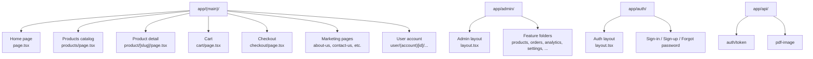
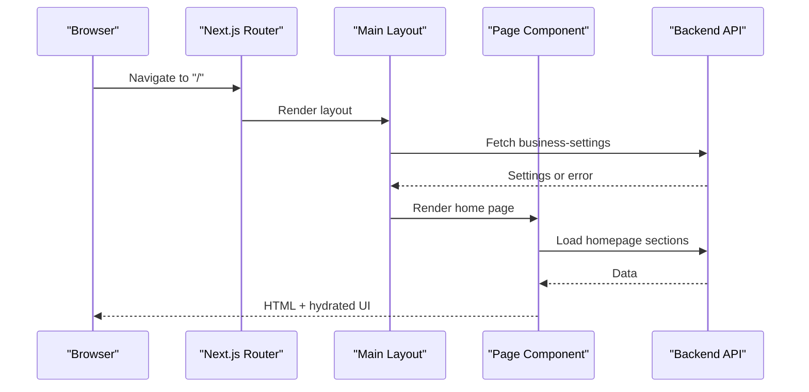
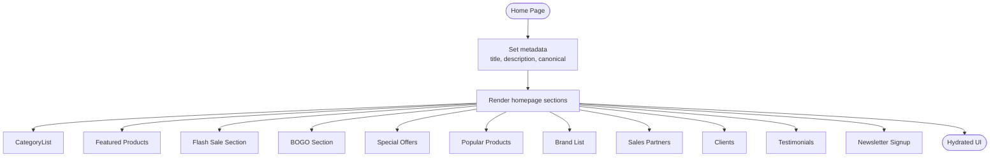
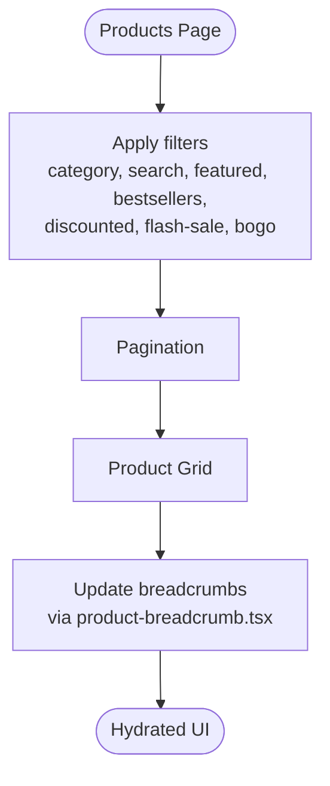
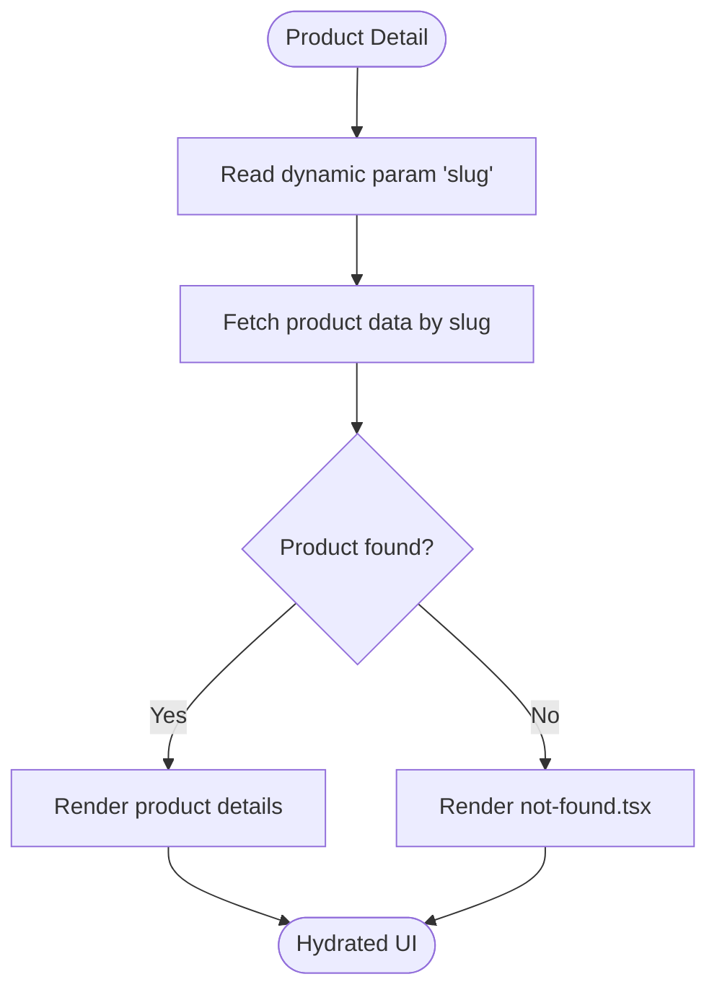
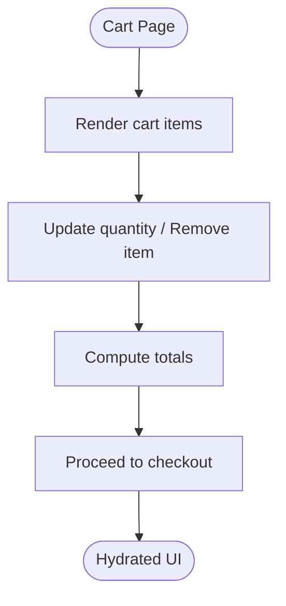
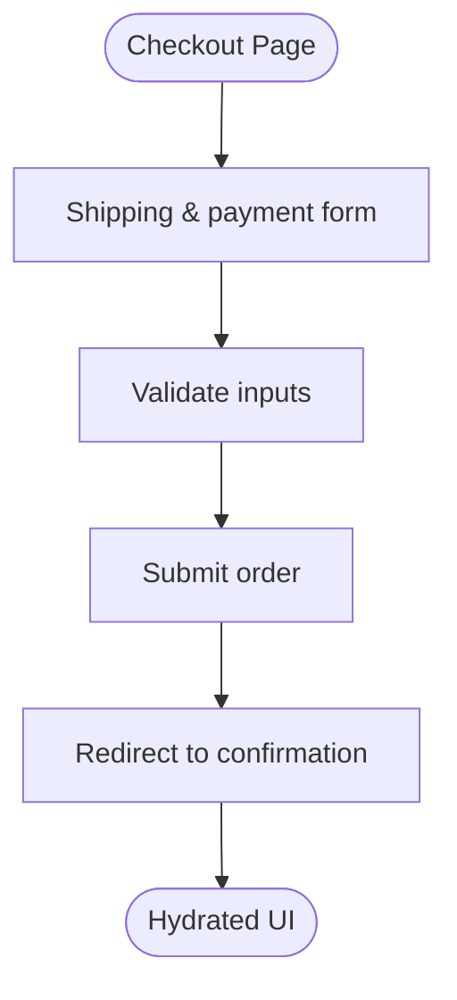
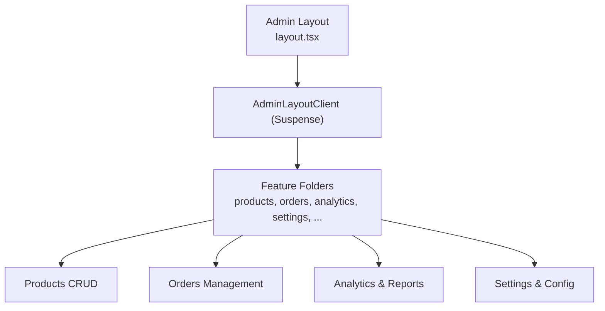
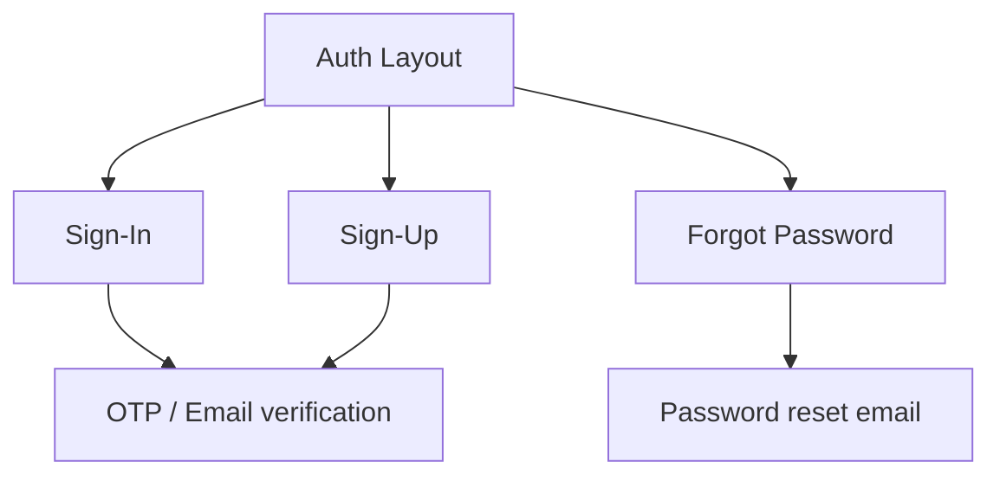
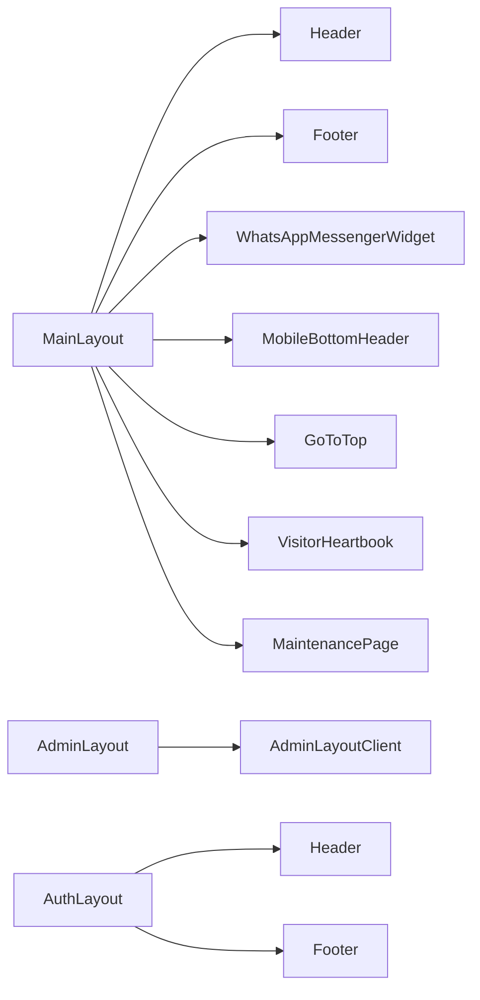

# Pages & Routing System

<cite>
**Referenced Files in This Document**
- [layout.tsx](file://apps/frontend/app/(main)/layout.tsx)
- [page.tsx](file://apps/frontend/app/(main)/page.tsx)
- [layout.tsx](file://apps/frontend/app/admin/layout.tsx)
- [layout.tsx](file://apps/frontend/app/auth/layout.tsx)
- [page.tsx](file://apps/frontend/app/(main)/products/page.tsx)
- [product-breadcrumb.tsx](file://apps/frontend/app/(main)/products/product-breadcrumb.tsx)
- [page.tsx](file://apps/frontend/app/(main)/product/[slug]/page.tsx)
- [not-found.tsx](file://apps/frontend/app/(main)/product/[slug]/not-found.tsx)
- [page.tsx](file://apps/frontend/app/(main)/cart/page.tsx)
- [page.tsx](file://apps/frontend/app/(main)/checkout/page.tsx)
</cite>

## Table of Contents
1. [Introduction](#introduction)
2. [Project Structure](#project-structure)
3. [Core Components](#core-components)
4. [Architecture Overview](#architecture-overview)
5. [Detailed Component Analysis](#detailed-component-analysis)
6. [Dependency Analysis](#dependency-analysis)
7. [Performance Considerations](#performance-considerations)
8. [Troubleshooting Guide](#troubleshooting-guide)
9. [Conclusion](#conclusion)

## Introduction
This document explains the German Butcher Next.js App Router pages and routing system across four major route groups:
- Customer-facing routes under app/(main)/
- Admin dashboard routes under app/admin/
- Authentication routes under app/auth/
- API routes under app/api/

It covers navigation patterns, breadcrumbs, SEO metadata, route protection, dynamic parameters, nested layouts, and code-splitting strategies used throughout the application.

## Project Structure
The frontend uses Next.js App Router with grouped routes for clear separation of concerns:
- app/(main)/: Public storefront (home, products, cart, checkout, marketing pages, user account subroutes)
- app/admin/: Admin dashboard with feature-based folders (products, orders, analytics, settings, etc.)
- app/auth/: Authentication flows (sign-in, sign-up, forgot password)
- app/api/: Server-side endpoints exposed to the client

**Diagram sources**
- [layout.tsx](file://apps/frontend/app/(main)/layout.tsx)
- [page.tsx](file://apps/frontend/app/(main)/page.tsx)
- [layout.tsx](file://apps/frontend/app/admin/layout.tsx)
- [layout.tsx](file://apps/frontend/app/auth/layout.tsx)

**Section sources**
- [layout.tsx](file://apps/frontend/app/(main)/layout.tsx)
- [page.tsx](file://apps/frontend/app/(main)/page.tsx)
- [layout.tsx](file://apps/frontend/app/admin/layout.tsx)
- [layout.tsx](file://apps/frontend/app/auth/layout.tsx)

## Core Components
- Main storefront layout: Provides global header/footer, maintenance mode takeover, visitor heartbeat, top progress bar, and mobile bottom header. It fetches business settings per request and can render a MaintenancePage when maintenance is active.
- Admin layout: Wraps admin routes with a client-side layout component inside Suspense, providing skeleton UI during loading.
- Auth layout: Wraps authentication pages with shared header/footer and copyright.

Key responsibilities:
- Route-level layout composition
- Global UI chrome injection
- Maintenance gating for public routes
- User context availability via getUser()

**Section sources**
- [layout.tsx](file://apps/frontend/app/(main)/layout.tsx)
- [layout.tsx](file://apps/frontend/app/admin/layout.tsx)
- [layout.tsx](file://apps/frontend/app/auth/layout.tsx)

## Architecture Overview
The routing architecture follows Next.js conventions:
- Grouped routes (parentheses) isolate layout and behavior without affecting URL paths
- Dynamic segments ([slug], [id]) enable parameterized routes
- Nested layouts compose UI progressively
- API routes provide server-side functionality consumed by both storefront and admin

**Diagram sources**
- [layout.tsx](file://apps/frontend/app/(main)/layout.tsx)
- [page.tsx](file://apps/frontend/app/(main)/page.tsx)

## Detailed Component Analysis

### Customer-Facing Routes: app/(main)/
The main storefront group includes:
- Home page
- Product catalog and product detail
- Cart and checkout
- Marketing pages (about-us, contact-us, how-to-order, where-to-buy, certification, clients, our-brands)
- Recipes and recipe detail
- User account subroutes under user/(account)[id]

#### Home Page
- Purpose: Landing page showcasing categories, featured products, flash sales, BOGO, special offers, popular products, brands, sales partners, clients, testimonials, newsletter signup.
- SEO: Defines title, description, keywords, and canonical link.
- Behavior: No revalidate segment config; root layout reads cookies(), so every route renders dynamically.

**Diagram sources**
- [page.tsx](file://apps/frontend/app/(main)/page.tsx)

**Section sources**
- [page.tsx](file://apps/frontend/app/(main)/page.tsx)

#### Product Catalog: app/(main)/products
- Purpose: Lists products filtered by category, search, featured, bestsellers, discounts, flash sale, and BOGO campaigns.
- Breadcrumbs: Uses a dedicated breadcrumb component to reflect current filter context.

**Diagram sources**
- [page.tsx](file://apps/frontend/app/(main)/products/page.tsx)
- [product-breadcrumb.tsx](file://apps/frontend/app/(main)/products/product-breadcrumb.tsx)

**Section sources**
- [page.tsx](file://apps/frontend/app/(main)/products/page.tsx)
- [product-breadcrumb.tsx](file://apps/frontend/app/(main)/products/product-breadcrumb.tsx)

#### Product Detail: app/(main)/product/[slug]
- Purpose: Displays details for a specific product using the slug parameter.
- Not Found: Provides a custom not-found page for invalid slugs.

**Diagram sources**
- [page.tsx](file://apps/frontend/app/(main)/product/[slug]/page.tsx)
- [not-found.tsx](file://apps/frontend/app/(main)/product/[slug]/not-found.tsx)

**Section sources**
- [page.tsx](file://apps/frontend/app/(main)/product/[slug]/page.tsx)
- [not-found.tsx](file://apps/frontend/app/(main)/product/[slug]/not-found.tsx)

#### Shopping Cart: app/(main)/cart
- Purpose: Shows cart items, quantities, pricing, and actions to proceed to checkout.
- Navigation: Links to checkout flow and allows updating item quantities.

**Section sources**
- [page.tsx](file://apps/frontend/app/(main)/cart/page.tsx)

#### Checkout Flow: app/(main)/checkout
- Purpose: Collects shipping/payment information and finalizes order placement.
- Integration: Communicates with backend APIs through server actions or API routes.

**Section sources**
- [page.tsx](file://apps/frontend/app/(main)/checkout/page.tsx)

#### Marketing and Informational Pages
- Examples: about-us, contact-us, how-to-order, where-to-buy, certification, clients, our-brands.
- Pattern: Static or data-driven content pages under app/(main)/ with consistent layout from MainLayout.

**Section sources**
- [layout.tsx](file://apps/frontend/app/(main)/layout.tsx)

#### User Account Pages: app/(main)/user/(account)[id]
- Purpose: Protected customer account pages (profile, orders, addresses, wishlist).
- Protection: Typically guarded by checking user session via getUser() before rendering sensitive content.

**Section sources**
- [layout.tsx](file://apps/frontend/app/(main)/layout.tsx)

### Admin Dashboard Routes: app/admin/
- Layout: Provides a shell for admin features with a client-side layout component wrapped in Suspense for progressive loading.
- Feature Areas:
  - Products management
  - Orders processing
  - Analytics and reports
  - Marketing campaigns
  - CRM and customers
  - Sales points and shops
  - Settings and configuration
  - Audit logs and statistics

**Diagram sources**
- [layout.tsx](file://apps/frontend/app/admin/layout.tsx)

**Section sources**
- [layout.tsx](file://apps/frontend/app/admin/layout.tsx)

### Authentication Routes: app/auth/
- Layout: Wraps auth flows with shared header/footer and copyright.
- Flows:
  - Sign-in
  - Sign-up
  - Forgot password

**Section sources**
- [layout.tsx](file://apps/frontend/app/auth/layout.tsx)

### API Routes: app/api/
- Endpoints:
  - auth/token: Token issuance or refresh
  - pdf-image: PDF/image generation endpoint

These endpoints are consumed by both storefront and admin pages for server-side operations.

**Section sources**
- [layout.tsx](file://apps/frontend/app/(main)/layout.tsx)

## Dependency Analysis
- MainLayout depends on:
  - getUser() for user context
  - fetchPublicData("business-settings") for global settings
  - Header, Footer, WhatsAppMessengerWidget, MobileBottomHeader, GoToTop, VisitorHeartbeat, MaintenancePage
- AdminLayout depends on:
  - getUser() for admin context
  - AdminLayoutClient for interactive shell
- AuthLayout depends on:
  - getBusinessSettings() for branding and footer/header consistency
- Product catalog and detail pages depend on:
  - Product listing/detail components and API utilities
- Cart and checkout depend on:
  - Cart context and checkout services

**Diagram sources**
- [layout.tsx](file://apps/frontend/app/(main)/layout.tsx)
- [layout.tsx](file://apps/frontend/app/admin/layout.tsx)
- [layout.tsx](file://apps/frontend/app/auth/layout.tsx)

**Section sources**
- [layout.tsx](file://apps/frontend/app/(main)/layout.tsx)
- [layout.tsx](file://apps/frontend/app/admin/layout.tsx)
- [layout.tsx](file://apps/frontend/app/auth/layout.tsx)

## Performance Considerations
- Dynamic Rendering: The main layout reads cookies() and user context, making storefront routes dynamic. Avoid static revalidate configs that would be inert due to cookie usage.
- Maintenance Mode: Evaluated per request to gate public routes efficiently.
- Suspense in Admin: Admin layout wraps the client shell in Suspense to show skeletons while the interactive shell loads.
- Code Splitting: Each route folder acts as a code-split boundary; large feature folders (admin/*) benefit from lazy loading.

[No sources needed since this section provides general guidance]

## Troubleshooting Guide
- Maintenance Mode Unexpectedly Active:
  - Check business settings flags and scheduled maintenance windows evaluated in MainLayout.
  - Ensure time comparisons and timezone handling are correct.
- Missing Product Details:
  - Verify slug parameter resolution and fallback to not-found.tsx for invalid slugs.
- Admin Layout Loading Issues:
  - Inspect AdminLayoutClient initialization and ensure Suspense fallback renders correctly.
- Auth Pages Styling:
  - Confirm AuthLayout renders Header/Footer consistently and business settings are available.

**Section sources**
- [layout.tsx](file://apps/frontend/app/(main)/layout.tsx)
- [page.tsx](file://apps/frontend/app/(main)/product/[slug]/page.tsx)
- [not-found.tsx](file://apps/frontend/app/(main)/product/[slug]/not-found.tsx)
- [layout.tsx](file://apps/frontend/app/admin/layout.tsx)
- [layout.tsx](file://apps/frontend/app/auth/layout.tsx)

## Conclusion
The German Butcher routing system leverages Next.js App Router conventions to deliver a scalable, maintainable storefront and admin experience. Grouped routes organize behavior cleanly, dynamic segments enable parameterized pages, and nested layouts compose global UI consistently. SEO metadata is set at the page level, breadcrumbs reflect catalog context, and maintenance gating protects public access. The admin shell uses Suspense for smooth loading, and API routes centralize server-side logic. Following these patterns ensures predictable navigation, robust performance, and clear extensibility.