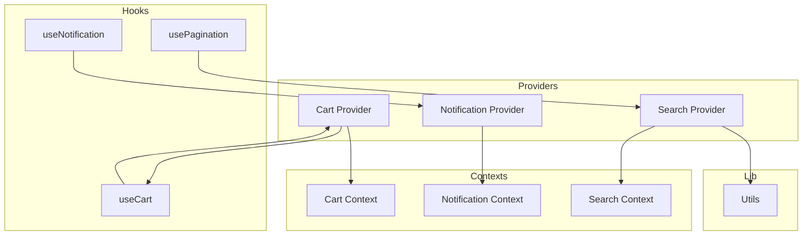
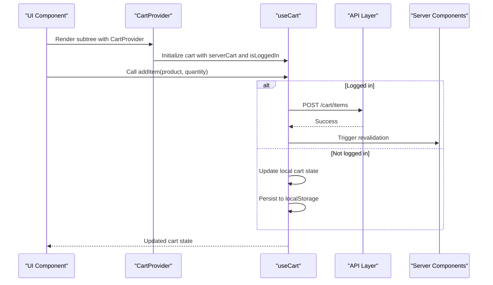
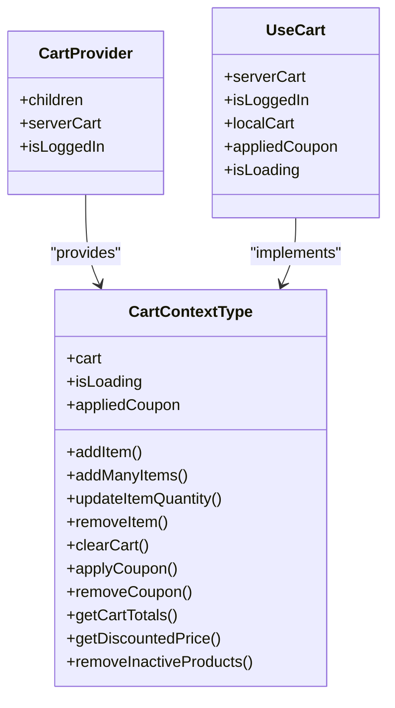
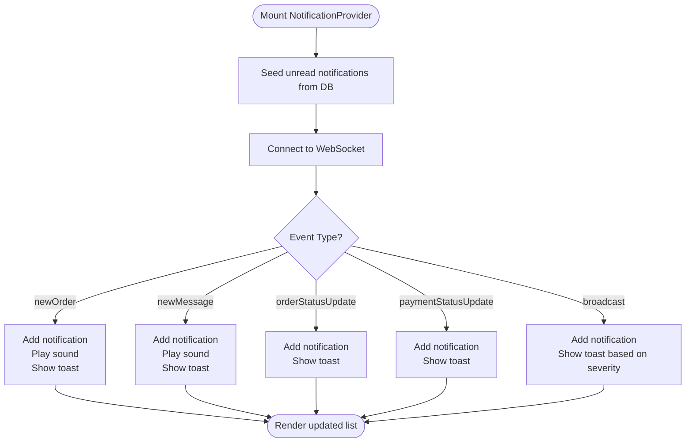
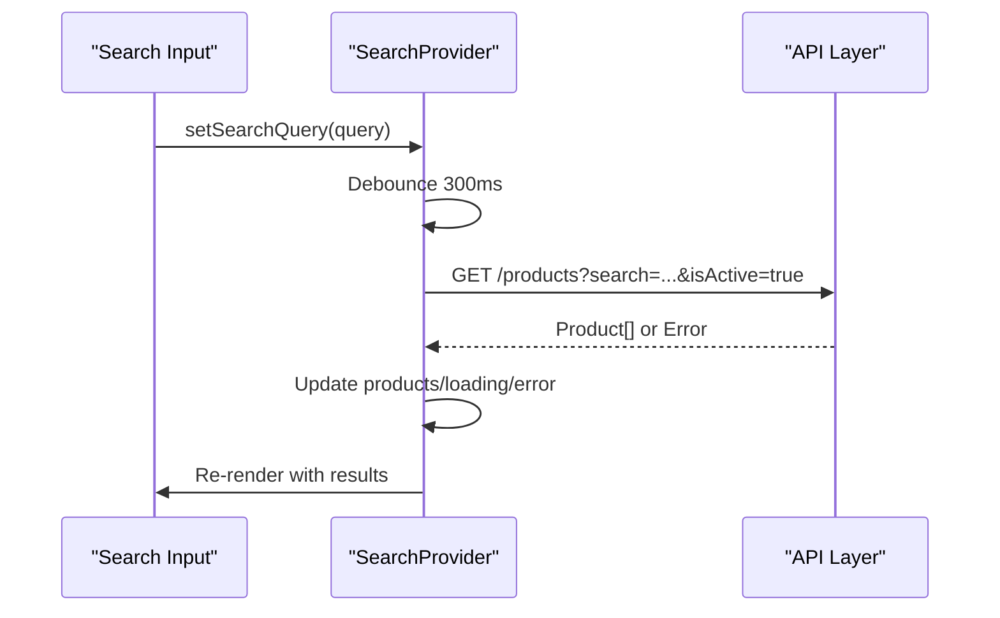
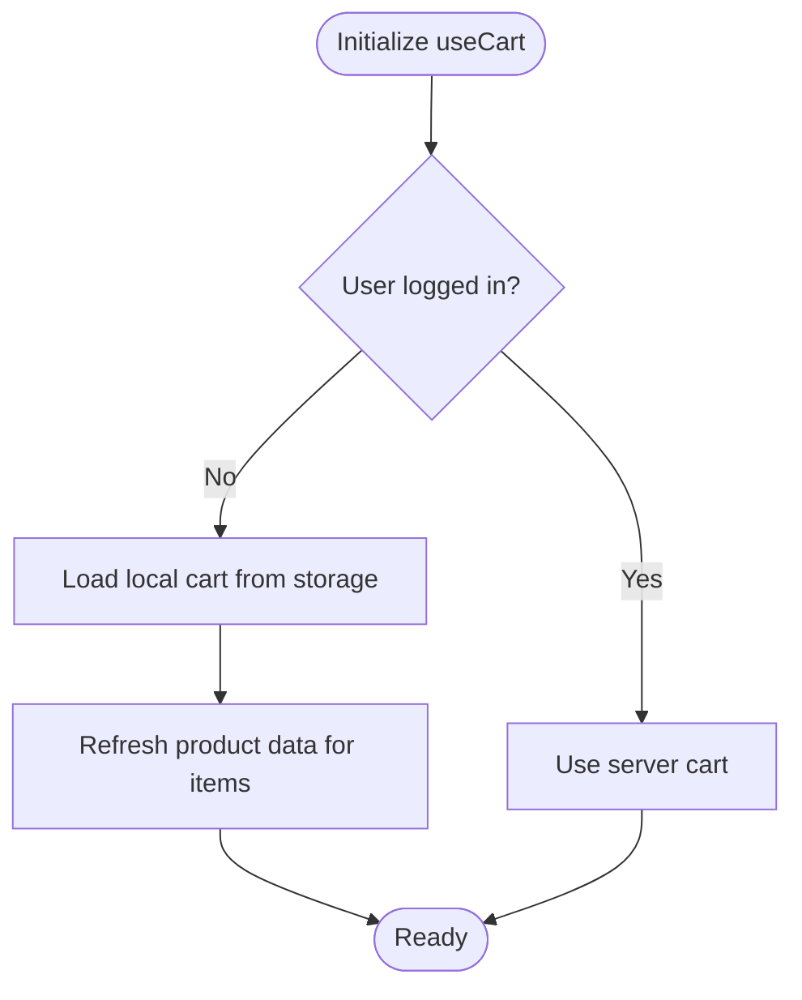
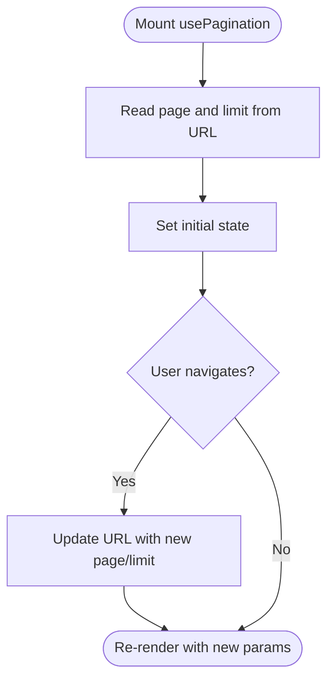
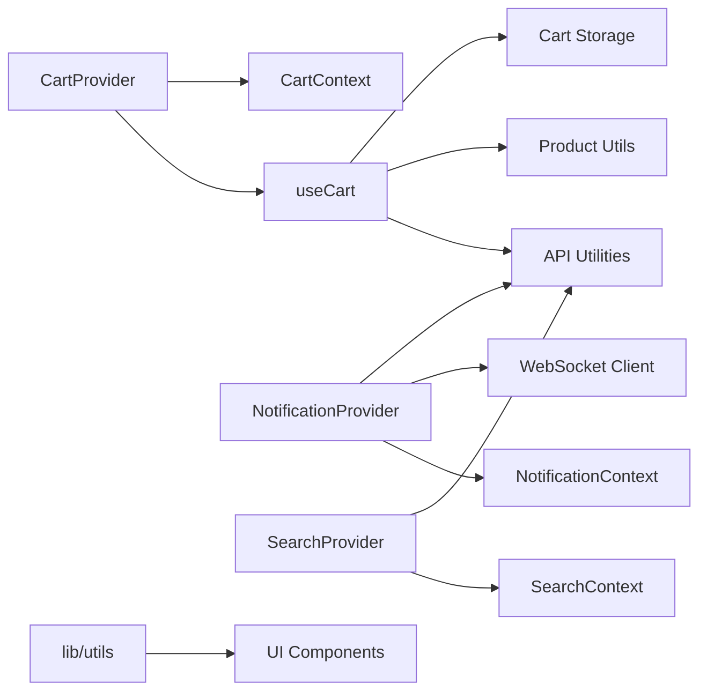

# State Management & Data Fetching

<cite>
**Referenced Files in This Document**
- [cart-context.tsx](file://apps/frontend/contexts/cart-context.tsx)
- [notification-context.tsx](file://apps/frontend/contexts/notification-context.tsx)
- [search-context.tsx](file://apps/frontend/contexts/search-context.tsx)
- [cart-provider.tsx](file://apps/frontend/providers/cart-provider.tsx)
- [notification-provider.tsx](file://apps/frontend/providers/notification-provider.tsx)
- [search-provider.tsx](file://apps/frontend/providers/search-provider.tsx)
- [use-cart.ts](file://apps/frontend/hooks/use-cart.ts)
- [use-notification.ts](file://apps/frontend/hooks/use-notification.ts)
- [use-pagination.ts](file://apps/frontend/hooks/use-pagination.ts)
- [utils.ts](file://apps/frontend/lib/utils.ts)
</cite>

## Table of Contents
1. [Introduction](#introduction)
2. [Project Structure](#project-structure)
3. [Core Components](#core-components)
4. [Architecture Overview](#architecture-overview)
5. [Detailed Component Analysis](#detailed-component-analysis)
6. [Dependency Analysis](#dependency-analysis)
7. [Performance Considerations](#performance-considerations)
8. [Troubleshooting Guide](#troubleshooting-guide)
9. [Conclusion](#conclusion)

## Introduction
This document explains the German Butcher frontend state management and data fetching strategy. It focuses on:
- Context-based global state for cart, notifications, and search
- Provider components that wrap application sections with context values
- Custom hooks that encapsulate reusable logic
- Service layer abstractions for API communication and business rules
- Caching strategies, error handling, and performance optimizations
- Synchronization between client-side state and server-side React Server Components

The goal is to make these patterns clear for both new contributors and maintainers.

## Project Structure
The relevant frontend directories are organized by responsibility:
- contexts/: React Context definitions for global state
- providers/: Provider components that supply context values
- hooks/: Reusable custom hooks for UI and data logic
- lib/: Shared utilities and service modules for domain logic and helpers

**Diagram sources**
- [cart-context.tsx:7-48](file://apps/frontend/contexts/cart-context.tsx#L7-L48)
- [notification-context.tsx:1-7](file://apps/frontend/contexts/notification-context.tsx#L1-L7)
- [search-context.tsx:1-21](file://apps/frontend/contexts/search-context.tsx#L1-L21)
- [cart-provider.tsx:1-32](file://apps/frontend/providers/cart-provider.tsx#L1-L32)
- [notification-provider.tsx:1-292](file://apps/frontend/providers/notification-provider.tsx#L1-L292)
- [search-provider.tsx:1-136](file://apps/frontend/providers/search-provider.tsx#L1-L136)
- [use-cart.ts:1-647](file://apps/frontend/hooks/use-cart.ts#L1-L647)
- [use-notification.ts:1-15](file://apps/frontend/hooks/use-notification.ts#L1-L15)
- [use-pagination.ts:1-78](file://apps/frontend/hooks/use-pagination.ts#L1-L78)
- [utils.ts:1-189](file://apps/frontend/lib/utils.ts#L1-L189)

**Section sources**
- [cart-context.tsx:1-49](file://apps/frontend/contexts/cart-context.tsx#L1-L49)
- [notification-context.tsx:1-7](file://apps/frontend/contexts/notification-context.tsx#L1-L7)
- [search-context.tsx:1-21](file://apps/frontend/contexts/search-context.tsx#L1-L21)
- [cart-provider.tsx:1-32](file://apps/frontend/providers/cart-provider.tsx#L1-L32)
- [notification-provider.tsx:1-292](file://apps/frontend/providers/notification-provider.tsx#L1-L292)
- [search-provider.tsx:1-136](file://apps/frontend/providers/search-provider.tsx#L1-L136)
- [use-cart.ts:1-647](file://apps/frontend/hooks/use-cart.ts#L1-L647)
- [use-notification.ts:1-15](file://apps/frontend/hooks/use-notification.ts#L1-L15)
- [use-pagination.ts:1-78](file://apps/frontend/hooks/use-pagination.ts#L1-L78)
- [utils.ts:1-189](file://apps/frontend/lib/utils.ts#L1-L189)

## Core Components
This section summarizes the main building blocks:
- Cart context and provider manage shopping cart state, coupon application, and synchronization with the server when logged in.
- Notification context and provider manage real-time notifications via WebSocket, persist unread counts, and surface toast messages.
- Search context and provider implement debounced product search with URL synchronization and abortable requests.
- useCart hook centralizes cart operations, local storage persistence, and server sync.
- useNotification hook exposes notification context safely.
- usePagination hook manages page and limit state synchronized with URL query parameters.
- lib/utils provides shared formatting and helper functions used across the app.

Key responsibilities:
- Global state exposure through React Context
- Provider components wrapping subtrees with context values
- Hooks encapsulating complex logic (data fetching, persistence, event handling)
- Service abstractions for API calls and business rules

**Section sources**
- [cart-context.tsx:7-48](file://apps/frontend/contexts/cart-context.tsx#L7-L48)
- [cart-provider.tsx:8-31](file://apps/frontend/providers/cart-provider.tsx#L8-L31)
- [use-cart.ts:24-35](file://apps/frontend/hooks/use-cart.ts#L24-L35)
- [notification-context.tsx:1-7](file://apps/frontend/contexts/notification-context.tsx#L1-L7)
- [notification-provider.tsx:19-28](file://apps/frontend/providers/notification-provider.tsx#L19-L28)
- [use-notification.ts:1-15](file://apps/frontend/hooks/use-notification.ts#L1-L15)
- [search-context.tsx:4-16](file://apps/frontend/contexts/search-context.tsx#L4-L16)
- [search-provider.tsx:8-18](file://apps/frontend/providers/search-provider.tsx#L8-L18)
- [use-pagination.ts:6-16](file://apps/frontend/hooks/use-pagination.ts#L6-L16)
- [utils.ts:5-7](file://apps/frontend/lib/utils.ts#L5-L7)

## Architecture Overview
The system follows a layered approach:
- Providers own state and side effects
- Contexts define the shape of global state
- Hooks provide typed accessors and actions
- Services and utilities encapsulate API calls and business logic

**Diagram sources**
- [cart-provider.tsx:14-30](file://apps/frontend/providers/cart-provider.tsx#L14-L30)
- [use-cart.ts:157-224](file://apps/frontend/hooks/use-cart.ts#L157-L224)
- [use-cart.ts:386-445](file://apps/frontend/hooks/use-cart.ts#L386-L445)

## Detailed Component Analysis

### Cart Context and Provider
The cart subsystem uses a context/provider pattern:
- CartContext defines the shape of cart state and methods
- CartProvider wraps components and supplies context value
- useCart implements core logic including:
  - Local storage persistence for anonymous users
  - Server synchronization for authenticated users
  - Coupon application and removal
  - Totals calculation and discount price computation
  - Cleanup of inactive products

**Diagram sources**
- [cart-context.tsx:7-48](file://apps/frontend/contexts/cart-context.tsx#L7-L48)
- [cart-provider.tsx:8-31](file://apps/frontend/providers/cart-provider.tsx#L8-L31)
- [use-cart.ts:24-35](file://apps/frontend/hooks/use-cart.ts#L24-L35)

Key behaviors:
- For logged-in users, cart operations call the backend and trigger server revalidation to keep RSC data fresh
- For anonymous users, cart state persists to localStorage and updates immediately
- Coupon application validates against current cart items and updates totals accordingly
- Inactive products are removed from cart and reflected in UI

**Section sources**
- [cart-context.tsx:7-48](file://apps/frontend/contexts/cart-context.tsx#L7-L48)
- [cart-provider.tsx:14-30](file://apps/frontend/providers/cart-provider.tsx#L14-L30)
- [use-cart.ts:107-155](file://apps/frontend/hooks/use-cart.ts#L107-L155)
- [use-cart.ts:157-224](file://apps/frontend/hooks/use-cart.ts#L157-L224)
- [use-cart.ts:386-445](file://apps/frontend/hooks/use-cart.ts#L386-L445)
- [use-cart.ts:460-500](file://apps/frontend/hooks/use-cart.ts#L460-L500)
- [use-cart.ts:584-629](file://apps/frontend/hooks/use-cart.ts#L584-L629)

### Notification Context and Provider
The notification subsystem handles real-time events and user feedback:
- NotificationContext defines the notification state shape
- NotificationProvider manages:
  - WebSocket connection lifecycle
  - Seeding unread notifications from the database
  - Handling various event types (new orders, messages, order status updates, payment updates, broadcasts)
  - Marking notifications as read and clearing them
  - Playing sounds and showing toasts

**Diagram sources**
- [notification-provider.tsx:37-79](file://apps/frontend/providers/notification-provider.tsx#L37-L79)
- [notification-provider.tsx:86-127](file://apps/frontend/providers/notification-provider.tsx#L86-L127)
- [notification-provider.tsx:133-235](file://apps/frontend/providers/notification-provider.tsx#L133-L235)

Error handling and resilience:
- Connection errors are logged and connection state is updated
- Disconnections update connectivity state
- Clearing notifications marks persisted rows as read to avoid reappearing after reload
- Unread seeding runs on mount and reconnect to prevent missed events

**Section sources**
- [notification-context.tsx:1-7](file://apps/frontend/contexts/notification-context.tsx#L1-L7)
- [notification-provider.tsx:23-31](file://apps/frontend/providers/notification-provider.tsx#L23-L31)
- [notification-provider.tsx:37-79](file://apps/frontend/providers/notification-provider.tsx#L37-L79)
- [notification-provider.tsx:86-127](file://apps/frontend/providers/notification-provider.tsx#L86-L127)
- [notification-provider.tsx:133-235](file://apps/frontend/providers/notification-provider.tsx#L133-L235)
- [notification-provider.tsx:250-272](file://apps/frontend/providers/notification-provider.tsx#L250-L272)
- [use-notification.ts:1-15](file://apps/frontend/hooks/use-notification.ts#L1-L15)

### Search Context and Provider
The search subsystem provides:
- Debounced product search with AbortController to cancel stale requests
- URL synchronization for shareable search queries
- Loading and error states
- Expand/collapse behavior for search UI

**Diagram sources**
- [search-provider.tsx:32-87](file://apps/frontend/providers/search-provider.tsx#L32-L87)

Caching and cancellation:
- Previous fetches are aborted when a new query arrives
- Errors are caught and stored in state; AbortError is ignored
- URL changes only occur on explicit search actions

**Section sources**
- [search-context.tsx:4-16](file://apps/frontend/contexts/search-context.tsx#L4-L16)
- [search-provider.tsx:8-18](file://apps/frontend/providers/search-provider.tsx#L8-L18)
- [search-provider.tsx:32-87](file://apps/frontend/providers/search-provider.tsx#L32-L87)
- [search-provider.tsx:90-114](file://apps/frontend/providers/search-provider.tsx#L90-L114)

### Custom Hooks

#### useCart
Responsibilities:
- Initialize cart from server or local storage
- Persist local cart and coupon for anonymous users
- Sync local cart to server when user logs in
- Add, update, remove items; clear cart
- Apply/remove coupons and update totals
- Refresh product data for cached cart items
- Remove inactive products and reflect changes

**Diagram sources**
- [use-cart.ts:37-93](file://apps/frontend/hooks/use-cart.ts#L37-L93)
- [use-cart.ts:107-155](file://apps/frontend/hooks/use-cart.ts#L107-L155)

**Section sources**
- [use-cart.ts:24-35](file://apps/frontend/hooks/use-cart.ts#L24-L35)
- [use-cart.ts:37-93](file://apps/frontend/hooks/use-cart.ts#L37-L93)
- [use-cart.ts:107-155](file://apps/frontend/hooks/use-cart.ts#L107-L155)
- [use-cart.ts:157-224](file://apps/frontend/hooks/use-cart.ts#L157-L224)
- [use-cart.ts:283-357](file://apps/frontend/hooks/use-cart.ts#L283-L357)
- [use-cart.ts:359-384](file://apps/frontend/hooks/use-cart.ts#L359-L384)
- [use-cart.ts:386-445](file://apps/frontend/hooks/use-cart.ts#L386-L445)
- [use-cart.ts:460-500](file://apps/frontend/hooks/use-cart.ts#L460-L500)
- [use-cart.ts:502-582](file://apps/frontend/hooks/use-cart.ts#L502-L582)
- [use-cart.ts:584-629](file://apps/frontend/hooks/use-cart.ts#L584-L629)

#### useNotification
Responsibilities:
- Provide safe access to NotificationContext
- Throw an error if used outside NotificationProvider

Usage pattern:
- Consume context in components under NotificationProvider
- Access notifications, socket state, and actions like markNotificationRead and clearNotifications

**Section sources**
- [use-notification.ts:1-15](file://apps/frontend/hooks/use-notification.ts#L1-L15)

#### usePagination
Responsibilities:
- Manage currentPage, limit, and totalPages
- Synchronize pagination state with URL query parameters
- Provide navigation helpers (goToPage, nextPage, prevPage, changeLimit)

**Diagram sources**
- [use-pagination.ts:12-40](file://apps/frontend/hooks/use-pagination.ts#L12-L40)

**Section sources**
- [use-pagination.ts:6-16](file://apps/frontend/hooks/use-pagination.ts#L6-L16)
- [use-pagination.ts:12-40](file://apps/frontend/hooks/use-pagination.ts#L12-L40)
- [use-pagination.ts:42-76](file://apps/frontend/hooks/use-pagination.ts#L42-L76)

### Service Layer Abstraction
While this document focuses on state management, the cart and notification providers rely on utility functions for API communication and business logic:
- API utilities handle protected data fetching, posting, patching, and deleting
- Coupon service abstracts coupon application logic
- Utility functions provide formatting and helper capabilities

Examples:
- Cart operations use API utilities for adding, updating, removing items and syncing with the server
- Notification provider seeds unread notifications and marks them as read using API utilities
- Search provider fetches products using API utilities

**Section sources**
- [use-cart.ts:7-22](file://apps/frontend/hooks/use-cart.ts#L7-L22)
- [notification-provider.tsx:3-17](file://apps/frontend/providers/notification-provider.tsx#L3-L17)
- [search-provider.tsx:3-6](file://apps/frontend/providers/search-provider.tsx#L3-L6)
- [utils.ts:5-7](file://apps/frontend/lib/utils.ts#L5-L7)

## Dependency Analysis
The following diagram shows how providers depend on hooks and contexts, and how hooks depend on services and utilities.

**Diagram sources**
- [cart-provider.tsx:1-32](file://apps/frontend/providers/cart-provider.tsx#L1-L32)
- [notification-provider.tsx:1-292](file://apps/frontend/providers/notification-provider.tsx#L1-L292)
- [search-provider.tsx:1-136](file://apps/frontend/providers/search-provider.tsx#L1-L136)
- [use-cart.ts:1-647](file://apps/frontend/hooks/use-cart.ts#L1-L647)
- [utils.ts:1-189](file://apps/frontend/lib/utils.ts#L1-L189)

Coupling and cohesion:
- Providers encapsulate state and side effects, keeping components decoupled
- Hooks centralize logic, improving cohesion within feature areas
- Contexts define contracts, reducing coupling between consumers and implementation details

Potential circular dependencies:
- None observed among contexts, providers, and hooks
- Services and utilities are pure or stateless where possible

External dependencies:
- WebSocket client for real-time notifications
- Next.js router and search params for URL synchronization
- Toast library for user feedback

**Section sources**
- [cart-provider.tsx:1-32](file://apps/frontend/providers/cart-provider.tsx#L1-L32)
- [notification-provider.tsx:1-292](file://apps/frontend/providers/notification-provider.tsx#L1-L292)
- [search-provider.tsx:1-136](file://apps/frontend/providers/search-provider.tsx#L1-L136)
- [use-cart.ts:1-647](file://apps/frontend/hooks/use-cart.ts#L1-L647)
- [utils.ts:1-189](file://apps/frontend/lib/utils.ts#L1-L189)

## Performance Considerations
- Debounced search reduces unnecessary network requests
- AbortController cancels stale fetches during rapid typing
- Local storage caching improves perceived performance for anonymous users
- Background refresh of product data ensures accurate prices and availability
- Throttled server revalidation prevents excessive full-page refreshes
- WebSocket reconnection settings balance reliability and resource usage
- Selective revalidation targets specific routes to minimize overhead

Recommendations:
- Consider implementing request deduplication for repeated identical queries
- Introduce optimistic updates for non-critical mutations where appropriate
- Cache product data at the hook level for frequently accessed items
- Monitor WebSocket message volume and consider batching for high-frequency events

[No sources needed since this section provides general guidance]

## Troubleshooting Guide
Common issues and resolutions:
- Using hooks outside providers:
  - Ensure components consuming useCart or useNotification are wrapped with their respective providers
  - The hooks throw descriptive errors when used incorrectly
- WebSocket connection failures:
  - Check environment variables for socket URL configuration
  - Verify authentication flow and userId/isAdmin query parameters
  - Inspect connection error logs and reconnection attempts
- Stale cart data:
  - Confirm server revalidation is triggered after mutations
  - Validate that focus/visibility listeners are active for logged-in users
- Search not updating:
  - Ensure debounce timeout is configured and AbortController is properly cleaned up
  - Verify URL synchronization occurs only on explicit search actions

**Section sources**
- [use-cart.ts:214-224](file://apps/frontend/hooks/use-cart.ts#L214-L224)
- [use-cart.ts:313-320](file://apps/frontend/hooks/use-cart.ts#L313-L320)
- [use-cart.ts:349-356](file://apps/frontend/hooks/use-cart.ts#L349-L356)
- [use-cart.ts:376-383](file://apps/frontend/hooks/use-cart.ts#L376-L383)
- [use-cart.ts:434-444](file://apps/frontend/hooks/use-cart.ts#L434-L444)
- [notification-provider.tsx:128-131](file://apps/frontend/providers/notification-provider.tsx#L128-L131)
- [search-provider.tsx:62-76](file://apps/frontend/providers/search-provider.tsx#L62-L76)

## Conclusion
The German Butcher frontend employs a robust state management architecture built around React Context and Providers, enhanced by custom hooks and service abstractions. This design separates concerns, improves maintainability, and supports both client-side and server-side data synchronization. By leveraging caching, debouncing, and selective revalidation, the application achieves responsive user experiences while maintaining data consistency.

[No sources needed since this section summarizes without analyzing specific files]