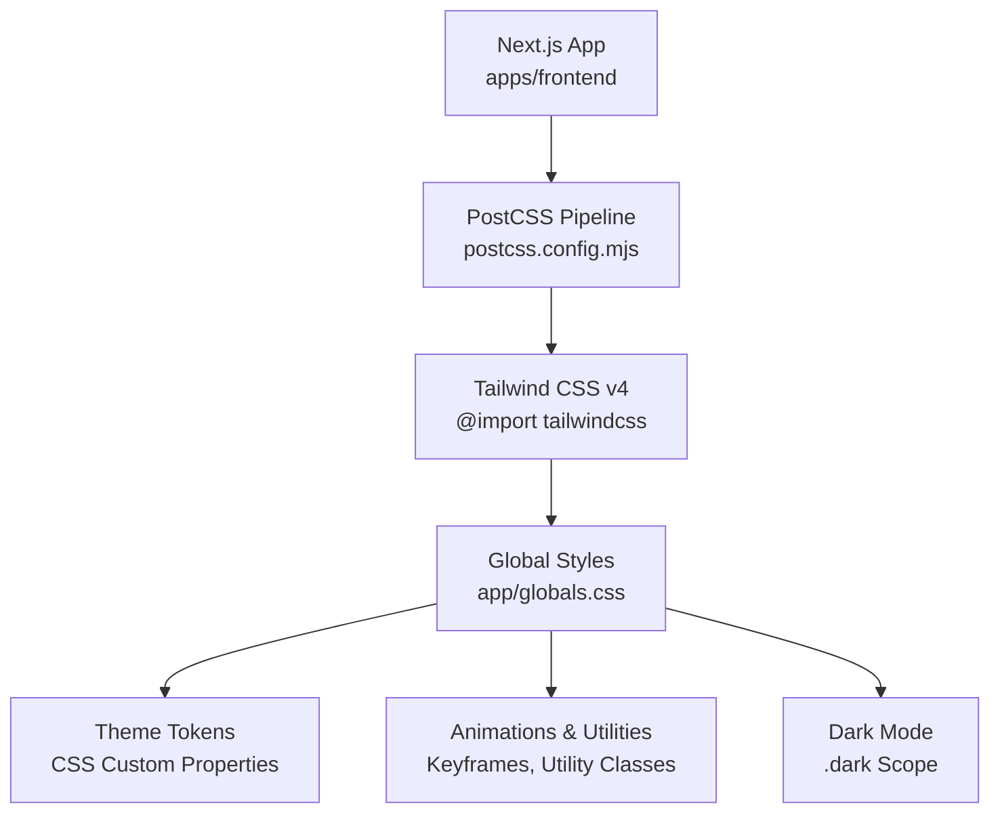
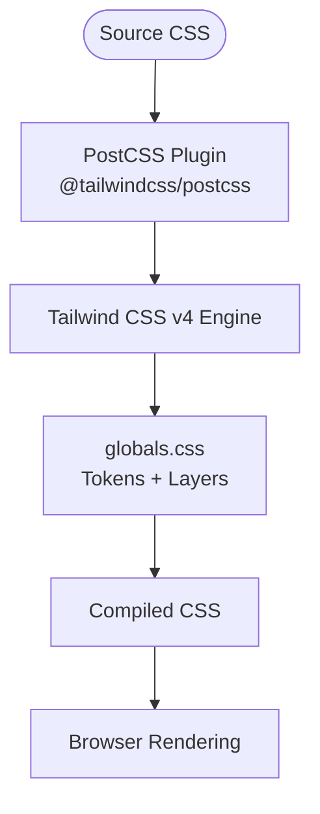
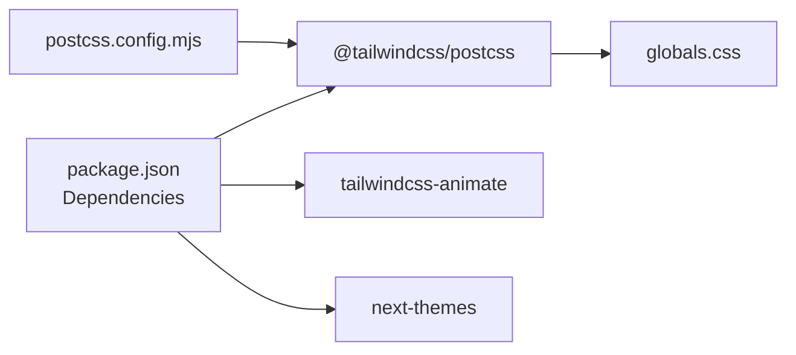

# Styling & Theming System

<cite>
**Referenced Files in This Document**
- [package.json](file://apps/frontend/package.json)
- [postcss.config.mjs](file://apps/frontend/postcss.config.mjs)
- [globals.css](file://apps/frontend/app/globals.css)
- [next.config.js](file://apps/frontend/next.config.js)
</cite>

## Table of Contents
1. [Introduction](#introduction)
2. [Project Structure](#project-structure)
3. [Core Components](#core-components)
4. [Architecture Overview](#architecture-overview)
5. [Detailed Component Analysis](#detailed-component-analysis)
6. [Dependency Analysis](#dependency-analysis)
7. [Performance Considerations](#performance-considerations)
8. [Troubleshooting Guide](#troubleshooting-guide)
9. [Conclusion](#conclusion)

## Introduction
This document explains the German Butcher styling and theming system built on Tailwind CSS v4 within the Next.js frontend application. It covers the PostCSS pipeline, global styles, theme tokens, dark mode support, animations, responsive patterns, accessibility considerations, and performance optimizations. The goal is to provide a clear, maintainable guide for consistent styling across components and pages.

## Project Structure
The styling system lives primarily in the frontend app:
- PostCSS configuration wires Tailwind CSS v4 into the build pipeline.
- Global styles define theme tokens, base resets, utility classes, animations, and dark mode variables.
- Next.js configuration integrates with the build toolchain (Turbopack/Webpack) and image optimization.



**Diagram sources**
- [postcss.config.mjs:1-6](file://apps/frontend/postcss.config.mjs#L1-L6)
- [globals.css:1-55](file://apps/frontend/app/globals.css#L1-L55)

**Section sources**
- [postcss.config.mjs:1-6](file://apps/frontend/postcss.config.mjs#L1-L6)
- [globals.css:1-55](file://apps/frontend/app/globals.css#L1-L55)

## Core Components
- Tailwind CSS v4 integration via PostCSS plugin.
- Theme token definitions using CSS custom properties under :root and .dark.
- Base layer resets and typography defaults.
- Utility layer with animations, gradients, and component-specific helpers.
- Dark mode variant enabled through a custom variant.

Key responsibilities:
- postcss.config.mjs: Registers @tailwindcss/postcss to process Tailwind CSS v4.
- globals.css: Imports Tailwind, enables plugins, defines theme tokens, base styles, utilities, and dark mode.

**Section sources**
- [postcss.config.mjs:1-6](file://apps/frontend/postcss.config.mjs#L1-L6)
- [globals.css:1-55](file://apps/frontend/app/globals.css#L1-L55)

## Architecture Overview
The styling architecture follows a layered approach:
- Build-time processing: Next.js invokes PostCSS, which runs Tailwind CSS v4.
- Source-of-truth: globals.css declares all design tokens and base/utility layers.
- Runtime behavior: CSS custom properties drive colors, radii, and semantic tokens; .dark scope overrides tokens for dark mode.



**Diagram sources**
- [postcss.config.mjs:1-6](file://apps/frontend/postcss.config.mjs#L1-L6)
- [globals.css:1-55](file://apps/frontend/app/globals.css#L1-L55)

## Detailed Component Analysis

### PostCSS Configuration
- Uses @tailwindcss/postcss as the only plugin.
- Integrates seamlessly with Next.js build (Turbopack/Webpack).

Best practices:
- Keep PostCSS minimal; rely on Tailwind’s v4 engine for processing.
- Avoid additional PostCSS transforms unless required.

**Section sources**
- [postcss.config.mjs:1-6](file://apps/frontend/postcss.config.mjs#L1-L6)

### Global Styles and Theme Tokens
- Imports Tailwind CSS and enables the animation plugin.
- Defines a custom dark variant scoped to .dark.
- Declares inline theme tokens mapping brand colors and semantic tokens to CSS custom properties.
- Establishes :root and .dark variable sets for light and dark themes.
- Provides base layer resets and typography defaults.
- Adds utility layer animations, gradients, and helper classes.

Highlights:
- Brand tokens: primaryColor, secondaryColor, secondColor.
- Semantic tokens: background, foreground, card, popover, primary, secondary, muted, accent, destructive, border, input, ring, chart-1..5, sidebar tokens.
- Typography: sans, mono, quicksand, castor mapped to font variables.
- Radii: sm, md, lg, xl derived from a base radius variable.
- Animations: marquee, shimmer, fadeIn, loading; plus staggered delay utilities.
- Accessibility: prefers-reduced-motion disables animations when requested.

```mermaid
classDiagram
class ThemeTokens {
"+Brand Colors"
"+Semantic Colors"
"+Radii"
"+Typography"
"+Chart Colors"
"+Sidebar Tokens"
}
class Layers {
"+Base Layer"
"+Utilities Layer"
}
class DarkMode {
"+Override Variables"
}
ThemeTokens --> Layers : "used by"
DarkMode --> ThemeTokens : "overrides"
```

**Diagram sources**
- [globals.css:7-55](file://apps/frontend/app/globals.css#L7-L55)
- [globals.css:57-125](file://apps/frontend/app/globals.css#L57-L125)
- [globals.css:127-138](file://apps/frontend/app/globals.css#L127-L138)
- [globals.css:140-222](file://apps/frontend/app/globals.css#L140-L222)

**Section sources**
- [globals.css:1-55](file://apps/frontend/app/globals.css#L1-L55)
- [globals.css:57-125](file://apps/frontend/app/globals.css#L57-L125)
- [globals.css:127-138](file://apps/frontend/app/globals.css#L127-L138)
- [globals.css:140-222](file://apps/frontend/app/globals.css#L140-L222)

### Animations and Utilities
- Marquee and reverse marquee keyframes with a CSS variable gap.
- Shimmer and fade-in animations with optional delays.
- Gradient text and product background utilities.
- Scrollbar styling and hide utilities.
- Performance hints like contain and transform for smoother rendering.

Accessibility:
- Respects prefers-reduced-motion to disable animations.

**Section sources**
- [globals.css:140-222](file://apps/frontend/app/globals.css#L140-L222)
- [globals.css:320-373](file://apps/frontend/app/globals.css#L320-L373)
- [globals.css:374-387](file://apps/frontend/app/globals.css#L374-L387)

### Dark Mode Support
- Custom variant dark (&:is(.dark *)) enables dark-mode variants.
- .dark scope overrides semantic color tokens and chart/sidebar variables.
- UI components should use semantic tokens (e.g., bg-background, text-foreground) rather than hardcoded colors.

Usage pattern:
- Toggle a .dark class on the root element at runtime (e.g., via next-themes or similar).
- Apply dark-mode variants using the configured dark variant.

**Section sources**
- [globals.css:5-5](file://apps/frontend/app/globals.css#L5-L5)
- [globals.css:92-125](file://apps/frontend/app/globals.css#L92-L125)

### Responsive Design Patterns
- Use Tailwind’s default responsive breakpoints and mobile-first utilities.
- Prefer semantic tokens and spacing scales over ad-hoc values.
- For complex responsive logic, combine Tailwind utilities with CSS custom properties where appropriate.

Note: No explicit breakpoint overrides are defined in the analyzed files; rely on Tailwind’s defaults.

**Section sources**
- [globals.css:127-138](file://apps/frontend/app/globals.css#L127-L138)

### Cross-Browser Compatibility
- Font smoothing properties for WebKit and Firefox.
- Scrollbar styling targets both standard and vendor-prefixed selectors.
- Animation fallbacks and reduced motion media query ensure graceful degradation.

**Section sources**
- [globals.css:127-138](file://apps/frontend/app/globals.css#L127-L138)
- [globals.css:326-352](file://apps/frontend/app/globals.css#L326-L352)
- [globals.css:374-387](file://apps/frontend/app/globals.css#L374-L387)

### Component Styling Examples
- Use semantic tokens for backgrounds, text, borders, and focus rings (e.g., bg-background, text-foreground, border-border, outline-ring).
- Apply brand tokens sparingly for accents and highlights (e.g., primaryColor, secondaryColor).
- Leverage utility classes for layout, spacing, and typography; keep component-level CSS minimal and scoped.

Guidelines:
- Prefer Tailwind utilities for common patterns.
- Reserve CSS classes for reusable component visuals that cannot be expressed purely with utilities.
- Keep animations and heavy effects behind utility classes to avoid duplication.

**Section sources**
- [globals.css:127-138](file://apps/frontend/app/globals.css#L127-L138)
- [globals.css:140-222](file://apps/frontend/app/globals.css#L140-L222)

### Theme Customization
- Extend or override CSS custom properties in :root or .dark to adjust brand colors, radii, and semantic tokens.
- Maintain consistency by centralizing changes in globals.css.
- When adding new tokens, map them in the inline theme block so they are available as Tailwind utilities.

**Section sources**
- [globals.css:7-55](file://apps/frontend/app/globals.css#L7-L55)
- [globals.css:57-125](file://apps/frontend/app/globals.css#L57-L125)

### Accessibility Considerations
- Respect prefers-reduced-motion to disable animations.
- Ensure sufficient contrast using semantic tokens designed for readability.
- Provide visible focus indicators via outline-ring.

**Section sources**
- [globals.css:374-387](file://apps/frontend/app/globals.css#L374-L387)
- [globals.css:127-138](file://apps/frontend/app/globals.css#L127-L138)

## Dependency Analysis
- Tailwind CSS v4 is installed and processed via @tailwindcss/postcss.
- Animation support comes from tailwindcss-animate plugin.
- next-themes is available for toggling dark mode at runtime.
- next.config.js configures Next.js build settings and image optimization but does not alter the CSS pipeline.



**Diagram sources**
- [package.json:68-70](file://apps/frontend/package.json#L68-L70)
- [package.json:74-85](file://apps/frontend/package.json#L74-L85)
- [postcss.config.mjs:1-6](file://apps/frontend/postcss.config.mjs#L1-L6)
- [globals.css:1-5](file://apps/frontend/app/globals.css#L1-L5)

**Section sources**
- [package.json:68-70](file://apps/frontend/package.json#L68-L70)
- [package.json:74-85](file://apps/frontend/package.json#L74-L85)
- [postcss.config.mjs:1-6](file://apps/frontend/postcss.config.mjs#L1-L6)

## Performance Considerations
- Tailwind CSS v4 generates optimized CSS; keep source files clean and avoid redundant utilities.
- Use semantic tokens to reduce repeated color values and improve maintainability.
- Minimize heavy animations; leverage hardware acceleration hints (transform, will-change) where necessary.
- Respect prefers-reduced-motion to improve perceived performance for sensitive users.
- Image optimization is handled by Next.js; configure remote patterns and caching as needed.

[No sources needed since this section provides general guidance]

## Troubleshooting Guide
- If Tailwind utilities are missing, verify @tailwindcss/postcss is registered in PostCSS configuration.
- If dark mode variants do not apply, ensure the .dark class is present on the root element and the custom dark variant is configured.
- If animations do not run, check prefers-reduced-motion settings and browser compatibility.
- If brand colors appear inconsistent, confirm that CSS custom properties are correctly set in :root and .dark scopes.

**Section sources**
- [postcss.config.mjs:1-6](file://apps/frontend/postcss.config.mjs#L1-L6)
- [globals.css:5-5](file://apps/frontend/app/globals.css#L5-L5)
- [globals.css:92-125](file://apps/frontend/app/globals.css#L92-L125)
- [globals.css:374-387](file://apps/frontend/app/globals.css#L374-L387)

## Conclusion
The German Butcher styling system leverages Tailwind CSS v4 with a clean PostCSS setup and a robust set of CSS custom properties for theming. Global styles define base resets, semantic tokens, animations, and dark mode support. By adhering to semantic tokens, mobile-first utilities, and accessibility best practices, the team can maintain a consistent, performant, and accessible UI across the application.

[No sources needed since this section summarizes without analyzing specific files]