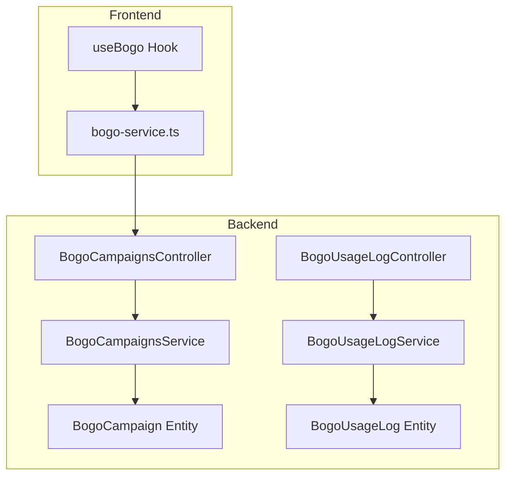
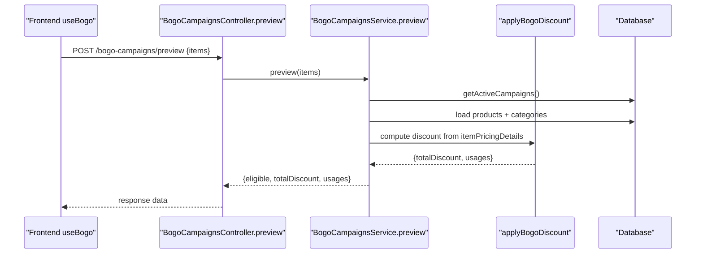
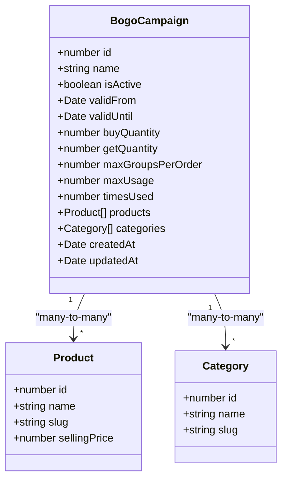
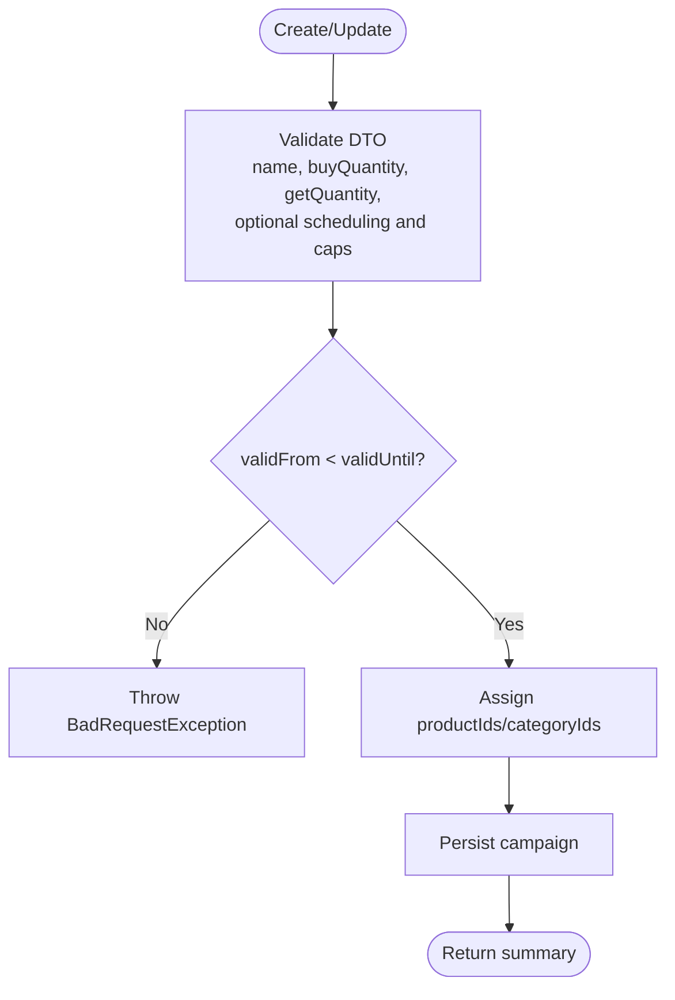
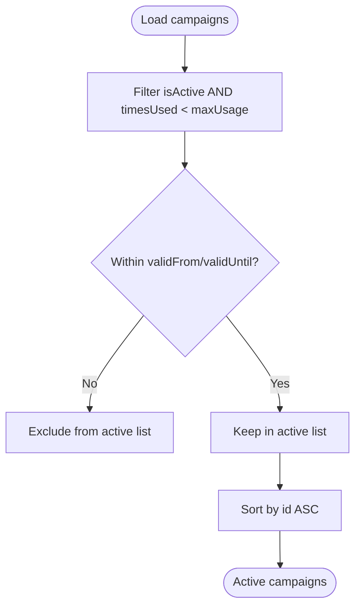
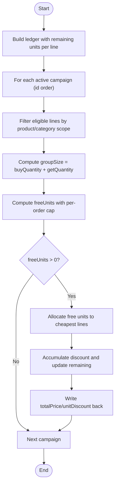
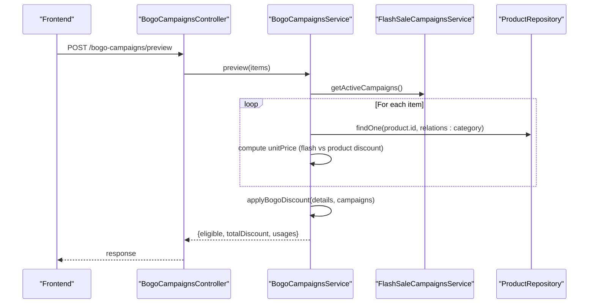
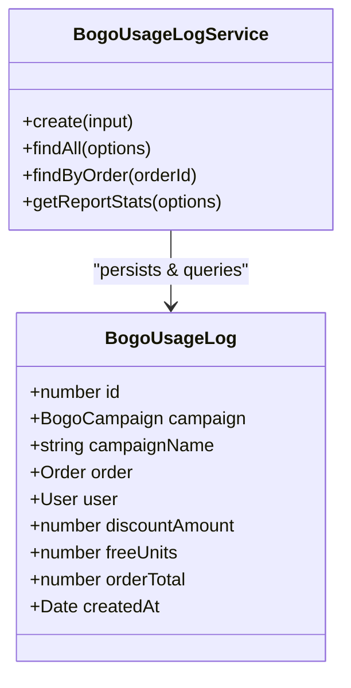
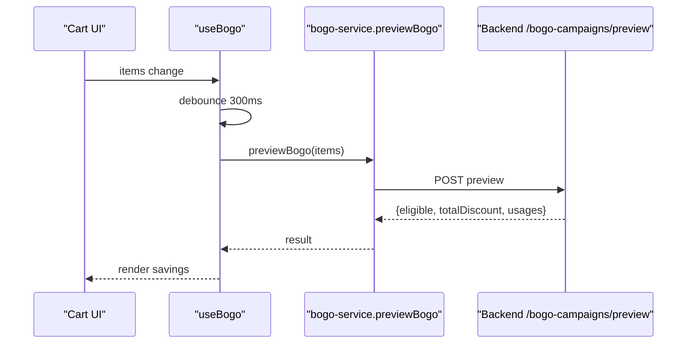
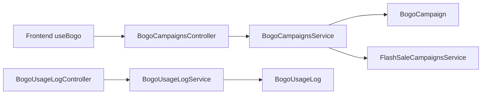

# BOGO Campaigns

<cite>
**Referenced Files in This Document**
- [bogo-campaigns.service.ts](file://apps/backend/src/bogo-campaigns/bogo-campaigns.service.ts)
- [bogo-campaigns.controller.ts](file://apps/backend/src/bogo-campaigns/bogo-campaigns.controller.ts)
- [create-bogo-campaign.dto.ts](file://apps/backend/src/bogo-campaigns/dto/create-bogo-campaign.dto.ts)
- [update-bogo-campaign.dto.ts](file://apps/backend/src/bogo-campaigns/dto/update-bogo-campaign.dto.ts)
- [preview-bogo.dto.ts](file://apps/backend/src/bogo-campaigns/dto/preview-bogo.dto.ts)
- [bogo-campaign.entity.ts](file://apps/backend/src/bogo-campaigns/entities/bogo-campaign.entity.ts)
- [bogo-usage-log.service.ts](file://apps/backend/src/bogo-usage-log/bogo-usage-log.service.ts)
- [bogo-usage-log.controller.ts](file://apps/backend/src/bogo-usage-log/bogo-usage-log.controller.ts)
- [bogo-usage-log.entity.ts](file://apps/backend/src/bogo-usage-log/entities/bogo-usage-log.entity.ts)
- [use-bogo.ts](file://apps/frontend/hooks/use-bogo.ts)
- [bogo-service.ts](file://apps/frontend/lib/bogo-service.ts)
</cite>

## Table of Contents
1. [Introduction](#introduction)
2. [Project Structure](#project-structure)
3. [Core Components](#core-components)
4. [Architecture Overview](#architecture-overview)
5. [Detailed Component Analysis](#detailed-component-analysis)
6. [Dependency Analysis](#dependency-analysis)
7. [Performance Considerations](#performance-considerations)
8. [Troubleshooting Guide](#troubleshooting-guide)
9. [Conclusion](#conclusion)

## Introduction
This document explains the Buy One Get One (BOGO) campaign system: how campaigns are created, how eligibility and discounts are calculated, how usage is tracked, and how the system integrates with cart and order processing. It also covers scheduling, automatic expiration, real-time availability checks, and practical guidance for common edge cases such as partial fulfillment and overlapping promotions.

## Project Structure
The BOGO feature spans backend modules for campaign management and usage logging, plus frontend hooks and services that call the backend preview endpoint.

**Diagram sources**
- [bogo-campaigns.controller.ts:28-129](file://apps/backend/src/bogo-campaigns/bogo-campaigns.controller.ts#L28-L129)
- [bogo-campaigns.service.ts:177-518](file://apps/backend/src/bogo-campaigns/bogo-campaigns.service.ts#L177-L518)
- [bogo-campaign.entity.ts:22-107](file://apps/backend/src/bogo-campaigns/entities/bogo-campaign.entity.ts#L22-L107)
- [bogo-usage-log.controller.ts:21-133](file://apps/backend/src/bogo-usage-log/bogo-usage-log.controller.ts#L21-L133)
- [bogo-usage-log.service.ts:30-149](file://apps/backend/src/bogo-usage-log/bogo-usage-log.service.ts#L30-L149)
- [bogo-usage-log.entity.ts:14-69](file://apps/backend/src/bogo-usage-log/entities/bogo-usage-log.entity.ts#L14-L69)
- [use-bogo.ts:11-33](file://apps/frontend/hooks/use-bogo.ts#L11-L33)
- [bogo-service.ts:71-78](file://apps/frontend/lib/bogo-service.ts#L71-L78)

**Section sources**
- [bogo-campaigns.controller.ts:28-129](file://apps/backend/src/bogo-campaigns/bogo-campaigns.controller.ts#L28-L129)
- [bogo-campaigns.service.ts:177-518](file://apps/backend/src/bogo-campaigns/bogo-campaigns.service.ts#L177-L518)
- [bogo-usage-log.controller.ts:21-133](file://apps/backend/src/bogo-usage-log/bogo-usage-log.controller.ts#L21-L133)
- [bogo-usage-log.service.ts:30-149](file://apps/backend/src/bogo-usage-log/bogo-usage-log.service.ts#L30-L149)
- [use-bogo.ts:11-33](file://apps/frontend/hooks/use-bogo.ts#L11-L33)
- [bogo-service.ts:71-78](file://apps/frontend/lib/bogo-service.ts#L71-L78)

## Core Components
- Campaign entity defines the rules: buy/get quantities, scheduling, per-order group caps, global usage limits, and product/category scope.
- Service provides CRUD, active campaign resolution, product-level hints, cart preview, discount application, and usage increment.
- Usage log tracks each applied campaign on an order with discount amount, free units, and order total.
- Frontend hook debounces cart changes and calls the public preview endpoint to display potential savings.

Key responsibilities:
- Campaign creation and updates validate dates and assign product/category relations.
- Active campaign selection considers activation state, date range, usage cap, and ordering by id for overlap resolution.
- Discount calculation pools eligible units across lines, applies cheapest-free logic, and writes back pricing details.
- Usage logs aggregate metrics for reporting and admin visibility.

**Section sources**
- [bogo-campaign.entity.ts:14-107](file://apps/backend/src/bogo-campaigns/entities/bogo-campaign.entity.ts#L14-L107)
- [bogo-campaigns.service.ts:85-175](file://apps/backend/src/bogo-campaigns/bogo-campaigns.service.ts#L85-L175)
- [bogo-campaigns.service.ts:313-340](file://apps/backend/src/bogo-campaigns/bogo-campaigns.service.ts#L313-L340)
- [bogo-usage-log.entity.ts:14-69](file://apps/backend/src/bogo-usage-log/entities/bogo-usage-log.entity.ts#L14-L69)
- [bogo-usage-log.service.ts:39-149](file://apps/backend/src/bogo-usage-log/bogo-usage-log.service.ts#L39-L149)
- [use-bogo.ts:11-33](file://apps/frontend/hooks/use-bogo.ts#L11-L33)

## Architecture Overview
The BOGO system exposes a public preview API for cart-side estimation and protected admin APIs for campaign management. The core discount engine is a pure function that mutates pricing details based on pooled eligible units.

**Diagram sources**
- [bogo-campaigns.controller.ts:35-54](file://apps/backend/src/bogo-campaigns/bogo-campaigns.controller.ts#L35-L54)
- [bogo-campaigns.service.ts:414-494](file://apps/backend/src/bogo-campaigns/bogo-campaigns.service.ts#L414-L494)
- [bogo-campaigns.service.ts:95-175](file://apps/backend/src/bogo-campaigns/bogo-campaigns.service.ts#L95-L175)
- [bogo-campaigns.service.ts:322-340](file://apps/backend/src/bogo-campaigns/bogo-campaigns.service.ts#L322-L340)

## Detailed Component Analysis

### Campaign Data Model
The campaign model captures all configuration needed to evaluate eligibility and apply discounts.

**Diagram sources**
- [bogo-campaign.entity.ts:22-107](file://apps/backend/src/bogo-campaigns/entities/bogo-campaign.entity.ts#L22-L107)

**Section sources**
- [bogo-campaign.entity.ts:22-107](file://apps/backend/src/bogo-campaigns/entities/bogo-campaign.entity.ts#L22-L107)

### Campaign Creation and Updates
Admin endpoints accept DTOs that enforce required fields, numeric ranges, array sizes, and optional scheduling. Updates allow partial changes while preserving existing values unless explicitly provided.

- Required fields include campaign name, buy quantity, and get quantity.
- Optional fields include activation flag, scheduling windows, per-order group caps, global usage limit, and product/category scopes.
- Date validation ensures validFrom precedes validUntil.
- Relations are assigned via id arrays; repository save replaces previous relations.

**Diagram sources**
- [create-bogo-campaign.dto.ts:15-83](file://apps/backend/src/bogo-campaigns/dto/create-bogo-campaign.dto.ts#L15-L83)
- [update-bogo-campaign.dto.ts:1-5](file://apps/backend/src/bogo-campaigns/dto/update-bogo-campaign.dto.ts#L1-L5)
- [bogo-campaigns.service.ts:191-225](file://apps/backend/src/bogo-campaigns/bogo-campaigns.service.ts#L191-L225)
- [bogo-campaigns.service.ts:292-311](file://apps/backend/src/bogo-campaigns/bogo-campaigns.service.ts#L292-L311)

**Section sources**
- [create-bogo-campaign.dto.ts:15-83](file://apps/backend/src/bogo-campaigns/dto/create-bogo-campaign.dto.ts#L15-L83)
- [update-bogo-campaign.dto.ts:1-5](file://apps/backend/src/bogo-campaigns/dto/update-bogo-campaign.dto.ts#L1-L5)
- [bogo-campaigns.service.ts:191-225](file://apps/backend/src/bogo-campaigns/bogo-campaigns.service.ts#L191-L225)
- [bogo-campaigns.service.ts:292-311](file://apps/backend/src/bogo-campaigns/bogo-campaigns.service.ts#L292-L311)

### Eligibility Rules and Active Campaign Resolution
A campaign is considered active when:
- It is marked active.
- Its usage has not reached its maximum (or it is unlimited).
- Its current time falls within validFrom and validUntil (if set).

Active campaigns are ordered by id so that lower ids claim eligible units first when multiple campaigns overlap.

**Diagram sources**
- [bogo-campaigns.service.ts:322-340](file://apps/backend/src/bogo-campaigns/bogo-campaigns.service.ts#L322-L340)

**Section sources**
- [bogo-campaigns.service.ts:322-340](file://apps/backend/src/bogo-campaigns/bogo-campaigns.service.ts#L322-L340)

### BOGO Discount Engine
The discount engine computes free units by pooling eligible units across order lines and applying the cheapest-free rule.

Algorithm highlights:
- Pool eligible units from lines matching the campaign’s product or category scope.
- Compute group size as buyQuantity + getQuantity.
- Determine freeUnits using floor(totalUnits / groupSize) * getQuantity.
- Apply per-order cap via maxGroupsPerOrder if configured.
- Allocate free units to the cheapest line prices first.
- Write back totalPrice and unitDiscount into pricing details.

**Diagram sources**
- [bogo-campaigns.service.ts:95-175](file://apps/backend/src/bogo-campaigns/bogo-campaigns.service.ts#L95-L175)

**Section sources**
- [bogo-campaigns.service.ts:95-175](file://apps/backend/src/bogo-campaigns/bogo-campaigns.service.ts#L95-L175)

### Cart Preview and Pricing Integration
The preview endpoint estimates BOGO savings for a given cart. It mirrors order pricing by considering flash sale prices first (no stacking), then product discount windows.

Flow:
- Resolve active flash sale campaigns once per cart.
- For each cart item, resolve product price (flash sale wins over product discount window).
- Build pricing details including unitPrice, unitDiscount, and totalPrice.
- Run applyBogoDiscount to compute eligible discount and per-campaign usage.
- Return eligibility, total discount, and per-campaign breakdown.

**Diagram sources**
- [bogo-campaigns.controller.ts:35-54](file://apps/backend/src/bogo-campaigns/bogo-campaigns.controller.ts#L35-L54)
- [bogo-campaigns.service.ts:414-494](file://apps/backend/src/bogo-campaigns/bogo-campaigns.service.ts#L414-L494)

**Section sources**
- [bogo-campaigns.controller.ts:35-54](file://apps/backend/src/bogo-campaigns/bogo-campaigns.controller.ts#L35-L54)
- [bogo-campaigns.service.ts:414-494](file://apps/backend/src/bogo-campaigns/bogo-campaigns.service.ts#L414-L494)

### Usage Tracking and Reporting
Usage logs record each campaign application on an order, capturing discount amount, free units, and order total. The service supports:
- Creating usage entries.
- Paginated listing with filters by campaign and date range.
- Fetching all usages for a specific order.
- Aggregated report stats (uses, discount, free units, order value, average order value, unique campaigns).

**Diagram sources**
- [bogo-usage-log.entity.ts:14-69](file://apps/backend/src/bogo-usage-log/entities/bogo-usage-log.entity.ts#L14-L69)
- [bogo-usage-log.service.ts:30-149](file://apps/backend/src/bogo-usage-log/bogo-usage-log.service.ts#L30-L149)

**Section sources**
- [bogo-usage-log.entity.ts:14-69](file://apps/backend/src/bogo-usage-log/entities/bogo-usage-log.entity.ts#L14-L69)
- [bogo-usage-log.service.ts:39-149](file://apps/backend/src/bogo-usage-log/bogo-usage-log.service.ts#L39-L149)

### Frontend Integration
The frontend uses a hook to debounce cart changes and call the public preview endpoint. The result indicates eligibility and displays estimated savings.

**Diagram sources**
- [use-bogo.ts:11-33](file://apps/frontend/hooks/use-bogo.ts#L11-L33)
- [bogo-service.ts:71-78](file://apps/frontend/lib/bogo-service.ts#L71-L78)

**Section sources**
- [use-bogo.ts:11-33](file://apps/frontend/hooks/use-bogo.ts#L11-L33)
- [bogo-service.ts:71-78](file://apps/frontend/lib/bogo-service.ts#L71-L78)

## Dependency Analysis
- Controllers depend on services for business logic.
- Services depend on repositories and other services (e.g., flash sale campaigns).
- Entities define relationships between campaigns, products, categories, orders, and users.
- Frontend components rely on the public preview endpoint and do not require authentication.

**Diagram sources**
- [bogo-campaigns.controller.ts:28-129](file://apps/backend/src/bogo-campaigns/bogo-campaigns.controller.ts#L28-L129)
- [bogo-campaigns.service.ts:177-518](file://apps/backend/src/bogo-campaigns/bogo-campaigns.service.ts#L177-L518)
- [bogo-usage-log.controller.ts:21-133](file://apps/backend/src/bogo-usage-log/bogo-usage-log.controller.ts#L21-L133)
- [bogo-usage-log.service.ts:30-149](file://apps/backend/src/bogo-usage-log/bogo-usage-log.service.ts#L30-L149)
- [use-bogo.ts:11-33](file://apps/frontend/hooks/use-bogo.ts#L11-L33)

**Section sources**
- [bogo-campaigns.controller.ts:28-129](file://apps/backend/src/bogo-campaigns/bogo-campaigns.controller.ts#L28-L129)
- [bogo-campaigns.service.ts:177-518](file://apps/backend/src/bogo-campaigns/bogo-campaigns.service.ts#L177-L518)
- [bogo-usage-log.controller.ts:21-133](file://apps/backend/src/bogo-usage-log/bogo-usage-log.controller.ts#L21-L133)
- [bogo-usage-log.service.ts:30-149](file://apps/backend/src/bogo-usage-log/bogo-usage-log.service.ts#L30-L149)
- [use-bogo.ts:11-33](file://apps/frontend/hooks/use-bogo.ts#L11-L33)

## Performance Considerations
- Active campaign query uses caching with a short TTL to reduce database load while keeping storefront results slightly stale; order-time pricing always re-resolves to avoid monetary loss.
- Preview resolves flash sale campaigns once per cart to avoid repeated lookups.
- Usage log queries separate count and data queries to optimize pagination performance.
- Frontend debounces cart changes to minimize unnecessary preview requests.

Recommendations:
- Keep product/category scopes concise to reduce filtering overhead.
- Monitor cache hit rates for active campaigns and adjust TTL if necessary.
- Use report stats endpoints with date ranges to limit aggregation scope.

[No sources needed since this section provides general guidance]

## Troubleshooting Guide

Common issues and resolutions:
- Stock conflicts: If inventory runs out during an order, the usage increment may fail mid-order. The service logs a warning when maxUsage is reached; callers should log and proceed gracefully.
- Overlapping promotions: Lower campaign ids claim eligible units first. Ensure campaign ids and scoping reflect intended priority.
- Partial cart fulfillment: The algorithm pools eligible units across lines; leftover units beyond full groups remain paid. Verify maxGroupsPerOrder settings if you need stricter per-order caps.
- Date scheduling errors: Ensure validFrom precedes validUntil; otherwise creation/update will reject the request.
- Preview mismatches: Preview is display-only; actual order creation is authoritative. Differences can occur due to timing or concurrent changes.

Operational tips:
- Check campaign activation and usage counts before expecting discounts.
- Inspect usage logs for applied campaigns and discount amounts per order.
- Use report stats to analyze campaign effectiveness and detect anomalies.

**Section sources**
- [bogo-campaigns.service.ts:501-517](file://apps/backend/src/bogo-campaigns/bogo-campaigns.service.ts#L501-L517)
- [bogo-campaigns.service.ts:292-296](file://apps/backend/src/bogo-campaigns/bogo-campaigns.service.ts#L292-L296)
- [bogo-usage-log.service.ts:39-50](file://apps/backend/src/bogo-usage-log/bogo-usage-log.service.ts#L39-L50)

## Conclusion
The BOGO campaign system provides flexible promotion rules with clear eligibility criteria, robust discount computation, and comprehensive usage tracking. Admins can create and manage campaigns with precise control over scheduling, scope, and limits. The frontend offers a responsive preview experience, while the backend ensures accurate, secure, and performant evaluation. Proper configuration and monitoring help avoid common pitfalls like stock conflicts and overlapping promotions, ensuring consistent customer experiences and reliable reporting.