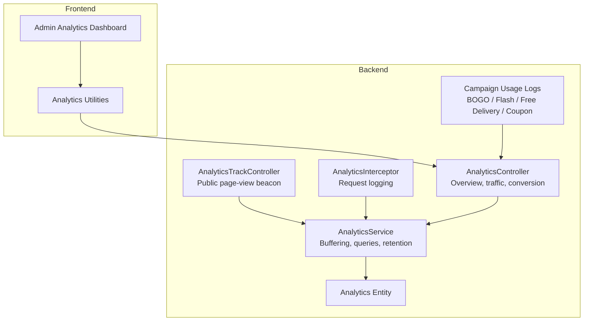
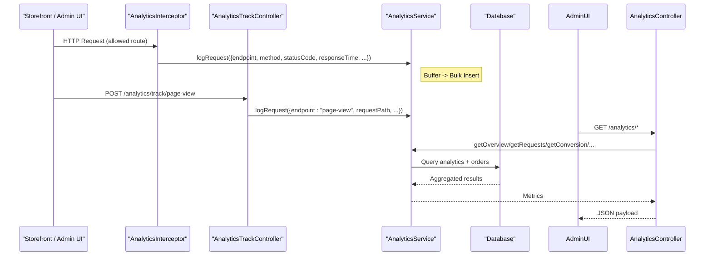
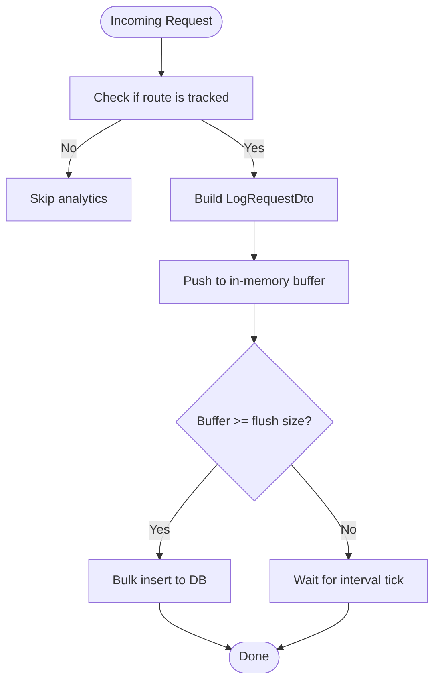
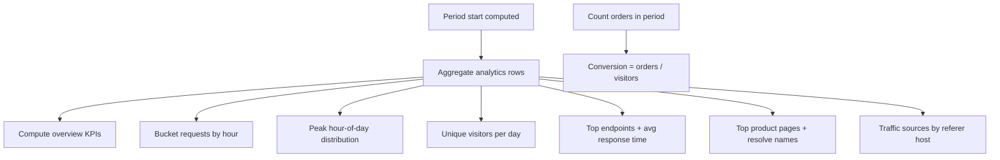
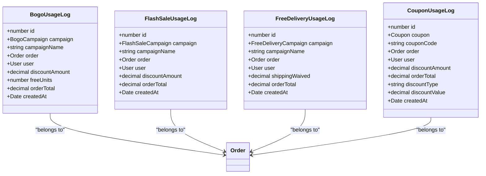
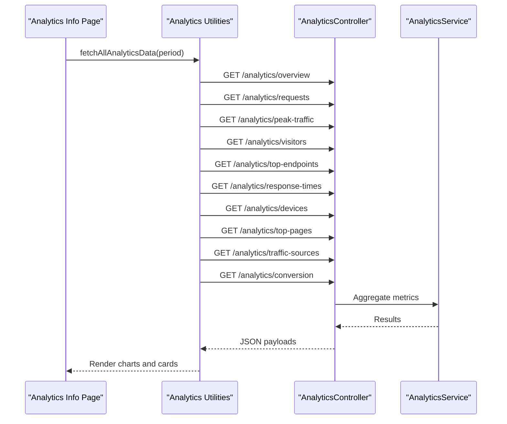
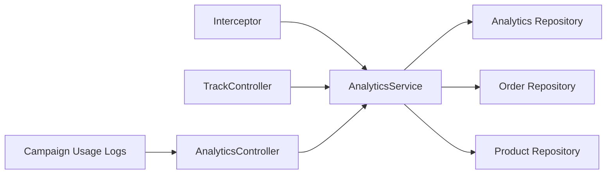

# Campaign Analytics & Reporting

<cite>
**Referenced Files in This Document**
- [analytics.controller.ts](file://apps/backend/src/analytics/analytics.controller.ts)
- [analytics.service.ts](file://apps/backend/src/analytics/analytics.service.ts)
- [analytics-track.controller.ts](file://apps/backend/src/analytics/analytics-track.controller.ts)
- [analytics.entity.ts](file://apps/backend/src/analytics/entities/analytics.entity.ts)
- [log-request.dto.ts](file://apps/backend/src/analytics/dto/log-request.dto.ts)
- [analytics.interceptor.ts](file://apps/backend/src/analytics/interceptors/analytics.interceptor.ts)
- [bogo-usage-log.entity.ts](file://apps/backend/src/bogo-usage-log/entities/bogo-usage-log.entity.ts)
- [flash-sale-usage-log.entity.ts](file://apps/backend/src/flash-sale-usage-log/entities/flash-sale-usage-log.entity.ts)
- [free-delivery-usage-log.entity.ts](file://apps/backend/src/free-delivery-usage-log/entities/free-delivery-usage-log.entity.ts)
- [coupon-usage-log.entity.ts](file://apps/backend/src/coupon-usage-log/entities/coupon-usage-log.entity.ts)
- [bogo-usage-log.controller.ts](file://apps/backend/src/bogo-usage-log/bogo-usage-log.controller.ts)
- [bogo-usage-log.service.ts](file://apps/backend/src/bogo-usage-log/bogo-usage-log.service.ts)
- [analytics-utils.ts](file://apps/frontend/utils/analytics-utils.ts)
- [analytics-info page](file://apps/frontend/app/admin/analytics/analytics-info/page.tsx)
- [conversion-card.tsx](file://apps/frontend/components/admin/analytics/conversion-card.tsx)
</cite>

## Table of Contents
1. [Introduction](#introduction)
2. [Project Structure](#project-structure)
3. [Core Components](#core-components)
4. [Architecture Overview](#architecture-overview)
5. [Detailed Component Analysis](#detailed-component-analysis)
6. [Dependency Analysis](#dependency-analysis)
7. [Performance Considerations](#performance-considerations)
8. [Troubleshooting Guide](#troubleshooting-guide)
9. [Conclusion](#conclusion)
10. [Appendices](#appendices)

## Introduction
This document explains the marketing campaign analytics and reporting system that tracks campaign performance, customer engagement, and revenue attribution across BOGO, flash sales, free delivery, and coupon campaigns. It covers data collection, aggregation, conversion and ROI calculations, segmentation by campaign participation, dashboard visualization, custom reporting, export strategies, BI integration, privacy considerations, performance optimization for large datasets, and real-time analytics capabilities.

## Project Structure
The analytics subsystem is implemented as a NestJS backend module with a Next.js admin dashboard:
- Backend analytics module exposes endpoints for overview, traffic, visitors, device/browser breakdown, top pages, traffic sources, response times, and conversion metrics.
- Storefront page views are captured via a public beacon endpoint to complement server-side request logs.
- Usage logs per campaign type (BOGO, flash sale, free delivery, coupons) provide granular discount and order value data for ROI and attribution.
- Frontend analytics dashboard aggregates multiple charts and KPIs from the backend APIs.

**Diagram sources**
- [analytics.controller.ts:33-329](file://apps/backend/src/analytics/analytics.controller.ts#L33-L329)
- [analytics.service.ts:39-616](file://apps/backend/src/analytics/analytics.service.ts#L39-L616)
- [analytics-track.controller.ts:32-61](file://apps/backend/src/analytics/analytics-track.controller.ts#L32-L61)
- [analytics.interceptor.ts:42-87](file://apps/backend/src/analytics/interceptors/analytics.interceptor.ts#L42-L87)
- [analytics.entity.ts:12-58](file://apps/backend/src/analytics/entities/analytics.entity.ts#L12-L58)
- [bogo-usage-log.entity.ts:14-69](file://apps/backend/src/bogo-usage-log/entities/bogo-usage-log.entity.ts#L14-L69)
- [flash-sale-usage-log.entity.ts:14-62](file://apps/backend/src/flash-sale-usage-log/entities/flash-sale-usage-log.entity.ts#L14-L62)
- [free-delivery-usage-log.entity.ts:14-62](file://apps/backend/src/free-delivery-usage-log/entities/free-delivery-usage-log.entity.ts#L14-L62)
- [coupon-usage-log.entity.ts:14-73](file://apps/backend/src/coupon-usage-log/entities/coupon-usage-log.entity.ts#L14-L73)

**Section sources**
- [analytics.controller.ts:33-329](file://apps/backend/src/analytics/analytics.controller.ts#L33-L329)
- [analytics.service.ts:39-616](file://apps/backend/src/analytics/analytics.service.ts#L39-L616)
- [analytics-track.controller.ts:32-61](file://apps/backend/src/analytics/analytics-track.controller.ts#L32-L61)
- [analytics.interceptor.ts:42-87](file://apps/backend/src/analytics/interceptors/analytics.interceptor.ts#L42-L87)
- [analytics.entity.ts:12-58](file://apps/backend/src/analytics/entities/analytics.entity.ts#L12-L58)

## Core Components
- AnalyticsController: REST endpoints for analytics overview, requests over time, peak traffic, unique visitors, top endpoints, response times, device/browser breakdown, top product pages, traffic sources, and visitor-to-order conversion.
- AnalyticsService: In-memory buffered ingestion, bulk flush to database, timezone-aware aggregations, index management, scheduled retention cleanup, and conversion calculation.
- AnalyticsTrackController: Public beacon for storefront page views, restricted to product detail paths.
- AnalyticsInterceptor: Captures API request/response telemetry for allowed routes and enriches logs with user identity, IP, user-agent, referer, and path.
- Analytics entity: Stores endpoint, method, status code, response time, user context, IP, user-agent, referer, requestPath, timestamp, and authentication flag.
- Campaign usage log entities: Capture per-campaign discounts, free units, shipping waived, order totals, timestamps, and relationships to orders/users.

Key responsibilities:
- Data collection: Interceptor + track controller feed the analytics table; storefront page views fill gaps where server-rendered pages bypass tracked routes.
- Aggregation: Service computes overview metrics, hourly/hour-of-day series, unique visitors, top endpoints/pages, device/browser mix, traffic sources, and conversion rate.
- Reporting: Controller returns structured payloads consumed by the frontend dashboard components.

**Section sources**
- [analytics.controller.ts:33-329](file://apps/backend/src/analytics/analytics.controller.ts#L33-L329)
- [analytics.service.ts:39-616](file://apps/backend/src/analytics/analytics.service.ts#L39-L616)
- [analytics-track.controller.ts:32-61](file://apps/backend/src/analytics/analytics-track.controller.ts#L32-L61)
- [analytics.interceptor.ts:42-87](file://apps/backend/src/analytics/interceptors/analytics.interceptor.ts#L42-L87)
- [analytics.entity.ts:12-58](file://apps/backend/src/analytics/entities/analytics.entity.ts#L12-L58)
- [bogo-usage-log.entity.ts:14-69](file://apps/backend/src/bogo-usage-log/entities/bogo-usage-log.entity.ts#L14-L69)
- [flash-sale-usage-log.entity.ts:14-62](file://apps/backend/src/flash-sale-usage-log/entities/flash-sale-usage-log.entity.ts#L14-L62)
- [free-delivery-usage-log.entity.ts:14-62](file://apps/backend/src/free-delivery-usage-log/entities/free-delivery-usage-log.entity.ts#L14-L62)
- [coupon-usage-log.entity.ts:14-73](file://apps/backend/src/coupon-usage-log/entities/coupon-usage-log.entity.ts#L14-L73)

## Architecture Overview
The system collects two complementary signals:
- Server-side request telemetry via interceptor for selected routes.
- Client-side page views via a public beacon for product detail pages.

Aggregations run against the analytics table and combine with order counts for conversion metrics. Campaign-specific usage logs enable ROI and discount impact analysis.

**Diagram sources**
- [analytics.interceptor.ts:42-87](file://apps/backend/src/analytics/interceptors/analytics.interceptor.ts#L42-L87)
- [analytics-track.controller.ts:32-61](file://apps/backend/src/analytics/analytics-track.controller.ts#L32-L61)
- [analytics.service.ts:142-192](file://apps/backend/src/analytics/analytics.service.ts#L142-L192)
- [analytics.controller.ts:33-329](file://apps/backend/src/analytics/analytics.controller.ts#L33-L329)

## Detailed Component Analysis

### Analytics Collection Pipeline
- Interceptor captures request metadata for allowed routes and calls service.logRequest.
- TrackController accepts only product detail paths and records a synthetic GET request with client IP, user-agent, referer, and concrete requestPath.
- Service buffers entries and performs batch inserts at configured intervals or when buffer reaches threshold.

**Diagram sources**
- [analytics.interceptor.ts:42-87](file://apps/backend/src/analytics/interceptors/analytics.interceptor.ts#L42-L87)
- [analytics-track.controller.ts:32-61](file://apps/backend/src/analytics/analytics-track.controller.ts#L32-L61)
- [analytics.service.ts:142-192](file://apps/backend/src/analytics/analytics.service.ts#L142-L192)
- [log-request.dto.ts:1-46](file://apps/backend/src/analytics/dto/log-request.dto.ts#L1-L46)

**Section sources**
- [analytics.interceptor.ts:42-87](file://apps/backend/src/analytics/interceptors/analytics.interceptor.ts#L42-L87)
- [analytics-track.controller.ts:32-61](file://apps/backend/src/analytics/analytics-track.controller.ts#L32-L61)
- [analytics.service.ts:142-192](file://apps/backend/src/analytics/analytics.service.ts#L142-L192)
- [log-request.dto.ts:1-46](file://apps/backend/src/analytics/dto/log-request.dto.ts#L1-L46)

### Analytics Aggregation and Conversion Metrics
- Overview aggregates total requests, unique visitors, peak hour, top endpoint, and average response time.
- Requests over time are bucketed by hour and zero-filled to ensure continuous chart axes.
- Peak traffic shows hour-of-day distribution across the period.
- Unique visitors count distinct users/IPs per day aligned to local timezone.
- Top endpoints and top product pages include counts and average response times; product names are resolved from IDs/slugs.
- Traffic sources group by referer host; missing referer is labeled Direct.
- Conversion rate = placed orders / unique visitors in the same period.

**Diagram sources**
- [analytics.service.ts:194-548](file://apps/backend/src/analytics/analytics.service.ts#L194-L548)

**Section sources**
- [analytics.service.ts:194-548](file://apps/backend/src/analytics/analytics.service.ts#L194-L548)

### Campaign Usage Logs and ROI Attribution
Each campaign type maintains a usage log entity capturing:
- BOGO: discount amount, free units, order total, campaign snapshot.
- Flash Sale: discount amount, order total, campaign snapshot.
- Free Delivery: shipping waived, order total, campaign snapshot.
- Coupons: discount amount, order total before discount, discount type/value, coupon code.

These logs enable:
- Revenue attribution per campaign.
- Discount impact and ROI analysis.
- Customer segmentation by campaign participation.

**Diagram sources**
- [bogo-usage-log.entity.ts:14-69](file://apps/backend/src/bogo-usage-log/entities/bogo-usage-log.entity.ts#L14-L69)
- [flash-sale-usage-log.entity.ts:14-62](file://apps/backend/src/flash-sale-usage-log/entities/flash-sale-usage-log.entity.ts#L14-L62)
- [free-delivery-usage-log.entity.ts:14-62](file://apps/backend/src/free-delivery-usage-log/entities/free-delivery-usage-log.entity.ts#L14-L62)
- [coupon-usage-log.entity.ts:14-73](file://apps/backend/src/coupon-usage-log/entities/coupon-usage-log.entity.ts#L14-L73)

**Section sources**
- [bogo-usage-log.entity.ts:14-69](file://apps/backend/src/bogo-usage-log/entities/bogo-usage-log.entity.ts#L14-L69)
- [flash-sale-usage-log.entity.ts:14-62](file://apps/backend/src/flash-sale-usage-log/entities/flash-sale-usage-log.entity.ts#L14-L62)
- [free-delivery-usage-log.entity.ts:14-62](file://apps/backend/src/free-delivery-usage-log/entities/free-delivery-usage-log.entity.ts#L14-L62)
- [coupon-usage-log.entity.ts:14-73](file://apps/backend/src/coupon-usage-log/entities/coupon-usage-log.entity.ts#L14-L73)

### Reporting Dashboard
The admin analytics dashboard fetches all metrics concurrently and renders:
- Overview cards (requests/min, total requests, unique visitors, peak hour, top endpoint, avg response time).
- Requests over time chart.
- Peak traffic chart.
- Visitors chart.
- Device and browser breakdown.
- Top product pages.
- Traffic sources.
- Conversion card showing conversion rate, orders, and visitors.

**Diagram sources**
- [analytics-info page:75-84](file://apps/frontend/app/admin/analytics/analytics-info/page.tsx#L75-L84)
- [analytics-utils.ts:100-113](file://apps/frontend/utils/analytics-utils.ts#L100-L113)
- [analytics.controller.ts:33-329](file://apps/backend/src/analytics/analytics.controller.ts#L33-L329)
- [conversion-card.tsx:11-20](file://apps/frontend/components/admin/analytics/conversion-card.tsx#L11-L20)

**Section sources**
- [analytics-info page:75-84](file://apps/frontend/app/admin/analytics/analytics-info/page.tsx#L75-L84)
- [analytics-utils.ts:100-113](file://apps/frontend/utils/analytics-utils.ts#L100-L113)
- [analytics.controller.ts:33-329](file://apps/backend/src/analytics/analytics.controller.ts#L33-L329)
- [conversion-card.tsx:11-20](file://apps/frontend/components/admin/analytics/conversion-card.tsx#L11-L20)

## Dependency Analysis
- Controllers depend on AnalyticsService for all aggregation logic.
- AnalyticsService depends on TypeORM repositories for analytics, orders, and products.
- Interceptor depends on AnalyticsService for ingestion.
- TrackController depends on AnalyticsService and shared path regex for validation.
- Campaign usage logs are independent but used for ROI and attribution reports.

**Diagram sources**
- [analytics.controller.ts:33-329](file://apps/backend/src/analytics/analytics.controller.ts#L33-L329)
- [analytics.service.ts:39-616](file://apps/backend/src/analytics/analytics.service.ts#L39-L616)
- [analytics.interceptor.ts:42-87](file://apps/backend/src/analytics/interceptors/analytics.interceptor.ts#L42-L87)
- [analytics-track.controller.ts:32-61](file://apps/backend/src/analytics/analytics-track.controller.ts#L32-L61)

**Section sources**
- [analytics.controller.ts:33-329](file://apps/backend/src/analytics/analytics.controller.ts#L33-L329)
- [analytics.service.ts:39-616](file://apps/backend/src/analytics/analytics.service.ts#L39-L616)
- [analytics.interceptor.ts:42-87](file://apps/backend/src/analytics/interceptors/analytics.interceptor.ts#L42-L87)
- [analytics-track.controller.ts:32-61](file://apps/backend/src/analytics/analytics-track.controller.ts#L32-L61)

## Performance Considerations
- Buffered ingestion: The service batches analytics rows and flushes them periodically or when reaching a threshold, reducing database round trips.
- Index management: On startup, the service creates necessary indexes for timestamp and composite timestamp+endpoint queries to avoid full scans.
- Retention policy: A daily cron purges old analytics rows beyond a configurable retention window to keep the table bounded.
- Timezone alignment: Aggregations align to local timezone buckets to prevent misaligned charts and duplicate labels.
- Concurrency safety: Flushing is single-flight to prevent race conditions; failed flushes re-queue rows respecting buffer cap.

Recommendations:
- Tune ANALYTICS_FLUSH_BATCH_SIZE, ANALYTICS_MAX_BUFFER_SIZE, and ANALYTICS_FLUSH_INTERVAL_MS based on traffic volume.
- Monitor ANALYTICS_RETENTION_DAYS to balance storage costs and historical analysis needs.
- Ensure database indexes exist in production environments where ORM synchronization is disabled.

**Section sources**
- [analytics.service.ts:59-117](file://apps/backend/src/analytics/analytics.service.ts#L59-L117)
- [analytics.service.ts:142-192](file://apps/backend/src/analytics/analytics.service.ts#L142-L192)
- [analytics.service.ts:587-615](file://apps/backend/src/analytics/analytics.service.ts#L587-L615)

## Troubleshooting Guide
Common issues and resolutions:
- Missing analytics data: Verify that the interceptor is enabled for the intended routes and that the route path matches allowed patterns.
- Incorrect time buckets: Confirm timezone handling and that date truncation aligns with local business hours.
- Slow dashboard queries: Ensure indexes on timestamp and composite timestamp+endpoint are created; check retention settings to limit table growth.
- Conversion anomalies: Validate that order creation timestamps fall within the selected period and that unique visitor counting uses userId or ipAddress consistently.

Operational checks:
- Inspect buffer behavior and flush logs for errors.
- Review cron retention job logs for successful deletions.
- Validate that the public page-view beacon only accepts product detail paths.

**Section sources**
- [analytics.interceptor.ts:42-87](file://apps/backend/src/analytics/interceptors/analytics.interceptor.ts#L42-L87)
- [analytics.service.ts:59-117](file://apps/backend/src/analytics/analytics.service.ts#L59-L117)
- [analytics.service.ts:587-615](file://apps/backend/src/analytics/analytics.service.ts#L587-L615)
- [analytics-track.controller.ts:32-61](file://apps/backend/src/analytics/analytics-track.controller.ts#L32-L61)

## Conclusion
The analytics and reporting system provides robust data collection through both server-side interceptors and client-side beacons, powerful aggregation for traffic and conversion metrics, and detailed campaign usage logs for ROI and attribution. The admin dashboard visualizes key insights and supports strategic decision-making. With careful tuning of buffering, indexing, and retention, the system scales effectively for large datasets while maintaining privacy and performance.

## Appendices

### API Reference Summary
- Overview: GET /analytics/overview?period=...
- Requests over time: GET /analytics/requests?period=...
- Peak traffic: GET /analytics/peak-traffic?period=...
- Unique visitors: GET /analytics/visitors?period=...
- Top endpoints: GET /analytics/top-endpoints?limit=...&period=...
- Response times: GET /analytics/response-times?period=...
- Devices and browsers: GET /analytics/devices?period=...
- Top product pages: GET /analytics/top-pages?period=...&limit=...
- Traffic sources: GET /analytics/traffic-sources?period=...
- Conversion: GET /analytics/conversion?period=...
- Page view beacon: POST /analytics/track/page-view

**Section sources**
- [analytics.controller.ts:33-329](file://apps/backend/src/analytics/analytics.controller.ts#L33-L329)
- [analytics-track.controller.ts:32-61](file://apps/backend/src/analytics/analytics-track.controller.ts#L32-L61)

### Custom Reports and Export Strategies
- Use the existing report stats endpoints for campaign usage logs (e.g., BOGO report stats) to aggregate total uses, discount given, free units, order value, average order value, and unique campaigns, optionally filtered by date range and campaign ID.
- For custom reports, query the usage log entities directly or extend the service methods to compute additional KPIs such as ROI per campaign:
  - ROI per campaign = (attributed revenue uplift - discount cost) / discount cost.
  - Segment customers by campaign participation using order relationships in usage logs.
- Export data by querying the usage log tables and analytics table with date filters, then format as CSV/JSON for downstream BI tools.

**Section sources**
- [bogo-usage-log.controller.ts:87-133](file://apps/backend/src/bogo-usage-log/bogo-usage-log.controller.ts#L87-L133)
- [bogo-usage-log.service.ts:113-137](file://apps/backend/src/bogo-usage-log/bogo-usage-log.service.ts#L113-L137)
- [bogo-usage-log.entity.ts:14-69](file://apps/backend/src/bogo-usage-log/entities/bogo-usage-log.entity.ts#L14-L69)

### BI Integration Guidance
- Connect BI tools to the database to query:
  - analytics table for traffic, device/browser, and conversion trends.
  - campaign usage logs for discount impact and ROI.
- Alternatively, use the provided endpoints to pull aggregated metrics into BI dashboards via scheduled jobs or API connectors.

[No sources needed since this section provides general guidance]

### Privacy and Security Notes
- Analytics logs may contain IP addresses, user agents, referers, and authenticated user IDs. Treat these as personal data under applicable privacy regulations.
- Avoid exposing sensitive fields in external reports; mask or anonymize identifiers where required.
- The page-view beacon does not require authentication and relies on throttling to prevent abuse.

**Section sources**
- [analytics.entity.ts:12-58](file://apps/backend/src/analytics/entities/analytics.entity.ts#L12-L58)
- [analytics-track.controller.ts:32-61](file://apps/backend/src/analytics/analytics-track.controller.ts#L32-L61)