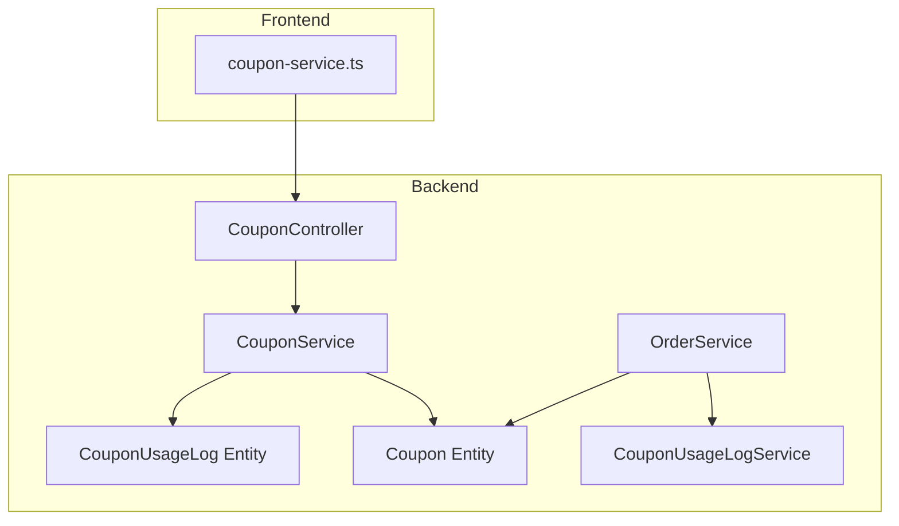
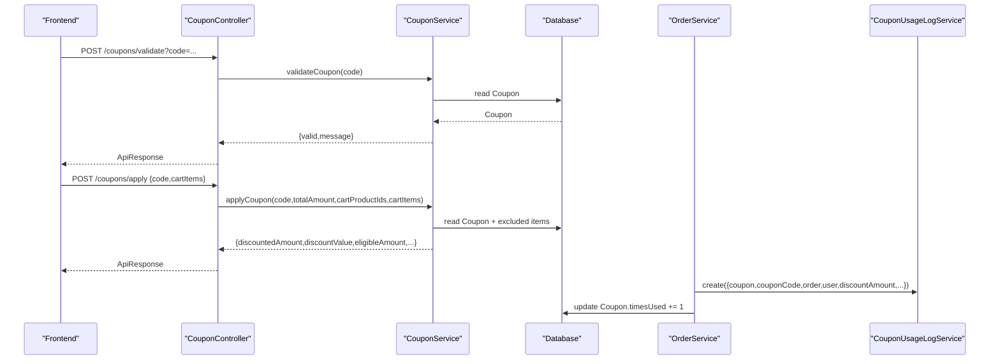
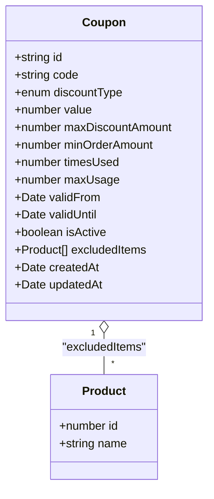
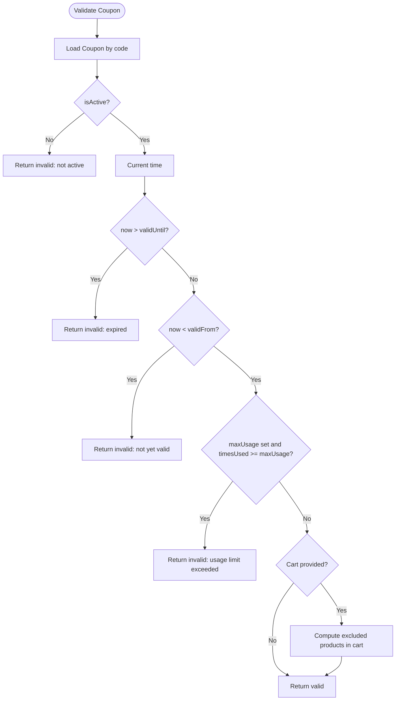
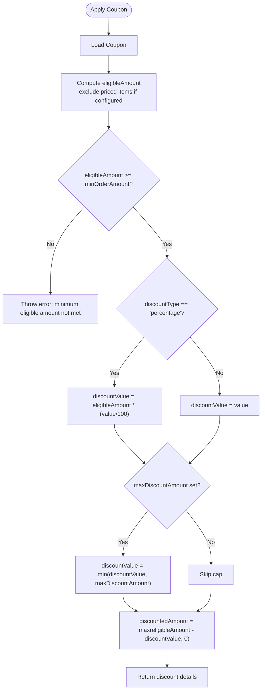
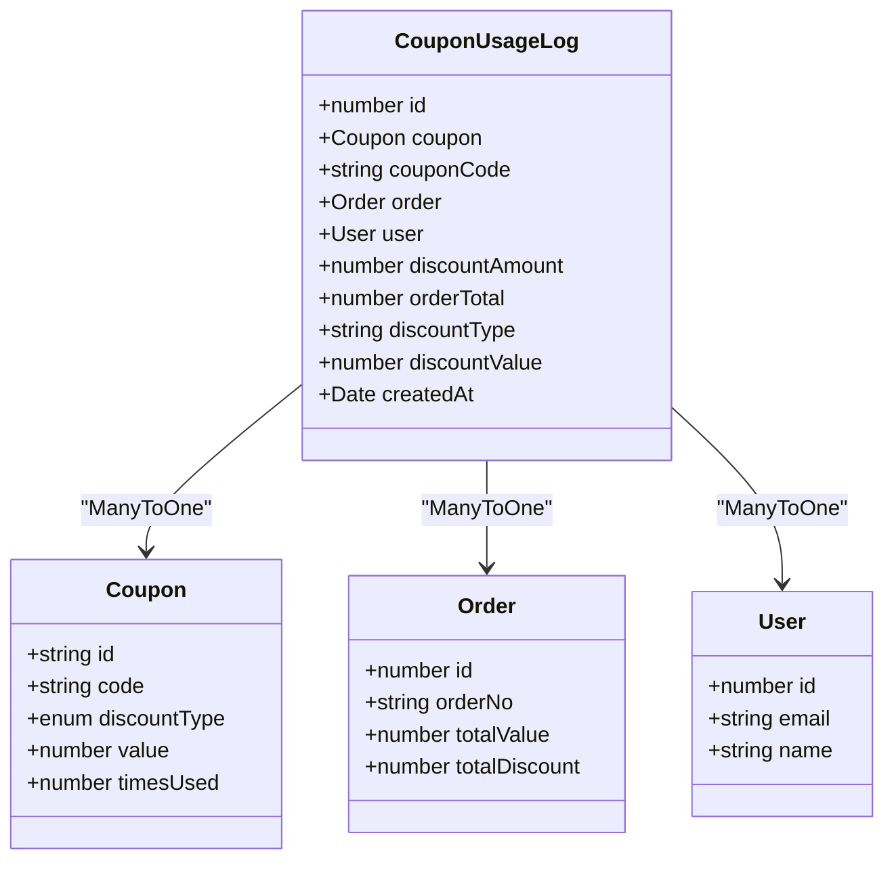
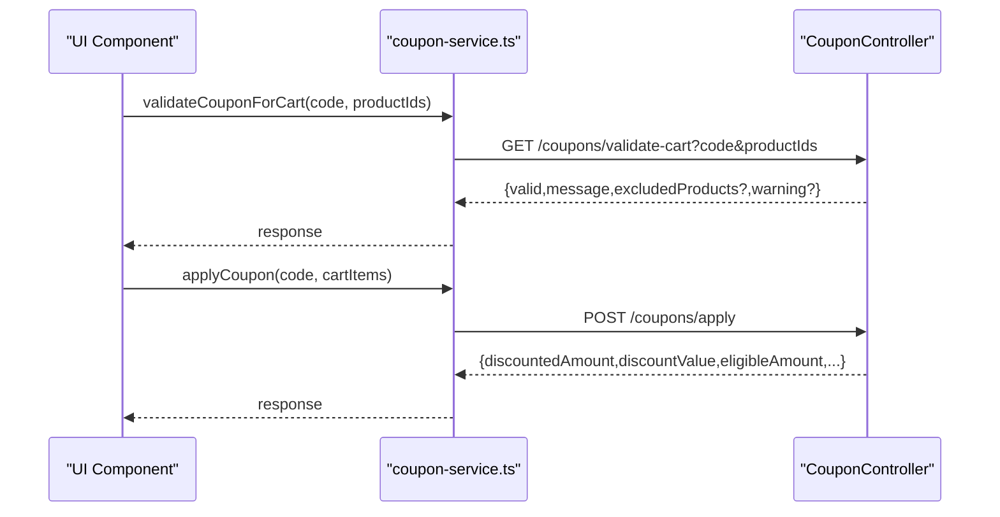
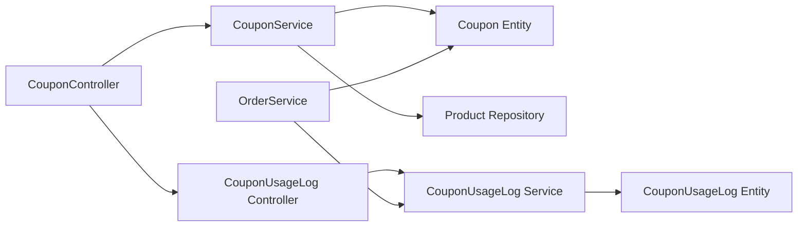

# Coupon System

<cite>
**Referenced Files in This Document**
- [coupon.service.ts](file://apps/backend/src/coupon/coupon.service.ts)
- [coupon.controller.ts](file://apps/backend/src/coupon/coupon.controller.ts)
- [coupon.entity.ts](file://apps/backend/src/coupon/entities/coupon.entity.ts)
- [create-coupon.dto.ts](file://apps/backend/src/coupon/dto/create-coupon.dto.ts)
- [apply-coupon.dto.ts](file://apps/backend/src/coupon/dto/apply-coupon.dto.ts)
- [coupon-usage-log.service.ts](file://apps/backend/src/coupon-usage-log/coupon-usage-log.service.ts)
- [coupon-usage-log.controller.ts](file://apps/backend/src/coupon-usage-log/coupon-usage-log.controller.ts)
- [coupon-usage-log.entity.ts](file://apps/backend/src/coupon-usage-log/entities/coupon-usage-log.entity.ts)
- [order.service.ts](file://apps/backend/src/order/order.service.ts)
- [index.ts](file://apps/backend/src/common/enums/index.ts)
- [coupon-service.ts](file://apps/frontend/lib/coupon-service.ts)
</cite>

## Table of Contents
1. [Introduction](#introduction)
2. [Project Structure](#project-structure)
3. [Core Components](#core-components)
4. [Architecture Overview](#architecture-overview)
5. [Detailed Component Analysis](#detailed-component-analysis)
6. [Dependency Analysis](#dependency-analysis)
7. [Performance Considerations](#performance-considerations)
8. [Troubleshooting Guide](#troubleshooting-guide)
9. [Conclusion](#conclusion)
10. [Appendices](#appendices)

## Introduction
This document explains the coupon management system implemented in the backend and its integration points with order processing, cart validation, and analytics. It covers:
- Coupon creation and configuration (discount types, limits, validity windows, exclusions, minimum spend)
- Validation engine (code existence, activation, time window, usage caps, eligibility)
- Discount application (percentage vs fixed, max discount cap, eligible amount calculation)
- Usage logging and reporting (redemption tracking, campaign effectiveness, top coupons)
- Integration with orders (final totals, usage increment, logging)
- Frontend API consumption for validation and application
- Security, fraud prevention, performance optimization, and ROI measurement guidance

Note on discount types: The current enum supports percentage and fixed discounts. Free shipping is not modeled as a coupon discount type in this codebase; it is handled by separate free delivery campaigns.

## Project Structure
The coupon subsystem is organized into:
- Coupon domain: entity, DTOs, service, controller
- Coupon usage log domain: entity, service, controller
- Order integration: order service logs coupon usage and increments counters
- Frontend client: utility functions to call coupon APIs

**Diagram sources**
- [coupon.controller.ts:37-325](file://apps/backend/src/coupon/coupon.controller.ts#L37-L325)
- [coupon.service.ts:16-392](file://apps/backend/src/coupon/coupon.service.ts#L16-L392)
- [coupon.entity.ts:13-66](file://apps/backend/src/coupon/entities/coupon.entity.ts#L13-L66)
- [coupon-usage-log.service.ts:20-252](file://apps/backend/src/coupon-usage-log/coupon-usage-log.service.ts#L20-L252)
- [coupon-usage-log.entity.ts:14-73](file://apps/backend/src/coupon-usage-log/entities/coupon-usage-log.entity.ts#L14-L73)
- [order.service.ts:434-474](file://apps/backend/src/order/order.service.ts#L434-L474)
- [coupon-service.ts:36-80](file://apps/frontend/lib/coupon-service.ts#L36-L80)

**Section sources**
- [coupon.controller.ts:37-325](file://apps/backend/src/coupon/coupon.controller.ts#L37-L325)
- [coupon.service.ts:16-392](file://apps/backend/src/coupon/coupon.service.ts#L16-L392)
- [coupon.entity.ts:13-66](file://apps/backend/src/coupon/entities/coupon.entity.ts#L13-L66)
- [coupon-usage-log.service.ts:20-252](file://apps/backend/src/coupon-usage-log/coupon-usage-log.service.ts#L20-L252)
- [coupon-usage-log.entity.ts:14-73](file://apps/backend/src/coupon-usage-log/entities/coupon-usage-log.entity.ts#L14-L73)
- [order.service.ts:434-474](file://apps/backend/src/order/order.service.ts#L434-L474)
- [coupon-service.ts:36-80](file://apps/frontend/lib/coupon-service.ts#L36-L80)

## Core Components
- Coupon entity: stores code, discount type, value, optional max discount cap, min order amount, times used, max usage, validity window, active flag, and excluded products.
- Coupon service: CRUD operations, validation, discount application, cart-aware validation.
- Coupon usage log service: persistence, pagination, aggregation, top coupons.
- Order service: finalizes orders, logs coupon usage, increments coupon usage counter.
- Frontend coupon service: calls validate, validate-cart, and apply endpoints.

Key capabilities:
- Percentage and fixed discounts
- Max discount cap
- Minimum eligible order amount
- Excluded product list
- Validity window and activation status
- Global usage limit and per-coupon usage counter
- Cart-aware validation and application

**Section sources**
- [coupon.entity.ts:13-66](file://apps/backend/src/coupon/entities/coupon.entity.ts#L13-L66)
- [coupon.service.ts:25-306](file://apps/backend/src/coupon/coupon.service.ts#L25-L306)
- [coupon-usage-log.service.ts:29-251](file://apps/backend/src/coupon-usage-log/coupon-usage-log.service.ts#L29-L251)
- [order.service.ts:450-474](file://apps/backend/src/order/order.service.ts#L450-L474)
- [coupon-service.ts:36-80](file://apps/frontend/lib/coupon-service.ts#L36-L80)

## Architecture Overview
The coupon flow spans frontend requests, backend controllers, services, and data models, with order processing integrating coupon usage logging.

**Diagram sources**
- [coupon.controller.ts:177-266](file://apps/backend/src/coupon/coupon.controller.ts#L177-L266)
- [coupon.service.ts:135-306](file://apps/backend/src/coupon/coupon.service.ts#L135-L306)
- [order.service.ts:450-474](file://apps/backend/src/order/order.service.ts#L450-L474)
- [coupon-usage-log.service.ts:29-40](file://apps/backend/src/coupon-usage-log/coupon-usage-log.service.ts#L29-L40)

## Detailed Component Analysis

### Coupon Data Model and Creation
- Fields include unique code, discount type, numeric value, optional max discount cap, optional minimum order amount, times used, optional max usage, validFrom/validUntil, isActive, and many-to-many excluded products.
- Creation validates uniqueness of code, persists basic fields first, then attaches excluded products via relation builder.

**Diagram sources**
- [coupon.entity.ts:13-66](file://apps/backend/src/coupon/entities/coupon.entity.ts#L13-L66)

Implementation highlights:
- Uniqueness guard on code prevents duplicates.
- Excluded items are attached after initial save using a relation query builder.
- DTO enforces required fields and optional constraints.

**Section sources**
- [coupon.entity.ts:13-66](file://apps/backend/src/coupon/entities/coupon.entity.ts#L13-L66)
- [coupon.service.ts:25-54](file://apps/backend/src/coupon/coupon.service.ts#L25-L54)
- [create-coupon.dto.ts:6-89](file://apps/backend/src/coupon/dto/create-coupon.dto.ts#L6-L89)

### Coupon Validation Engine
Validation checks:
- Coupon exists and is active
- Not expired (validUntil)
- Not yet valid (validFrom)
- Usage limit not exceeded (timesUsed < maxUsage when set)

Cart-aware validation additionally reports excluded products without invalidating the coupon.

**Diagram sources**
- [coupon.service.ts:135-178](file://apps/backend/src/coupon/coupon.service.ts#L135-L178)
- [coupon.service.ts:313-391](file://apps/backend/src/coupon/coupon.service.ts#L313-L391)

API surface:
- Validate endpoint returns boolean validity and message.
- Validate-cart endpoint returns validity plus excluded product details and warning if applicable.

**Section sources**
- [coupon.controller.ts:177-222](file://apps/backend/src/coupon/coupon.controller.ts#L177-L222)
- [coupon.controller.ts:268-324](file://apps/backend/src/coupon/coupon.controller.ts#L268-L324)
- [coupon.service.ts:135-178](file://apps/backend/src/coupon/coupon.service.ts#L135-L178)
- [coupon.service.ts:313-391](file://apps/backend/src/coupon/coupon.service.ts#L313-L391)

### Discount Application Logic
Application rules:
- Eligible amount excludes prices of excluded products when cart items are provided.
- Minimum eligible order amount enforced against eligible amount.
- Percentage discount computed as eligibleAmount * (value / 100), capped by maxDiscountAmount if set.
- Fixed discount equals value, also capped by maxDiscountAmount if set.
- Final discountedAmount = max(eligibleAmount - discountValue, 0).

**Diagram sources**
- [coupon.service.ts:180-306](file://apps/backend/src/coupon/coupon.service.ts#L180-L306)

DTO for applying:
- Requires code and cartItems array with productId and price.

**Section sources**
- [coupon.service.ts:180-306](file://apps/backend/src/coupon/coupon.service.ts#L180-L306)
- [apply-coupon.dto.ts:4-23](file://apps/backend/src/coupon/dto/apply-coupon.dto.ts#L4-L23)

### Usage Logging and Analytics
Logging captures:
- Coupon reference and code
- Order reference and user
- Discount amount applied, original order total, discount type, and discount value
- Timestamp

Analytics features:
- Paginated listing with date range filters
- Per-coupon statistics (uses, total discount given, average discount, total order value)
- Aggregated report stats across coupons or filtered by date and coupon code
- Top coupons by usage over last N days

**Diagram sources**
- [coupon-usage-log.entity.ts:14-73](file://apps/backend/src/coupon-usage-log/entities/coupon-usage-log.entity.ts#L14-L73)

Integration with order placement:
- After saving an order, if a coupon was applied with positive discount, the system logs usage and increments the coupon’s timesUsed counter. Errors in logging do not fail the order.

**Section sources**
- [coupon-usage-log.entity.ts:14-73](file://apps/backend/src/coupon-usage-log/entities/coupon-usage-log.entity.ts#L14-L73)
- [coupon-usage-log.service.ts:29-40](file://apps/backend/src/coupon-usage-log/coupon-usage-log.service.ts#L29-L40)
- [coupon-usage-log.service.ts:160-251](file://apps/backend/src/coupon-usage-log/coupon-usage-log.service.ts#L160-L251)
- [order.service.ts:450-474](file://apps/backend/src/order/order.service.ts#L450-L474)

### Frontend Integration
The frontend exposes helper functions to:
- Validate a coupon code
- Validate a coupon against cart product IDs
- Apply a coupon with cart items

These call backend endpoints under /coupons.

**Diagram sources**
- [coupon-service.ts:36-80](file://apps/frontend/lib/coupon-service.ts#L36-L80)
- [coupon.controller.ts:177-324](file://apps/backend/src/coupon/coupon.controller.ts#L177-L324)

**Section sources**
- [coupon-service.ts:36-80](file://apps/frontend/lib/coupon-service.ts#L36-L80)
- [coupon.controller.ts:177-324](file://apps/backend/src/coupon/coupon.controller.ts#L177-L324)

## Dependency Analysis
Coupling and cohesion:
- Controllers depend only on their respective services.
- Services encapsulate business logic and interact with repositories/entities.
- Order service depends on coupon and usage log services to finalize promotions and record metrics.
- Frontend depends on backend REST endpoints exposed by controllers.

External dependencies:
- TypeORM entities and repositories
- NestJS guards and decorators for authentication and authorization
- Common enums for discount types and statuses

Potential circular dependencies:
- None observed between coupon and usage log modules; order service references both independently.

**Diagram sources**
- [coupon.controller.ts:37-325](file://apps/backend/src/coupon/coupon.controller.ts#L37-L325)
- [coupon.service.ts:16-392](file://apps/backend/src/coupon/coupon.service.ts#L16-L392)
- [coupon-usage-log.controller.ts:26-237](file://apps/backend/src/coupon-usage-log/coupon-usage-log.controller.ts#L26-L237)
- [coupon-usage-log.service.ts:20-252](file://apps/backend/src/coupon-usage-log/coupon-usage-log.service.ts#L20-L252)
- [order.service.ts:450-474](file://apps/backend/src/order/order.service.ts#L450-L474)

**Section sources**
- [index.ts:38-41](file://apps/backend/src/common/enums/index.ts#L38-L41)
- [coupon.controller.ts:37-325](file://apps/backend/src/coupon/coupon.controller.ts#L37-L325)
- [coupon.service.ts:16-392](file://apps/backend/src/coupon/coupon.service.ts#L16-L392)
- [coupon-usage-log.controller.ts:26-237](file://apps/backend/src/coupon-usage-log/coupon-usage-log.controller.ts#L26-L237)
- [coupon-usage-log.service.ts:20-252](file://apps/backend/src/coupon-usage-log/coupon-usage-log.service.ts#L20-L252)
- [order.service.ts:450-474](file://apps/backend/src/order/order.service.ts#L450-L474)

## Performance Considerations
- Use cart item prices to compute eligible amounts rather than relying solely on total cart amount to avoid unnecessary product lookups.
- Batch product fetches for excluded items using IN queries to reduce round trips.
- Paginate usage logs efficiently with skip/take and count queries separated from joins.
- Aggregate statistics using SQL-level aggregations (COUNT, SUM, AVG) to minimize data transfer.
- Cache frequently accessed coupon metadata where appropriate (e.g., admin lists) to reduce repeated reads.
- Avoid heavy relations in high-frequency paths; load only necessary relations.

[No sources needed since this section provides general guidance]

## Troubleshooting Guide
Common issues and resolutions:
- Coupon not found: Ensure the code exists and is correctly passed to validation endpoints.
- Coupon inactive: Check isActive flag and re-enable if needed.
- Coupon expired or not yet valid: Verify validFrom and validUntil timestamps.
- Usage limit exceeded: Confirm maxUsage and current timesUsed; adjust or wait for reset if applicable.
- Minimum eligible amount not met: Ensure eligible amount (after excluding restricted products) meets minOrderAmount.
- Excluded products warning: Some items may be excluded; discount applies only to eligible items.

Operational tips:
- Inspect usage logs to confirm redemption and discount values.
- Review aggregated stats to detect anomalies or unusually high discount rates.
- When order creation fails due to logging errors, check logs but note that order creation should still succeed.

**Section sources**
- [coupon.service.ts:135-178](file://apps/backend/src/coupon/coupon.service.ts#L135-L178)
- [coupon.service.ts:180-306](file://apps/backend/src/coupon/coupon.service.ts#L180-L306)
- [coupon.service.ts:313-391](file://apps/backend/src/coupon/coupon.service.ts#L313-L391)
- [order.service.ts:450-474](file://apps/backend/src/order/order.service.ts#L450-L474)

## Conclusion
The coupon system provides robust support for percentage and fixed discounts, configurable eligibility rules, and comprehensive usage analytics. It integrates cleanly with order processing and offers clear APIs for frontend validation and application. While free shipping is not a coupon discount type here, the same patterns can be extended to other promotional mechanisms. For advanced scenarios such as customer-specific coupons, category-based restrictions, and multi-coupon stacking, additional model fields and validation logic would be required beyond the current implementation.

[No sources needed since this section summarizes without analyzing specific files]

## Appendices

### Implementation Examples

- Generate unique coupon codes:
  - Create a code generation utility that ensures uniqueness before persisting via the create endpoint.
  - Enforce uniqueness at the database level (unique constraint on code).

- Apply complex discount rules:
  - Use exclude product lists to restrict applicability.
  - Set minOrderAmount to enforce minimum eligible spend.
  - Apply maxDiscountAmount to cap percentage discounts.

- Handle multi-coupon scenarios:
  - Current design applies one coupon per order. To support multiple coupons, extend the order model to track multiple coupon applications and adjust discount computation accordingly.

- Customer-specific coupons:
  - Add a customerId field to the coupon entity and enforce eligibility during validation.

- Category-based restrictions:
  - Introduce a category exclusion/inclusion mechanism linked to products and evaluate against cart items during validation/application.

- Minimum purchase requirements:
  - Already supported via minOrderAmount evaluated against eligible amount.

- Security and fraud prevention:
  - Restrict coupon creation and updates to authenticated admin roles using existing guards.
  - Rate-limit validation and application endpoints to prevent abuse.
  - Log all attempts and failures for auditability.

- Performance optimization:
  - Precompute eligible amounts on the server side using cart item prices.
  - Use efficient queries and pagination for logs and reports.

- Analytics for campaign ROI:
  - Use getReportStats and getTopCoupons to measure usage, discount impact, and revenue lift.
  - Track conversion rates by correlating coupon usage with order completion.

**Section sources**
- [coupon.entity.ts:13-66](file://apps/backend/src/coupon/entities/coupon.entity.ts#L13-L66)
- [coupon.service.ts:180-306](file://apps/backend/src/coupon/coupon.service.ts#L180-L306)
- [coupon-usage-log.service.ts:160-251](file://apps/backend/src/coupon-usage-log/coupon-usage-log.service.ts#L160-L251)
- [index.ts:38-41](file://apps/backend/src/common/enums/index.ts#L38-L41)