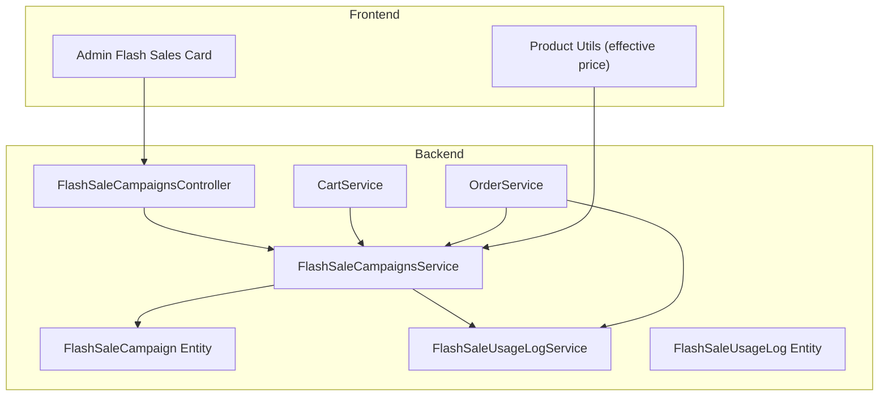
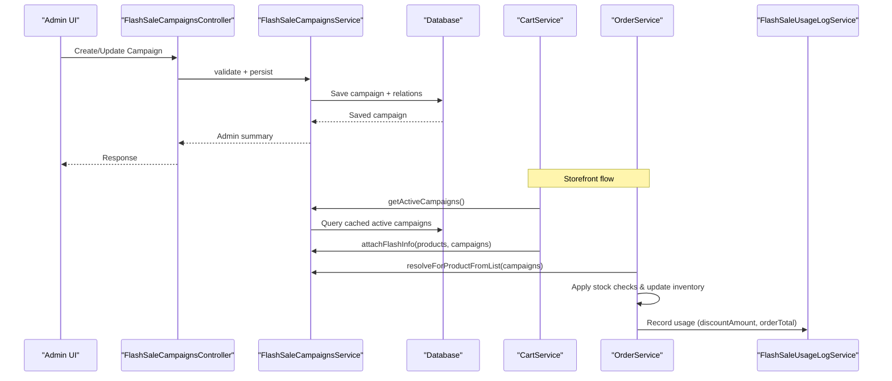
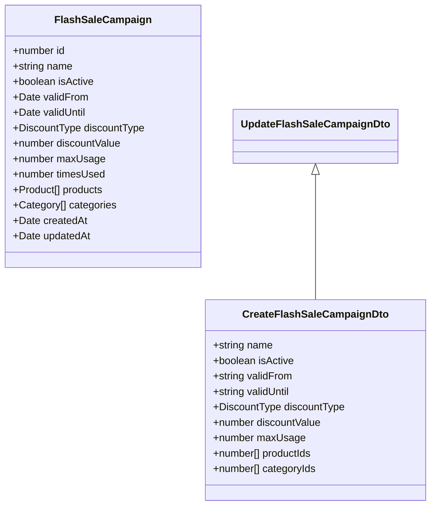
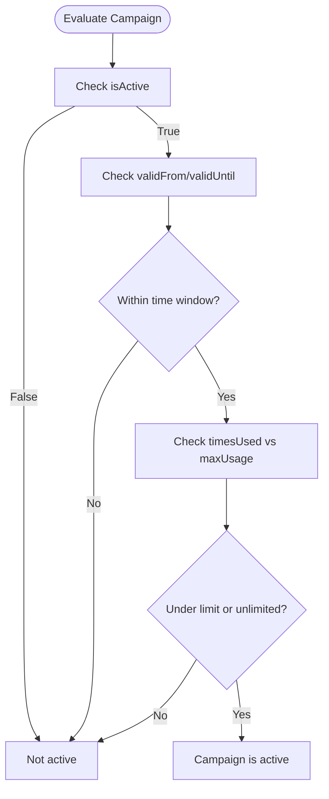
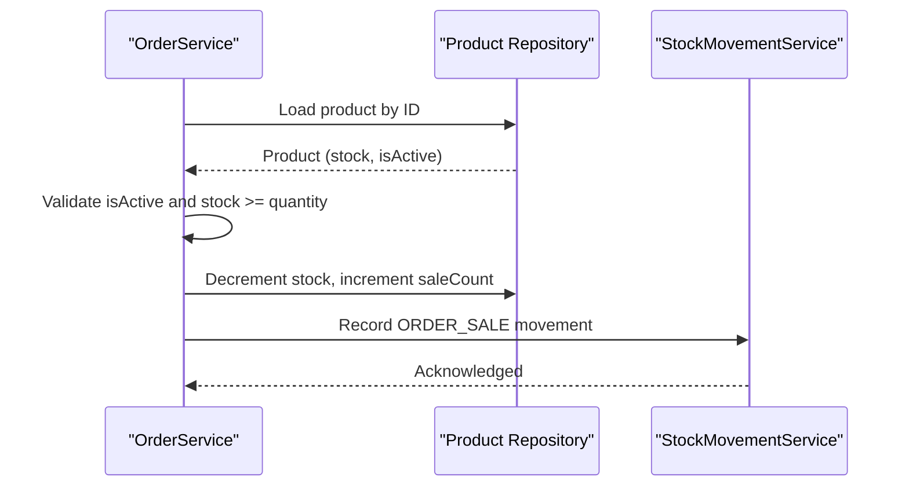
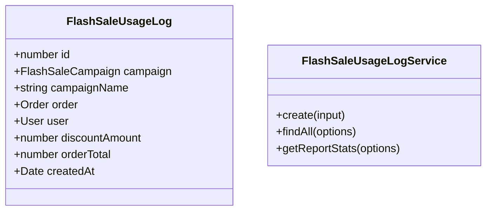
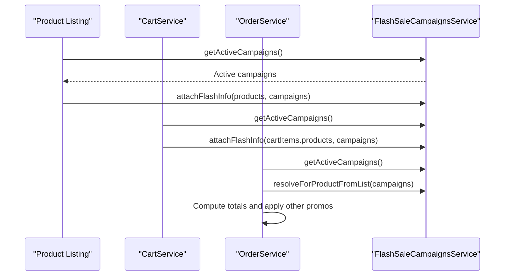
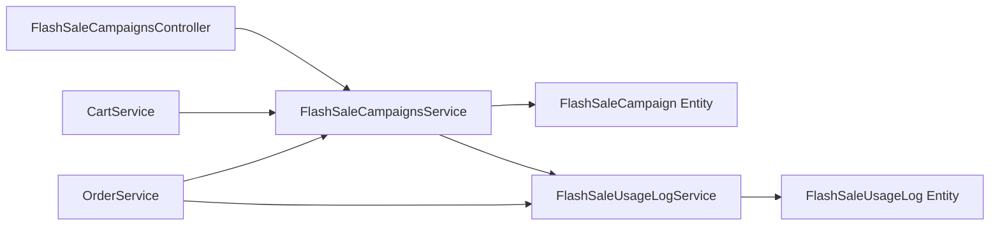

# Flash Sales

<cite>
**Referenced Files in This Document**
- [flash-sale-campaign.entity.ts](file://apps/backend/src/flash-sale-campaigns/entities/flash-sale-campaign.entity.ts)
- [create-flash-sale-campaign.dto.ts](file://apps/backend/src/flash-sale-campaigns/dto/create-flash-sale-campaign.dto.ts)
- [update-flash-sale-campaign.dto.ts](file://apps/backend/src/flash-sale-campaigns/dto/update-flash-sale-campaign.dto.ts)
- [flash-sale-campaigns.service.ts](file://apps/backend/src/flash-sale-campaigns/flash-sale-campaigns.service.ts)
- [flash-sale-campaigns.controller.ts](file://apps/backend/src/flash-sale-campaigns/flash-sale-campaigns.controller.ts)
- [flash-sale-usage-log.entity.ts](file://apps/backend/src/flash-sale-usage-log/entities/flash-sale-usage-log.entity.ts)
- [flash-sale-usage-log.service.ts](file://apps/backend/src/flash-sale-usage-log/flash-sale-usage-log.service.ts)
- [flash-sale-usage-log.controller.ts](file://apps/backend/src/flash-sale-usage-log/flash-sale-usage-log.controller.ts)
- [cart.service.ts](file://apps/backend/src/cart/cart.service.ts)
- [order.service.ts](file://apps/backend/src/order/order.service.ts)
- [product-utils.ts](file://apps/frontend/utils/product-utils.ts)
- [flash-sales-card.tsx](file://apps/frontend/components/admin/marketing/flash-sales/flash-sales-card.tsx)
</cite>

## Table of Contents
1. [Introduction](#introduction)
2. [Project Structure](#project-structure)
3. [Core Components](#core-components)
4. [Architecture Overview](#architecture-overview)
5. [Detailed Component Analysis](#detailed-component-analysis)
6. [Dependency Analysis](#dependency-analysis)
7. [Performance Considerations](#performance-considerations)
8. [Troubleshooting Guide](#troubleshooting-guide)
9. [Conclusion](#conclusion)

## Introduction
This document explains the flash sales promotion system: how to create time-limited promotions, select products or categories, configure discounts, and enforce automatic expiration and usage limits. It also covers inventory synchronization, real-time availability updates, usage logging for revenue impact and engagement metrics, integration with the product catalog, cart, and checkout, plus performance guidance for high-traffic periods.

## Project Structure
The flash sale feature is implemented as a backend module with admin APIs and a frontend admin UI. The core data model is a campaign entity that links to products and categories, while a separate usage log records order-level application of campaigns.

**Diagram sources**
- [flash-sale-campaigns.controller.ts:27-120](file://apps/backend/src/flash-sale-campaigns/flash-sale-campaigns.controller.ts#L27-L120)
- [flash-sale-campaigns.service.ts:82-374](file://apps/backend/src/flash-sale-campaigns/flash-sale-campaigns.service.ts#L82-L374)
- [flash-sale-campaign.entity.ts:21-97](file://apps/backend/src/flash-sale-campaigns/entities/flash-sale-campaign.entity.ts#L21-L97)
- [flash-sale-usage-log.service.ts:29-138](file://apps/backend/src/flash-sale-usage-log/flash-sale-usage-log.service.ts#L29-L138)
- [flash-sale-usage-log.entity.ts:14-62](file://apps/backend/src/flash-sale-usage-log/entities/flash-sale-usage-log.entity.ts#L14-L62)
- [cart.service.ts:15-48](file://apps/backend/src/cart/cart.service.ts#L15-L48)
- [order.service.ts:180-235](file://apps/backend/src/order/order.service.ts#L180-L235)
- [product-utils.ts:1-31](file://apps/frontend/utils/product-utils.ts#L1-L31)
- [flash-sales-card.tsx:1-166](file://apps/frontend/components/admin/marketing/flash-sales/flash-sales-card.tsx#L1-L166)

**Section sources**
- [flash-sale-campaigns.controller.ts:27-120](file://apps/backend/src/flash-sale-campaigns/flash-sale-campaigns.controller.ts#L27-L120)
- [flash-sale-campaigns.service.ts:82-374](file://apps/backend/src/flash-sale-campaigns/flash-sale-campaigns.service.ts#L82-L374)
- [flash-sale-campaign.entity.ts:21-97](file://apps/backend/src/flash-sale-campaigns/entities/flash-sale-campaign.entity.ts#L21-L97)
- [flash-sale-usage-log.service.ts:29-138](file://apps/backend/src/flash-sale-usage-log/flash-sale-usage-log.service.ts#L29-L138)
- [flash-sale-usage-log.entity.ts:14-62](file://apps/backend/src/flash-sale-usage-log/entities/flash-sale-usage-log.entity.ts#L14-L62)
- [cart.service.ts:15-48](file://apps/backend/src/cart/cart.service.ts#L15-L48)
- [order.service.ts:180-235](file://apps/backend/src/order/order.service.ts#L180-L235)
- [product-utils.ts:1-31](file://apps/frontend/utils/product-utils.ts#L1-L31)
- [flash-sales-card.tsx:1-166](file://apps/frontend/components/admin/marketing/flash-sales/flash-sales-card.tsx#L1-L166)

## Core Components
- Campaign entity: stores name, active flag, validFrom/validUntil, discountType/discountValue, maxUsage/timesUsed, and M2M relations to Product and Category.
- Campaign service: CRUD, validation, active campaign resolution with caching, per-product matching (direct or via category), effective price computation, and atomic usage increment.
- Usage log entity/service/controller: records campaign usage at order time with discount amount and order total; supports pagination and report aggregation.
- Cart integration: attaches flash sale info and effective prices to cart items for display.
- Order integration: re-evaluates flash pricing at checkout, applies stock checks, updates inventory, and aggregates per-campaign discount totals.
- Frontend admin card: creates/edits campaigns with date pickers, product/category selectors, and discount configuration.
- Frontend product utils: client-side helper to compute effective price and check if a flash sale is still active based on endsAt.

**Section sources**
- [flash-sale-campaign.entity.ts:21-97](file://apps/backend/src/flash-sale-campaigns/entities/flash-sale-campaign.entity.ts#L21-L97)
- [flash-sale-campaigns.service.ts:82-374](file://apps/backend/src/flash-sale-campaigns/flash-sale-campaigns.service.ts#L82-L374)
- [flash-sale-usage-log.entity.ts:14-62](file://apps/backend/src/flash-sale-usage-log/entities/flash-sale-usage-log.entity.ts#L14-L62)
- [flash-sale-usage-log.service.ts:29-138](file://apps/backend/src/flash-sale-usage-log/flash-sale-usage-log.service.ts#L29-L138)
- [cart.service.ts:15-48](file://apps/backend/src/cart/cart.service.ts#L15-L48)
- [order.service.ts:180-235](file://apps/backend/src/order/order.service.ts#L180-L235)
- [flash-sales-card.tsx:1-166](file://apps/frontend/components/admin/marketing/flash-sales/flash-sales-card.tsx#L1-L166)
- [product-utils.ts:1-31](file://apps/frontend/utils/product-utils.ts#L1-L31)

## Architecture Overview
The system separates admin-facing campaign management from storefront-facing evaluation and checkout-time enforcement.

**Diagram sources**
- [flash-sale-campaigns.controller.ts:27-120](file://apps/backend/src/flash-sale-campaigns/flash-sale-campaigns.controller.ts#L27-L120)
- [flash-sale-campaigns.service.ts:93-133](file://apps/backend/src/flash-sale-campaigns/flash-sale-campaigns.service.ts#L93-L133)
- [flash-sale-campaigns.service.ts:247-265](file://apps/backend/src/flash-sale-campaigns/flash-sale-campaigns.service.ts#L247-L265)
- [cart.service.ts:31-48](file://apps/backend/src/cart/cart.service.ts#L31-L48)
- [order.service.ts:180-235](file://apps/backend/src/order/order.service.ts#L180-L235)
- [flash-sale-usage-log.service.ts:38-49](file://apps/backend/src/flash-sale-usage-log/flash-sale-usage-log.service.ts#L38-L49)

## Detailed Component Analysis

### Campaign Data Model and DTOs
- Campaign fields include identity, name, isActive, validFrom/validUntil, discountType/discountValue, maxUsage/timesUsed, and relations to Product and Category.
- DTOs enforce required fields, optional dates, numeric ranges, and array sizes for productIds/categoryIds.

**Diagram sources**
- [flash-sale-campaign.entity.ts:21-97](file://apps/backend/src/flash-sale-campaigns/entities/flash-sale-campaign.entity.ts#L21-L97)
- [create-flash-sale-campaign.dto.ts:17-70](file://apps/backend/src/flash-sale-campaigns/dto/create-flash-sale-campaign.dto.ts#L17-L70)
- [update-flash-sale-campaign.dto.ts:1-6](file://apps/backend/src/flash-sale-campaigns/dto/update-flash-sale-campaign.dto.ts#L1-L6)

**Section sources**
- [flash-sale-campaign.entity.ts:21-97](file://apps/backend/src/flash-sale-campaigns/entities/flash-sale-campaign.entity.ts#L21-L97)
- [create-flash-sale-campaign.dto.ts:17-70](file://apps/backend/src/flash-sale-campaigns/dto/create-flash-sale-campaign.dto.ts#L17-L70)
- [update-flash-sale-campaign.dto.ts:1-6](file://apps/backend/src/flash-sale-campaigns/dto/update-flash-sale-campaign.dto.ts#L1-L6)

### Campaign Creation and Validation
- Admin endpoints accept create/update DTOs.
- Service validates date range ordering and discount value constraints, assigns product/category relations, persists, and returns trimmed summaries.

Key behaviors:
- Date validation ensures validUntil is after validFrom when both are provided.
- Percentage discount cannot exceed 100.
- Relations are assigned by IDs; repository.save syncs junction tables.

**Section sources**
- [flash-sale-campaigns.controller.ts:75-104](file://apps/backend/src/flash-sale-campaigns/flash-sale-campaigns.controller.ts#L75-L104)
- [flash-sale-campaigns.service.ts:93-133](file://apps/backend/src/flash-sale-campaigns/flash-sale-campaigns.service.ts#L93-L133)
- [flash-sale-campaigns.service.ts:203-236](file://apps/backend/src/flash-sale-campaigns/flash-sale-campaigns.service.ts#L203-L236)

### Time-Based Scheduling and Automatic Expiration
- Campaigns are considered active only when:
  - isActive is true
  - validFrom <= now (if set)
  - validUntil >= now (if set)
  - timesUsed < maxUsage (or unlimited when maxUsage is 0)
- Active campaigns are cached for 30 seconds to reduce database load; storefront may lag up to 30 seconds on start/end transitions.
- Order-time pricing always re-resolves campaigns, preventing monetary loss due to cache staleness.

**Diagram sources**
- [flash-sale-campaigns.service.ts:247-265](file://apps/backend/src/flash-sale-campaigns/flash-sale-campaigns.service.ts#L247-L265)

**Section sources**
- [flash-sale-campaigns.service.ts:247-265](file://apps/backend/src/flash-sale-campaigns/flash-sale-campaigns.service.ts#L247-L265)

### Product Selection and Discount Configuration
- Campaigns can target specific products or entire categories.
- When multiple campaigns overlap, the lowest id (created first) wins.
- Discount types support percentage or fixed amounts; effective price is computed against sellingPrice.

Implementation highlights:
- resolveForProductFromList matches by productId or categoryId.
- attachFlashInfo sets display-only flashSale metadata and effectivePrice on products.

**Section sources**
- [flash-sale-campaigns.service.ts:267-353](file://apps/backend/src/flash-sale-campaigns/flash-sale-campaigns.service.ts#L267-L353)

### Inventory Synchronization and Real-Time Availability
- At order creation, stock is checked before applying discounts.
- Stock is decremented and saleCount incremented; stock movements are recorded for auditability.
- Products marked inactive cannot be ordered.

**Diagram sources**
- [order.service.ts:190-210](file://apps/backend/src/order/order.service.ts#L190-L210)
- [order.service.ts:263-279](file://apps/backend/src/order/order.service.ts#L263-L279)

**Section sources**
- [order.service.ts:190-210](file://apps/backend/src/order/order.service.ts#L190-L210)
- [order.service.ts:263-279](file://apps/backend/src/order/order.service.ts#L263-L279)

### Usage Logging System
- Each order logs campaign usage with campaign snapshot, order reference, user reference, discount amount contributed by the campaign, and order total.
- Logs support pagination and filtering by campaignId and date range.
- Report stats aggregate totalUses, totalDiscount, totalOrderValue, avgOrderValue, and uniqueCampaigns.

**Diagram sources**
- [flash-sale-usage-log.entity.ts:14-62](file://apps/backend/src/flash-sale-usage-log/entities/flash-sale-usage-log.entity.ts#L14-L62)
- [flash-sale-usage-log.service.ts:38-138](file://apps/backend/src/flash-sale-usage-log/flash-sale-usage-log.service.ts#L38-L138)

**Section sources**
- [flash-sale-usage-log.entity.ts:14-62](file://apps/backend/src/flash-sale-usage-log/entities/flash-sale-usage-log.entity.ts#L14-L62)
- [flash-sale-usage-log.service.ts:38-138](file://apps/backend/src/flash-sale-usage-log/flash-sale-usage-log.service.ts#L38-L138)

### Integration With Catalog, Cart, and Checkout
- Catalog/Product listing: service attaches flashSale and effectivePrice to products using active campaigns.
- Cart: fetches active campaigns and attaches flash info to cart items for consistent display.
- Checkout: re-evaluates flash pricing per item, aggregates per-campaign discount totals, then proceeds to BOGO/coupon logic.

**Diagram sources**
- [flash-sale-campaigns.service.ts:247-353](file://apps/backend/src/flash-sale-campaigns/flash-sale-campaigns.service.ts#L247-L353)
- [cart.service.ts:31-48](file://apps/backend/src/cart/cart.service.ts#L31-L48)
- [order.service.ts:180-235](file://apps/backend/src/order/order.service.ts#L180-L235)

**Section sources**
- [flash-sale-campaigns.service.ts:247-353](file://apps/backend/src/flash-sale-campaigns/flash-sale-campaigns.service.ts#L247-L353)
- [cart.service.ts:31-48](file://apps/backend/src/cart/cart.service.ts#L31-L48)
- [order.service.ts:180-235](file://apps/backend/src/order/order.service.ts#L180-L235)

### Implementation Examples

#### Create a Time-Limited Promotion
- Use the admin endpoint to create a campaign with:
  - name
  - isActive
  - validFrom and validUntil (optional)
  - discountType and discountValue
  - maxUsage (0 = unlimited)
  - productIds and/or categoryIds

Validation rules:
- validUntil must be after validFrom when both are present.
- Percentage discount cannot exceed 100.

**Section sources**
- [flash-sale-campaigns.controller.ts:75-88](file://apps/backend/src/flash-sale-campaigns/flash-sale-campaigns.controller.ts#L75-L88)
- [flash-sale-campaigns.service.ts:93-133](file://apps/backend/src/flash-sale-campaigns/flash-sale-campaigns.service.ts#L93-L133)
- [create-flash-sale-campaign.dto.ts:17-70](file://apps/backend/src/flash-sale-campaigns/dto/create-flash-sale-campaign.dto.ts#L17-L70)

#### Handle Concurrent Access During High-Traffic Periods
- Active campaigns are cached for 30 seconds to reduce DB pressure.
- Order-time pricing always re-resolves campaigns so money is never lost to stale cache.
- Usage increments are atomic at the database level; if a campaign reaches its limit mid-order, the service logs a warning and allows the order to proceed without double-counting.

Operational tips:
- Monitor cache hit rates and query latency for active campaigns.
- Watch for warnings about campaigns reaching maxUsage mid-order.

**Section sources**
- [flash-sale-campaigns.service.ts:247-265](file://apps/backend/src/flash-sale-campaigns/flash-sale-campaigns.service.ts#L247-L265)
- [flash-sale-campaigns.service.ts:360-373](file://apps/backend/src/flash-sale-campaigns/flash-sale-campaigns.service.ts#L360-L373)

#### Manage Inventory Reservations
- Stock is validated before discount application.
- On success, stock is decremented and saleCount incremented; stock movement is recorded.
- If stock is insufficient, the order fails early.

Note: There is no explicit reservation table; stock is decremented during order processing. For multi-step reservations, consider adding a temporary reservation mechanism outside this codebase.

**Section sources**
- [order.service.ts:190-210](file://apps/backend/src/order/order.service.ts#L190-L210)
- [order.service.ts:263-279](file://apps/backend/src/order/order.service.ts#L263-L279)

## Dependency Analysis
The following diagram shows key dependencies between services and entities involved in flash sales.

**Diagram sources**
- [flash-sale-campaigns.controller.ts:27-120](file://apps/backend/src/flash-sale-campaigns/flash-sale-campaigns.controller.ts#L27-L120)
- [flash-sale-campaigns.service.ts:82-374](file://apps/backend/src/flash-sale-campaigns/flash-sale-campaigns.service.ts#L82-L374)
- [flash-sale-campaign.entity.ts:21-97](file://apps/backend/src/flash-sale-campaigns/entities/flash-sale-campaign.entity.ts#L21-L97)
- [flash-sale-usage-log.service.ts:29-138](file://apps/backend/src/flash-sale-usage-log/flash-sale-usage-log.service.ts#L29-L138)
- [flash-sale-usage-log.entity.ts:14-62](file://apps/backend/src/flash-sale-usage-log/entities/flash-sale-usage-log.entity.ts#L14-L62)
- [cart.service.ts:15-48](file://apps/backend/src/cart/cart.service.ts#L15-L48)
- [order.service.ts:180-235](file://apps/backend/src/order/order.service.ts#L180-L235)

**Section sources**
- [flash-sale-campaigns.controller.ts:27-120](file://apps/backend/src/flash-sale-campaigns/flash-sale-campaigns.controller.ts#L27-L120)
- [flash-sale-campaigns.service.ts:82-374](file://apps/backend/src/flash-sale-campaigns/flash-sale-campaigns.service.ts#L82-L374)
- [flash-sale-campaign.entity.ts:21-97](file://apps/backend/src/flash-sale-campaigns/entities/flash-sale-campaign.entity.ts#L21-L97)
- [flash-sale-usage-log.service.ts:29-138](file://apps/backend/src/flash-sale-usage-log/flash-sale-usage-log.service.ts#L29-L138)
- [flash-sale-usage-log.entity.ts:14-62](file://apps/backend/src/flash-sale-usage-log/entities/flash-sale-usage-log.entity.ts#L14-L62)
- [cart.service.ts:15-48](file://apps/backend/src/cart/cart.service.ts#L15-L48)
- [order.service.ts:180-235](file://apps/backend/src/order/order.service.ts#L180-L235)

## Performance Considerations
- Caching: Active campaigns are cached for 30 seconds to reduce repeated queries under load.
- Query optimization: Active campaign queries join only necessary relations and filter by isActive, usage limits, and ordering by id.
- Display vs authoritative pricing: Cart and product listings use cached campaigns for display; order-time pricing always re-resolves to ensure accuracy.
- Database writes: Usage increments are atomic updates; avoid additional locking around campaign rows.
- Frontend efficiency: Client-side effective price helpers rely on backend-computed values to minimize re-computation.

Recommendations:
- Monitor cache TTL effectiveness and adjust if needed.
- Ensure indexes exist on campaign.isActive, campaign.timesUsed, campaign.maxUsage, campaign.validFrom, and campaign.validUntil.
- Avoid heavy joins in product listing; prefer precomputed effectivePrice where possible.

[No sources needed since this section provides general guidance]

## Troubleshooting Guide
Common issues and resolutions:
- Campaign not appearing in storefront:
  - Verify isActive, validFrom/validUntil, and timesUsed vs maxUsage.
  - Check cache TTL; changes may take up to 30 seconds to reflect.
- Unexpected discount behavior:
  - Confirm discountType and discountValue are valid.
  - Ensure product is included directly or via category.
- Inventory mismatch:
  - Review stock checks and stock movement records during order processing.
- Usage logs missing:
  - Ensure order completion path calls usage logging with correct campaign and order references.

Monitoring and alerts:
- Track warnings when campaigns reach maxUsage mid-order.
- Observe error paths for out-of-stock or inactive products during order creation.

**Section sources**
- [flash-sale-campaigns.service.ts:247-265](file://apps/backend/src/flash-sale-campaigns/flash-sale-campaigns.service.ts#L247-L265)
- [flash-sale-campaigns.service.ts:360-373](file://apps/backend/src/flash-sale-campaigns/flash-sale-campaigns.service.ts#L360-L373)
- [order.service.ts:190-210](file://apps/backend/src/order/order.service.ts#L190-L210)

## Conclusion
The flash sales system provides robust campaign management, precise time-based scheduling, flexible product/category targeting, and accurate pricing through atomic operations and careful separation of display versus authoritative pricing. Usage logging enables detailed reporting on revenue impact and customer engagement. With caching and optimized queries, it scales well under high traffic, while clear validation and error handling protect business integrity.

[No sources needed since this section summarizes without analyzing specific files]