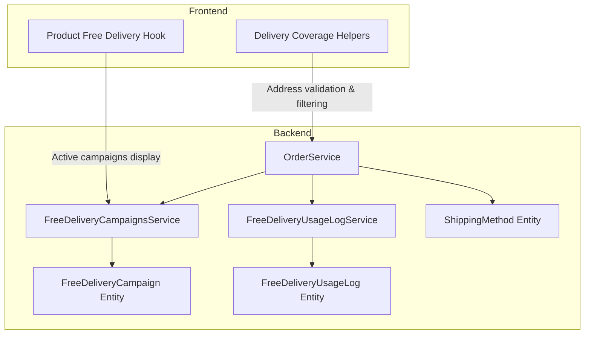
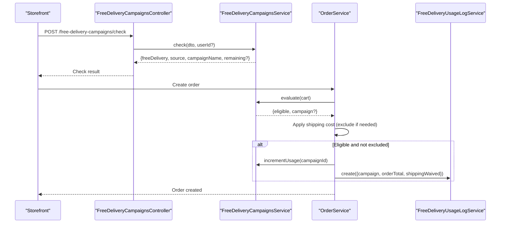
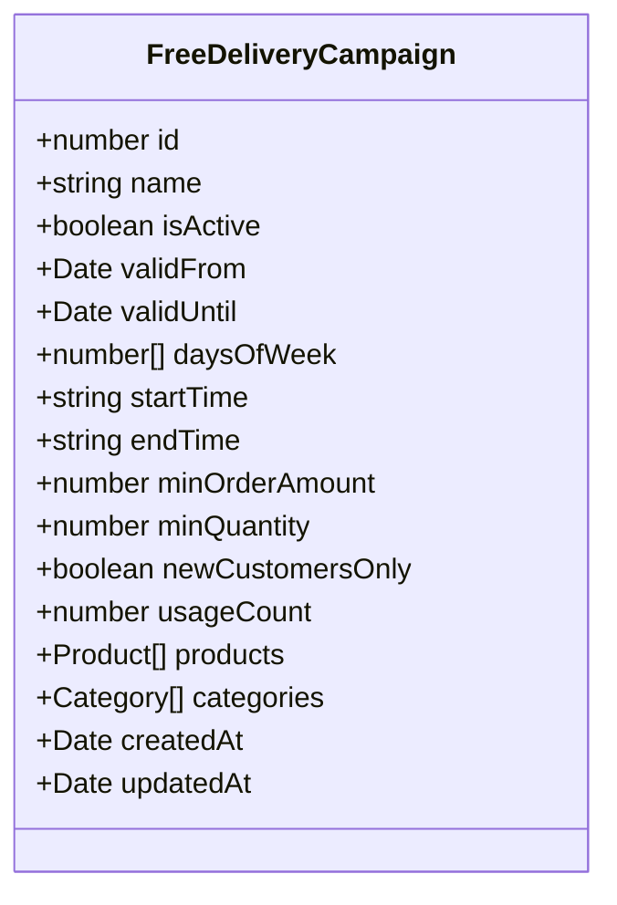
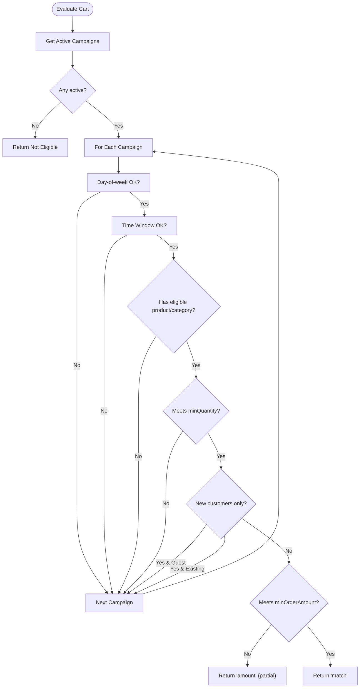
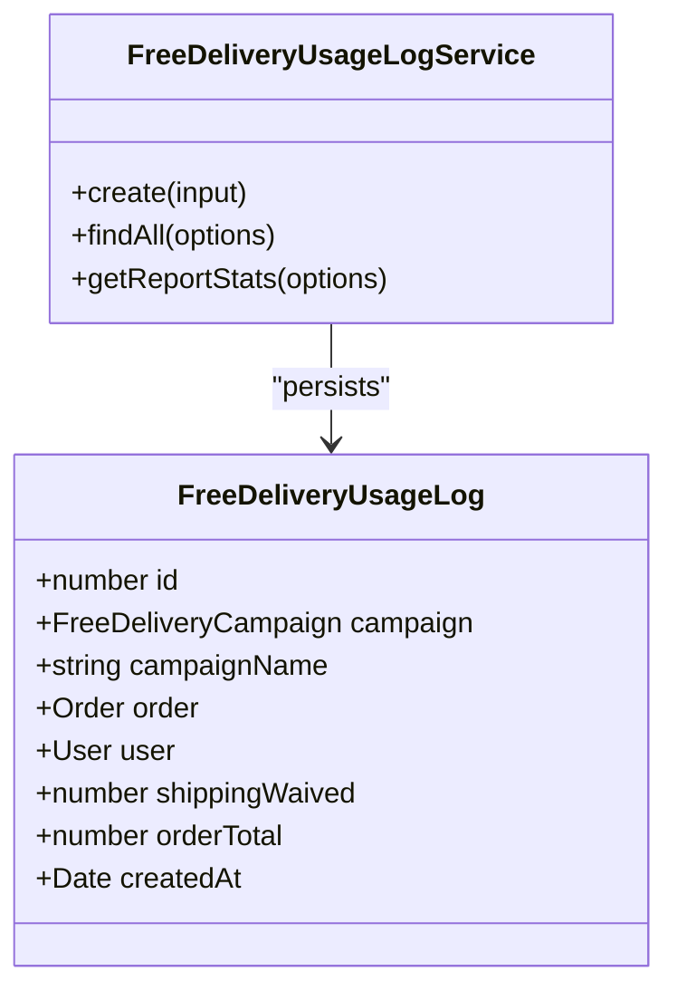
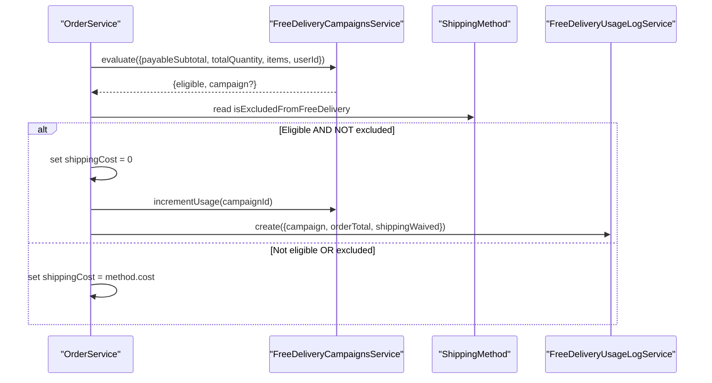
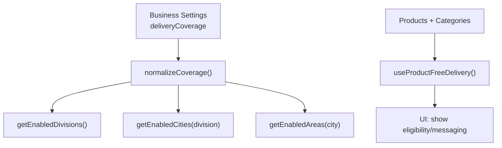
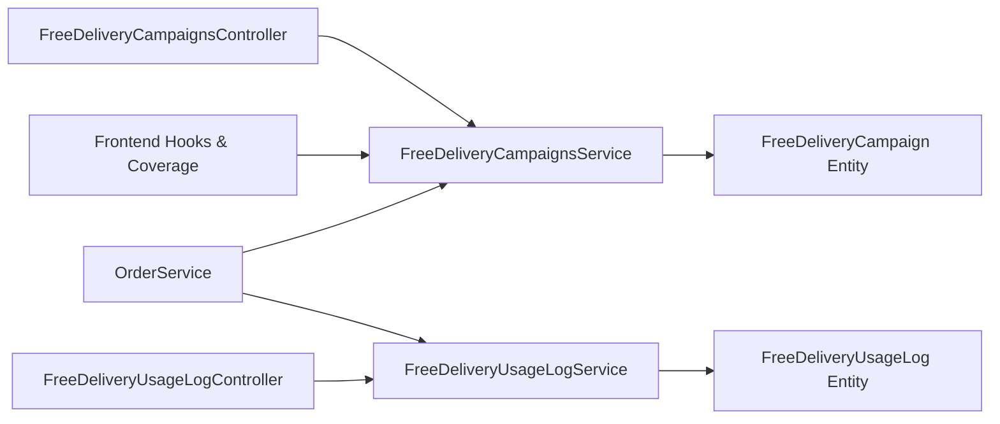

# Free Delivery Campaigns

<cite>
**Referenced Files in This Document**
- [free-delivery-campaign.entity.ts](file://apps/backend/src/free-delivery-campaigns/entities/free-delivery-campaign.entity.ts)
- [create-free-delivery-campaign.dto.ts](file://apps/backend/src/free-delivery-campaigns/dto/create-free-delivery-campaign.dto.ts)
- [check-free-delivery.dto.ts](file://apps/backend/src/free-delivery-campaigns/dto/check-free-delivery.dto.ts)
- [free-delivery-campaigns.service.ts](file://apps/backend/src/free-delivery-campaigns/free-delivery-campaigns.service.ts)
- [free-delivery-campaigns.controller.ts](file://apps/backend/src/free-delivery-campaigns/free-delivery-campaigns.controller.ts)
- [free-delivery-usage-log.entity.ts](file://apps/backend/src/free-delivery-usage-log/entities/free-delivery-usage-log.entity.ts)
- [free-delivery-usage-log.service.ts](file://apps/backend/src/free-delivery-usage-log/free-delivery-usage-log.service.ts)
- [free-delivery-usage-log.controller.ts](file://apps/backend/src/free-delivery-usage-log/free-delivery-usage-log.controller.ts)
- [order.service.ts](file://apps/backend/src/order/order.service.ts)
- [shipping-method.entity.ts](file://apps/backend/src/shipping-methods/entities/shipping-method.entity.ts)
- [delivery-coverage.ts](file://apps/frontend/lib/delivery-coverage.ts)
- [use-product-free-delivery.ts](file://apps/frontend/hooks/use-product-free-delivery.ts)
</cite>

## Table of Contents
1. [Introduction](#introduction)
2. [Project Structure](#project-structure)
3. [Core Components](#core-components)
4. [Architecture Overview](#architecture-overview)
5. [Detailed Component Analysis](#detailed-component-analysis)
6. [Dependency Analysis](#dependency-analysis)
7. [Performance Considerations](#performance-considerations)
8. [Troubleshooting Guide](#troubleshooting-guide)
9. [Conclusion](#conclusion)

## Introduction
This document explains the free delivery campaign system: how campaigns are configured, evaluated, applied to orders, and analyzed through usage analytics. It also covers integration points with shipping methods, address coverage, and checkout flows, plus guidance for region-specific zones, order thresholds, and promotion conflict handling.

## Project Structure
The feature is implemented as two backend modules and supporting frontend utilities:
- Free delivery campaigns: entity, DTOs, service, and controller
- Free delivery usage logs: entity, service, and controller
- Order integration: evaluation and application during order creation
- Shipping method integration: exclusion flag controls whether free delivery applies
- Frontend coverage and product eligibility helpers

**Diagram sources**
- [free-delivery-campaigns.service.ts](file://apps/backend/src/free-delivery-campaigns/free-delivery-campaigns.service.ts)
- [free-delivery-campaign.entity.ts](file://apps/backend/src/free-delivery-campaigns/entities/free-delivery-campaign.entity.ts)
- [free-delivery-usage-log.service.ts](file://apps/backend/src/free-delivery-usage-log/free-delivery-usage-log.service.ts)
- [free-delivery-usage-log.entity.ts](file://apps/backend/src/free-delivery-usage-log/entities/free-delivery-usage-log.entity.ts)
- [order.service.ts](file://apps/backend/src/order/order.service.ts)
- [shipping-method.entity.ts](file://apps/backend/src/shipping-methods/entities/shipping-method.entity.ts)
- [delivery-coverage.ts](file://apps/frontend/lib/delivery-coverage.ts)
- [use-product-free-delivery.ts](file://apps/frontend/hooks/use-product-free-delivery.ts)

**Section sources**
- [free-delivery-campaigns.service.ts](file://apps/backend/src/free-delivery-campaigns/free-delivery-campaigns.service.ts)
- [free-delivery-usage-log.service.ts](file://apps/backend/src/free-delivery-usage-log/free-delivery-usage-log.service.ts)
- [order.service.ts](file://apps/backend/src/order/order.service.ts)
- [delivery-coverage.ts](file://apps/frontend/lib/delivery-coverage.ts)
- [use-product-free-delivery.ts](file://apps/frontend/hooks/use-product-free-delivery.ts)

## Core Components
- Free delivery campaign configuration:
  - Name, active status, validity window (validFrom/validUntil), day-of-week and time windows, minimum order amount, minimum quantity, new customers only, product/category targeting, and usage counter.
- Evaluation engine:
  - Active campaign selection, day/time checks, product/category matching, minimum quantity, new customer check, and minimum order amount threshold. Returns match/partial/none.
- Usage tracking:
  - Per-order log capturing campaign name snapshot, waived shipping cost, order total, user, and order reference; aggregated reporting endpoints.
- Order integration:
  - Evaluates cart before finalizing shipping cost; excludes certain shipping methods from free delivery; increments campaign usage and writes usage log.
- Frontend helpers:
  - Delivery coverage normalization and enabled area filters; product-level free delivery eligibility and messaging based on active campaigns.

**Section sources**
- [free-delivery-campaign.entity.ts](file://apps/backend/src/free-delivery-campaigns/entities/free-delivery-campaign.entity.ts)
- [free-delivery-campaigns.service.ts](file://apps/backend/src/free-delivery-campaigns/free-delivery-campaigns.service.ts)
- [free-delivery-usage-log.entity.ts](file://apps/backend/src/free-delivery-usage-log/entities/free-delivery-usage-log.entity.ts)
- [free-delivery-usage-log.service.ts](file://apps/backend/src/free-delivery-usage-log/free-delivery-usage-log.service.ts)
- [order.service.ts](file://apps/backend/src/order/order.service.ts)
- [delivery-coverage.ts](file://apps/frontend/lib/delivery-coverage.ts)
- [use-product-free-delivery.ts](file://apps/frontend/hooks/use-product-free-delivery.ts)

## Architecture Overview
The system evaluates free delivery eligibility at two points:
- Cart/checkout preview: public endpoint returns eligibility and “pending” progress when a campaign is close to meeting its minimum order amount.
- Order creation: backend evaluates again, applies free delivery if eligible and not excluded by the selected shipping method, then records usage.

**Diagram sources**
- [free-delivery-campaigns.controller.ts](file://apps/backend/src/free-delivery-campaigns/free-delivery-campaigns.controller.ts)
- [free-delivery-campaigns.service.ts](file://apps/backend/src/free-delivery-campaigns/free-delivery-campaigns.service.ts)
- [order.service.ts](file://apps/backend/src/order/order.service.ts)
- [free-delivery-usage-log.service.ts](file://apps/backend/src/free-delivery-usage-log/free-delivery-usage-log.service.ts)

## Detailed Component Analysis

### Campaign Configuration Model
- Fields include identity, name, isActive, validFrom/validUntil, daysOfWeek, startTime/endTime, minOrderAmount, minQuantity, newCustomersOnly, products/categories M2M relations, createdAt/updatedAt, and usageCount.
- Admin DTO validates inputs such as date strings, HH:mm patterns, numeric ranges, array sizes, and allowed day values.

**Diagram sources**
- [free-delivery-campaign.entity.ts](file://apps/backend/src/free-delivery-campaigns/entities/free-delivery-campaign.entity.ts)

**Section sources**
- [free-delivery-campaign.entity.ts](file://apps/backend/src/free-delivery-campaigns/entities/free-delivery-campaign.entity.ts)
- [create-free-delivery-campaign.dto.ts](file://apps/backend/src/free-delivery-campaigns/dto/create-free-delivery-campaign.dto.ts)

### Eligibility Checking Logic
- Active campaigns are filtered by isActive and validFrom/validUntil.
- For each active campaign:
  - Day-of-week filter
  - Time window (supports midnight wrap)
  - Product or category inclusion (order qualifies if any item matches)
  - Minimum quantity
  - New customers only (guests do not qualify)
  - Minimum order amount (returns partial “amount” state instead of hard fail)
- First matching campaign wins.

**Diagram sources**
- [free-delivery-campaigns.service.ts](file://apps/backend/src/free-delivery-campaigns/free-delivery-campaigns.service.ts)

**Section sources**
- [free-delivery-campaigns.service.ts](file://apps/backend/src/free-delivery-campaigns/free-delivery-campaigns.service.ts)

### Usage Tracking System
- Per-use log stores campaign snapshot, order reference, user reference, shippingWaived, orderTotal, and timestamp.
- Service supports paginated listing with filters (campaignId, fromDate, toDate) and aggregated report stats (totalUses, totalShippingWaived, totalOrderValue, avgOrderValue, uniqueCampaigns).

**Diagram sources**
- [free-delivery-usage-log.entity.ts](file://apps/backend/src/free-delivery-usage-log/entities/free-delivery-usage-log.entity.ts)
- [free-delivery-usage-log.service.ts](file://apps/backend/src/free-delivery-usage-log/free-delivery-usage-log.service.ts)

**Section sources**
- [free-delivery-usage-log.entity.ts](file://apps/backend/src/free-delivery-usage-log/entities/free-delivery-usage-log.entity.ts)
- [free-delivery-usage-log.service.ts](file://apps/backend/src/free-delivery-usage-log/free-delivery-usage-log.service.ts)
- [free-delivery-usage-log.controller.ts](file://apps/backend/src/free-delivery-usage-log/free-delivery-usage-log.controller.ts)

### Order Integration and Shipping Method Interaction
- During order creation, the system evaluates free delivery against the payable subtotal after product/coupon discounts.
- If eligible and the selected shipping method is not excluded, shipping cost becomes zero; otherwise, the method’s cost is charged.
- When applied, the system increments campaign usage and writes a usage log entry.

**Diagram sources**
- [order.service.ts](file://apps/backend/src/order/order.service.ts)
- [shipping-method.entity.ts](file://apps/backend/src/shipping-methods/entities/shipping-method.entity.ts)
- [free-delivery-campaigns.service.ts](file://apps/backend/src/free-delivery-campaigns/free-delivery-campaigns.service.ts)
- [free-delivery-usage-log.service.ts](file://apps/backend/src/free-delivery-usage-log/free-delivery-usage-log.service.ts)

**Section sources**
- [order.service.ts](file://apps/backend/src/order/order.service.ts)
- [shipping-method.entity.ts](file://apps/backend/src/shipping-methods/entities/shipping-method.entity.ts)

### Frontend Coverage and Product Eligibility
- Delivery coverage helper normalizes business settings into divisions/cities/areas and exposes enabled lists for form filtering.
- Product free delivery hook determines whether a product is covered by an active campaign and surfaces appropriate messaging.

**Diagram sources**
- [delivery-coverage.ts](file://apps/frontend/lib/delivery-coverage.ts)
- [use-product-free-delivery.ts](file://apps/frontend/hooks/use-product-free-delivery.ts)

**Section sources**
- [delivery-coverage.ts](file://apps/frontend/lib/delivery-coverage.ts)
- [use-product-free-delivery.ts](file://apps/frontend/hooks/use-product-free-delivery.ts)

## Dependency Analysis
- Controllers expose admin and public endpoints for campaign CRUD and cart checks.
- Services encapsulate business logic and data access via TypeORM repositories.
- Order service depends on campaign evaluation and shipping method metadata to finalize costs and record usage.
- Frontend uses delivery coverage and campaign summaries to guide UX.

**Diagram sources**
- [free-delivery-campaigns.controller.ts](file://apps/backend/src/free-delivery-campaigns/free-delivery-campaigns.controller.ts)
- [free-delivery-campaigns.service.ts](file://apps/backend/src/free-delivery-campaigns/free-delivery-campaigns.service.ts)
- [free-delivery-usage-log.controller.ts](file://apps/backend/src/free-delivery-usage-log/free-delivery-usage-log.controller.ts)
- [free-delivery-usage-log.service.ts](file://apps/backend/src/free-delivery-usage-log/free-delivery-usage-log.service.ts)
- [order.service.ts](file://apps/backend/src/order/order.service.ts)
- [free-delivery-campaign.entity.ts](file://apps/backend/src/free-delivery-campaigns/entities/free-delivery-campaign.entity.ts)
- [free-delivery-usage-log.entity.ts](file://apps/backend/src/free-delivery-usage-log/entities/free-delivery-usage-log.entity.ts)
- [use-product-free-delivery.ts](file://apps/frontend/hooks/use-product-free-delivery.ts)

**Section sources**
- [free-delivery-campaigns.controller.ts](file://apps/backend/src/free-delivery-campaigns/free-delivery-campaigns.controller.ts)
- [free-delivery-usage-log.controller.ts](file://apps/backend/src/free-delivery-usage-log/free-delivery-usage-log.controller.ts)
- [order.service.ts](file://apps/backend/src/order/order.service.ts)

## Performance Considerations
- Campaign evaluation iterates active campaigns once per cart check and once more for “pending” detection; keep active campaigns minimal and well-indexed.
- The pending path re-evaluates campaigns; consider caching active campaigns for short-lived requests if traffic grows.
- Usage log queries use pagination and join-free counts where possible; ensure indexes on createdAt and campaign.id for large datasets.
- Avoid overloading newCustomersOnly checks with heavy queries; current implementation counts previous orders per user—monitor under high load.

[No sources needed since this section provides general guidance]

## Troubleshooting Guide
Common issues and resolutions:
- Campaign never activates:
  - Verify isActive and validFrom/validUntil boundaries.
  - Confirm day-of-week and time window alignment with Asia/Dhaka time.
- Customer sees “pending” but cannot unlock:
  - Ensure payableSubtotal includes all applicable line items and that product/category filters match the cart contents.
  - Check minQuantity and newCustomersOnly constraints.
- Free delivery not applied at checkout:
  - Confirm the selected shipping method is not marked as excluded from free delivery.
  - Validate that the order evaluation runs after coupon/product discounts so payableSubtotal meets the threshold.
- Usage logs missing:
  - Ensure the order flow reaches the usage logging step and that the campaign was both eligible and not excluded.
  - Inspect error logs around usage increment and log creation.

**Section sources**
- [free-delivery-campaigns.service.ts](file://apps/backend/src/free-delivery-campaigns/free-delivery-campaigns.service.ts)
- [order.service.ts](file://apps/backend/src/order/order.service.ts)
- [shipping-method.entity.ts](file://apps/backend/src/shipping-methods/entities/shipping-method.entity.ts)

## Conclusion
The free delivery campaign system provides flexible, rule-based delivery waivers with robust evaluation, clear storefront feedback, and comprehensive usage analytics. By combining campaign configuration, shipping method exclusions, and order-time evaluation, it integrates cleanly with existing checkout flows while enabling precise regional targeting and promotional control.

[No sources needed since this section summarizes without analyzing specific files]