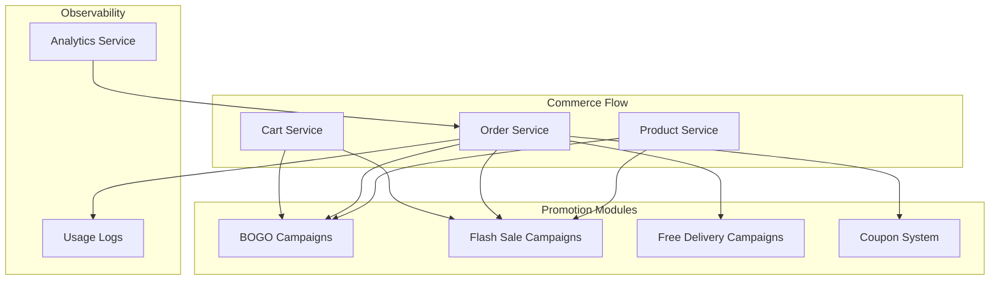
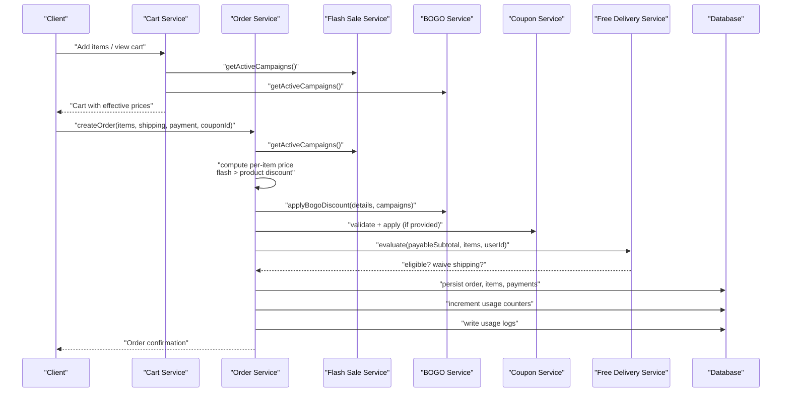
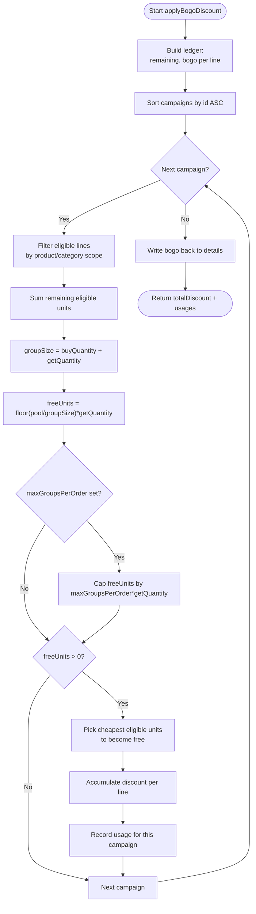
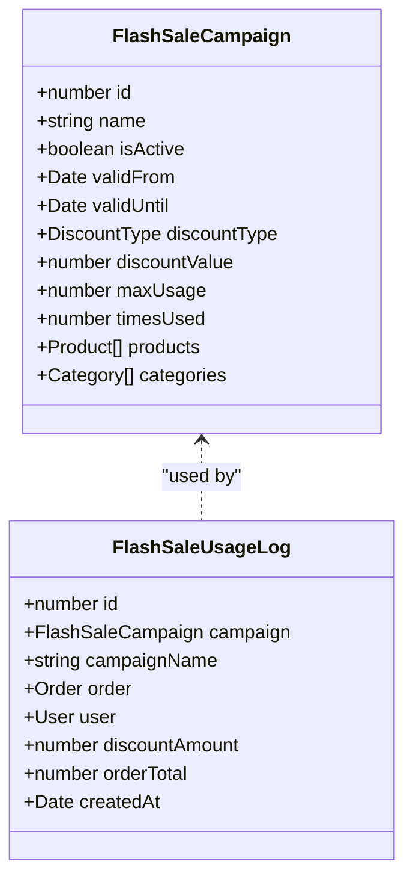
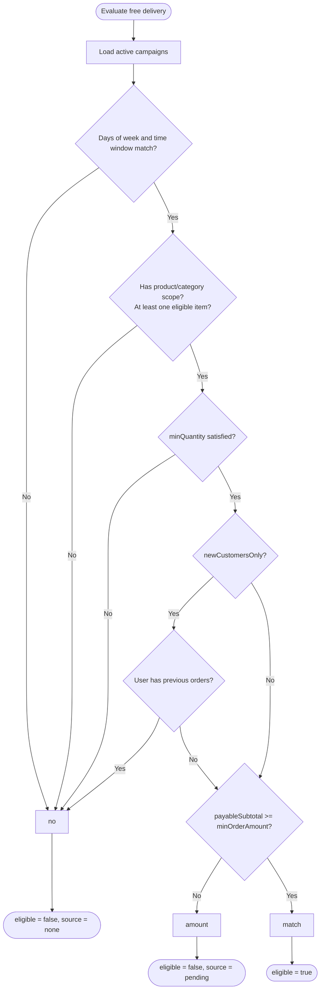
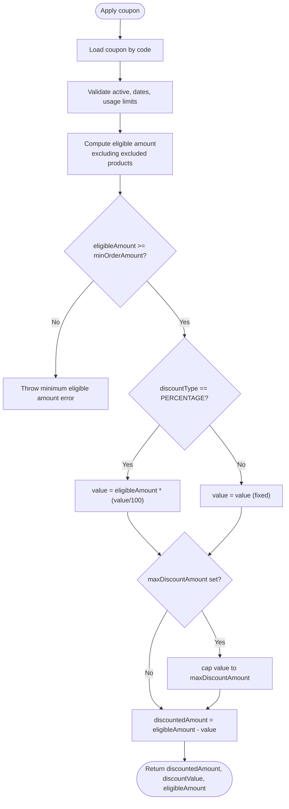
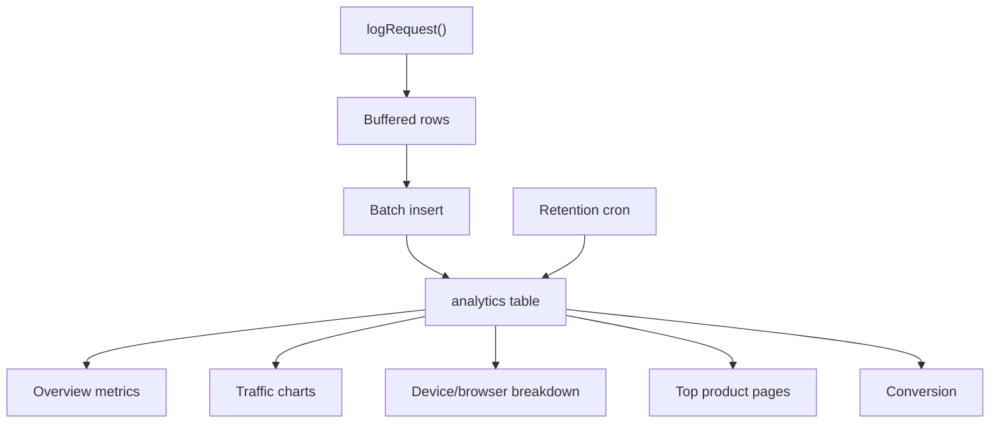
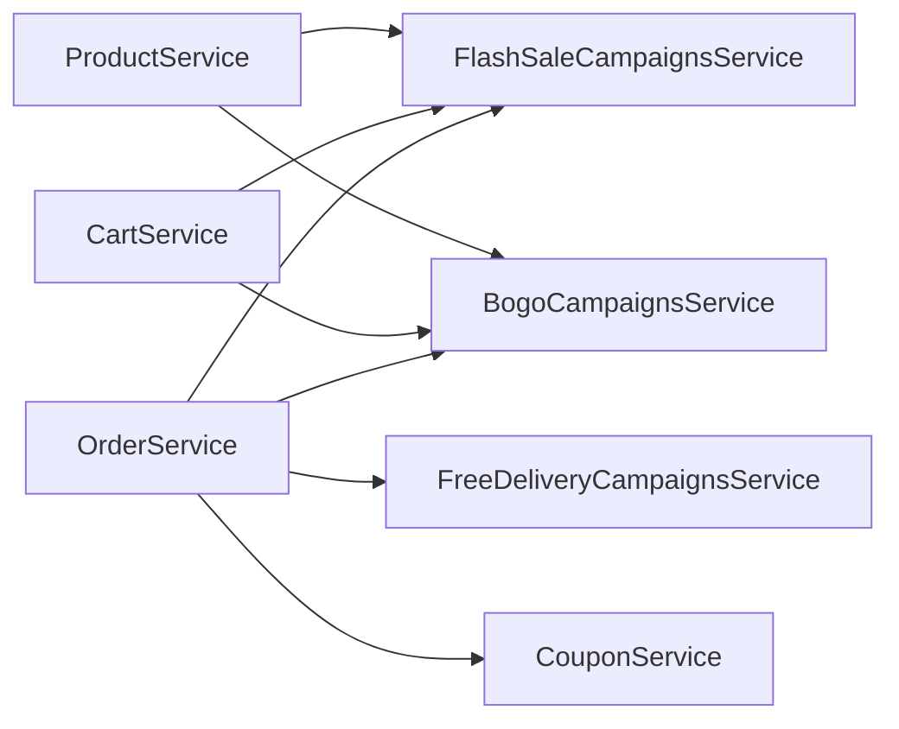

# Marketing & Promotions

<cite>
**Referenced Files in This Document**
- [bogo-campaigns.service.ts](file://apps/backend/src/bogo-campaigns/bogo-campaigns.service.ts)
- [bogo-campaign.entity.ts](file://apps/backend/src/bogo-campaigns/entities/bogo-campaign.entity.ts)
- [bogo-usage-log.entity.ts](file://apps/backend/src/bogo-usage-log/entities/bogo-usage-log.entity.ts)
- [flash-sale-campaigns.service.ts](file://apps/backend/src/flash-sale-campaigns/flash-sale-campaigns.service.ts)
- [flash-sale-campaign.entity.ts](file://apps/backend/src/flash-sale-campaigns/entities/flash-sale-campaign.entity.ts)
- [flash-sale-usage-log.entity.ts](file://apps/backend/src/flash-sale-usage-log/entities/flash-sale-usage-log.entity.ts)
- [free-delivery-campaigns.service.ts](file://apps/backend/src/free-delivery-campaigns/free-delivery-campaigns.service.ts)
- [free-delivery-campaign.entity.ts](file://apps/backend/src/free-delivery-campaigns/entities/free-delivery-campaign.entity.ts)
- [free-delivery-usage-log.entity.ts](file://apps/backend/src/free-delivery-usage-log/entities/free-delivery-usage-log.entity.ts)
- [coupon.service.ts](file://apps/backend/src/coupon/coupon.service.ts)
- [coupon.entity.ts](file://apps/backend/src/coupon/entities/coupon.entity.ts)
- [coupon-usage-log.entity.ts](file://apps/backend/src/coupon-usage-log/entities/coupon-usage-log.entity.ts)
- [cart.service.ts](file://apps/backend/src/cart/cart.service.ts)
- [order.service.ts](file://apps/backend/src/order/order.service.ts)
- [product.service.ts](file://apps/backend/src/product/product.service.ts)
- [analytics.service.ts](file://apps/backend/src/analytics/analytics.service.ts)
</cite>

## Table of Contents
1. [Introduction](#introduction)
2. [Project Structure](#project-structure)
3. [Core Components](#core-components)
4. [Architecture Overview](#architecture-overview)
5. [Detailed Component Analysis](#detailed-component-analysis)
6. [Dependency Analysis](#dependency-analysis)
7. [Performance Considerations](#performance-considerations)
8. [Troubleshooting Guide](#troubleshooting-guide)
9. [Conclusion](#conclusion)
10. [Appendices](#appendices)

## Introduction
This document explains the German Butcher marketing and promotion system implemented in the backend. It covers:
- BOGO (Buy One Get One) campaign engine, including creation, eligibility rules, pricing, and usage tracking.
- Flash sales with time-based promotions, automatic expiration, inventory-aware pricing, and usage logging.
- Free delivery campaigns with day/time windows, product/category scoping, minimum order values, new-customer restrictions, and shipping method integration.
- Coupon support for percentage and fixed discounts, exclusion lists, minimum eligible amounts, and usage logs.
- Campaign analytics and reporting through usage logs and general analytics endpoints.
- Integration points with cart, order processing, inventory management, stock movement, email/SMS/WebSocket notifications, and storefront product listing.

The system is designed so that display-time previews are consistent with authoritative order-time pricing, while keeping expensive database work cached where safe.

## Project Structure
Marketing features are organized as separate NestJS modules under `apps/backend/src`:
- `bogo-campaigns` — BOGO campaign CRUD, active evaluation, preview, and usage increment.
- `flash-sale-campaigns` — flash sale campaign CRUD, active evaluation, price computation, and usage increment.
- `free-delivery-campaigns` — free delivery campaign CRUD, evaluation logic, and usage increment.
- `coupon` — coupon CRUD, validation, application, and cart-level validation helpers.
- Usage log modules under `*-usage-log` store per-order promotional effects.
- `cart`, `order`, `product`, and `analytics` integrate these services into the shopping flow and reporting.

**Diagram sources**
- [cart.service.ts:15-48](file://apps/backend/src/cart/cart.service.ts#L15-L48)
- [order.service.ts:103-694](file://apps/backend/src/order/order.service.ts#L103-L694)
- [product.service.ts:84-109](file://apps/backend/src/product/product.service.ts#L84-L109)
- [analytics.service.ts:142-192](file://apps/backend/src/analytics/analytics.service.ts#L142-L192)

**Section sources**
- [cart.service.ts:15-48](file://apps/backend/src/cart/cart.service.ts#L15-L48)
- [order.service.ts:103-694](file://apps/backend/src/order/order.service.ts#L103-L694)
- [product.service.ts:84-109](file://apps/backend/src/product/product.service.ts#L84-L109)

## Core Components
- BOGO Campaign Engine: pools eligible units across order lines, applies “buy X get Y” rules, caps groups per order, and updates line totals atomically.
- Flash Sale Campaign Engine: computes discounted prices, overrides product discount when active, and tracks usage per distinct campaign per order.
- Free Delivery Campaign Engine: evaluates day/time, product/category inclusion, minimum quantity, new-customer-only, and minimum order amount; waives shipping unless excluded by the shipping method.
- Coupon System: validates lifecycle and limits, excludes products, enforces minimum eligible amount, supports percentage/fixed discounts, and caps maximum discount.
- Usage Logging: records which campaign applied how much discount or waived shipping on each order.
- Analytics: aggregates request metrics, traffic, device/browser mix, top product pages, conversion, and retention cleanup.

**Section sources**
- [bogo-campaigns.service.ts:95-175](file://apps/backend/src/bogo-campaigns/bogo-campaigns.service.ts#L95-L175)
- [flash-sale-campaigns.service.ts:70-80](file://apps/backend/src/flash-sale-campaigns/flash-sale-campaigns.service.ts#L70-L80)
- [free-delivery-campaigns.service.ts:269-340](file://apps/backend/src/free-delivery-campaigns/free-delivery-campaigns.service.ts#L269-L340)
- [coupon.service.ts:135-306](file://apps/backend/src/coupon/coupon.service.ts#L135-L306)
- [bogo-usage-log.entity.ts:14-69](file://apps/backend/src/bogo-usage-log/entities/bogo-usage-log.entity.ts#L14-L69)
- [flash-sale-usage-log.entity.ts:14-62](file://apps/backend/src/flash-sale-usage-log/entities/flash-sale-usage-log.entity.ts#L14-L62)
- [free-delivery-usage-log.entity.ts:14-62](file://apps/backend/src/free-delivery-usage-log/entities/free-delivery-usage-log.entity.ts#L14-L62)
- [coupon-usage-log.entity.ts:14-73](file://apps/backend/src/coupon-usage-log/entities/coupon-usage-log.entity.ts#L14-L73)
- [analytics.service.ts:194-548](file://apps/backend/src/analytics/analytics.service.ts#L194-L548)

## Architecture Overview
The order pipeline applies promotions in a strict, documented order to ensure consistent pricing and accounting:
1. Resolve product base price.
2. Apply flash sale if present (overrides product discount).
3. Apply product discount if within its window.
4. Apply BOGO discount to pooled eligible units.
5. Apply coupon discount against eligible subtotal after BOGO.
6. Evaluate free delivery campaign against payable subtotal; waive shipping if eligible and not excluded by the shipping method.
7. Increment usage counters and write usage logs.
8. Persist order, items, payments, and send notifications.

**Diagram sources**
- [cart.service.ts:31-48](file://apps/backend/src/cart/cart.service.ts#L31-L48)
- [order.service.ts:180-428](file://apps/backend/src/order/order.service.ts#L180-L428)
- [bogo-campaigns.service.ts:95-175](file://apps/backend/src/bogo-campaigns/bogo-campaigns.service.ts#L95-L175)
- [flash-sale-campaigns.service.ts:247-293](file://apps/backend/src/flash-sale-campaigns/flash-sale-campaigns.service.ts#L247-L293)
- [free-delivery-campaigns.service.ts:325-340](file://apps/backend/src/free-delivery-campaigns/free-delivery-campaigns.service.ts#L325-L340)

## Detailed Component Analysis

### BOGO Campaign Engine
- Purpose: For every `(buyQuantity + getQuantity)` eligible units in an order, make the `getQuantity` cheapest units free. Eligibility is scoped to selected products or categories; no selection means whole catalog.
- Pricing model:
  - Pools eligible units across all order lines.
  - Sorts eligible lines by unit price to pick cheapest units for free.
  - Supports `maxGroupsPerOrder` to cap free groups per order.
  - Updates `totalPrice` and `unitDiscount` on pricing details so downstream totals remain correct.
- Active evaluation:
  - Filters by `isActive`, date range, and `timesUsed < maxUsage`.
  - Orders by ID so lower-ID campaigns claim units first when overlapping.
  - Uses a 30-second cache for active campaigns.
- Preview:
  - Computes per-item price using flash sale precedence, then estimates BOGO discount without persisting changes.
- Usage tracking:
  - Atomic conditional update increments `timesUsed`; returns false if exhausted mid-order.
  - Order service writes one usage log row per campaign that freed at least one unit.

**Diagram sources**
- [bogo-campaigns.service.ts:95-175](file://apps/backend/src/bogo-campaigns/bogo-campaigns.service.ts#L95-L175)

**Section sources**
- [bogo-campaigns.service.ts:95-175](file://apps/backend/src/bogo-campaigns/bogo-campaigns.service.ts#L95-L175)
- [bogo-campaigns.service.ts:322-340](file://apps/backend/src/bogo-campaigns/bogo-campaigns.service.ts#L322-L340)
- [bogo-campaigns.service.ts:419-494](file://apps/backend/src/bogo-campaigns/bogo-campaigns.service.ts#L419-L494)
- [bogo-campaigns.service.ts:506-517](file://apps/backend/src/bogo-campaigns/bogo-campaigns.service.ts#L506-L517)
- [bogo-campaign.entity.ts:14-107](file://apps/backend/src/bogo-campaigns/entities/bogo-campaign.entity.ts#L14-L107)
- [bogo-usage-log.entity.ts:14-69](file://apps/backend/src/bogo-usage-log/entities/bogo-usage-log.entity.ts#L14-L69)
- [order.service.ts:292-328](file://apps/backend/src/order/order.service.ts#L292-L328)
- [order.service.ts:414-426](file://apps/backend/src/order/order.service.ts#L414-L426)
- [order.service.ts:514-535](file://apps/backend/src/order/order.service.ts#L514-L535)

### Flash Sales System
- Purpose: Time-bound promotions that override product discount and compute a campaign price.
- Key behaviors:
  - Percentage or fixed discount type.
  - Active filtering by `isActive`, date range, and usage limit.
  - Lowest-ID campaign wins when multiple campaigns cover the same product.
  - Price computation function used both in product listing and order creation.
- Inventory interaction:
  - Order creation checks stock before applying discounts and decrements stock upon success.
  - Stock movements are recorded with reference to the order number.
- Usage tracking:
  - One usage increment per distinct campaign that priced at least one item.
  - Usage log captures discount amount and order total.

**Diagram sources**
- [flash-sale-campaign.entity.ts:15-97](file://apps/backend/src/flash-sale-campaigns/entities/flash-sale-campaign.entity.ts#L15-L97)
- [flash-sale-usage-log.entity.ts:14-62](file://apps/backend/src/flash-sale-usage-log/entities/flash-sale-usage-log.entity.ts#L14-L62)

**Section sources**
- [flash-sale-campaigns.service.ts:70-80](file://apps/backend/src/flash-sale-campaigns/flash-sale-campaigns.service.ts#L70-L80)
- [flash-sale-campaigns.service.ts:247-293](file://apps/backend/src/flash-sale-campaigns/flash-sale-campaigns.service.ts#L247-L293)
- [flash-sale-campaigns.service.ts:323-353](file://apps/backend/src/flash-sale-campaigns/flash-sale-campaigns.service.ts#L323-L353)
- [flash-sale-campaigns.service.ts:360-373](file://apps/backend/src/flash-sale-campaigns/flash-sale-campaigns.service.ts#L360-L373)
- [flash-sale-campaign.entity.ts:15-97](file://apps/backend/src/flash-sale-campaigns/entities/flash-sale-campaign.entity.ts#L15-L97)
- [flash-sale-usage-log.entity.ts:14-62](file://apps/backend/src/flash-sale-usage-log/entities/flash-sale-usage-log.entity.ts#L14-L62)
- [order.service.ts:180-290](file://apps/backend/src/order/order.service.ts#L180-L290)
- [order.service.ts:402-412](file://apps/backend/src/order/order.service.ts#L402-L412)
- [order.service.ts:494-512](file://apps/backend/src/order/order.service.ts#L494-L512)

### Free Delivery Campaigns
- Purpose: Waive shipping cost when an order matches campaign conditions.
- Evaluation rules:
  - Day-of-week filter.
  - Time window in Asia/Dhaka timezone, supporting midnight wrap-around.
  - Product/category inclusion check.
  - Minimum total quantity.
  - New customers only (guests never match).
  - Minimum order amount; returns “pending” guidance when only this condition fails.
- Shipping integration:
  - If eligible and the shipping method is not excluded, shipping cost becomes zero.
  - Usage counter incremented once per matching order.
- Public check:
  - Returns whether free delivery applies, which campaign matched, or how much more is needed to qualify.

**Diagram sources**
- [free-delivery-campaigns.service.ts:269-340](file://apps/backend/src/free-delivery-campaigns/free-delivery-campaigns.service.ts#L269-L340)

**Section sources**
- [free-delivery-campaigns.service.ts:224-238](file://apps/backend/src/free-delivery-campaigns/free-delivery-campaigns.service.ts#L224-L238)
- [free-delivery-campaigns.service.ts:269-340](file://apps/backend/src/free-delivery-campaigns/free-delivery-campaigns.service.ts#L269-L340)
- [free-delivery-campaigns.service.ts:346-410](file://apps/backend/src/free-delivery-campaigns/free-delivery-campaigns.service.ts#L346-L410)
- [free-delivery-campaign.entity.ts:14-105](file://apps/backend/src/free-delivery-campaigns/entities/free-delivery-campaign.entity.ts#L14-L105)
- [free-delivery-usage-log.entity.ts:14-62](file://apps/backend/src/free-delivery-usage-log/entities/free-delivery-usage-log.entity.ts#L14-L62)
- [order.service.ts:357-400](file://apps/backend/src/order/order.service.ts#L357-L400)
- [order.service.ts:476-492](file://apps/backend/src/order/order.service.ts#L476-L492)

### Coupon System
- Purpose: Apply percentage or fixed discounts with optional exclusions and minimum eligible amount.
- Validation:
  - Active flag, validity window, and usage limits.
  - Cart-level validation can warn about excluded products without failing.
- Application:
  - Excluded products reduce the eligible amount.
  - Percentage discounts may be capped by `maxDiscountAmount`.
  - Fixed discounts also respect the cap when set.
- Usage tracking:
  - On successful order creation, usage is logged and the coupon’s `timesUsed` is incremented.

**Diagram sources**
- [coupon.service.ts:180-306](file://apps/backend/src/coupon/coupon.service.ts#L180-L306)

**Section sources**
- [coupon.service.ts:25-54](file://apps/backend/src/coupon/coupon.service.ts#L25-L54)
- [coupon.service.ts:60-80](file://apps/backend/src/coupon/coupon.service.ts#L60-L80)
- [coupon.service.ts:135-178](file://apps/backend/src/coupon/coupon.service.ts#L135-L178)
- [coupon.service.ts:180-306](file://apps/backend/src/coupon/coupon.service.ts#L180-L306)
- [coupon.service.ts:313-391](file://apps/backend/src/coupon/coupon.service.ts#L313-L391)
- [coupon.entity.ts:13-66](file://apps/backend/src/coupon/entities/coupon.entity.ts#L13-L66)
- [coupon-usage-log.entity.ts:14-73](file://apps/backend/src/coupon-usage-log/entities/coupon-usage-log.entity.ts#L14-L73)
- [order.service.ts:310-355](file://apps/backend/src/order/order.service.ts#L310-L355)
- [order.service.ts:450-474](file://apps/backend/src/order/order.service.ts#L450-L474)

### Campaign Analytics and Reporting
- General analytics:
  - Buffered request logging with batch flush and periodic timer.
  - Metrics: overview, hourly traffic, peak hours, unique visitors, top endpoints, response times, device/browser breakdown, top product pages, traffic sources, conversion rate.
  - Retention cron deletes rows older than configured days.
- Promotion effectiveness:
  - Usage logs for BOGO, flash sale, free delivery, and coupons provide per-order impact data.
  - Order service attaches BOGO usage to order responses for display.

**Diagram sources**
- [analytics.service.ts:142-192](file://apps/backend/src/analytics/analytics.service.ts#L142-L192)
- [analytics.service.ts:194-548](file://apps/backend/src/analytics/analytics.service.ts#L194-L548)
- [analytics.service.ts:593-615](file://apps/backend/src/analytics/analytics.service.ts#L593-L615)

**Section sources**
- [analytics.service.ts:142-192](file://apps/backend/src/analytics/analytics.service.ts#L142-L192)
- [analytics.service.ts:194-548](file://apps/backend/src/analytics/analytics.service.ts#L194-L548)
- [analytics.service.ts:593-615](file://apps/backend/src/analytics/analytics.service.ts#L593-L615)
- [order.service.ts:725-734](file://apps/backend/src/order/order.service.ts#L725-L734)

## Dependency Analysis
Key dependencies between components:
- `CartService` depends on `FlashSaleCampaignsService` and `BogoCampaignsService` to attach display-only pricing info to cart products.
- `OrderService` orchestrates all promotions:
  - Resolves flash sale and product discount.
  - Applies BOGO via `applyBogoDiscount`.
  - Applies coupon discount.
  - Evaluates free delivery and adjusts shipping.
  - Increments usage counters and writes usage logs.
  - Persists order, items, and sends notifications.
- `ProductService` enriches product listings with flash sale and BOGO info after cache retrieval.

**Diagram sources**
- [product.service.ts:84-109](file://apps/backend/src/product/product.service.ts#L84-L109)
- [cart.service.ts:15-48](file://apps/backend/src/cart/cart.service.ts#L15-L48)
- [order.service.ts:63-101](file://apps/backend/src/order/order.service.ts#L63-L101)

**Section sources**
- [product.service.ts:84-109](file://apps/backend/src/product/product.service.ts#L84-L109)
- [cart.service.ts:15-48](file://apps/backend/src/cart/cart.service.ts#L15-L48)
- [order.service.ts:63-101](file://apps/backend/src/order/order.service.ts#L63-L101)

## Performance Considerations
- Campaign caching:
  - Active campaign queries use a 30-second cache to reduce DB load during high traffic.
  - Order-time pricing always re-resolves campaigns to avoid stale money calculations.
- Product list caching:
  - Product list uses SWR-style caching with short freshness and longer staleness tolerance.
  - Campaign enrichment runs after cache retrieval to avoid serving stale deal info.
- Analytics buffering:
  - Request logs are buffered and flushed in batches to minimize DB round trips.
  - Buffer size is capped to protect memory when the database is unreachable.
- Indexing:
  - Analytics indexes are created concurrently at startup to speed up dashboard queries.

[No sources needed since this section provides general guidance]

## Troubleshooting Guide
Common issues and resolutions:
- BOGO not applying:
  - Verify campaign is active, within date range, and not exhausted (`timesUsed < maxUsage`).
  - Ensure eligible units exist in the order and product/category scope matches.
  - Check `maxGroupsPerOrder` cap if expected free units are fewer than anticipated.
- Flash sale not showing:
  - Confirm campaign is active and within date range.
  - Ensure the product is included directly or via category.
  - Check that the lowest-ID campaign is the intended winner when overlaps exist.
- Free delivery not applied:
  - Check day-of-week and time window alignment in Asia/Dhaka.
  - Verify product/category inclusion, minimum quantity, and new-customer-only rule.
  - Confirm payable subtotal meets minimum order amount and shipping method is not excluded.
- Coupon not applying:
  - Validate active status, validity window, and usage limits.
  - Confirm eligible amount after excluding products meets `minOrderAmount`.
  - Check `maxDiscountAmount` cap for percentage discounts.
- Usage logs missing:
  - Ensure order creation path reached usage increment and log writing sections.
  - Inspect logs for errors during increment or log insertion.

**Section sources**
- [bogo-campaigns.service.ts:322-340](file://apps/backend/src/bogo-campaigns/bogo-campaigns.service.ts#L322-L340)
- [bogo-campaigns.service.ts:506-517](file://apps/backend/src/bogo-campaigns/bogo-campaigns.service.ts#L506-L517)
- [flash-sale-campaigns.service.ts:247-293](file://apps/backend/src/flash-sale-campaigns/flash-sale-campaigns.service.ts#L247-L293)
- [free-delivery-campaigns.service.ts:269-340](file://apps/backend/src/free-delivery-campaigns/free-delivery-campaigns.service.ts#L269-L340)
- [coupon.service.ts:135-178](file://apps/backend/src/coupon/coupon.service.ts#L135-L178)
- [order.service.ts:402-426](file://apps/backend/src/order/order.service.ts#L402-L426)
- [order.service.ts:450-535](file://apps/backend/src/order/order.service.ts#L450-L535)

## Conclusion
The German Butcher marketing and promotions system provides a robust, composable set of tools for running BOGO deals, flash sales, free delivery campaigns, and coupons. The order pipeline applies promotions in a deterministic order, ensuring accurate pricing, inventory integrity, and comprehensive usage tracking. Caching strategies balance performance with correctness, while analytics and usage logs enable measurement and optimization of promotional effectiveness.

[No sources needed since this section summarizes without analyzing specific files]

## Appendices

### Implementation Examples

- Create a BOGO campaign:
  - Use the BOGO campaign service to create a campaign with `buyQuantity`, `getQuantity`, optional product/category scopes, and usage limits.
  - Reference: [bogo-campaigns.service.ts:191-199](file://apps/backend/src/bogo-campaigns/bogo-campaigns.service.ts#L191-L199), [bogo-campaign.entity.ts:14-107](file://apps/backend/src/bogo-campaigns/entities/bogo-campaign.entity.ts#L14-L107)

- Apply discounts during checkout:
  - Order creation resolves flash sale, product discount, BOGO, coupon, and free delivery in sequence, updating totals and shipping accordingly.
  - Reference: [order.service.ts:180-428](file://apps/backend/src/order/order.service.ts#L180-L428)

- Track usage statistics:
  - Each promotion increments usage counters and writes usage logs capturing discount amount, free units, waived shipping, and order totals.
  - Reference:
    - BOGO: [order.service.ts:414-426](file://apps/backend/src/order/order.service.ts#L414-L426), [bogo-usage-log.entity.ts:14-69](file://apps/backend/src/bogo-usage-log/entities/bogo-usage-log.entity.ts#L14-L69)
    - Flash sale: [order.service.ts:402-412](file://apps/backend/src/order/order.service.ts#L402-L412), [flash-sale-usage-log.entity.ts:14-62](file://apps/backend/src/flash-sale-usage-log/entities/flash-sale-usage-log.entity.ts#L14-L62)
    - Free delivery: [order.service.ts:392-400](file://apps/backend/src/order/order.service.ts#L392-L400), [free-delivery-usage-log.entity.ts:14-62](file://apps/backend/src/free-delivery-usage-log/entities/free-delivery-usage-log.entity.ts#L14-L62)
    - Coupon: [order.service.ts:450-474](file://apps/backend/src/order/order.service.ts#L450-L474), [coupon-usage-log.entity.ts:14-73](file://apps/backend/src/coupon-usage-log/entities/coupon-usage-log.entity.ts#L14-L73)

- Integrate with order processing, inventory, and notifications:
  - Order creation decrements stock, records stock movement, persists order and items, and sends email, SMS, and WebSocket notifications.
  - Reference: [order.service.ts:263-279](file://apps/backend/src/order/order.service.ts#L263-L279), [order.service.ts:537-694](file://apps/backend/src/order/order.service.ts#L537-L694)

- Promotional calendar and scheduling:
  - Campaigns define `validFrom` and `validUntil` for start/end times.
  - Free delivery campaigns add `daysOfWeek`, `startTime`, and `endTime` for time-window control.
  - Reference:
    - BOGO: [bogo-campaign.entity.ts:36-48](file://apps/backend/src/bogo-campaigns/entities/bogo-campaign.entity.ts#L36-L48)
    - Flash sale: [flash-sale-campaign.entity.ts:35-47](file://apps/backend/src/flash-sale-campaigns/entities/flash-sale-campaign.entity.ts#L35-L47)
    - Free delivery: [free-delivery-campaign.entity.ts:47-61](file://apps/backend/src/free-delivery-campaigns/entities/free-delivery-campaign.entity.ts#L47-L61)

- Automated campaign management:
  - Active campaign evaluation filters by `isActive`, date ranges, and usage limits.
  - Usage increments are atomic and safe even if campaigns exhaust mid-order.
  - Reference:
    - BOGO: [bogo-campaigns.service.ts:322-340](file://apps/backend/src/bogo-campaigns/bogo-campaigns.service.ts#L322-L340), [bogo-campaigns.service.ts:506-517](file://apps/backend/src/bogo-campaigns/bogo-campaigns.service.ts#L506-L517)
    - Flash sale: [flash-sale-campaigns.service.ts:247-293](file://apps/backend/src/flash-sale-campaigns/flash-sale-campaigns.service.ts#L247-L293), [flash-sale-campaigns.service.ts:360-373](file://apps/backend/src/flash-sale-campaigns/flash-sale-campaigns.service.ts#L360-L373)
    - Free delivery: [free-delivery-campaigns.service.ts:224-238](file://apps/backend/src/free-delivery-campaigns/free-delivery-campaigns.service.ts#L224-L238), [free-delivery-campaigns.service.ts:412-416](file://apps/backend/src/free-delivery-campaigns/free-delivery-campaigns.service.ts#L412-L416)