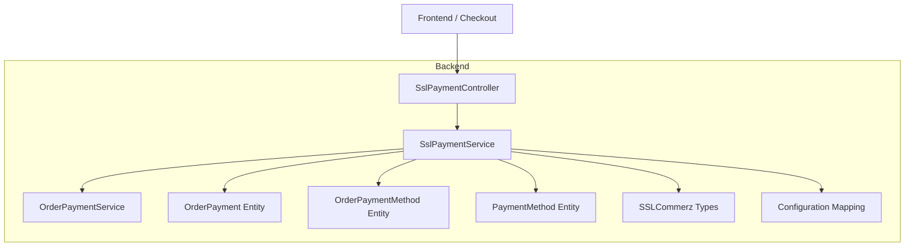
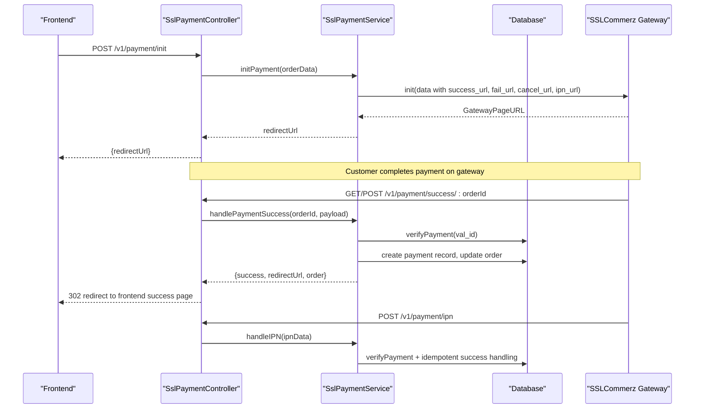
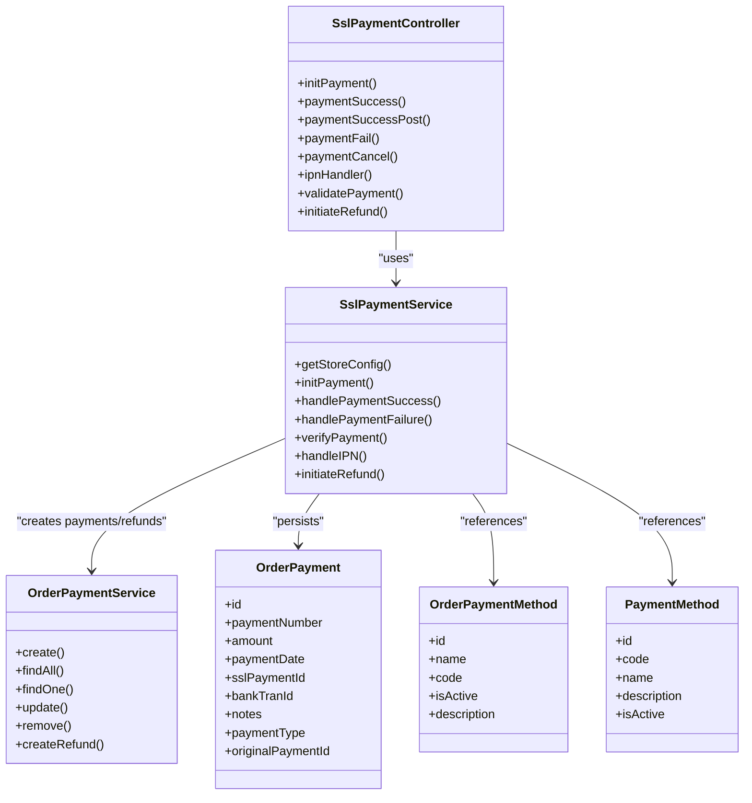

# Payment Integration

<cite>
**Referenced Files in This Document**
- [ssl-payment.service.ts](file://apps/backend/src/ssl-payment/ssl-payment.service.ts)
- [ssl-payment.controller.ts](file://apps/backend/src/ssl-payment/ssl-payment.controller.ts)
- [sslcommerz-lts.d.ts](file://apps/backend/src/types/sslcommerz-lts.d.ts)
- [configuration.ts](file://apps/backend/src/config/configuration.ts)
- [order-payment.entity.ts](file://apps/backend/src/order-payment/entities/order-payment.entity.ts)
- [order-payment.service.ts](file://apps/backend/src/order-payment/order-payment.service.ts)
- [order-payment-method.entity.ts](file://apps/backend/src/order-payment-method/entities/order-payment-method.entity.ts)
- [payment-method.entity.ts](file://apps/backend/src/payment-method/entities/payment-method.entity.ts)
- [README.md](file://README.md)
</cite>

## Table of Contents
1. [Introduction](#introduction)
2. [Project Structure](#project-structure)
3. [Core Components](#core-components)
4. [Architecture Overview](#architecture-overview)
5. [Detailed Component Analysis](#detailed-component-analysis)
6. [Dependency Analysis](#dependency-analysis)
7. [Performance Considerations](#performance-considerations)
8. [Troubleshooting Guide](#troubleshooting-guide)
9. [Conclusion](#conclusion)
10. [Appendices](#appendices)

## Introduction
This document explains the German Butcher payment integration, focusing on SSLCommerz gateway integration for payment initiation, transaction processing, callback handling, and refunds. It also covers multi-payment method support (credit cards, digital wallets, bank transfers, cash on delivery), security measures, end-to-end workflow from checkout to confirmation, error handling strategies, reconciliation/logging/reporting, and testing guidance.

## Project Structure
The payment integration is implemented in the backend NestJS application with a dedicated SSLCommerz module and shared order/payment modules:
- SSLCommerz integration: controller and service under ssl-payment
- Type definitions for the SSLCommerz SDK
- Configuration mapping for environment variables
- Order and payment entities/services for recording transactions and managing statuses
- Payment method entities for supporting multiple payment types



**Diagram sources**
- [ssl-payment.controller.ts:31-258](file://apps/backend/src/ssl-payment/ssl-payment.controller.ts#L31-L258)
- [ssl-payment.service.ts:16-413](file://apps/backend/src/ssl-payment/ssl-payment.service.ts#L16-L413)
- [order-payment.service.ts:17-309](file://apps/backend/src/order-payment/order-payment.service.ts#L17-L309)
- [order-payment.entity.ts:18-127](file://apps/backend/src/order-payment/entities/order-payment.entity.ts#L18-L127)
- [order-payment-method.entity.ts:14-67](file://apps/backend/src/order-payment-method/entities/order-payment-method.entity.ts#L14-L67)
- [payment-method.entity.ts:16-94](file://apps/backend/src/payment-method/entities/payment-method.entity.ts#L16-L94)
- [sslcommerz-lts.d.ts:1-127](file://apps/backend/src/types/sslcommerz-lts.d.ts#L1-L127)
- [configuration.ts:1-16](file://apps/backend/src/config/configuration.ts#L1-L16)

**Section sources**
- [README.md:60-61](file://README.md#L60-L61)
- [ssl-payment.controller.ts:31-258](file://apps/backend/src/ssl-payment/ssl-payment.controller.ts#L31-L258)
- [ssl-payment.service.ts:16-413](file://apps/backend/src/ssl-payment/ssl-payment.service.ts#L16-L413)
- [order-payment.service.ts:17-309](file://apps/backend/src/order-payment/order-payment.service.ts#L17-L309)
- [order-payment.entity.ts:18-127](file://apps/backend/src/order-payment/entities/order-payment.entity.ts#L18-L127)
- [order-payment-method.entity.ts:14-67](file://apps/backend/src/order-payment-method/entities/order-payment-method.entity.ts#L14-L67)
- [payment-method.entity.ts:16-94](file://apps/backend/src/payment-method/entities/payment-method.entity.ts#L16-L94)
- [sslcommerz-lts.d.ts:1-127](file://apps/backend/src/types/sslcommerz-lts.d.ts#L1-L127)
- [configuration.ts:1-16](file://apps/backend/src/config/configuration.ts#L1-L16)

## Core Components
- SslPaymentController: Exposes endpoints for initiating payments, handling success/fail/cancel callbacks, IPN, validation, and refund initiation.
- SslPaymentService: Orchestrates SSLCommerz interactions (init, validate, IPN processing, refunds), persists payment records, updates orders, and manages payment methods.
- OrderPaymentService: Manages payment records, generates unique payment numbers, calculates paid amounts and statuses, and handles refunds.
- Entities: OrderPayment, OrderPaymentMethod, PaymentMethod define data structures for payments and methods.
- Types: TypeScript declarations for the SSLCommerz SDK interfaces.
- Configuration: Maps environment variables for SSLCommerz credentials and URLs.

Key responsibilities:
- Payment initiation returns a redirect URL to the SSLCommerz gateway.
- Success/failure/cancel routes process callbacks and update order state.
- IPN endpoint provides asynchronous verification and idempotent success handling.
- Refund flow integrates with SSLCommerz and creates reversal postings.

**Section sources**
- [ssl-payment.controller.ts:31-258](file://apps/backend/src/ssl-payment/ssl-payment.controller.ts#L31-L258)
- [ssl-payment.service.ts:16-413](file://apps/backend/src/ssl-payment/ssl-payment.service.ts#L16-L413)
- [order-payment.service.ts:17-309](file://apps/backend/src/order-payment/order-payment.service.ts#L17-L309)
- [order-payment.entity.ts:18-127](file://apps/backend/src/order-payment/entities/order-payment.entity.ts#L18-L127)
- [order-payment-method.entity.ts:14-67](file://apps/backend/src/order-payment-method/entities/order-payment-method.entity.ts#L14-L67)
- [payment-method.entity.ts:16-94](file://apps/backend/src/payment-method/entities/payment-method.entity.ts#L16-L94)
- [sslcommerz-lts.d.ts:1-127](file://apps/backend/src/types/sslcommerz-lts.d.ts#L1-L127)
- [configuration.ts:1-16](file://apps/backend/src/config/configuration.ts#L1-L16)

## Architecture Overview
End-to-end flow from checkout to confirmation via SSLCommerz:



**Diagram sources**
- [ssl-payment.controller.ts:35-206](file://apps/backend/src/ssl-payment/ssl-payment.controller.ts#L35-L206)
- [ssl-payment.service.ts:44-328](file://apps/backend/src/ssl-payment/ssl-payment.service.ts#L44-L328)
- [order-payment.service.ts:28-73](file://apps/backend/src/order-payment/order-payment.service.ts#L28-L73)

## Detailed Component Analysis

### SSLCommerz Payment Service
Responsibilities:
- Reads SSLCommerz credentials and environment configuration.
- Initializes payment with SSLCommerz using order details and callback URLs.
- Verifies payment by calling gateway validation and comparing transaction identifiers and amounts.
- Handles success/failure/cancel callbacks and redirects users appropriately.
- Processes IPN asynchronously for robust settlement.
- Initiates refunds and creates reversal postings in the system.

```mermaid
flowchart TD
Start(["initPayment"]) --> ReadCfg["Read SSLCommerz config"]
ReadCfg --> BuildData["Build SSLCommerz payload<br/>with order, customer, shipping, value fields"]
BuildData --> CallInit["Call SSLCommerz.init()"]
CallInit --> HasURL{"GatewayPageURL present?"}
HasURL --> |Yes| ReturnURL["Return redirect URL"]
HasURL --> |No| ThrowErr["Throw BadRequestException"]
subgraph Callbacks
Success["handlePaymentSuccess"] --> Verify["verifyPayment(val_id)"]
Verify --> Valid{"Valid?"}
Valid --> |Yes| Persist["Create payment record<br/>Update order method & totals"]
Valid --> |No| FailErr["Throw BadRequestException"]
Fail["handlePaymentFailure"] --> LogFail["Log failure details"]
Cancel["handlePaymentCancel"] --> RedirectCancel["Redirect to cancelled page"]
end
subgraph IPN
IPN["handleIPN"] --> CheckStatus{"status == VALID?"}
CheckStatus --> |Yes| ProcessSuccess["Call handlePaymentSuccess"]
CheckStatus --> |No| LogInvalid["Log invalid status"]
end
subgraph Refunds
Refund["initiateRefund"] --> ValidateFields["Validate bank_tran_id vs tran_id"]
ValidateFields --> CallRefund["Call SSLCommerz.initiateRefund()"]
CallRefund --> RefundOK{"status SUCCESS?"}
RefundOK --> |Yes| CreateReversal["Create reversal posting"]
RefundOK --> |No| RaiseError["Throw BadRequestException"]
end
```

**Diagram sources**
- [ssl-payment.service.ts:29-111](file://apps/backend/src/ssl-payment/ssl-payment.service.ts#L29-L111)
- [ssl-payment.service.ts:113-328](file://apps/backend/src/ssl-payment/ssl-payment.service.ts#L113-L328)
- [ssl-payment.service.ts:330-413](file://apps/backend/src/ssl-payment/ssl-payment.service.ts#L330-L413)

**Section sources**
- [ssl-payment.service.ts:29-111](file://apps/backend/src/ssl-payment/ssl-payment.service.ts#L29-L111)
- [ssl-payment.service.ts:113-328](file://apps/backend/src/ssl-payment/ssl-payment.service.ts#L113-L328)
- [ssl-payment.service.ts:330-413](file://apps/backend/src/ssl-payment/ssl-payment.service.ts#L330-L413)

### SSLCommerz Payment Controller
Endpoints:
- POST /v1/payment/init: Initiates payment and returns redirect URL.
- GET/POST /v1/payment/success/:orderId: Processes successful payment callbacks.
- POST /v1/payment/fail/:orderId: Handles failed payments.
- POST /v1/payment/cancel/:orderId: Handles canceled payments.
- POST /v1/payment/ipn: Receives IPN notifications.
- GET /v1/payment/validate/:tranId: Placeholder for manual validation.
- POST /v1/payment/refund: Admin-only endpoint to initiate refunds.

Security:
- Init requires JWT authentication.
- Refund requires JWT and permission guard with module permissions.

**Section sources**
- [ssl-payment.controller.ts:31-258](file://apps/backend/src/ssl-payment/ssl-payment.controller.ts#L31-L258)

### Order Payment Service and Entities
OrderPaymentService:
- Creates payment records with unique sequential numbers per year.
- Updates order paid amount and payment status based on accumulated payments.
- Supports partial payments and full completion logic.
- Creates refund entries with negative amounts and updates order status accordingly.

OrderPayment entity:
- Stores payment number, amount, date, method, SSL transaction IDs, bank transaction ID, notes, type (PAYMENT or REFUND), and references to original payment for reversals.

OrderPaymentMethod and PaymentMethod entities:
- Represent available payment methods (e.g., Cash on Delivery, Bank Transfer, Credit Card).
- Include code, name, description, activation status, and audit fields.

**Section sources**
- [order-payment.service.ts:28-73](file://apps/backend/src/order-payment/order-payment.service.ts#L28-L73)
- [order-payment.service.ts:187-211](file://apps/backend/src/order-payment/order-payment.service.ts#L187-L211)
- [order-payment.service.ts:213-307](file://apps/backend/src/order-payment/order-payment.service.ts#L213-L307)
- [order-payment.entity.ts:18-127](file://apps/backend/src/order-payment/entities/order-payment.entity.ts#L18-L127)
- [order-payment-method.entity.ts:14-67](file://apps/backend/src/order-payment-method/entities/order-payment-method.entity.ts#L14-L67)
- [payment-method.entity.ts:16-94](file://apps/backend/src/payment-method/entities/payment-method.entity.ts#L16-L94)

### SSLCommerz Types and Configuration
Types:
- Define interfaces for payment data, initialization response, IPN response, refund response, query response, and SDK class methods.

Configuration:
- Maps environment variables for SSLCommerz store credentials and payment URLs.

**Section sources**
- [sslcommerz-lts.d.ts:1-127](file://apps/backend/src/types/sslcommerz-lts.d.ts#L1-L127)
- [configuration.ts:1-16](file://apps/backend/src/config/configuration.ts#L1-L16)

## Dependency Analysis
Component relationships:
- SslPaymentController depends on SslPaymentService for business logic.
- SslPaymentService depends on:
  - ConfigService for environment variables.
  - Repositories for Order, OrderPayment, OrderPaymentMethod.
  - OrderPaymentService for creating payment records and refunds.
  - SSLCommerz SDK via typed interface.

External dependencies:
- sslcommerz-lts SDK for payment initiation, validation, and refunds.

Potential coupling:
- Tight coupling between SslPaymentService and OrderPaymentService for payment persistence.
- Reliance on environment variables for gateway configuration.



**Diagram sources**
- [ssl-payment.controller.ts:31-258](file://apps/backend/src/ssl-payment/ssl-payment.controller.ts#L31-L258)
- [ssl-payment.service.ts:16-413](file://apps/backend/src/ssl-payment/ssl-payment.service.ts#L16-L413)
- [order-payment.service.ts:17-309](file://apps/backend/src/order-payment/order-payment.service.ts#L17-L309)
- [order-payment.entity.ts:18-127](file://apps/backend/src/order-payment/entities/order-payment.entity.ts#L18-L127)
- [order-payment-method.entity.ts:14-67](file://apps/backend/src/order-payment-method/entities/order-payment-method.entity.ts#L14-L67)
- [payment-method.entity.ts:16-94](file://apps/backend/src/payment-method/entities/payment-method.entity.ts#L16-L94)

**Section sources**
- [ssl-payment.controller.ts:31-258](file://apps/backend/src/ssl-payment/ssl-payment.controller.ts#L31-L258)
- [ssl-payment.service.ts:16-413](file://apps/backend/src/ssl-payment/ssl-payment.service.ts#L16-L413)
- [order-payment.service.ts:17-309](file://apps/backend/src/order-payment/order-payment.service.ts#L17-L309)

## Performance Considerations
- Idempotency: The success handler checks for existing payment records to avoid duplicate processing.
- Logging: Only non-sensitive fields are logged to reduce overhead and protect PII.
- Database queries: Relations are explicitly loaded to minimize N+1 queries during success handling.
- Validation: Gateway validation is performed before persisting payment records to ensure correctness early.

[No sources needed since this section provides general guidance]

## Troubleshooting Guide
Common issues and resolutions:
- Missing SSLCommerz credentials: Ensure environment variables are set; otherwise, initialization throws an error.
- Invalid source/IP whitelist: Refund calls detect INVALID_SOURCE errors and instruct whitelisting your server IP in the merchant panel.
- Payment verification failures: Mismatched transaction IDs or amounts cause verification to fail; check callback payloads and gateway responses.
- Network failures: Initialization and validation wrap external calls in try/catch and return appropriate error responses.
- Duplicate payments: Existing payment records prevent reprocessing; logs indicate already processed transactions.

Operational tips:
- Use the IPN endpoint for asynchronous settlement and rely on it for robustness.
- Monitor logs for sanitized callback fields (transaction ID, status, amount).
- For refunds, confirm that bank_tran_id differs from tran_id and that the correct values are provided.

**Section sources**
- [ssl-payment.service.ts:29-42](file://apps/backend/src/ssl-payment/ssl-payment.service.ts#L29-L42)
- [ssl-payment.service.ts:107-110](file://apps/backend/src/ssl-payment/ssl-payment.service.ts#L107-L110)
- [ssl-payment.service.ts:151-165](file://apps/backend/src/ssl-payment/ssl-payment.service.ts#L151-L165)
- [ssl-payment.service.ts:269-306](file://apps/backend/src/ssl-payment/ssl-payment.service.ts#L269-L306)
- [ssl-payment.service.ts:367-377](file://apps/backend/src/ssl-payment/ssl-payment.service.ts#L367-L377)

## Conclusion
The German Butcher payment integration leverages SSLCommerz for secure payment processing with robust callback handling, IPN support, and comprehensive refund capabilities. The architecture cleanly separates concerns across controllers, services, and domain entities, ensuring maintainability and extensibility for additional payment methods. Security best practices include credential management, sensitive data minimization in logs, and gateway-side validation. Operational resilience is achieved through idempotent success handling and clear error signaling.

[No sources needed since this section summarizes without analyzing specific files]

## Appendices

### Multi-Payment Method Support
Supported methods include:
- Credit cards
- Digital wallets (mobile banking)
- Bank transfers
- Cash on delivery

These are represented by payment method entities and can be extended by adding new entries and wiring them into the checkout flow.

**Section sources**
- [order-payment-method.entity.ts:14-67](file://apps/backend/src/order-payment-method/entities/order-payment-method.entity.ts#L14-L67)
- [payment-method.entity.ts:16-94](file://apps/backend/src/payment-method/entities/payment-method.entity.ts#L16-L94)

### Payment Workflow Summary
- Initiation: Frontend calls /payment/init to obtain a redirect URL to SSLCommerz.
- Processing: After payment, SSLCommerz calls success/fail/cancel endpoints and IPN.
- Confirmation: Success path verifies payment, creates payment records, updates order status, and redirects to frontend success page.
- Failure: Failure path logs details and redirects to failure page.
- Reconciliation: Payment records capture SSL transaction IDs and bank transaction IDs for reporting and refunds.

**Section sources**
- [ssl-payment.controller.ts:35-206](file://apps/backend/src/ssl-payment/ssl-payment.controller.ts#L35-L206)
- [ssl-payment.service.ts:44-328](file://apps/backend/src/ssl-payment/ssl-payment.service.ts#L44-L328)
- [order-payment.service.ts:28-73](file://apps/backend/src/order-payment/order-payment.service.ts#L28-L73)

### Security Measures
- Credentials managed via environment variables.
- Gateway-side validation ensures authenticity and integrity of payments.
- Logs sanitize sensitive fields to protect PII.
- Access controls: JWT and permission guards protect sensitive endpoints like refunds.

**Section sources**
- [ssl-payment.service.ts:29-42](file://apps/backend/src/ssl-payment/ssl-payment.service.ts#L29-L42)
- [ssl-payment.controller.ts:35-39](file://apps/backend/src/ssl-payment/ssl-payment.controller.ts#L35-L39)
- [ssl-payment.controller.ts:229-238](file://apps/backend/src/ssl-payment/ssl-payment.controller.ts#L229-L238)

### Testing Procedures and Sandbox Setup
- Configure SSLCOMMERZ_IS_LIVE to false for sandbox mode.
- Set BASE_URL and PAYMENT_IPN_URL to point to development endpoints.
- Use test order data to exercise init, success, fail, cancel, and IPN flows.
- Validate refund flow with test bank_tran_id and tran_id values.

**Section sources**
- [configuration.ts:1-16](file://apps/backend/src/config/configuration.ts#L1-L16)
- [ssl-payment.service.ts:330-413](file://apps/backend/src/ssl-payment/ssl-payment.service.ts#L330-L413)