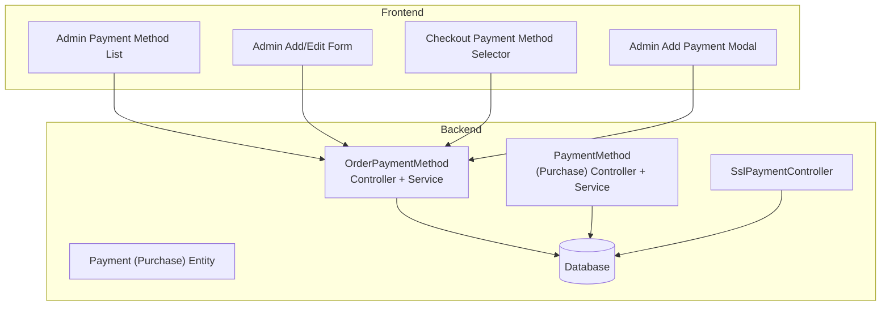
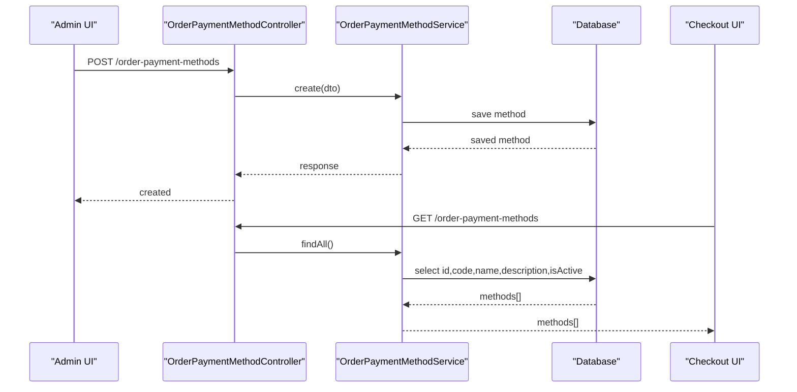
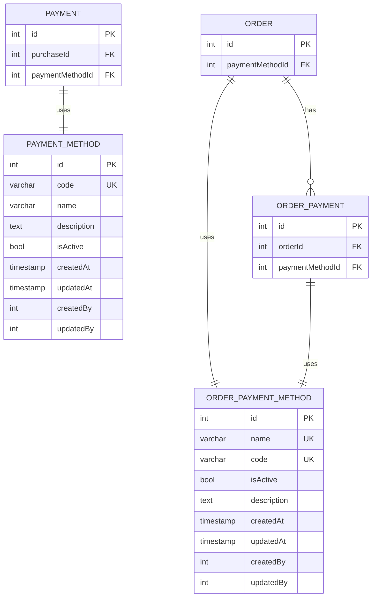
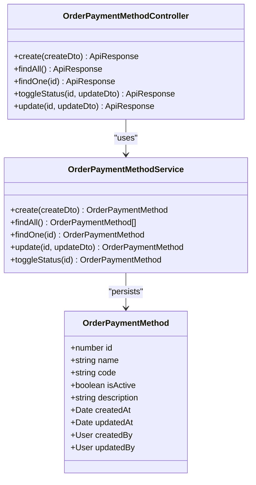
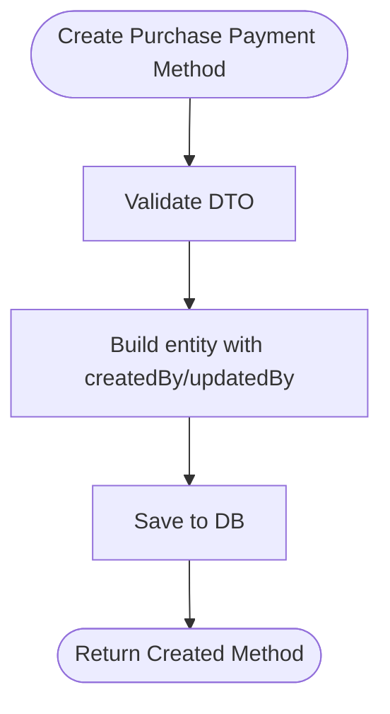
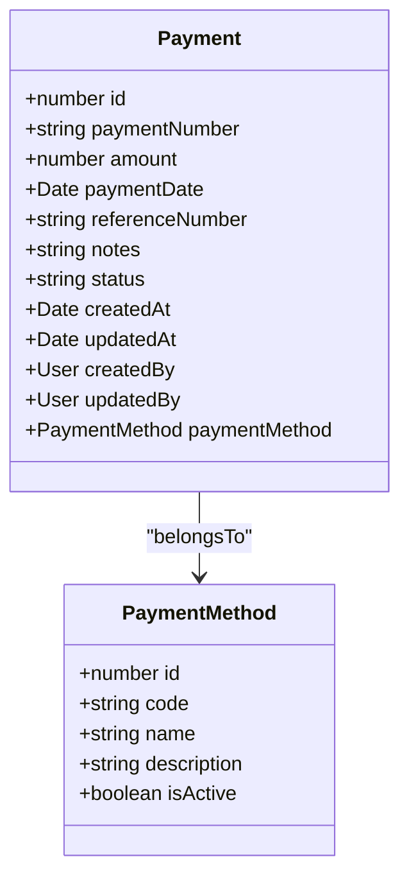
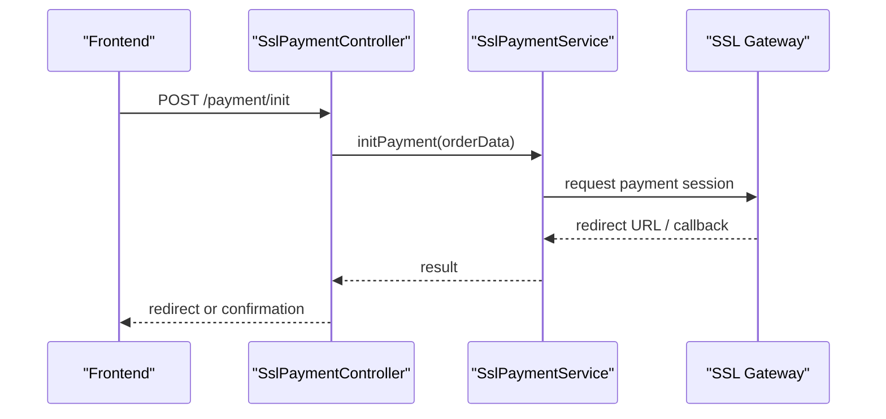
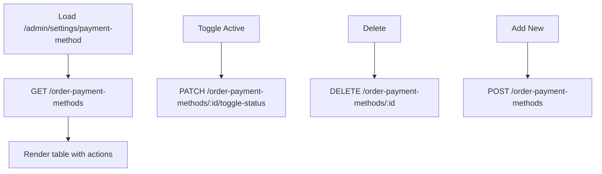
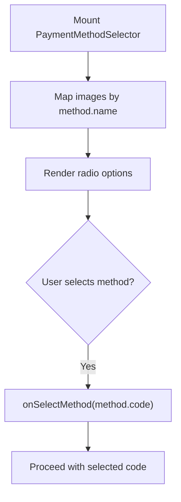
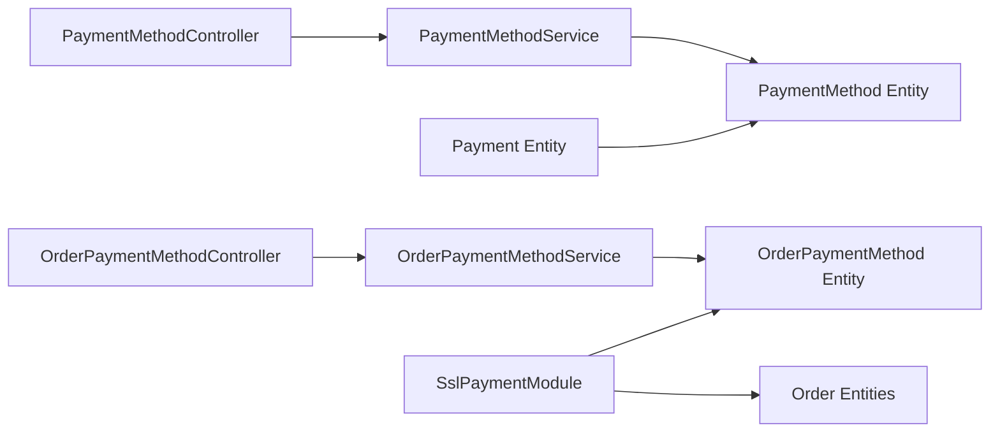

# Payment Methods

<cite>
**Referenced Files in This Document**
- [payment-method.entity.ts](file://apps/backend/src/payment-method/entities/payment-method.entity.ts)
- [create-payment-method.dto.ts](file://apps/backend/src/payment-method/dto/create-payment-method.dto.ts)
- [payment-method.service.ts](file://apps/backend/src/payment-method/payment-method.service.ts)
- [payment-method.controller.ts](file://apps/backend/src/payment-method/payment-method.controller.ts)
- [order-payment-method.entity.ts](file://apps/backend/src/order-payment-method/entities/order-payment-method.entity.ts)
- [order-payment-method.service.ts](file://apps/backend/src/order-payment-method/order-payment-method.service.ts)
- [order-payment-method.controller.ts](file://apps/backend/src/order-payment-method/order-payment-method.controller.ts)
- [payment.entity.ts](file://apps/backend/src/payment/entities/payment.entity.ts)
- [database.dbml](file://apps/backend/database.dbml)
- [payment-method-selector.tsx](file://apps/frontend/components/checkout/payment-method-selector.tsx)
- [add-payment-modal.tsx](file://apps/frontend/components/admin/orders/add-payment-modal.tsx)
- [payment-form.tsx](file://apps/frontend/components/admin/payment/payment-form.tsx)
- [payment-method-list.tsx](file://apps/frontend/components/admin/payment-method/payment-method-list.tsx)
- [page.tsx (admin settings payment-method)](file://apps/frontend/app/admin/settings/payment-method/page.tsx)
- [page.tsx (admin add payment-method)](file://apps/frontend/app/admin/settings/payment-method/add/page.tsx)
- [types.ts](file://apps/frontend/utils/types.ts)
- [ssl-payment.controller.ts](file://apps/backend/src/ssl-payment/ssl-payment.controller.ts)
- [ssl-payment.module.ts](file://apps/backend/src/ssl-payment/ssl-payment.module.ts)
- [order confirmation page.tsx](file://apps/frontend/app/(main)/order-confirmation/[id]/page.tsx)
</cite>

## Table of Contents
1. [Introduction](#introduction)
2. [Project Structure](#project-structure)
3. [Core Components](#core-components)
4. [Architecture Overview](#architecture-overview)
5. [Detailed Component Analysis](#detailed-component-analysis)
6. [Dependency Analysis](#dependency-analysis)
7. [Performance Considerations](#performance-considerations)
8. [Troubleshooting Guide](#troubleshooting-guide)
9. [Conclusion](#conclusion)
10. [Appendices](#appendices)

## Introduction
This document explains the multi-payment method support system across backend and frontend. It covers supported payment types, configuration via the admin interface, database schema, selection logic during checkout, validation rules, lifecycle management (creation, activation/deactivation, removal), customization guidance, and display behavior on web and mobile.

Supported payment types observed in the codebase:
- Credit card / digital wallet via SSLCommerz integration
- Bank transfer
- Cash on delivery

The system exposes two related but distinct concepts:
- Order-level payment methods used for customer-facing checkout and order recording
- Purchase-level payment methods used for internal purchase accounting

## Project Structure
The payment method feature spans multiple modules:
- Backend NestJS modules for order payment methods, purchase payment methods, payments, and SSLCommerz integration
- Frontend Next.js pages and components for admin configuration and checkout UI

**Diagram sources**
- [order-payment-method.controller.ts:33-159](file://apps/backend/src/order-payment-method/order-payment-method.controller.ts#L33-L159)
- [order-payment-method.service.ts:9-64](file://apps/backend/src/order-payment-method/order-payment-method.service.ts#L9-L64)
- [payment-method.controller.ts:34-44](file://apps/backend/src/payment-method/payment-method.controller.ts#L34-L44)
- [payment-method.service.ts:9-52](file://apps/backend/src/payment-method/payment-method.service.ts#L9-L52)
- [payment.entity.ts:17-143](file://apps/backend/src/payment/entities/payment.entity.ts#L17-L143)
- [ssl-payment.controller.ts:31-43](file://apps/backend/src/ssl-payment/ssl-payment.controller.ts#L31-L43)
- [payment-method-selector.tsx:28-107](file://apps/frontend/components/checkout/payment-method-selector.tsx#L28-L107)
- [payment-method-list.tsx:34-76](file://apps/frontend/components/admin/payment-method/payment-method-list.tsx#L34-L76)
- [payment-form.tsx:197-221](file://apps/frontend/components/admin/payment/payment-form.tsx#L197-L221)
- [add-payment-modal.tsx:197-233](file://apps/frontend/components/admin/orders/add-payment-modal.tsx#L197-L233)

**Section sources**
- [order-payment-method.controller.ts:33-159](file://apps/backend/src/order-payment-method/order-payment-method.controller.ts#L33-L159)
- [order-payment-method.service.ts:9-64](file://apps/backend/src/order-payment-method/order-payment-method.service.ts#L9-L64)
- [payment-method.controller.ts:34-44](file://apps/backend/src/payment-method/payment-method.controller.ts#L34-L44)
- [payment-method.service.ts:9-52](file://apps/backend/src/payment-method/payment-method.service.ts#L9-L52)
- [payment.entity.ts:17-143](file://apps/backend/src/payment/entities/payment.entity.ts#L17-L143)
- [ssl-payment.controller.ts:31-43](file://apps/backend/src/ssl-payment/ssl-payment.controller.ts#L31-L43)
- [payment-method-selector.tsx:28-107](file://apps/frontend/components/checkout/payment-method-selector.tsx#L28-L107)
- [payment-method-list.tsx:34-76](file://apps/frontend/components/admin/payment-method/payment-method-list.tsx#L34-L76)
- [payment-form.tsx:197-221](file://apps/frontend/components/admin/payment/payment-form.tsx#L197-L221)
- [add-payment-modal.tsx:197-233](file://apps/frontend/components/admin/orders/add-payment-modal.tsx#L197-L233)

## Core Components
- Order payment methods: The primary set of payment options available to customers at checkout and stored with orders.
- Purchase payment methods: A separate entity used for recording payments against purchases.
- Payments: Transaction records that link to a payment method and an order or purchase.
- SSLCommerz integration: Handles online payments (credit cards, wallets).
- Admin UI: Provides CRUD operations and toggling of active status for order payment methods.
- Checkout UI: Renders available payment methods and allows selection.

Key responsibilities:
- OrderPaymentMethodService: Create, list, update, toggle active status.
- PaymentMethodService (purchase): Create, list, update, remove; returns only active methods by default.
- Payment entity: Generates unique payment numbers and links to a payment method.
- SslPaymentController: Initiates online payments and handles callbacks.

**Section sources**
- [order-payment-method.service.ts:16-62](file://apps/backend/src/order-payment-method/order-payment-method.service.ts#L16-L62)
- [payment-method.service.ts:16-51](file://apps/backend/src/payment-method/payment-method.service.ts#L16-L51)
- [payment.entity.ts:95-109](file://apps/backend/src/payment/entities/payment.entity.ts#L95-L109)
- [ssl-payment.controller.ts:31-43](file://apps/backend/src/ssl-payment/ssl-payment.controller.ts#L31-L43)

## Architecture Overview
The system separates administrative configuration from customer-facing selection and payment processing.

**Diagram sources**
- [order-payment-method.controller.ts:44-83](file://apps/backend/src/order-payment-method/order-payment-method.controller.ts#L44-L83)
- [order-payment-method.service.ts:16-44](file://apps/backend/src/order-payment-method/order-payment-method.service.ts#L16-L44)

## Detailed Component Analysis

### Database Schema
Two related tables define payment methods:
- order_payment_method: Customer-facing payment options for orders
- payment_method: Internal payment options for purchases

**Diagram sources**
- [database.dbml:228-254](file://apps/backend/database.dbml#L228-L254)
- [database.dbml:337-369](file://apps/backend/database.dbml#L337-L369)
- [database.dbml:381-396](file://apps/backend/database.dbml#L381-L396)

**Section sources**
- [database.dbml:228-254](file://apps/backend/database.dbml#L228-L254)
- [database.dbml:337-369](file://apps/backend/database.dbml#L337-L369)
- [database.dbml:381-396](file://apps/backend/database.dbml#L381-L396)

### Order Payment Methods (Customer-Facing)
- Entity fields: id, name, code, isActive, description, timestamps, createdBy, updatedBy
- Service operations:
  - create: validates uniqueness of code/name
  - findAll: returns all methods (selected fields)
  - findOne: by id
  - update: partial updates
  - toggleStatus: flips isActive
- Controller endpoints:
  - POST /order-payment-methods (protected)
  - GET /order-payment-methods (public)
  - GET /order-payment-methods/:id
  - PATCH /order-payment-methods/:id/toggle-status (protected)
  - PATCH /order-payment-methods/:id (protected)

**Diagram sources**
- [order-payment-method.entity.ts:14-67](file://apps/backend/src/order-payment-method/entities/order-payment-method.entity.ts#L14-L67)
- [order-payment-method.service.ts:9-64](file://apps/backend/src/order-payment-method/order-payment-method.service.ts#L9-L64)
- [order-payment-method.controller.ts:33-159](file://apps/backend/src/order-payment-method/order-payment-method.controller.ts#L33-L159)

**Section sources**
- [order-payment-method.entity.ts:14-67](file://apps/backend/src/order-payment-method/entities/order-payment-method.entity.ts#L14-L67)
- [order-payment-method.service.ts:16-62](file://apps/backend/src/order-payment-method/order-payment-method.service.ts#L16-L62)
- [order-payment-method.controller.ts:44-159](file://apps/backend/src/order-payment-method/order-payment-method.controller.ts#L44-L159)

### Purchase Payment Methods (Internal)
- Entity fields: id, code, name, description, isActive, timestamps, createdBy, updatedBy
- Service operations:
  - create: sets createdBy/updatedBy from authenticated user
  - findAll: returns only active methods
  - findOne: by id
  - update: applies updateDto and sets updatedBy
  - remove: deletes by id
- Controller endpoints:
  - POST /payment-methods (protected)
  - GET /payment-methods (returns active only)
  - GET /payment-methods/:id
  - PATCH /payment-methods/:id (protected)
  - DELETE /payment-methods/:id (protected)

**Diagram sources**
- [payment-method.service.ts:16-23](file://apps/backend/src/payment-method/payment-method.service.ts#L16-L23)
- [create-payment-method.dto.ts:4-37](file://apps/backend/src/payment-method/dto/create-payment-method.dto.ts#L4-L37)

**Section sources**
- [payment-method.entity.ts:16-94](file://apps/backend/src/payment-method/entities/payment-method.entity.ts#L16-L94)
- [payment-method.service.ts:16-51](file://apps/backend/src/payment-method/payment-method.service.ts#L16-L51)
- [payment-method.controller.ts:34-44](file://apps/backend/src/payment-method/payment-method.controller.ts#L34-L44)
- [create-payment-method.dto.ts:4-37](file://apps/backend/src/payment-method/dto/create-payment-method.dto.ts#L4-L37)

### Payments (Transactions)
- Links to a payment method and either a purchase or an order
- Generates a unique payment number before insert
- Tracks amount, date, reference, notes, and status

**Diagram sources**
- [payment.entity.ts:17-143](file://apps/backend/src/payment/entities/payment.entity.ts#L17-L143)
- [payment-method.entity.ts:16-94](file://apps/backend/src/payment-method/entities/payment-method.entity.ts#L16-L94)

**Section sources**
- [payment.entity.ts:95-109](file://apps/backend/src/payment/entities/payment.entity.ts#L95-L109)
- [payment.entity.ts:62-70](file://apps/backend/src/payment/entities/payment.entity.ts#L62-L70)

### SSLCommerz Integration (Credit Cards and Digital Wallets)
- Controller endpoint initiates online payments
- Module wires SSL payment entities and services with order-related entities

**Diagram sources**
- [ssl-payment.controller.ts:31-43](file://apps/backend/src/ssl-payment/ssl-payment.controller.ts#L31-L43)
- [ssl-payment.module.ts:13-26](file://apps/backend/src/ssl-payment/ssl-payment.module.ts#L13-L26)

**Section sources**
- [ssl-payment.controller.ts:31-43](file://apps/backend/src/ssl-payment/ssl-payment.controller.ts#L31-L43)
- [ssl-payment.module.ts:13-26](file://apps/backend/src/ssl-payment/ssl-payment.module.ts#L13-L26)

### Admin Interface for Payment Methods
- Lists all order payment methods with ability to toggle active status and delete
- Provides add/edit forms for creating/updating payment methods
- Uses permissions guard for protected routes

**Diagram sources**
- [payment-method-list.tsx:34-76](file://apps/frontend/components/admin/payment-method/payment-method-list.tsx#L34-L76)
- [order-payment-method.controller.ts:110-159](file://apps/backend/src/order-payment-method/order-payment-method.controller.ts#L110-L159)
- [page.tsx (admin settings payment-method):1-10](file://apps/frontend/app/admin/settings/payment-method/page.tsx#L1-L10)
- [page.tsx (admin add payment-method):1-29](file://apps/frontend/app/admin/settings/payment-method/add/page.tsx#L1-L29)

**Section sources**
- [payment-method-list.tsx:34-76](file://apps/frontend/components/admin/payment-method/payment-method-list.tsx#L34-L76)
- [page.tsx (admin settings payment-method):1-10](file://apps/frontend/app/admin/settings/payment-method/page.tsx#L1-L10)
- [page.tsx (admin add payment-method):1-29](file://apps/frontend/app/admin/settings/payment-method/add/page.tsx#L1-L29)

### Checkout Payment Method Selection
- Renders available payment methods with names, descriptions, and optional logos
- Supports disabling specific methods with inline reasons
- Sends selected method code to backend

**Diagram sources**
- [payment-method-selector.tsx:28-107](file://apps/frontend/components/checkout/payment-method-selector.tsx#L28-L107)

**Section sources**
- [payment-method-selector.tsx:28-107](file://apps/frontend/components/checkout/payment-method-selector.tsx#L28-L107)

### Admin Payment Recording for Orders
- Allows selecting a payment method when adding a payment record for an order
- Uses the same order payment methods list

**Section sources**
- [add-payment-modal.tsx:197-233](file://apps/frontend/components/admin/orders/add-payment-modal.tsx#L197-L233)
- [payment-form.tsx:197-221](file://apps/frontend/components/admin/payment/payment-form.tsx#L197-L221)

### Payment Method Display Logic in Frontend
- Displays method name and description
- Shows associated logo if mapped
- Disables methods based on business rules and shows reason

**Section sources**
- [payment-method-selector.tsx:23-26](file://apps/frontend/components/checkout/payment-method-selector.tsx#L23-L26)
- [payment-method-selector.tsx:51-107](file://apps/frontend/components/checkout/payment-method-selector.tsx#L51-L107)

### Cash on Delivery Handling
- Order confirmation page detects COD and hides Pay Now button accordingly

**Section sources**
- [order confirmation page.tsx:66-81](file://apps/frontend/app/(main)/order-confirmation/[id]/page.tsx#L66-L81)

## Dependency Analysis
- OrderPaymentMethodController depends on OrderPaymentMethodService
- OrderPaymentMethodService depends on TypeORM repository for OrderPaymentMethod
- PaymentMethodService (purchase) depends on TypeORM repository for PaymentMethod
- Payment entity depends on PaymentMethod
- SSL module depends on SSL entities and order-related entities

**Diagram sources**
- [order-payment-method.controller.ts:33-159](file://apps/backend/src/order-payment-method/order-payment-method.controller.ts#L33-L159)
- [order-payment-method.service.ts:9-64](file://apps/backend/src/order-payment-method/order-payment-method.service.ts#L9-L64)
- [payment-method.service.ts:9-52](file://apps/backend/src/payment-method/payment-method.service.ts#L9-L52)
- [payment.entity.ts:17-143](file://apps/backend/src/payment/entities/payment.entity.ts#L17-L143)
- [ssl-payment.module.ts:13-26](file://apps/backend/src/ssl-payment/ssl-payment.module.ts#L13-L26)

**Section sources**
- [order-payment-method.controller.ts:33-159](file://apps/backend/src/order-payment-method/order-payment-method.controller.ts#L33-L159)
- [order-payment-method.service.ts:9-64](file://apps/backend/src/order-payment-method/order-payment-method.service.ts#L9-L64)
- [payment-method.service.ts:9-52](file://apps/backend/src/payment-method/payment-method.service.ts#L9-L52)
- [payment.entity.ts:17-143](file://apps/backend/src/payment/entities/payment.entity.ts#L17-L143)
- [ssl-payment.module.ts:13-26](file://apps/backend/src/ssl-payment/ssl-payment.module.ts#L13-L26)

## Performance Considerations
- Use selective field projection for listing payment methods to reduce payload size
- Cache frequently accessed payment methods on the frontend where appropriate
- Avoid eager loading relationships unless necessary to prevent N+1 queries
- For SSL callbacks, log minimal non-sensitive fields to reduce I/O overhead

[No sources needed since this section provides general guidance]

## Troubleshooting Guide
Common issues and resolutions:
- Duplicate payment method creation: Ensure unique code and name; service throws conflict on duplicates
- Missing payment methods in checkout: Verify they are returned by the public list endpoint and not disabled
- Cannot toggle status: Confirm authentication and permission guards are satisfied
- Payment number generation errors: Check database constraints and ensure no concurrent inserts without proper sequencing

**Section sources**
- [order-payment-method.service.ts:16-30](file://apps/backend/src/order-payment-method/order-payment-method.service.ts#L16-L30)
- [order-payment-method.controller.ts:44-83](file://apps/backend/src/order-payment-method/order-payment-method.controller.ts#L44-L83)
- [payment.entity.ts:95-109](file://apps/backend/src/payment/entities/payment.entity.ts#L95-L109)

## Conclusion
The multi-payment method system provides a clear separation between administrative configuration and customer-facing selection. Order payment methods drive checkout experiences, while purchase payment methods support internal accounting. SSLCommerz integration enables credit card and digital wallet payments. The admin interface offers robust CRUD and activation controls, and the frontend renders dynamic, selectable options with optional disabling and messaging.

[No sources needed since this section summarizes without analyzing specific files]

## Appendices

### Supported Payment Types
- Credit cards and digital wallets via SSLCommerz
- Bank transfer
- Cash on delivery

**Section sources**
- [payment-method-selector.tsx:23-26](file://apps/frontend/components/checkout/payment-method-selector.tsx#L23-L26)
- [how-to-order page.tsx:105-118](file://apps/frontend/app/(main)/how-to-order/page.tsx#L105-L118)

### Configuration Through Admin Interface
- Create new payment methods with name, code, description, and active status
- Update existing methods
- Toggle active status to enable/disable availability
- Delete methods when no longer needed

**Section sources**
- [order-payment-method.controller.ts:44-159](file://apps/backend/src/order-payment-method/order-payment-method.controller.ts#L44-L159)
- [payment-method-list.tsx:34-76](file://apps/frontend/components/admin/payment-method/payment-method-list.tsx#L34-L76)
- [page.tsx (admin add payment-method):1-29](file://apps/frontend/app/admin/settings/payment-method/add/page.tsx#L1-L29)

### Validation Rules
- Code and name must be strings and non-empty
- isActive is boolean
- Description is optional string
- Unique constraints enforced on code and name for order payment methods

**Section sources**
- [create-payment-method.dto.ts:4-37](file://apps/backend/src/payment-method/dto/create-payment-method.dto.ts#L4-L37)
- [order-payment-method.service.ts:16-30](file://apps/backend/src/order-payment-method/order-payment-method.service.ts#L16-L30)

### Lifecycle Management
- Creation: Admin creates method via protected endpoint
- Activation/Deactivation: Toggle active status via protected endpoint
- Removal: Delete method via protected endpoint

**Section sources**
- [order-payment-method.controller.ts:44-159](file://apps/backend/src/order-payment-method/order-payment-method.controller.ts#L44-L159)
- [payment-method.service.ts:41-51](file://apps/backend/src/payment-method/payment-method.service.ts#L41-L51)

### Customization Examples
- Adding a new payment method:
  - Provide unique code and display name
  - Optionally add description and set initial active status
- Customizing existing methods:
  - Update name, description, or active status
- Extending with fees, limits, and regional availability:
  - Extend DTOs and entities to include fee structures, min/max limits, and region codes
  - Enforce validation rules in services
  - Surface restrictions in frontend selector with disabled reasons

**Section sources**
- [create-payment-method.dto.ts:4-37](file://apps/backend/src/payment-method/dto/create-payment-method.dto.ts#L4-L37)
- [order-payment-method.service.ts:16-30](file://apps/backend/src/order-payment-method/order-payment-method.service.ts#L16-L30)
- [payment-method-selector.tsx:34-36](file://apps/frontend/components/checkout/payment-method-selector.tsx#L34-L36)

### Frontend Display Logic
- Renders method name and description
- Maps logos by method name
- Disables methods with inline reasons

**Section sources**
- [payment-method-selector.tsx:23-26](file://apps/frontend/components/checkout/payment-method-selector.tsx#L23-L26)
- [payment-method-selector.tsx:51-107](file://apps/frontend/components/checkout/payment-method-selector.tsx#L51-L107)