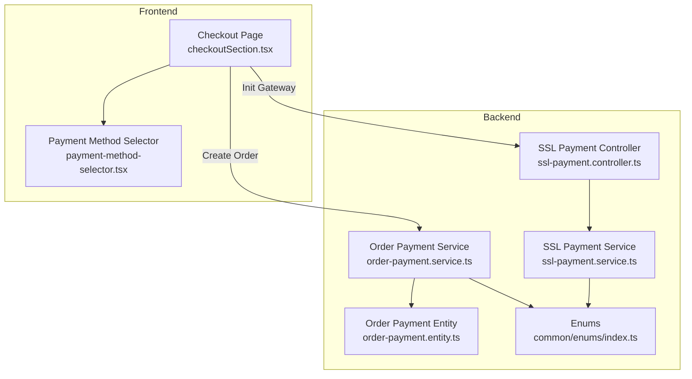
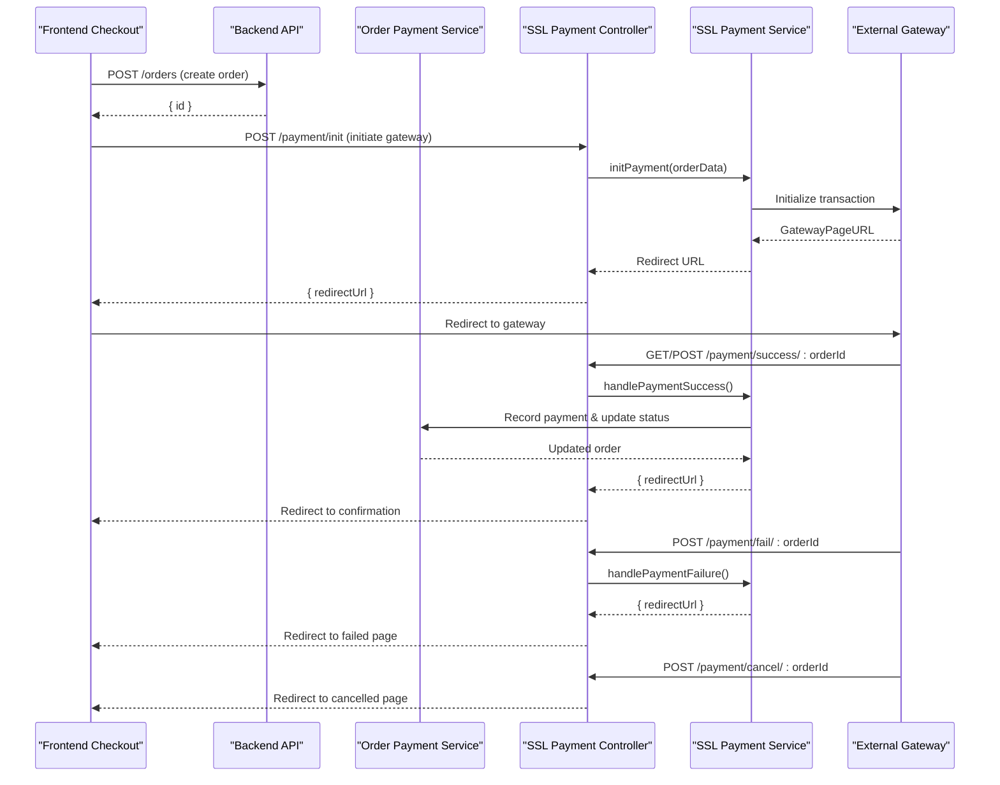
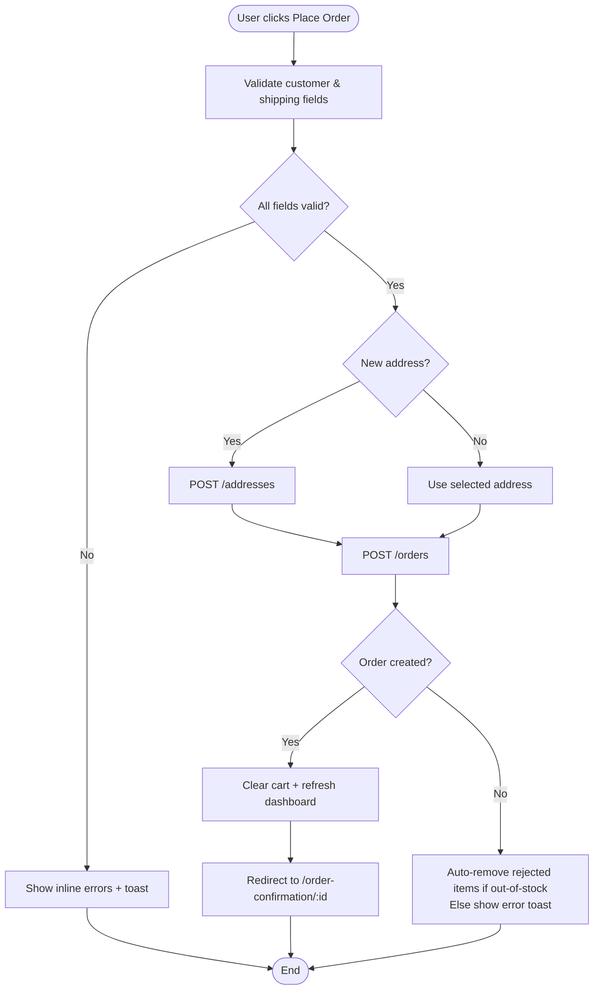
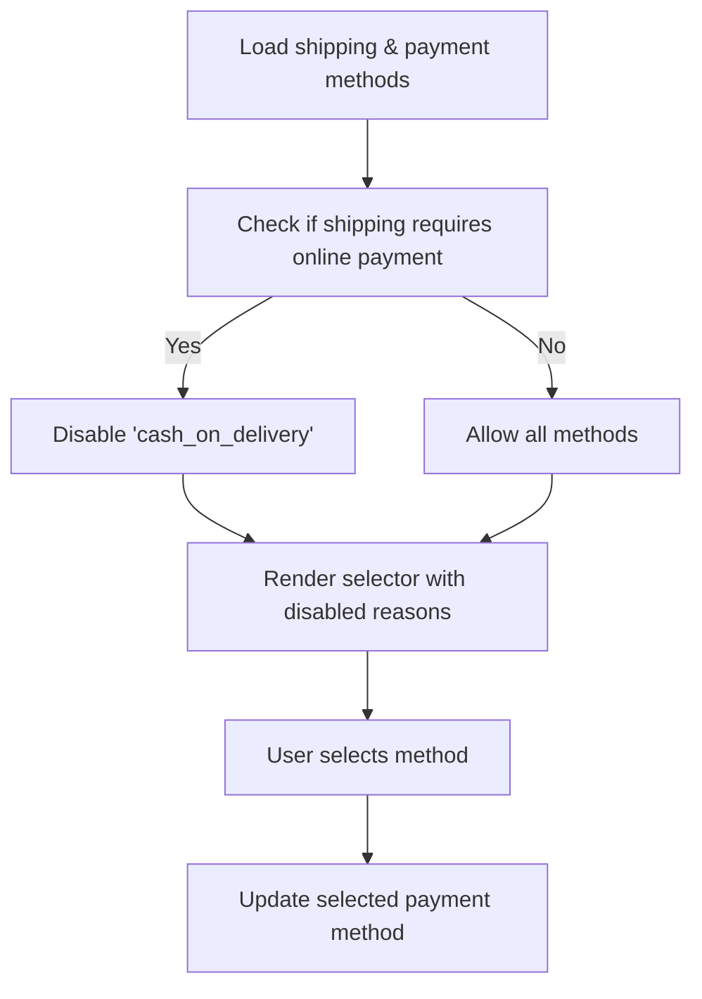
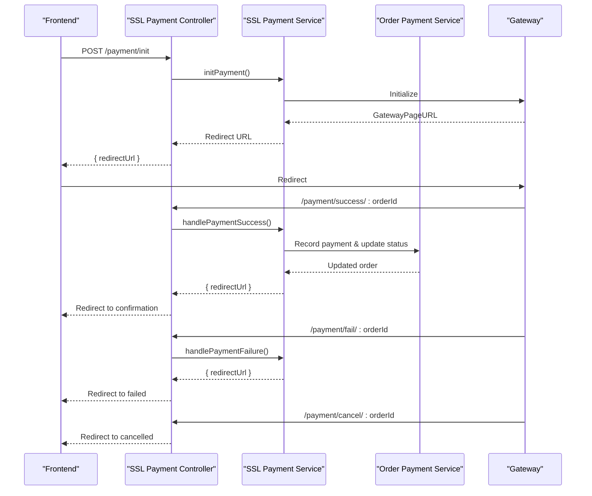
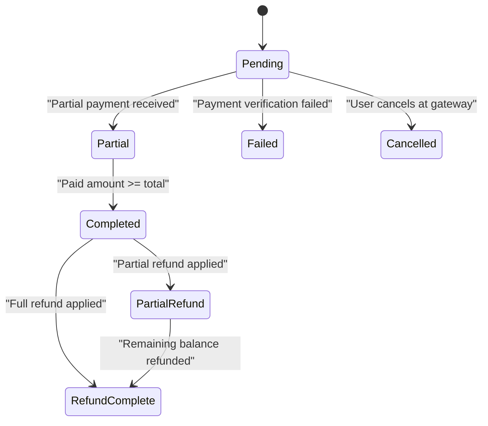
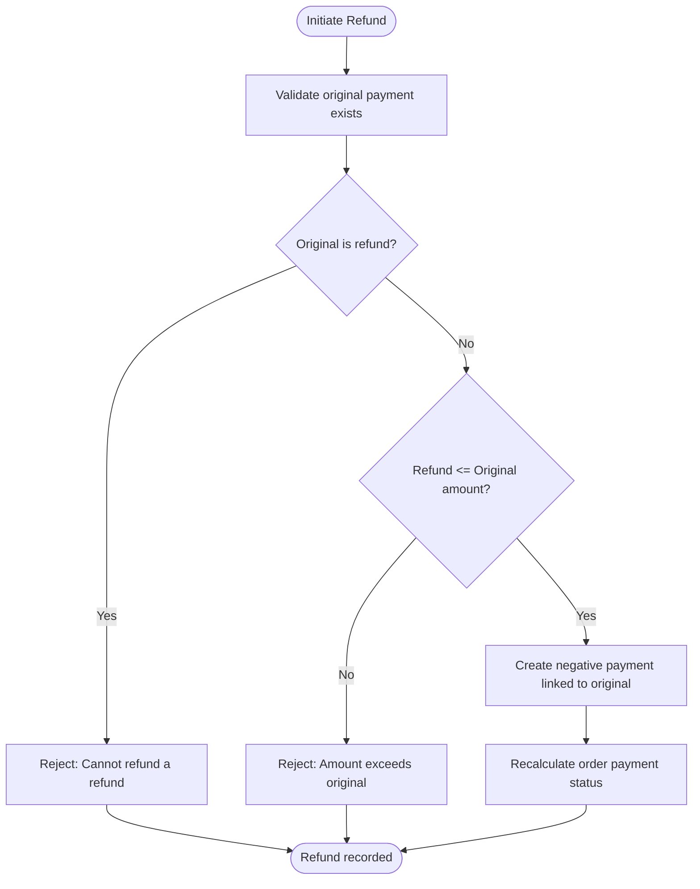
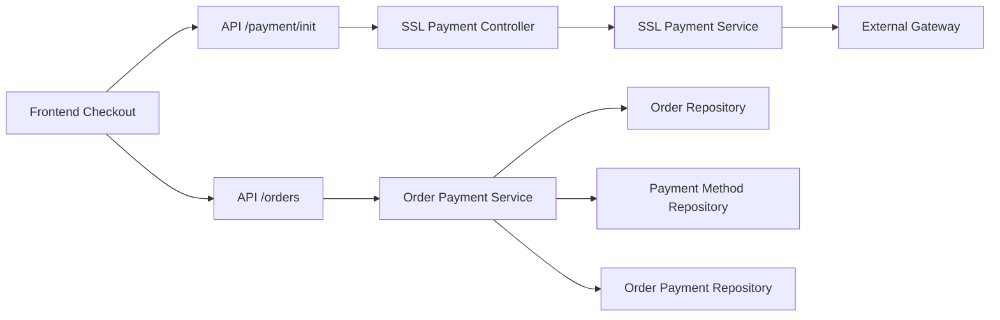

# Payment Workflow

<cite>
**Referenced Files in This Document**
- [checkoutSection.tsx](file://apps/frontend/components/checkout/checkoutSection.tsx)
- [payment-method-selector.tsx](file://apps/frontend/components/checkout/payment-method-selector.tsx)
- [page.tsx](file://apps/frontend/app/(main)/checkout/page.tsx)
- [order-payment.service.ts](file://apps/backend/src/order-payment/order-payment.service.ts)
- [order-payment.entity.ts](file://apps/backend/src/order-payment/entities/order-payment.entity.ts)
- [enums/index.ts](file://apps/backend/src/common/enums/index.ts)
- [ssl-payment.controller.ts](file://apps/backend/src/ssl-payment/ssl-payment.controller.ts)
- [ssl-payment.service.ts](file://apps/backend/src/ssl-payment/ssl-payment.service.ts)
</cite>

## Table of Contents
1. [Introduction](#introduction)
2. [Project Structure](#project-structure)
3. [Core Components](#core-components)
4. [Architecture Overview](#architecture-overview)
5. [Detailed Component Analysis](#detailed-component-analysis)
6. [Dependency Analysis](#dependency-analysis)
7. [Performance Considerations](#performance-considerations)
8. [Troubleshooting Guide](#troubleshooting-guide)
9. [Conclusion](#conclusion)

## Introduction
This document explains the end-to-end payment workflow from checkout to confirmation, including cart validation, payment method selection, payment initiation, result handling, state management for pending/successful/failed/cancelled payments, order status transitions, refund and reversal processes, retry mechanisms, timeout handling, user experience flows, and customization points.

## Project Structure
The payment flow spans frontend checkout UI and backend services:
- Frontend: Checkout page orchestrates data collection, validation, order creation, and redirects to the payment gateway when needed.
- Backend: Order payment service manages payment records and order payment status; SSL payment service integrates with the external gateway for initialization, success/failure handling, IPN callbacks, and refunds.

**Diagram sources**
- [checkoutSection.tsx:434-454](file://apps/frontend/components/checkout/checkoutSection.tsx#L434-L454)
- [payment-method-selector.tsx:28-131](file://apps/frontend/components/checkout/payment-method-selector.tsx#L28-L131)
- [order-payment.service.ts:28-73](file://apps/backend/src/order-payment/order-payment.service.ts#L28-L73)
- [ssl-payment.controller.ts:35-64](file://apps/backend/src/ssl-payment/ssl-payment.controller.ts#L35-L64)
- [ssl-payment.service.ts:94-110](file://apps/backend/src/ssl-payment/ssl-payment.service.ts#L94-L110)
- [order-payment.entity.ts:18-126](file://apps/backend/src/order-payment/entities/order-payment.entity.ts#L18-L126)
- [enums/index.ts:12-36](file://apps/backend/src/common/enums/index.ts#L12-L36)

**Section sources**
- [page.tsx:1-8](file://apps/frontend/app/(main)/checkout/page.tsx#L1-L8)
- [checkoutSection.tsx:41-644](file://apps/frontend/components/checkout/checkoutSection.tsx#L41-L644)
- [payment-method-selector.tsx:1-132](file://apps/frontend/components/checkout/payment-method-selector.tsx#L1-L132)
- [order-payment.service.ts:1-309](file://apps/backend/src/order-payment/order-payment.service.ts#L1-L309)
- [order-payment.entity.ts:1-127](file://apps/backend/src/order-payment/entities/order-payment.entity.ts#L1-L127)
- [enums/index.ts:1-142](file://apps/backend/src/common/enums/index.ts#L1-L142)
- [ssl-payment.controller.ts:1-184](file://apps/backend/src/ssl-payment/ssl-payment.controller.ts#L1-L184)
- [ssl-payment.service.ts:94-363](file://apps/backend/src/ssl-payment/ssl-payment.service.ts#L94-L363)

## Core Components
- Checkout UI: Collects customer/shipping info, validates inputs, selects shipping and payment methods, creates an order, and initiates payment via the gateway when required.
- Payment Method Selector: Renders available payment methods, supports disabling options (e.g., cash on delivery for online-only shipping), and communicates selection to the parent component.
- Order Payment Service: Creates payment records, calculates order payment status based on cumulative paid amounts, and handles refunds with proper status updates.
- SSL Payment Integration: Initializes gateway transactions, verifies callbacks, persists successful payments, handles failures and cancellations, and processes refunds.

Key responsibilities:
- Cart validation and out-of-stock handling occur before order submission.
- Shipping rules can enforce online-only payment methods.
- Payment status is derived from accumulated payments and refunds.
- Refunds are modeled as negative payments linked to original transactions.

**Section sources**
- [checkoutSection.tsx:47-90](file://apps/frontend/components/checkout/checkoutSection.tsx#L47-L90)
- [checkoutSection.tsx:129-157](file://apps/frontend/components/checkout/checkoutSection.tsx#L129-L157)
- [checkoutSection.tsx:336-490](file://apps/frontend/components/checkout/checkoutSection.tsx#L336-L490)
- [payment-method-selector.tsx:28-131](file://apps/frontend/components/checkout/payment-method-selector.tsx#L28-L131)
- [order-payment.service.ts:28-73](file://apps/backend/src/order-payment/order-payment.service.ts#L28-L73)
- [order-payment.service.ts:187-211](file://apps/backend/src/order-payment/order-payment.service.ts#L187-L211)
- [order-payment.service.ts:213-307](file://apps/backend/src/order-payment/order-payment.service.ts#L213-L307)
- [ssl-payment.controller.ts:35-64](file://apps/backend/src/ssl-payment/ssl-payment.controller.ts#L35-L64)
- [ssl-payment.service.ts:94-110](file://apps/backend/src/ssl-payment/ssl-payment.service.ts#L94-L110)

## Architecture Overview
The payment architecture follows a client-server model with an external payment gateway:
- The frontend collects and validates checkout data, then submits an order.
- For online payments, the frontend requests a gateway redirect URL from the backend.
- The backend initializes the gateway transaction and returns a redirect URL.
- The gateway calls back to backend endpoints for success, failure, or cancellation.
- On success, the backend verifies the callback, records the payment, and updates order payment status.
- Refunds are initiated through dedicated endpoints and recorded as negative payments.

**Diagram sources**
- [checkoutSection.tsx:434-454](file://apps/frontend/components/checkout/checkoutSection.tsx#L434-L454)
- [ssl-payment.controller.ts:35-64](file://apps/backend/src/ssl-payment/ssl-payment.controller.ts#L35-L64)
- [ssl-payment.controller.ts:66-134](file://apps/backend/src/ssl-payment/ssl-payment.controller.ts#L66-L134)
- [ssl-payment.controller.ts:136-184](file://apps/backend/src/ssl-payment/ssl-payment.controller.ts#L136-L184)
- [ssl-payment.service.ts:94-110](file://apps/backend/src/ssl-payment/ssl-payment.service.ts#L94-L110)
- [ssl-payment.service.ts:113-267](file://apps/backend/src/ssl-payment/ssl-payment.service.ts#L113-L267)
- [order-payment.service.ts:28-73](file://apps/backend/src/order-payment/order-payment.service.ts#L28-L73)

## Detailed Component Analysis

### Checkout Flow and Cart Validation
- Out-of-stock items are automatically removed from the cart before order placement, with user feedback via toast notifications.
- Customer information and shipping details are validated; missing fields trigger inline errors and toast messages.
- When new address data is provided, it is created server-side and used to place the order.
- Order creation sends shipping method, payment method, items, and coupon to the backend.
- After successful order creation, the cart is cleared, dashboards are refreshed, and the user is redirected to the order confirmation page.

**Diagram sources**
- [checkoutSection.tsx:47-90](file://apps/frontend/components/checkout/checkoutSection.tsx#L47-L90)
- [checkoutSection.tsx:336-490](file://apps/frontend/components/checkout/checkoutSection.tsx#L336-L490)

**Section sources**
- [checkoutSection.tsx:47-90](file://apps/frontend/components/checkout/checkoutSection.tsx#L47-L90)
- [checkoutSection.tsx:336-490](file://apps/frontend/components/checkout/checkoutSection.tsx#L336-L490)

### Payment Method Selection
- Available payment methods are fetched and displayed.
- If the selected shipping method requires online payment, cash on delivery is disabled with an inline reason.
- The selector enforces valid selections and provides visual feedback for disabled methods.

**Diagram sources**
- [checkoutSection.tsx:129-157](file://apps/frontend/components/checkout/checkoutSection.tsx#L129-L157)
- [payment-method-selector.tsx:28-131](file://apps/frontend/components/checkout/payment-method-selector.tsx#L28-L131)

**Section sources**
- [checkoutSection.tsx:129-157](file://apps/frontend/components/checkout/checkoutSection.tsx#L129-L157)
- [payment-method-selector.tsx:28-131](file://apps/frontend/components/checkout/payment-method-selector.tsx#L28-L131)

### Payment Initiation and Result Handling
- For online payments, the frontend calls the backend to initialize the gateway transaction.
- The backend initializes the external gateway and returns a redirect URL.
- The frontend redirects the user to the gateway.
- The gateway calls backend endpoints for success, failure, or cancellation.
- On success, the backend verifies the callback, records the payment, and updates order payment status.
- On failure or cancellation, the backend redirects to appropriate frontend pages.

**Diagram sources**
- [ssl-payment.controller.ts:35-64](file://apps/backend/src/ssl-payment/ssl-payment.controller.ts#L35-L64)
- [ssl-payment.controller.ts:66-134](file://apps/backend/src/ssl-payment/ssl-payment.controller.ts#L66-L134)
- [ssl-payment.controller.ts:136-184](file://apps/backend/src/ssl-payment/ssl-payment.controller.ts#L136-L184)
- [ssl-payment.service.ts:94-110](file://apps/backend/src/ssl-payment/ssl-payment.service.ts#L94-L110)
- [ssl-payment.service.ts:113-267](file://apps/backend/src/ssl-payment/ssl-payment.service.ts#L113-L267)
- [order-payment.service.ts:28-73](file://apps/backend/src/order-payment/order-payment.service.ts#L28-L73)

**Section sources**
- [ssl-payment.controller.ts:35-64](file://apps/backend/src/ssl-payment/ssl-payment.controller.ts#L35-L64)
- [ssl-payment.controller.ts:66-134](file://apps/backend/src/ssl-payment/ssl-payment.controller.ts#L66-L134)
- [ssl-payment.controller.ts:136-184](file://apps/backend/src/ssl-payment/ssl-payment.controller.ts#L136-L184)
- [ssl-payment.service.ts:94-110](file://apps/backend/src/ssl-payment/ssl-payment.service.ts#L94-L110)
- [ssl-payment.service.ts:113-267](file://apps/backend/src/ssl-payment/ssl-payment.service.ts#L113-L267)
- [order-payment.service.ts:28-73](file://apps/backend/src/order-payment/order-payment.service.ts#L28-L73)

### State Management for Payments and Orders
- Payment statuses include pending, completed, partial, paid, failed, refunded, need_refund, refund_complete, and partial_refund.
- Order payment status is calculated based on total paid amount versus order total value:
  - If paid >= total: COMPLETED
  - If paid > 0 but < total: PARTIAL
  - Otherwise: PENDING
- Refunds are recorded as negative payments linked to the original payment, updating order payment status accordingly:
  - Fully refunded: REFUND_COMPLETE
  - Partially refunded: PARTIAL_REFUND
  - Still has remaining paid amount: PAID

**Diagram sources**
- [enums/index.ts:21-31](file://apps/backend/src/common/enums/index.ts#L21-L31)
- [order-payment.service.ts:187-211](file://apps/backend/src/order-payment/order-payment.service.ts#L187-L211)
- [order-payment.service.ts:278-307](file://apps/backend/src/order-payment/order-payment.service.ts#L278-L307)

**Section sources**
- [enums/index.ts:21-31](file://apps/backend/src/common/enums/index.ts#L21-L31)
- [order-payment.service.ts:187-211](file://apps/backend/src/order-payment/order-payment.service.ts#L187-L211)
- [order-payment.service.ts:278-307](file://apps/backend/src/order-payment/order-payment.service.ts#L278-L307)

### Refund and Reversal Processes
- Refunds are created by linking a new payment record with a negative amount to the original payment.
- The system prevents refunding a refund transaction and ensures refund amounts do not exceed the original payment.
- After creating a refund, the order payment status is recalculated considering negative amounts.

**Diagram sources**
- [order-payment.service.ts:213-276](file://apps/backend/src/order-payment/order-payment.service.ts#L213-L276)
- [order-payment.service.ts:278-307](file://apps/backend/src/order-payment/order-payment.service.ts#L278-L307)

**Section sources**
- [order-payment.service.ts:213-276](file://apps/backend/src/order-payment/order-payment.service.ts#L213-L276)
- [order-payment.service.ts:278-307](file://apps/backend/src/order-payment/order-payment.service.ts#L278-L307)

### Retry Mechanisms and Timeout Handling
- The current implementation does not include explicit retry logic for failed payments or timeouts within the checkout flow.
- Idempotency is partially addressed by checking for existing payments associated with a gateway transaction ID to avoid duplicate processing.
- IPN (Instant Payment Notification) support allows asynchronous confirmation of successful payments.

Recommendations:
- Implement exponential backoff retries for transient network errors during gateway initialization and callback verification.
- Add timeout guards around external gateway calls with clear user-facing error messages.
- Introduce a reconciliation job that periodically checks unresolved orders against gateway logs.

**Section sources**
- [ssl-payment.service.ts:151-165](file://apps/backend/src/ssl-payment/ssl-payment.service.ts#L151-L165)
- [ssl-payment.service.ts:308-328](file://apps/backend/src/ssl-payment/ssl-payment.service.ts#L308-L328)

### User Experience Flows for Different Payment Outcomes
- Successful payment:
  - Backend verifies the callback, records the payment, updates order status, and redirects to the confirmation page.
  - Frontend shows confirmation and allows users to view order details.
- Failed payment:
  - Backend logs failure details and redirects to a failure page with guidance to retry or choose another method.
- Cancelled payment:
  - Backend redirects to a cancellation page where users can review their order and try again.

Recovery options:
- For failed payments, users can retry the same method or select an alternative method supported by the selected shipping option.
- For cancellations, users can re-initiate the payment flow.

**Section sources**
- [ssl-payment.controller.ts:66-134](file://apps/backend/src/ssl-payment/ssl-payment.controller.ts#L66-L134)
- [ssl-payment.controller.ts:136-184](file://apps/backend/src/ssl-payment/ssl-payment.controller.ts#L136-L184)
- [ssl-payment.service.ts:113-267](file://apps/backend/src/ssl-payment/ssl-payment.service.ts#L113-L267)

### Customizing the Payment Flow and Integrating Business Logic
- Adding new payment methods:
  - Extend the payment method list and ensure the frontend selector can render and disable methods based on business rules.
- Enforcing payment constraints:
  - Use shipping method flags to restrict certain payment methods (e.g., online-only).
- Extending payment verification:
  - Customize the gateway verification logic to incorporate additional checks (e.g., fraud scoring).
- Recording custom metadata:
  - Use the notes field in payment records to store business-specific context.
- Handling asynchronous confirmations:
  - Leverage IPN endpoints to process delayed confirmations robustly.

**Section sources**
- [checkoutSection.tsx:129-157](file://apps/frontend/components/checkout/checkoutSection.tsx#L129-L157)
- [payment-method-selector.tsx:28-131](file://apps/frontend/components/checkout/payment-method-selector.tsx#L28-L131)
- [order-payment.entity.ts:49-66](file://apps/backend/src/order-payment/entities/order-payment.entity.ts#L49-L66)
- [ssl-payment.service.ts:308-328](file://apps/backend/src/ssl-payment/ssl-payment.service.ts#L308-L328)

## Dependency Analysis
The payment workflow depends on several modules and entities:
- Frontend checkout depends on cart context, business settings, and API utilities.
- Backend order payment service depends on order, payment method, and user repositories.
- SSL payment controller and service depend on external gateway SDK and internal order/payment repositories.
- Enums define consistent states across the system.

**Diagram sources**
- [checkoutSection.tsx:434-454](file://apps/frontend/components/checkout/checkoutSection.tsx#L434-L454)
- [ssl-payment.controller.ts:35-64](file://apps/backend/src/ssl-payment/ssl-payment.controller.ts#L35-L64)
- [order-payment.service.ts:18-26](file://apps/backend/src/order-payment/order-payment.service.ts#L18-L26)

**Section sources**
- [checkoutSection.tsx:434-454](file://apps/frontend/components/checkout/checkoutSection.tsx#L434-L454)
- [ssl-payment.controller.ts:35-64](file://apps/backend/src/ssl-payment/ssl-payment.controller.ts#L35-L64)
- [order-payment.service.ts:18-26](file://apps/backend/src/order-payment/order-payment.service.ts#L18-L26)

## Performance Considerations
- Minimize unnecessary re-renders in the checkout UI by memoizing computed totals and avoiding redundant API calls.
- Batch operations where possible (e.g., fetching shipping and payment methods concurrently).
- Ensure database queries in payment status calculations are efficient and indexed appropriately.
- Avoid logging sensitive data in callbacks; only log non-sensitive identifiers and statuses.

[No sources needed since this section provides general guidance]

## Troubleshooting Guide
Common issues and resolutions:
- Payment initialization fails:
  - Verify gateway credentials and configuration.
  - Check error responses from the backend and gateway.
- Callback verification fails:
  - Ensure transaction IDs and amounts match between request and validation response.
  - Inspect logs for discrepancies in expected vs actual values.
- Duplicate payment processing:
  - Confirm idempotency checks are in place using transaction IDs.
- Refund amount exceeds original:
  - Validate refund amounts against original payment before processing.

Operational tips:
- Monitor IPN endpoints for delayed confirmations.
- Use toast notifications to guide users through recovery steps.
- Provide clear error messages and actionable next steps.

**Section sources**
- [ssl-payment.controller.ts:56-63](file://apps/backend/src/ssl-payment/ssl-payment.controller.ts#L56-L63)
- [ssl-payment.service.ts:269-306](file://apps/backend/src/ssl-payment/ssl-payment.service.ts#L269-L306)
- [order-payment.service.ts:232-236](file://apps/backend/src/order-payment/order-payment.service.ts#L232-L236)

## Conclusion
The payment workflow integrates frontend checkout validation, dynamic payment method selection, secure gateway initialization, robust callback verification, and comprehensive state management for payments and orders. Refunds are modeled as negative payments with proper status updates. While explicit retry and timeout handling are not implemented, the system supports idempotent processing and asynchronous confirmations via IPN. Customization points allow extending payment methods, enforcing business rules, and integrating additional logic throughout the flow.

[No sources needed since this section summarizes without analyzing specific files]