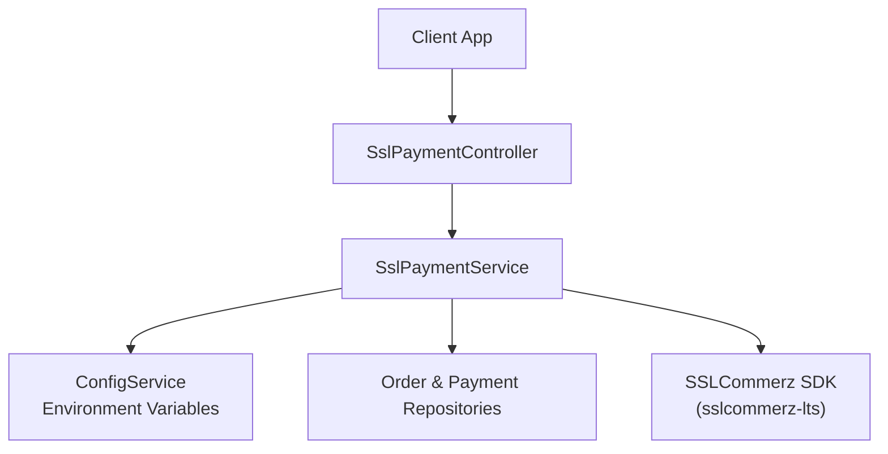
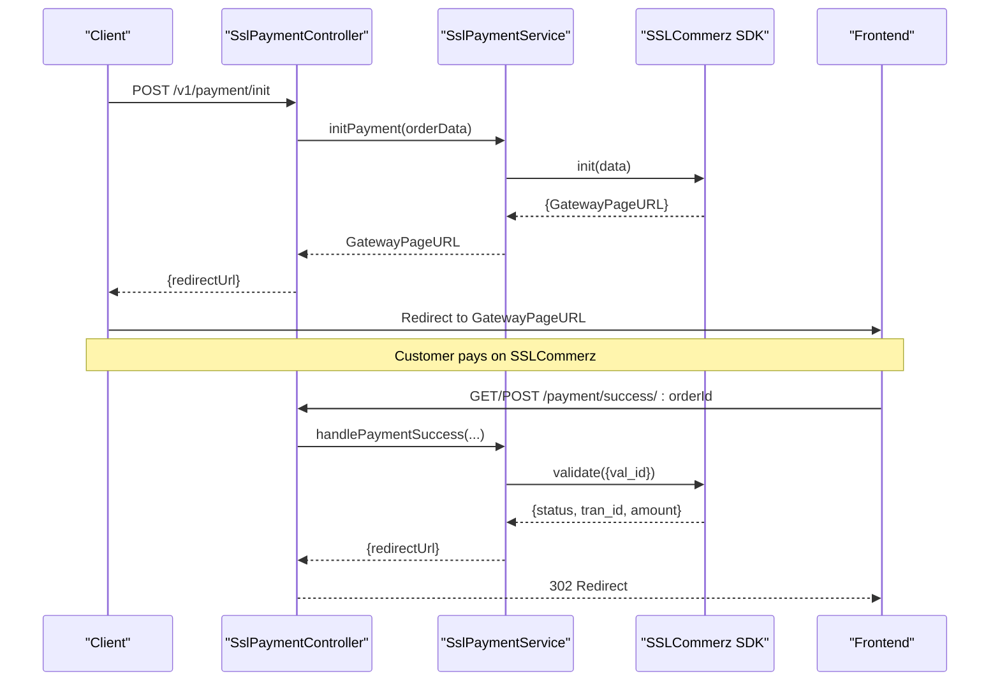
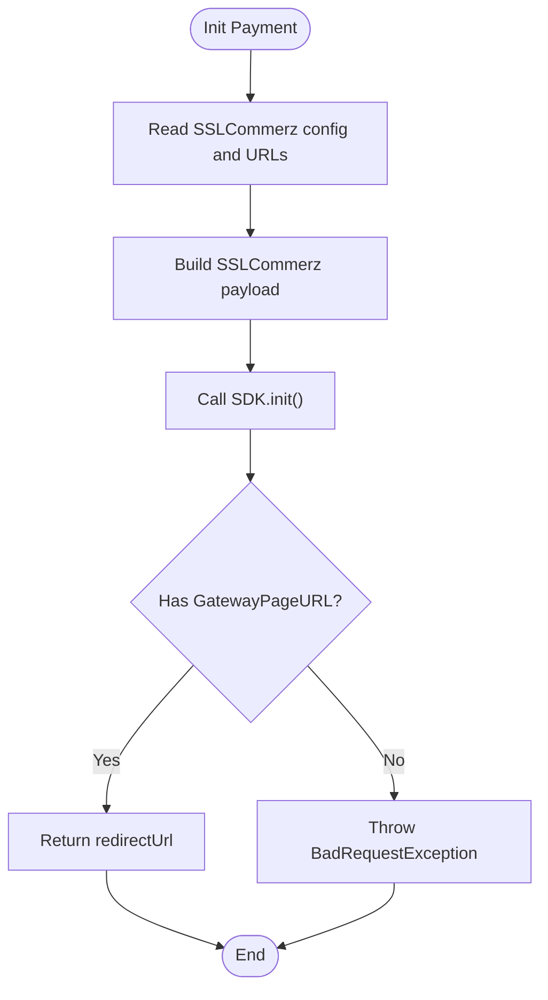
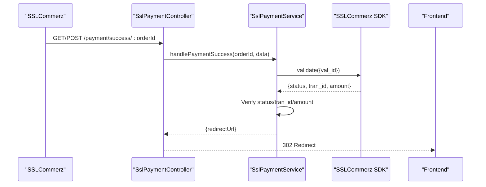
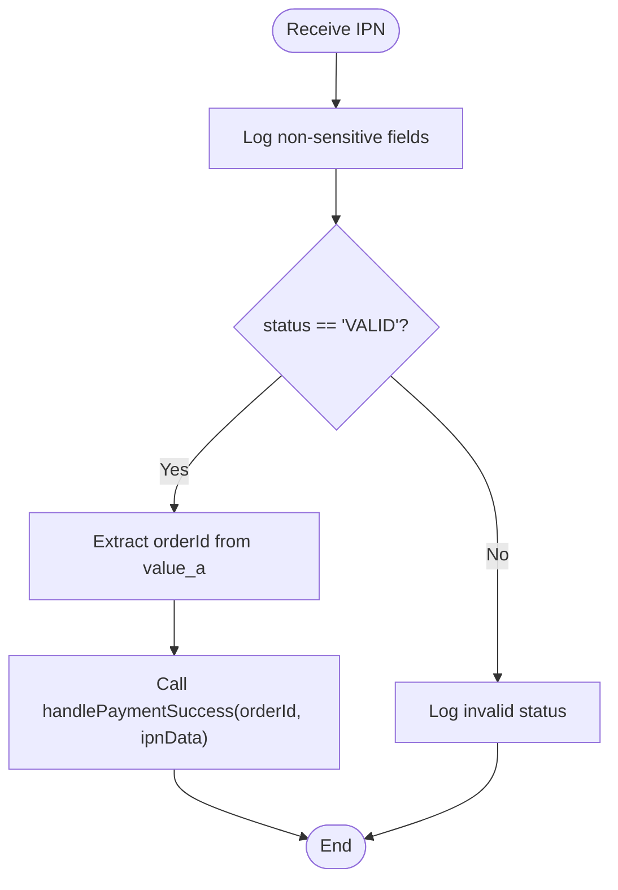
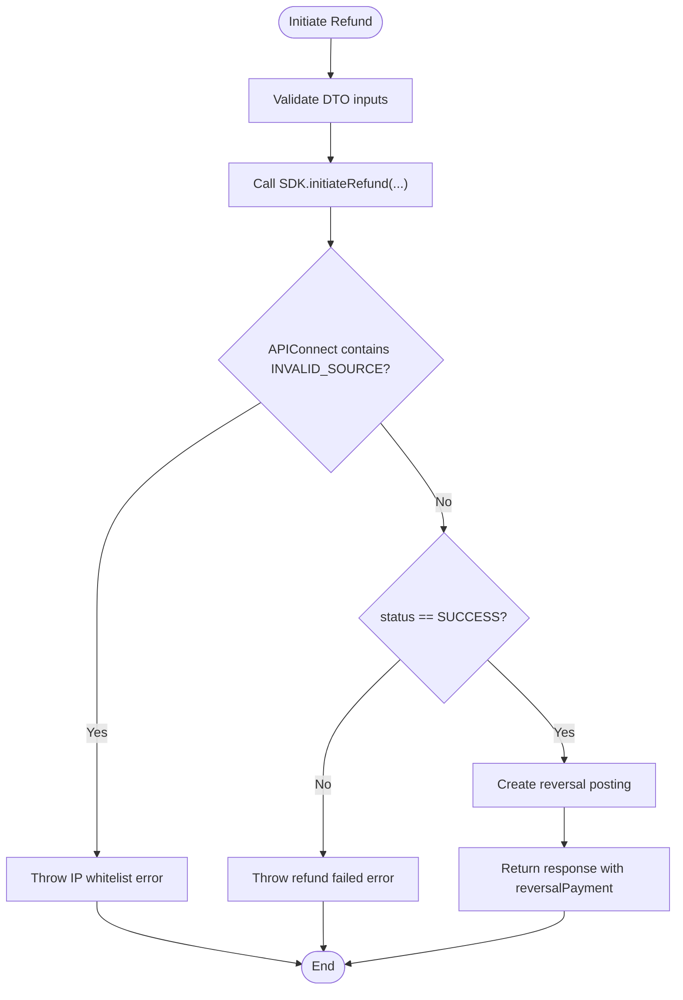
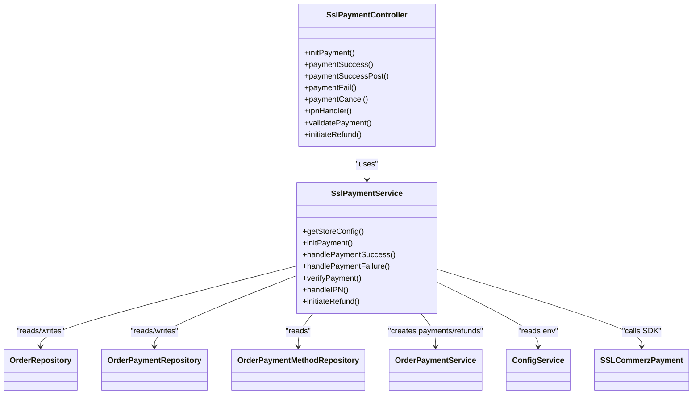

# SSLCommerz Integration

<cite>
**Referenced Files in This Document**
- [configuration.ts](file://apps/backend/src/config/configuration.ts)
- [ssl-payment.service.ts](file://apps/backend/src/ssl-payment/ssl-payment.service.ts)
- [ssl-payment.controller.ts](file://apps/backend/src/ssl-payment/ssl-payment.controller.ts)
- [initiate-refund.dto.ts](file://apps/backend/src/ssl-payment/dto/initiate-refund.dto.ts)
- [sslcommerz-lts.d.ts](file://apps/backend/src/types/sslcommerz-lts.d.ts)
</cite>

## Table of Contents
1. [Introduction](#introduction)
2. [Project Structure](#project-structure)
3. [Core Components](#core-components)
4. [Architecture Overview](#architecture-overview)
5. [Detailed Component Analysis](#detailed-component-analysis)
6. [Dependency Analysis](#dependency-analysis)
7. [Performance Considerations](#performance-considerations)
8. [Troubleshooting Guide](#troubleshooting-guide)
9. [Conclusion](#conclusion)
10. [Appendices](#appendices)

## Introduction
This document explains the SSLCommerz payment gateway integration implemented in the backend service. It covers configuration, environment variables, API endpoints, the complete payment flow from checkout to redirect, callback handling for success/failure/cancel, IPN processing, hash and transaction verification, refund initiation, error handling, and testing guidance using the sandbox environment.

## Project Structure
The SSLCommerz integration is implemented under the backend NestJS application:
- Configuration exposes SSLCommerz credentials and payment URLs via environment variables.
- The controller exposes REST endpoints for initiating payments, handling callbacks, IPN, validation, and refunds.
- The service encapsulates business logic: initialization, verification, success/failure handling, IPN processing, and refund initiation.
- Type definitions describe the SSLCommerz SDK contract used by the service.

**Diagram sources**
- [ssl-payment.controller.ts:31-257](file://apps/backend/src/ssl-payment/ssl-payment.controller.ts#L31-L257)
- [ssl-payment.service.ts:16-413](file://apps/backend/src/ssl-payment/ssl-payment.service.ts#L16-L413)
- [configuration.ts:1-15](file://apps/backend/src/config/configuration.ts#L1-L15)
- [sslcommerz-lts.d.ts:89-111](file://apps/backend/src/types/sslcommerz-lts.d.ts#L89-L111)

**Section sources**
- [configuration.ts:1-15](file://apps/backend/src/config/configuration.ts#L1-L15)
- [ssl-payment.controller.ts:31-257](file://apps/backend/src/ssl-payment/ssl-payment.controller.ts#L31-L257)
- [ssl-payment.service.ts:16-413](file://apps/backend/src/ssl-payment/ssl-payment.service.ts#L16-L413)
- [sslcommerz-lts.d.ts:1-127](file://apps/backend/src/types/sslcommerz-lts.d.ts#L1-L127)

## Core Components
- SslPaymentController: Exposes REST endpoints for payment initiation, success/failure/cancel callbacks, IPN, manual validation, and refund initiation.
- SslPaymentService: Implements payment initialization, verification, success/failure handling, IPN processing, and refund initiation.
- Configuration: Reads SSLCommerz credentials and payment URLs from environment variables.
- DTOs: Define input contracts for refund initiation.
- Types: Describe the SSLCommerz SDK interfaces.

Key responsibilities:
- Initiation: Build payload, call SDK init, return GatewayPageURL.
- Callbacks: Validate request data, verify payment with SDK, update order/payment records, redirect to frontend.
- IPN: Process asynchronous notifications and reconcile orders.
- Refunds: Call SDK initiateRefund, create reversal posting on success, handle errors.

**Section sources**
- [ssl-payment.controller.ts:31-257](file://apps/backend/src/ssl-payment/ssl-payment.controller.ts#L31-L257)
- [ssl-payment.service.ts:16-413](file://apps/backend/src/ssl-payment/ssl-payment.service.ts#L16-L413)
- [configuration.ts:1-15](file://apps/backend/src/config/configuration.ts#L1-L15)
- [initiate-refund.dto.ts:1-39](file://apps/backend/src/ssl-payment/dto/initiate-refund.dto.ts#L1-L39)
- [sslcommerz-lts.d.ts:1-127](file://apps/backend/src/types/sslcommerz-lts.d.ts#L1-L127)

## Architecture Overview
The integration follows a standard e-commerce payment flow:
- Client calls backend to initiate payment.
- Backend initializes a transaction with SSLCommerz and returns a redirect URL.
- Customer completes payment on SSLCommerz’s gateway.
- SSLCommerz redirects to success/fail/cancel endpoints and/or sends an IPN.
- Backend verifies the transaction, updates internal records, and redirects to the frontend.

**Diagram sources**
- [ssl-payment.controller.ts:35-99](file://apps/backend/src/ssl-payment/ssl-payment.controller.ts#L35-L99)
- [ssl-payment.service.ts:44-111](file://apps/backend/src/ssl-payment/ssl-payment.service.ts#L44-L111)
- [ssl-payment.service.ts:113-234](file://apps/backend/src/ssl-payment/ssl-payment.service.ts#L113-L234)
- [sslcommerz-lts.d.ts:89-111](file://apps/backend/src/types/sslcommerz-lts.d.ts#L89-L111)

## Detailed Component Analysis

### Configuration and Environment Variables
- SSLCommerz credentials and environment flags are read from environment variables:
  - SSLCOMMERZ_STORE_ID
  - SSLCOMMERZ_STORE_PASSWORD
  - SSLCOMMERZ_IS_LIVE (boolean string)
- Payment-related URLs:
  - PAYMENT_IPN_URL
  - BASE_URL
  - FRONTEND_URL
- The configuration module also defines a payment object mapping these variables for centralized access.

Operational notes:
- If storeId or storePassword are missing, initialization throws an error indicating credentials are not configured.
- isLive determines whether the SDK connects to production or sandbox.

**Section sources**
- [configuration.ts:1-15](file://apps/backend/src/config/configuration.ts#L1-L15)
- [ssl-payment.service.ts:29-42](file://apps/backend/src/ssl-payment/ssl-payment.service.ts#L29-L42)

### Payment Initiation Flow
- Endpoint: POST /v1/payment/init (JWT-protected).
- Input: Order data including id, totalValue, items, user, address, shippingMethod, coupon, paymentMethod.
- Processing:
  - Build SSLCommerz payload with required fields (amount, currency, tran_id, URLs, customer/shipping details, value_a-d).
  - Generate a unique tran_id combining order id and timestamp.
  - Call SDK init and return GatewayPageURL.
- Output: JSON containing redirectUrl and orderId.

Validation and error handling:
- Missing GatewayPageURL results in a bad request error.
- Network or SDK errors are caught and converted to a standardized error response.

**Diagram sources**
- [ssl-payment.controller.ts:35-64](file://apps/backend/src/ssl-payment/ssl-payment.controller.ts#L35-L64)
- [ssl-payment.service.ts:44-111](file://apps/backend/src/ssl-payment/ssl-payment.service.ts#L44-L111)

**Section sources**
- [ssl-payment.controller.ts:35-64](file://apps/backend/src/ssl-payment/ssl-payment.controller.ts#L35-L64)
- [ssl-payment.service.ts:44-111](file://apps/backend/src/ssl-payment/ssl-payment.service.ts#L44-L111)

### Callback Handling: Success, Failure, Cancel
- Success endpoint:
  - GET /payment/success/:orderId and POST /payment/success/:orderId accept SSLCommerz callback data.
  - Validates orderId, logs non-sensitive fields, verifies payment via SDK, updates order and payment records, and redirects to frontend success page.
- Failure endpoint:
  - POST /payment/fail/:orderId handles failure scenarios, logs relevant fields, and redirects to frontend failure page.
- Cancel endpoint:
  - POST /payment/cancel/:orderId logs cancellation and redirects to frontend cancelled page.

Verification process:
- Uses SDK.validate with val_id to confirm transaction status, transaction ID, and amount match expectations.
- Only non-sensitive fields are logged to protect PII.

**Diagram sources**
- [ssl-payment.controller.ts:66-134](file://apps/backend/src/ssl-payment/ssl-payment.controller.ts#L66-L134)
- [ssl-payment.service.ts:113-234](file://apps/backend/src/ssl-payment/ssl-payment.service.ts#L113-L234)
- [ssl-payment.service.ts:269-306](file://apps/backend/src/ssl-payment/ssl-payment.service.ts#L269-L306)

**Section sources**
- [ssl-payment.controller.ts:66-185](file://apps/backend/src/ssl-payment/ssl-payment.controller.ts#L66-L185)
- [ssl-payment.service.ts:113-306](file://apps/backend/src/ssl-payment/ssl-payment.service.ts#L113-L306)

### IPN (Instant Payment Notification) Handling
- Endpoint: POST /payment/ipn
- Purpose: Receive asynchronous notifications from SSLCommerz to reconcile transactions even if browser redirects fail.
- Processing:
  - Logs non-sensitive fields.
  - If status is VALID, extracts orderId from value_a and processes success handling.
  - Otherwise, logs invalid status.

**Diagram sources**
- [ssl-payment.controller.ts:187-206](file://apps/backend/src/ssl-payment/ssl-payment.controller.ts#L187-L206)
- [ssl-payment.service.ts:308-328](file://apps/backend/src/ssl-payment/ssl-payment.service.ts#L308-L328)

**Section sources**
- [ssl-payment.controller.ts:187-206](file://apps/backend/src/ssl-payment/ssl-payment.controller.ts#L187-L206)
- [ssl-payment.service.ts:308-328](file://apps/backend/src/ssl-payment/ssl-payment.service.ts#L308-L328)

### Payment Verification and Security Validation
- Hash and transaction validation:
  - Uses SDK.validate with val_id to retrieve official transaction details.
  - Confirms status equals VALID and that both tran_id and amount match the callback payload.
- Logging policy:
  - Only non-sensitive fields are logged to avoid exposing PII or card details.

Security considerations:
- Always rely on server-side validation; do not trust client-provided status alone.
- Ensure IPN and callback endpoints are publicly accessible but protected against replay attacks by verifying each transaction uniquely.

**Section sources**
- [ssl-payment.service.ts:269-306](file://apps/backend/src/ssl-payment/ssl-payment.service.ts#L269-L306)

### Refund Processing
- Endpoint: POST /payment/refund (admin-only, JWT + permission guard).
- Input DTO: InitiateRefundDto includes paymentId, refund_amount, optional refund_remarks, bank_tran_id, and tran_id.
- Processing:
  - Calls SDK.initiateRefund with provided parameters.
  - Handles IP whitelist errors and maps them to a clear error message.
  - On successful refund, creates a reversal posting via OrderPaymentService.
  - Returns combined response including reversal payment details.

Error handling:
- Invalid source/IP whitelist errors are explicitly handled.
- Failed refunds throw a bad request with error reason.

**Diagram sources**
- [ssl-payment.controller.ts:229-257](file://apps/backend/src/ssl-payment/ssl-payment.controller.ts#L229-L257)
- [ssl-payment.service.ts:330-412](file://apps/backend/src/ssl-payment/ssl-payment.service.ts#L330-L412)
- [initiate-refund.dto.ts:1-39](file://apps/backend/src/ssl-payment/dto/initiate-refund.dto.ts#L1-L39)

**Section sources**
- [ssl-payment.controller.ts:229-257](file://apps/backend/src/ssl-payment/ssl-payment.controller.ts#L229-L257)
- [ssl-payment.service.ts:330-412](file://apps/backend/src/ssl-payment/ssl-payment.service.ts#L330-L412)
- [initiate-refund.dto.ts:1-39](file://apps/backend/src/ssl-payment/dto/initiate-refund.dto.ts#L1-L39)

### Data Models and SDK Contract
- SSLCommerzPaymentData: Defines all fields sent during initialization, including customer and shipping details, product info, and custom values.
- SSLCommerzInitResponse: Response shape from init, including GatewayPageURL.
- SSLCommerzIPNResponse: Shape of IPN payloads.
- SSLCommerzRefundResponse: Shape of refund responses, including errorReason and APIConnect.
- SSLCommerzTransactionQueryResponse: Shape for query operations.
- SSLCommerzValidationResponse: Shape returned by validate.

These types ensure consistent usage of the SDK across the service.

**Section sources**
- [sslcommerz-lts.d.ts:1-127](file://apps/backend/src/types/sslcommerz-lts.d.ts#L1-L127)

## Dependency Analysis
The SSLCommerz integration depends on:
- NestJS core modules: controllers, guards, decorators.
- ConfigService for environment variables.
- TypeORM repositories for Order, OrderPayment, and OrderPaymentMethod.
- OrderPaymentService for creating payments and refunds.
- SSLCommerz SDK for API interactions.

**Diagram sources**
- [ssl-payment.controller.ts:31-257](file://apps/backend/src/ssl-payment/ssl-payment.controller.ts#L31-L257)
- [ssl-payment.service.ts:16-413](file://apps/backend/src/ssl-payment/ssl-payment.service.ts#L16-L413)
- [sslcommerz-lts.d.ts:89-111](file://apps/backend/src/types/sslcommerz-lts.d.ts#L89-L111)

**Section sources**
- [ssl-payment.controller.ts:31-257](file://apps/backend/src/ssl-payment/ssl-payment.controller.ts#L31-L257)
- [ssl-payment.service.ts:16-413](file://apps/backend/src/ssl-payment/ssl-payment.service.ts#L16-L413)

## Performance Considerations
- Avoid logging sensitive data: The implementation intentionally logs only non-sensitive fields to reduce overhead and protect PII.
- Idempotency: Success handling checks for existing payments by sslPaymentId to prevent duplicate processing.
- Minimal database queries: Relations are loaded only when necessary during success handling.
- External API calls: SDK calls should be wrapped with appropriate timeouts and retries at the infrastructure level to mitigate network instability.

[No sources needed since this section provides general guidance]

## Troubleshooting Guide
Common issues and resolutions:
- Credentials not configured:
  - Symptom: Initialization fails with an error indicating missing credentials.
  - Resolution: Ensure SSLCOMMERZ_STORE_ID and SSLCOMMERZ_STORE_PASSWORD are set and SSLCOMMERZ_IS_LIVE is correctly configured.
- IP whitelist error:
  - Symptom: Refund initiation fails with APIConnect containing INVALID_SOURCE or REQUEST_FROM_INVALID_SOURCE.
  - Resolution: Whitelist your server IP in the SSLCommerz merchant panel.
- Invalid response from SDK:
  - Symptom: No GatewayPageURL returned during initialization.
  - Resolution: Validate payload fields and environment configuration; check SDK documentation for required fields.
- Verification failures:
  - Symptom: Payment verification fails due to mismatched status, tran_id, or amount.
  - Resolution: Confirm that val_id is present and correct; ensure server time synchronization and proper environment selection (sandbox vs live).
- Callback not received:
  - Symptom: Browser does not redirect to success/fail/cancel endpoints.
  - Resolution: Use IPN endpoint to reconcile; ensure PAYMENT_IPN_URL is reachable and SSLCommerz can post to it.

Operational tips:
- Use sandbox mode by setting SSLCOMMERZ_IS_LIVE to false for testing.
- Monitor logs for non-sensitive fields to diagnose issues without exposing PII.
- Test refund flows with small amounts and verify reversal postings in the system.

**Section sources**
- [ssl-payment.service.ts:29-42](file://apps/backend/src/ssl-payment/ssl-payment.service.ts#L29-L42)
- [ssl-payment.service.ts:330-412](file://apps/backend/src/ssl-payment/ssl-payment.service.ts#L330-L412)
- [ssl-payment.controller.ts:187-206](file://apps/backend/src/ssl-payment/ssl-payment.controller.ts#L187-L206)

## Conclusion
The SSLCommerz integration provides a robust payment flow with secure verification, comprehensive callback handling, and reliable IPN processing. It supports refunds with clear error handling and maintains security by avoiding sensitive data in logs. Proper configuration of environment variables and IP whitelisting is essential for smooth operation in both sandbox and production environments.

[No sources needed since this section summarizes without analyzing specific files]

## Appendices

### API Endpoints Summary
- POST /v1/payment/init
  - Auth: JWT
  - Purpose: Initialize payment and receive redirect URL
- GET /payment/success/:orderId
  - Purpose: Handle success redirect from SSLCommerz
- POST /payment/success/:orderId
  - Purpose: Handle success callback from SSLCommerz
- POST /payment/fail/:orderId
  - Purpose: Handle failure callback from SSLCommerz
- POST /payment/cancel/:orderId
  - Purpose: Handle cancellation callback from SSLCommerz
- POST /payment/ipn
  - Purpose: Process IPN notifications
- GET /payment/validate/:tranId
  - Purpose: Manual validation placeholder
- POST /payment/refund
  - Auth: JWT + PermissionGuard
  - Purpose: Initiate refund

**Section sources**
- [ssl-payment.controller.ts:35-257](file://apps/backend/src/ssl-payment/ssl-payment.controller.ts#L35-L257)

### Environment Variables Reference
- SSLCOMMERZ_STORE_ID
- SSLCOMMERZ_STORE_PASSWORD
- SSLCOMMERZ_IS_LIVE
- PAYMENT_IPN_URL
- BASE_URL
- FRONTEND_URL

**Section sources**
- [configuration.ts:1-15](file://apps/backend/src/config/configuration.ts#L1-L15)