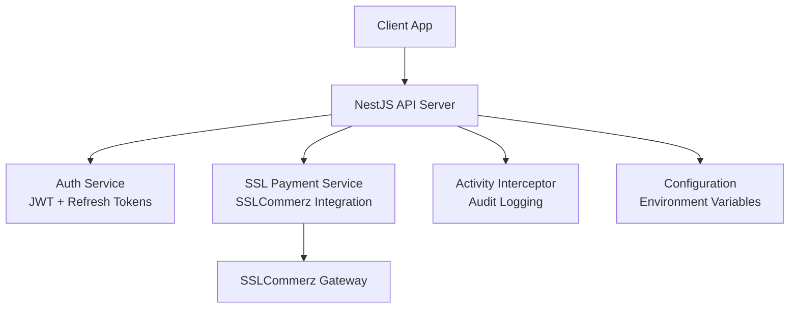
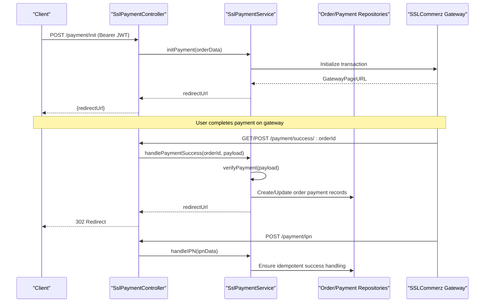
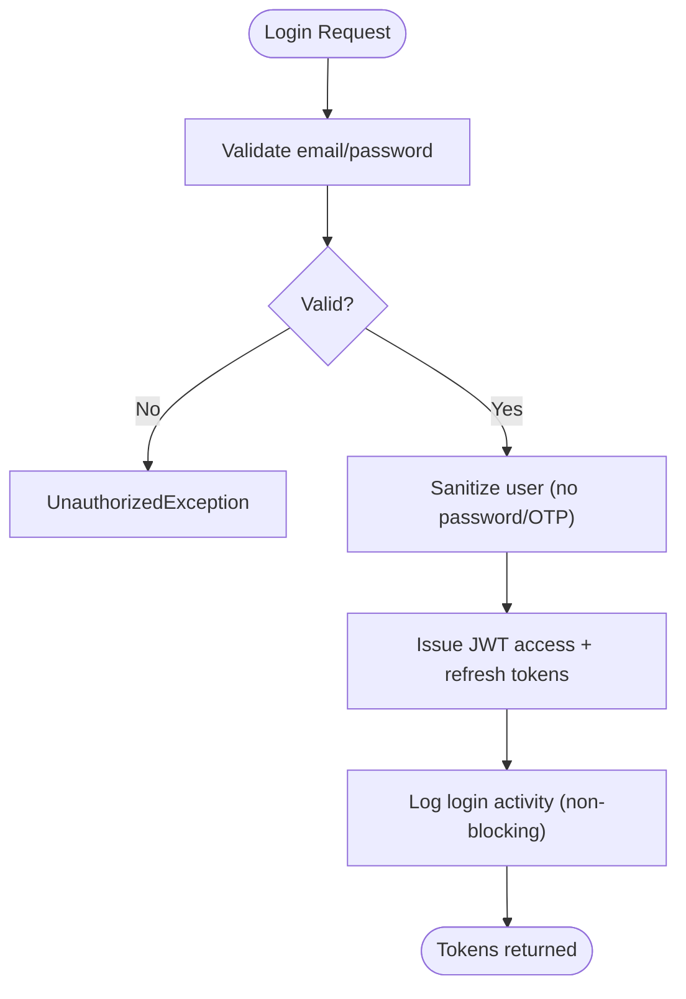
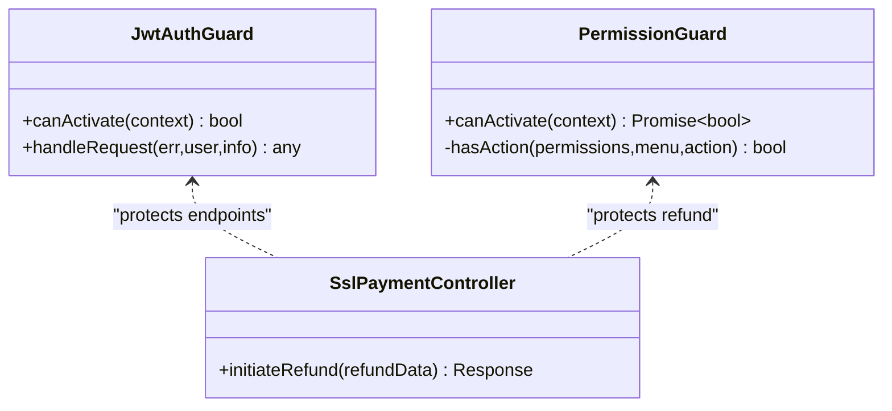
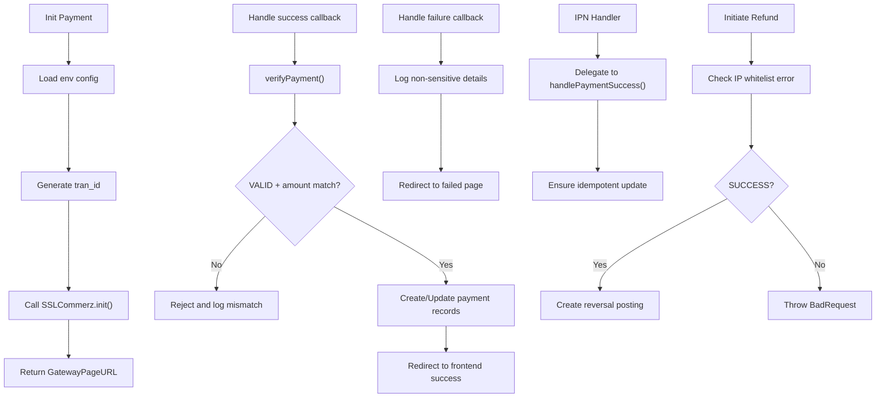
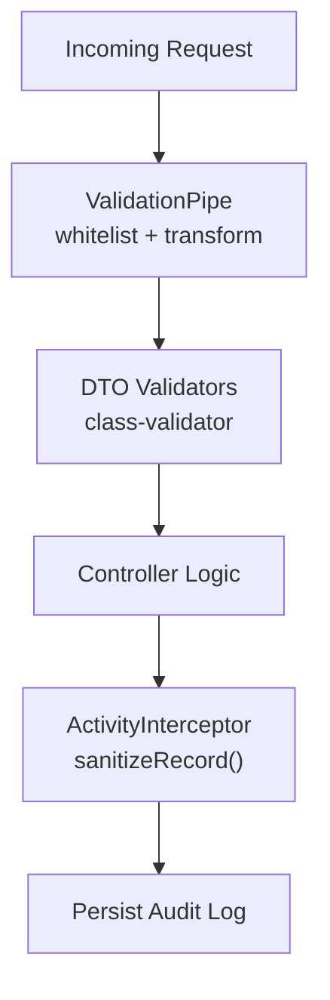
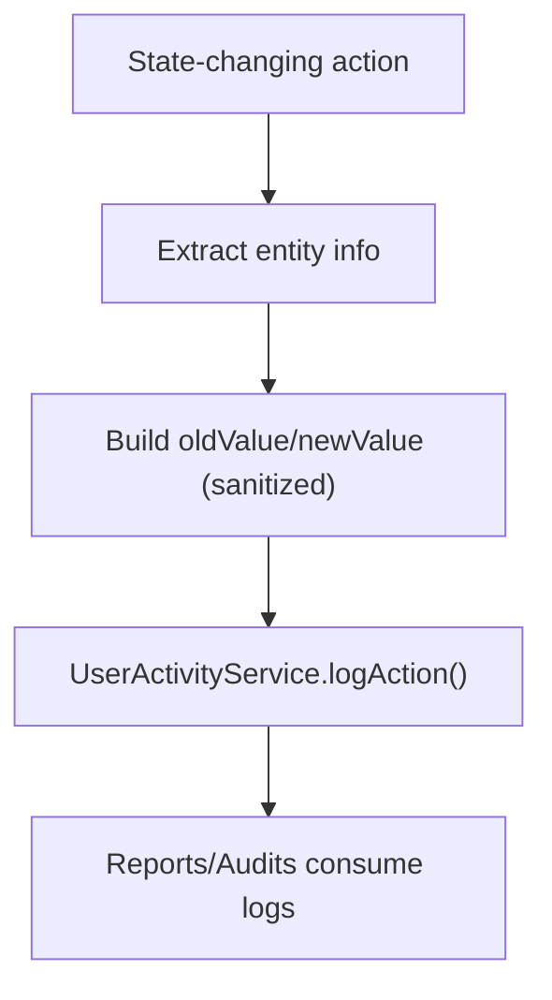
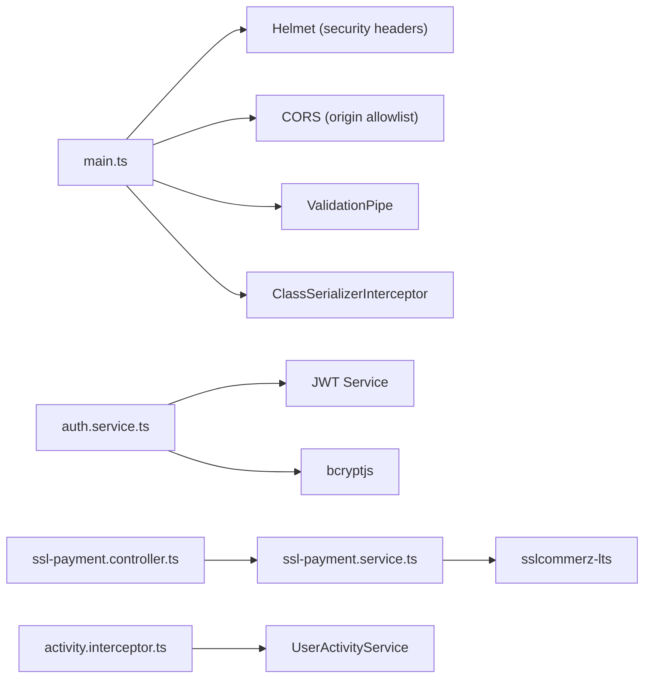

# Security & Compliance

<cite>
**Referenced Files in This Document**
- [main.ts](file://apps/backend/src/main.ts)
- [configuration.ts](file://apps/backend/src/config/configuration.ts)
- [auth.service.ts](file://apps/backend/src/auth/auth.service.ts)
- [jwt-auth.guard.ts](file://apps/backend/src/auth/guards/jwt-auth.guard.ts)
- [permission.guard.ts](file://apps/backend/src/auth/guards/permission.guard.ts)
- [activity.interceptor.ts](file://apps/backend/src/interceptor/activity.interceptor.ts)
- [ssl-payment.controller.ts](file://apps/backend/src/ssl-payment/ssl-payment.controller.ts)
- [ssl-payment.service.ts](file://apps/backend/src/ssl-payment/ssl-payment.service.ts)
</cite>

## Table of Contents
1. [Introduction](#introduction)
2. [Project Structure](#project-structure)
3. [Core Components](#core-components)
4. [Architecture Overview](#architecture-overview)
5. [Detailed Component Analysis](#detailed-component-analysis)
6. [Dependency Analysis](#dependency-analysis)
7. [Performance Considerations](#performance-considerations)
8. [Troubleshooting Guide](#troubleshooting-guide)
9. [Conclusion](#conclusion)

## Introduction
This document provides a comprehensive security and compliance guide for the payment system, focusing on PCI DSS-aligned controls, authentication and authorization, input validation, session and token handling, CSRF considerations, secure coding practices, data privacy, audit logging, compliance reporting, and monitoring/alerting. It maps these controls to concrete implementation points in the codebase.

## Project Structure
The backend is a NestJS application with:
- Global security middleware (Helmet, CORS, body size limits).
- Centralized configuration for payment gateway settings.
- Authentication via JWT with refresh tokens and mobile OTP flows.
- Role-based authorization using guards and module permissions.
- Payment integration with SSLCommerz including IPN callbacks and refunds.
- Activity interception and audit logging for sensitive operations.

**Diagram sources**
- [main.ts:16-128](file://apps/backend/src/main.ts#L16-L128)
- [configuration.ts:1-16](file://apps/backend/src/config/configuration.ts#L1-L16)
- [auth.service.ts:75-170](file://apps/backend/src/auth/auth.service.ts#L75-L170)
- [ssl-payment.controller.ts:31-257](file://apps/backend/src/ssl-payment/ssl-payment.controller.ts#L31-L257)
- [ssl-payment.service.ts:16-413](file://apps/backend/src/ssl-payment/ssl-payment.service.ts#L16-L413)
- [activity.interceptor.ts:20-73](file://apps/backend/src/interceptor/activity.interceptor.ts#L20-L73)

**Section sources**
- [main.ts:16-128](file://apps/backend/src/main.ts#L16-L128)
- [configuration.ts:1-16](file://apps/backend/src/config/configuration.ts#L1-L16)

## Core Components
- Application bootstrap and global security: Helmet headers, CORS policy, body parser limits, versioning, Swagger gating, and global pipes/interceptors.
- Configuration: Environment-driven settings for SSLCommerz credentials and payment URLs.
- Authentication: Email/password login with bcrypt, JWT access/refresh tokens, mobile OTP flow, and token refresh.
- Authorization: JWT guard plus opt-in permission guard mapped to menu permissions.
- Payment: SSLCommerz initialization, success/failure/cancel handlers, IPN processing, refund initiation, and server IP whitelist checks.
- Audit and activity logging: Interceptor that captures user actions, sanitizes sensitive fields, and persists structured logs.

**Section sources**
- [main.ts:16-128](file://apps/backend/src/main.ts#L16-L128)
- [configuration.ts:1-16](file://apps/backend/src/config/configuration.ts#L1-L16)
- [auth.service.ts:54-170](file://apps/backend/src/auth/auth.service.ts#L54-L170)
- [jwt-auth.guard.ts:10-45](file://apps/backend/src/auth/guards/jwt-auth.guard.ts#L10-L45)
- [permission.guard.ts:31-90](file://apps/backend/src/auth/guards/permission.guard.ts#L31-L90)
- [ssl-payment.controller.ts:31-257](file://apps/backend/src/ssl-payment/ssl-payment.controller.ts#L31-L257)
- [ssl-payment.service.ts:16-413](file://apps/backend/src/ssl-payment/ssl-payment.service.ts#L16-L413)
- [activity.interceptor.ts:20-73](file://apps/backend/src/interceptor/activity.interceptor.ts#L20-L73)

## Architecture Overview
The payment flow integrates client requests, authenticated endpoints, SSLCommerz gateway, and internal services with robust verification and auditing.

**Diagram sources**
- [ssl-payment.controller.ts:35-134](file://apps/backend/src/ssl-payment/ssl-payment.controller.ts#L35-L134)
- [ssl-payment.service.ts:44-111](file://apps/backend/src/ssl-payment/ssl-payment.service.ts#L44-L111)
- [ssl-payment.service.ts:113-234](file://apps/backend/src/ssl-payment/ssl-payment.service.ts#L113-L234)
- [ssl-payment.service.ts:269-306](file://apps/backend/src/ssl-payment/ssl-payment.service.ts#L269-L306)
- [ssl-payment.service.ts:308-328](file://apps/backend/src/ssl-payment/ssl-payment.service.ts#L308-L328)

## Detailed Component Analysis

### Authentication and Token Handling
- Password hashing uses bcrypt; login validates credentials and returns sanitized user data.
- JWT access and refresh tokens are issued with environment-configured secrets and expiration.
- Mobile OTP login enforces format validation, cooldowns, and SMS delivery; verifies OTP against stored values and expiry.
- Token refresh validates the refresh token and issues new pairs.

**Diagram sources**
- [auth.service.ts:54-100](file://apps/backend/src/auth/auth.service.ts#L54-L100)
- [auth.service.ts:107-170](file://apps/backend/src/auth/auth.service.ts#L107-L170)
- [auth.service.ts:172-250](file://apps/backend/src/auth/auth.service.ts#L172-L250)
- [auth.service.ts:252-358](file://apps/backend/src/auth/auth.service.ts#L252-L358)

**Section sources**
- [auth.service.ts:54-170](file://apps/backend/src/auth/auth.service.ts#L54-L170)
- [auth.service.ts:172-358](file://apps/backend/src/auth/auth.service.ts#L172-L358)

### Authorization and Access Control
- JwtAuthGuard enforces Bearer token presence and supports public route overrides.
- PermissionGuard is opt-in via metadata and maps HTTP methods to CRUD permissions, with role inheritance and inactive role denial.
- Refund endpoint requires both JWT and module-level permissions.

**Diagram sources**
- [jwt-auth.guard.ts:10-45](file://apps/backend/src/auth/guards/jwt-auth.guard.ts#L10-L45)
- [permission.guard.ts:31-90](file://apps/backend/src/auth/guards/permission.guard.ts#L31-L90)
- [ssl-payment.controller.ts:229-256](file://apps/backend/src/ssl-payment/ssl-payment.controller.ts#L229-L256)

**Section sources**
- [jwt-auth.guard.ts:10-45](file://apps/backend/src/auth/guards/jwt-auth.guard.ts#L10-L45)
- [permission.guard.ts:31-90](file://apps/backend/src/auth/guards/permission.guard.ts#L31-L90)
- [ssl-payment.controller.ts:229-256](file://apps/backend/src/ssl-payment/ssl-payment.controller.ts#L229-L256)

### Payment Processing and PCI DSS Controls
- Credentials and payment URLs are loaded from environment variables; missing credentials throw errors early.
- Transaction IDs are generated server-side; success/fail/cancel URLs are configured per environment.
- Payment success path performs server-side verification against the gateway before updating records.
- Logs intentionally omit sensitive fields; only non-sensitive identifiers and amounts are recorded.
- IPN handler processes asynchronous notifications and delegates to success handling.
- Refund initiation validates bank vs. merchant transaction IDs and handles IP whitelist errors.

**Diagram sources**
- [ssl-payment.service.ts:29-42](file://apps/backend/src/ssl-payment/ssl-payment.service.ts#L29-L42)
- [ssl-payment.service.ts:44-111](file://apps/backend/src/ssl-payment/ssl-payment.service.ts#L44-L111)
- [ssl-payment.service.ts:113-234](file://apps/backend/src/ssl-payment/ssl-payment.service.ts#L113-L234)
- [ssl-payment.service.ts:269-306](file://apps/backend/src/ssl-payment/ssl-payment.service.ts#L269-L306)
- [ssl-payment.service.ts:308-328](file://apps/backend/src/ssl-payment/ssl-payment.service.ts#L308-L328)
- [ssl-payment.service.ts:330-412](file://apps/backend/src/ssl-payment/ssl-payment.service.ts#L330-L412)

**Section sources**
- [ssl-payment.service.ts:29-42](file://apps/backend/src/ssl-payment/ssl-payment.service.ts#L29-L42)
- [ssl-payment.service.ts:44-111](file://apps/backend/src/ssl-payment/ssl-payment.service.ts#L44-L111)
- [ssl-payment.service.ts:113-234](file://apps/backend/src/ssl-payment/ssl-payment.service.ts#L113-L234)
- [ssl-payment.service.ts:269-306](file://apps/backend/src/ssl-payment/ssl-payment.service.ts#L269-L306)
- [ssl-payment.service.ts:308-328](file://apps/backend/src/ssl-payment/ssl-payment.service.ts#L308-L328)
- [ssl-payment.service.ts:330-412](file://apps/backend/src/ssl-payment/ssl-payment.service.ts#L330-L412)
- [ssl-payment.controller.ts:35-134](file://apps/backend/src/ssl-payment/ssl-payment.controller.ts#L35-L134)
- [ssl-payment.controller.ts:187-206](file://apps/backend/src/ssl-payment/ssl-payment.controller.ts#L187-L206)

### Input Validation and Sanitization
- Global ValidationPipe whitelists and transforms inputs, reducing injection surface.
- DTOs use class-validator decorators for field constraints across modules.
- Activity interceptor sanitizes old/new values and excludes sensitive fields like passwords and OTPs.
- Payment callbacks sanitize logs to avoid PII leakage.

**Diagram sources**
- [main.ts:111-125](file://apps/backend/src/main.ts#L111-L125)
- [activity.interceptor.ts:136-182](file://apps/backend/src/interceptor/activity.interceptor.ts#L136-L182)
- [ssl-payment.controller.ts:21-29](file://apps/backend/src/ssl-payment/ssl-payment.controller.ts#L21-L29)

**Section sources**
- [main.ts:111-125](file://apps/backend/src/main.ts#L111-L125)
- [activity.interceptor.ts:136-182](file://apps/backend/src/interceptor/activity.interceptor.ts#L136-L182)
- [ssl-payment.controller.ts:21-29](file://apps/backend/src/ssl-payment/ssl-payment.controller.ts#L21-L29)

### Session Management, CSRF, and Secure Transmission
- Sessions: The application does not rely on server sessions for auth; it uses stateless JWTs with refresh tokens.
- CSRF: No server-side CSRF protection is implemented. For state-changing endpoints, consider adding CSRF tokens or ensuring strict SameSite cookie policies if cookies are used.
- TLS: HTTPS termination should be enforced at the reverse proxy/load balancer; ensure all payment-related routes are only accessible over HTTPS.
- CORS: Configurable origins; restrict to known frontends in production.

**Section sources**
- [auth.service.ts:107-170](file://apps/backend/src/auth/auth.service.ts#L107-L170)
- [main.ts:89-109](file://apps/backend/src/main.ts#L89-L109)

### Data Privacy and Sensitive Data Handling
- Passwords and OTPs are excluded from responses and audit logs.
- Payment callback logs include only non-sensitive fields (transaction ID, status, amount).
- ClassSerializerInterceptor strips @Exclude fields globally.

**Section sources**
- [auth.service.ts:102-105](file://apps/backend/src/auth/auth.service.ts#L102-L105)
- [activity.interceptor.ts:136-182](file://apps/backend/src/interceptor/activity.interceptor.ts#L136-L182)
- [ssl-payment.controller.ts:21-29](file://apps/backend/src/ssl-payment/ssl-payment.controller.ts#L21-L29)
- [main.ts:120-125](file://apps/backend/src/main.ts#L120-L125)

### Audit Logging and Compliance Reporting
- ActivityInterceptor captures method, entity type/id, IP, user agent, request ID, session ID, and user type, with descriptive messages for key flows (orders, payments, refunds).
- Audit writes are best-effort and do not block response paths.
- Refund operations are guarded by module permissions and logged with amount and payment context.

**Diagram sources**
- [activity.interceptor.ts:37-73](file://apps/backend/src/interceptor/activity.interceptor.ts#L37-L73)
- [activity.interceptor.ts:184-251](file://apps/backend/src/interceptor/activity.interceptor.ts#L184-L251)
- [activity.interceptor.ts:399-439](file://apps/backend/src/interceptor/activity.interceptor.ts#L399-L439)

**Section sources**
- [activity.interceptor.ts:37-73](file://apps/backend/src/interceptor/activity.interceptor.ts#L37-L73)
- [activity.interceptor.ts:184-251](file://apps/backend/src/interceptor/activity.interceptor.ts#L184-L251)
- [activity.interceptor.ts:399-439](file://apps/backend/src/interceptor/activity.interceptor.ts#L399-L439)
- [ssl-payment.controller.ts:229-256](file://apps/backend/src/ssl-payment/ssl-payment.controller.ts#L229-L256)

### Security Monitoring and Alerting
- Structured logs capture transaction IDs, statuses, and amounts without PII.
- IPN and payment failures are logged for observability.
- Refund attempts and IP whitelist errors are explicitly tracked.
- Recommendations: Integrate centralized logging (e.g., ELK/Splunk), set alerts for repeated failures, invalid validations, and unauthorized refund attempts.

**Section sources**
- [ssl-payment.service.ts:113-131](file://apps/backend/src/ssl-payment/ssl-payment.service.ts#L113-L131)
- [ssl-payment.service.ts:269-306](file://apps/backend/src/ssl-payment/ssl-payment.service.ts#L269-L306)
- [ssl-payment.service.ts:330-412](file://apps/backend/src/ssl-payment/ssl-payment.service.ts#L330-L412)

## Dependency Analysis
Key dependencies and relationships relevant to security:

**Diagram sources**
- [main.ts:1-128](file://apps/backend/src/main.ts#L1-L128)
- [auth.service.ts:1-32](file://apps/backend/src/auth/auth.service.ts#L1-L32)
- [ssl-payment.controller.ts:1-20](file://apps/backend/src/ssl-payment/ssl-payment.controller.ts#L1-L20)
- [ssl-payment.service.ts:1-14](file://apps/backend/src/ssl-payment/ssl-payment.service.ts#L1-L14)
- [activity.interceptor.ts:1-18](file://apps/backend/src/interceptor/activity.interceptor.ts#L1-L18)

**Section sources**
- [main.ts:1-128](file://apps/backend/src/main.ts#L1-L128)
- [auth.service.ts:1-32](file://apps/backend/src/auth/auth.service.ts#L1-L32)
- [ssl-payment.controller.ts:1-20](file://apps/backend/src/ssl-payment/ssl-payment.controller.ts#L1-L20)
- [ssl-payment.service.ts:1-14](file://apps/backend/src/ssl-payment/ssl-payment.service.ts#L1-L14)
- [activity.interceptor.ts:1-18](file://apps/backend/src/interceptor/activity.interceptor.ts#L1-L18)

## Performance Considerations
- Body parser limits increased to accommodate checkout payloads; keep limits minimal yet sufficient.
- Compression enabled for JSON responses.
- Audit logging is non-blocking to avoid impacting latency-critical flows like login and payment callbacks.

**Section sources**
- [main.ts:20-26](file://apps/backend/src/main.ts#L20-L26)
- [auth.service.ts:86-93](file://apps/backend/src/auth/auth.service.ts#L86-L93)
- [activity.interceptor.ts:229-251](file://apps/backend/src/interceptor/activity.interceptor.ts#L229-L251)

## Troubleshooting Guide
- Missing SSLCommerz credentials: Initialization fails early; ensure environment variables are set.
- Invalid order ID in callbacks: Controllers validate numeric IDs and redirect to error pages.
- Payment verification failures: Occur when gateway validation status is not VALID or amounts/IDs mismatch; check logs and gateway configuration.
- IP whitelist errors during refunds: Indicates server IP not whitelisted in SSLCommerz panel; add the IP and retry.
- Unauthorized/forbidden access: Verify JWT validity and required module permissions for protected endpoints.

**Section sources**
- [ssl-payment.service.ts:29-42](file://apps/backend/src/ssl-payment/ssl-payment.service.ts#L29-L42)
- [ssl-payment.controller.ts:76-80](file://apps/backend/src/ssl-payment/ssl-payment.controller.ts#L76-L80)
- [ssl-payment.service.ts:269-306](file://apps/backend/src/ssl-payment/ssl-payment.service.ts#L269-L306)
- [ssl-payment.service.ts:367-377](file://apps/backend/src/ssl-payment/ssl-payment.service.ts#L367-L377)
- [jwt-auth.guard.ts:31-44](file://apps/backend/src/auth/guards/jwt-auth.guard.ts#L31-L44)
- [permission.guard.ts:39-75](file://apps/backend/src/auth/guards/permission.guard.ts#L39-L75)

## Conclusion
The payment system implements strong foundational security controls aligned with PCI DSS principles: environment-scoped secrets, server-side payment verification, least-privilege authorization, input validation, sensitive data redaction, and comprehensive audit logging. To further harden the system, enforce HTTPS-only endpoints, implement CSRF protections where applicable, centralize and alert on security events, and regularly review permissions and logging sensitivity.