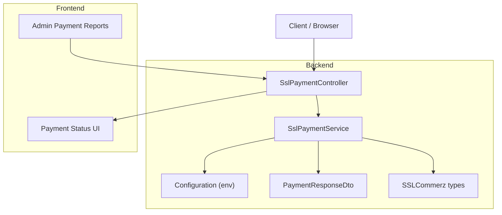
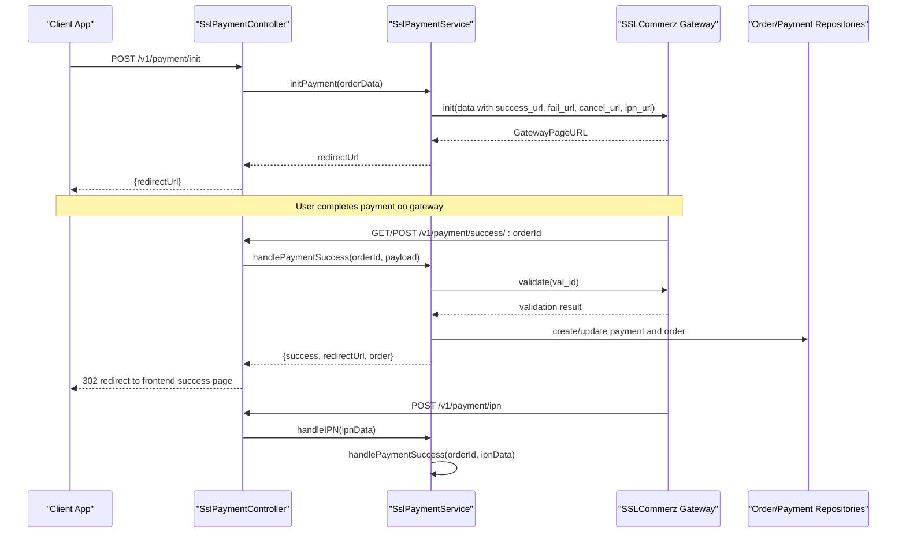
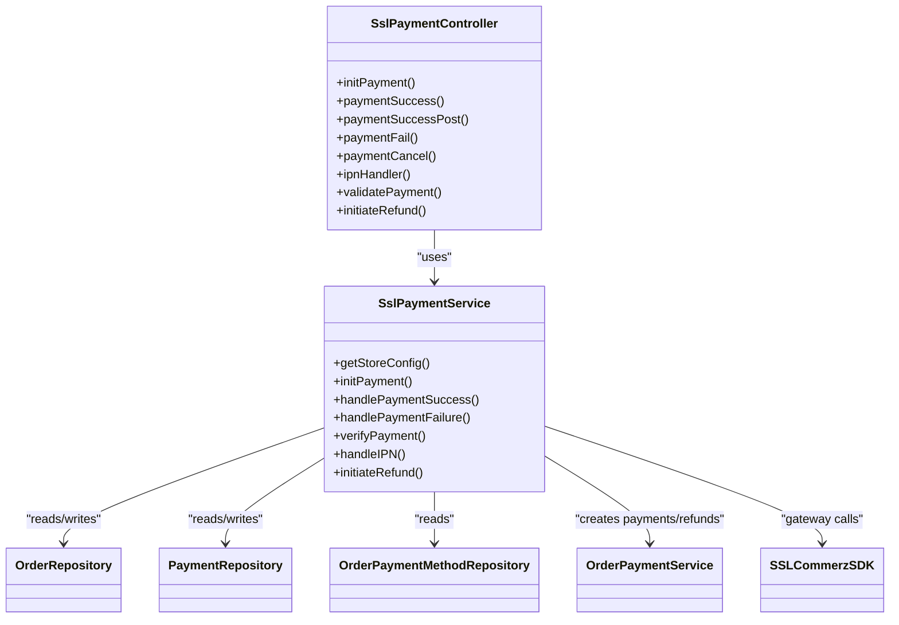

# Testing & Monitoring

<cite>
**Referenced Files in This Document**
- [ssl-payment.service.ts](file://apps/backend/src/ssl-payment/ssl-payment.service.ts)
- [ssl-payment.controller.ts](file://apps/backend/src/ssl-payment/ssl-payment.controller.ts)
- [configuration.ts](file://apps/backend/src/config/configuration.ts)
- [payment-response.dto.ts](file://apps/backend/src/ssl-payment/dto/payment-response.dto.ts)
- [sslcommerz-lts.d.ts](file://apps/backend/src/types/sslcommerz-lts.d.ts)
- [payment-status-config.ts](file://apps/frontend/utils/payment-status-config.ts)
- [payment-status.tsx](file://apps/frontend/components/payment/payment-status.tsx)
- [order-payment-list.tsx](file://apps/frontend/components/admin/reports/order-payments/order-payment-list.tsx)
- [activity.interceptor.ts](file://apps/backend/src/interceptor/activity.interceptor.ts)
- [app.e2e-spec.ts](file://apps/backend/test/app.e2e-spec.ts)
- [ssl-payment.controller.spec.ts](file://apps/backend/src/ssl-payment/ssl-payment.controller.spec.ts)
- [ssl-payment.service.spec.ts](file://apps/backend/src/ssl-payment/ssl-payment.service.spec.ts)
- [payment.service.spec.ts](file://apps/backend/src/payment/payment.service.spec.ts)
- [payment-method.service.spec.ts](file://apps/backend/src/payment-method/payment-method.service.spec.ts)
</cite>

## Table of Contents
1. Introduction
2. Project Structure
3. Core Components
4. Architecture Overview
5. Detailed Component Analysis
6. Dependency Analysis
7. Performance Considerations
8. Troubleshooting Guide
9. Conclusion
10. Appendices

## Introduction
This document provides comprehensive testing and monitoring guidance for the payment system, focusing on SSLCommerz integration. It covers unit tests for payment services, integration points with the gateway, end-to-end flows, sandbox configuration, mock scenarios, monitoring/logging strategies, debugging techniques, and analytics/reporting for financial reconciliation.

## Project Structure
The payment functionality is implemented primarily in the backend under ssl-payment and related modules, with frontend components handling status display and admin reporting. Key areas:
- Backend service and controller for SSLCommerz integration
- Configuration for environment variables (sandbox vs live)
- Frontend status UI and admin reports for payments

**Diagram sources**
- [ssl-payment.controller.ts:31-257](file://apps/backend/src/ssl-payment/ssl-payment.controller.ts#L31-L257)
- [ssl-payment.service.ts:16-413](file://apps/backend/src/ssl-payment/ssl-payment.service.ts#L16-L413)
- [configuration.ts:1-16](file://apps/backend/src/config/configuration.ts#L1-L16)
- [payment-response.dto.ts:1-7](file://apps/backend/src/ssl-payment/dto/payment-response.dto.ts#L1-L7)
- [sslcommerz-lts.d.ts:1-54](file://apps/backend/src/types/sslcommerz-lts.d.ts#L1-L54)
- [payment-status.tsx:231-272](file://apps/frontend/components/payment/payment-status.tsx#L231-L272)
- [order-payment-list.tsx:1-144](file://apps/frontend/components/admin/reports/order-payments/order-payment-list.tsx#L1-L144)

**Section sources**
- [ssl-payment.controller.ts:31-257](file://apps/backend/src/ssl-payment/ssl-payment.controller.ts#L31-L257)
- [ssl-payment.service.ts:16-413](file://apps/backend/src/ssl-payment/ssl-payment.service.ts#L16-L413)
- [configuration.ts:1-16](file://apps/backend/src/config/configuration.ts#L1-L16)
- [payment-response.dto.ts:1-7](file://apps/backend/src/ssl-payment/dto/payment-response.dto.ts#L1-L7)
- [sslcommerz-lts.d.ts:1-54](file://apps/backend/src/types/sslcommerz-lts.d.ts#L1-L54)
- [payment-status.tsx:231-272](file://apps/frontend/components/payment/payment-status.tsx#L231-L272)
- [order-payment-list.tsx:1-144](file://apps/frontend/components/admin/reports/order-payments/order-payment-list.tsx#L1-L144)

## Core Components
- SslPaymentController: Exposes endpoints to initialize payments, handle success/failure/cancel callbacks, IPN, validation, and refunds.
- SslPaymentService: Implements business logic for initializing payments via SSLCommerz, verifying transactions, processing success/failure, IPN handling, and refund initiation.
- Configuration: Centralizes environment-driven settings for SSLCommerz credentials and payment URLs.
- DTOs and Types: Define request/response shapes and third-party SDK types.
- Frontend UI: Displays payment status and supports admin reporting and exports.

Key responsibilities:
- Initialize payment and return gateway URL
- Validate callback payloads and amounts
- Persist payment records and update order state
- Handle asynchronous IPN notifications
- Support refunds with reversal postings
- Provide user-facing status pages and admin reports

**Section sources**
- [ssl-payment.controller.ts:31-257](file://apps/backend/src/ssl-payment/ssl-payment.controller.ts#L31-L257)
- [ssl-payment.service.ts:16-413](file://apps/backend/src/ssl-payment/ssl-payment.service.ts#L16-L413)
- [configuration.ts:1-16](file://apps/backend/src/config/configuration.ts#L1-L16)
- [payment-response.dto.ts:1-7](file://apps/backend/src/ssl-payment/dto/payment-response.dto.ts#L1-L7)
- [sslcommerz-lts.d.ts:1-54](file://apps/backend/src/types/sslcommerz-lts.d.ts#L1-L54)

## Architecture Overview
End-to-end flow from client to gateway and back:

**Diagram sources**
- [ssl-payment.controller.ts:35-206](file://apps/backend/src/ssl-payment/ssl-payment.controller.ts#L35-L206)
- [ssl-payment.service.ts:44-111](file://apps/backend/src/ssl-payment/ssl-payment.service.ts#L44-L111)
- [ssl-payment.service.ts:113-234](file://apps/backend/src/ssl-payment/ssl-payment.service.ts#L113-L234)
- [ssl-payment.service.ts:269-328](file://apps/backend/src/ssl-payment/ssl-payment.service.ts#L269-L328)

## Detailed Component Analysis

### Unit Tests Strategy
- Controller-level tests verify module wiring and basic existence; extend these to assert endpoint behaviors using NestJS TestingModule and Supertest.
- Service-level tests should mock SSLCommerz SDK calls and repository interactions to validate business logic paths (init, verify, success, failure, IPN, refund).
- Payment and payment method service specs exist as placeholders; expand them to cover core scenarios.

Recommended test cases:
- Initialization returns a valid gateway URL when credentials are configured
- Failure when credentials are missing or invalid
- Success path validates amount and transaction ID, creates payment record, updates order
- Failure path logs reason and redirects appropriately
- IPN handler processes VALID status and idempotently handles repeated callbacks
- Refund initiates correctly and creates reversal posting on success

**Section sources**
- [ssl-payment.controller.spec.ts:1-21](file://apps/backend/src/ssl-payment/ssl-payment.controller.spec.ts#L1-L21)
- [ssl-payment.service.spec.ts:1-19](file://apps/backend/src/ssl-payment/ssl-payment.service.spec.ts#L1-L19)
- [payment.service.spec.ts:1-19](file://apps/backend/src/payment/payment.service.spec.ts#L1-L19)
- [payment-method.service.spec.ts:1-19](file://apps/backend/src/payment-method/payment-method.service.spec.ts#L1-L19)

### Integration Tests Strategy
- Use Supertest to call real endpoints against an in-memory or test database instance.
- Mock external dependencies:
  - SSLCommerz SDK methods (init, validate, initiateRefund)
  - Repository queries and updates
- Validate:
  - End-to-end initialization and redirection
  - Callback handling (success/fail/cancel)
  - IPN processing and idempotency
  - Refund initiation and reversal creation

Example structure:
- Setup Nest application with test module imports
- Seed minimal data (orders, payment methods)
- Assert HTTP responses and side effects (DB changes)

**Section sources**
- [app.e2e-spec.ts:1-25](file://apps/backend/test/app.e2e-spec.ts#L1-L25)
- [ssl-payment.controller.ts:35-206](file://apps/backend/src/ssl-payment/ssl-payment.controller.ts#L35-L206)
- [ssl-payment.service.ts:44-111](file://apps/backend/src/ssl-payment/ssl-payment.service.ts#L44-L111)
- [ssl-payment.service.ts:113-234](file://apps/backend/src/ssl-payment/ssl-payment.service.ts#L113-L234)
- [ssl-payment.service.ts:308-328](file://apps/backend/src/ssl-payment/ssl-payment.service.ts#L308-L328)
- [ssl-payment.service.ts:330-413](file://apps/backend/src/ssl-payment/ssl-payment.service.ts#L330-L413)

### End-to-End Tests Strategy
- Simulate complete checkout flow:
  - Create order and cart items
  - Initiate payment via /payment/init
  - Redirect to gateway and simulate successful completion
  - Verify success callback updates order and payment records
  - Confirm frontend displays correct status
- Include negative flows:
  - Failures and cancellations
  - Invalid or mismatched amounts/transaction IDs
  - IPN retries and idempotency

**Section sources**
- [ssl-payment.controller.ts:66-185](file://apps/backend/src/ssl-payment/ssl-payment.controller.ts#L66-L185)
- [ssl-payment.service.ts:113-234](file://apps/backend/src/ssl-payment/ssl-payment.service.ts#L113-L234)
- [payment-status.tsx:231-272](file://apps/frontend/components/payment/payment-status.tsx#L231-L272)

### Sandbox Environment Setup (SSLCommerz)
- Configure environment variables:
  - SSLCOMMERZ_STORE_ID
  - SSLCOMMERZ_STORE_PASSWORD
  - SSLCOMMERZ_IS_LIVE set to false for sandbox
  - PAYMENT_SUCCESS_URL, PAYMENT_FAIL_URL, PAYMENT_CANCEL_URL, PAYMENT_IPN_URL
  - BASE_URL and FRONTEND_URL for redirect targets
- The service reads these values to construct requests and determine sandbox vs live mode.

Operational notes:
- Ensure IP whitelist is configured in the merchant panel for both sandbox and production.
- Validate that success/fail/cancel/IPN URLs are reachable by the gateway.

**Section sources**
- [configuration.ts:1-16](file://apps/backend/src/config/configuration.ts#L1-L16)
- [ssl-payment.service.ts:29-42](file://apps/backend/src/ssl-payment/ssl-payment.service.ts#L29-L42)
- [ssl-payment.service.ts:44-111](file://apps/backend/src/ssl-payment/ssl-payment.service.ts#L44-L111)

### Mock Payment Scenarios
Mock scenarios to cover development and testing:
- Success:
  - Valid amount and transaction ID match
  - Idempotent reprocessing of same transaction
- Failure:
  - Mismatched amount or transaction ID
  - Gateway validation returns non-VALID
  - Network or API errors during validation
- Edge Cases:
  - Missing or malformed callback parameters
  - Duplicate IPN messages
  - Refund with identical bank_tran_id and tran_id
  - IP whitelist errors from gateway

Implementation tips:
- Mock SSLCommerz SDK methods to return controlled responses
- Inject test doubles for repositories to assert persistence behavior
- Validate error handling paths and user-facing messages

**Section sources**
- [ssl-payment.service.ts:113-234](file://apps/backend/src/ssl-payment/ssl-payment.service.ts#L113-L234)
- [ssl-payment.service.ts:269-328](file://apps/backend/src/ssl-payment/ssl-payment.service.ts#L269-L328)
- [ssl-payment.service.ts:330-413](file://apps/backend/src/ssl-payment/ssl-payment.service.ts#L330-L413)

### Monitoring and Logging Strategies
- Logging:
  - Non-sensitive fields logged for callbacks (tran_id, val_id presence, status, amount)
  - Validation response trimmed to identifiers to avoid PII leakage
  - Error paths log detailed context without exposing sensitive data
- Metrics to track:
  - Success rate by payment method and time window
  - Failure reasons distribution
  - IPN processing latency and retry counts
  - Refund success rate and reversal posting times
- Operational visibility:
  - Activity interceptor captures relevant actions for audit trails
  - Admin reports provide transaction lists and export capabilities

Recommendations:
- Integrate structured logging with correlation IDs per transaction
- Emit metrics to a monitoring system (e.g., Prometheus) for success rates and latencies
- Set up alerts for high failure rates, IP whitelist errors, and failed validations

**Section sources**
- [ssl-payment.controller.ts:21-29](file://apps/backend/src/ssl-payment/ssl-payment.controller.ts#L21-L29)
- [ssl-payment.service.ts:113-234](file://apps/backend/src/ssl-payment/ssl-payment.service.ts#L113-L234)
- [ssl-payment.service.ts:269-328](file://apps/backend/src/ssl-payment/ssl-payment.service.ts#L269-L328)
- [activity.interceptor.ts:404-429](file://apps/backend/src/interceptor/activity.interceptor.ts#L404-L429)
- [order-payment-list.tsx:1-144](file://apps/frontend/components/admin/reports/order-payments/order-payment-list.tsx#L1-L144)

### Debugging Techniques
- Validate callback integrity:
  - Compare validation status, transaction ID, and amount
- Inspect logs for:
  - Failed validation mismatches
  - IPN processing failures
  - IP whitelist errors during refunds
- Reproduce issues:
  - Use sandbox credentials and controlled SDK mocks
  - Replay IPN payloads to confirm idempotency
- Frontend checks:
  - Confirm redirect URLs and status pages render correctly
  - Review common failure reasons displayed to users

**Section sources**
- [ssl-payment.service.ts:269-328](file://apps/backend/src/ssl-payment/ssl-payment.service.ts#L269-L328)
- [ssl-payment.service.ts:330-413](file://apps/backend/src/ssl-payment/ssl-payment.service.ts#L330-L413)
- [payment-status.tsx:231-272](file://apps/frontend/components/payment/payment-status.tsx#L231-L272)

### Analytics and Reporting Features
- Admin payment list:
  - Displays payment transactions with filters and summaries
  - Supports Excel export and PDF generation for reconciliation
- Metrics and insights:
  - Aggregate totals and averages for orders and campaigns (pattern used across modules)
  - Extend to include payment-specific KPIs (success rate, average payment time, refund ratio)

Best practices:
- Standardize date range filters and presets
- Include currency formatting and consistent column headers
- Provide downloadable reports for finance teams

**Section sources**
- [order-payment-list.tsx:1-144](file://apps/frontend/components/admin/reports/order-payments/order-payment-list.tsx#L1-L144)
- [free-delivery-usage-log.service.ts:112-138](file://apps/backend/src/free-delivery-usage-log/free-delivery-usage-log.service.ts#L112-L138)

## Dependency Analysis
Core dependencies and relationships:
- SslPaymentController depends on SslPaymentService
- SslPaymentService depends on:
  - ConfigService for environment variables
  - TypeORM repositories for Order and OrderPayment
  - OrderPaymentService for creating payments and refunds
  - SSLCommerz SDK for gateway communication
- DTOs and type definitions define contracts with the gateway

**Diagram sources**
- [ssl-payment.controller.ts:31-257](file://apps/backend/src/ssl-payment/ssl-payment.controller.ts#L31-L257)
- [ssl-payment.service.ts:16-413](file://apps/backend/src/ssl-payment/ssl-payment.service.ts#L16-L413)

**Section sources**
- [ssl-payment.controller.ts:31-257](file://apps/backend/src/ssl-payment/ssl-payment.controller.ts#L31-L257)
- [ssl-payment.service.ts:16-413](file://apps/backend/src/ssl-payment/ssl-payment.service.ts#L16-L413)

## Performance Considerations
- Minimize PII exposure in logs to reduce overhead and risk
- Avoid redundant gateway calls; cache validation results where appropriate
- Ensure idempotent processing of IPN callbacks to prevent duplicate work
- Optimize database queries by selecting only necessary relations
- Batch operations where possible (e.g., report aggregation)

[No sources needed since this section provides general guidance]

## Troubleshooting Guide
Common issues and resolutions:
- Credentials not configured:
  - Ensure SSLCOMMERZ_STORE_ID and SSLCOMMERZ_STORE_PASSWORD are set
  - Verify SSLCOMMERZ_IS_LIVE matches intended environment
- IP whitelist errors:
  - Whitelist server IP in SSLCommerz merchant panel
  - Check error messages indicating INVALID_SOURCE or REQUEST_FROM_INVALID_SOURCE
- Validation failures:
  - Confirm validation.status is VALID
  - Match transaction ID and amount between callback and validation response
- IPN processing failures:
  - Inspect logs for invalid status or missing orderId
  - Ensure idempotency to handle repeated IPNs
- Frontend status anomalies:
  - Verify redirect URLs and environment variables for FRONTEND_URL
  - Review common failure reasons presented to users

**Section sources**
- [ssl-payment.service.ts:29-42](file://apps/backend/src/ssl-payment/ssl-payment.service.ts#L29-L42)
- [ssl-payment.service.ts:330-413](file://apps/backend/src/ssl-payment/ssl-payment.service.ts#L330-L413)
- [ssl-payment.service.ts:269-328](file://apps/backend/src/ssl-payment/ssl-payment.service.ts#L269-L328)
- [payment-status.tsx:231-272](file://apps/frontend/components/payment/payment-status.tsx#L231-L272)

## Conclusion
The payment system integrates SSLCommerz through well-defined controllers and services, with robust logging and verification mechanisms. Comprehensive unit, integration, and end-to-end tests should be implemented to ensure reliability. Proper sandbox configuration, mock scenarios, and monitoring will support stable operations and effective troubleshooting. Admin reporting tools facilitate financial reconciliation and insight generation.

[No sources needed since this section summarizes without analyzing specific files]

## Appendices

### API Endpoints Summary
- POST /payment/init: Initialize payment and return gateway URL
- GET /payment/success/:orderId: Handle success callback
- POST /payment/success/:orderId: Handle success callback (POST variant)
- POST /payment/fail/:orderId: Handle failure callback
- POST /payment/cancel/:orderId: Handle cancellation
- POST /payment/ipn: Process IPN notifications
- GET /payment/validate/:tranId: Manual validation placeholder
- POST /payment/refund: Initiate refund (admin-only)

**Section sources**
- [ssl-payment.controller.ts:35-257](file://apps/backend/src/ssl-payment/ssl-payment.controller.ts#L35-L257)

### Data Models and Contracts
- PaymentResponseDto defines response shape for payment operations
- SSLCommerz types define SDK interfaces for initialization and responses

**Section sources**
- [payment-response.dto.ts:1-7](file://apps/backend/src/ssl-payment/dto/payment-response.dto.ts#L1-L7)
- [sslcommerz-lts.d.ts:1-54](file://apps/backend/src/types/sslcommerz-lts.d.ts#L1-L54)