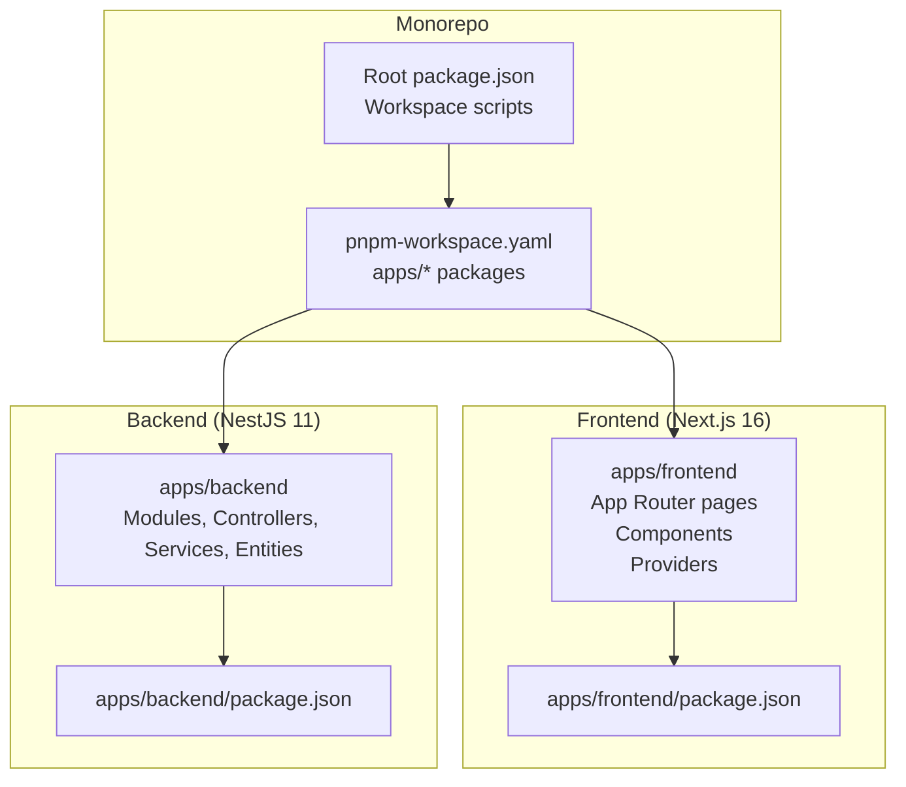
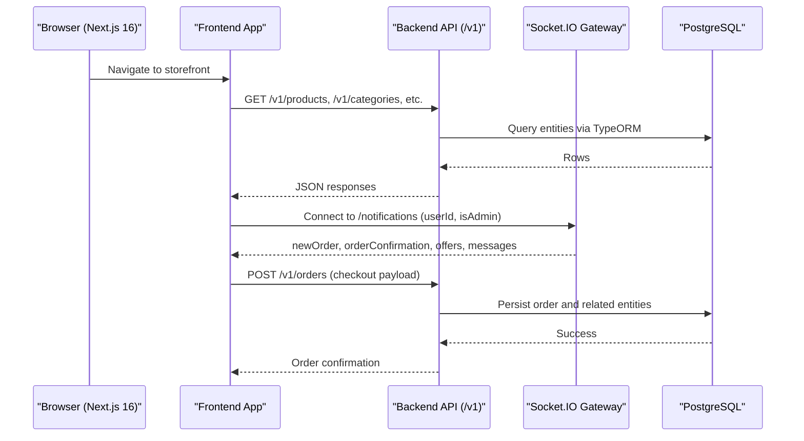
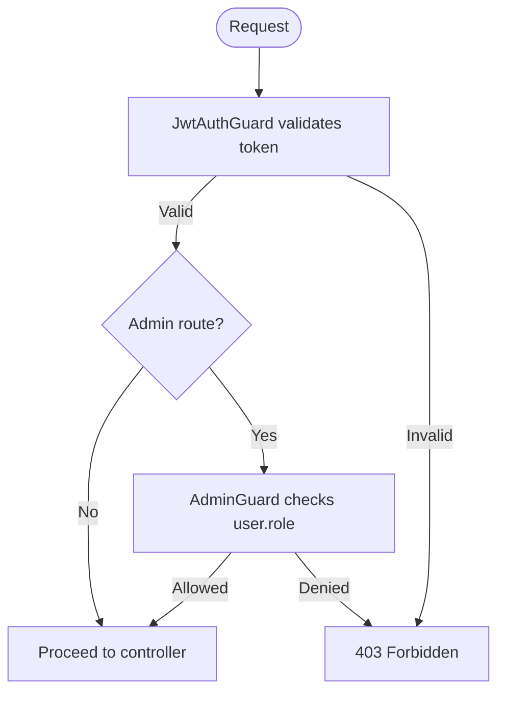
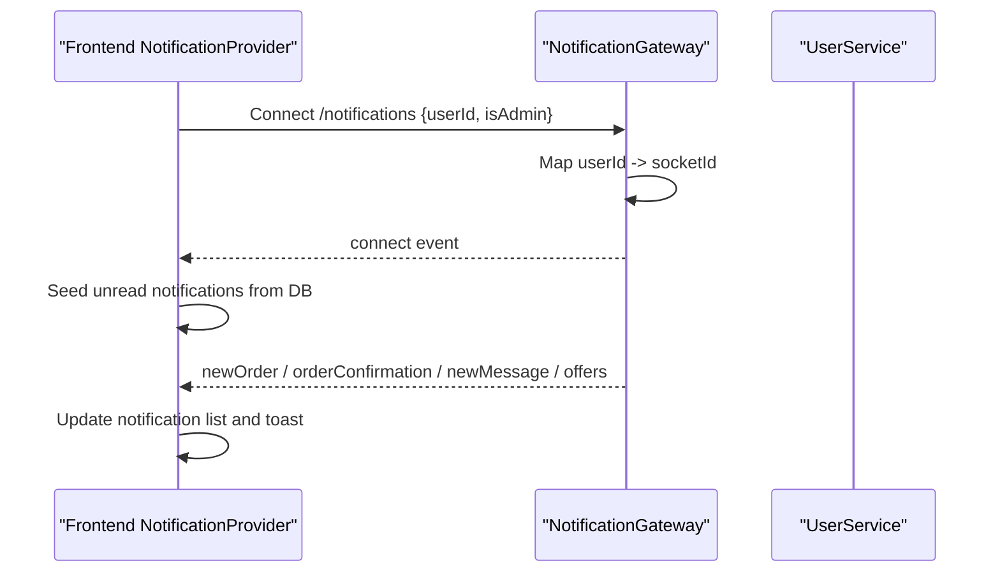
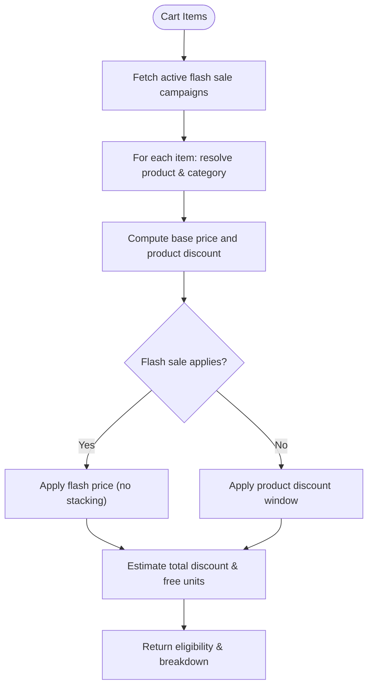
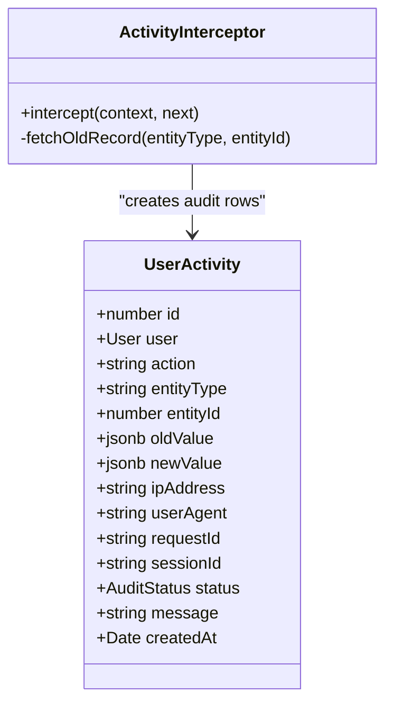
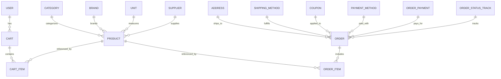
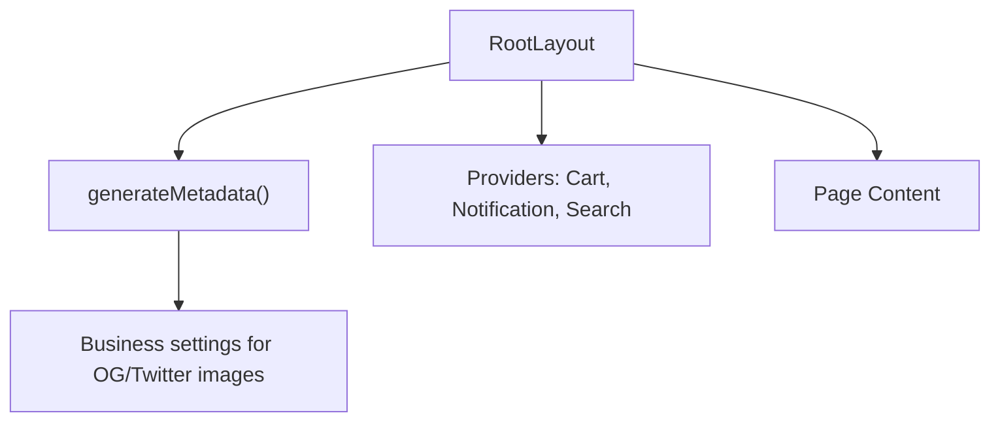
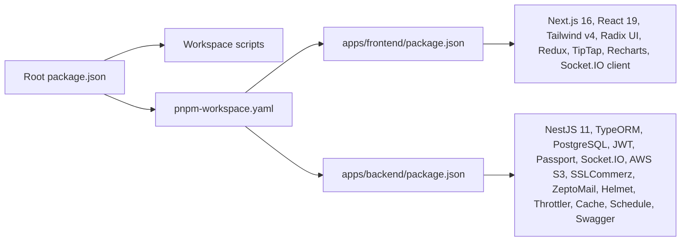

# Project Overview

<cite>
**Referenced Files in This Document**
- [README.md](file://README.md)
- [package.json](file://package.json)
- [pnpm-workspace.yaml](file://pnpm-workspace.yaml)
- [apps/backend/package.json](file://apps/backend/package.json)
- [apps/frontend/package.json](file://apps/frontend/package.json)
- [apps/backend/src/main.ts](file://apps/backend/src/main.ts)
- [apps/backend/src/app.module.ts](file://apps/backend/src/app.module.ts)
- [apps/backend/database.dbml](file://apps/backend/database.dbml)
- [apps/backend/src/auth/guards/admin.guard.ts](file://apps/backend/src/auth/guards/admin.guard.ts)
- [apps/backend/src/interceptor/activity.interceptor.ts](file://apps/backend/src/interceptor/activity.interceptor.ts)
- [apps/backend/src/user-activity/entities/user-activity.entity.ts](file://apps/backend/src/user-activity/entities/user-activity.entity.ts)
- [apps/backend/src/bogo-campaigns/bogo-campaigns.service.ts](file://apps/backend/src/bogo-campaigns/bogo-campaigns.service.ts)
- [apps/backend/src/notification/notification.gateway.ts](file://apps/backend/src/notification/notification.gateway.ts)
- [apps/frontend/providers/notification-provider.tsx](file://apps/frontend/providers/notification-provider.tsx)
- [apps/frontend/app/layout.tsx](file://apps/frontend/app/layout.tsx)
- [Dockerfile.backend](file://Dockerfile.backend)
- [Dockerfile.frontend](file://Dockerfile.frontend)
</cite>

## Table of Contents
1. [Introduction](#introduction)
2. [Project Structure](#project-structure)
3. [Core Components](#core-components)
4. [Architecture Overview](#architecture-overview)
5. [Detailed Component Analysis](#detailed-component-analysis)
6. [Dependency Analysis](#dependency-analysis)
7. [Performance Considerations](#performance-considerations)
8. [Troubleshooting Guide](#troubleshooting-guide)
9. [Conclusion](#conclusion)

## Introduction
German Butcher is a full-stack e-commerce platform for premium German sausages and meat products. It provides:
- A customer-facing storefront for browsing, cart management, checkout, and order tracking.
- An administrative dashboard for product, order, marketing campaign, CRM, and analytics management.
- Real-time communication between the frontend and backend via WebSockets.
- Marketing campaigns including BOGO (buy-one-get-one), flash sales, free delivery promotions, and coupons.

The project uses a monorepo architecture with pnpm workspaces, a Next.js 16 frontend, and a NestJS 11 backend. The database layer is PostgreSQL with TypeORM entities and repositories. Deployment is containerized using Docker with multi-stage builds.

## Project Structure
The repository is organized as a pnpm workspace containing two primary applications under apps/:
- apps/frontend: Next.js 16 application with App Router, Tailwind CSS v4, Radix UI primitives, Redux Toolkit state, Socket.IO client, Recharts dashboards, React Hook Form + Zod validation, and PDF generation.
- apps/backend: NestJS 11 API server with modules per feature domain, TypeORM entities, JWT authentication, Swagger/OpenAPI docs, Socket.IO gateway, AWS S3 storage integration, SSLCommerz payment integration, caching, throttling, and scheduling.

**Diagram sources**
- [package.json:1-30](file://package.json#L1-L30)
- [pnpm-workspace.yaml:1-19](file://pnpm-workspace.yaml#L1-L19)
- [apps/frontend/package.json:1-88](file://apps/frontend/package.json#L1-L88)
- [apps/backend/package.json:1-114](file://apps/backend/package.json#L1-L114)

**Section sources**
- [README.md:5-32](file://README.md#L5-L32)
- [package.json:1-30](file://package.json#L1-L30)
- [pnpm-workspace.yaml:1-19](file://pnpm-workspace.yaml#L1-L19)

## Core Components
- Frontend (Next.js 16): Modern UI stack with responsive design, rich text editor, real-time notifications, analytics charts, form validation, PDF rendering, image optimization, dark mode, animations, and date handling.
- Backend (NestJS 11): Modular architecture with controllers, services, entities, guards, interceptors, DTOs, and decorators. Includes JWT auth, Passport strategies, Swagger docs, AWS S3, ZeptoMail email, SSLCommerz payments, Throttler rate limiting, Cache Manager, and NestJS Schedule.
- Database: PostgreSQL with TypeORM; schema defined in DBML and auto-loaded by TypeORM.
- Real-time: Socket.IO gateway on the backend and Socket.IO client on the frontend for live notifications and admin alerts.
- Security: Helmet headers, CORS configuration, input validation, parameterized queries, role-based access control via guards.

**Section sources**
- [README.md:34-66](file://README.md#L34-L66)
- [README.md:186-217](file://README.md#L186-L217)
- [apps/backend/src/main.ts:16-149](file://apps/backend/src/main.ts#L16-L149)
- [apps/backend/src/app.module.ts:60-183](file://apps/backend/src/app.module.ts#L60-L183)

## Architecture Overview
The frontend communicates with the backend over HTTP(S) for REST APIs and uses WebSocket connections for real-time updates. The backend exposes versioned APIs under /v1, integrates Swagger documentation, and applies global pipes, interceptors, and security middleware.

**Diagram sources**
- [apps/backend/src/main.ts:37-40](file://apps/backend/src/main.ts#L37-L40)
- [apps/backend/src/notification/notification.gateway.ts:15-27](file://apps/backend/src/notification/notification.gateway.ts#L15-L27)
- [apps/frontend/providers/notification-provider.tsx:91-114](file://apps/frontend/providers/notification-provider.tsx#L91-L114)

**Section sources**
- [apps/backend/src/main.ts:16-149](file://apps/backend/src/main.ts#L16-L149)
- [apps/backend/src/app.module.ts:60-183](file://apps/backend/src/app.module.ts#L60-L183)

## Detailed Component Analysis

### Authentication and Authorization
- Guards enforce authentication and authorization:
  - JwtAuthGuard validates bearer tokens.
  - AdminGuard restricts routes to superadmin or admin roles.
- Role-based access control is applied across controllers and menu permissions.

**Diagram sources**
- [apps/backend/src/auth/guards/admin.guard.ts:1-15](file://apps/backend/src/auth/guards/admin.guard.ts#L1-L15)

**Section sources**
- [apps/backend/src/auth/guards/admin.guard.ts:1-15](file://apps/backend/src/auth/guards/admin.guard.ts#L1-L15)

### Real-time Notifications
- Backend: NotificationGateway listens on the /notifications namespace, maps userId to socket sessions, and emits events such as newOrder, orderConfirmation, newMessage, and offers.
- Frontend: NotificationProvider connects via Socket.IO, seeds unread notifications from the database, and handles incoming events to update UI and play sounds.

**Diagram sources**
- [apps/backend/src/notification/notification.gateway.ts:15-48](file://apps/backend/src/notification/notification.gateway.ts#L15-L48)
- [apps/frontend/providers/notification-provider.tsx:91-114](file://apps/frontend/providers/notification-provider.tsx#L91-L114)
- [apps/frontend/providers/notification-provider.tsx:133-155](file://apps/frontend/providers/notification-provider.tsx#L133-L155)
- [apps/frontend/providers/notification-provider.tsx:157-160](file://apps/frontend/providers/notification-provider.tsx#L157-L160)

**Section sources**
- [apps/backend/src/notification/notification.gateway.ts:15-48](file://apps/backend/src/notification/notification.gateway.ts#L15-L48)
- [apps/frontend/providers/notification-provider.tsx:76-114](file://apps/frontend/providers/notification-provider.tsx#L76-L114)
- [apps/frontend/providers/notification-provider.tsx:133-160](file://apps/frontend/providers/notification-provider.tsx#L133-L160)

### Marketing Campaigns (BOGO, Flash Sale, Free Delivery, Coupons)
- BOGO Campaigns Service computes eligible discounts based on cart items, considering flash sale precedence and product discount windows. It returns preview details for display-only purposes.
- Other campaign types include flash-sale campaigns, free-delivery campaigns, and coupon usage logs.

**Diagram sources**
- [apps/backend/src/bogo-campaigns/bogo-campaigns.service.ts:414-447](file://apps/backend/src/bogo-campaigns/bogo-campaigns.service.ts#L414-L447)

**Section sources**
- [apps/backend/src/bogo-campaigns/bogo-campaigns.service.ts:1-447](file://apps/backend/src/bogo-campaigns/bogo-campaigns.service.ts#L1-L447)

### Audit Logging and Activity Tracking
- ActivityInterceptor captures changes to key entities (products, orders, users, categories, coupons) and persists audit records.
- UserActivity entity stores action metadata, old/new values, IP address, user agent, request/session IDs, and status.

**Diagram sources**
- [apps/backend/src/interceptor/activity.interceptor.ts:73-118](file://apps/backend/src/interceptor/activity.interceptor.ts#L73-L118)
- [apps/backend/src/user-activity/entities/user-activity.entity.ts:1-87](file://apps/backend/src/user-activity/entities/user-activity.entity.ts#L1-L87)

**Section sources**
- [apps/backend/src/interceptor/activity.interceptor.ts:73-118](file://apps/backend/src/interceptor/activity.interceptor.ts#L73-L118)
- [apps/backend/src/user-activity/entities/user-activity.entity.ts:1-87](file://apps/backend/src/user-activity/entities/user-activity.entity.ts#L1-L87)

### Data Model and Database Design
- PostgreSQL is used with TypeORM; entities are auto-loaded and synchronized in non-production environments unless disabled.
- DBML defines core tables: user, category, product, brand, attachment, menu, unit, role, menu_permission, supplier, purchase, payment, payment_method, banner, purchase_item, address, cart, cart_item, coupon, shipping_method, order_payment_method, galleries, order_payment, order_status_track, order, order_item.

**Diagram sources**
- [apps/backend/database.dbml:60-121](file://apps/backend/database.dbml#L60-L121)
- [apps/backend/database.dbml:285-308](file://apps/backend/database.dbml#L285-L308)
- [apps/backend/database.dbml:381-405](file://apps/backend/database.dbml#L381-L405)
- [apps/backend/database.dbml:407-538](file://apps/backend/database.dbml#L407-L538)

**Section sources**
- [apps/backend/src/app.module.ts:93-115](file://apps/backend/src/app.module.ts#L93-L115)
- [apps/backend/database.dbml:1-538](file://apps/backend/database.dbml#L1-L538)

### Frontend Application Shell and Providers
- Root layout sets SEO metadata, fonts, Google Analytics/Tag Manager, and wraps the app with providers for notifications, cart state, and search.
- Server-side data fetching initializes protected cart data when authenticated.

**Diagram sources**
- [apps/frontend/app/layout.tsx:36-177](file://apps/frontend/app/layout.tsx#L36-L177)
- [apps/frontend/app/layout.tsx:180-206](file://apps/frontend/app/layout.tsx#L180-L206)

**Section sources**
- [apps/frontend/app/layout.tsx:36-177](file://apps/frontend/app/layout.tsx#L36-L177)
- [apps/frontend/app/layout.tsx:180-206](file://apps/frontend/app/layout.tsx#L180-L206)

## Dependency Analysis
- Monorepo orchestration:
  - Root package.json defines workspace scripts for dev, build, start, and Docker commands.
  - pnpm-workspace.yaml declares apps/* as packages and allows specific native dependencies.
- Frontend dependencies:
  - Next.js 16, React 19, Tailwind CSS v4, Radix UI, Redux Toolkit, TipTap, Recharts, Socket.IO client, Sharp, Plaiceholder, Zod, React Hook Form.
- Backend dependencies:
  - NestJS 11, TypeORM, PostgreSQL driver, JWT, Passport, Socket.IO, AWS S3 SDK, SSLCommerz, ZeptoMail, Helmet, Throttler, Cache Manager, Schedule, Swagger.

**Diagram sources**
- [package.json:1-30](file://package.json#L1-L30)
- [pnpm-workspace.yaml:1-19](file://pnpm-workspace.yaml#L1-L19)
- [apps/frontend/package.json:1-88](file://apps/frontend/package.json#L1-L88)
- [apps/backend/package.json:1-114](file://apps/backend/package.json#L1-L114)

**Section sources**
- [package.json:1-30](file://package.json#L1-L30)
- [pnpm-workspace.yaml:1-19](file://pnpm-workspace.yaml#L1-L19)
- [apps/frontend/package.json:1-88](file://apps/frontend/package.json#L1-L88)
- [apps/backend/package.json:1-114](file://apps/backend/package.json#L1-L114)

## Performance Considerations
- Compression enabled globally for JSON responses to reduce bandwidth.
- Body size limits increased to accommodate large checkout payloads.
- TypeORM connection pooling configured with max/min pool sizes and timeouts.
- Caching via Cache Manager and HTTP cache interceptor for repeated reads.
- Rate limiting via Throttler with short/medium/long windows.
- Frontend uses Turbopack in development and standalone output in production for optimized builds.

**Section sources**
- [apps/backend/src/main.ts:20-29](file://apps/backend/src/main.ts#L20-L29)
- [apps/backend/src/app.module.ts:70-92](file://apps/backend/src/app.module.ts#L70-L92)
- [apps/backend/src/app.module.ts:93-115](file://apps/backend/src/app.module.ts#L93-L115)
- [apps/frontend/package.json:5-9](file://apps/frontend/package.json#L5-L9)

## Troubleshooting Guide
- Port conflicts: Ensure ports 3000 (backend) and 3002 (frontend) are available.
- Database connectivity: Verify PostgreSQL is running and DATABASE_URL is correct.
- Docker issues: Clear caches, ensure pnpm is installed inside containers, and check network connectivity.
- Frontend build problems: Clear .next cache, reinstall dependencies, verify Node.js version compatibility.

**Section sources**
- [README.md:282-310](file://README.md#L282-L310)

## Conclusion
German Butcher’s platform delivers a robust, scalable e-commerce solution tailored for premium meat products. Its monorepo structure streamlines development, while modular backend services and a modern frontend provide a seamless shopping experience. Real-time features, comprehensive marketing campaigns, and strong security practices make it suitable for both customer-facing operations and administrative workflows. Containerized deployment ensures consistent environments across development and production.