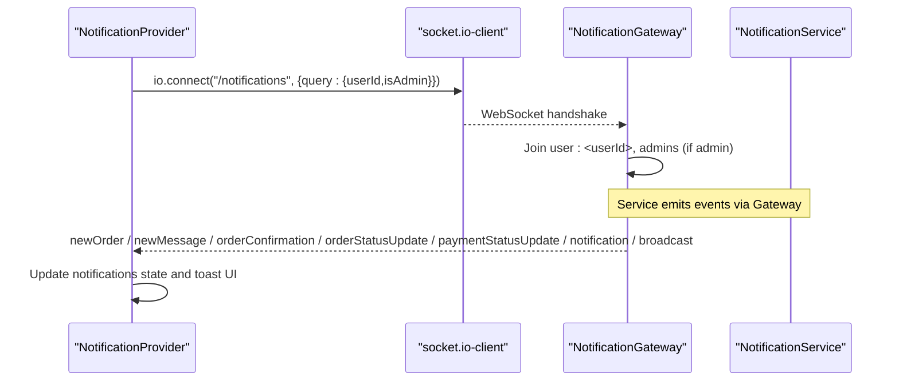
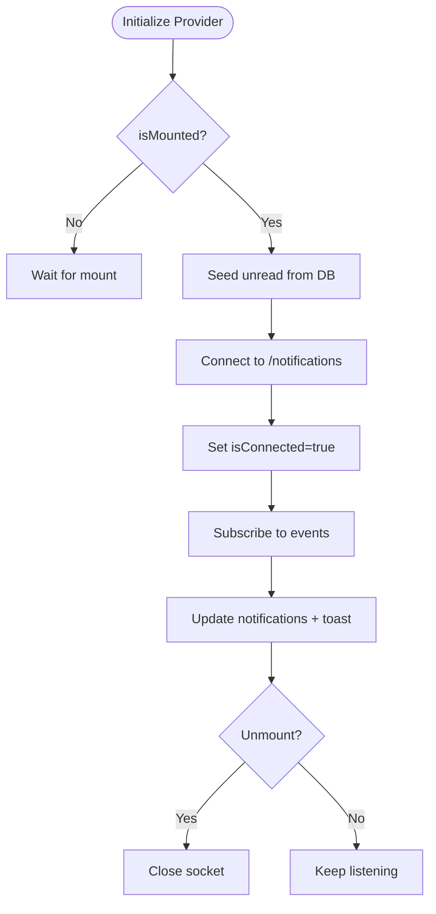
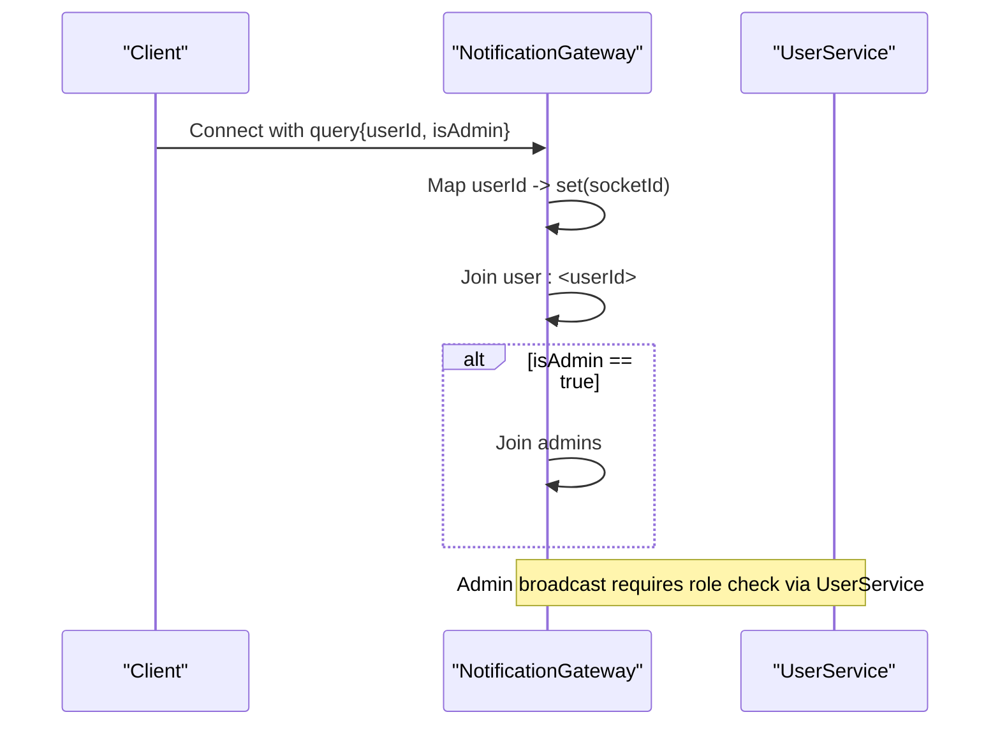
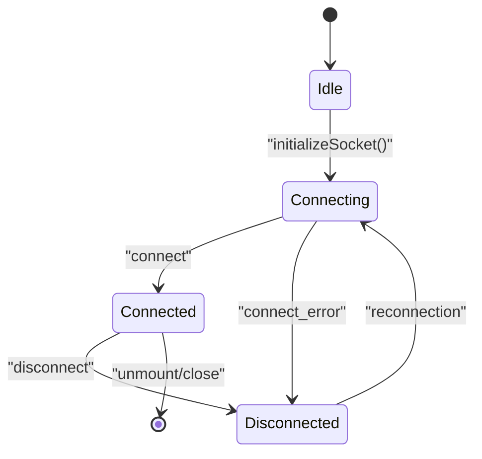
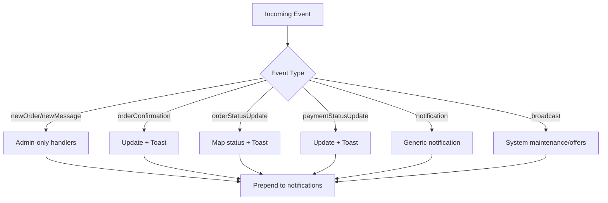
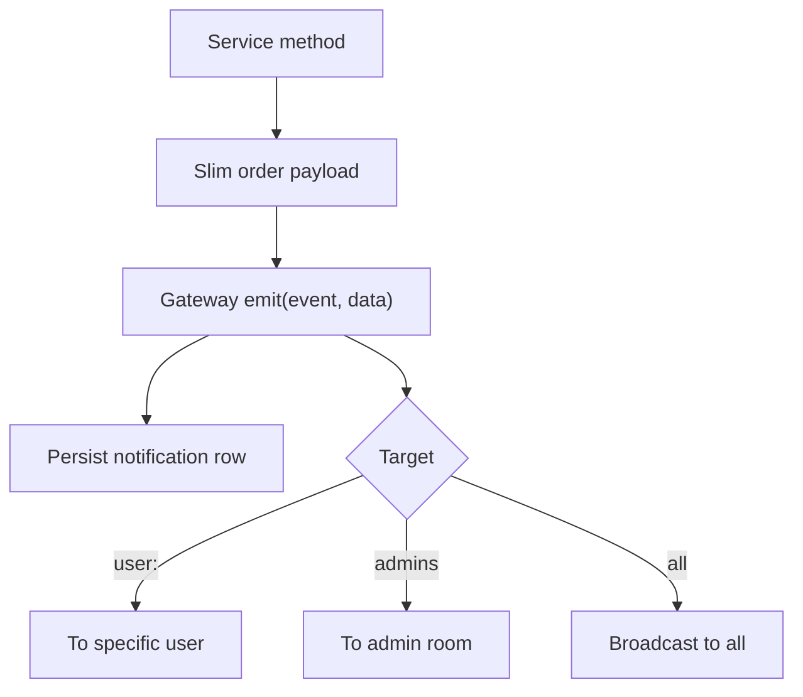
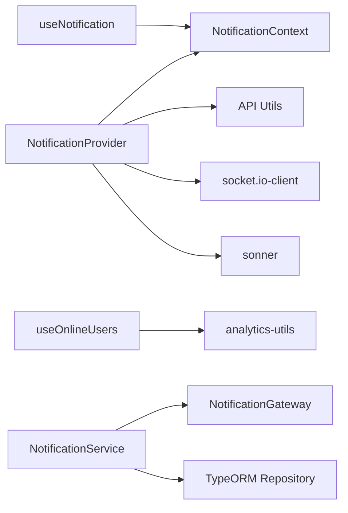

# Client Integration

<cite>
**Referenced Files in This Document**
- [notification-provider.tsx](file://apps/frontend/providers/notification-provider.tsx)
- [use-notification.ts](file://apps/frontend/hooks/use-notification.ts)
- [notification-context.tsx](file://apps/frontend/contexts/notification-context.tsx)
- [use-online-users.ts](file://apps/frontend/hooks/use-online-users.ts)
- [notification.gateway.ts](file://apps/backend/src/notification/notification.gateway.ts)
- [notification.service.ts](file://apps/backend/src/notification/notification.service.ts)
</cite>

## Table of Contents
1. [Introduction](#introduction)
2. [Project Structure](#project-structure)
3. [Core Components](#core-components)
4. [Architecture Overview](#architecture-overview)
5. [Detailed Component Analysis](#detailed-component-analysis)
6. [Dependency Analysis](#dependency-analysis)
7. [Performance Considerations](#performance-considerations)
8. [Troubleshooting Guide](#troubleshooting-guide)
9. [Conclusion](#conclusion)

## Introduction
This document explains how to integrate clients with the German Butcher real-time communication system. It covers client-side WebSocket connection setup, authentication via handshake query parameters, connection state management, and the notification provider that manages event listeners, message routing, and UI updates. It also documents the available hooks for consuming real-time data and presence information, including useNotification for incoming messages and useOnlineUsers for polling online users. Finally, it provides best practices for event handling, memory management, performance optimization, browser compatibility, fallback strategies, and debugging techniques.

## Project Structure
The real-time feature spans both frontend and backend:
- Frontend
  - NotificationProvider: establishes the WebSocket connection, handles events, and exposes a React context for notifications and socket state.
  - useNotification: React hook to consume the notification context.
  - useOnlineUsers: React hook that polls an API endpoint for current online user counts.
  - NotificationContext: React context definition for sharing notification state and methods.
- Backend
  - NotificationGateway: Socket.IO gateway handling connections, rooms, and emitting events to specific users or all clients.
  - NotificationService: Orchestrates persistence and emits events through the gateway.

```mermaid
graph TB
subgraph "Frontend"
NP["NotificationProvider<br/>WebSocket + Context"]
UN["useNotification<br/>Hook"]
UOU["useOnlineUsers<br/>Polling Hook"]
NC["NotificationContext<br/>React Context"]
end
subgraph "Backend"
NG["NotificationGateway<br/>Socket.IO"]
NS["NotificationService<br/>Persistence + Emit"]
end
NP --> NC
UN --> NC
NP --> |io.connect("/notifications")| NG
NS --> NG
UOU --> |"HTTP Poll"| NS
```

**Diagram sources**
- [notification-provider.tsx:1-292](file://apps/frontend/providers/notification-provider.tsx#L1-L292)
- [use-notification.ts:1-15](file://apps/frontend/hooks/use-notification.ts#L1-L15)
- [use-online-users.ts:1-31](file://apps/frontend/hooks/use-online-users.ts#L1-L31)
- [notification-context.tsx:1-7](file://apps/frontend/contexts/notification-context.tsx#L1-L7)
- [notification.gateway.ts:1-340](file://apps/backend/src/notification/notification.gateway.ts#L1-L340)
- [notification.service.ts:1-327](file://apps/backend/src/notification/notification.service.ts#L1-L327)

**Section sources**
- [notification-provider.tsx:1-292](file://apps/frontend/providers/notification-provider.tsx#L1-L292)
- [use-notification.ts:1-15](file://apps/frontend/hooks/use-notification.ts#L1-L15)
- [use-online-users.ts:1-31](file://apps/frontend/hooks/use-online-users.ts#L1-L31)
- [notification-context.tsx:1-7](file://apps/frontend/contexts/notification-context.tsx#L1-L7)
- [notification.gateway.ts:1-340](file://apps/backend/src/notification/notification.gateway.ts#L1-L340)
- [notification.service.ts:1-327](file://apps/backend/src/notification/notification.service.ts#L1-L327)

## Core Components
- NotificationProvider (frontend)
  - Establishes a Socket.IO connection to the /notifications namespace using environment-based URL.
  - Sends userId and isAdmin flags in the handshake query.
  - Manages connection state (connected/disconnected/error).
  - Subscribes to events: newOrder, newMessage, orderConfirmation, orderStatusUpdate, paymentStatusUpdate, notification, broadcast.
  - Seeds unread notifications from the database on mount and reconnection to avoid missed events.
  - Exposes socket instance, notifications list, isConnected flag, and helpers to clear/mark/remove notifications via context.
- useNotification (frontend)
  - Hook to access the NotificationContext safely within components.
- useOnlineUsers (frontend)
  - Polls the online users endpoint every 30 seconds and returns current data and loading state.
- NotificationContext (frontend)
  - Defines the shared context for notification state and operations.
- NotificationGateway (backend)
  - Handles connection lifecycle, joins user-specific rooms and admin room, and emits events to targeted users or broadcasts to all.
  - Supports joinRoom/leaveRoom and sendBroadcast endpoints with authorization checks.
- NotificationService (backend)
  - Emits events via the gateway and persists notifications to the database.
  - Provides APIs for listing, marking read, and counting notifications for users and admins.

**Section sources**
- [notification-provider.tsx:23-292](file://apps/frontend/providers/notification-provider.tsx#L23-L292)
- [use-notification.ts:1-15](file://apps/frontend/hooks/use-notification.ts#L1-L15)
- [use-online-users.ts:1-31](file://apps/frontend/hooks/use-online-users.ts#L1-L31)
- [notification-context.tsx:1-7](file://apps/frontend/contexts/notification-context.tsx#L1-L7)
- [notification.gateway.ts:15-340](file://apps/backend/src/notification/notification.gateway.ts#L15-L340)
- [notification.service.ts:21-327](file://apps/backend/src/notification/notification.service.ts#L21-L327)

## Architecture Overview
The client connects to the server’s WebSocket gateway under the /notifications namespace. The server maps each connected client to a user-specific room and optionally an admin room. Services emit events to these rooms; the client listens for event names and updates local state and UI accordingly.



**Diagram sources**
- [notification-provider.tsx:91-114](file://apps/frontend/providers/notification-provider.tsx#L91-L114)
- [notification.gateway.ts:43-60](file://apps/backend/src/notification/notification.gateway.ts#L43-L60)
- [notification.service.ts:60-167](file://apps/backend/src/notification/notification.service.ts#L60-L167)

## Detailed Component Analysis

### Client-Side WebSocket Connection Setup
- Connection initialization
  - Connects to the /notifications namespace using a configurable base URL.
  - Passes userId and isAdmin in the handshake query.
  - Enables reconnection with exponential backoff settings.
- Connection state
  - Sets isConnected to true on connect, false on disconnect or error.
  - Re-seeds unread notifications from the database after connect to ensure consistency.
- Event subscriptions
  - Admin-only: newOrder, newMessage.
  - All users: orderConfirmation, orderStatusUpdate, paymentStatusUpdate, notification, broadcast.
- Cleanup
  - Closes the socket on component unmount to prevent leaks.



**Diagram sources**
- [notification-provider.tsx:86-131](file://apps/frontend/providers/notification-provider.tsx#L86-L131)
- [notification-provider.tsx:133-237](file://apps/frontend/providers/notification-provider.tsx#L133-L237)
- [notification-provider.tsx:242-248](file://apps/frontend/providers/notification-provider.tsx#L242-L248)

**Section sources**
- [notification-provider.tsx:86-131](file://apps/frontend/providers/notification-provider.tsx#L86-L131)
- [notification-provider.tsx:133-237](file://apps/frontend/providers/notification-provider.tsx#L133-L237)
- [notification-provider.tsx:242-248](file://apps/frontend/providers/notification-provider.tsx#L242-L248)

### Authentication Flow
- Handshake parameters
  - userId: string identifier of the authenticated user.
  - isAdmin: boolean flag indicating admin role.
- Server-side mapping
  - On connection, the gateway registers the socket under user:<userId> and optionally the admins room.
- Authorization
  - Broadcast sending is restricted to admin users verified by the service layer.



**Diagram sources**
- [notification.gateway.ts:43-60](file://apps/backend/src/notification/notification.gateway.ts#L43-L60)
- [notification.gateway.ts:228-338](file://apps/backend/src/notification/notification.gateway.ts#L228-L338)

**Section sources**
- [notification.gateway.ts:43-60](file://apps/backend/src/notification/notification.gateway.ts#L43-L60)
- [notification.gateway.ts:228-338](file://apps/backend/src/notification/notification.gateway.ts#L228-L338)

### Connection State Management
- States
  - Connected: isConnected = true.
  - Disconnected: isConnected = false on disconnect.
  - Error: isConnected = false on connect_error.
- Reconnection
  - Enabled with configured delay and max attempts.
- Consistency
  - On connect, the provider seeds unread notifications from the database to reconcile missed events during downtime.



**Diagram sources**
- [notification-provider.tsx:117-131](file://apps/frontend/providers/notification-provider.tsx#L117-L131)
- [notification-provider.tsx:103-114](file://apps/frontend/providers/notification-provider.tsx#L103-L114)

**Section sources**
- [notification-provider.tsx:103-131](file://apps/frontend/providers/notification-provider.tsx#L103-L131)

### Notification Provider Responsibilities
- Event routing
  - newOrder/newMessage: admin-only, update notifications list, play sound, show toast.
  - orderConfirmation/orderStatusUpdate/paymentStatusUpdate: update notifications list and show contextual toasts.
  - notification/broadcast: generic notifications and system-wide announcements.
- Data synchronization
  - Seeds unread notifications from the database on mount and reconnect.
  - Marks notifications read and clears lists via API calls when needed.



**Diagram sources**
- [notification-provider.tsx:133-237](file://apps/frontend/providers/notification-provider.tsx#L133-L237)

**Section sources**
- [notification-provider.tsx:133-237](file://apps/frontend/providers/notification-provider.tsx#L133-L237)

### Hooks and Utilities
- useNotification
  - Returns the NotificationContext value. Must be used inside NotificationProvider.
- useOnlineUsers
  - Polls the online users endpoint every 30 seconds.
  - Returns data and isLoading state.
  - Cleans up interval on unmount.

```mermaid
classDiagram
class UseNotification {
+returns "NotificationContextType"
}
class UseOnlineUsers {
+data "OnlineUsers | null"
+isLoading "boolean"
+pollInterval "30s"
}
UseNotification --> NotificationContext : "consumes"
UseOnlineUsers --> "fetchOnlineUsers()" : "calls"
```

**Diagram sources**
- [use-notification.ts:1-15](file://apps/frontend/hooks/use-notification.ts#L1-L15)
- [use-online-users.ts:1-31](file://apps/frontend/hooks/use-online-users.ts#L1-L31)
- [notification-context.tsx:1-7](file://apps/frontend/contexts/notification-context.tsx#L1-L7)

**Section sources**
- [use-notification.ts:1-15](file://apps/frontend/hooks/use-notification.ts#L1-L15)
- [use-online-users.ts:1-31](file://apps/frontend/hooks/use-online-users.ts#L1-L31)
- [notification-context.tsx:1-7](file://apps/frontend/contexts/notification-context.tsx#L1-L7)

### Backend Event Emission Model
- NotificationService
  - Slims order payloads before emitting to reduce payload size.
  - Emits events via NotificationGateway and persists them.
- NotificationGateway
  - Emits to user:<userId> rooms or to admins room or globally for broadcasts.
  - Validates admin roles for broadcast requests.



**Diagram sources**
- [notification.service.ts:37-58](file://apps/backend/src/notification/notification.service.ts#L37-L58)
- [notification.service.ts:60-167](file://apps/backend/src/notification/notification.service.ts#L60-L167)
- [notification.gateway.ts:148-222](file://apps/backend/src/notification/notification.gateway.ts#L148-L222)

**Section sources**
- [notification.service.ts:37-58](file://apps/backend/src/notification/notification.service.ts#L37-L58)
- [notification.service.ts:60-167](file://apps/backend/src/notification/notification.service.ts#L60-L167)
- [notification.gateway.ts:148-222](file://apps/backend/src/notification/notification.gateway.ts#L148-L222)

## Dependency Analysis
- Frontend dependencies
  - NotificationProvider depends on:
    - NotificationContext for state sharing.
    - API utilities for fetching and patching notifications.
    - socket.io-client for WebSocket transport.
    - sonner for toast notifications.
  - useNotification depends on NotificationContext.
  - useOnlineUsers depends on analytics-utils for HTTP polling.
- Backend dependencies
  - NotificationGateway depends on NestJS WebSockets and Socket.IO Server.
  - NotificationService depends on NotificationGateway and TypeORM repository.



**Diagram sources**
- [notification-provider.tsx:1-17](file://apps/frontend/providers/notification-provider.tsx#L1-L17)
- [use-notification.ts:1-15](file://apps/frontend/hooks/use-notification.ts#L1-L15)
- [use-online-users.ts:1-31](file://apps/frontend/hooks/use-online-users.ts#L1-L31)
- [notification.service.ts:1-29](file://apps/backend/src/notification/notification.service.ts#L1-L29)
- [notification.gateway.ts:1-13](file://apps/backend/src/notification/notification.gateway.ts#L1-L13)

**Section sources**
- [notification-provider.tsx:1-17](file://apps/frontend/providers/notification-provider.tsx#L1-L17)
- [use-notification.ts:1-15](file://apps/frontend/hooks/use-notification.ts#L1-L15)
- [use-online-users.ts:1-31](file://apps/frontend/hooks/use-online-users.ts#L1-L31)
- [notification.service.ts:1-29](file://apps/backend/src/notification/notification.service.ts#L1-L29)
- [notification.gateway.ts:1-13](file://apps/backend/src/notification/notification.gateway.ts#L1-L13)

## Performance Considerations
- Minimize payload size
  - Backend slimming of order objects reduces bandwidth and parsing overhead.
- Efficient event handling
  - Avoid heavy computations in event callbacks; defer to background tasks if necessary.
- Debounce UI updates
  - For high-frequency events (e.g., status updates), batch UI updates where possible.
- Memory management
  - Ensure socket cleanup on unmount to prevent leaks.
  - Clear intervals and timers in hooks.
- Network resilience
  - Use reconnection settings to handle transient network issues gracefully.
- Database seeding strategy
  - Seed unread notifications on connect to reconcile missed events without excessive polling.

[No sources needed since this section provides general guidance]

## Troubleshooting Guide
- WebSocket connection errors
  - Inspect console logs for connection errors and verify CORS configuration on the server.
  - Ensure the correct base URL is configured and accessible from the client environment.
- Missing notifications after reload
  - Verify that the provider seeds unread notifications from the database on mount and reconnect.
- Admin-only events not received
  - Confirm that the isAdmin flag is correctly passed in the handshake query.
- Broadcast failures
  - Validate that the sender is an admin and that required fields are present.
- Presence data not updating
  - Check the polling interval and network requests for the online users endpoint.

**Section sources**
- [notification-provider.tsx:128-131](file://apps/frontend/providers/notification-provider.tsx#L128-L131)
- [notification-provider.tsx:37-84](file://apps/frontend/providers/notification-provider.tsx#L37-L84)
- [notification.gateway.ts:228-338](file://apps/backend/src/notification/notification.gateway.ts#L228-L338)
- [use-online-users.ts:23-27](file://apps/frontend/hooks/use-online-users.ts#L23-L27)

## Conclusion
The German Butcher platform integrates real-time communication through a well-structured frontend provider and a robust backend gateway/service pair. Clients establish a secure WebSocket connection, authenticate via handshake parameters, and reactively update UIs based on event types. The provided hooks simplify consumption of notifications and presence data. Following the outlined best practices ensures reliable, performant, and maintainable real-time features across browsers and environments.

[No sources needed since this section summarizes without analyzing specific files]