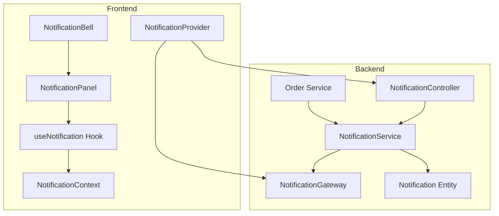
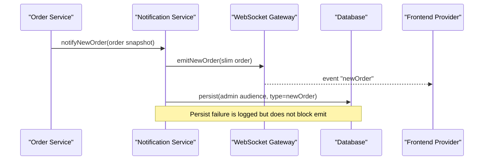
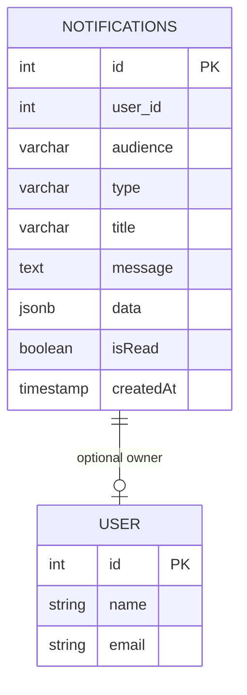
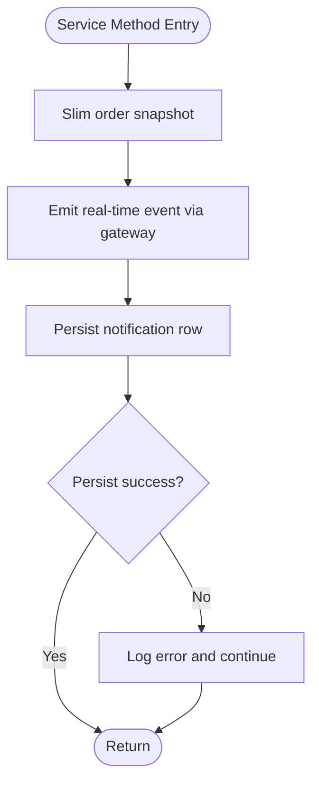
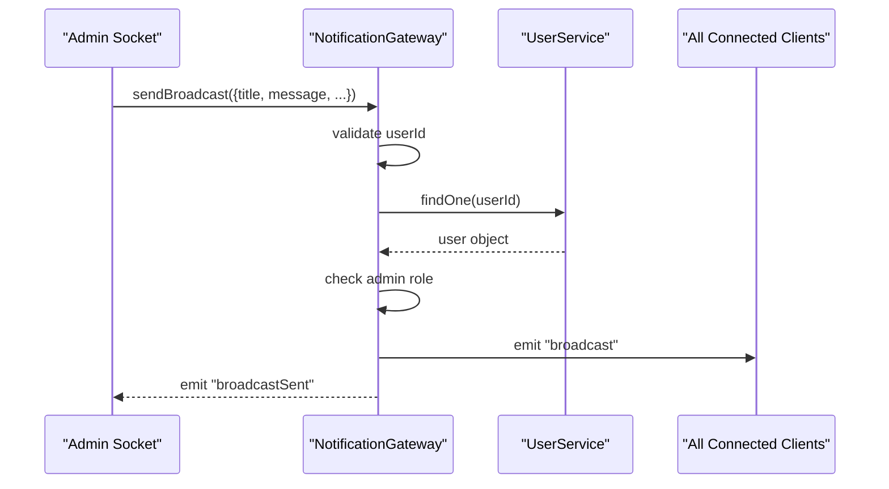
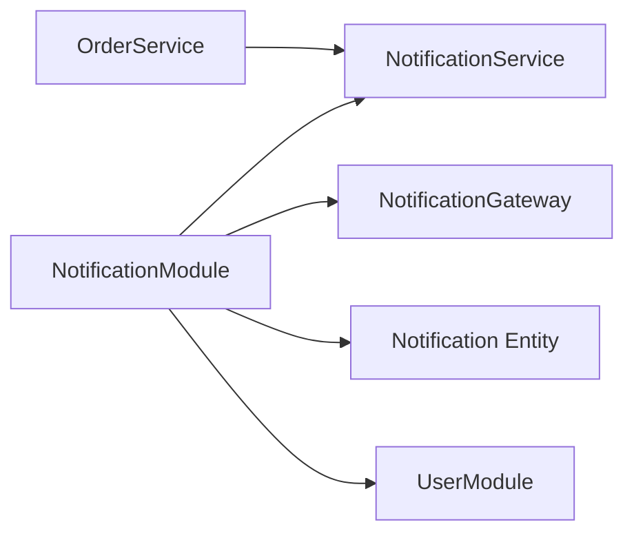

# Notification System

<cite>
**Referenced Files in This Document**
- [notification.service.ts](file://apps/backend/src/notification/notification.service.ts)
- [notification.controller.ts](file://apps/backend/src/notification/notification.controller.ts)
- [notification.gateway.ts](file://apps/backend/src/notification/notification.gateway.ts)
- [notification.entity.ts](file://apps/backend/src/notification/entities/notification.entity.ts)
- [notification.module.ts](file://apps/backend/src/notification/notification.module.ts)
- [order.service.ts](file://apps/backend/src/order/order.service.ts)
- [notification-provider.tsx](file://apps/frontend/providers/notification-provider.tsx)
- [notification-context.tsx](file://apps/frontend/contexts/notification-context.tsx)
- [use-notification.ts](file://apps/frontend/hooks/use-notification.ts)
- [notification-panel.tsx](file://apps/frontend/components/notification-panel.tsx)
- [notification-bell.tsx](file://apps/frontend/components/notification-bell.tsx)
</cite>

## Table of Contents
1. [Introduction](#introduction)
2. [Project Structure](#project-structure)
3. [Core Components](#core-components)
4. [Architecture Overview](#architecture-overview)
5. [Detailed Component Analysis](#detailed-component-analysis)
6. [Dependency Analysis](#dependency-analysis)
7. [Performance Considerations](#performance-considerations)
8. [Troubleshooting Guide](#troubleshooting-guide)
9. [Conclusion](#conclusion)

## Introduction
This document explains the notification system used by the German Butcher platform to deliver real-time and persistent notifications. It covers:
- The notification entity and data model
- Message types such as order updates, payment status changes, new orders, contact messages, user notifications, and broadcasts
- The backend service layer that processes requests, validates permissions, and routes messages
- Real-time delivery through WebSockets
- Persistence and history retrieval for both customer and admin feeds
- The frontend provider, context, hooks, bell icon, and notification panel
- Delivery guarantees, persistence fallback behavior, and operational considerations

## Project Structure
The notification feature is split between a NestJS backend and a Next.js frontend:

- Backend
  - `notification.service.ts`: Business logic for creating, routing, querying, and marking notifications
  - `notification.controller.ts`: REST endpoints for listing and managing notifications
  - `notification.gateway.ts`: WebSocket gateway for real-time event distribution
  - `entities/notification.entity.ts`: TypeORM entity for persisted notifications
  - `notification.module.ts`: Module wiring and exports
  - Integration points with other modules, notably `order.service.ts`

- Frontend
  - `providers/notification-provider.tsx`: WebSocket connection, event listeners, toast UI, and local state
  - `contexts/notification-context.tsx`: React context definition
  - `hooks/use-notification.ts`: Hook for consuming notification state
  - `components/notification-panel.tsx`: Admin notification list UI
  - `components/notification-bell.tsx`: Bell trigger and popover/sheet wrapper

**Diagram sources**
- [notification.controller.ts:1-138](file://apps/backend/src/notification/notification.controller.ts#L1-L138)
- [notification.service.ts:1-327](file://apps/backend/src/notification/notification.service.ts#L1-L327)
- [notification.gateway.ts:1-340](file://apps/backend/src/notification/notification.gateway.ts#L1-L340)
- [notification.entity.ts:1-60](file://apps/backend/src/notification/entities/notification.entity.ts#L1-L60)
- [order.service.ts:646-693](file://apps/backend/src/order/order.service.ts#L646-L693)
- [notification-provider.tsx:1-292](file://apps/frontend/providers/notification-provider.tsx#L1-L292)
- [notification-context.tsx:1-7](file://apps/frontend/contexts/notification-context.tsx#L1-L7)
- [use-notification.ts:1-15](file://apps/frontend/hooks/use-notification.ts#L1-L15)
- [notification-panel.tsx:1-286](file://apps/frontend/components/notification-panel.tsx#L1-L286)
- [notification-bell.tsx:1-102](file://apps/frontend/components/notification-bell.tsx#L1-L102)

**Section sources**
- [notification.module.ts:1-16](file://apps/backend/src/notification/notification.module.ts#L1-L16)
- [notification.controller.ts:1-138](file://apps/backend/src/notification/notification.controller.ts#L1-L138)
- [notification.service.ts:1-327](file://apps/backend/src/notification/notification.service.ts#L1-L327)
- [notification.gateway.ts:1-340](file://apps/backend/src/notification/notification.gateway.ts#L1-L340)
- [notification.entity.ts:1-60](file://apps/backend/src/notification/entities/notification.entity.ts#L1-L60)
- [notification-provider.tsx:1-292](file://apps/frontend/providers/notification-provider.tsx#L1-L292)
- [notification-panel.tsx:1-286](file://apps/frontend/components/notification-panel.tsx#L1-L286)
- [notification-bell.tsx:1-102](file://apps/frontend/components/notification-bell.tsx#L1-L102)

## Core Components
- Notification entity
  - Stores per-user or broadcast notifications
  - Separates customer feed (`audience=user`) from admin feed (`audience=admin`)
  - Tracks read state and creation time
  - Holds structured payload data for rich UI rendering

- Notification service
  - Creates compact order snapshots for events and persistence
  - Emits real-time events via the gateway
  - Persists notifications with fail-open behavior so realtime delivery is not blocked by DB failures
  - Provides paginated queries and read-marking operations for users and admins

- Notification gateway
  - Manages WebSocket connections under the `/notifications` namespace
  - Joins clients into user-specific rooms and an admin room
  - Emits typed events: new orders, new messages, order confirmation, order status update, payment status update, general notifications, and broadcasts
  - Validates admin-only broadcast requests at the socket level

- Notification controller
  - Exposes REST endpoints for:
    - Admin feed listing, unread count, mark-all-read, mark-one-read
    - User feed listing, unread count, mark-all-read, mark-one-read
  - Uses JWT authentication and admin guard where required

- Frontend provider
  - Connects to the WebSocket server using client credentials
  - Seeds unread admin notifications from the database on mount and reconnect
  - Handles all incoming events, updates local state, plays sounds, and shows toasts
  - Marks admin notifications read via REST when interacting with the UI

- Frontend components
  - Bell icon displays badge counts and opens the notification panel
  - Panel renders recent notifications, supports copying order numbers, dismissing items, and navigating to full history

**Section sources**
- [notification.entity.ts:12-59](file://apps/backend/src/notification/entities/notification.entity.ts#L12-L59)
- [notification.service.ts:21-327](file://apps/backend/src/notification/notification.service.ts#L21-L327)
- [notification.gateway.ts:15-340](file://apps/backend/src/notification/notification.gateway.ts#L15-L340)
- [notification.controller.ts:25-138](file://apps/backend/src/notification/notification.controller.ts#L25-L138)
- [notification-provider.tsx:23-292](file://apps/frontend/providers/notification-provider.tsx#L23-L292)
- [notification-bell.tsx:22-102](file://apps/frontend/components/notification-bell.tsx#L22-L102)
- [notification-panel.tsx:42-286](file://apps/frontend/components/notification-panel.tsx#L42-L286)

## Architecture Overview
The system follows a layered architecture:
- Controllers expose REST APIs for history and management
- Services encapsulate business rules, payload shaping, and persistence
- Gateways handle real-time event routing
- Entities persist notification records
- Frontend providers manage live connections and UI state

**Diagram sources**
- [order.service.ts:668-693](file://apps/backend/src/order/order.service.ts#L668-L693)
- [notification.service.ts:60-75](file://apps/backend/src/notification/notification.service.ts#L60-L75)
- [notification.gateway.ts:148-156](file://apps/backend/src/notification/notification.gateway.ts#L148-L156)
- [notification-provider.tsx:133-143](file://apps/frontend/providers/notification-provider.tsx#L133-L143)

## Detailed Component Analysis

### Notification Entity Model
The entity defines the shape of persisted notifications:
- `id`: Primary key
- `userId`: Nullable recipient; null means broadcast visible to all users
- `user`: Optional relation to the user entity
- `audience`: Feed separation between `user` and `admin`
- `type`: Event kind matching socket events
- `title`, `message`: Human-readable text
- `data`: JSON payload for rich content
- `isRead`: Read/unread flag
- `createdAt`: Timestamp

**Diagram sources**
- [notification.entity.ts:12-59](file://apps/backend/src/notification/entities/notification.entity.ts#L12-L59)

**Section sources**
- [notification.entity.ts:12-59](file://apps/backend/src/notification/entities/notification.entity.ts#L12-L59)

### Notification Service
Responsibilities:
- Shape compact order snapshots to avoid leaking sensitive relations and reduce payload size
- Emit real-time events through the gateway
- Persist notifications with fail-open behavior
- Provide paginated queries and read-marking for user and admin feeds

Key methods:
- `notifyNewOrder`: Emits to admin room and persists admin-feed row
- `notifyNewMessage`: Emits new contact-message alert to admin room
- `notifyOrderConfirmation`: Emits to specific user
- `notifyOrderStatusUpdate`: Emits order status change to specific user
- `notifyPaymentStatusUpdate`: Emits payment status change to specific user
- `notifyUser`: Sends custom notification to a user
- `notifyBroadcast`: Broadcasts to all connected clients
- `findForUser`, `getUnreadCount`, `markAllRead`, `markRead`: Customer feed operations
- `findForAdmin`, `getAdminUnreadCount`, `markAllAdminRead`, `markAdminRead`: Admin feed operations
- `persist`: Save operation with error logging and fail-open semantics

**Diagram sources**
- [notification.service.ts:31-58](file://apps/backend/src/notification/notification.service.ts#L31-L58)
- [notification.service.ts:308-325](file://apps/backend/src/notification/notification.service.ts#L308-L325)

**Section sources**
- [notification.service.ts:21-327](file://apps/backend/src/notification/notification.service.ts#L21-L327)

### Notification Gateway
Responsibilities:
- Initialize WebSocket server under `/notifications`
- Track active sockets per user
- Join clients into `user:{userId}` rooms and `admins` room
- Validate admin-only broadcast requests
- Emit typed events to appropriate recipients

Events emitted:
- `newOrder` to admin room
- `newMessage` to admin room
- `orderConfirmation` to user room
- `orderStatusUpdate` to user room
- `paymentStatusUpdate` to user room
- `notification` to user room
- `broadcast` to all clients

Admin broadcast validation:
- Requires valid userId
- Verifies user exists
- Checks role-based admin permission
- Validates required fields
- Emits broadcast and confirms back to sender

**Diagram sources**
- [notification.gateway.ts:228-338](file://apps/backend/src/notification/notification.gateway.ts#L228-L338)

**Section sources**
- [notification.gateway.ts:15-340](file://apps/backend/src/notification/notification.gateway.ts#L15-L340)

### Notification Controller
REST API surface:
- Admin endpoints (JWT + AdminGuard):
  - GET `/notifications/admin`: Paginated admin feed
  - GET `/notifications/admin/unread-count`: Unread count
  - PATCH `/notifications/admin/read-all`: Mark all admin notifications read
  - PATCH `/notifications/admin/:id/read`: Mark one admin notification read
- User endpoints (JWT):
  - GET `/notifications/my`: Paginated user feed including broadcasts
  - GET `/notifications/my/unread-count`: Unread count
  - PATCH `/notifications/read-all`: Mark all user notifications read
  - PATCH `/notifications/:id/read`: Mark one user notification read

Permissions:
- Admin endpoints require JWT and admin guard
- User endpoints require JWT
- Query parameters support pagination

**Section sources**
- [notification.controller.ts:25-138](file://apps/backend/src/notification/notification.controller.ts#L25-L138)

### Frontend Notification Provider
Responsibilities:
- Establish WebSocket connection with user identity and admin flag
- Seed unread admin notifications from the database on mount and reconnect
- Listen for all event types and update local notification state
- Show toasts and play sounds for relevant events
- Mark admin notifications read via REST when interacting with the UI
- Manage connection state and cleanup on unmount

Event handling highlights:
- Admin-only: `newOrder`, `newMessage`
- User-facing: `orderConfirmation`, `orderStatusUpdate`, `paymentStatusUpdate`, `notification`
- Global: `broadcast` with severity-aware toasts

Persistence synchronization:
- On connect, fetches unread admin notifications and merges them into local state
- Deduplicates by DB id or order number to avoid duplicates after reconnect

**Section sources**
- [notification-provider.tsx:23-292](file://apps/frontend/providers/notification-provider.tsx#L23-L292)

### Frontend Context and Hook
- `NotificationContext` provides shared notification state across components
- `useNotification` hook enforces usage within provider and returns context value

Usage pattern:
- Components consume `notifications`, `isConnected`, and actions like `clearNotifications`, `removeNotification`, `markNotificationRead`

**Section sources**
- [notification-context.tsx:1-7](file://apps/frontend/contexts/notification-context.tsx#L1-L7)
- [use-notification.ts:1-15](file://apps/frontend/hooks/use-notification.ts#L1-L15)

### Frontend Notification Bell and Panel
- `NotificationBell` wraps the bell button and opens either a popover or mobile sheet containing the panel
- `NotificationPanel` renders recent notifications, supports:
  - Copying order numbers
  - Dismissing individual notifications
  - Click-to-mark-read for persisted rows
  - Linking to admin order view
  - Showing online/offline connection status

**Section sources**
- [notification-bell.tsx:22-102](file://apps/frontend/components/notification-bell.tsx#L22-L102)
- [notification-panel.tsx:42-286](file://apps/frontend/components/notification-panel.tsx#L42-L286)

## Dependency Analysis
Module wiring and integration:
- `NotificationModule` imports `UserModule` and registers the `Notification` entity
- Exports `NotificationService` for use by other modules
- Integrates with `OrderService` to emit notifications on order lifecycle events

**Diagram sources**
- [notification.module.ts:9-15](file://apps/backend/src/notification/notification.module.ts#L9-L15)
- [order.service.ts:668-693](file://apps/backend/src/order/order.service.ts#L668-L693)

**Section sources**
- [notification.module.ts:1-16](file://apps/backend/src/notification/notification.module.ts#L1-L16)
- [order.service.ts:646-693](file://apps/backend/src/order/order.service.ts#L646-L693)

## Performance Considerations
- Payload minimization: The service creates slim order snapshots to avoid bloating payloads and prevent leaking sensitive relations
- Database indexing: The entity indexes `userId`, `audience`, `type`, and `createdAt` to optimize query performance for feed listing and filtering
- Fail-open persistence: Database write failures are logged but do not block real-time emission, preserving responsiveness during transient DB issues
- WebSocket reconnection: The frontend uses automatic reconnection with exponential backoff and seeds unread notifications on reconnect to close gaps caused by disconnections
- Pagination: Both user and admin feeds are paginated to limit memory and network overhead

[No sources needed since this section provides general guidance]

## Troubleshooting Guide
Common issues and resolutions:
- WebSocket connection errors
  - Check CORS configuration and origin allowlist
  - Verify client-side URL and credentials settings
  - Confirm userId and isAdmin flags are passed correctly

- Missing notifications after reload
  - Ensure the provider seeds unread admin notifications on mount and reconnect
  - Verify admin endpoints return expected rows

- Broadcast failures
  - Validate that the sender has admin role
  - Confirm required fields like title and message are present
  - Inspect logs for unauthorized attempts or invalid userId values

- Persistence failures
  - Review service logs for failed inserts
  - Remember that persistence failures are non-blocking; realtime events still occur
  - Investigate database constraints or connectivity issues

- Permission errors
  - Admin endpoints require JWT and admin guard
  - Broadcast socket handler requires admin role verification

**Section sources**
- [notification.gateway.ts:15-27](file://apps/backend/src/notification/notification.gateway.ts#L15-L27)
- [notification.gateway.ts:228-338](file://apps/backend/src/notification/notification.gateway.ts#L228-L338)
- [notification.service.ts:308-325](file://apps/backend/src/notification/notification.service.ts#L308-L325)
- [notification-provider.tsx:117-131](file://apps/frontend/providers/notification-provider.tsx#L117-L131)

## Conclusion
The notification system combines real-time WebSocket delivery with durable persistence to ensure timely and reliable communication across the German Butcher platform. The service layer centralizes notification creation and routing, while the gateway handles efficient event distribution. The frontend provider maintains a responsive UI with robust reconnection and persistence synchronization. Together, these components provide a scalable foundation for order updates, payment status changes, admin alerts, and broadcast announcements.

[No sources needed since this section summarizes without analyzing specific files]