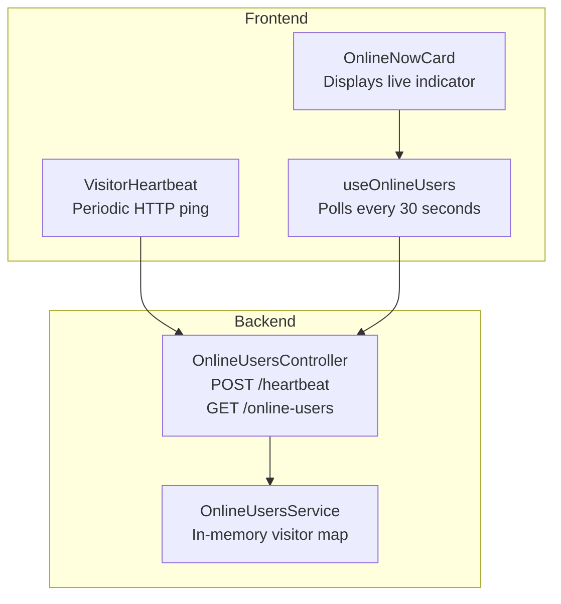
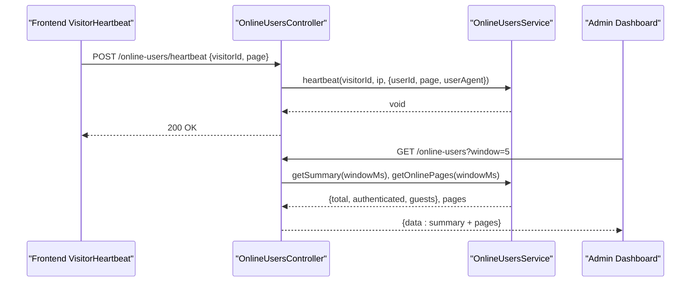
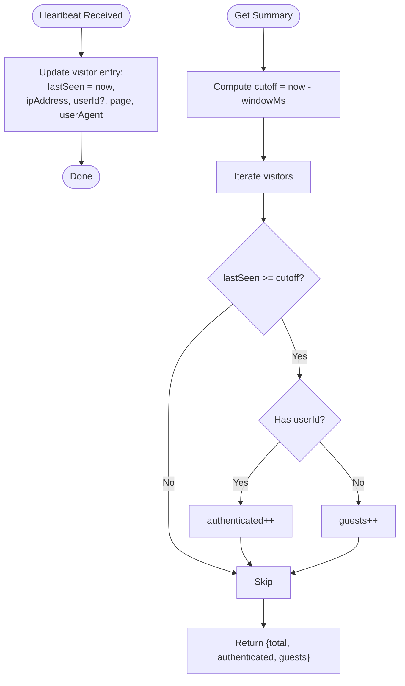
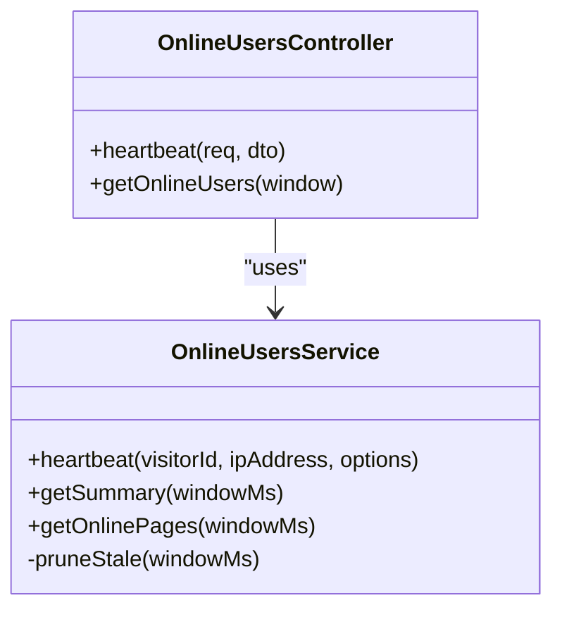
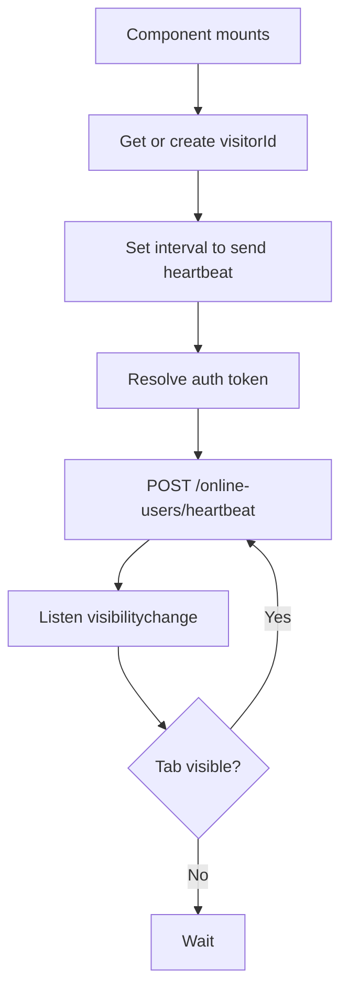
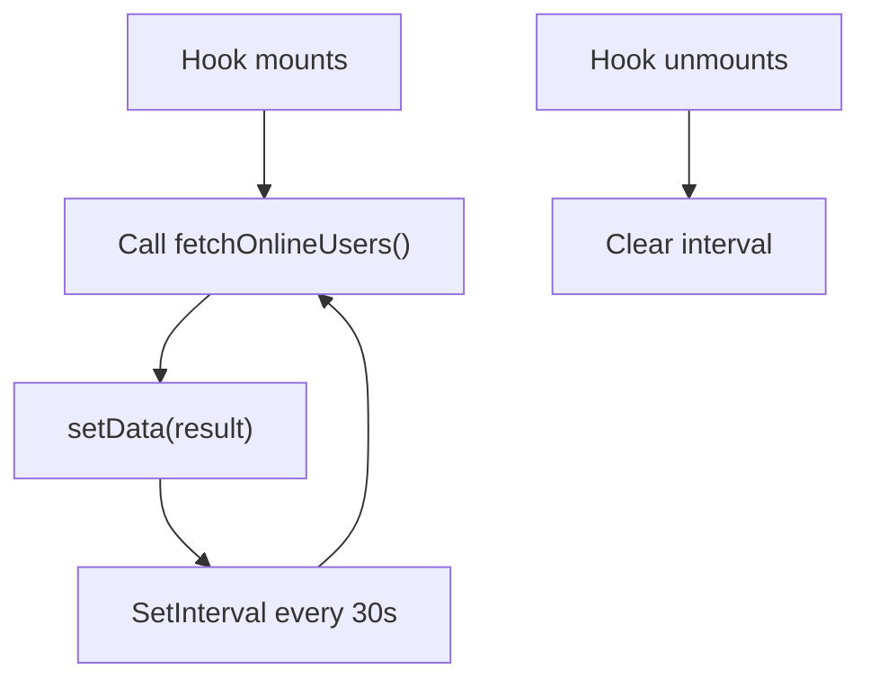
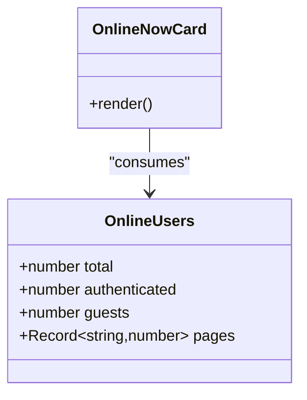
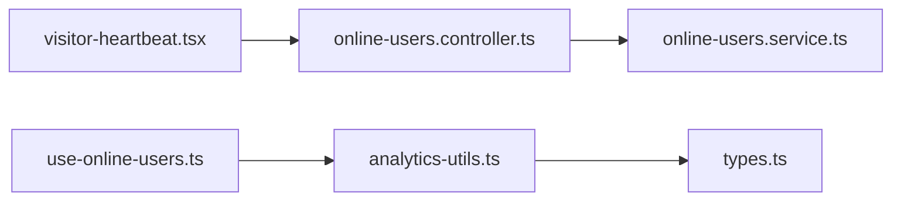

# Online Users Tracking

<cite>
**Referenced Files in This Document**
- [online-users.service.ts](file://apps/backend/src/online-users/online-users.service.ts)
- [online-users.controller.ts](file://apps/backend/src/online-users/online-users.controller.ts)
- [visitor-heartbeat.tsx](file://apps/frontend/components/common/visitor-heartbeat.tsx)
- [use-online-users.ts](file://apps/frontend/hooks/use-online-users.ts)
- [analytics-utils.ts](file://apps/frontend/utils/analytics-utils.ts)
- [types.ts](file://apps/frontend/utils/types.ts)
- [notification.gateway.ts](file://apps/backend/src/notification/notification.gateway.ts)
- [online-now-card.tsx](file://apps/frontend/components/admin/analytics/online-now-card.tsx)
</cite>

## Table of Contents
1. [Introduction](#introduction)
2. [Project Structure](#project-structure)
3. [Core Components](#core-components)
4. [Architecture Overview](#architecture-overview)
5. [Detailed Component Analysis](#detailed-component-analysis)
6. [Dependency Analysis](#dependency-analysis)
7. [Performance Considerations](#performance-considerations)
8. [Troubleshooting Guide](#troubleshooting-guide)
9. [Conclusion](#conclusion)

## Introduction
This document explains the online users tracking system for the German Butcher platform. It covers how active user sessions and presence are monitored, including:
- The heartbeat mechanism that keeps visitors “online” through periodic HTTP pings from the frontend.
- The presence detection algorithm that classifies visitors as online based on their last activity timestamp.
- The backend service layer that manages visitor state, computes summaries, and exposes admin APIs.
- Frontend hooks and components that poll the backend to display live presence indicators.
- Notes on privacy, data retention, and performance considerations for large user bases.

The current implementation uses HTTP heartbeats rather than WebSocket-based presence. A separate WebSocket gateway exists for notifications but is not used by the online users feature.

## Project Structure
The online users feature spans both backend and frontend:
- Backend NestJS module provides a controller and service for heartbeat registration and summary queries.
- Frontend React application includes a heartbeat component and a polling hook to fetch online counts.

**Diagram sources**
- [visitor-heartbeat.tsx:26-61](file://apps/frontend/components/common/visitor-heartbeat.tsx#L26-L61)
- [use-online-users.ts:8-29](file://apps/frontend/hooks/use-online-users.ts#L8-L29)
- [online-now-card.tsx:16-34](file://apps/frontend/components/admin/analytics/online-now-card.tsx#L16-L34)
- [online-users.controller.ts:31-97](file://apps/backend/src/online-users/online-users.controller.ts#L31-L97)
- [online-users.service.ts:20-91](file://apps/backend/src/online-users/online-users.service.ts#L20-L91)

**Section sources**
- [online-users.service.ts:1-93](file://apps/backend/src/online-users/online-users.service.ts#L1-L93)
- [online-users.controller.ts:1-99](file://apps/backend/src/online-users/online-users.controller.ts#L1-L99)
- [visitor-heartbeat.tsx:1-65](file://apps/frontend/components/common/visitor-heartbeat.tsx#L1-L65)
- [use-online-users.ts:1-31](file://apps/frontend/hooks/use-online-users.ts#L1-L31)
- [analytics-utils.ts:90-98](file://apps/frontend/utils/analytics-utils.ts#L90-L98)
- [types.ts:1266-1271](file://apps/frontend/utils/types.ts#L1266-L1271)
- [online-now-card.tsx:1-35](file://apps/frontend/components/admin/analytics/online-now-card.tsx#L1-L35)

## Core Components
- Visitor Heartbeat (frontend): Generates or retrieves a stable visitor ID, attaches optional authentication token, and sends periodic POST requests to the backend with the current page path.
- Online Users Controller (backend): Accepts heartbeat requests and exposes an admin-only GET endpoint returning total, authenticated, guest counts, and per-page distribution.
- Online Users Service (backend): Maintains an in-memory map of visitors keyed by visitorId or IP fallback, updates lastSeen timestamps, prunes stale entries, and computes summaries.
- useOnlineUsers Hook (frontend): Polls the backend’s online users endpoint at a fixed interval and exposes loading state and data.
- Analytics Utilities (frontend): Provides fetchOnlineUsers which calls the protected analytics API wrapper and unwraps responses.
- Types (frontend): Defines the OnlineUsers shape consumed by the UI.
- Online Now Card (frontend): Renders a dashboard card showing total online users with a live badge and breakdown.

**Section sources**
- [visitor-heartbeat.tsx:9-61](file://apps/frontend/components/common/visitor-heartbeat.tsx#L9-L61)
- [online-users.controller.ts:31-97](file://apps/backend/src/online-users/online-users.controller.ts#L31-L97)
- [online-users.service.ts:20-91](file://apps/backend/src/online-users/online-users.service.ts#L20-L91)
- [use-online-users.ts:8-29](file://apps/frontend/hooks/use-online-users.ts#L8-L29)
- [analytics-utils.ts:90-98](file://apps/frontend/utils/analytics-utils.ts#L90-L98)
- [types.ts:1266-1271](file://apps/frontend/utils/types.ts#L1266-L1271)
- [online-now-card.tsx:16-34](file://apps/frontend/components/admin/analytics/online-now-card.tsx#L16-L34)

## Architecture Overview
The system tracks presence using HTTP heartbeats rather than WebSockets. The flow is:
1. Frontend VisitorHeartbeat periodically posts to /online-users/heartbeat with a visitorId and page path.
2. Controller extracts client IP and optional userId from the request and delegates to the service.
3. Service updates the visitor entry’s lastSeen timestamp and metadata.
4. Admin UI polls /online-users with a window parameter to get totals and page distribution.
5. Service computes summaries over the configured time window and returns results.

**Diagram sources**
- [visitor-heartbeat.tsx:26-61](file://apps/frontend/components/common/visitor-heartbeat.tsx#L26-L61)
- [online-users.controller.ts:31-97](file://apps/backend/src/online-users/online-users.controller.ts#L31-L97)
- [online-users.service.ts:41-81](file://apps/backend/src/online-users/online-users.service.ts#L41-L81)

## Detailed Component Analysis

### Backend Service: Presence Detection Algorithm
The service maintains an in-memory Map of visitors. Each entry stores:
- lastSeen: timestamp updated on each heartbeat.
- userId: present when the request carries a valid JWT; otherwise treated as guest.
- ipAddress: extracted from the request.
- page: current page path sent by the frontend.
- userAgent: browser agent string.

Presence rules:
- A visitor is considered online if lastSeen falls within the configured window (default 5 minutes).
- Visitors without a userId are counted as guests; those with a userId are authenticated.
- A background cleanup timer prunes entries older than the window.

Complexity:
- Heartbeat update: O(1) set operation.
- Summary computation: O(n) scan over all visitors.
- Page distribution: O(n) scan with aggregation into a record.
- Cleanup: O(n) pass to delete stale entries.

**Diagram sources**
- [online-users.service.ts:41-69](file://apps/backend/src/online-users/online-users.service.ts#L41-L69)

**Section sources**
- [online-users.service.ts:1-93](file://apps/backend/src/online-users/online-users.service.ts#L1-L93)

### Backend Controller: API Surface
Endpoints:
- POST /online-users/heartbeat
  - Optional JWT via OptionalJwtAuthGuard.
  - Body includes visitorId and page.
  - Updates presence via service.
- GET /online-users
  - Protected by JwtAuthGuard and AdminGuard.
  - Query parameter window (minutes, default 5, clamped between 1 and 60).
  - Returns summary and per-page counts.

**Diagram sources**
- [online-users.controller.ts:28-97](file://apps/backend/src/online-users/online-users.controller.ts#L28-L97)
- [online-users.service.ts:20-91](file://apps/backend/src/online-users/online-users.service.ts#L20-L91)

**Section sources**
- [online-users.controller.ts:1-99](file://apps/backend/src/online-users/online-users.controller.ts#L1-L99)

### Frontend Heartbeat Component
Responsibilities:
- Generate or retrieve a persistent visitorId from localStorage, with a fallback for private browsing.
- Resolve the current auth token and attach it to the heartbeat request if available.
- Send periodic POST requests to /online-users/heartbeat with visitorId and page.
- Use keepalive to improve reliability during page unload.
- Re-send immediately when the tab becomes visible again.

**Diagram sources**
- [visitor-heartbeat.tsx:9-61](file://apps/frontend/components/common/visitor-heartbeat.tsx#L9-L61)

**Section sources**
- [visitor-heartbeat.tsx:1-65](file://apps/frontend/components/common/visitor-heartbeat.tsx#L1-L65)

### Frontend Hook: Polling Online Users
Responsibilities:
- Call fetchOnlineUsers every 30 seconds.
- Manage loading state and data state.
- Expose data and isLoading to consumers.

**Diagram sources**
- [use-online-users.ts:8-29](file://apps/frontend/hooks/use-online-users.ts#L8-L29)
- [analytics-utils.ts:90-98](file://apps/frontend/utils/analytics-utils.ts#L90-L98)

**Section sources**
- [use-online-users.ts:1-31](file://apps/frontend/hooks/use-online-users.ts#L1-L31)
- [analytics-utils.ts:90-98](file://apps/frontend/utils/analytics-utils.ts#L90-L98)

### Frontend Types and Display
Types:
- OnlineUsers: total, authenticated, guests, pages.

Display:
- OnlineNowCard renders a stats card with a live badge and shows authenticated vs guest breakdown.

**Diagram sources**
- [types.ts:1266-1271](file://apps/frontend/utils/types.ts#L1266-L1271)
- [online-now-card.tsx:16-34](file://apps/frontend/components/admin/analytics/online-now-card.tsx#L16-L34)

**Section sources**
- [types.ts:1266-1271](file://apps/frontend/utils/types.ts#L1266-L1271)
- [online-now-card.tsx:1-35](file://apps/frontend/components/admin/analytics/online-now-card.tsx#L1-L35)

### WebSocket Gateway Note
A notification WebSocket gateway exists for order and message events. It is not used by the online users tracking feature. Presence is tracked via HTTP heartbeats and polling.

**Section sources**
- [notification.gateway.ts:1-340](file://apps/backend/src/notification/notification.gateway.ts#L1-L340)

## Dependency Analysis
Key relationships:
- Frontend VisitorHeartbeat depends on API utilities to resolve tokens and call the backend heartbeat endpoint.
- Frontend useOnlineUsers depends on analytics-utils to fetch protected data and types for structure.
- Backend controller depends on guards for authentication and authorization, and on the service for business logic.
- Backend service has no external dependencies beyond Node.js primitives and NestJS decorators.

**Diagram sources**
- [visitor-heartbeat.tsx:1-65](file://apps/frontend/components/common/visitor-heartbeat.tsx#L1-L65)
- [use-online-users.ts:1-31](file://apps/frontend/hooks/use-online-users.ts#L1-L31)
- [analytics-utils.ts:1-207](file://apps/frontend/utils/analytics-utils.ts#L1-L207)
- [types.ts:1266-1271](file://apps/frontend/utils/types.ts#L1266-L1271)
- [online-users.controller.ts:1-99](file://apps/backend/src/online-users/online-users.controller.ts#L1-L99)
- [online-users.service.ts:1-93](file://apps/backend/src/online-users/online-users.service.ts#L1-L93)

**Section sources**
- [visitor-heartbeat.tsx:1-65](file://apps/frontend/components/common/visitor-heartbeat.tsx#L1-L65)
- [use-online-users.ts:1-31](file://apps/frontend/hooks/use-online-users.ts#L1-L31)
- [analytics-utils.ts:1-207](file://apps/frontend/utils/analytics-utils.ts#L1-L207)
- [types.ts:1266-1271](file://apps/frontend/utils/types.ts#L1266-L1271)
- [online-users.controller.ts:1-99](file://apps/backend/src/online-users/online-users.controller.ts#L1-L99)
- [online-users.service.ts:1-93](file://apps/backend/src/online-users/online-users.service.ts#L1-L93)

## Performance Considerations
- In-memory storage: The service uses an in-process Map. This is fast but not shared across multiple server instances. For multi-instance deployments, consider moving to Redis or another shared store.
- Time-window scans: Summaries and page distributions iterate over all visitors. With very large traffic volumes, this can become costly. Consider:
  - Using a time-series or sliding-window data structure.
  - Pre-aggregating counts per minute bucket.
  - Caching summaries for short intervals.
- Cleanup frequency: The cleanup runs every minute. Adjust CLEANUP_INTERVAL_MS based on expected load and memory constraints.
- Heartbeat rate: The frontend heartbeats every 60 seconds. If more granular presence is needed, reduce the interval while considering network overhead.
- Polling rate: The frontend polls every 30 seconds. Tune REFRESH_MS based on desired freshness versus API load.
- Request optimization: The heartbeat uses keepalive to reduce overhead during page transitions. Ensure payloads remain minimal.

[No sources needed since this section provides general guidance]

## Troubleshooting Guide
Common issues and resolutions:
- Heartbeats not recorded:
  - Verify the frontend is sending POST /online-users/heartbeat with a visitorId and page.
  - Confirm the backend controller is reachable and not blocked by CORS or firewall rules.
  - Check that OptionalJwtAuthGuard allows anonymous requests; ensure Authorization header is optional.
- Counts appear zero:
  - Ensure the frontend is running and tabs are open; presence requires recent heartbeats within the window.
  - Validate the window query parameter on GET /online-users is reasonable (1–60 minutes).
- Admin endpoint unauthorized:
  - GET /online-users requires a valid JWT and admin role. Ensure the caller is authenticated and authorized.
- Memory growth:
  - If the process retains many visitor entries, verify pruneStale is running and adjust cleanup intervals.
  - Consider adding max size limits or TTL-based eviction strategies.

**Section sources**
- [online-users.controller.ts:31-97](file://apps/backend/src/online-users/online-users.controller.ts#L31-L97)
- [online-users.service.ts:26-39](file://apps/backend/src/online-users/online-users.service.ts#L26-L39)
- [visitor-heartbeat.tsx:26-61](file://apps/frontend/components/common/visitor-heartbeat.tsx#L26-L61)

## Conclusion
The online users tracking system provides a lightweight presence solution using HTTP heartbeats and in-memory state management. It supports:
- Anonymous and authenticated visitor tracking.
- Admin dashboards displaying live counts and page distribution.
- Simple configuration of presence windows and cleanup intervals.

For production-scale deployments, consider migrating to a distributed store, optimizing aggregation algorithms, and tuning heartbeat and polling intervals to balance accuracy and resource usage.

[No sources needed since this section summarizes without analyzing specific files]