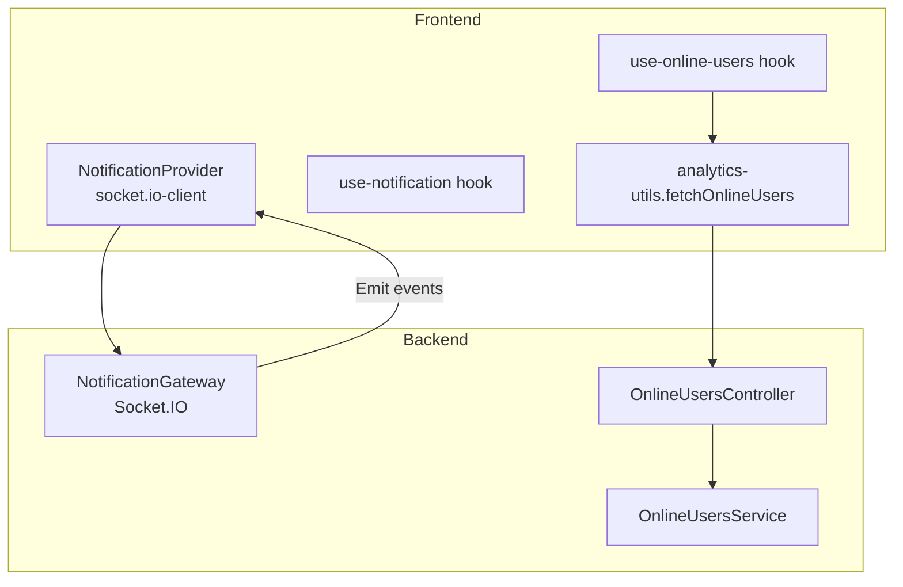
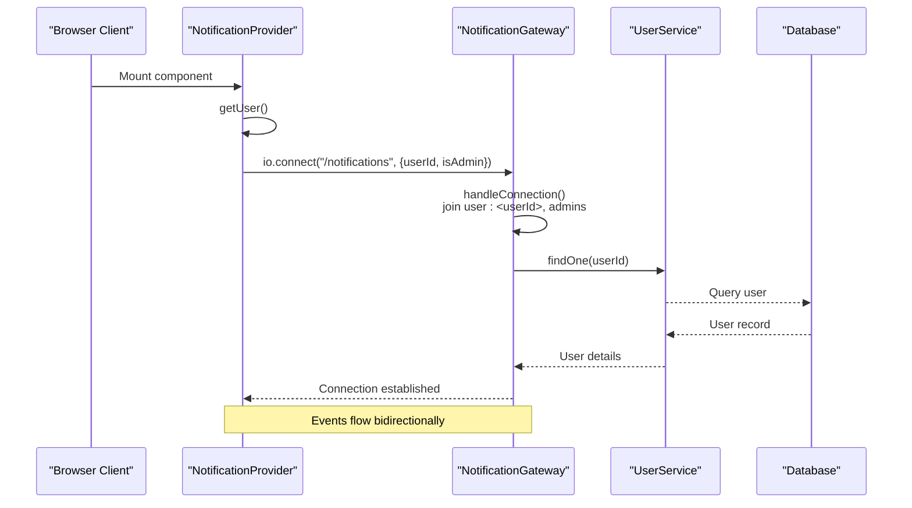
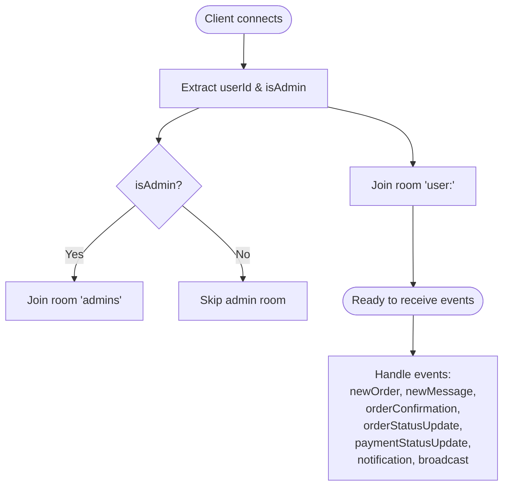
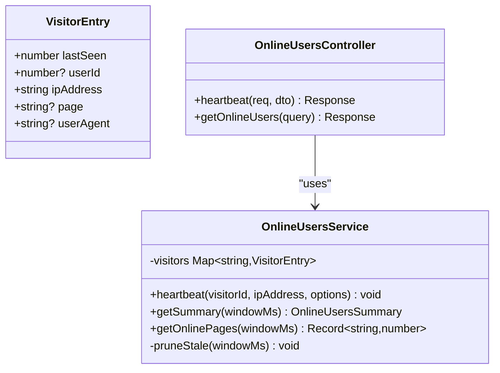
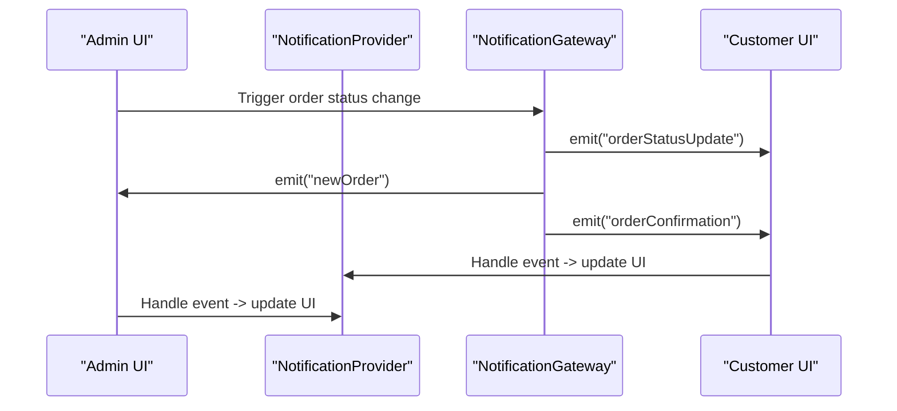
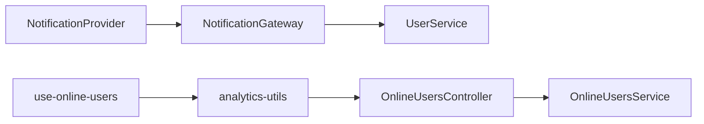

# Real-time Communication

<cite>
**Referenced Files in This Document**
- [notification.gateway.ts](file://apps/backend/src/notification/notification.gateway.ts)
- [online-users.service.ts](file://apps/backend/src/online-users/online-users.service.ts)
- [online-users.controller.ts](file://apps/backend/src/online-users/online-users.controller.ts)
- [notification-provider.tsx](file://apps/frontend/providers/notification-provider.tsx)
- [use-notification.ts](file://apps/frontend/hooks/use-notification.ts)
- [use-online-users.ts](file://apps/frontend/hooks/use-online-users.ts)
- [analytics-utils.ts](file://apps/frontend/utils/analytics-utils.ts)
</cite>

## Table of Contents
1. [Introduction](#introduction)
2. [Project Structure](#project-structure)
3. [Core Components](#core-components)
4. [Architecture Overview](#architecture-overview)
5. [Detailed Component Analysis](#detailed-component-analysis)
6. [Dependency Analysis](#dependency-analysis)
7. [Performance Considerations](#performance-considerations)
8. [Troubleshooting Guide](#troubleshooting-guide)
9. [Conclusion](#conclusion)

## Introduction
This document explains the German Butcher platform’s real-time communication features built with Socket.IO and NestJS WebSockets. It covers live notifications, online user presence tracking, and real-time order status updates. It also documents the notification system architecture (event broadcasting, message persistence, and delivery), the online users tracking system for active sessions and activity patterns, and the real-time order management flow including instant status updates and customer notifications. Implementation examples show how clients connect to the WebSocket server, handle events, and manage connection states. Finally, it addresses scalability considerations and fallback strategies for environments without native WebSocket support.

## Project Structure
The real-time features span backend and frontend:
- Backend:
  - Notification gateway for WebSocket event handling and broadcasting
  - Online users service and controller for heartbeat-based presence tracking
- Frontend:
  - Notification provider that connects to the WebSocket server and handles events
  - Hooks and utilities for consuming notifications and polling online users

**Diagram sources**
- [notification-provider.tsx:86-248](file://apps/frontend/providers/notification-provider.tsx#L86-L248)
- [notification.gateway.ts:15-338](file://apps/backend/src/notification/notification.gateway.ts#L15-L338)
- [online-users.controller.ts:31-97](file://apps/backend/src/online-users/online-users.controller.ts#L31-L97)
- [online-users.service.ts:20-91](file://apps/backend/src/online-users/online-users.service.ts#L20-L91)
- [analytics-utils.ts:90-98](file://apps/frontend/utils/analytics-utils.ts#L90-L98)

**Section sources**
- [notification.gateway.ts:15-338](file://apps/backend/src/notification/notification.gateway.ts#L15-L338)
- [online-users.controller.ts:31-97](file://apps/backend/src/online-users/online-users.controller.ts#L31-L97)
- [online-users.service.ts:20-91](file://apps/backend/src/online-users/online-users.service.ts#L20-L91)
- [notification-provider.tsx:86-248](file://apps/frontend/providers/notification-provider.tsx#L86-L248)
- [analytics-utils.ts:90-98](file://apps/frontend/utils/analytics-utils.ts#L90-L98)

## Core Components
- NotificationGateway (backend): Manages WebSocket connections, rooms, and emits events such as new orders, messages, order/payment status updates, general notifications, and broadcasts. It maintains a mapping of userId to socketIds and joins per-user rooms.
- OnlineUsersService (backend): Tracks visitor heartbeats in-memory, computes summaries (total/authenticated/guests), and provides page-level counts within a time window.
- OnlineUsersController (backend): Exposes heartbeat registration and an admin-only endpoint to retrieve online users summary and pages.
- NotificationProvider (frontend): Connects to the Socket.IO server, seeds unread notifications from the database on mount/reconnect, and handles incoming events to update UI state and toast notifications.
- use-notification (frontend): React hook to access the notification context.
- use-online-users (frontend): Polls the online-users endpoint every 30 seconds to display current online metrics.
- analytics-utils (frontend): Utility to fetch online users data via REST API.

**Section sources**
- [notification.gateway.ts:15-338](file://apps/backend/src/notification/notification.gateway.ts#L15-L338)
- [online-users.service.ts:20-91](file://apps/backend/src/online-users/online-users.service.ts#L20-L91)
- [online-users.controller.ts:31-97](file://apps/backend/src/online-users/online-users.controller.ts#L31-L97)
- [notification-provider.tsx:86-248](file://apps/frontend/providers/notification-provider.tsx#L86-L248)
- [use-notification.ts:6-14](file://apps/frontend/hooks/use-notification.ts#L6-L14)
- [use-online-users.ts:8-30](file://apps/frontend/hooks/use-online-users.ts#L8-L30)
- [analytics-utils.ts:90-98](file://apps/frontend/utils/analytics-utils.ts#L90-L98)

## Architecture Overview
The real-time architecture uses Socket.IO over WebSockets for low-latency event streaming between clients and the backend. The frontend establishes a persistent connection to the /notifications namespace, authenticates via query parameters, and subscribes to relevant events. The backend routes events to specific users or broadcast channels. Presence is tracked separately via HTTP heartbeats and summarized by the online users service.

**Diagram sources**
- [notification-provider.tsx:86-122](file://apps/frontend/providers/notification-provider.tsx#L86-L122)
- [notification.gateway.ts:43-87](file://apps/backend/src/notification/notification.gateway.ts#L43-L87)

## Detailed Component Analysis

### Notification System (WebSocket + Broadcasting)
Responsibilities:
- Manage WebSocket lifecycle (init, connect, disconnect)
- Maintain per-user rooms and admin room
- Emit targeted and broadcast events
- Validate admin-only broadcast requests

Key behaviors:
- On connect, extract userId and isAdmin, join user-specific room and optionally admins room
- Emit order confirmation, order status update, payment status update, general notifications
- Broadcast announcements to all connected clients; validate sender role before allowing broadcast

Event surface:
- Server-to-client: newOrder, newMessage, orderConfirmation, orderStatusUpdate, paymentStatusUpdate, notification, broadcast
- Client-to-server: joinRoom, leaveRoom, sendBroadcast

**Diagram sources**
- [notification.gateway.ts:43-87](file://apps/backend/src/notification/notification.gateway.ts#L43-L87)
- [notification.gateway.ts:148-222](file://apps/backend/src/notification/notification.gateway.ts#L148-L222)
- [notification.gateway.ts:228-338](file://apps/backend/src/notification/notification.gateway.ts#L228-L338)

Implementation highlights:
- Room-based targeting ensures efficient delivery to specific users and admin groups
- Broadcast validation enforces admin-only publishing and validates payload structure
- Logging provides observability for connection and event flows

**Section sources**
- [notification.gateway.ts:15-338](file://apps/backend/src/notification/notification.gateway.ts#L15-L338)

### Online Users Tracking (Heartbeat + Summary)
Responsibilities:
- Accept periodic heartbeats from clients
- Track lastSeen timestamps, optional userId, page, and userAgent
- Provide summaries and page-level counts within a configurable window
- Periodically prune stale entries

API surface:
- POST /online-users/heartbeat: Register/update visitor heartbeat
- GET /online-users: Admin-only summary with total, authenticated, guests, and pages

**Diagram sources**
- [online-users.service.ts:20-91](file://apps/backend/src/online-users/online-users.service.ts#L20-L91)
- [online-users.controller.ts:31-97](file://apps/backend/src/online-users/online-users.controller.ts#L31-L97)

Operational notes:
- Heartbeat interval is client-driven; default polling interval in frontend is 30 seconds
- Window defaults to 5 minutes; can be configured via query parameter up to 60 minutes
- In-memory storage is simple and fast; suitable for moderate scale but may require externalization for multi-instance deployments

**Section sources**
- [online-users.service.ts:20-91](file://apps/backend/src/online-users/online-users.service.ts#L20-L91)
- [online-users.controller.ts:31-97](file://apps/backend/src/online-users/online-users.controller.ts#L31-L97)

### Real-time Order Management
Responsibilities:
- Deliver instant order status updates to customers
- Notify admins of new orders and contact messages
- Confirm orders to customers in real time

Flow overview:
- Business logic triggers order status changes
- Backend emits orderStatusUpdate and orderConfirmation events to the appropriate user rooms
- Frontend listens and updates UI with toasts and notification list

**Diagram sources**
- [notification.gateway.ts:148-202](file://apps/backend/src/notification/notification.gateway.ts#L148-L202)
- [notification-provider.tsx:133-198](file://apps/frontend/providers/notification-provider.tsx#L133-L198)

**Section sources**
- [notification.gateway.ts:148-202](file://apps/backend/src/notification/notification.gateway.ts#L148-L202)
- [notification-provider.tsx:133-198](file://apps/frontend/providers/notification-provider.tsx#L133-L198)

### Client Integration Examples
Connecting to the WebSocket server:
- Initialize socket connection to the /notifications namespace with userId and isAdmin flags
- Configure reconnection settings and credentials
- Subscribe to events: newOrder, newMessage, orderConfirmation, orderStatusUpdate, paymentStatusUpdate, notification, broadcast

Handling real-time events:
- Update local notification list
- Play notification sounds and show toasts
- Seed unread notifications from the database on connect to avoid missed events while offline

Managing connection states:
- Track isConnected flag
- Re-seed notifications on reconnect
- Clean up socket on unmount

Fallback mechanisms:
- The provider currently restricts transports to ["websocket"]; enabling additional transports allows graceful degradation to polling when needed
- For presence, the frontend polls the REST endpoint periodically as a reliable fallback

**Section sources**
- [notification-provider.tsx:86-248](file://apps/frontend/providers/notification-provider.tsx#L86-L248)
- [use-online-users.ts:8-30](file://apps/frontend/hooks/use-online-users.ts#L8-L30)
- [analytics-utils.ts:90-98](file://apps/frontend/utils/analytics-utils.ts#L90-L98)

## Dependency Analysis
Component relationships:
- NotificationProvider depends on socket.io-client and the backend NotificationGateway
- NotificationGateway depends on UserService for user lookups and logs
- OnlineUsersController depends on OnlineUsersService for presence data
- Frontend hooks consume REST APIs for presence and context for notifications

**Diagram sources**
- [notification-provider.tsx:86-248](file://apps/frontend/providers/notification-provider.tsx#L86-L248)
- [notification.gateway.ts:15-338](file://apps/backend/src/notification/notification.gateway.ts#L15-L338)
- [online-users.controller.ts:31-97](file://apps/backend/src/online-users/online-users.controller.ts#L31-L97)
- [online-users.service.ts:20-91](file://apps/backend/src/online-users/online-users.service.ts#L20-L91)
- [analytics-utils.ts:90-98](file://apps/frontend/utils/analytics-utils.ts#L90-L98)

**Section sources**
- [notification-provider.tsx:86-248](file://apps/frontend/providers/notification-provider.tsx#L86-L248)
- [notification.gateway.ts:15-338](file://apps/backend/src/notification/notification.gateway.ts#L15-L338)
- [online-users.controller.ts:31-97](file://apps/backend/src/online-users/online-users.controller.ts#L31-L97)
- [online-users.service.ts:20-91](file://apps/backend/src/online-users/online-users.service.ts#L20-L91)
- [analytics-utils.ts:90-98](file://apps/frontend/utils/analytics-utils.ts#L90-L98)

## Performance Considerations
- Scalability:
  - In-memory maps for user sockets and visitors are fast but not shared across processes; consider Redis adapter for Socket.IO and distributed cache for presence if running multiple instances
  - Use rooms efficiently to limit fan-out; target user rooms rather than global broadcasts where possible
- Message persistence:
  - Notifications are seeded from the database on connect/reconnect to avoid loss during disconnections; ensure write path persists notifications before emitting events
- Error recovery:
  - Enable reconnection with backoff; seed notifications after reconnect to reconcile missed events
  - Validate and sanitize broadcast payloads to prevent abuse and reduce processing overhead
- Resource usage:
  - Prune stale presence entries regularly
  - Avoid heavy operations inside event handlers; offload to background jobs if necessary

[No sources needed since this section provides general guidance]

## Troubleshooting Guide
Common issues and resolutions:
- WebSocket connection failures:
  - Verify CORS configuration and allowed origins
  - Ensure correct environment variable for socket URL
  - Check network/firewall restrictions blocking WebSockets
- Missing notifications:
  - Confirm database seeding on connect/reconnect
  - Validate that business logic persists notifications before emitting events
- Broadcast unauthorized errors:
  - Ensure sender is admin and userId is valid
  - Validate required fields in broadcast payload
- Presence not updating:
  - Confirm heartbeat endpoint is called at regular intervals
  - Check admin-only guard and JWT token validity for querying presence

**Section sources**
- [notification.gateway.ts:228-338](file://apps/backend/src/notification/notification.gateway.ts#L228-L338)
- [notification-provider.tsx:117-131](file://apps/frontend/providers/notification-provider.tsx#L117-L131)
- [online-users.controller.ts:31-97](file://apps/backend/src/online-users/online-users.controller.ts#L31-L97)

## Conclusion
The German Butcher platform implements robust real-time communication using Socket.IO for live notifications and order updates, complemented by an in-memory presence tracker driven by periodic heartbeats. The notification system combines event broadcasting with database-backed persistence to ensure reliability. The frontend integrates seamlessly through a provider that manages connection lifecycle, event handling, and UI updates. For production-scale deployments, consider horizontal scaling with a shared adapter/cache, enhanced error handling, and fallback transports to maintain resilience under varying network conditions.