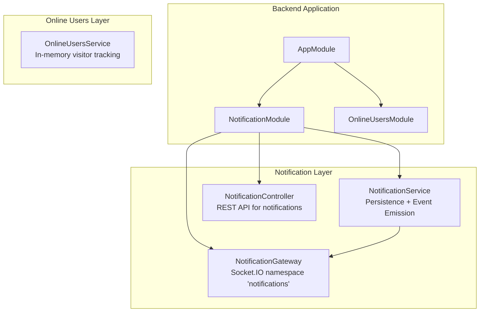
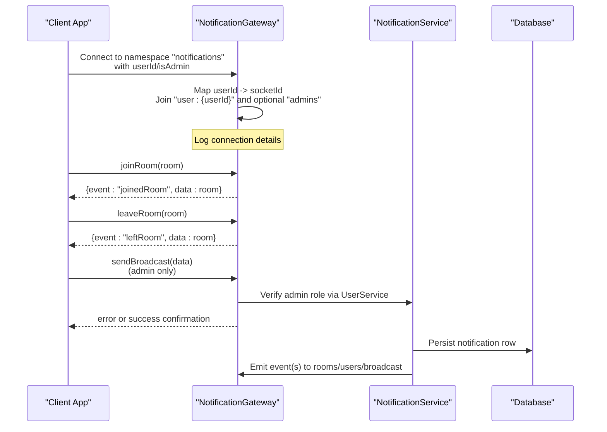
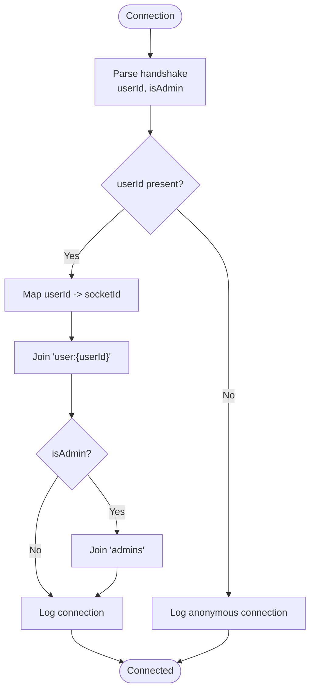
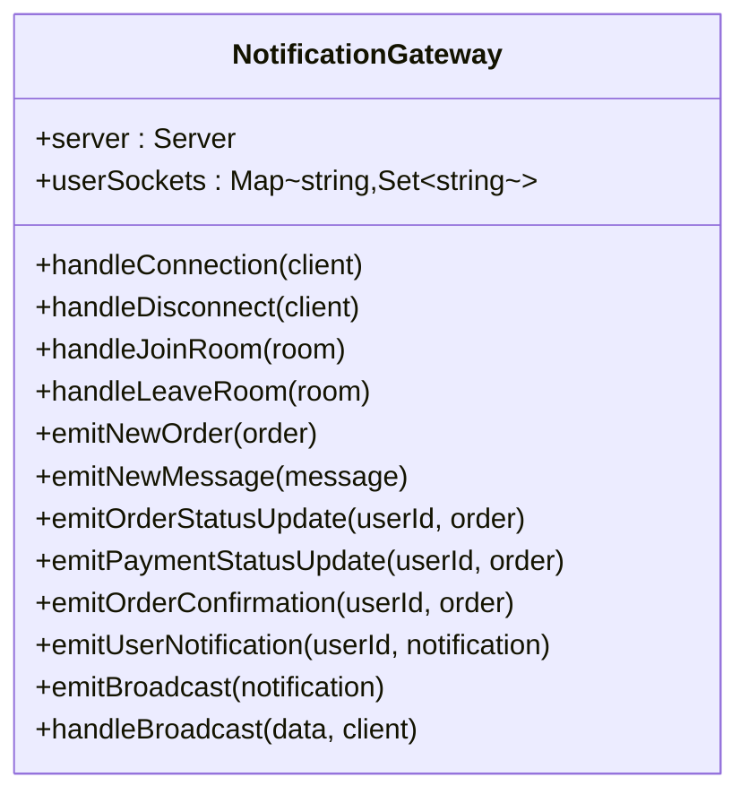
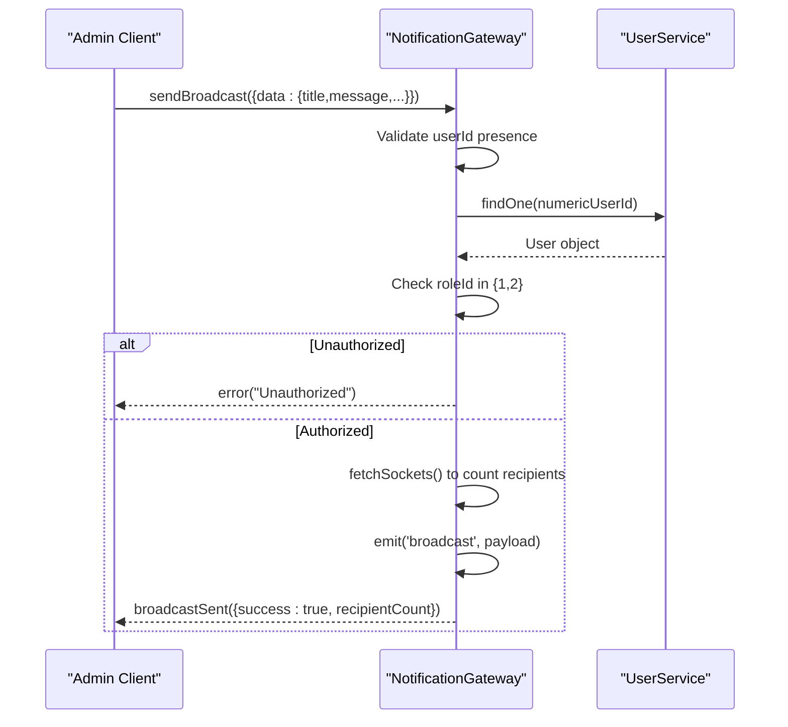
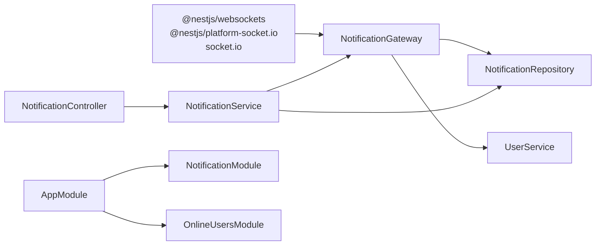

# WebSocket Infrastructure

<cite>
**Referenced Files in This Document**   
- [notification.gateway.ts](file://apps/backend/src/notification/notification.gateway.ts)
- [notification.module.ts](file://apps/backend/src/notification/notification.module.ts)
- [notification.service.ts](file://apps/backend/src/notification/notification.service.ts)
- [notification.controller.ts](file://apps/backend/src/notification/notification.controller.ts)
- [online-users.service.ts](file://apps/backend/src/online-users/online-users.service.ts)
- [online-users.module.ts](file://apps/backend/src/online-users/online-users.module.ts)
- [app.module.ts](file://apps/backend/src/app.module.ts)
- [package.json (backend)](file://apps/backend/package.json)
</cite>

## Table of Contents
1. [Introduction](#introduction)
2. [Project Structure](#project-structure)
3. [Core Components](#core-components)
4. [Architecture Overview](#architecture-overview)
5. [Detailed Component Analysis](#detailed-component-analysis)
6. [Dependency Analysis](#dependency-analysis)
7. [Performance Considerations](#performance-considerations)
8. [Troubleshooting Guide](#troubleshooting-guide)
9. [Conclusion](#conclusion)

## Introduction
This document explains the real-time communication infrastructure for the German Butcher platform, built with NestJS and Socket.IO. It covers the WebSocket gateway configuration, connection lifecycle, user socket mapping, room-based messaging, broadcast controls, and operational considerations for scalability and performance.

The system provides:
- A namespaced WebSocket gateway for notifications.
- Connection handling that maps users to sockets and joins rooms.
- Admin-only broadcast capabilities.
- Realtime event emission alongside persisted notification records.
- An in-memory online visitor tracker with periodic cleanup.

## Project Structure
The WebSocket layer lives under the backend application and is composed of a gateway, service, controller, and supporting modules. The gateway exposes Socket.IO endpoints, while the service coordinates persistence and emits events through the gateway.

**Diagram sources**
- [app.module.ts:60-166](file://apps/backend/src/app.module.ts#L60-L166)
- [notification.module.ts:9-15](file://apps/backend/src/notification/notification.module.ts#L9-L15)
- [online-users.module.ts:5-10](file://apps/backend/src/online-users/online-users.module.ts#L5-L10)

**Section sources**
- [app.module.ts:60-166](file://apps/backend/src/app.module.ts#L60-L166)
- [notification.module.ts:9-15](file://apps/backend/src/notification/notification.module.ts#L9-L15)
- [online-users.module.ts:5-10](file://apps/backend/src/online-users/online-users.module.ts#L5-L10)

## Core Components
- NotificationGateway: Socket.IO gateway implementing connection, disconnection, room management, and admin broadcast handling.
- NotificationService: Business logic for emitting realtime notifications and persisting them; also exposes REST endpoints via the controller.
- NotificationController: REST API for fetching and managing notifications for users and admins.
- OnlineUsersService: In-memory service tracking active visitors with heartbeat updates and periodic pruning.

Key responsibilities:
- Gateway manages Socket.IO connections, user-to-socket mapping, and room membership.
- Service ensures consistent event payloads and durable notification records.
- Controller exposes paginated and read-state APIs.
- OnlineUsersService maintains lightweight visitor metrics.

**Section sources**
- [notification.gateway.ts:15-37](file://apps/backend/src/notification/notification.gateway.ts#L15-L37)
- [notification.service.ts:21-29](file://apps/backend/src/notification/notification.service.ts#L21-L29)
- [notification.controller.ts:25-28](file://apps/backend/src/notification/notification.controller.ts#L25-L28)
- [online-users.service.ts:20-24](file://apps/backend/src/online-users/online-users.service.ts#L20-L24)

## Architecture Overview
The WebSocket architecture centers on a single Socket.IO gateway under the `notifications` namespace. Clients connect to this namespace, optionally providing authentication context via handshake query parameters. The gateway tracks which sockets belong to which users and joins them into rooms for targeted delivery. Admins can send broadcasts after server-side authorization checks.

**Diagram sources**
- [notification.gateway.ts:43-87](file://apps/backend/src/notification/notification.gateway.ts#L43-L87)
- [notification.gateway.ts:128-146](file://apps/backend/src/notification/notification.gateway.ts#L128-L146)
- [notification.gateway.ts:228-337](file://apps/backend/src/notification/notification.gateway.ts#L228-L337)
- [notification.service.ts:60-167](file://apps/backend/src/notification/notification.service.ts#L60-L167)

## Detailed Component Analysis

### Socket.IO Gateway Configuration
- Namespace: `notifications`.
- CORS: Configured to allow specific production domains and local development origins, with credentials enabled.
- Server access: The gateway holds a reference to the underlying Socket.IO server for room operations and broadcasting.

Configuration highlights:
- Allowed origins include production domains and localhost development servers.
- Credentials are enabled for cookie-based auth flows.
- The gateway implements initialization, connection, and disconnection lifecycle hooks.

**Section sources**
- [notification.gateway.ts:15-27](file://apps/backend/src/notification/notification.gateway.ts#L15-L27)
- [notification.gateway.ts:31-41](file://apps/backend/src/notification/notification.gateway.ts#L31-L41)

### Connection Lifecycle
- Handshake parsing: The gateway extracts `userId` and `isAdmin` from the handshake query.
- User socket mapping: Maintains an in-memory map from `userId` to a set of socket IDs.
- Room joining: On connect, clients automatically join a per-user room (`user:{userId}`) and, if admin, the `admins` room.
- Logging: Connection logs include user identity where available.
- Disconnection: Removes the socket from the user’s set and cleans up empty entries.

**Diagram sources**
- [notification.gateway.ts:43-87](file://apps/backend/src/notification/notification.gateway.ts#L43-L87)

**Section sources**
- [notification.gateway.ts:43-87](file://apps/backend/src/notification/notification.gateway.ts#L43-L87)
- [notification.gateway.ts:89-126](file://apps/backend/src/notification/notification.gateway.ts#L89-L126)

### User Socket Mapping System
- Data structure: `Map<string, Set<string>>` mapping `userId` to active socket IDs.
- Operations:
  - Add socket ID on connection.
  - Remove socket ID on disconnect.
  - Delete user entry when no sockets remain.
- Purpose: Enables targeted emissions to all sockets belonging to a user.

Operational notes:
- The mapping is process-local; in multi-instance deployments, consider a shared store (e.g., Redis) for cross-process awareness.
- The gateway uses this mapping implicitly by joining per-user rooms rather than iterating sockets directly.

**Section sources**
- [notification.gateway.ts:35-36](file://apps/backend/src/notification/notification.gateway.ts#L35-L36)
- [notification.gateway.ts:48-60](file://apps/backend/src/notification/notification.gateway.ts#L48-L60)
- [notification.gateway.ts:119-125](file://apps/backend/src/notification/notification.gateway.ts#L119-L125)

### Room-Based Messaging Architecture
Rooms used:
- Per-user room: `user:{userId}` for targeted messages.
- Admin room: `admins` for admin-only alerts.
- Dynamic rooms: Clients may request arbitrary rooms via `joinRoom`/`leaveRoom`.

Emission methods:
- Admin-only events: new order, new message.
- User-targeted events: order status update, payment status update, order confirmation, general notifications.
- Broadcast: global event to all connected clients.

**Diagram sources**
- [notification.gateway.ts:15-37](file://apps/backend/src/notification/notification.gateway.ts#L15-L37)
- [notification.gateway.ts:128-222](file://apps/backend/src/notification/notification.gateway.ts#L128-L222)
- [notification.gateway.ts:228-337](file://apps/backend/src/notification/notification.gateway.ts#L228-L337)

**Section sources**
- [notification.gateway.ts:128-146](file://apps/backend/src/notification/notification.gateway.ts#L128-L146)
- [notification.gateway.ts:148-222](file://apps/backend/src/notification/notification.gateway.ts#L148-L222)

### Admin Broadcast Authorization Flow
Admins can send promotional offers and announcements to all users. The gateway enforces:
- Presence of `userId` in handshake.
- Numeric validation of `userId`.
- Database lookup to verify admin role (role IDs 1 or 2).
- Payload validation requiring title and message.
- Counting recipients using the current socket count.
- Emitting a global broadcast and confirming back to the admin.

**Diagram sources**
- [notification.gateway.ts:228-337](file://apps/backend/src/notification/notification.gateway.ts#L228-L337)

**Section sources**
- [notification.gateway.ts:228-337](file://apps/backend/src/notification/notification.gateway.ts#L228-L337)

### Notification Service and Persistence
The service coordinates:
- Slimming order snapshots to reduce payload size and avoid leaking sensitive relations.
- Emitting realtime events via the gateway.
- Persisting notification rows with audience scoping (`user` vs `admin`).
- Exposing REST endpoints for pagination, unread counts, and marking notifications as read.

Key behaviors:
- Fail-open persistence: database errors do not break realtime emission.
- Audience separation: admin feed excludes user notifications and vice versa.
- Shared read semantics: broadcasts and admin rows are marked read globally.

**Section sources**
- [notification.service.ts:31-58](file://apps/backend/src/notification/notification.service.ts#L31-L58)
- [notification.service.ts:60-167](file://apps/backend/src/notification/notification.service.ts#L60-L167)
- [notification.service.ts:169-325](file://apps/backend/src/notification/notification.service.ts#L169-L325)
- [notification.controller.ts:25-137](file://apps/backend/src/notification/notification.controller.ts#L25-L137)

### Online Visitors Tracking
The online users service maintains an in-memory map of visitors with:
- Heartbeat updates including optional authenticated user ID, page, and user agent.
- Summary statistics for total, authenticated, and guest visitors within a time window.
- Page popularity aggregation.
- Periodic cleanup of stale entries.

Operational characteristics:
- Cleanup timer runs unref’d so it does not keep the process alive.
- Time windows default to 5 minutes for “online” status.

**Section sources**
- [online-users.service.ts:17-33](file://apps/backend/src/online-users/online-users.service.ts#L17-L33)
- [online-users.service.ts:41-53](file://apps/backend/src/online-users/online-users.service.ts#L41-L53)
- [online-users.service.ts:55-82](file://apps/backend/src/online-users/online-users.service.ts#L55-L82)
- [online-users.service.ts:84-91](file://apps/backend/src/online-users/online-users.service.ts#L84-L91)

## Dependency Analysis
The WebSocket subsystem depends on:
- NestJS WebSockets and Socket.IO runtime.
- User service for role verification during broadcast authorization.
- TypeORM repository for notification persistence.
- Module wiring in the application root.

**Diagram sources**
- [package.json (backend):35-58](file://apps/backend/package.json#L35-L58)
- [notification.gateway.ts:1-13](file://apps/backend/src/notification/notification.gateway.ts#L1-L13)
- [notification.service.ts:1-5](file://apps/backend/src/notification/notification.service.ts#L1-L5)
- [notification.module.ts:9-15](file://apps/backend/src/notification/notification.module.ts#L9-L15)
- [app.module.ts:117-143](file://apps/backend/src/app.module.ts#L117-L143)

**Section sources**
- [package.json (backend):35-58](file://apps/backend/package.json#L35-L58)
- [notification.module.ts:9-15](file://apps/backend/src/notification/notification.module.ts#L9-L15)
- [app.module.ts:117-143](file://apps/backend/src/app.module.ts#L117-L143)

## Performance Considerations
- Memory usage:
  - User socket mapping is in-memory; monitor growth and ensure cleanup on disconnect.
  - Online visitors map is periodically pruned; tune intervals and windows based on traffic patterns.
- Broadcasting:
  - Global broadcasts fan out to all connected sockets; consider rate limiting and throttling at the gateway level.
  - Use recipient counting judiciously; avoid heavy operations inside hot paths.
- Payload size:
  - The service slimifies order snapshots to reduce bandwidth and prevent leaking sensitive relations.
- Concurrency:
  - For multi-instance deployments, replace in-memory structures with a distributed store (e.g., Redis) to share state across processes.
- Database writes:
  - Persistence failures are fail-open; ensure monitoring and alerting for failed notification inserts.
- Scaling horizontally:
  - Use a shared adapter for Socket.IO (e.g., Redis adapter) to distribute rooms and broadcasts across instances.
- Monitoring:
  - Track connection counts, room sizes, broadcast frequency, and error rates.
  - Instrument gateway logs and service metrics for observability.

[No sources needed since this section provides general guidance]

## Troubleshooting Guide
Common issues and resolutions:
- CORS errors:
  - Ensure client origins match the configured allowed origins in the gateway.
  - Verify credentials are enabled when using cookies.
- Unauthorized broadcasts:
  - Confirm the client sends a valid `userId` in the handshake.
  - Verify the user has an admin role (role IDs 1 or 2).
  - Validate payload includes required fields like title and message.
- Missing notifications:
  - Check that the correct room is joined (`user:{userId}`).
  - Verify the service emitted the event and persisted the record.
- Stale online visitors:
  - Ensure heartbeats are sent regularly.
  - Adjust cleanup intervals and online windows if necessary.

Operational tips:
- Review gateway logs for connection/disconnection events and broadcast attempts.
- Monitor database errors in the service’s persistence path.
- Use the REST endpoints to validate notification visibility and read states.

**Section sources**
- [notification.gateway.ts:15-27](file://apps/backend/src/notification/notification.gateway.ts#L15-L27)
- [notification.gateway.ts:228-337](file://apps/backend/src/notification/notification.gateway.ts#L228-L337)
- [notification.service.ts:304-325](file://apps/backend/src/notification/notification.service.ts#L304-L325)
- [online-users.service.ts:17-33](file://apps/backend/src/online-users/online-users.service.ts#L17-L33)

## Conclusion
The German Butcher platform’s WebSocket infrastructure provides a robust foundation for real-time communication. The Socket.IO gateway handles connection lifecycle, user mapping, and room-based messaging, while the service layer ensures consistent event payloads and durable notification records. Admin broadcasts are securely controlled, and the online visitor tracker supports lightweight analytics. For large-scale deployments, adopt shared state stores and Socket.IO adapters to scale horizontally, and implement comprehensive monitoring and rate limiting to maintain performance and reliability.

[No sources needed since this section summarizes without analyzing specific files]